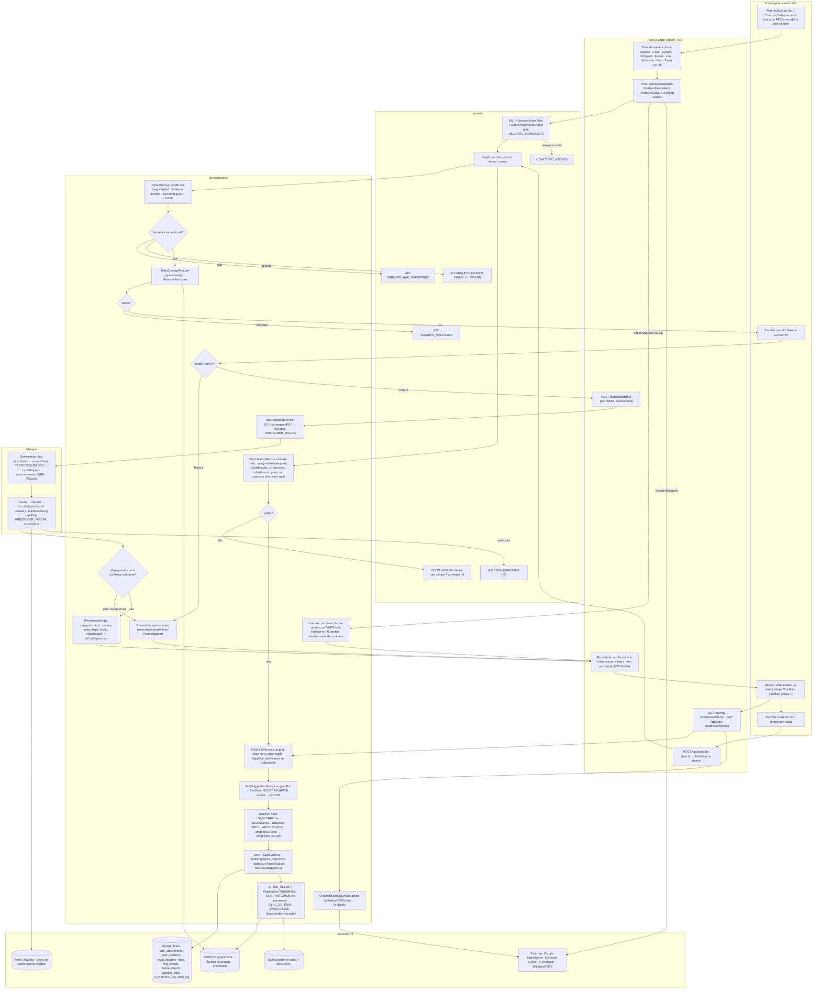
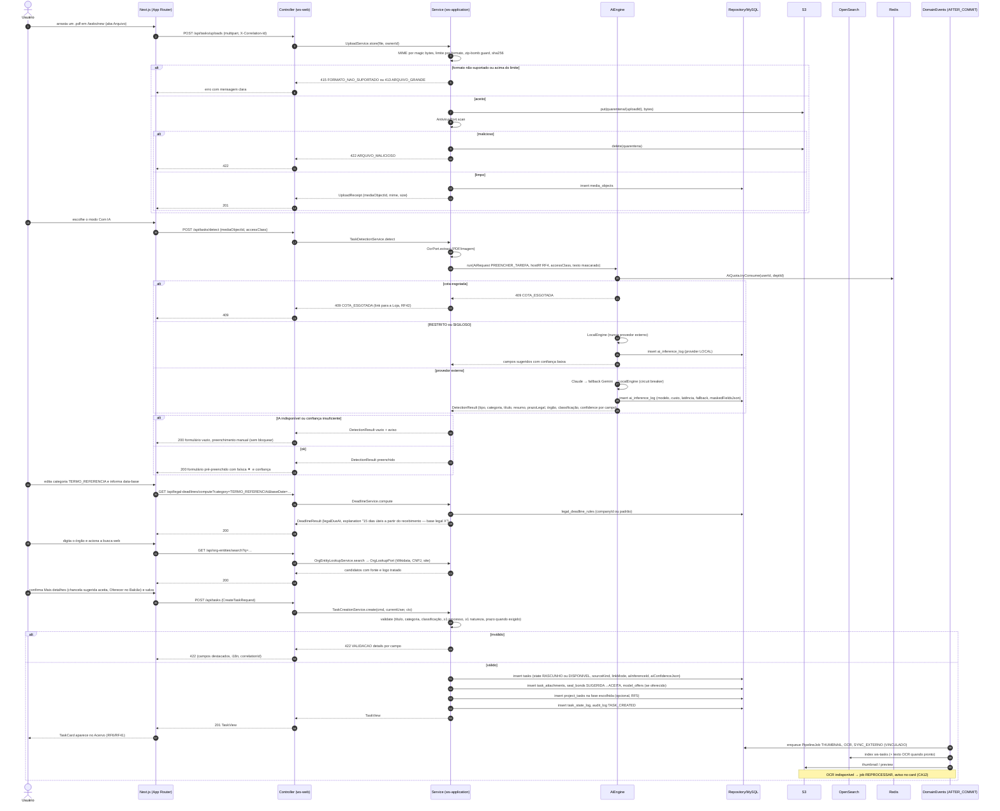
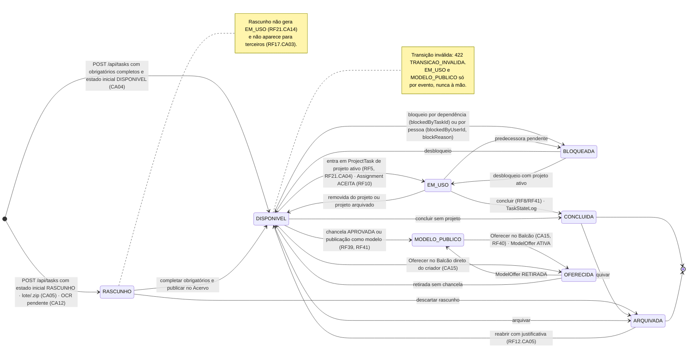
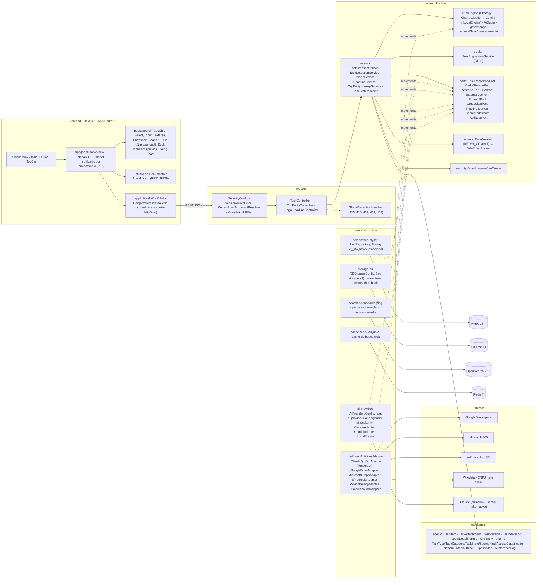

# RF4 — Utilizar o criador de tarefas, escolhendo o tipo do arquivo e editando detalhes, em modo manual ou com IA
**HU:** HU4 · **Sprint (board Work Station):** lista *Requisitos Funcionais* sem sprint atribuída (o card "SPRINT 1" cita "RF4 Tema e acesso da sessão", escopo antigo — ver `RENUMERACAO.md`; fase (d) da ARQUITETURA §6) · **Equivalente FAI:** RF4 Adicionar peça (foto → IA pré-preenche → formulário com taxonomia oficial → "Mais detalhes" → Closet) + RF11 Background Studio + buscador web de marcas · **Aba/rota:** Criar Tarefa (`/tasks/new`; folha "+ Criar" do `SidebarNav`; botão "Cadastrar nova tarefa" do Criador de Projetos, RF5); API `POST /api/tasks`, `POST /api/tasks/uploads`, `POST /api/tasks/detect`, `GET /api/org-entities/search`, `GET /api/legal-deadlines/compute`
**Critérios de aceite cobertos:** RF20.CA01 · CA02 · CA03 · CA04 · CA05 · CA06 · CA07 · CA08 · CA09 · CA10 · CA11 · CA12 · CA13 · CA14 · CA15 — **corpo do card = card RF20** (o card RF4 está vazio; o criador de tarefas está descrito no corpo do card RF20, cujos CAs são citados aqui como estão escritos; ver `RENUMERACAO.md`). Nenhuma classe deste RF existe ainda no código: tudo **(planejado)**, exceto os transversais do Bloco 1–3 (`SecurityConfig`, `CorrelationIdFilter`, `Guard`, `AuditLogPort`, `AuthRateLimitFilter`, `S3StorageConfig`, `AiProvidersConfig`).

> **HU4** — COMO usuário logado dentro do sistema WS POSSO acessar a aba criar nova tarefa PARA criar um esquema de tarefa único e personalizado conforme as diretrizes de minha equipe de trabalho.

A **tarefa** (`TaskItem`, TAXONOMIA §2.1) é a unidade mínima do Work Station (= peça de roupa). O título do card destaca o que o corpo (RF20) detalha em 5 etapas: **(1) Fonte** — a aba escolhida define `SourceKind` e o `TaskType` sugerido; **(2) Detecção por IA** — `AiEngine` capability `PREENCHER_TAREFA` pré-preenche com confiança por campo e faísca ✦ (pulada no modo Manual ou quando a IA falha, CA03); **(3) Dados da tarefa** — taxonomia oficial, prazo legal (`LegalDeadlineRule`), órgão (`OrgEntity` via busca web); **(4) Mais detalhes** — chancelas sugeridas (RF39), visibilidade, estado inicial, situação do documento, protocolo, guarda, Balcão (RF40), tags, dependências, projeto/fase; **(5) Arte do card** — thumbnail assíncrono (RF38/RF11). Antivírus, OCR e thumbnail rodam como `PipelineJob` após o commit e a tarefa entra no **Acervo (RF6/RF41)**.

| Fonte (etapa 1) | `SourceKind` | `TaskType` sugerido | Porta / adaptador |
|---|---|---|---|
| Arquivo (.docx .xlsx .pptx .pdf .txt .md .csv .msg .eml .zip .png .jpg .dwg .dxf .ifc .glb; 50 MB, zip 200 MB) | ARQUIVO | por MIME real: DOCUMENTO · PLANILHA · PASTA · IMAGEM_EDITADA · DESENHO_TECNICO … | `MediaStoragePort` (storage-s3), `AntivirusPort` |
| Colar Ctrl+V (texto · tabela · captura) | COLAR | TEXTO_MANUAL · PLANILHA · IMAGEM_EDITADA | `MediaStoragePort` |
| Google Workspace (Drive, Gmail, Agenda) — vinculado ou copiado | GOOGLE | DOCUMENTO · PLANILHA · FORMULARIO · EMAIL | `ExternalDocPort` (`GoogleDriveAdapter`) |
| Microsoft 365 (OneDrive/SharePoint, Outlook, Teams) | MICROSOFT | DOCUMENTO · PLANILHA · EMAIL · LINK | `ExternalDocPort` (`MicrosoftGraphAdapter`) |
| E-mail encaminhado (`tarefas+<usuário>@…`) ou .eml/.msg | EMAIL | EMAIL (+ anexos → `TaskAttachment` ou tarefas filhas) | `EmailInboundAdapter` |
| Link | LINK | LINK | `LinkPreviewAdapter` |
| Protocolo (e-Protocolo/SEI) | PROTOCOLO | PROTOCOLO | `ProtocolPort` (`EProtocoloAdapter`) |
| Foto/scanner do celular (QR) + Estúdio de Documento | FOTO | IMAGEM_EDITADA · DOCUMENTO (OCR) | `OcrPort`, `MediaStoragePort` |
| Texto com IA (pedido + ≤ 5 tarefas de referência) | TEXTO_IA | TEXTO_IA | `AiEngine` |

## 1. Diagrama de classes

```mermaid
classDiagram
  direction LR

  class TaskController {
    <<controller>>
    +upload(MultipartFile, CurrentUser) UploadReceipt
    +detect(DetectRequest, CurrentUser) DetectionResult
    +create(CreateTaskRequest, CurrentUser, ctx) TaskView
    +createBatch(BatchRequest, CurrentUser, ctx) List
  }
  class OrgEntityController {
    <<controller>>
    +search(q) List
  }
  class LegalDeadlineController {
    <<controller>>
    +compute(category, subcategory, baseDate, companyId) DeadlineResult
  }
  class TaskCreationService {
    <<service>>
    +create(CreateTaskCommand, CurrentUser, ctx) TaskItem
    +createBatch(BatchCommand, CurrentUser, ctx) List
    +fromPaste(PasteCommand) TaskItem
    +fromEmail(EmailCommand) TaskItem
    +fromProtocol(protocolNumber) TaskItem
    -validate(CreateTaskCommand) void
  }
  class TaskDetectionService {
    <<service>>
    +detect(sourceRef, accessClass, mode) DetectionResult
  }
  class DeadlineService {
    <<service>>
    +compute(category, subcategory, baseDate, companyId) DeadlineResult
  }
  class OrgEntityLookupService {
    <<service>>
    +search(q) List
    +adopt(candidate) OrgEntity
  }
  class UploadService {
    <<service>>
    +store(file, ownerId) MediaObject
    -detectMime(bytes) String
    -zipBombGuard(file) void
  }
  class AiEngine {
    <<service>>
    +run(AiRequest) AiResponse
    capability PREENCHER_TAREFA
  }
  class TaskStateMachine {
    <<service>>
    +transition(TaskItem, TaskState, actor, reason) TaskStateLog
  }
  class MediaStoragePort {
    <<port>>
    +put(key, bytes, mime) MediaObject
    +presign(key) URL
  }
  class AntivirusPort {
    <<port>>
    +scan(MediaObject) ScanResult
  }
  class OcrPort {
    <<port>>
    +extract(MediaObject) OcrText
  }
  class ExternalDocPort {
    <<port>>
    +pick(provider, token) ExternalDoc
    +snapshot(ref) MediaObject
    +watch(ref) void
  }
  class ProtocolPort {
    <<port>>
    +lookup(number) ProtocolMeta
  }
  class OrgLookupPort {
    <<port>>
    +search(q) List
  }
  class TaskRepositoryPort {
    <<port>>
    +save(TaskItem) TaskItem
  }
  class PipelineJobPort {
    <<port>>
    +enqueue(type, targetType, targetId) PipelineJob
  }
  class SearchIndexPort {
    <<port>>
    +index(TaskItem) void
  }
  class SealSuggestionService {
    <<service>>
    +suggestFor(TaskItem) List
  }

  class TaskItem {
    <<entity>>
    +UUID id
    +UUID ownerId
    +UUID departmentId
    +String title
    +String summary
    +TaskType type
    +TaskCategory category
    +String subcategory
    +Set~ProcessTag~ processTags
    +Set~NatureTag~ natureTags
    +AccessClassification accessClass
    +String format
    +EffortSize effortSize
    +BigDecimal amountInvolved
    +TaskOrigin origin
    +SourceKind sourceKind
    +String sourceRef
    +LinkMode linkMode
    +UUID orgEntityId
    +UUID responsibleId
    +LocalDate dueAt
    +UUID legalDeadlineRuleId
    +LocalDate legalDueAt
    +String legalOverrideReason
    +Priority priority
    +TaskState state
    +DocSituation docSituation
    +String protocolNumber
    +Visibility visibility
    +boolean offeredInCounter
    +boolean aiGenerated
    +UUID aiInferenceId
    +JSON aiConfidenceJson
    +String thumbnailUrl
    +CoverMode coverMode
    +long version
  }
  class TaskAttachment {
    <<entity>>
    +UUID taskId
    +UUID mediaObjectId
    +String fileName
    +String mimeType
    +String sha256
    +String antivirusStatus
    +String ocrStatus
    +boolean isPrimary
  }
  class TaskVersion {
    <<entity>>
    +UUID taskId
    +int versionNumber
    +String externalRevisionId
    +Instant syncedAt
    +UUID snapshotMediaId
  }
  class LegalDeadlineRule {
    <<entity>>
    +UUID companyId
    +TaskCategory category
    +int days
    +boolean businessDays
    +String legalBasis
  }
  class OrgEntity {
    <<entity>>
    +String name
    +String cnpj
    +String kind
    +String source
    +String externalRef
    +String logoUrl
  }
  class MediaObject {
    <<entity>>
    +String bucket
    +String objectKey
    +String mimeType
    +long sizeBytes
    +String sha256
    +UUID ownerId
  }
  class PipelineJob {
    <<entity>>
    +String type
    +String targetType
    +UUID targetId
    +PipelineJobStatus status
    +int attempts
  }
  class AiInferenceLog {
    <<entity>>
    +AiCapability capability
    +String hostRf
    +AiProvider provider
    +InferenceResult result
    +BigDecimal confidence
    +String correlationId
  }
  class SealBond {
    <<entity>>
    +SealBondStatus status
    +SealBondBasis basis
  }
  class ModelOffer {
    <<entity>>
    +int pricePoints
    +ModelLicense license
  }
  class TaskState {
    <<enum>>
    RASCUNHO
    DISPONIVEL
    EM_USO
    BLOQUEADA
    CONCLUIDA
    ARQUIVADA
    MODELO_PUBLICO
    OFERECIDA
  }
  class TaskType {
    <<enum>>
    TEXTO_MANUAL
    TEXTO_IA
    IMAGEM_WEB
    IMAGEM_EDITADA
    PLANILHA
    DOCUMENTO
    PASTA
    LINK
    DESENHO_TECNICO
    FORMULARIO
    ATA_REGISTRO
    EMAIL
    PROTOCOLO
    CRONOGRAMA
    ESTUDO_TECNICO_PRELIMINAR
  }
  class SourceKind {
    <<enum>>
    ARQUIVO
    COLAR
    GOOGLE
    MICROSOFT
    EMAIL
    LINK
    PROTOCOLO
    FOTO
    TEXTO_IA
    EXTRAIDA_DE_PROJETO
    REMIX
    DECIA
    AUTOPILOT
  }
  class AccessClassification {
    <<enum>>
    PUBLICO
    INTERNO
    RESTRITO
    SIGILOSO
  }
  class LinkMode {
    <<enum>>
    VINCULADO
    COPIADO
  }

  TaskController --> TaskCreationService
  TaskController --> TaskDetectionService
  TaskController --> UploadService
  OrgEntityController --> OrgEntityLookupService
  LegalDeadlineController --> DeadlineService
  TaskCreationService --> DeadlineService
  TaskCreationService --> TaskStateMachine
  TaskCreationService --> TaskRepositoryPort
  TaskCreationService --> PipelineJobPort
  TaskCreationService --> SealSuggestionService
  TaskCreationService --> ExternalDocPort
  TaskCreationService --> ProtocolPort
  TaskDetectionService --> AiEngine
  TaskDetectionService --> OcrPort
  UploadService --> MediaStoragePort
  UploadService --> AntivirusPort
  OrgEntityLookupService --> OrgLookupPort
  TaskItem "1" --> "0..*" TaskAttachment
  TaskItem "1" --> "0..*" TaskVersion : VINCULADO
  TaskItem "0..*" --> "0..1" LegalDeadlineRule
  TaskItem "0..*" --> "0..1" OrgEntity
  TaskItem "0..*" --> "0..1" AiInferenceLog : aiInferenceId
  TaskItem "1" --> "0..*" SealBond : targetType TASK
  TaskItem "1" --> "0..1" ModelOffer : offeredInCounter
  TaskAttachment "1" --> "1" MediaObject
  PipelineJob "0..*" --> "1" TaskItem : THUMBNAIL, OCR, ANTIVIRUS, SYNC_EXTERNO
  TaskItem --> TaskState
  TaskItem --> TaskType
  TaskItem --> SourceKind
  TaskItem --> AccessClassification
  TaskItem --> LinkMode
  note for TaskItem "+22 campos (descriptionMd, receivedAt, senderOrigin, retentionPolicyJson, favorite, cardSkin, tags, notes, originalTaskId, sourceProjectId, checklistItemId, reuseCount, projectUsageCount, contadores sociais, sealIdsJson, blocked*). TaskCategory: OFICIO_MEMORANDO … OUTRO (15 valores)."
```

## 2. Diagrama de atividades

## 3. Diagrama de sequência

## 4. Máquina de estados

Entidade central: **`TaskItem.state`** (`TaskState`, TAXONOMIA §2.1/§13), governada pelo `TaskStateMachine` (ARQUITETURA §3 "State Machine explícita"); toda transição grava `TaskStateLog`. O criador cria em `RASCUNHO` ou `DISPONIVEL` (CA04); os demais estados são operados pelo Acervo (RF6/RF41), pelo Criador de Projetos (RF5) e pelo Balcão (RF40).

## 5. Diagrama de componentes

## 6. Rastreabilidade

| CA (card RF20) | Classe (§1) | Passo da atividade (§2) | Mensagem da sequência (§3) | Transição de estado (§4) | Componente (§5) | Situação |
|---|---|---|---|---|---|---|
| RF20.CA01 | `UploadService`, `MediaStoragePort`, `AntivirusPort`, `MediaObject`, `ExternalDocPort` | `F2`→`U1`→`U4`, `E415`, `E413`, `E422M` | 2–15 | — | `S3`, `PLT` (ClamAV, Drive, Graph), `GEH` | planejado |
| RF20.CA02 | `TaskDetectionService`, `AiEngine` (PREENCHER_TAREFA), `AiInferenceLog`, `TaskItem.aiConfidenceJson/aiGenerated` | `D1`→`D2`→`I1`→`I2`→`D5`→`F4` | 16–32, 35–36 | — | `AIE`, `AIP`, `UI` (`Spark`) | planejado |
| RF20.CA03 | `TaskDetectionService` (fallback vazio) | `D3`→`D4`→`F4` | 33–34 | — | `AIE` (LocalEngine/circuit breaker) | planejado |
| RF20.CA04 | `TaskCreationService.create/validate`, `TaskRepositoryPort`, `ProjectTask` (RF5) | `V1`→`V2`→`V6`→`V7` | 49–58 | `[*]`→`DIS` / `RAS` | `TC`, `AC`, `MY` | planejado |
| RF20.CA05 | `TaskCreationService.createBatch`, `TaskType.PASTA` | `B1` | — | `[*]`→`RAS` | `TC.createBatch` | planejado |
| RF20.CA06 | `TaskCreationService.fromPaste`, `SourceKind.COLAR` | `F1` (aba Colar) → `V6` | — | `[*]`→`DIS` | `PG` | planejado |
| RF20.CA07 | `ExternalDocPort.watch`, `TaskVersion`, `LinkMode`, `PipelineJob SYNC_EXTERNO` | `F2` (Google/Microsoft) → `V6` → `AC` | 59 | — | `PLT` (`GoogleDriveAdapter`, `MicrosoftGraphAdapter`), `BFF` (OAuth) | planejado |
| RF20.CA08 | `TaskCreationService.fromEmail`, `EmailInboundAdapter`, `TaskAttachment` | `F1` (aba E-mail) | — | — | `PLT` | planejado |
| RF20.CA09 | `TaskCreationService.fromProtocol`, `ProtocolPort`, `TaskType.PROTOCOLO`, `TaskItem.protocolNumber` | `F1` (aba Protocolo) | — | — | `PLT` (`EProtocoloAdapter`), `EP` | planejado |
| RF20.CA10 | `OrgEntityLookupService`, `OrgLookupPort`, `OrgEntity` | `F5`→`V4`→`P5` | 43–46 | — | `PLT` (`WikidataCnpjAdapter`), `RDS` (cache) | planejado |
| RF20.CA11 | `DeadlineService`, `LegalDeadlineRule`, `TaskItem.legalDueAt/legalOverrideReason` | `F5`→`V3` | 37–42 | — | `UI` (`Due` ⚖), `MY` | planejado |
| RF20.CA12 | `OcrPort`, `PipelineJob OCR` (REPROCESSAR), `TaskAttachment.ocrStatus` | `AC` | 59–61 | `[*]`→`RAS` | `PLT` (OCR), `EVT` | planejado |
| RF20.CA13 | `SealSuggestionService`, `SealBond` SUGERIDA→ACEITA | `V5` | 51 | — | `SEAL` | planejado (RF39) |
| RF20.CA14 | `TaskCreationService.validate`, `GlobalExceptionHandler` (`ApiError.details`) | `V2`→`E422` | 48–50 | — | `GEH`, `UI` (erro por campo i18n) | `GlobalExceptionHandler` real (Bloco 1); regras planejadas |
| RF20.CA15 | `ModelOffer`, `TaskItem.offeredInCounter` | `V6` | 51 | `DIS`→`OFE`, `MOD`→`OFE` | `AC`, `MY` | planejado (RF40) |

Tela/aba: `/tasks/new` (esqueleto em `app/(shell)/tasks/new/page.tsx`)
