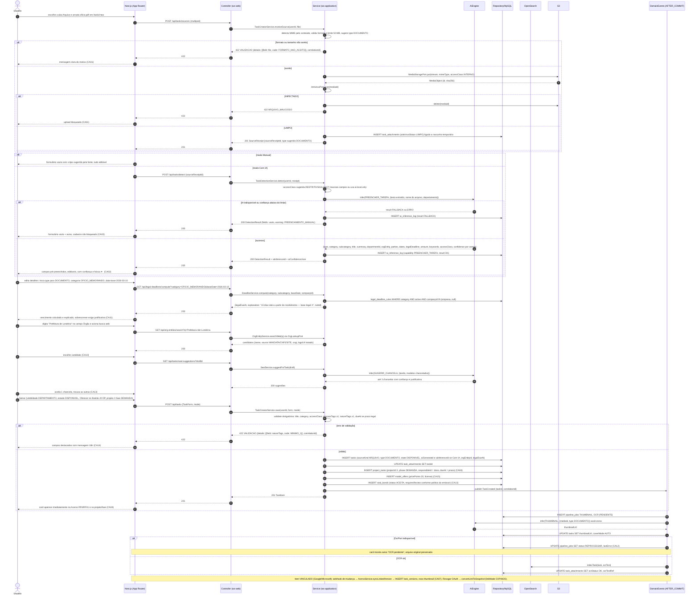
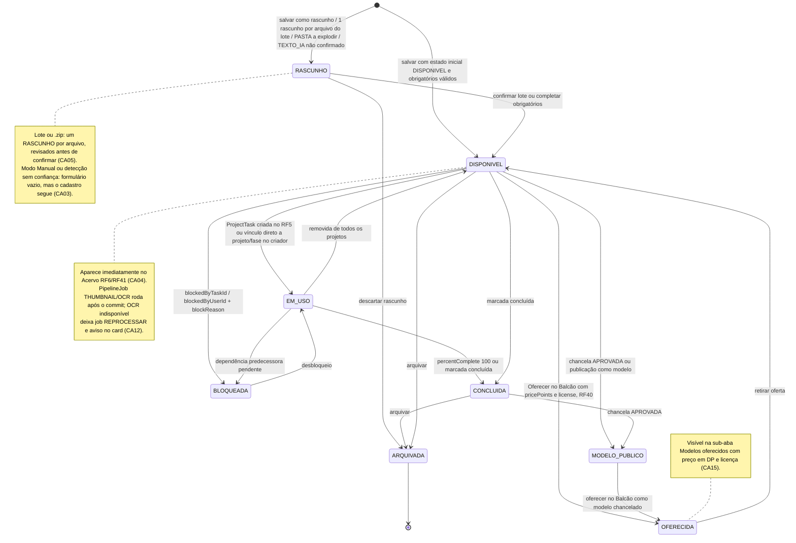
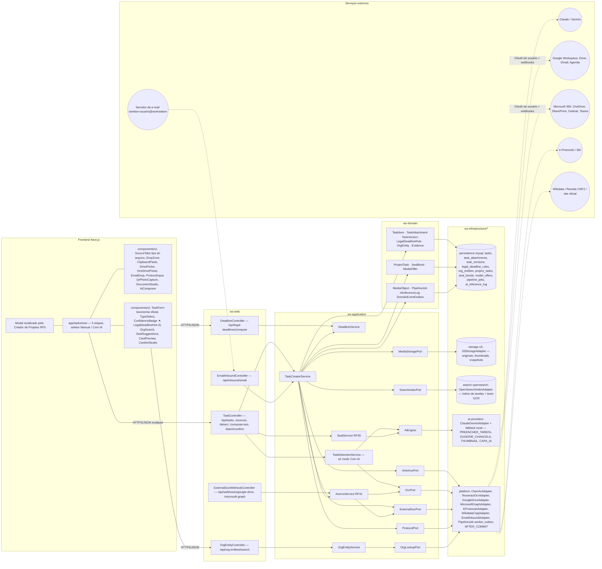

# RF4 — Utilizar o criador de tarefas, escolhendo o tipo do arquivo e editando detalhes, em modo manual ou com IA
**HU:** HU4 · **Sprint (board Work Station):** lista *Requisitos Funcionais* (sem sprint atribuída) · **Equivalente FAI:** RF4 Adicionar peça (foto → IA pré-preenche → formulário com taxonomia oficial → "Mais detalhes" → Closet) + RF11 Background Studio · **Aba/rota:** Criar Tarefa (`/tasks/new`; também pela folha "+ Criar" e pelo botão "Cadastrar nova tarefa" do Criador de Projetos, RF5)
**Critérios de aceite cobertos:** RF20.CA01 · CA02 · CA03 · CA04 · CA05 · CA06 · CA07 · CA08 · CA09 · CA10 · CA11 · CA12 · CA13 · CA14 · CA15 — **corpo do card = card RF20** (o card RF4 está vazio; o criador de tarefas está descrito no corpo do card RF20, cujos CAs são citados aqui como estão escritos; ver `RENUMERACAO.md`)

> **HU4** — COMO usuário logado dentro do sistema WS POSSO acessar a aba criar nova tarefa PARA criar um esquema de tarefa único e personalizado conforme as diretrizes de minha equipe de trabalho.

A **tarefa** (`TaskItem`) é a unidade mínima do Work Station (= peça de roupa). O título atual do card destaca três coisas que o corpo (RF20) detalha: **(a) escolher o tipo do arquivo** — a aba da fonte na etapa 1 determina `SourceKind` e o `TaskType` sugerido (tabela abaixo), editável na etapa 3; **(b) editar detalhes** — etapas 3 (dados da tarefa, taxonomia oficial) e 4 (Mais detalhes); **(c) modo manual ou com IA** — no modo **Com IA** a etapa 2 (`TaskDetectionService` → AiEngine `PREENCHER_TAREFA`) pré-preenche o formulário com confiança por campo e faísca ✦, e a aba "Texto com IA" redige a tarefa; no modo **Manual** a detecção é pulada (ou falha, CA03) e o formulário nasce vazio. As 5 etapas são: (1) Fonte; (2) Detecção por IA; (3) Dados da tarefa (prazo legal via `DeadlineService`, órgão via busca web); (4) Mais detalhes (chancelas RF39, visibilidade, estado inicial, situação do documento, protocolo, guarda, Balcão RF40, tags, dependências, projeto/fase); (5) Arte do card (thumbnail assíncrono RF38). Antivírus (`AntivirusPort`), OCR (`OcrPort`) e thumbnail rodam como `PipelineJob` após o commit e o resultado entra no **Acervo (RF6/RF41)**.

| Tipo do arquivo / fonte (etapa 1) | `SourceKind` | `TaskType` resultante (editável) | Porta / adaptador |
|---|---|---|---|
| Arquivo Windows/macOS (.docx .xlsx .pptx .pdf .txt .md .csv .msg .eml .zip .png .jpg .dwg .dxf .ifc .glb; 50 MB, zip 200 MB) | ARQUIVO | por MIME detectado: DOCUMENTO, PLANILHA, PASTA, IMAGEM_EDITADA, DESENHO_TECNICO … | `MediaStoragePort` (S3), `AntivirusPort` |
| Colar Ctrl+V (texto · tabela · captura) | COLAR | TEXTO_MANUAL · PLANILHA · IMAGEM_EDITADA | `MediaStoragePort` |
| Google Workspace (Drive, Gmail, Agenda) — vinculado ou copiado | GOOGLE | DOCUMENTO · PLANILHA · FORMULARIO · EMAIL | `ExternalDocPort` (GoogleDriveAdapter) |
| Microsoft 365 (OneDrive/SharePoint, Outlook, Teams) — vinculado ou copiado | MICROSOFT | DOCUMENTO · PLANILHA · EMAIL · LINK | `ExternalDocPort` (MicrosoftGraphAdapter) |
| E-mail encaminhado ou .eml/.msg colado | EMAIL | EMAIL (+ anexos → `TaskAttachment` ou tarefas filhas) | `EmailInboundAdapter` |
| Link (URL pública ou interna) | LINK | LINK | `LinkPreviewAdapter` |
| Protocolo (e-Protocolo/SEI) | PROTOCOLO | PROTOCOLO | `ProtocolPort` |
| Foto/scanner do celular via QR + Estúdio de Documento | FOTO | IMAGEM_EDITADA · DOCUMENTO (após OCR) | `MediaStoragePort`, `OcrPort` |
| Texto com IA (pedido + até 5 tarefas de referência) — só no modo Com IA | TEXTO_IA | TEXTO_IA | AiEngine `PREENCHER_TAREFA` |

## 1. Diagrama de classes

```mermaid
classDiagram
direction LR

namespace ws_domain_acervo {
  class TaskItem {
    <<entity>>
    +id: UUID
    +ownerId: UUID
    +departmentId: UUID
    +title: String
    +summary: String
    +descriptionMd: String
    +type: TaskType
    +category: TaskCategory
    +subcategory: String
    +processTags: Set~ProcessTag~ max 2
    +natureTags: Set~NatureTag~ max 2
    +accessClass: AccessClassification
    +format: String
    +effortSize: EffortSize
    +amountInvolved: BigDecimal
    +origin: TaskOrigin
    +sourceKind: SourceKind
    +sourceRef: String
    +linkMode: LinkMode
    +orgEntityId: UUID
    +responsibleId: UUID
    +dueAt: LocalDate
    +legalDeadlineRuleId: UUID
    +legalDeadlineBaseDate: LocalDate
    +legalDueAt: LocalDate
    +legalOverrideReason: String
    +priority: Priority
    +state: TaskState
    +docSituation: DocSituation
    +receivedAt: LocalDate
    +senderOrigin: String
    +protocolNumber: String
    +retentionPolicyJson: JSON
    +visibility: Visibility
    +offeredInCounter: boolean
    +aiGenerated: boolean
    +aiInferenceId: UUID
    +aiConfidenceJson: JSON
    +thumbnailUrl: String
    +coverUrl: String
    +coverMode: CoverMode
    +cardSkin: String
    +tags: Set~String~
    +notes: String
    +sourceProjectId: UUID
    +version: long
    .. +12 campos ..
  }
  class TaskAttachment {
    <<entity>>
    +id: UUID
    +taskId: UUID
    +mediaObjectId: UUID
    +fileName: String
    +mimeType: String detectado
    +sizeBytes: long
    +sha256: String
    +antivirusStatus: String PENDENTE LIMPO INFECTADO
    +ocrStatus: String
    +ocrTextRef: String
    +isPrimary: boolean
    +sortOrder: int
  }
  class TaskVersion {
    <<entity>>
    +id: UUID
    +taskId: UUID
    +versionNumber: int
    +externalRevisionId: String
    +syncedAt: Instant
    +thumbnailUrl: String
    +changeSummary: String
    +snapshotMediaId: UUID
  }
  class LegalDeadlineRule {
    <<entity>>
    +id: UUID
    +companyId: UUID
    +category: TaskCategory
    +subcategory: String
    +days: int
    +businessDays: boolean
    +legalBasis: String
    +active: boolean
  }
  class OrgEntity {
    <<entity>>
    +id: UUID
    +name: String
    +cnpj: String
    +kind: String ORGAO FORNECEDOR ENTIDADE CIDADAO
    +source: String WIKIDATA CNPJ SITE MANUAL
    +externalRef: String
    +logoUrl: String
    +verified: boolean
  }
  class Evidence {
    <<entity>>
    +id: UUID
    +ownerId: UUID
    +mediaObjectId: UUID
    +studioStatus: StudioStatus
    +derivedTaskId: UUID
  }
}

namespace ws_domain_projetos {
  class ProjectTask {
    <<entity>>
    +id: UUID
    +projectId: UUID
    +taskId: UUID
    +phase: ProjectPhase
    +sortOrder: int
    +responsibleId: UUID
    +dueAt: LocalDate
  }
}

namespace ws_domain_chancelas_balcao {
  class SealBond {
    <<entity>>
    +id: UUID
    +sealId: UUID
    +targetType: String TASK
    +targetId: UUID
    +basis: SealBondBasis
    +origin: String SUGESTAO_IA
    +confidence: BigDecimal
    +status: SealBondStatus
    +requiresReview: boolean
  }
  class ModelOffer {
    <<entity>>
    +id: UUID
    +ownerId: UUID
    +targetType: String TASK
    +targetId: UUID
    +pricePoints: int
    +license: ModelLicense
    +status: String ATIVA
  }
}

namespace ws_domain_plataforma {
  class MediaObject {
    <<entity>>
    +id: UUID
    +bucket: String
    +key: String
    +mimeType: String
    +sizeBytes: long
    +sha256: String
    +accessClass: AccessClassification
    +variantsJson: JSON thumb preview
  }
  class PipelineJob {
    <<entity>>
    +id: UUID
    +type: String THUMBNAIL OCR ANTIVIRUS SYNC_EXTERNO
    +targetType: String
    +targetId: UUID
    +status: PipelineJobStatus
    +attempts: int
    +lastError: String
  }
  class AiInferenceLog {
    <<entity>>
    +id: UUID
    +userId: UUID
    +capability: AiCapability PREENCHER_TAREFA
    +provider: AiProvider
    +mode: AiMode
    +confidence: BigDecimal
    +result: InferenceResult
    +maskedFields: String
    +correlationId: String
  }
}

namespace ws_domain_enums {
  class TaskType {
    <<enum>>
    TEXTO_MANUAL
    TEXTO_IA
    IMAGEM_WEB
    IMAGEM_EDITADA
    PLANILHA
    DOCUMENTO
    PASTA
    LINK
    DESENHO_TECNICO
    FORMULARIO
    ATA_REGISTRO
    EMAIL
    PROTOCOLO
    CRONOGRAMA
    ESTUDO_TECNICO_PRELIMINAR
  }
  class SourceKind {
    <<enum>>
    ARQUIVO
    COLAR
    GOOGLE
    MICROSOFT
    EMAIL
    LINK
    PROTOCOLO
    FOTO
    TEXTO_IA
    EXTRAIDA_DE_PROJETO
    REMIX
    DECIA
    AUTOPILOT
    ATA_VIVA
    DOSSIE
    EXTRACAO
  }
  class LinkMode {
    <<enum>>
    VINCULADO
    COPIADO
  }
  class AccessClassification {
    <<enum>>
    PUBLICO
    INTERNO
    RESTRITO
    SIGILOSO
  }
  class TaskState {
    <<enum>>
    RASCUNHO
    DISPONIVEL
    EM_USO
    BLOQUEADA
    CONCLUIDA
    ARQUIVADA
    MODELO_PUBLICO
    OFERECIDA
  }
  class DocSituation {
    <<enum>>
    MINUTA
    REVISADO
    ASSINADO
    PUBLICADO
  }
  class AiMode {
    <<enum>>
    ECONOMIA
    AVANCADO
  }
}

namespace ws_application {
  class TaskCreatorService {
    <<service>>
    +receiveSource(userId, SourceInput) SourceReceipt
    +createDraftsFromBatch(userId, mediaIds, explodeZip) List~TaskItem~
    +createFromPaste(userId, clipboard) TaskItem
    +createFromEmail(userId, MailMessage, attachmentsMode) TaskItem
    +createFromProtocol(userId, protocolNumber) TaskItem
    +save(userId, TaskForm, mode MANUAL ou COM_IA) TaskItem
    +linkToProject(taskId, projectId, phase) ProjectTask
    +offerInCounter(taskId, pricePoints, license) ModelOffer
    -validate(TaskForm) 422 VALIDACAO details por campo
  }
  class TaskDetectionService {
    <<service>>
    +detect(userId, SourceReceipt) DetectionResult
    +composeText(userId, prompt, referenceTaskIds) DetectionResult
    -maskSensitive(accessClass) campos
    -confidenceThreshold: BigDecimal
  }
  class DeadlineService {
    <<service>>
    +compute(category, subcategory, baseDate, companyId) LegalDeadline
    +override(taskId, newDueAt, reason) TaskItem
    +explain(rule, baseDate) String
  }
  class AcervoService {
    <<service>>
    +addToAcervo(TaskItem)
    +syncLinkedVersion(taskId, externalRevision) TaskVersion
    +convertLinkToSnapshot(taskId) TaskVersion
  }
  class OrgEntityService {
    <<service>>
    +searchWeb(query) List~OrgCandidate~
    +pick(candidate) OrgEntity
  }
  class SealService {
    <<service>>
    +suggestForTask(taskId) List~SealBond~
    +accept(bondId) SealBond
  }
  class AiEngine {
    <<service>>
    +infer(capability, input, mode) AiResult
  }
  class MediaStoragePort {
    <<port>>
    +put(stream, mimeType, accessClass) MediaObject
    +presign(mediaId) URL
  }
  class AntivirusPort {
    <<port>>
    +scan(mediaId) PENDENTE LIMPO INFECTADO
  }
  class OcrPort {
    <<port>>
    +extractText(mediaId) OcrResult
    +studio(mediaId, ops) MediaObject
  }
  class ExternalDocPort {
    <<port>>
    +pick(provider, oauthToken) ExternalDoc
    +fetch(provider, ref, mode) ExternalDoc
    +subscribeChanges(provider, ref) Subscription
    +revoke(provider, ref)
  }
  class ProtocolPort {
    <<port>>
    +lookup(protocolNumber) ProtocolMetadata
  }
  class OrgLookupPort {
    <<port>>
    +search(query) List~OrgCandidate~
  }
  class SearchIndexPort {
    <<port>>
    +indexTask(TaskItem, ocrText)
  }
}

namespace ws_web {
  class TaskController {
    <<controller>>
    +POST_api_tasks_sources(multipart ou ref)
    +POST_api_tasks_detect(sourceReceiptId)
    +POST_api_tasks_compose_text(prompt, referenceTaskIds)
    +GET_api_legal_deadlines_compute(category, baseDate)
    +GET_api_org_entities_search(q)
    +POST_api_tasks(TaskForm)
    +POST_api_tasks_batch_confirm(draftIds)
    +POST_api_tasks_id_seal_bonds_bondId_accept()
  }
  class ExternalDocWebhookController {
    <<controller>>
    +POST_api_webhooks_google_drive()
    +POST_api_webhooks_microsoft_graph()
  }
  class EmailInboundController {
    <<controller>>
    +POST_api_inbound_email(MailMessage)
  }
}

namespace ws_infrastructure {
  class S3StorageAdapter {
    <<adapter>>
  }
  class ClamAvAdapter {
    <<adapter>>
  }
  class TesseractOcrAdapter {
    <<adapter>>
  }
  class GoogleDriveAdapter {
    <<adapter>>
  }
  class MicrosoftGraphAdapter {
    <<adapter>>
  }
  class EProtocoloAdapter {
    <<adapter>>
  }
  class WikidataCnpjAdapter {
    <<adapter>>
  }
  class OpenSearchIndexAdapter {
    <<adapter>>
  }
  class ClaudeGeminiAdapter {
    <<adapter>>
  }
}

TaskItem "1" --> "*" TaskAttachment : anexos
TaskItem "1" --> "*" TaskVersion : versões se VINCULADO
TaskItem "*" --> "0..1" LegalDeadlineRule : legalDeadlineRuleId
TaskItem "*" --> "0..1" OrgEntity : orgEntityId
TaskItem "1" --> "*" ProjectTask : vínculo a projeto e fase
TaskItem "1" --> "*" SealBond : targetId quando TASK
TaskItem "1" --> "0..1" ModelOffer : Balcão
TaskItem "*" --> "0..1" AiInferenceLog : aiInferenceId no modo Com IA
TaskAttachment "*" --> "1" MediaObject : mediaObjectId
TaskVersion "*" --> "0..1" MediaObject : snapshotMediaId
Evidence "*" --> "0..1" TaskItem : derivedTaskId
PipelineJob "*" --> "1" TaskItem : targetId
TaskItem --> TaskType
TaskItem --> SourceKind
TaskItem --> LinkMode
TaskItem --> AccessClassification
TaskItem --> TaskState
TaskItem --> DocSituation
AiInferenceLog --> AiMode

TaskController ..> TaskCreatorService
TaskController ..> TaskDetectionService : só modo Com IA
TaskController ..> DeadlineService
TaskController ..> OrgEntityService
TaskController ..> SealService
ExternalDocWebhookController ..> AcervoService : syncLinkedVersion
EmailInboundController ..> TaskCreatorService : createFromEmail
TaskCreatorService ..> MediaStoragePort
TaskCreatorService ..> AntivirusPort
TaskCreatorService ..> ExternalDocPort
TaskCreatorService ..> ProtocolPort
TaskCreatorService ..> DeadlineService
TaskCreatorService ..> AcervoService
TaskCreatorService ..> SearchIndexPort
TaskDetectionService ..> AiEngine : PREENCHER_TAREFA
TaskDetectionService ..> OcrPort
OrgEntityService ..> OrgLookupPort
AcervoService ..> ExternalDocPort
AcervoService ..> OcrPort
S3StorageAdapter ..|> MediaStoragePort
ClamAvAdapter ..|> AntivirusPort
TesseractOcrAdapter ..|> OcrPort
GoogleDriveAdapter ..|> ExternalDocPort
MicrosoftGraphAdapter ..|> ExternalDocPort
EProtocoloAdapter ..|> ProtocolPort
WikidataCnpjAdapter ..|> OrgLookupPort
OpenSearchIndexAdapter ..|> SearchIndexPort
ClaudeGeminiAdapter ..> AiEngine : provider

note for TaskItem "tabela tasks · obrigatórios: title, category, accessClass, processTags ≥1, natureTags ≥1, dueAt quando a categoria tem prazo legal (CA04) · type sugerido pela fonte e editável na etapa 3"
note for TaskAttachment "tabela task_attachments · mimeType detectado pelo conteúdo, não só pela extensão (CA01)"
note for TaskVersion "tabela task_versions · itens VINCULADOS Google/Microsoft; revogar OAuth converte em snapshot (CA07)"
note for TaskDetectionService "modo Com IA: PREENCHER_TAREFA com confiança por campo (CA02) · RESTRITO/SIGILOSO nunca vai a IA externa: BLOQUEADO_SIGILO ou ai.local.only · modo Manual pula a detecção"
```



## 2. Diagrama de atividades

```mermaid
flowchart TD
  subgraph LU["Usuário"]
    U1["Abre /tasks/new e escolhe a aba da fonte (tipo do arquivo)"]
    U0{"Modo: Manual ou Com IA?"}
    U2["Etapa 3: edita detalhes — tipo, categoria, subcategoria, título, resumo, processo, natureza, classificação, órgão, prazo"]
    U3["Etapa 4: Mais detalhes — chancelas sugeridas, visibilidade, estado inicial, situação, protocolo, guarda, Balcão, tags, dependências, projeto/fase"]
    U4["Etapa 5: arte do card — thumbnail automático, capa manual ou IA, skin, pré-visualização"]
    U5["Salvar"]
    U6["Lote: revisa cada rascunho e confirma"]
  end

  subgraph LW["Web / BFF (Next.js App Router)"]
    W1{"Qual fonte?"}
    W2["Upload multipart / seletor Drive ou OneDrive via OAuth / colar / link / nº protocolo / QR do celular / pedido para IA"]
    W3["Formulário pré-preenchido com confiança e faísca ✦, tudo editável"]
    W4["Formulário vazio: modo Manual ou aviso de preenchimento manual"]
    W5["Destaca campos com mensagem i18n específica"]
    W6["Card aparece no Acervo RF6/RF41 e, se indicado, no projeto/fase RF5"]
  end

  subgraph LA["ws-application"]
    A1["TaskCreatorService.receiveSource"]
    A2{"Formato aceito e dentro do limite 50 MB / zip 200 MB?"}
    A3["422 VALIDACAO: formato ou tamanho não aceito"]
    A4["AntivirusPort.scan"]
    A5{"Resultado do antivírus"}
    A6["422 ARQUIVO_MALICIOSO: upload bloqueado e MediaObject descartado"]
    A7{"Vários arquivos ou .zip?"}
    A8["1 rascunho RASCUNHO por arquivo ou 1 PASTA com opção explodir em N tarefas"]
    A9{"Colar: texto, tabela ou captura?"}
    A10["TEXTO_MANUAL / PLANILHA / IMAGEM_EDITADA com conteúdo preservado"]
    A11["E-mail: assunto → title, corpo → descriptionMd, remetente → senderOrigin, anexos → TaskAttachment ou tarefas filhas, thread em sourceRef"]
    A12["Protocolo: TaskItem PROTOCOLO com link ao sistema de origem; ProtocolPort.lookup se houver integração"]
    A13["Google/Microsoft: ExternalDocPort.fetch — VINCULADO assina mudanças, COPIADO gera snapshot"]
    A14{"accessClass sugerida é RESTRITO ou SIGILOSO?"}
    A15["TaskDetectionService.detect com campos mascarados ou IA local"]
    A16["TaskDetectionService.detect"]
    A17{"Confiança ≥ limiar e IA disponível?"}
    A18["DeadlineService.compute: vencimento + explicação da base legal; sobrescrever exige legalOverrideReason"]
    A19["OrgEntityService.searchWeb: candidatos Wikidata / CNPJ / site com logo tratado"]
    A20["SealService.suggestForTask: até 3 chancelas; aceitar cria SealBond SUGERIDA → ACEITA; recusar não bloqueia"]
    A21["TaskCreatorService.save → validate"]
    A22{"Obrigatórios ok? title, category, accessClass, ≥1 processo, ≥1 natureza, prazo se exigido"}
    A23["422 VALIDACAO com details por campo e correlationId"]
    A24["Persiste TaskItem (aiGenerated conforme o modo), TaskAttachment, ProjectTask se projeto/fase, ModelOffer se Oferecer no Balcão"]
    A25["AFTER_COMMIT TaskCreated: PipelineJob THUMBNAIL, OCR, SYNC_EXTERNO; SearchIndexPort.indexTask"]
    A26{"OcrPort / Estúdio disponível?"}
    A27["Salva com arquivo original e PipelineJob OCR REPROCESSAR pendente, aviso no card"]
  end

  subgraph LI["IA (AiEngine)"]
    I1["PREENCHER_TAREFA: tipo, categoria, subcategoria, título, resumo 3 linhas, departamento provável, órgão, partes, datas e prazo legal, valor, palavras-chave, sigilo sugerido + confiança por campo"]
    I2["Redige TEXTO_IA no padrão do departamento a partir do pedido e até 5 tarefas de referência"]
    I3["THUMBNAIL / CAPA_IA assíncronos"]
  end

  subgraph LP["Persistência"]
    P1[("S3: MediaObject original + variantes")]
    P2[("MySQL: tasks, task_attachments, task_versions, project_tasks, model_offers, seal_bonds")]
    P3[("MySQL: ai_inference_log")]
    P4[("MySQL: pipeline_jobs")]
    P5[("OpenSearch: índice de tarefas + texto OCR")]
  end

  U1 --> W1
  W1 -->|"Arquivo / Foto"| W2 --> A1 --> A2
  W1 -->|"Colar"| A9
  W1 -->|"E-mail"| A11
  W1 -->|"Protocolo"| A12
  W1 -->|"Google / Microsoft"| A13
  W1 -->|"Texto com IA"| I2
  A2 -->|"não"| A3
  A2 -->|"sim"| P1 --> A4 --> A5
  A5 -->|"INFECTADO"| A6
  A5 -->|"LIMPO"| A7
  A7 -->|"sim"| A8 --> U6
  A7 -->|"não"| U0
  A9 --> A10 --> U0
  A11 --> U0
  A12 --> U0
  A13 --> U0
  I2 --> P3
  I2 --> W3
  U0 -->|"Manual"| W4
  U0 -->|"Com IA"| A14
  A14 -->|"sim"| A15
  A14 -->|"não"| A16
  A15 --> I1
  A16 --> I1
  I1 --> P3
  I1 --> A17
  A17 -->|"sim"| W3
  A17 -->|"não ou indisponível"| W4
  W3 --> U2
  W4 --> U2
  U2 --> A18
  U2 --> A19
  U2 --> U3
  U3 --> A20
  U3 --> U4 --> U5 --> A21 --> A22
  A22 -->|"não"| A23 --> W5 --> U2
  A22 -->|"sim"| A26
  A26 -->|"não"| A27 --> A24
  A26 -->|"sim"| A24
  A24 --> P2
  A24 --> A25
  A25 --> P4
  A25 --> I3
  A25 --> P5
  A25 --> W6
  U6 --> A21

  classDef err fill:#ffe3e3,stroke:#c0392b,color:#5a1a12
  classDef warn fill:#fff4d6,stroke:#b7791f,color:#5a3b06
  class A3,A6,A23 err
  class W4,A27 warn
```

## 3. Diagrama de sequência



## 4. Máquina de estados

Entidade central: **`TaskItem.state`** (enum `TaskState`). O criador cria a tarefa em **RASCUNHO** (lote, "Texto com IA" não confirmado, projeto ainda não escolhido) ou **DISPONIVEL** (estado inicial escolhido na etapa 4) e, quando o usuário marca "Oferecer no Balcão", ela também fica **OFERECIDA** (RF40). O modo (Manual / Com IA) não altera o ciclo de estados — só `aiGenerated`/`aiInferenceId`. As demais transições pertencem ao RF41/RF5 e estão indicadas para contexto.



## 5. Diagrama de componentes



## 6. Rastreabilidade

Os ids dos CAs são os do corpo do card RF20 (corpo do card = card RF20). A coluna "Título RF4" diz qual parte do título atual cada CA sustenta: **tipo** = escolher o tipo do arquivo · **detalhes** = editar detalhes · **modo** = manual ou com IA.

| CA | Título RF4 | Elemento do diagrama (classe / passo / mensagem / transição / componente) |
|---|---|---|
| RF20.CA01 | tipo | Classes `TaskAttachment.mimeType detectado/antivirusStatus`, `MediaObject`, `AntivirusPort`, `ClamAvAdapter`, `TaskCreatorService.receiveSource` · Atividades `U1 → W1 → A1 → A2 → A3 422 VALIDACAO`, `A4 → A5 → A6 422 ARQUIVO_MALICIOSO` · Sequência msgs 1–17 (dois `alt`) · Componentes `SourceTabs`, `DropZone`, `DrivePicker`, `OneDrivePicker`, `AntivirusPort → platform ClamAvAdapter`, `storage-s3` |
| RF20.CA02 | modo (Com IA) | Classes `TaskDetectionService.detect`, `AiEngine`, `AiInferenceLog` (PREENCHER_TAREFA), `TaskItem.aiGenerated/aiInferenceId/aiConfidenceJson` · Atividades `U0 (Com IA) → A14 → A15/A16 → I1 → P3 → A17 → W3` · Sequência `else modo Com IA` → `else sucesso` · Componentes `ConfidenceBadge ✦`, `ai-providers` |
| RF20.CA03 | modo (Manual / fallback) | `TaskDetectionService.confidenceThreshold` · Atividades `U0 (Manual) → W4` e `A17 (não) → W4` · Sequência `alt modo Manual` e `alt IA indisponível ou confiança abaixo do limiar` · Nota do estado RASCUNHO |
| RF20.CA04 | detalhes | Classes `TaskItem` (nota de obrigatórios), `ProjectTask`, `TaskCreatorService.save/linkToProject`, `AcervoService.addToAcervo` · Atividades `U2 → U3 → U5 → A21 → A22 → A24 → P2 → A25 → W6` · Sequência `POST /api/tasks {TaskForm, mode}` → `else válido` → INSERT tasks, project_tasks, 201, card no Acervo · Transição `[*] → DISPONIVEL` e `DISPONIVEL → EM_USO` · Componente `AcervoService RF41` |
| RF20.CA05 | tipo | `TaskCreatorService.createDraftsFromBatch`, enum `TaskType.PASTA` · Atividades `A7 → A8 → U6 → A21` · Transição `[*] → RASCUNHO` e nota · Componente `TaskController /batch/confirm` |
| RF20.CA06 | tipo | `TaskCreatorService.createFromPaste`, enum `SourceKind.COLAR`, `TaskType` TEXTO_MANUAL/PLANILHA/IMAGEM_EDITADA · Atividades `W1 → A9 → A10` · Componente `ClipboardPaste` |
| RF20.CA07 | tipo | Classes `TaskVersion`, `TaskItem.linkMode/sourceRef`, enum `LinkMode`, `ExternalDocPort.subscribeChanges/revoke`, `AcervoService.syncLinkedVersion/convertLinkToSnapshot`, `ExternalDocWebhookController`, `GoogleDriveAdapter`, `MicrosoftGraphAdapter` · Atividades `A13` · Sequência nota final (webhook → task_versions; revogar → snapshot) · Componentes `C4`, `I5 → E2/E3` |
| RF20.CA08 | tipo | `TaskCreatorService.createFromEmail`, `EmailInboundController`, enum `SourceKind.EMAIL`, `TaskType.EMAIL`, `TaskItem.senderOrigin/sourceRef` · Atividades `W1 → A11` · Componentes `EmailDrop`, `C5`, `E6 → C5` |
| RF20.CA09 | tipo | `TaskCreatorService.createFromProtocol`, `ProtocolPort.lookup`, `EProtocoloAdapter`, `TaskItem.protocolNumber`, `TaskType.PROTOCOLO` · Atividades `W1 → A12` · Componentes `ProtocolInput`, `P5 → I5 → E4` |
| RF20.CA10 | detalhes | Classes `OrgEntity`, `OrgEntityService.searchWeb/pick`, `OrgLookupPort`, `WikidataCnpjAdapter` · Atividades `U2 → A19` · Sequência `GET /api/org-entities/search` · Componentes `OrgSearch`, `C3`, `E5` |
| RF20.CA11 | detalhes | Classes `LegalDeadlineRule`, `TaskItem.legalDeadlineRuleId/legalDeadlineBaseDate/legalDueAt/legalOverrideReason`, `DeadlineService.compute/explain/override` · Atividades `U2 → A18` · Sequência `GET /api/legal-deadlines/compute` · Componentes `LegalDeadlineHint ⚖`, `DeadlineController` |
| RF20.CA12 | tipo | Classes `PipelineJob` (REPROCESSAR, lastError), `OcrPort`, `TaskAttachment.ocrStatus` · Atividades `A26 → A27 → A24` · Sequência `alt OcrPort indisponível` + nota "OCR pendente" · Nota do estado DISPONIVEL · Componente `platform PipelineJob worker` |
| RF20.CA13 | detalhes (Mais detalhes) | Classes `SealBond` (SUGERIDA → ACEITA, requiresReview, origin SUGESTAO_IA), `SealService.suggestForTask/accept` · Atividades `U3 → A20` · Sequência `GET /api/tasks/seal-suggestions` e INSERT seal_bonds · Componente `SealSuggestions`, `SealService RF39` |
| RF20.CA14 | detalhes | `TaskCreatorService.validate` (422 VALIDACAO details por campo) · Atividades `A22 → A23 → W5 → U2` · Sequência `alt erro de validação` com `details` e `correlationId` · Componente `TaskForm` (mensagens i18n) |
| RF20.CA15 | detalhes (Mais detalhes) | Classes `ModelOffer` (pricePoints, license), `TaskItem.offeredInCounter`, `TaskCreatorService.offerInCounter` · Atividades `U3 → A24` · Sequência INSERT model_offers · Transição `DISPONIVEL → OFERECIDA` e nota |


Tela/aba: `/tasks/new` (esqueleto em `app/(shell)/tasks/new/page.tsx`)
