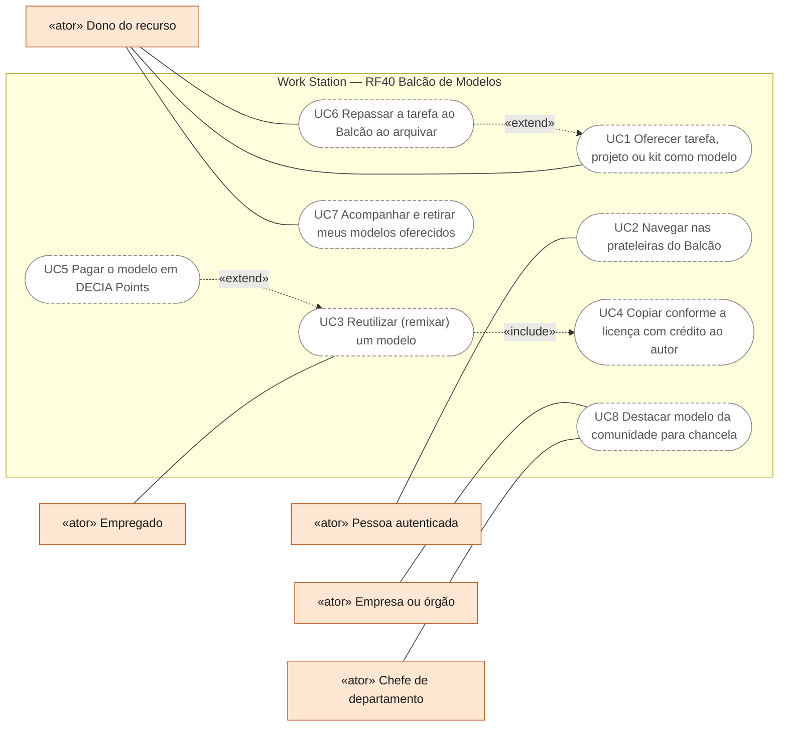
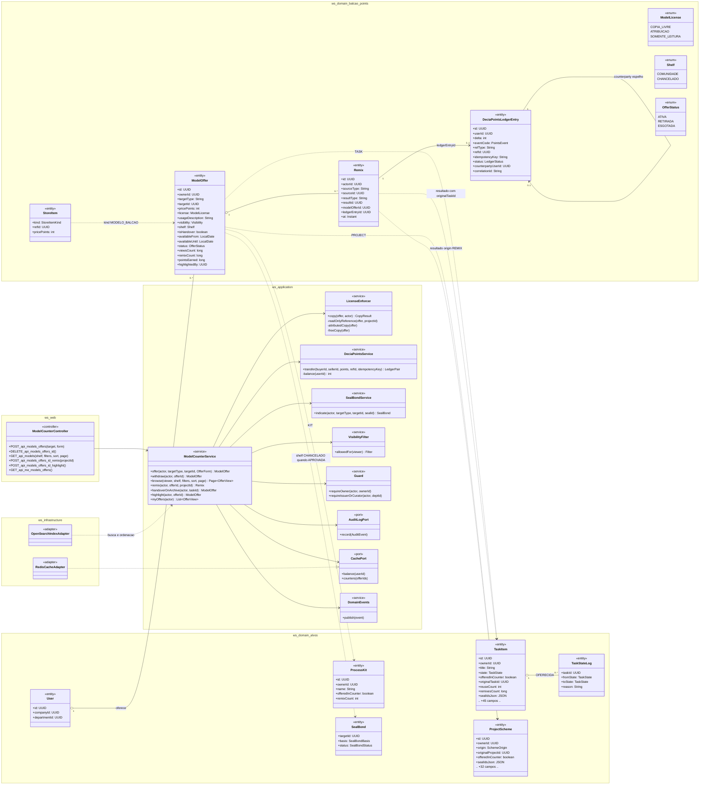
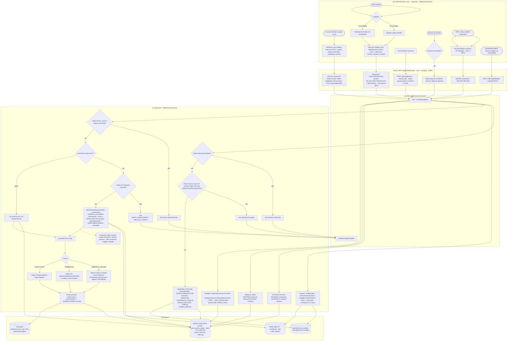
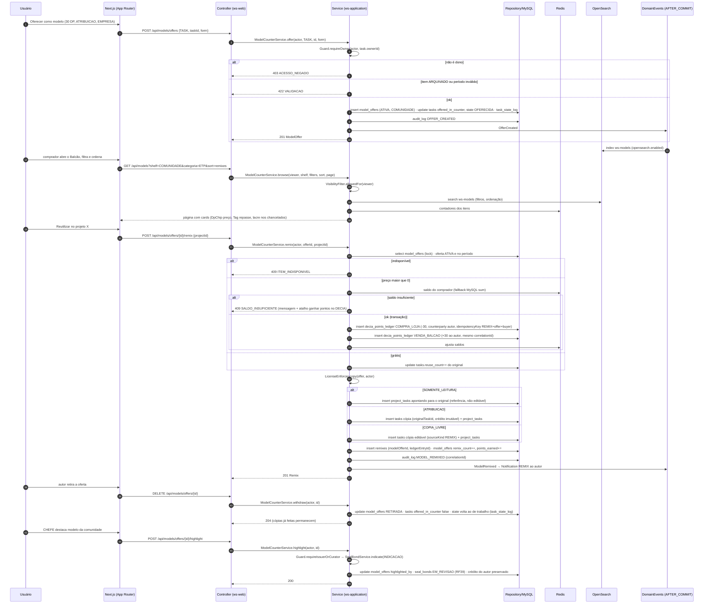
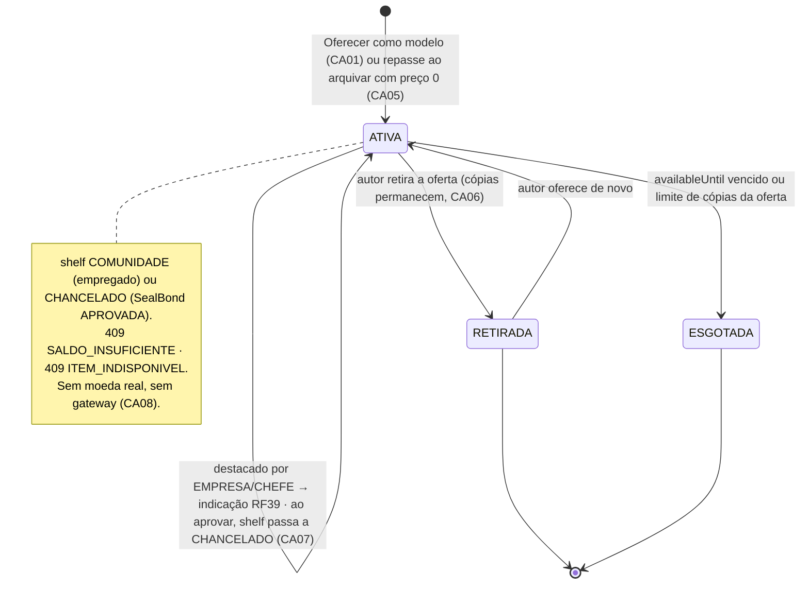
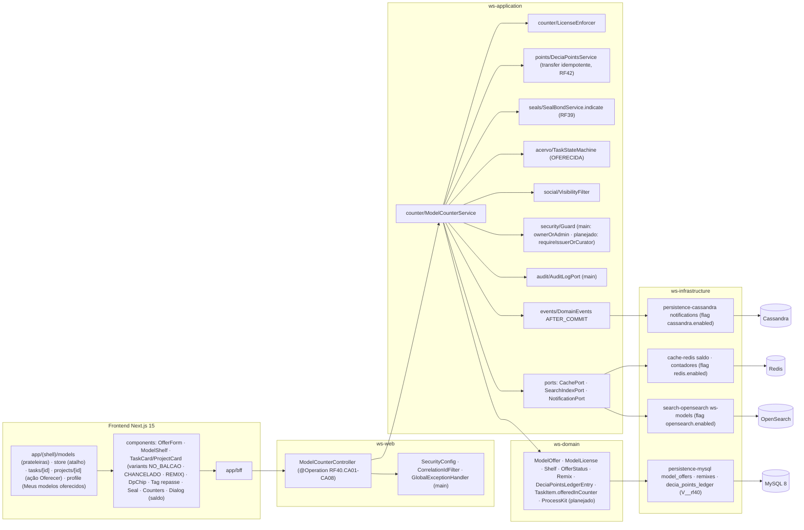

# RF40 — Oferecer tarefas, projetos e kits como modelos no Balcão de Modelos (marketplace interno em DECIA Points, sem dinheiro) e reutilizá-los com crédito ao autor
**HU:** HU40 · **Sprint (board Work Station):** Product Backlog (não comprometido na Sprint 4) · **Equivalente FAI:** estado "À venda" da peça (RF4.CA8 / RF31), sub-aba "Peças à venda", Arara do Desapego e o remix · **Aba/rota:** Balcão de Modelos (`/models`, prateleiras Chancelados · Comunidade, também pela Loja `/store`), ação **Oferecer como modelo** no card (`/tasks/[id]`, `/projects/[id]`, kits), sub-aba **Meus modelos oferecidos** no perfil (`/profile?tab=modelos`), "repassar ao Balcão" ao arquivar (RF41)
**Critérios de aceite cobertos:** RF40.CA01 · CA02 · CA03 · CA04 · CA05 · CA06 · CA07 · CA08 (corpo do card, inalterado) — regra: o **título do card** define o RF e o corpo traz os próprios CAs. A HU40 ainda diz "Pontos de Contribuição" (= DECIA Points, RF42).

`ModelOffer` (targetType TASK · PROJECT · KIT, `pricePoints` 0 = grátis, `license` `ModelLicense` COPIA_LIVRE · ATRIBUICAO · SOMENTE_LEITURA, `visibility`, `shelf` COMUNIDADE · CHANCELADO, `isHandover` repasse, `status` `OfferStatus` ATIVA · RETIRADA · ESGOTADA, contadores). O item passa a `TaskItem.offeredInCounter = true` + `TaskState OFERECIDA` mantendo o estado de trabalho (`TaskStateLog`). **Remixar** = `Remix` + cópia respeitando a licença + **1 lançamento** no ledger que debita o comprador e credita o autor (`DeciaPointsLedgerEntry COMPRA_LOJA` com `counterpartyUserId`, `idempotencyKey`; `VENDA_BALCAO` espelho) — grátis credita só `reuseCount`. Saldo insuficiente → `409 SALDO_INSUFICIENTE`. **Nenhum campo de moeda real, nenhum gateway** (CA08). Destacar/converter em chancelado passa pelo fluxo RF39 (indicação → chancela) preservando `originalTaskId/originalProjectId`.

## 0. Diagrama de casos de uso

Quem usa o Balcão de Modelos e para quê. Atores do catálogo de [`ATORES_E_ATRIBUTOS.md`](../../arquitetura/ATORES_E_ATRIBUTOS.md) §2 e permissões da Matriz A de [`ABAS_POR_PERFIL.md`](../../produto/ABAS_POR_PERFIL.md) (6.1); casos tracejados são planejados — hoje só existem as entidades `ModelOffer` e `StoreItem`, sem serviço nem tela.

| Caso de uso | Ator(es) | CAs | Situação |
|---|---|---|---|
| UC1 Oferecer tarefa, projeto ou kit como modelo | Dono do recurso | RF40.CA01, RF40.CA08 | planejado |
| UC2 Navegar nas prateleiras do Balcão (Chancelados · Comunidade) | Pessoa autenticada | RF40.CA02 | planejado (`/models` é página-esqueleto) |
| UC3 Reutilizar (remixar) um modelo | Empregado | RF40.CA03, RF40.CA08 | planejado |
| UC4 Copiar conforme a licença com crédito ao autor | — (incluído por UC3) | RF40.CA04 | planejado |
| UC5 Pagar o modelo em DECIA Points (só quando o preço é maior que 0) | — (estende UC3) | RF40.CA03, RF40.CA08 | planejado |
| UC6 Repassar a tarefa ao Balcão ao arquivar (preço 0, etiqueta repasse) | Dono do recurso | RF40.CA05 | planejado |
| UC7 Acompanhar e retirar meus modelos oferecidos | Dono do recurso | RF40.CA06 | planejado |
| UC8 Destacar modelo da comunidade para chancela (RF39) | Chefe de departamento, Empresa ou órgão | RF40.CA07 | planejado |

## 1. Diagrama de classes

## 2. Diagrama de atividades

## 3. Diagrama de sequência

## 4. Máquina de estados

Entidade central: `ModelOffer.status` (`OfferStatus`); em paralelo a tarefa entra em `TaskState OFERECIDA` (RF41) mantendo o estado de trabalho no `TaskStateLog`.

## 5. Diagrama de componentes

## 6. Rastreabilidade

| CA | Classe | Passo | Mensagem | Transição | Componente |
|---|---|---|---|---|---|
| RF40.CA01 | `ModelOffer` (pricePoints, license, usageDescription, visibility, availableFrom/Until), `ModelCounterService.offer`, `TaskState OFERECIDA` + `TaskStateLog`, `offeredInCounter` | A1 → F1 → P1 (403) → P2 (422) → P3 | 1–11 | `[*] → ATIVA` | `OfferForm`, `MS`, `TSM` |
| RF40.CA02 | `Shelf COMUNIDADE/CHANCELADO`, `ModelCounterService.browse`, filtros e ordenação (remixes · reações · recentes), `SealBond APROVADA` | A2 → A3 → A6 → F2 → P4 | 12–17 | nota de ATIVA | `ModelShelf`, `OSA`, `RD` |
| RF40.CA03 | `DeciaPointsService.transfer` (COMPRA_LOJA + VENDA_BALCAO, `counterpartyUserId`, `idempotencyKey`), 409 SALDO_INSUFICIENTE, grátis → `reuseCount` | A7 → F3 → P5 (409 ITEM_INDISPONIVEL) → P6 → P7 (409 SALDO_INSUFICIENTE) → P8/P9 | 18–31 | `ATIVA → self (remix)` | `DPS`, `Dialog (saldo)` |
| RF40.CA04 | `LicenseEnforcer.copy`, `ModelLicense` (SOMENTE_LEITURA referência · ATRIBUICAO crédito imutável · COPIA_LIVRE), `Remix`, `originalTaskId/originalProjectId` | P10 → P11 → P12/P13/P14 → P15 | 32–40 | `ATIVA → self (cópia conforme licença)` | `LE` |
| RF40.CA05 | `ModelCounterService.handoverOnArchive`, `ModelOffer.isHandover`, preço 0, etiqueta repasse (RF41) | A8 → A9 → F4 → P16 | — (fluxo de arquivar do RF41) | `[*] → ATIVA (repasse)` | `Tag repasse`, `MS` |
| RF40.CA06 | `ModelOffer.viewsCount/remixCount/pointsEarned`, `ModelCounterService.myOffers/withdraw`, `OfferStatus RETIRADA` | A10 → A11 → F5 → P17 | 41–45 | `ATIVA → RETIRADA` | `MyOffers (Counters)`, `R1 profile` |
| RF40.CA07 | `ModelCounterService.highlight`, `highlightedBy`, `SealBondService.indicate` (INDICACAO → RF39), `Shelf CHANCELADO`, crédito preservado | A12 → F6 → P18 | 46–50 | `ATIVA → self (destacado → chancelado)` | `SBS`, `GD` |
| RF40.CA08 | invariante: sem campo monetário, sem gateway; todo movimento é `DeciaPointsLedgerEntry` com `AuditLog`/`correlationId` | P19 | 27–29, 39 | nota de ATIVA | `DPS`, `AUD`, `MY` |
