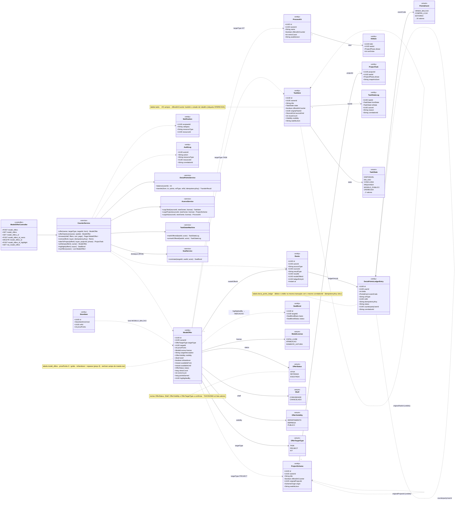
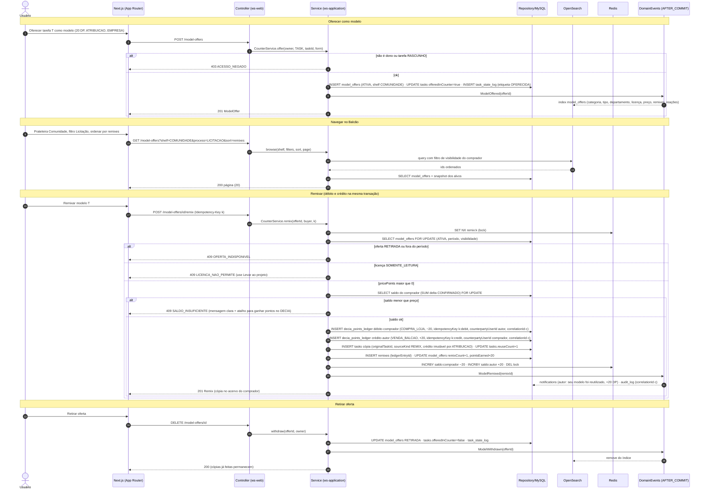
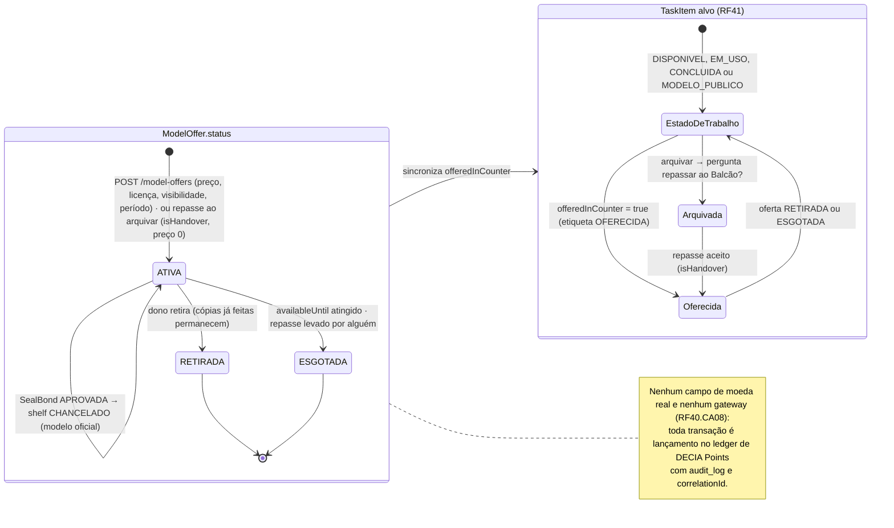
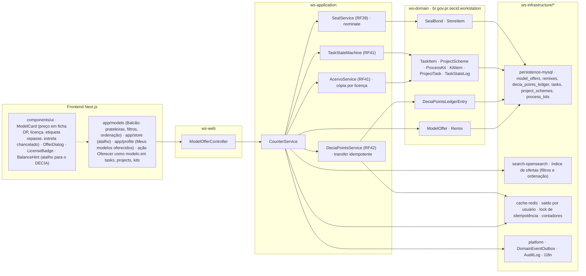

# RF40 — Oferecer tarefas, projetos e kits como modelos no Balcão de Modelos (marketplace interno em DECIA Points, sem dinheiro) e reutilizá-los com crédito ao autor
**HU:** HU40 · **Sprint (board Work Station):** Product Backlog (não priorizado — pós-Sprint 4) · **Equivalente FAI:** estado "À venda" da peça (RF4.CA8 / RF31), sub-aba "Peças à venda" do perfil, Arara do Desapego do Meu Quarto e o remix · **Aba/rota:** Balcão de Modelos (`/models`, também acessível pela Loja Work Station), sub-aba "Meus modelos oferecidos" no perfil (RF19)
**Critérios de aceite cobertos:** RF40.CA01 · RF40.CA02 · RF40.CA03 · RF40.CA04 · RF40.CA05 · RF40.CA06 · RF40.CA07 · RF40.CA08

> Contexto Balcão & Loja & DECIA Points (bounded context 7). Entidade central: `ModelOffer` (status ATIVA → RETIRADA | ESGOTADA) sobre um alvo `TASK | PROJECT | KIT`. A oferta liga `TaskItem.offeredInCounter = true` (etiqueta `OFERECIDA`) sem destruir o estado de trabalho. O remix é uma **transferência** no ledger de DECIA Points (`DeciaPointsService`: débito do comprador + crédito do autor na mesma transação, `counterpartyUserId`, `idempotencyKey`), registrada em `Remix`. Não existe moeda real nem gateway (RF40.CA08).

## 1. Diagrama de classes

## 2. Diagrama de atividades

```mermaid
flowchart TD
  classDef err fill:#FFE3E3,stroke:#C0392B,color:#5B1A12
  classDef store fill:#EEF6FF,stroke:#4A4852,color:#1F2937

  subgraph L_owner["Ator humano · EMPREGADO autor"]
    O1["Em tarefa, projeto ou kit meu: Oferecer como modelo"]
    O2["Define preço em DP (0 = grátis), licença, descrição de uso, visibilidade, período"]
    O3["Arquiva uma tarefa → sistema oferece: repassar ao Balcão?"]
    O4["Perfil › Meus modelos oferecidos: visualizações, remixes, DP recebidos · Retirar oferta"]
  end

  subgraph L_buyer["Ator humano · EMPREGADO comprador · EMPRESA/CHEFE"]
    B1["Abre o Balcão: prateleiras Chancelados × Comunidade, filtros e ordenação"]
    B2{"Ação no modelo?"}
    B3["Remixar (copiar para o meu acervo)"]
    B4["Levar ao projeto como referência"]
    B5["EMPRESA/CHEFE: Destacar modelo da comunidade"]
    B6["Atalho: ganhar pontos no DECIA"]
  end

  subgraph L_web["Web/BFF · Next.js /models · /store · perfil"]
    W1["POST /model-offers (targetType, targetId, pricePoints, license, usageDescription, visibility, período, isHandover)"]
    W2["GET /model-offers?shelf=&category=&type=&department=&license=&price=&sort=remixes|reactions|recent"]
    W3["POST /model-offers/id/remix (Idempotency-Key)"]
    W4["POST /model-offers/id/take-to-project (projectId, phase)"]
    W5["DELETE /model-offers/id"]
    W6["POST /model-offers/id/highlight"]
    W7["GET /me/model-offers"]
  end

  subgraph L_app["ws-application · CounterService · DeciaPointsService · AcervoService · TaskStateMachine"]
    S1{"Ator é dono do alvo e alvo não é RASCUNHO?"}
    S2{"availableUntil maior que availableFrom e pricePoints maior ou igual a 0?"}
    S3["Cria ModelOffer ATIVA · shelf COMUNIDADE (CHANCELADO se SealBond APROVADA) · offeredInCounter true · TaskStateMachine.markOffered (etiqueta OFERECIDA, estado de trabalho preservado) · task_state_log"]
    S4["Repasse: ModelOffer isHandover true, pricePoints 0, etiqueta repasse"]
    S5["browse: filtra por visibilidade do comprador (DEPARTAMENTO, EMPRESA, PUBLICO) · OpenSearch + contadores"]
    S6{"Oferta ATIVA, dentro do período e visível ao comprador?"}
    S7{"idempotencyKey já processada?"}
    S8{"pricePoints maior que 0?"}
    S9{"Saldo do comprador maior ou igual ao preço?"}
    S10["DeciaPointsService.transfer: débito COMPRA_LOJA no comprador + crédito VENDA_BALCAO no autor, mesma transação, mesmo correlationId, counterpartyUserId"]
    S11["Modelo grátis: só reuseCount do alvo (RF23) · sem lançamento"]
    S12{"Licença?"}
    S13["COPIA_LIVRE: AcervoService.copy* editável · originalTaskId para crédito"]
    S14["ATRIBUICAO: cópia com originalTaskId imutável e crédito visível"]
    S15["SOMENTE_LEITURA: sem cópia · só ProjectTask referência não editável (Levar ao projeto)"]
    S16["Remix registrado · remixCount+1 · pointsEarned · Notification ao autor · audit_log"]
    S17["withdraw: ModelOffer RETIRADA · offeredInCounter false · unmarkOffered · cópias já feitas permanecem"]
    S18{"Ator é EMPRESA ou CHEFE?"}
    S19["highlightedBy · SealService.nominate (basis INDICACAO) → fluxo RF39 · crédito do autor preservado"]
    E1["403 ACESSO_NEGADO"]
    E2["422 VALIDACAO"]
    E3["409 OFERTA_INDISPONIVEL"]
    E4["409 SALDO_INSUFICIENTE (mensagem clara + atalho para o DECIA)"]
    E5["409 LICENCA_NAO_PERMITE"]
  end

  subgraph L_db["Persistência"]
    D1["MySQL model_offers · tasks.offeredInCounter · task_state_log"]
    D2["OpenSearch índice de ofertas (filtros, ordenação) · Redis cache de contadores"]
    D3["MySQL decia_points_ledger (2 linhas, mesmo correlationId) · Redis saldo:userId"]
    D4["MySQL tasks/project_schemes/process_kits cópia · project_tasks referência · remixes"]
    D5["MySQL seal_bonds (INDICACAO) · audit_log · DomainEventOutbox → notifications"]
  end

  O1 --> O2 --> W1 --> S1
  O3 -- "sim" --> W1
  S1 -- "não" --> E1
  S1 -- "sim" --> S2
  S2 -- "não" --> E2
  S2 -- "sim" --> S3 --> D1
  W1 -- "isHandover" --> S4 --> S3
  S3 --> D2

  B1 --> W2 --> S5 --> D2
  S5 --> B2
  B2 -- "remixar" --> B3 --> W3 --> S6
  B2 -- "levar ao projeto" --> B4 --> W4 --> S6
  B2 -- "destacar" --> B5 --> W6 --> S18
  S6 -- "não" --> E3
  S6 -- "sim" --> S7
  S7 -- "sim" --> X1(["Retorna o Remix existente (idempotente)"])
  S7 -- "não" --> S8
  S8 -- "sim" --> S9
  S8 -- "não" --> S11 --> S12
  S9 -- "não" --> E4 --> B6
  S9 -- "sim" --> S10 --> D3
  S10 --> S12
  S12 -- "COPIA_LIVRE" --> S13 --> S16
  S12 -- "ATRIBUICAO" --> S14 --> S16
  S12 -- "SOMENTE_LEITURA e ação remixar" --> E5
  S12 -- "SOMENTE_LEITURA e ação levar ao projeto" --> S15 --> S16
  S16 --> D4
  S16 --> D5

  O4 --> W7 --> S5
  O4 -- "retirar" --> W5 --> S17 --> D1
  S18 -- "não" --> E1
  S18 -- "sim" --> S19 --> D5

  class E1,E2,E3,E4,E5 err
  class D1,D2,D3,D4,D5 store
```

## 3. Diagrama de sequência

## 4. Máquina de estados

Entidade central: `ModelOffer.status`. A região inferior mostra o efeito sobre `TaskItem` (`offeredInCounter` + etiqueta `OFERECIDA`, estado de trabalho preservado) e o encaminhamento para chancela (RF39) quando EMPRESA/CHEFE destaca o modelo.

## 5. Diagrama de componentes

## 6. Rastreabilidade

| CA | Elemento do diagrama (classe / passo / mensagem / transição / componente) |
|---|---|
| RF40.CA01 | Classes `ModelOffer` (pricePoints, license, usageDescription, visibility, availableFrom/Until, targetType TASK/PROJECT/KIT), `TaskItem.offeredInCounter`, `TaskState.OFERECIDA`, `TaskStateMachine.markOffered`, `CounterService.offer`; atividades O1, O2, W1, S1 (403), S2 (422), S3; sequência msgs 1–8; transições `[*] → ATIVA` e `EstadoDeTrabalho → Oferecida` (estado de trabalho preservado); componentes `OfferDialog`, `ModelOfferController`. |
| RF40.CA02 | Classes `ModelOffer.shelf` (COMUNIDADE, CHANCELADO), enum `Shelf`, `CounterService.browse`; atividades B1, W2 (filtros categoria, tipo, departamento, licença, preço; ordenação remixes/reações/recentes), S5; sequência msgs 9–15 (OpenSearch); componentes `app/models`, `search-opensearch`, `ModelCard`. |
| RF40.CA03 | Classes `DeciaPointsService.transfer`, `DeciaPointsLedgerEntry` (counterpartyUserId, idempotencyKey, correlationId, eventCode COMPRA_LOJA/VENDA_BALCAO), `Remix.ledgerEntryId`, `TaskItem.reuseCount`; atividades S7 (idempotência), S8, S9 → E4 (409 SALDO_INSUFICIENTE + atalho B6), S10, S11 (grátis: só reuseCount); sequência msgs 16–20, 23–31 (SELECT saldo FOR UPDATE, 409 SALDO_INSUFICIENTE, 2 lançamentos com mesmo correlationId); componentes `DeciaPointsService`, `cache-redis · saldo e lock`, `BalanceHint`. |
| RF40.CA04 | Enum `ModelLicense`, `AcervoService.copyTask/copyProject/copyKit`, `CounterService.takeToProject`, `TaskItem.originalTaskId` (crédito imutável), `ProjectTask.snapshotJson`; atividades S12 → S13 (COPIA_LIVRE), S14 (ATRIBUICAO), S15 (SOMENTE_LEITURA só Levar ao projeto), E5 (409 LICENCA_NAO_PERMITE); sequência msgs 22 e 27 (cópia com crédito imutável por ATRIBUICAO); componente `LicenseBadge`. |
| RF40.CA05 | Classes `ModelOffer.isHandover`, `CounterService.offerHandover`; atividades O3, S4 (preço 0, etiqueta repasse); transições `EstadoDeTrabalho → Arquivada → Oferecida` (repasse aceito) e `ATIVA → ESGOTADA` (repasse levado); componente `ModelCard` (etiqueta repasse). |
| RF40.CA06 | Classes `ModelOffer.viewsCount/remixCount/pointsEarned/status`, `CounterService.myOffers/withdraw`, `OfferStatus`; atividades O4, W7, W5, S17 (cópias permanecem); sequência msgs 32–38; transição `ATIVA → RETIRADA`; componentes `app/profile (Meus modelos oferecidos)`, `GET me_model_offers`. |
| RF40.CA07 | Classes `ModelOffer.highlightedBy`, `CounterService.highlight`, `SealService.nominate`, `SealBond.basis` INDICACAO; atividades B5, W6, S18 (403 para não EMPRESA/CHEFE), S19 (crédito do autor preservado); transições `ATIVA → ATIVA` (destaque → INDICACAO; APROVADA → shelf CHANCELADO); componente `SealService (RF39)`. |
| RF40.CA08 | Nota da classe `ModelOffer` (nenhum campo de moeda real), `DeciaPointsLedgerEntry.correlationId`, `AuditLog`; atividade S10 e D3/D5 (ledger + audit_log); sequência msg 30 (audit_log correlationId); nota da máquina de estados (nenhum gateway); componentes `platform · AuditLog` — não há componente de pagamento no diagrama. |

Tela/aba: `/models` (esqueleto em `app/(shell)/models/page.tsx`) · `/profile` (esqueleto em `app/(shell)/profile/page.tsx`) · `/store` (esqueleto em `app/(shell)/store/page.tsx`)
