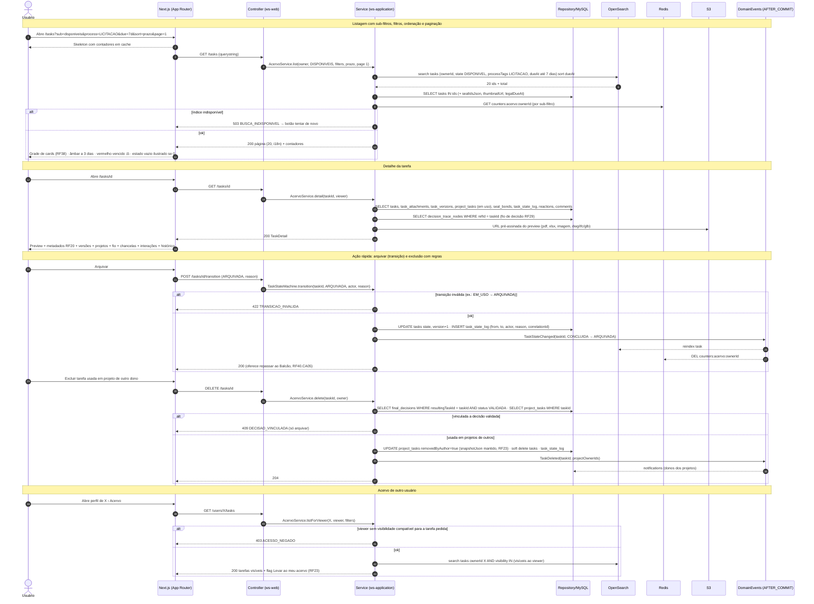
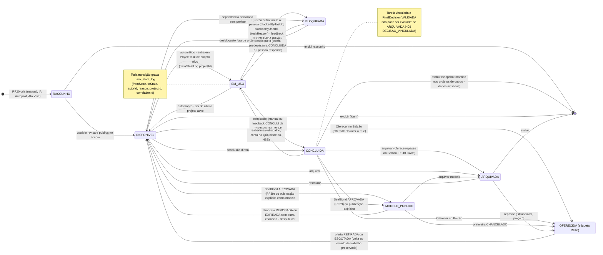
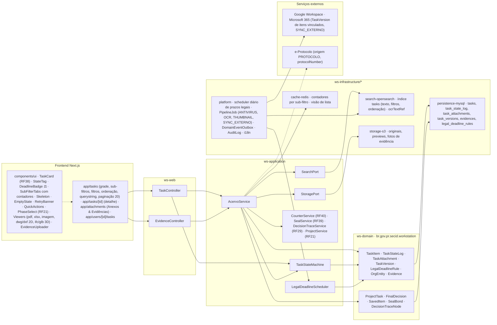

# RF41 — Gerir o Acervo de Tarefas (inventário do usuário): estados, sub-filtros, ordenação, prazos legais, anexos & evidências e ações rápidas
**HU:** HU41 · **Sprint (board Work Station):** Product Backlog (não priorizado — pós-Sprint 4) · **Equivalente FAI:** Closet Digital (RF6) + RF31 Estados do acervo + RF12 Minhas Fotos + RF7 detalhe da peça · **Aba/rota:** Acervo de Tarefas (`/tasks`), detalhe da tarefa (`/tasks/[id]`), Anexos & Evidências (`/attachments`)
**Critérios de aceite cobertos:** RF41.CA01 · RF41.CA02 · RF41.CA03 · RF41.CA04 · RF41.CA05 · RF41.CA06 · RF41.CA07 · RF41.CA08 · RF41.CA09

> Contexto Acervo de Tarefas (bounded context 2). Entidade central: `TaskItem` com `TaskState` RASCUNHO → DISPONIVEL → EM_USO ⇄ BLOQUEADA → CONCLUIDA → ARQUIVADA, mais MODELO_PUBLICO (só via chancela RF39 ou publicação explícita) e OFERECIDA (Balcão RF40). Toda transição passa por `TaskStateMachine` e grava `TaskStateLog` (equivalente ao `wardrobe_availability_log` do FAI). O Acervo é o inventário que alimenta os selects do Criador de Projetos (RF21) e os anexos de mensagem do DECIA (RF29). A criação de tarefas é o RF20.

## 1. Diagrama de classes

```mermaid
classDiagram
  direction LR

  class TaskItem {
    <<entity>>
    +UUID id
    +UUID ownerId
    +UUID departmentId
    +String title
    +String summary
    +TaskType type
    +TaskCategory category
    +String subcategory
    +Set~ProcessTag~ processTags
    +Set~NatureTag~ natureTags
    +AccessClassification accessClass
    +String format
    +EffortSize effortSize
    +BigDecimal amountInvolved
    +TaskOrigin origin
    +SourceKind sourceKind
    +String sourceRef
    +LinkMode linkMode
    +UUID orgEntityId
    +UUID responsibleId
    +LocalDate dueAt
    +UUID legalDeadlineRuleId
    +LocalDate legalDeadlineBaseDate
    +LocalDate legalDueAt
    +String legalOverrideReason
    +Priority priority
    +TaskState state
    +UUID blockedByTaskId
    +UUID blockedByUserId
    +String blockReason
    +DocSituation docSituation
    +Visibility visibility
    +boolean favorite
    +boolean offeredInCounter
    +String thumbnailUrl
    +int reuseCount
    +int projectUsageCount
    +String sealIdsJson
    +long version
  }
  class TaskStateLog {
    <<entity>>
    +UUID id
    +UUID taskId
    +TaskState fromState
    +TaskState toState
    +UUID actorId
    +String reason
    +UUID projectId
    +String correlationId
    +Instant at
  }
  class TaskAttachment {
    <<entity>>
    +UUID id
    +UUID taskId
    +UUID mediaObjectId
    +String fileName
    +String mimeType
    +long sizeBytes
    +String sha256
    +String antivirusStatus
    +String ocrStatus
    +String ocrTextRef
    +boolean isPrimary
  }
  class TaskVersion {
    <<entity>>
    +UUID id
    +UUID taskId
    +int versionNumber
    +String externalRevisionId
    +Instant syncedAt
    +String changeSummary
  }
  class LegalDeadlineRule {
    <<entity>>
    +UUID id
    +UUID companyId
    +TaskCategory category
    +String subcategory
    +int days
    +boolean businessDays
    +String legalBasis
    +boolean active
  }
  class Evidence {
    <<entity>>
    +UUID id
    +UUID ownerId
    +UUID mediaObjectId
    +Instant takenAt
    +BigDecimal latitude
    +BigDecimal longitude
    +String caption
    +UUID linkedTaskId
    +UUID linkedProjectId
    +String studioStatus
    +UUID derivedTaskId
  }
  class OrgEntity {
    <<entity>>
    +UUID id
    +String name
    +String kind
    +String logoUrl
  }
  class ProjectTask {
    <<entity>>
    +UUID id
    +UUID projectId
    +UUID taskId
    +ProjectPhase phase
    +String snapshotJson
    +boolean removedByAuthor
  }
  class ProjectScheme {
    <<entity>>
    +UUID id
    +UUID ownerId
    +ProjectStatus status
  }
  class FinalDecision {
    <<entity>>
    +UUID id
    +DecisionStatus status
    +UUID resultingTaskId
  }
  class SavedItem {
    <<entity>>
    +UUID userId
    +String targetType
    +UUID targetId
    +boolean favorite
  }
  class DecisionTraceNode {
    <<entity>>
    +UUID id
    +TraceNodeType nodeType
    +UUID refId
  }
  class SealBond {
    <<entity>>
    +UUID targetId
    +SealBondStatus status
  }
  class Notification {
    <<entity>>
    +UUID recipientId
    +String category
    +String resourceType
    +UUID resourceId
  }
  class MediaObject {
    <<entity>>
    +UUID id
    +String mimeType
    +String variantsJson
    +AccessClassification accessClass
  }

  class TaskState {
    <<enum>>
    RASCUNHO
    DISPONIVEL
    EM_USO
    BLOQUEADA
    CONCLUIDA
    ARQUIVADA
    MODELO_PUBLICO
    OFERECIDA
  }
  class TaskType {
    <<enum>>
    TEXTO_MANUAL
    DOCUMENTO
    PLANILHA
    DESENHO_TECNICO
    IMAGEM_EDITADA
    ...10 valores
  }
  class TaskCategory {
    <<enum>>
    OFICIO_MEMORANDO
    PARECER_TECNICO
    ETP
    TERMO_REFERENCIA
    ...11 valores
  }
  class AccessClassification {
    <<enum>>
    PUBLICO
    INTERNO
    RESTRITO
    SIGILOSO
  }
  class Visibility {
    <<enum>>
    PRIVADA
    DEPARTAMENTO
    EMPRESA
    PUBLICA
  }
  class SourceKind {
    <<enum>>
    ARQUIVO
    GOOGLE
    MICROSOFT
    EMAIL
    PROTOCOLO
    ...10 valores
  }
  class StudioStatus {
    <<enum>>
    ORIGINAL
    ENDIREITADA
    RECORTADA
    SEM_FUNDO
    OCR
  }

  class TaskController {
    <<controller>>
    +GET tasks
    +GET tasks_counters
    +GET tasks_id
    +POST tasks_id_transition
    +POST tasks_id_favorite
    +POST tasks_id_duplicate
    +DELETE tasks_id
    +GET users_id_tasks
  }
  class EvidenceController {
    <<controller>>
    +POST evidences
    +GET evidences
    +POST evidences_id_to_task
  }
  class AcervoService {
    <<service>>
    +list(owner, subFilter, filters, sort, page) Page~TaskItem~
    +counters(owner) Map~SubFilter int~
    +detail(taskId, viewer) TaskDetail
    +favorite(taskId, user) SavedItem
    +duplicate(taskId, user) TaskItem
    +delete(taskId, owner) void
    +listForViewer(ownerId, viewer, filters) Page~TaskItem~
    +takeToMyAcervo(taskId, viewer) TaskItem
    +addEvidence(owner, media, meta) Evidence
    +evidenceToTask(evidenceId) TaskItem
  }
  class TaskStateMachine {
    <<service>>
    +transition(taskId, toState, actor, reason, projectId) TaskStateLog
    +onProjectActivated(projectId) void
    +onProjectTaskRemoved(projectId, taskId) void
    +canTransition(from, to) boolean
  }
  class LegalDeadlineScheduler {
    <<service>>
    +scanUpcoming() void
    +computeLegalDueAt(task, rule) LocalDate
  }
  class SearchPort {
    <<port>>
    +searchTasks(query, filters, sort, page) Page~UUID~
  }

  TaskItem --> TaskState : state
  TaskItem --> TaskType : type
  TaskItem --> TaskCategory : category
  TaskItem --> AccessClassification : accessClass
  TaskItem --> Visibility : visibility
  TaskItem --> SourceKind : sourceKind
  TaskItem "1" --> "*" TaskStateLog : taskId
  TaskItem "1" --> "*" TaskAttachment : taskId
  TaskItem "1" --> "*" TaskVersion : taskId (GOOGLE, MICROSOFT)
  TaskItem --> LegalDeadlineRule : legalDeadlineRuleId
  TaskItem --> OrgEntity : orgEntityId
  TaskItem ..> TaskItem : blockedByTaskId
  TaskItem "1" --> "*" ProjectTask : taskId (em uso)
  ProjectTask --> ProjectScheme : projectId
  FinalDecision ..> TaskItem : resultingTaskId (não excluível)
  Evidence --> StudioStatus : studioStatus
  Evidence ..> TaskItem : linkedTaskId
  Evidence ..> TaskItem : derivedTaskId IMAGEM_EDITADA
  Evidence --> MediaObject : mediaObjectId
  TaskAttachment --> MediaObject : mediaObjectId
  SavedItem ..> TaskItem : favoritar
  DecisionTraceNode ..> TaskItem : fio de decisão (RF29)
  SealBond ..> TaskItem : chancelas (RF39)

  TaskController --> AcervoService
  TaskController --> TaskStateMachine
  EvidenceController --> AcervoService
  AcervoService --> TaskStateMachine
  AcervoService --> SearchPort
  LegalDeadlineScheduler ..> TaskItem
  LegalDeadlineScheduler ..> Notification
  TaskStateMachine ..> TaskStateLog
  TaskStateMachine ..> Notification

  note for TaskItem "tabela tasks · +12 campos · version otimista · índice (ownerId, state), (responsibleId, legalDueAt)"
  note for TaskStateLog "tabela task_state_log · equivalente ao wardrobe_availability_log do FAI · toda transição (RF41.CA02)"
  note for Evidence "tabela evidences · latitude/longitude opcionais com AES-GCM · RF41.CA06"
  note for LegalDeadlineRule "tabela legal_deadline_rules · companyId null = padrão · dias úteis ou corridos"
```

## 2. Diagrama de atividades

```mermaid
flowchart TD
  classDef err fill:#FFE3E3,stroke:#C0392B,color:#5B1A12
  classDef store fill:#EEF6FF,stroke:#4A4852,color:#1F2937
  classDef job fill:#F3F0FA,stroke:#7E57C2,color:#2D2438

  subgraph L_user["Ator humano · EMPREGADO"]
    U1["Abre o Acervo /tasks"]
    U2["Escolhe sub-filtro (Todas, Favoritas, Disponíveis, Em uso, Bloqueadas, Concluídas, Modelos públicos, Chanceladas, Oferecidas), filtros e ordenação"]
    U3["Abre o detalhe /tasks/id"]
    U4{"Ação rápida?"}
    U5["Favoritar · Duplicar · Levar ao projeto · Compartilhar na sessão DECIA · Pedir chancela · Oferecer no Balcão · Arquivar/Repassar"]
    U6["Exclui tarefa usada em projetos de outros"]
    U7["Envia fotos de vistoria/obra em /attachments"]
    U8["Abre o Acervo de outro usuário (RF19)"]
    U9["Compartilha a URL com filtros"]
  end

  subgraph L_web["Web/BFF · Next.js /tasks · /tasks/[id] · /attachments"]
    W1["Skeleton de carregamento → grade de cards (RF38) com contadores por sub-filtro"]
    W2{"Resposta?"}
    W3["Estado vazio ilustrado"]
    W4["Erro: tentar de novo"]
    W5["GET /tasks?sub=&category=&type=&process=&nature=&department=&access=&due=vencidas|7d|30d&source=&sort=&page= (querystring = visão restaurável, 20 por página, i18n)"]
    W6["GET /tasks/id → preview (documento, planilha, imagem, desenho 2D-3D), metadados RF20, versões, projetos em uso, fio de decisão, chancelas, interações, histórico"]
    W7["POST /tasks/id/transition · /favorite · /duplicate · DELETE /tasks/id"]
    W8["Levar ao projeto abre o select de fase do RF21 · Compartilhar abre a sessão (RF29) · Pedir chancela (RF39) · Oferecer (RF40)"]
    W9["POST /evidences (foto, takenAt, lat/long opcional, linkedTaskId/ProjectId)"]
    W10["GET /users/id/tasks"]
    W11["Card âmbar a 3 dias, vermelho vencido, ícone ⚖ (RF38.CA05)"]
  end

  subgraph L_app["ws-application · AcervoService · TaskStateMachine · LegalDeadlineScheduler"]
    S1["AcervoService.list: filtra por ownerId, sub-filtro e filtros · ordena (recentes, mais usadas, menos usadas, nome, prazo, valor) · pagina 20"]
    S2["AcervoService.counters por sub-filtro (cache)"]
    S3["AcervoService.detail: agrega TaskAttachment, TaskVersion, ProjectTask em uso, DecisionTraceNode, SealBond, Reaction/Comment, TaskStateLog"]
    S4{"TaskStateMachine.canTransition(from, to)?"}
    S5["Aplica transição · TaskStateLog (actor, reason, projectId, correlationId) · version+1"]
    S6["Automático: projeto ativo → EM_USO · sai do projeto → DISPONIVEL · MODELO_PUBLICO só via SealBond APROVADA ou publicação explícita"]
    S7{"Tarefa vinculada a FinalDecision VALIDADA (resultingTaskId ou anexo usado)?"}
    S8{"Usada em ProjectTask de outros donos?"}
    S9["Marca ProjectTask.removedByAuthor · snapshotJson preservado (RF23) · Notification aos donos"]
    S10["Exclui tarefa (soft delete) · TaskStateLog"]
    S11["Só ARQUIVADA permitida"]
    S12["LegalDeadlineScheduler.scanUpcoming (diário): legalDueAt em 3 dias ou vencido → Notification ao responsável · sinaliza Prioridade do Dia (RF19/RF44)"]
    S13["addEvidence: MediaObject (antivírus, EXIF takenAt, geolocalização opcional AES) · Evidence studioStatus ORIGINAL"]
    S14["evidenceToTask: Estúdio de Documento (RF20) → TaskItem IMAGEM_EDITADA · Evidence.derivedTaskId"]
    S15{"Viewer tem visibilidade compatível (PRIVADA, DEPARTAMENTO, EMPRESA, PUBLICA)?"}
    S16["listForViewer: só tarefas visíveis · ação Levar ao meu acervo (RF23) quando permitida"]
    E1["403 ACESSO_NEGADO"]
    E2["422 TRANSICAO_INVALIDA"]
    E3["409 DECISAO_VINCULADA (só arquivar)"]
    E4["422 VALIDACAO (foto inválida, mime real diferente da extensão)"]
  end

  subgraph L_db["Persistência"]
    D1["OpenSearch índice tasks (texto, filtros, ordenação) · Redis contadores por sub-filtro"]
    D2["MySQL tasks · task_state_log · task_attachments · task_versions · project_tasks"]
    D3["MySQL evidences · media_objects (S3) · pipeline_jobs ANTIVIRUS, OCR, THUMBNAIL"]
    D4["MySQL legal_deadline_rules · DomainEventOutbox → notifications_by_user"]
    D5["S3 originais e variantes (preview) · audit_log"]
  end

  U1 --> W1 --> W5 --> S1 --> D1
  S1 --> D2
  U2 --> W5
  U9 --> W5
  S1 --> S2 --> D1
  S2 --> W2
  W2 -- "0 itens" --> W3
  W2 -- "erro" --> W4 --> W5
  W2 -- "itens" --> W11
  U3 --> W6 --> S3 --> D2
  S3 --> D5
  U4 --> U5
  U5 --> W7 --> S4
  U5 --> W8
  S4 -- "não" --> E2
  S4 -- "sim" --> S5 --> D2
  S6 --> S5
  S5 --> D4
  U6 --> W7 --> S7
  S7 -- "sim" --> E3 --> S11 --> S5
  S7 -- "não" --> S8
  S8 -- "sim" --> S9 --> S10
  S8 -- "não" --> S10 --> D2
  S9 --> D4
  S12 --> D4
  S12 --> W11
  U7 --> W9 --> S13
  S13 -- "inválido" --> E4
  S13 -- "ok" --> D3
  S13 --> S14 --> D2
  U8 --> W10 --> S15
  S15 -- "não" --> E1
  S15 -- "sim" --> S16 --> D1

  class E1,E2,E3,E4 err
  class D1,D2,D3,D4,D5 store
  class S12 job
```

## 3. Diagrama de sequência

## 4. Máquina de estados

Entidade central: `TaskItem.state` (`TaskState`). `OFERECIDA` é a etiqueta do Balcão (RF40) e preserva o estado de trabalho; a exclusão obedece às regras do RF41.CA05.

## 5. Diagrama de componentes

## 6. Rastreabilidade

| CA | Elemento do diagrama (classe / passo / mensagem / transição / componente) |
|---|---|
| RF41.CA01 | Classes `AcervoService.list/counters`, `TaskController.GET tasks/tasks_counters`; atividades U1, W1 (skeleton + contadores), W2 → W3 (estado vazio ilustrado) / W4 (tentar de novo), S1, S2; sequência msgs 1–11 (skeleton, 503 BUSCA_INDISPONIVEL → tentar de novo, grade de cards); componentes `SubFilterTabs`, `Skeleton`, `EmptyState`, `RetryBanner`, `cache-redis · contadores`. |
| RF41.CA02 | Classes `TaskStateMachine` (transition, onProjectActivated, onProjectTaskRemoved, canTransition), `TaskStateLog`, `TaskItem.state/blockedBy*/version`, enum `TaskState`; atividades S4 → E2 (422 TRANSICAO_INVALIDA), S5, S6 (EM_USO automático, MODELO_PUBLICO só via chancela/publicação); sequência msgs 21–28; máquina de estados completa (RASCUNHO → DISPONIVEL → EM_USO ⇄ BLOQUEADA → CONCLUIDA → ARQUIVADA, MODELO_PUBLICO, OFERECIDA) e nota do `task_state_log`; componente `TaskStateMachine`. |
| RF41.CA03 | Classes `AcervoService.detail`, `TaskAttachment`, `TaskVersion`, `ProjectTask`, `DecisionTraceNode`, `SealBond`, `TaskStateLog`, `MediaObject.variantsJson`; atividades U3, W6, S3; sequência msgs 12–19 (preview, versões, projetos em uso, fio, chancelas, interações, histórico); componentes `app/tasks/[id]`, `Viewers (pdf, xlsx, imagem, dwg/dxf 2D, ifc/glb 3D)`, `storage-s3`. |
| RF41.CA04 | Classes `LegalDeadlineRule`, `TaskItem.legalDeadlineRuleId/legalDeadlineBaseDate/legalDueAt`, `LegalDeadlineScheduler.scanUpcoming/computeLegalDueAt`, `Notification`; atividades S12 (job diário → notificação ao responsável, Prioridade do Dia) e W11 (âmbar 3 dias, vermelho vencido, ⚖); sequência msg 11; componentes `DeadlineBadge ⚖`, `platform · scheduler diário de prazos legais`. |
| RF41.CA05 | Classes `AcervoService.delete`, `ProjectTask.snapshotJson/removedByAuthor`, `FinalDecision.resultingTaskId`; atividades U6, S7 → E3 (409 DECISAO_VINCULADA → S11 só ARQUIVADA), S8, S9 (snapshot preservado + Notification aos donos), S10; sequência msgs 29–37; transições `CONCLUIDA/DISPONIVEL → [*]` com nota sobre decisão validada. |
| RF41.CA06 | Classes `Evidence` (takenAt, latitude/longitude AES, caption, linkedTaskId, linkedProjectId, studioStatus, derivedTaskId), enum `StudioStatus`, `AcervoService.addEvidence/evidenceToTask`, `EvidenceController`; atividades U7, W9, S13 → E4 (422 VALIDACAO), S14 (Estúdio de Documento RF20 → IMAGEM_EDITADA); componentes `app/attachments`, `EvidenceUploader`, `PipelineJob (ANTIVIRUS, OCR, THUMBNAIL)`. |
| RF41.CA07 | Classes `AcervoService.favorite/duplicate`, `SavedItem`, `TaskController` (favorite, duplicate, transition), `CounterService`, `SealService`, `DecisionTraceService`, `ProjectService`; atividades U4, U5, W7, W8 (Levar ao projeto abre PhaseSelect do RF21, Compartilhar na sessão RF29, Pedir chancela RF39, Oferecer RF40, Arquivar/Repassar); sequência msgs 20–28 (arquivar oferece repasse); transições `→ OFERECIDA`, `→ ARQUIVADA`, `→ MODELO_PUBLICO`; componentes `QuickActions`, `PhaseSelect (RF21)`. |
| RF41.CA08 | Classes `TaskItem.visibility`, enum `Visibility`, `AcervoService.listForViewer/takeToMyAcervo`, `TaskController.GET users_id_tasks`; atividades U8, W10, S15 → E1 (403 ACESSO_NEGADO), S16 (Levar ao meu acervo RF23); sequência msgs 38–44; componente `app/users/[id]/tasks`. |
| RF41.CA09 | Classe `AcervoService.list` (filters, sort, page), `SearchPort`; atividades U2, U9, W5 (querystring = visão restaurável, 20 por página, i18n), S1 (ordenações recentes, mais/menos usadas, nome, prazo, valor); sequência msgs 1–4 e 10 (querystring, página 20, i18n); componentes `app/tasks (querystring, paginação 20)`, `search-opensearch`, `platform · i18n`. |
