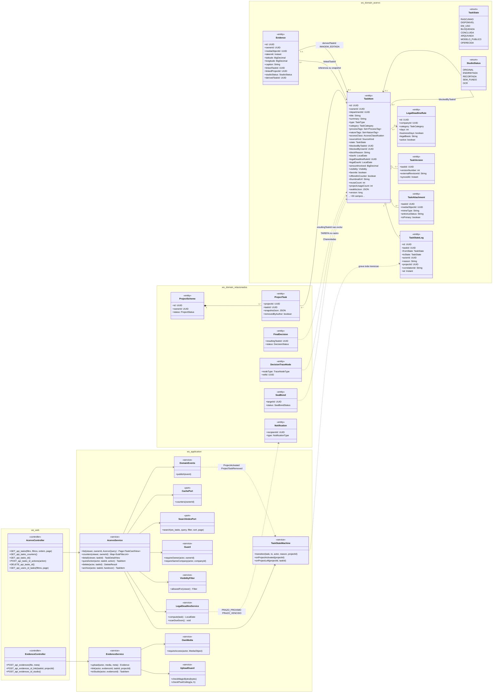
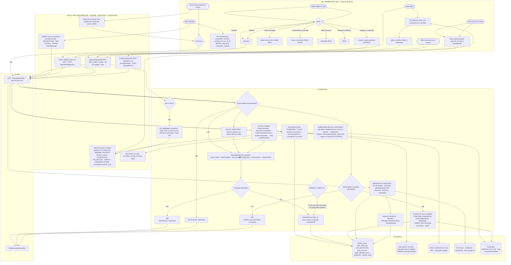
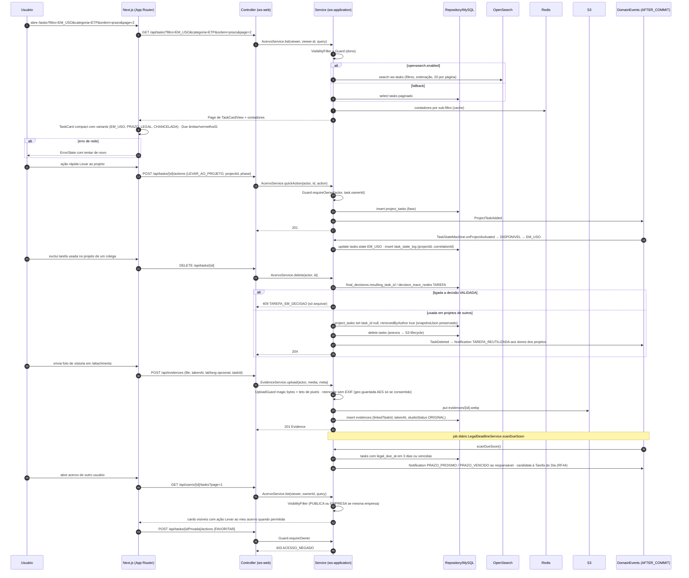
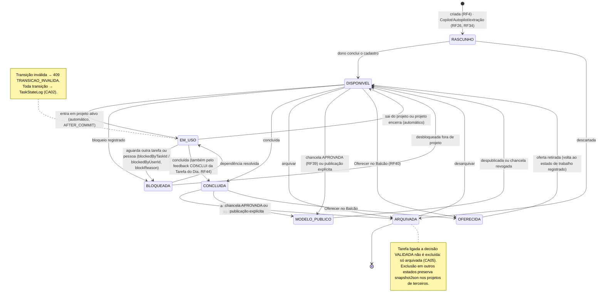
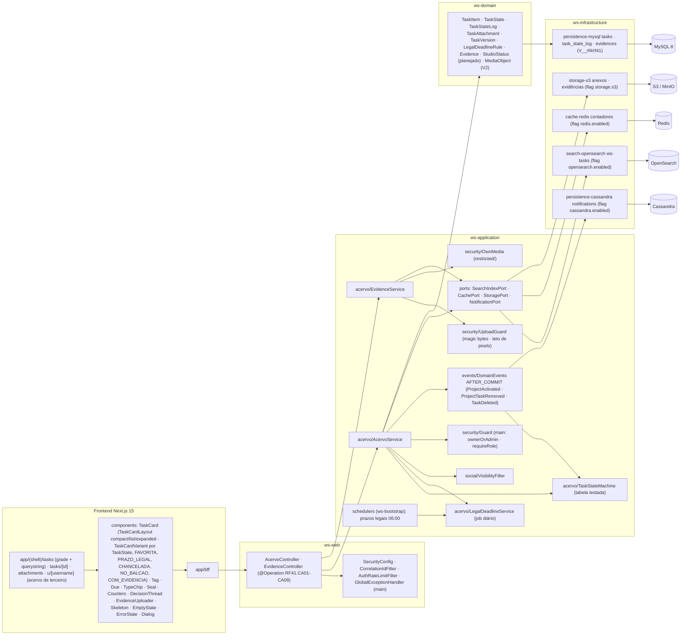

# RF41 — Gerir o Acervo de Tarefas (inventário do usuário): estados, sub-filtros, ordenação, prazos legais, anexos & evidências e ações rápidas
**HU:** HU41 · **Sprint (board Work Station):** Product Backlog (não comprometido na Sprint 4; o Acervo é entregue junto com RF4/RF6 na fase (d) da ARQUITETURA §6) · **Equivalente FAI:** Closet Digital (RF6) + RF31 Estados do acervo + RF12 Minhas Fotos + RF7 detalhe da peça · **Aba/rota:** Acervo de Tarefas (`/tasks?filtro=&categoria=&ordem=&page=`), detalhe (`/tasks/[id]`), Anexos & Evidências (`/attachments`), acervo de terceiros (`/u/[username]?tab=acervo`)
**Critérios de aceite cobertos:** RF41.CA01 · CA02 · CA03 · CA04 · CA05 · CA06 · CA07 · CA08 · CA09 (corpo do card, inalterado) — regra: o **título do card** define o RF e o corpo traz os próprios CAs. A criação de tarefas é o RF4 (corpo em RF20); o Acervo alimenta os selects do Criador de Projetos (RF5) e os anexos do DECIA (RF29).

Estados (`TaskState`): RASCUNHO · DISPONIVEL · EM_USO (em ≥ 1 projeto ativo, automático) · BLOQUEADA · CONCLUIDA · ARQUIVADA · MODELO_PUBLICO (só via chancela RF39 ou publicação explícita) · OFERECIDA (Balcão RF40); toda transição em `TaskStateLog` (`TaskStateMachine` com tabela testada). Sub-filtros: Todas · Favoritas · Disponíveis · Em uso · Bloqueadas · Concluídas · Modelos públicos · Chanceladas · Oferecidas (+ filtros categoria, tipo, processo, natureza, departamento, `accessClass`, prazo, origem; ordenação recentes, mais/menos usadas, nome, prazo, valor), tudo na querystring (CA09). Prazo legal (`legalDueAt`, `LegalDeadlineRule`): card âmbar a 3 dias, vermelho vencido, ⚖, notificação `PRAZO_PROXIMO/PRAZO_VENCIDO` (job diário) e sugestão na Tarefa do Dia (RF44). Evidências (`Evidence`: foto com `takenAt`, geolocalização opcional AES, vínculo a tarefa/projeto, `studioStatus`) podem virar IMAGEM_EDITADA pelo Estúdio (RF4). Exclusão: projetos de outros mantêm `ProjectTask.snapshotJson` (RF23) e donos são avisados; tarefa ligada a decisão VALIDADA (`FinalDecision.resultingTaskId` ou nó TAREFA do rastro) **não é excluída, só arquivada** (409). Acervo de terceiros: `VisibilityFilter` + `Guard` (403 no resto).

## 1. Diagrama de classes

## 2. Diagrama de atividades

## 3. Diagrama de sequência

## 4. Máquina de estados

Entidade central: `TaskItem.state` (`TaskState`, `TaskStateMachine` com tabela de transições testada; toda transição em `TaskStateLog`).

## 5. Diagrama de componentes

## 6. Rastreabilidade

| CA | Classe | Passo | Mensagem | Transição | Componente |
|---|---|---|---|---|---|
| RF41.CA01 | `AcervoService.list/counters`, `TaskCardView`, contadores por sub-filtro em `CachePort` | A0 → A1 → F1 → P1 → F2 | 1–11 | — | `TaskCard compact`, `Skeleton · EmptyState · ErrorState`, `RD`, `OSA` |
| RF41.CA02 | `TaskStateMachine.transition/onProjectActivated/onProjectLeft`, `TaskState`, `TaskStateLog`, MODELO_PUBLICO só via chancela/publicação | P4 → P5 (409) → P6 · P7 · P8 | 12–20 | toda a máquina + nota de EM_USO | `TSM`, `DE`, `MY` |
| RF41.CA03 | `AcervoService.detail` (preview, metadados RF4, `TaskVersion`, `ProjectTask` em uso, `DecisionTraceNode`, `SealBond`, interações, `TaskStateLog`) | A3 → A4 → F3 | — (GET /api/tasks/{id}) | — | `TaskCard expanded`, `DecisionThread`, `Seal`, `Counters` |
| RF41.CA04 | `LegalDeadlineRule`, `TaskItem.legalDueAt`, `LegalDeadlineService.scanDueSoon`, `Notification PRAZO_PROXIMO/PRAZO_VENCIDO`, `Due` (âmbar · vermelho · ⚖), RF44 | P9 → F5 | 39–41 | — | `LDS`, `SCH`, `Due`, `CASA` |
| RF41.CA05 | `AcervoService.delete`, `ProjectTask.snapshotJson/removedByAuthor` (RF23), `FinalDecision.resultingTaskId`, 409 TAREFA_EM_DECISAO, `Notification TAREFA_REUTILIZADA` | A13 → A14 → F7 → P10 → P11 (409) → P12 | 21–29 | nota de ARQUIVADA | `AS`, `Dialog` |
| RF41.CA06 | `Evidence` (takenAt, latitude/longitude AES, linkedTaskId/ProjectId, studioStatus), `EvidenceService.upload/link/toStudio`, `UploadGuard`, `OwnMedia`, IMAGEM_EDITADA (RF4) | A15 → A16 → F6 → P13 → P14 | 30–36 | — | `ES`, `UG`, `OM`, `EvidenceUploader`, `S3A` |
| RF41.CA07 | `AcervoService.quickAction` (FAVORITAR · DUPLICAR · LEVAR_AO_PROJETO · COMPARTILHAR_SESSAO · PEDIR_CHANCELA · OFERECER_BALCAO · ARQUIVAR/REPASSAR), `AcervoService.archive` | A5 → A6 → A7..A12 → F4 → P10 → P4/P15 | 12–17 | `→ ARQUIVADA / OFERECIDA / EM_USO` | `F4 menu do card`, `TSM` |
| RF41.CA08 | `VisibilityFilter.allowedFor`, `Guard.requireOwner` (403), ação Levar ao meu acervo (RF23) | A17 → F1 → P2 → P3 | 42–49 | — | `VF`, `GD`, `R1 u/[username]` |
| RF41.CA09 | querystring (filtro, filtros, ordem, page), 20 por página, i18n, `AcervoQuery` | A2 → F1 | 1–3 | — | `R1 /tasks`, `lib/i18n` |
