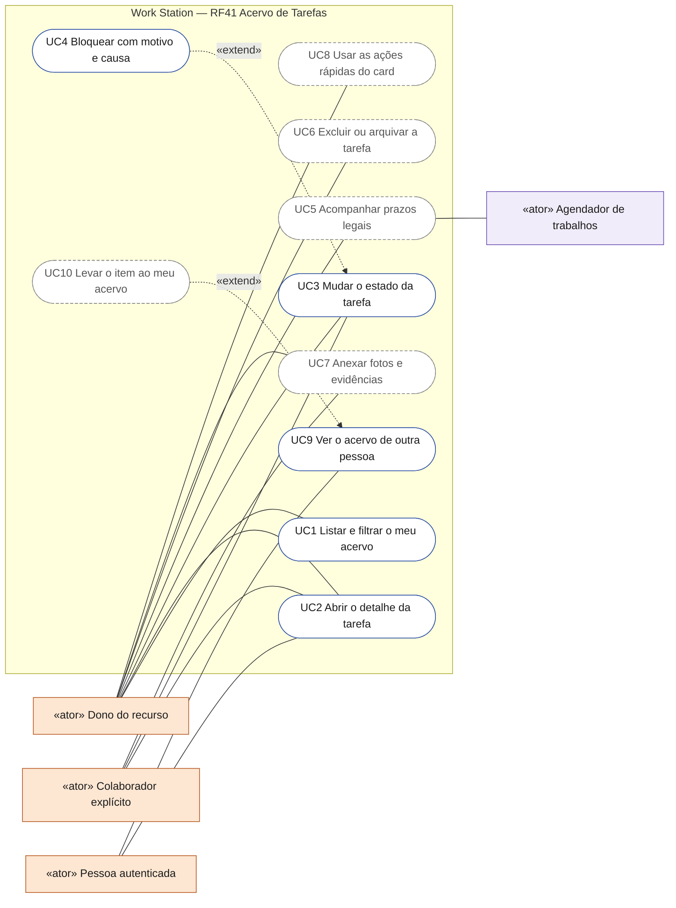
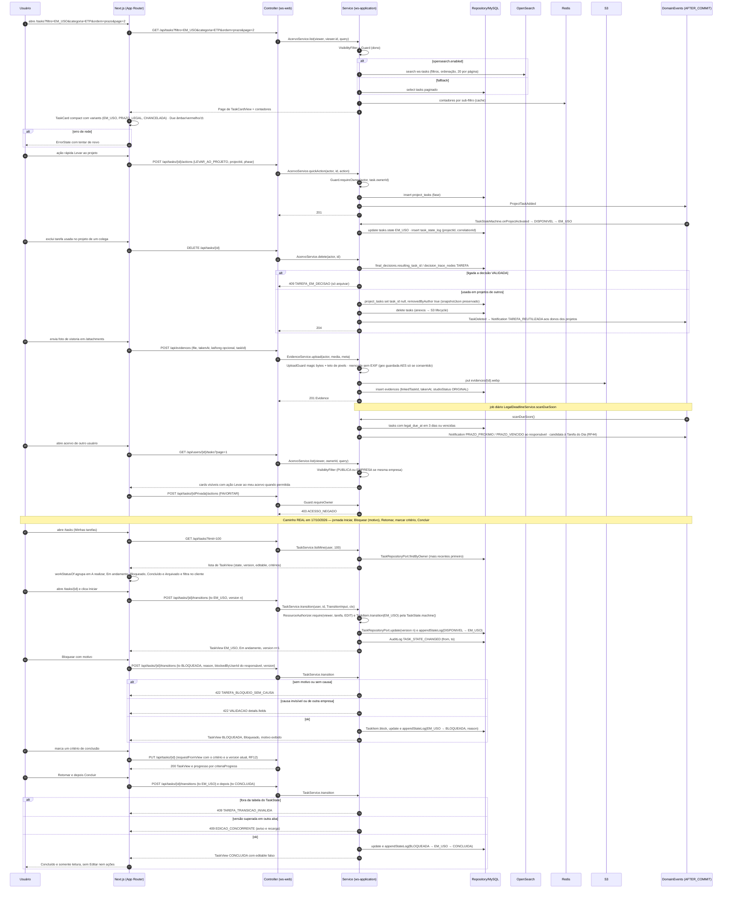
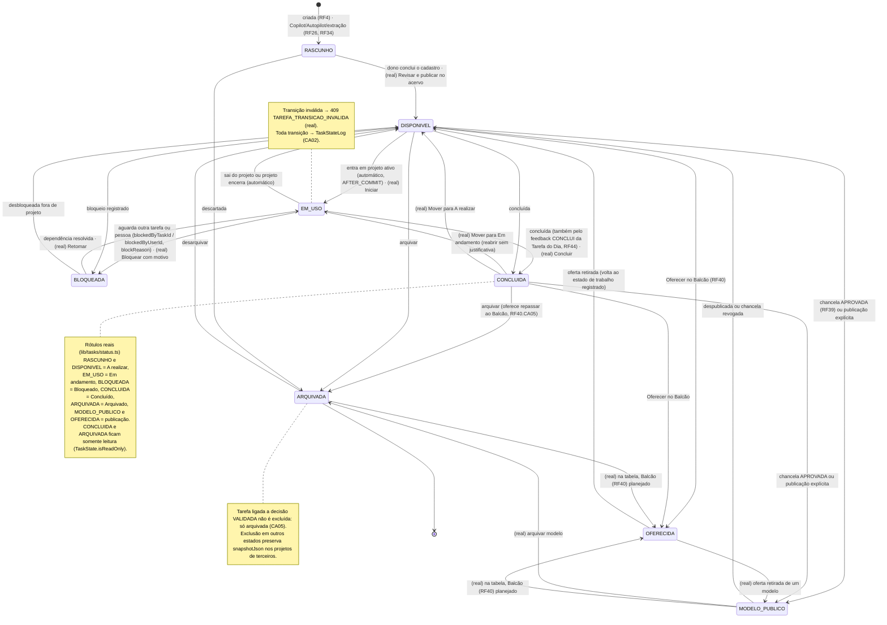
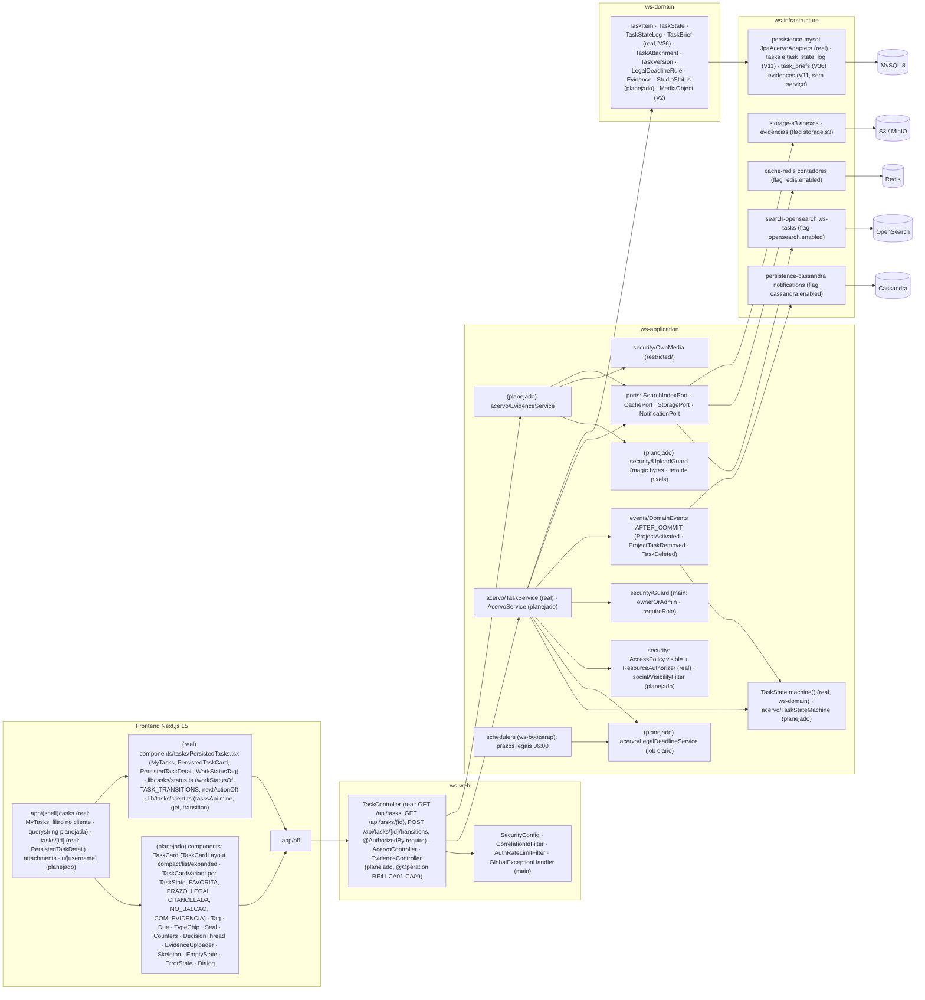

# RF41 — Gerir o Acervo de Tarefas (inventário do usuário): estados, sub-filtros, ordenação, prazos legais, anexos & evidências e ações rápidas
**HU:** HU41 · **Sprint (board Work Station):** Product Backlog (não comprometido na Sprint 4; o Acervo é entregue junto com RF4/RF6 na fase (d) da ARQUITETURA §6) · **Equivalente FAI:** Closet Digital (RF6) + RF31 Estados do acervo + RF12 Minhas Fotos + RF7 detalhe da peça · **Aba/rota:** Acervo de Tarefas (`/tasks?filtro=&categoria=&ordem=&page=`), detalhe (`/tasks/[id]`), Anexos & Evidências (`/attachments`), acervo de terceiros (`/u/[username]?tab=acervo`) · **real em 17/10/2026:** `/tasks` («Minhas tarefas», `MyTasks`), `/tasks/[id]` (`PersistedTaskDetail`), `GET /api/tasks?limit=`, `GET /api/tasks/{id}` e `POST /api/tasks/{id}/transitions`; querystring de filtros, contadores, ações rápidas, `/attachments` e acervo de terceiros seguem **(planejado)**
**Critérios de aceite cobertos:** RF41.CA01 · CA02 · CA03 · CA04 · CA05 · CA06 · CA07 · CA08 · CA09 (corpo do card, inalterado) — regra: o **título do card** define o RF e o corpo traz os próprios CAs. A criação de tarefas é o RF4 (corpo em RF20); o Acervo alimenta os selects do Criador de Projetos (RF5) e os anexos do DECIA (RF29). Situação em 17/10/2026 (MATRIZ_RF: DEMO EM MEMÓRIA → API REAL PARCIAL): ver «Real × planejado» abaixo.

Estados (`TaskState`): RASCUNHO · DISPONIVEL · EM_USO (em ≥ 1 projeto ativo, automático) · BLOQUEADA · CONCLUIDA · ARQUIVADA · MODELO_PUBLICO (só via chancela RF39 ou publicação explícita) · OFERECIDA (Balcão RF40); toda transição em `TaskStateLog` (`TaskStateMachine` com tabela testada). Sub-filtros: Todas · Favoritas · Disponíveis · Em uso · Bloqueadas · Concluídas · Modelos públicos · Chanceladas · Oferecidas (+ filtros categoria, tipo, processo, natureza, departamento, `accessClass`, prazo, origem; ordenação recentes, mais/menos usadas, nome, prazo, valor), tudo na querystring (CA09). Prazo legal (`legalDueAt`, `LegalDeadlineRule`): card âmbar a 3 dias, vermelho vencido, ⚖, notificação `PRAZO_PROXIMO/PRAZO_VENCIDO` (job diário) e sugestão na Tarefa do Dia (RF44). Evidências (`Evidence`: foto com `takenAt`, geolocalização opcional AES, vínculo a tarefa/projeto, `studioStatus`) podem virar IMAGEM_EDITADA pelo Estúdio (RF4). Exclusão: projetos de outros mantêm `ProjectTask.snapshotJson` (RF23) e donos são avisados; tarefa ligada a decisão VALIDADA (`FinalDecision.resultingTaskId` ou nó TAREFA do rastro) **não é excluída, só arquivada** (409). Acervo de terceiros: `VisibilityFilter` + `Guard` (403 no resto).

**Real × planejado (17/10/2026; commits `5ad78ae`, `97611a0`, `013657a`, `474b6cb`; jornada real 17/17 em `docs/auditoria/2026-10-17/README.md`):**

- **(real) estados** — `TaskState` com os 8 valores acima e a tabela `TaskState.machine()` (código `TAREFA_TRANSICAO_INVALIDA`), espelhada em `lib/tasks/status.ts` (`TASK_TRANSITIONS`; `lib/tasks/status.test.ts` lê o Java). A tela mostra o eixo de execução (`workStatusOf`): RASCUNHO e DISPONIVEL → **A realizar** (rascunho com tag tracejada «A realizar · Rascunho»), EM_USO → **Em andamento**, BLOQUEADA → **Bloqueado**, CONCLUIDA → **Concluído**, ARQUIVADA → **Arquivado**; MODELO_PUBLICO e OFERECIDA são eixo de publicação («Modelo público», «Oferecida»), sem progresso inventado.
- **(real) transições na tela** (`PersistedTaskDetail` → `tasksApi.transition` → `POST /api/tasks/{id}/transitions` com `TransitionRequest` e `version`): **Revisar e publicar no acervo** (RASCUNHO → DISPONIVEL), **Iniciar** (DISPONIVEL → EM_USO), **Bloquear** com motivo (causa = responsável da tarefa em `blockedByUserId`; sem motivo ou causa → `422 TAREFA_BLOQUEIO_SEM_CAUSA`), **Retomar (desbloquear)** (BLOQUEADA → EM_USO), **Concluir** (EM_USO → CONCLUIDA) e «Mover para: …» nas demais transições da tabela; concluída ou arquivada → `TaskView.editable = false`, **somente leitura**. Cada transição grava `task_state_log` e `AuditLog TASK_STATE_CHANGED`; versão superada → `409 EDICAO_CONCORRENTE`. Critérios marcáveis no detalhe usam `PUT /api/tasks/{id}` (RF12) e o progresso é `criteriaProgress` (atendidos ÷ total).
- **(real) lista** — `GET /api/tasks?limit=` (`TaskController.mine` → `TaskService.listMine`, mais recentes primeiro, até 100) e filtro **no cliente** por estado de execução com contagem: Todos · A realizar · Em andamento · Bloqueado · Concluído · Arquivado (só os que têm tarefas); card `PersistedTaskCard` com tipo, área, objetivo, estado, prioridade, prazo, próxima ação e progresso.
- **(real) acesso** — `ResourceAuthorizer` + `AccessPolicy` (SIGILOSO = PRIVADA; ADMIN sem acesso implícito a SIGILOSO, D-139); invisível → `404 NAO_ENCONTRADO`, e a tela diz «não existe ou você não tem acesso» sem revelar qual. Acervo de terceiros: `TaskService.listOf` filtra item a item por `AccessPolicy.visible` e é exposto em `GET /api/people/{id}/tasks` — ambos publicados no commit 381b452 (Onda 1).
- **(planejado)** — sub-filtros Favoritas, Disponíveis/Em uso como `filtro=`, Modelos públicos, Chanceladas e Oferecidas; filtros de categoria/tipo/processo/natureza/departamento/prazo/origem, ordenação e página na querystring (CA09) e contadores em cache; prazos legais e notificações (CA04); exclusão com `snapshotJson` e bloqueio por decisão (CA05); **Anexos & Evidências** (`/attachments`, `EvidenceService`, CA06); ações rápidas (favoritar, duplicar, levar ao projeto, compartilhar na sessão, pedir chancela, oferecer no Balcão — CA07); EM_USO/DISPONIVEL automáticos por projeto e MODELO_PUBLICO só via chancela (hoje a tabela aceita essas transições à mão e a tela as oferece em «Mover para»); `AcervoService`, `TaskStateMachine`, `LegalDeadlineService`, `EvidenceService`, `VisibilityFilter`, `UploadGuard`, `AcervoController`, `EvidenceController`. Onda 3 do `PLANO_ONDAS.md`: anexos, dependências estruturadas, responsável por busca (`/api/people?q=`), vínculo com projeto e peças.

## 0. Diagrama de casos de uso

Quem usa o Acervo de Tarefas e para quê. Atores do catálogo de [`ATORES_E_ATRIBUTOS.md`](../../arquitetura/ATORES_E_ATRIBUTOS.md) §2; casos com borda contínua existem no código (`TaskController`, `TaskService`, `components/tasks/PersistedTasks.tsx`) e os tracejados são planejados. Editar e mudar o estado exige `ResourceAction.EDIT` (dono ou colaborador explícito); ver exige `AccessPolicy.visible` (invisível responde `404 NAO_ENCONTRADO`).

| Caso de uso | Ator(es) | CAs | Situação |
|---|---|---|---|
| UC1 Listar e filtrar o meu acervo | Dono do recurso | RF41.CA01, RF41.CA09 | real parcial (`GET /api/tasks?limit=`, `MyTasks` com filtro por estado no cliente; sub-filtros, querystring, ordenação e página planejados) |
| UC2 Abrir o detalhe da tarefa | Dono do recurso, Colaborador explícito, Pessoa autenticada (só o que pode ver) | RF41.CA03, RF41.CA08 | real parcial (`GET /api/tasks/{id}`, `PersistedTaskDetail`; versões, projetos em uso e fio de decisão planejados) |
| UC3 Mudar o estado da tarefa (publicar, iniciar, retomar, concluir) | Dono do recurso, Colaborador explícito | RF41.CA02 | real (`POST /api/tasks/{id}/transitions`; EM_USO automático por projeto planejado) |
| UC4 Bloquear com motivo e causa | — (estende UC3) | RF41.CA02 | real (`422 TAREFA_BLOQUEIO_SEM_CAUSA`) |
| UC5 Acompanhar prazos legais | Dono do recurso, Agendador de trabalhos | RF41.CA04 | planejado (o real mostra só `dueAt`) |
| UC6 Excluir ou arquivar a tarefa | Dono do recurso | RF41.CA05 | planejado (não há `DELETE /api/tasks/{id}`) |
| UC7 Anexar fotos e evidências | Dono do recurso, Colaborador explícito | RF41.CA06 | planejado (`/attachments` é página-esqueleto) |
| UC8 Usar as ações rápidas do card (favoritar, duplicar, levar ao projeto, pedir chancela, oferecer no Balcão) | Dono do recurso | RF41.CA07 | planejado |
| UC9 Ver o acervo de outra pessoa | Pessoa autenticada | RF41.CA08 | real parcial (`GET /api/people/{id}/tasks` filtra item a item; tela de terceiros planejada) |
| UC10 Levar o item ao meu acervo | — (estende UC9) | RF41.CA08 | planejado |

## 1. Diagrama de classes

```mermaid
classDiagram
direction LR

namespace ws_domain_acervo {
  class TaskItem {
    <<entity>>
    +id: UUID
    +ownerId: UUID
    +departmentId: UUID
    +title: String
    +summary: String
    +type: TaskType
    +category: TaskCategory
    +processTags: Set~ProcessTag~
    +natureTags: Set~NatureTag~
    +accessClass: AccessClassification
    +sourceKind: SourceKind
    +state: TaskState
    +blockedByTaskId: UUID
    +blockedByUserId: UUID
    +blockReason: String
    +dueAt: LocalDate
    +legalDeadlineRuleId: UUID
    +legalDueAt: LocalDate
    +amountInvolved: BigDecimal
    +visibility: Visibility
    +favorite: boolean
    +offeredInCounter: boolean
    +thumbnailUrl: String
    +reuseCount: int
    +projectUsageCount: int
    +sealIdsJson: JSON
    +version: long
    .. +30 campos ..
    +transition(TaskState) TaskItem
    +block(byTaskId, byUserId, reason) TaskItem
  }
  class TaskStateLog {
    <<entity>>
    +id: UUID
    +taskId: UUID
    +fromState: TaskState
    +toState: TaskState
    +actorId: UUID
    +reason: String
    +projectId: UUID
    +correlationId: String
    +at: Instant
  }
  class TaskAttachment {
    <<entity>>
    +taskId: UUID
    +mediaObjectId: UUID
    +mimeType: String
    +antivirusStatus: String
    +isPrimary: boolean
  }
  class TaskVersion {
    <<entity>>
    +taskId: UUID
    +versionNumber: int
    +externalRevisionId: String
    +syncedAt: Instant
  }
  class LegalDeadlineRule {
    <<entity>>
    +id: UUID
    +companyId: UUID
    +category: TaskCategory
    +days: int
    +businessDays: boolean
    +legalBasis: String
    +active: boolean
  }
  class Evidence {
    <<entity>>
    +id: UUID
    +ownerId: UUID
    +mediaObjectId: UUID
    +takenAt: Instant
    +latitude: BigDecimal
    +longitude: BigDecimal
    +caption: String
    +linkedTaskId: UUID
    +linkedProjectId: UUID
    +studioStatus: StudioStatus
    +derivedTaskId: UUID
  }
  class TaskState {
    <<enum>>
    RASCUNHO
    DISPONIVEL
    EM_USO
    BLOQUEADA
    CONCLUIDA
    ARQUIVADA
    MODELO_PUBLICO
    OFERECIDA
    +canTransitionTo(TaskState) boolean
    +isReadOnly() boolean
    +locksVisibility() boolean
  }
  class StudioStatus {
    <<enum>>
    ORIGINAL
    ENDIREITADA
    RECORTADA
    SEM_FUNDO
    OCR
  }
}

namespace ws_domain_relacionados {
  class ProjectTask {
    <<entity>>
    +projectId: UUID
    +taskId: UUID
    +snapshotJson: JSON
    +removedByAuthor: boolean
  }
  class ProjectScheme {
    <<entity>>
    +id: UUID
    +ownerId: UUID
    +status: ProjectStatus
  }
  class FinalDecision {
    <<entity>>
    +resultingTaskId: UUID
    +status: DecisionStatus
  }
  class DecisionTraceNode {
    <<entity>>
    +nodeType: TraceNodeType
    +refId: UUID
  }
  class SealBond {
    <<entity>>
    +targetId: UUID
    +status: SealBondStatus
  }
  class Notification {
    <<entity>>
    +recipientId: UUID
    +type: NotificationType
  }
}

namespace ws_domain_security {
  class AccessPolicy {
    <<service>>
    +visible(Viewer, ScopedResource) boolean
    +decide(Viewer, ScopedResource, ResourceAction) AccessDecision
    +effectiveVisibility(Visibility, AccessClassification) Visibility
  }
}

namespace ws_application {
  class TaskService {
    <<service>>
    +listMine(CurrentUser, limit) List~TaskView~
    +listOf(CurrentUser, ownerId, limit) List~TaskView~
    +get(CurrentUser, id) TaskView
    +transition(CurrentUser, id, TransitionInput, ctx) TaskView
    -requireBlockCause(Viewer, taskId, TransitionInput) void
  }
  class TaskView {
    +id: UUID
    +version: long
    +state: TaskState
    +blockReason: String
    +acceptanceCriteria: List~Criterion~
    +editable: boolean
  }
  class ResourceAuthorizer {
    <<service>>
    +viewer(CurrentUser) Viewer
    +require(Viewer, ScopedResource, ResourceAction) void
  }
  class TaskRepositoryPort {
    <<port>>
    +findByOwner(ownerId, limit) List~StoredTask~
    +findById(id) Optional~StoredTask~
    +update(TaskItem, TaskBrief, expectedVersion) StoredTask
    +appendStateLog(TaskStateLog) void
  }
  class AcervoService {
    <<service>>
    +list(viewer, ownerId, AcervoQuery) Page~TaskCardView~
    +counters(viewer, ownerId) Map~SubFilter,int~
    +detail(viewer, taskId) TaskDetailView
    +quickAction(actor, taskId, action) TaskItem
    +delete(actor, taskId) DeleteResult
    +archive(actor, taskId, handover) TaskItem
  }
  class TaskStateMachine {
    <<service>>
    +transition(task, to, actor, reason, projectId)
    +onProjectActivated(projectId)
    +onProjectLeft(projectId, taskId)
  }
  class LegalDeadlineService {
    <<service>>
    +compute(task) LocalDate
    +scanDueSoon() void
  }
  class EvidenceService {
    <<service>>
    +upload(actor, media, meta) Evidence
    +link(actor, evidenceId, taskId, projectId)
    +toStudio(actor, evidenceId) TaskItem
  }
  class VisibilityFilter {
    <<service>>
    +allowedFor(viewer) Filter
  }
  class Guard {
    <<service>>
    +requireOwner(actor, ownerId)
    +requireSameCompany(actor, companyId)
  }
  class UploadGuard {
    <<service>>
    +checkMagicBytes(bytes)
    +checkPixelCeiling(w, h)
  }
  class OwnMedia {
    <<service>>
    +requireAccess(actor, MediaObject)
  }
  class SearchIndexPort {
    <<port>>
    +search(ws_tasks, query, filter, sort, page)
  }
  class CachePort {
    <<port>>
    +counters(ownerId)
  }
  class DomainEvents {
    <<service>>
    +publish(event)
  }
}

namespace ws_web {
  class TaskController {
    <<controller>>
    +mine(CurrentUser, limit) List~TaskView~
    +get(CurrentUser, id) TaskView
    +transition(CurrentUser, id, TransitionRequest, RequestContext) TaskView
  }
  class TransitionRequest {
    +to: TaskState
    +reason: String
    +blockedByTaskId: UUID
    +blockedByUserId: UUID
    +version: Long
  }
  class AcervoController {
    <<controller>>
    +GET_api_tasks(filtro, filtros, ordem, page)
    +GET_api_tasks_counters()
    +GET_api_tasks_id()
    +POST_api_tasks_id_actions(action)
    +DELETE_api_tasks_id()
    +GET_api_users_id_tasks(filtros, page)
  }
  class EvidenceController {
    <<controller>>
    +POST_api_evidences(file, meta)
    +POST_api_evidences_id_link(taskId, projectId)
    +POST_api_evidences_id_studio()
  }
}

TaskItem "1" o-- "0..*" TaskStateLog
TaskItem "1" o-- "0..*" TaskAttachment
TaskItem "1" o-- "0..*" TaskVersion
TaskItem "0..*" --> "0..1" LegalDeadlineRule
TaskItem "0..*" --> "0..1" TaskItem : blockedByTaskId
Evidence "0..*" --> "0..1" TaskItem : linkedTaskId
Evidence "0..1" --> "0..1" TaskItem : derivedTaskId IMAGEM_EDITADA
ProjectTask "0..*" --> "0..1" TaskItem : referencia ou snapshot
ProjectScheme "1" *-- "0..*" ProjectTask
FinalDecision ..> TaskItem : resultingTaskId nao exclui
DecisionTraceNode ..> TaskItem : TAREFA no rastro
SealBond ..> TaskItem : Chanceladas
AcervoController --> AcervoService
EvidenceController --> EvidenceService
AcervoService --> TaskStateMachine
AcervoService --> LegalDeadlineService
AcervoService --> VisibilityFilter
AcervoService --> Guard
AcervoService --> SearchIndexPort
AcervoService --> CachePort
AcervoService --> DomainEvents
TaskStateMachine ..> TaskStateLog : grava toda transicao
EvidenceService --> UploadGuard
EvidenceService --> OwnMedia
LegalDeadlineService ..> Notification : PRAZO_PROXIMO PRAZO_VENCIDO
DomainEvents ..> TaskStateMachine : ProjectActivated ProjectTaskRemoved
TaskController --> TaskService : real
TaskController ..> TransitionRequest
TaskService --> ResourceAuthorizer
ResourceAuthorizer --> AccessPolicy
TaskService --> TaskRepositoryPort
TaskService ..> TaskView
TaskService ..> TaskStateLog : grava toda transicao real
TaskItem ..> TaskState : transition e block
note for TaskController "(real) GET /api/tasks, GET /api/tasks/{id}, POST /api/tasks/{id}/transitions"
note for TaskService "(real) listOf publicado em 381b452 (Onda 1)"
note for AcervoController "(planejado) counters, actions, DELETE, filtros na querystring, acervo de terceiros"
note for TaskStateMachine "(planejado) no real a tabela é TaskState.machine()"
note for EvidenceService "(planejado) Anexos e Evidências"
```

## 2. Diagrama de atividades

```mermaid
flowchart TD
  subgraph ATOR["Ator (EMPREGADO dono · visitante do perfil)"]
    A0([Abre /tasks]) --> A1["Vê grade de cards com contadores por sub-filtro"]
    A1 --> A2["Aplica sub-filtro, filtros e ordenação"]
    A3([Abre /tasks/id]) --> A4["Pré-visualização, metadados, versões, projetos em uso, fio de decisão, chancelas, interações, histórico"]
    A5([Ação rápida no card]) --> A6{"Qual?"}
    A6 -->|favoritar| A7
    A6 -->|duplicar| A7
    A6 -->|Levar ao projeto| A8["Select de fase do Criador (RF5)"]
    A6 -->|Compartilhar na sessão| A9["Anexo na sessão DECIA (RF29)"]
    A6 -->|Pedir chancela| A10["Indicação RF39"]
    A6 -->|Oferecer no Balcão| A11["RF40"]
    A6 -->|arquivar ou repassar| A12["Arquiva, opção repassar ao Balcão"]
    A7["Executa"]
    A13([Exclui tarefa usada por outros]) --> A14{"Confirma?"}
    A15([Envia fotos de vistoria]) --> A16["Data, geolocalização opcional, vínculo a tarefa/projeto"]
    A17([Abre acervo de outro usuário])
  end

  subgraph FE["Next.js / BFF (app/(shell)/tasks · tasks/[id] · attachments · u/[username])"]
    F1["Querystring guarda filtro, filtros, ordem e page · 20 por página · i18n"]
    F2["TaskCard layout compact (grade) com variants por TaskState, FAVORITA, PRAZO_LEGAL, CHANCELADA, NO_BALCAO · Skeleton · EmptyState ilustrado · ErrorState tentar de novo"]
    F3["Detalhe: layout expanded · preview por tipo · DecisionThread · Seal · Counters · histórico (TaskStateLog)"]
    F4["Ações rápidas (menu do card) · POST /api/tasks/{id}/actions"]
    F5["Due âmbar a 3 dias, vermelho vencido, ⚖ prazo legal"]
    F6["EvidenceUploader (EXIF data/GPS com consentimento) · POST /api/evidences"]
    F7["Dialog de exclusão: lista projetos de outros que usam a tarefa"]
    FR1["(real) /tasks · MyTasks: GET /api/tasks?limit=100 · filtro no cliente Todos · A realizar · Em andamento · Bloqueado · Concluído · Arquivado com contagem · PersistedTaskCard"]
    FR2["(real) /tasks/[id] · PersistedTaskDetail: Iniciar · Retomar · Concluir · Revisar e publicar · Bloquear com motivo · Mover para · critérios marcáveis · concluída somente leitura"]
    FR3["(real) POST /api/tasks/{id}/transitions com to, reason, blockedByUserId e version"]
  end

  subgraph WEB["ws-web"]
    W1["JWT · CorrelationIdFilter · rate limit por rota"]
    W2["GlobalExceptionHandler"]
  end

  subgraph APP["ws-application"]
    P1["(planejado) AcervoService.list: VisibilityFilter + Guard (próprio ou terceiro) + SearchIndexPort + contadores em cache"]
    P2{"Ator é dono?"}
    P2 -->|não| P3["Só visibilidade compatível · ação Levar ao meu acervo (RF23) se permitida · resto 403"]
    P4["(planejado) TaskStateMachine.transition: RASCUNHO→DISPONIVEL→EM_USO⇄BLOQUEADA→CONCLUIDA→ARQUIVADA"]
    P4 --> P5{"Transição permitida?"}
    P5 -->|não| E1["409 TAREFA_TRANSICAO_INVALIDA"]
    P5 -->|sim| P6["TaskStateLog (from, to, actor, reason, projectId, correlationId)"]
    P7["(planejado) AFTER_COMMIT ProjectActivated → EM_USO automático · ProjectTaskRemoved ou projeto encerrado → volta a DISPONIVEL"]
    P8{"MODELO_PUBLICO?"}
    P8 -->|só via chancela aprovada ou publicação explícita| P6
    P9["(planejado) LegalDeadlineService.scanDueSoon (job diário): legalDueAt em 3 dias ou vencido → Notification PRAZO_PROXIMO/PRAZO_VENCIDO · sugere na Tarefa do Dia (RF44)"]
    P10{"(planejado) Guard.requireOwner(tarefa)?"}
    P10 -->|não| E2["403 ACESSO_NEGADO"]
    P11{"Tarefa ligada a decisão VALIDADA?"}
    P11 -->|sim| E3["409 TAREFA_EM_DECISAO: só arquivar"]
    P11 -->|não| P12["(planejado) Projetos de outros mantêm ProjectTask.snapshotJson (removedByAuthor) · Notification TAREFA_REUTILIZADA aos donos · delete"]
    P13["(planejado) UploadGuard (magic bytes, teto de pixels) · reencode · geolocalização AES opcional · Evidence · OwnMedia"]
    P14["(planejado) toStudio: Evidence → TaskItem IMAGEM_EDITADA (RF4) · derivedTaskId"]
    P15["(planejado) archive: ARQUIVADA · oferece repassar ao Balcão (RF40.CA05)"]
    PR4["(real) TaskService.listMine: TaskRepositoryPort.findByOwner, mais recentes primeiro, até 100 · TaskView com version e editable"]
    PR1["(real) TaskService.transition: ResourceAuthorizer.require EDIT · BLOQUEADA exige motivo e causa visível · TaskItem.block ou TaskItem.transition pela TaskState.machine()"]
    PR2{"permitida?"}
    ER1["409 TAREFA_TRANSICAO_INVALIDA (real)"]
    ER2["422 TAREFA_BLOQUEIO_SEM_CAUSA (real)"]
    PR3["(real) TaskRepositoryPort.update com version · task_state_log from, to, actor, reason · AuditLog TASK_STATE_CHANGED"]
    ER3["409 EDICAO_CONCORRENTE (version superada, real)"]
  end

  subgraph DB["Persistência"]
    D1[("MySQL tasks · task_state_log · task_attachments · task_versions · legal_deadline_rules · evidences · project_tasks")]
    D2[("OpenSearch ws-tasks · flag opensearch.enabled (fallback consulta MySQL)")]
    D3[("Redis contadores por sub-filtro · flag redis.enabled")]
    D4[("S3 anexos · evidências · thumbnails · flag storage.s3")]
    D5[("Cassandra notifications_by_user · flag cassandra.enabled")]
  end

  A0 --> F1 --> W1 --> P1 --> D2
  P1 --> D3
  P1 --> F2 --> A1
  A2 --> F1
  A3 --> F3 --> W1 --> P1 --> D1
  A5 --> A6
  A7 --> F4 --> W1 --> P10 -->|sim| P4
  A12 --> F4 --> W1 --> P10 --> P15 --> P4
  P6 --> D1
  P7 --> P4
  P9 --> D5
  P9 --> F5
  A13 --> F7 --> A14 -->|sim| W1 --> P10 --> P11
  P12 --> D1
  P12 --> D5
  A15 --> A16 --> F6 --> W1 --> P13 --> D4
  P13 --> D1
  P13 --> P14 --> D1
  A17 --> F1 --> P2
  P3 --> F2
  E1 --> W2
  E2 --> W2
  E3 --> W2
  A0 -->|"real"| FR1 --> W1
  W1 -->|"real GET /api/tasks"| PR4 --> D1
  PR4 --> FR1
  A3 -->|"real"| FR2 --> FR3 --> W1
  W1 -->|"real transitions"| PR1 --> PR2
  PR2 -->|"fora da tabela"| ER1
  PR2 -->|"bloqueio sem motivo ou causa"| ER2
  PR2 -->|"sim"| PR3 --> D1
  PR3 -->|"versão antiga"| ER3
  PR3 --> FR2
  ER1 --> W2
  ER2 --> W2
  ER3 --> W2
```

## 3. Diagrama de sequência

## 4. Máquina de estados

Entidade central: `TaskItem.state` (`TaskState`, `TaskStateMachine` com tabela de transições testada; toda transição em `TaskStateLog`). **Real (17/10/2026):** não há `TaskStateMachine`; a tabela é `TaskState.machine()`, espelhada em `lib/tasks/status.ts` (`TASK_TRANSITIONS`) e conferida por `status.test.ts` «transições espelham TaskState.java exatamente». As seis transições marcadas **(real)** abaixo estavam na tabela do código e faltavam no diagrama; os rótulos «(real) …» dizem o botão da tela. Os gatilhos automáticos (projeto ativo, chancela) seguem **(planejado)**: hoje essas transições são manuais.

## 5. Diagrama de componentes

## 6. Rastreabilidade

| CA | Classe | Passo | Mensagem | Transição | Componente | Situação (17/10/2026) |
|---|---|---|---|---|---|---|
| RF41.CA01 | `AcervoService.list/counters`, `TaskCardView`, contadores por sub-filtro em `CachePort`; real: `TaskController.mine`, `TaskService.listMine`, `TaskRepositoryPort.findByOwner`, `PersistedTaskCard`, `workStatusOf` | A0 → A1 → F1 → P1 → F2; real: A0 → FR1 → W1 → PR4 → FR1 | 1–11; real: 47–52 | — | `TaskCard compact`, `Skeleton · EmptyState · ErrorState`, `RD`, `OSA`, `RR` | **real parcial**: lista e filtro por estado de execução no cliente, com contagem, `LoadingState`/`EmptyState`/`ErrorState` (`tasks.test.tsx` «card mostra tipo, objetivo, estado padronizado, progresso e próxima ação; filtro por estado» e «sem sessão explica o motivo»; `013657a`); sub-filtros Favoritas/Modelos públicos/Chanceladas/Oferecidas e contadores em cache planejados |
| RF41.CA02 | `TaskStateMachine.transition/onProjectActivated/onProjectLeft`, `TaskState`, `TaskStateLog`, MODELO_PUBLICO só via chancela/publicação; real: `TaskController.transition`, `TransitionRequest`, `TaskService.transition`, `TaskItem.transition/block`, `TaskState.machine()`, `TASK_TRANSITIONS` | P4 → P5 (409) → P6 · P7 · P8; real: A3 → FR2 → FR3 → W1 → PR1 → PR2 → PR3 · ER1 · ER2 · ER3 | 12–20; real: 53–66, 70–77 | toda a máquina + nota de EM_USO + seis transições (real) | `TSM`, `DE`, `MY`, `RR` | **real**: Iniciar, Bloquear com motivo, Retomar, Concluir (somente leitura) e `task_state_log` + `TASK_STATE_CHANGED` (`TaskServiceTest.transicoesSeguemATabelaEBloqueioExigeCausa`, `causaDoBloqueioPrecisaExistirESerVisivel`; `TaskControllerWebTest.transicaoValidaCorpoEDevolveNovoEstado`; `status.test.ts` «transições espelham TaskState.java exatamente»; `tasks.test.tsx` «próxima ação transiciona com a versão atual e o bloqueio exige motivo»; jornada, capturas 05 e 06; `5ad78ae`, `97611a0`, `013657a`); EM_USO automático por projeto e MODELO_PUBLICO só via chancela planejados |
| RF41.CA03 | `AcervoService.detail` (preview, metadados RF4, `TaskVersion`, `ProjectTask` em uso, `DecisionTraceNode`, `SealBond`, interações, `TaskStateLog`) | A3 → A4 → F3 | — (GET /api/tasks/{id}); real: 53 (abre /tasks/{id}) | — | `TaskCard expanded`, `DecisionThread`, `Seal`, `Counters`, `RR` | **real parcial**: `PersistedTaskDetail` com objetivo, descrição, critérios marcáveis e progresso, entregáveis, referências, campos da área, prioridade, prazo, classificação, visibilidade e versão (`TaskService.get`; `tasks.test.tsx` «404 diz que não existe ou não há acesso»); preview, versões, projetos em uso, fio de decisão, chancelas e histórico na tela planejados |
| RF41.CA04 | `LegalDeadlineRule`, `TaskItem.legalDueAt`, `LegalDeadlineService.scanDueSoon`, `Notification PRAZO_PROXIMO/PRAZO_VENCIDO`, `Due` (âmbar · vermelho · ⚖), RF44 | P9 → F5 | 39–41 | — | `LDS`, `SCH`, `Due`, `CASA` | planejado (o real mostra só `dueAt` simples) |
| RF41.CA05 | `AcervoService.delete`, `ProjectTask.snapshotJson/removedByAuthor` (RF23), `FinalDecision.resultingTaskId`, 409 TAREFA_EM_DECISAO, `Notification TAREFA_REUTILIZADA` | A13 → A14 → F7 → P10 → P11 (409) → P12 | 21–29 | nota de ARQUIVADA | `AS`, `Dialog` | planejado (não há `DELETE /api/tasks/{id}`) |
| RF41.CA06 | `Evidence` (takenAt, latitude/longitude AES, linkedTaskId/ProjectId, studioStatus), `EvidenceService.upload/link/toStudio`, `UploadGuard`, `OwnMedia`, IMAGEM_EDITADA (RF4) | A15 → A16 → F6 → P13 → P14 | 30–36 | — | `ES`, `UG`, `OM`, `EvidenceUploader`, `S3A` | planejado (Anexos & Evidências, Onda 3; `MediaUploadService` ainda não é bean) |
| RF41.CA07 | `AcervoService.quickAction` (FAVORITAR · DUPLICAR · LEVAR_AO_PROJETO · COMPARTILHAR_SESSAO · PEDIR_CHANCELA · OFERECER_BALCAO · ARQUIVAR/REPASSAR), `AcervoService.archive` | A5 → A6 → A7..A12 → F4 → P10 → P4/P15 | 12–17 | `→ ARQUIVADA / OFERECIDA / EM_USO` | `F4 menu do card`, `TSM` | planejado (favoritar, duplicar, levar ao projeto, sessão, chancela, Balcão); o real oferece só as transições do detalhe |
| RF41.CA08 | `VisibilityFilter.allowedFor`, `Guard.requireOwner` (403), ação Levar ao meu acervo (RF23) | A17 → F1 → P2 → P3 | 39–46 | — | `VF`, `GD`, `R1 u/[username]` | **parcial**: `AccessPolicy` real (SIGILOSO = PRIVADA, ADMIN sem acesso implícito, D-139; 404 igual a inexistente — `TaskServiceTest.sigilosoNaoEhVistoPorColegaNemAdminSemVinculo`, `colegaDaEmpresaVeMasNaoEdita`); `TaskService.listOf` e `GET /api/people/{id}/tasks` publicados em 381b452 (Onda 1); tela de terceiros e Levar ao meu acervo planejados |
| RF41.CA09 | querystring (filtro, filtros, ordem, page), 20 por página, i18n, `AcervoQuery` | A2 → F1 | 1–3; real: 52 | — | `R1 /tasks`, `lib/i18n` | **parcial**: filtro por estado no cliente e i18n pt-BR/en/es reais; querystring, ordenação e paginação (20 por página) planejadas — a API real só aceita `limit` |
