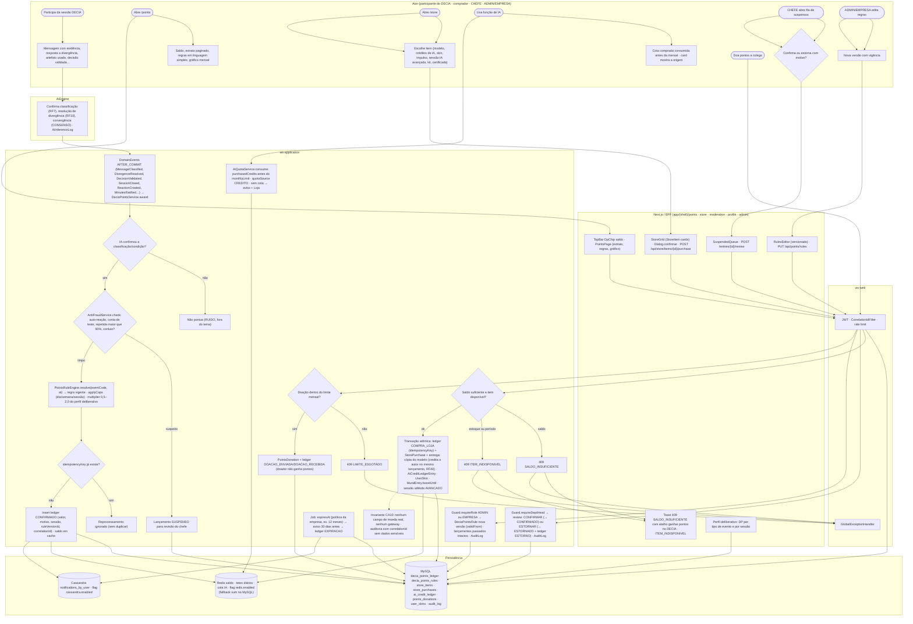
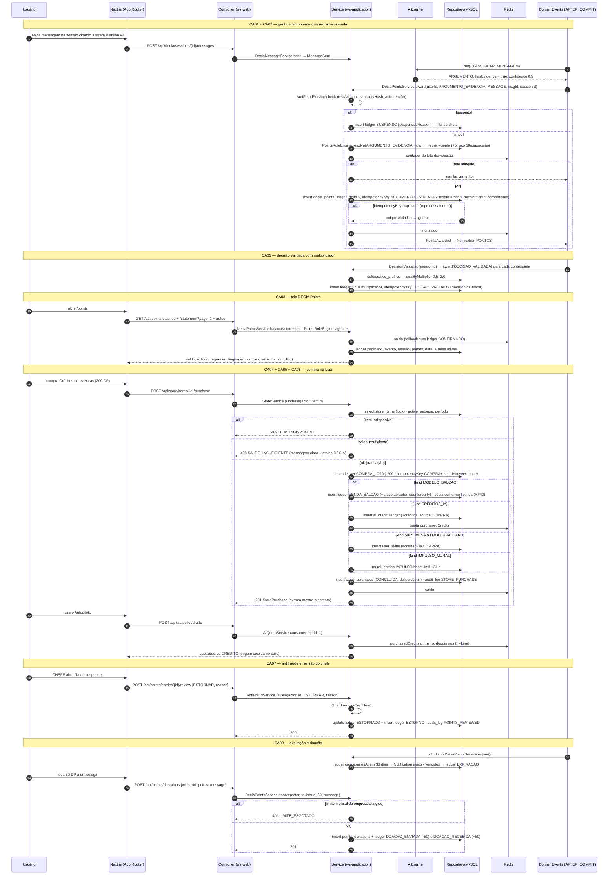
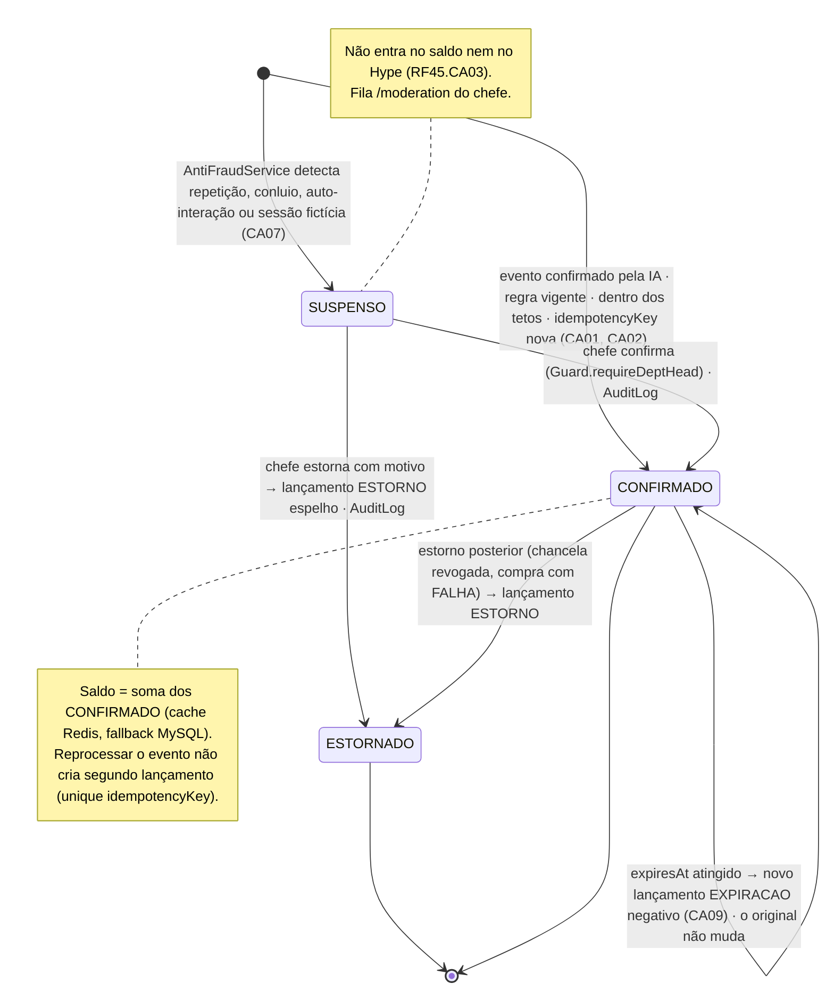
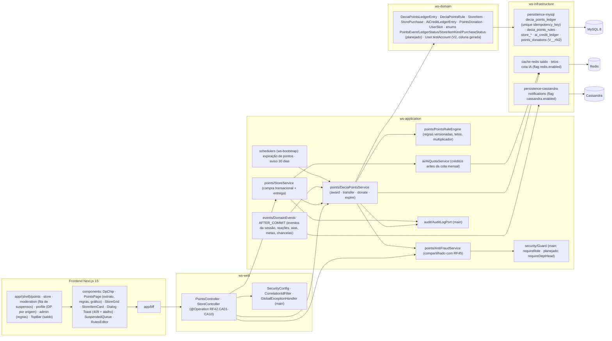

# RF42 — Acumular DECIA Points por participação de qualidade no chat DECIA e usá-los em compras dentro do app (Loja Work AI: modelos do Balcão, créditos de IA, capas/skins, impulsos, kits)
**HU:** HU42 · **Sprint (board Work Station):** Product Backlog (não comprometido na Sprint 4) · **Equivalente FAI:** RF30 FAI Points + RF41 FAI Points em jogos e criações (ledger idempotente, regras em banco, tetos, cupons) · **Aba/rota:** DECIA Points (`/points`: saldo, extrato, regras, gráfico mensal), Loja Work AI (`/store`), extrato por sessão no perfil deliberativo (`/profile?tab=decia-points`), fila de suspensos do chefe (`/moderation`), dashboard (`/admin/dashboard`, `/issuer/dashboard`)
**Critérios de aceite cobertos:** RF42.CA01 · CA02 · CA03 · CA04 · CA05 · CA06 · CA07 · CA08 · CA09 · CA10 (corpo do card, inalterado) — regra: o **título do card** define o RF e o corpo traz os próprios CAs. Proposta de nova redação e economia em `docs/produto/DECIA_POINTS.md` (não adotada aqui; os valores abaixo são os do card).

Os **DECIA Points** são a única moeda (sem dinheiro real, sem gateway, CA10). Ganha-se **só por participar bem no DECIA**: `PointsEvent` ARGUMENTO_EVIDENCIA (+5, teto 10 msgs/dia/sessão) · CONSENSO (+3) · DIVERGENCIA_RESOLVIDA (+8) · PERGUNTA_RESPONDIDA (+4) · ARTEFATO_USADO (+6 ao autor) · DECISAO_VALIDADA (+15 × multiplicador 0,5–2,0 do perfil deliberativo) · PRESENCA_ENCERRADA (+2) · REACAO_QUALIDADE (+2, teto 20/dia) · ATA_RATIFICADA/ENCAMINHAMENTO_CUMPRIDO (+3/+5) · BENEFICIO_BONUS · META_ATINGIDA; não pontuam ruído, auto-reação, sessão de teste (`User.testAccount`), repetidas (`similarityHash` > 90 %). Cada evento confirmado pela IA vira **1 `DeciaPointsLedgerEntry` idempotente** (`idempotencyKey` = tipo + id do evento + usuário, `correlationId`, `ruleVersionId`); regras em `DeciaPointsRule` versionada (ADMIN/EMPRESA, vigência; não altera o passado). Gasto: `StoreItem` (`StoreItemKind`) → `StorePurchase` transacional (409 SALDO_INSUFICIENTE / ITEM_INDISPONIVEL) com entrega (modelo copiado, `AiCreditLedgerEntry`, `UserSkin`, impulso `MuralEntry.boostUntil`); Balcão credita o autor no mesmo lançamento (RF40). Antifraude suspende (`LedgerStatus SUSPENSO`) para o chefe confirmar/estornar; expiração (`expiresAt`, aviso 30 dias) e doação com limite mensal (`PointsDonation`).

## 1. Diagrama de classes

```mermaid
classDiagram
direction LR

namespace ws_domain_points {
  class DeciaPointsLedgerEntry {
    <<entity>>
    +id: UUID
    +userId: UUID
    +delta: int
    +eventCode: PointsEvent
    +refType: String
    +refId: UUID
    +sessionId: UUID
    +ruleVersionId: UUID
    +qualityMultiplier: BigDecimal
    +idempotencyKey: String
    +status: LedgerStatus
    +suspendedReason: String
    +reviewedBy: UUID
    +counterpartyUserId: UUID
    +correlationId: String
    +expiresAt: Instant
    +createdAt: Instant
  }
  class DeciaPointsRule {
    <<entity>>
    +id: UUID
    +eventCode: PointsEvent
    +points: int
    +dailyCap: int
    +weeklyCap: int
    +perSessionCap: int
    +oncePerRef: boolean
    +multiplierSource: String
    +validFrom: Instant
    +validTo: Instant
    +active: boolean
    +editedBy: UUID
  }
  class StoreItem {
    <<entity>>
    +id: UUID
    +kind: StoreItemKind
    +refId: UUID
    +title: String
    +pricePoints: int
    +stock: int
    +availableFrom: Instant
    +availableUntil: Instant
    +companyId: UUID
    +active: boolean
  }
  class StorePurchase {
    <<entity>>
    +id: UUID
    +buyerId: UUID
    +storeItemId: UUID
    +pricePaid: int
    +ledgerEntryId: UUID
    +deliveryJson: JSON
    +status: PurchaseStatus
    +idempotencyKey: String
  }
  class AiCreditLedgerEntry {
    <<entity>>
    +id: UUID
    +userId: UUID
    +departmentId: UUID
    +delta: int
    +source: String
    +refId: UUID
    +expiresAt: Instant
  }
  class PointsDonation {
    <<entity>>
    +id: UUID
    +fromUserId: UUID
    +toUserId: UUID
    +points: int
    +message: String
    +ledgerDebitId: UUID
    +ledgerCreditId: UUID
    +monthKey: String
  }
  class PointsEvent {
    <<enum>>
    ARGUMENTO_EVIDENCIA
    CONSENSO
    DIVERGENCIA_RESOLVIDA
    PERGUNTA_RESPONDIDA
    ARTEFATO_USADO
    DECISAO_VALIDADA
    PRESENCA_ENCERRADA
    REACAO_QUALIDADE
    ATA_RATIFICADA
    ENCAMINHAMENTO_CUMPRIDO
    META_ATINGIDA
    BENEFICIO_BONUS
    COMPRA_LOJA
    VENDA_BALCAO
    DOACAO_ENVIADA
    DOACAO_RECEBIDA
    ESTORNO
    EXPIRACAO
  }
  class LedgerStatus {
    <<enum>>
    CONFIRMADO
    SUSPENSO
    ESTORNADO
  }
  class StoreItemKind {
    <<enum>>
    MODELO_BALCAO
    CREDITOS_IA
    SKIN_MESA
    MOLDURA_CARD
    CAPA_IA_LOTE
    IMPULSO_MURAL
    SESSAO_IA_AVANCADA
    KIT_CHANCELADO
    CERTIFICADO_PERSONALIZADO
  }
  class PurchaseStatus {
    <<enum>>
    CONCLUIDA
    FALHA
    ESTORNADA
  }
}

namespace ws_domain_fontes_destinos {
  class MessageClassification {
    <<entity>>
    +messageId: UUID
    +label: MessageClass
    +hasEvidence: boolean
    +confidence: BigDecimal
  }
  class SessionMessage {
    <<entity>>
    +similarityHash: String
    +authorId: UUID
  }
  class Divergence {
    <<entity>>
    +status: String
    +resolvedByReplyId: UUID
  }
  class FinalDecision {
    <<entity>>
    +status: DecisionStatus
  }
  class DeliberativeProfile {
    <<entity>>
    +clarity: BigDecimal
    +evidenceUse: BigDecimal
    +consistency: BigDecimal
  }
  class User {
    <<entity>>
    +id: UUID
    +testAccount: boolean
    +accountOrigin: AccountOrigin
  }
  class Company {
    <<entity>>
    +pointsPolicyJson: JSON
  }
  class UserSkin {
    <<entity>>
    +skinKey: String
    +acquiredVia: String
    +purchaseId: UUID
  }
  class MuralEntry {
    <<entity>>
    +kind: MuralKind
    +boostUntil: Instant
  }
  class AiQuota {
    <<entity>>
    +purchasedCredits: int
  }
}

namespace ws_application {
  class DeciaPointsService {
    <<service>>
    +award(userId, eventCode, refType, refId, sessionId) DeciaPointsLedgerEntry
    +transfer(buyerId, sellerId, points, refId, key) LedgerPair
    +balance(userId) int
    +statement(userId, page) Page~LedgerView~
    +donate(actor, toUserId, points, message) PointsDonation
    +expire() void
  }
  class PointsRuleEngine {
    <<service>>
    +resolve(eventCode, at) DeciaPointsRule
    +applyCaps(userId, rule, sessionId) boolean
    +multiplier(userId) BigDecimal
  }
  class AntiFraudService {
    <<service>>
    +check(event) Verdict
    +suspend(entry, reason)
    +review(actor, entryId, CONFIRMAR|ESTORNAR, reason)
  }
  class StoreService {
    <<service>>
    +catalog(viewer) List~StoreItem~
    +purchase(actor, itemId) StorePurchase
    -deliver(purchase) DeliveryResult
  }
  class AiQuotaService {
    <<service>>
    +consume(userId, units) QuotaSource
  }
  class Guard {
    <<service>>
    +requireRole(actor, role)
    +requireDeptHead(actor, deptId)
    +requireOwner(actor, ownerId)
  }
  class CachePort {
    <<port>>
    +balance(userId)
    +incr(userId, delta)
  }
  class AuditLogPort {
    <<port>>
    +record(AuditEvent)
  }
  class DomainEvents {
    <<service>>
    +publish(event)
  }
}

namespace ws_web {
  class PointsController {
    <<controller>>
    +GET_api_points_balance()
    +GET_api_points_statement(page)
    +GET_api_points_rules()
    +PUT_api_points_rules(rules)
    +POST_api_points_donations(toUserId, points)
    +GET_api_points_suspended()
    +POST_api_points_entries_id_review(decision, reason)
  }
  class StoreController {
    <<controller>>
    +GET_api_store()
    +POST_api_store_items_id_purchase()
  }
}

namespace ws_infrastructure {
  class RedisBalanceAdapter {
    <<adapter>>
  }
}

DeciaPointsRule "1" o-- "0..*" DeciaPointsLedgerEntry : ruleVersionId
StoreItem "1" o-- "0..*" StorePurchase
StorePurchase "1" --> "1" DeciaPointsLedgerEntry : debito COMPRA_LOJA
StorePurchase ..> AiCreditLedgerEntry : CREDITOS_IA
StorePurchase ..> UserSkin : SKIN_MESA MOLDURA_CARD
StorePurchase ..> MuralEntry : IMPULSO_MURAL boostUntil
AiCreditLedgerEntry ..> AiQuota : purchasedCredits
PointsDonation "1" --> "2" DeciaPointsLedgerEntry : debito e credito
DeciaPointsLedgerEntry "0..1" --> "0..1" DeciaPointsLedgerEntry : counterparty
MessageClassification ..> DeciaPointsService : ARGUMENTO_EVIDENCIA CONSENSO
Divergence ..> DeciaPointsService : DIVERGENCIA_RESOLVIDA
FinalDecision ..> DeciaPointsService : DECISAO_VALIDADA
DeliberativeProfile ..> PointsRuleEngine : qualityMultiplier
SessionMessage ..> AntiFraudService : similarityHash
User ..> AntiFraudService : testAccount nao pontua
Company ..> PointsRuleEngine : pointsPolicyJson tetos expiracao doacao
PointsController --> DeciaPointsService
PointsController --> AntiFraudService
StoreController --> StoreService
DeciaPointsService --> PointsRuleEngine
DeciaPointsService --> AntiFraudService
DeciaPointsService --> CachePort
DeciaPointsService --> AuditLogPort
StoreService --> DeciaPointsService
StoreService --> AiQuotaService
StoreService --> AuditLogPort
AntiFraudService --> Guard
DomainEvents ..> DeciaPointsService : eventos da sessao AFTER_COMMIT
RedisBalanceAdapter ..|> CachePort
```

## 2. Diagrama de atividades

## 3. Diagrama de sequência

## 4. Máquina de estados

Entidade central: `DeciaPointsLedgerEntry.status` (`LedgerStatus`). O ledger é append-only: estorno e expiração são **novos lançamentos** (ESTORNO, EXPIRACAO), nunca UPDATE do valor.

## 5. Diagrama de componentes

## 6. Rastreabilidade

| CA | Classe | Passo | Mensagem | Transição | Componente |
|---|---|---|---|---|---|
| RF42.CA01 | `DeciaPointsService.award`, `DeciaPointsLedgerEntry` (delta, eventCode, sessionId, idempotencyKey, correlationId), `PointsEvent`, unique `idempotencyKey` | A1 → I1 → P1 → P2 → P4 → P6 → P7 → P8/P9 | 1–22 | `[*] → CONFIRMADO` + nota | `DPS`, `DE`, `MY (unique)` |
| RF42.CA02 | `DeciaPointsRule` (points, caps, validFrom/To, editedBy), `PointsRuleEngine.resolve/applyCaps/multiplier`, `ruleVersionId`, `qualityMultiplier` | P6 · A10 → A11 → F5 → P14 | 9–11, 20–22 | — | `PRE`, `RulesEditor` |
| RF42.CA03 | `DeciaPointsService.balance/statement`, `PointsController`, regras vigentes, série mensal, i18n | A2 → A3 → F1 | 23–28 | nota de CONFIRMADO (saldo) | `PointsPage`, `DpChip`, `RD` |
| RF42.CA04 | `StoreService.purchase/deliver` (transação atômica), `StoreItem`, `StorePurchase` (idempotencyKey, deliveryJson), 409 SALDO_INSUFICIENTE / ITEM_INDISPONIVEL | A4 → A5 → F2 → P10 (409) → P11 → F3 | 29–48 | — | `SS`, `StoreGrid`, `Toast` |
| RF42.CA05 | `DeciaPointsService.transfer` (COMPRA_LOJA + VENDA_BALCAO, `counterpartyUserId`), licença RF40 | P11 (MODELO_BALCAO) | 38–39 | — | `DPS` |
| RF42.CA06 | `AiCreditLedgerEntry`, `AiQuota.purchasedCredits`, `AiQuotaService.consume`, `quotaSource CREDITO`, aviso + Loja | A6 → A7 → P12 | 40–41, 49–53 | — | `AQ`, `RD` |
| RF42.CA07 | `AntiFraudService.check/suspend/review`, `LedgerStatus SUSPENSO/ESTORNADO`, `User.testAccount`, `SessionMessage.similarityHash`, `Guard.requireDeptHead`, `AuditLog` | P4 → P5 · A8 → A9 → F4 → P13 | 7–8, 54–59 | `[*] → SUSPENSO → CONFIRMADO / ESTORNADO` | `AF`, `SuspendedQueue`, `AUD` |
| RF42.CA08 | extrato por tipo de evento e por sessão no perfil deliberativo (RF19/RF43), pontos por departamento e custo de IA no dashboard (RF18/RF28) | F6 | 26–28 | — | `R1 profile`, `admin/issuer dashboard` |
| RF42.CA09 | `DeciaPointsLedgerEntry.expiresAt`, `DeciaPointsService.expire/donate`, `PointsDonation` (monthKey, limite), `Company.pointsPolicyJson`, lançamento EXPIRACAO | P15 · A12 → P16 (409) → P17 | 60–67 | `CONFIRMADO → self (EXPIRACAO)` | `SCH`, `DPS` |
| RF42.CA10 | invariante sem moeda real/gateway; `AuditLog` com `correlationId` e `metadataJson` sanitizado em todo lançamento | P18 | 20, 46, 58 | append-only (estorno e expiração são lançamentos) | `AUD`, `MY` |
