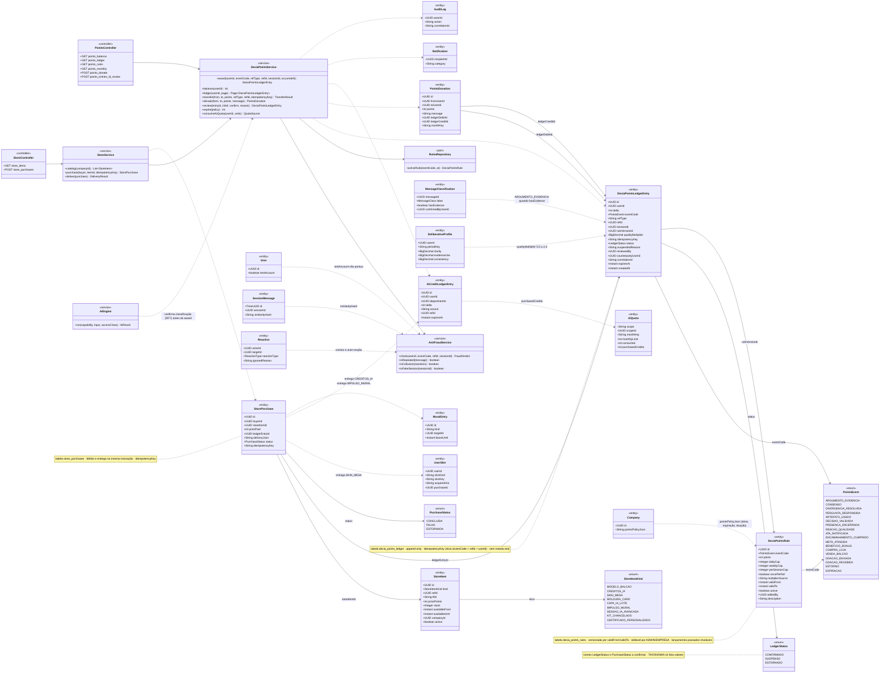
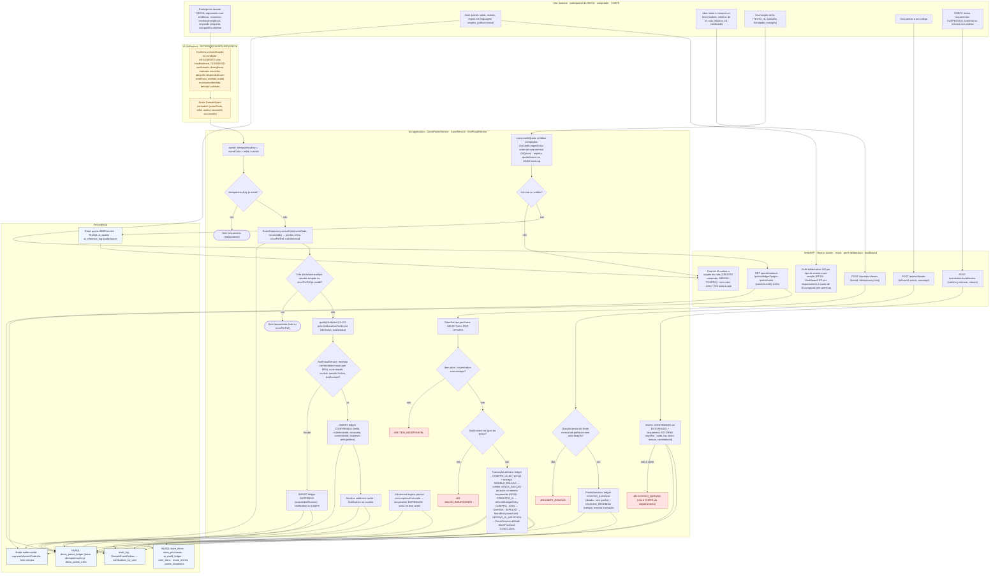
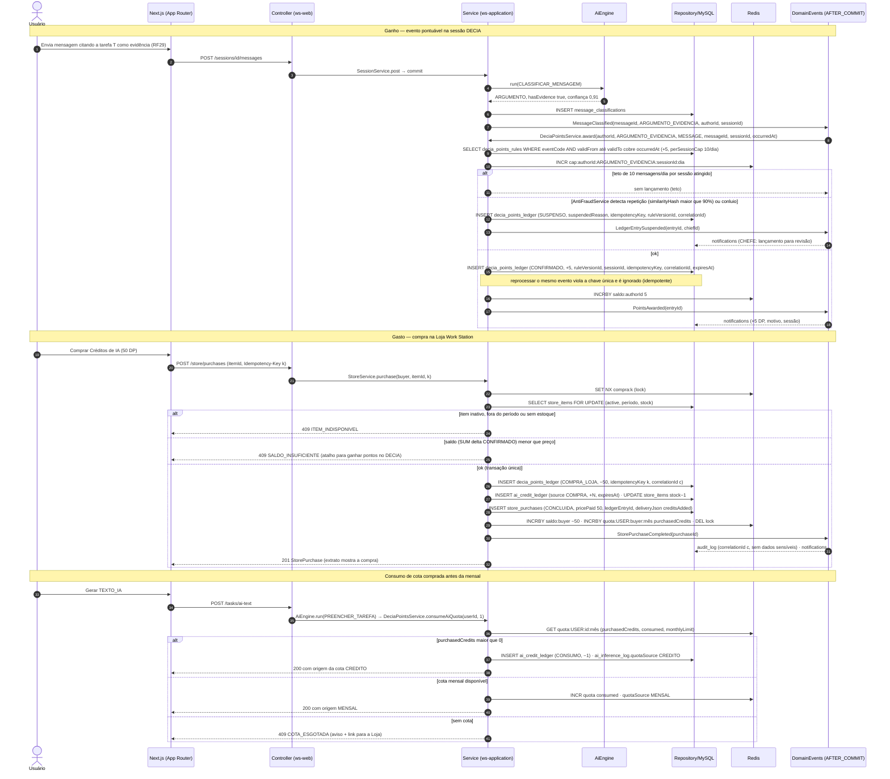
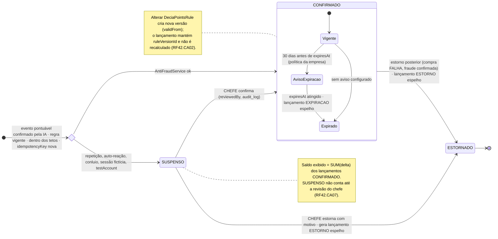
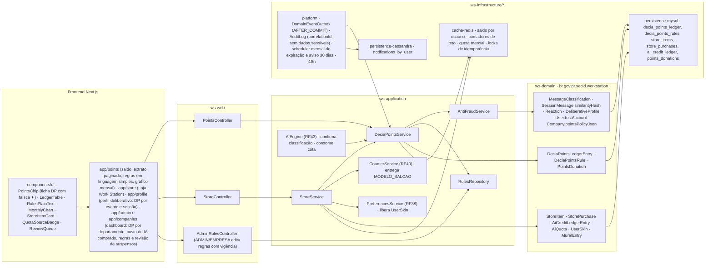

# RF42 — Acumular DECIA Points por participação de qualidade no chat DECIA e usá-los em compras dentro do app (Loja Work Station: modelos do Balcão, créditos de IA, capas/skins, impulsos, kits)
**HU:** HU42 · **Sprint (board Work Station):** Product Backlog (não priorizado — pós-Sprint 4) · **Equivalente FAI:** RF30 FAI Points + RF41 FAI Points em jogos e criações (ledger idempotente, regras em banco, tetos, cupons) · **Aba/rota:** DECIA Points (`/points`: saldo, extrato, regras), Loja Work Station (`/store`)
**Critérios de aceite cobertos:** RF42.CA01 · RF42.CA02 · RF42.CA03 · RF42.CA04 · RF42.CA05 · RF42.CA06 · RF42.CA07 · RF42.CA08 · RF42.CA09 · RF42.CA10

> Contexto Balcão & Loja & DECIA Points (bounded context 7). Entidade central: `DeciaPointsLedgerEntry` (status CONFIRMADO | SUSPENSO | ESTORNADO), **append-only e idempotente** (`idempotencyKey = eventCode + refId + userId`). Regras vêm de `DeciaPointsRule` versionada com vigência; o lançamento guarda `ruleVersionId`, logo alterar a regra não altera o passado. Gastos passam por `StoreService` (débito atômico + entrega) e `AiCreditLedgerEntry` (cota comprada consumida antes da mensal). `AntiFraudService` suspende lançamentos para revisão do chefe. Nenhum campo de moeda real (RF42.CA10).

## 1. Diagrama de classes

## 2. Diagrama de atividades

## 3. Diagrama de sequência

## 4. Máquina de estados

Entidade central: `DeciaPointsLedgerEntry.status`. O ledger é append-only: expiração e estorno não alteram o lançamento original, geram lançamentos espelho (`EXPIRACAO`, `ESTORNO`).

## 5. Diagrama de componentes

## 6. Rastreabilidade

| CA | Elemento do diagrama (classe / passo / mensagem / transição / componente) |
|---|---|
| RF42.CA01 | Classes `DeciaPointsLedgerEntry` (idempotencyKey, delta, eventCode, sessionId, correlationId), `DeciaPointsService.award`, `AiEngine` (confirma classificação), enum `PointsEvent`; atividades I1, I2, S1, S2 → X1 (idempotente), S7; sequência msgs 1–9 e 15–18 (chave única, reprocessar não duplica); transição `[*] → fraud → CONFIRMADO`; componentes `DomainEventOutbox (AFTER_COMMIT)`. |
| RF42.CA02 | Classes `DeciaPointsRule` (points, dailyCap, weeklyCap, perSessionCap, oncePerRef, validFrom/validTo, editedBy), `DeciaPointsLedgerEntry.ruleVersionId/qualityMultiplier`, `RulesRepository.activeRule`, `DeliberativeProfile`; atividades S3, S4 → X2, S5; sequência msgs 9–11 (regra vigente em occurredAt, teto); nota da máquina de estados (nova versão não recalcula); componentes `AdminRulesController`, `RulesRepository`. |
| RF42.CA03 | Classes `DeciaPointsService.balance/ledger`, `PointsController` (balance, ledger, rules, monthly); atividades U2, W1 (i18n); componentes `app/points`, `LedgerTable`, `RulesPlainText`, `MonthlyChart`, `platform · i18n`. |
| RF42.CA04 | Classes `StoreItem`, `StorePurchase` (pricePaid, ledgerEntryId, deliveryJson, status, idempotencyKey), `StoreService.purchase/deliver`, enums `StoreItemKind`, `PurchaseStatus`; atividades U3, W2, S10, S11 → E2 (409 ITEM_INDISPONIVEL), S12 → E1 (409 SALDO_INSUFICIENTE), S13 (transação atômica + entrega); sequência msgs 19–32; componentes `StoreController`, `StoreItemCard`, `cache-redis · locks`. |
| RF42.CA05 | Classes `DeciaPointsService.transfer`, `DeciaPointsLedgerEntry.counterpartyUserId`, `CounterService`; atividade S13 (MODELO_BALCAO → crédito VENDA_BALCAO ao autor no mesmo lançamento, respeitando a licença); componente `CounterService (RF40) · entrega MODELO_BALCAO`. Detalhe da transferência no RF40 §3. |
| RF42.CA06 | Classes `AiCreditLedgerEntry` (source COMPRA/CONSUMO), `AiQuota.purchasedCredits/consumed/monthlyLimit`, `DeciaPointsService.consumeAiQuota`; atividades U4, S14, S15, W6 (origem da cota, aviso + Loja); sequência msgs 33–41 (crédito antes da mensal, 409 COTA_ESGOTADA); componentes `QuotaSourceBadge`, `AiEngine · consome cota`, `cache-redis · quota mensal`. |
| RF42.CA07 | Classes `AntiFraudService` (isRepeated, isCollusion, isFakeSession), `DeciaPointsLedgerEntry.status/suspendedReason/reviewedBy`, `SessionMessage.similarityHash`, `Reaction.ignoredReason`, `User.testAccount`, `DeciaPointsService.review`; atividades S6 → S8, U6, W4, S18 → E4; sequência msgs 12–14; estados `SUSPENSO → CONFIRMADO / ESTORNADO` e nota do saldo; componente `ReviewQueue`. |
| RF42.CA08 | Classes `DeciaPointsLedgerEntry.eventCode/sessionId`, `DeliberativeProfile`, `AiCreditLedgerEntry.departmentId`; atividade W5 (perfil deliberativo por evento/sessão, dashboard por departamento e custo de IA); componentes `app/profile`, `app/admin e app/companies`. |
| RF42.CA09 | Classes `Company.pointsPolicyJson`, `DeciaPointsLedgerEntry.expiresAt`, `PointsDonation` (monthKey, ledgerDebitId, ledgerCreditId), `DeciaPointsService.expire/donate`, eventos `EXPIRACAO`, `DOACAO_ENVIADA`, `DOACAO_RECEBIDA`; atividades U5, W3, S16 → E3 (409 LIMITE_DOACAO), S17 (doador sem ganho), S19 (job mensal, aviso 30 dias); estado composto `CONFIRMADO` (Vigente → AvisoExpiracao → Expirado); componente `scheduler mensal de expiração`. |
| RF42.CA10 | Nota da classe `DeciaPointsLedgerEntry` (sem moeda real), `AuditLog.correlationId`; atividade D5 e S18 (audit_log); sequência msg 31 (audit_log correlationId, sem dados sensíveis); componente `platform · AuditLog` — nenhum componente de gateway ou campo monetário em qualquer diagrama. |
