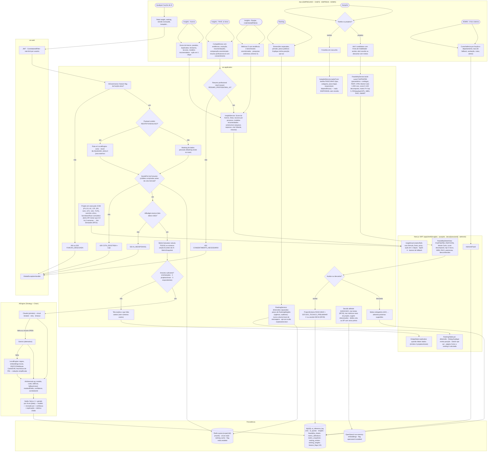
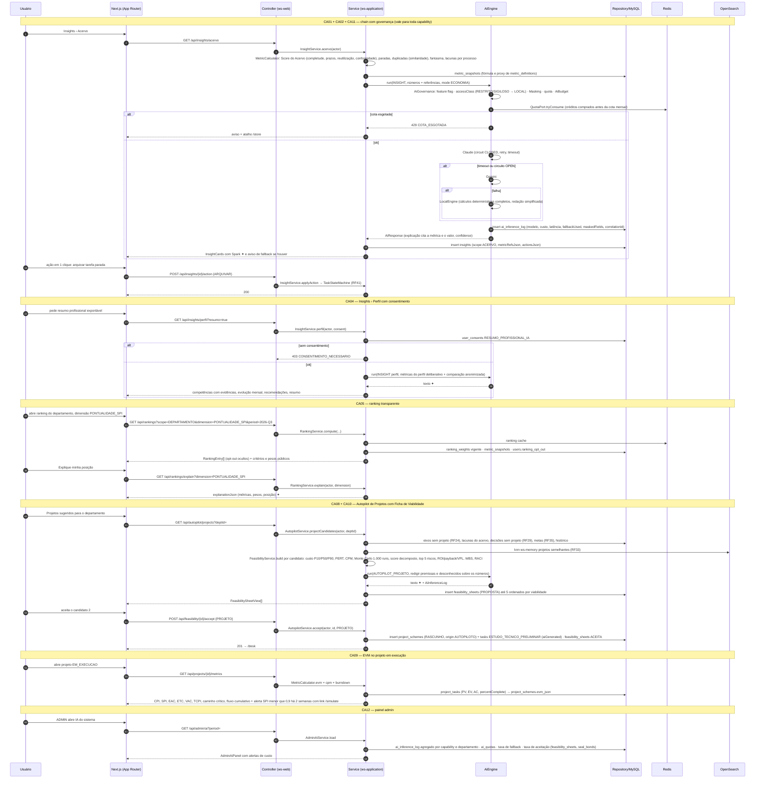
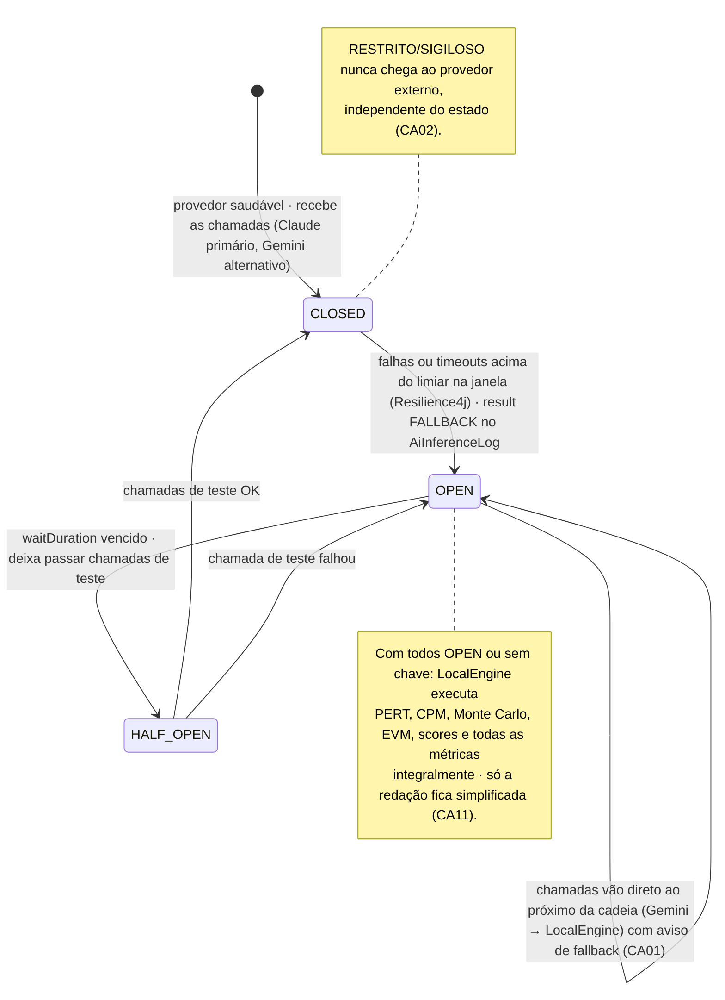
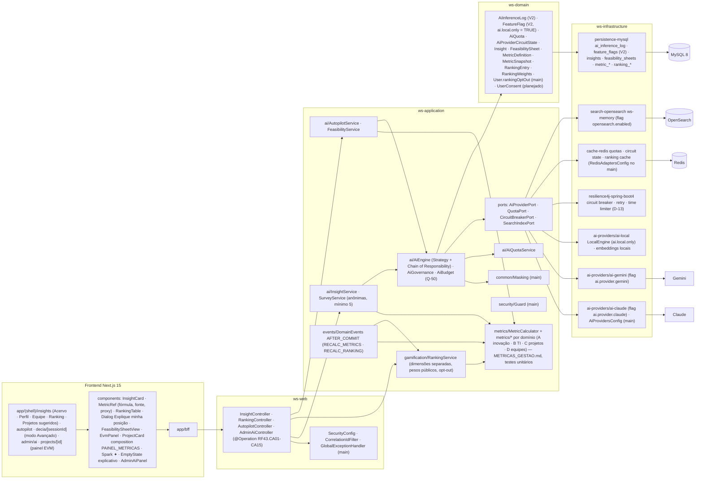

# RF43 — Usar a IA do sistema — insights do Acervo e do Perfil, ranking de usuários, motor do DECIA e Autopilot para criar tarefas e sugerir novos projetos com custo, tempo, prazo e viabilidade (EVM, CPM, PERT, Monte Carlo, ROI, matriz de risco)
**HU:** HU43 · **Sprint (board Work Station):** Product Backlog (não comprometido na Sprint 4; o `AiEngine` é base de todo RF com IA) · **Equivalente FAI:** RF24 Usar a IA do sistema (Strategy + Chain of Responsibility, `ai_inference_log`, circuit breaker, fallback) + Copilot (RF10) + Inventory Score (RF29) + Hype Score · **Aba/rota:** Insights (`/insights`: Acervo · Perfil · Equipe · Ranking · Projetos sugeridos), Autopilot (`/autopilot`, estende RF30), sessão em modo Avançado (`/decia/[sessionId]`), painel admin **IA do sistema** (`/admin/ai`, RF18), página "Como o ranking é calculado"
**Critérios de aceite cobertos:** RF43.CA01 · CA02 · CA03 · CA04 · CA05 · CA06 · CA07 · CA08 · CA09 · CA10 · CA11 · CA12 · CA13 · CA14 · CA15 (corpo do card, inalterado) — regra: o **título do card** define o RF e o corpo traz os próprios CAs.

**Motor** (`AiEngine`, ARQUITETURA §3.1): `AiRequest(capability, hostRf, userId, deptId, accessClass, payload, mode)` → governança (feature flag por função, `AccessClassification` RESTRITO/SIGILOSO só `LocalEngine`, `Masking` de dados pessoais — existe no main —, `AiQuota` em Redis, `AiBudget` teto diário Q-50, consentimento) → Claude (primário) → Gemini (alternativo) → `LocalEngine` (regras, embeddings locais, PERT/CPM/Monte Carlo/EVM); circuit breaker + retry + timeout (Resilience4j, `AiProviderCircuitState`); **sempre** `AiInferenceLog` (`ai_inference_log` já existe no V2). **Regra de ouro (D-12):** a IA só **interpreta números calculados pelo sistema** — `MetricCalculator` + `MetricDefinition` (catálogo §8 em `docs/arquitetura/METRICAS_GESTAO.md`: fórmula, fonte, proxy, `minSamples`) → `MetricSnapshot` → `Insight` (ACERVO · PERFIL · EQUIPE · PROJETO, `metricRefsJson`, `actionsJson`), `RankingEntry` (dimensões separadas, `RankingWeights` públicos, `rankingOptOut`, "Explique minha posição"), `FeasibilitySheet` (custo P10/P50/P90, PERT/CPM, Monte Carlo 1.000 execuções, score decomposto, top 5 riscos, WBS, RACI, premissas e desconhecidos). Nada vira decisão, chancela, ranking oficial ou projeto sem confirmação humana.

## 1. Diagrama de classes

```mermaid
classDiagram
direction LR

namespace ws_application_ai {
  class AiEngine {
    <<service>>
    +run(AiRequest) AiResponse
    -govern(AiRequest) Route
    -chain(primary, secondary, local)
  }
  class AiRequest {
    <<service>>
    +capability: AiCapability
    +hostRf: String
    +userId: UUID
    +departmentId: UUID
    +accessClass: AccessClassification
    +payload: JSON
    +mode: AiMode
  }
  class AiResponse {
    <<service>>
    +output: JSON
    +explanation: String
    +confidence: BigDecimal
    +citations: List~Citation~
    +fallbackUsed: boolean
    +inferenceId: UUID
  }
  class AiGovernance {
    <<service>>
    +featureFlag(capability)
    +accessClassRoute(accessClass)
    +mask(payload) MaskedPayload
    +quota(userId, deptId) QuotaSource
    +budget(estimatedUsd)
    +consent(userId, purpose)
  }
  class AiBudget {
    <<service>>
    +reserve(estimatedUsd) boolean
  }
  class AiProviderPort {
    <<port>>
    +complete(prompt, model, timeout)
    +embed(text)
  }
  class QuotaPort {
    <<port>>
    +tryConsume(scope, id, units)
  }
  class CircuitBreakerPort {
    <<port>>
    +state(provider) CircuitState
  }
  class MetricCalculator {
    <<service>>
    +compute(metricCode, scope, scopeId, period) MetricSnapshot
    +evm(project) EvmValues
    +pert(tasks) PertValues
    +cpm(tasks, deps) CriticalPath
    +monteCarlo(project, runs) Probability
    +riskMatrix(project) RiskExposure
    +roi(costs, benefits) RoiValues
    +littlesLaw(wip, throughput) CycleTime
  }
  class InsightService {
    <<service>>
    +acervo(actor) List~Insight~
    +perfil(actor, consent) List~Insight~
    +equipe(actor, deptId) List~Insight~
    +applyAction(actor, insightId, action)
  }
  class RankingService {
    <<service>>
    +compute(scope, scopeId, period) List~RankingEntry~
    +explain(actor, dimension) Explanation
    +optOut(actor, boolean)
    +updateWeights(actor, RankingWeightsForm) RankingWeights
  }
  class AutopilotService {
    <<service>>
    +tasksFrom(actor, source) List~TaskDraft~
    +projectCandidates(actor, deptId) List~FeasibilitySheet~
    +accept(actor, sheetId, target) AcceptResult
    +discard(actor, sheetId, reason)
  }
  class FeasibilityService {
    <<service>>
    +build(candidate) FeasibilitySheet
  }
  class SurveyService {
    <<service>>
    +psychSafety(deptId, period) Result
    +healthCheck(deptId, quarter) Result
    +enps(deptId, period) Result
    -minRespondents 5
  }
}

namespace ws_domain_ia {
  class AiInferenceLog {
    <<entity>>
    +id: UUID
    +userId: UUID
    +departmentId: UUID
    +capability: AiCapability
    +hostRf: String
    +provider: AiProvider
    +model: String
    +mode: AiMode
    +latencyMs: int
    +inputTokens: int
    +outputTokens: int
    +estimatedCostUsd: BigDecimal
    +result: InferenceResult
    +fallbackUsed: boolean
    +maskedFieldsJson: JSON
    +confidence: BigDecimal
    +reviewedBy: UUID
    +quotaSource: String
    +correlationId: String
  }
  class AiQuota {
    <<entity>>
    +scope: String
    +scopeId: UUID
    +monthKey: String
    +monthlyLimit: int
    +consumed: int
    +purchasedCredits: int
  }
  class AiProviderCircuitState {
    <<entity>>
    +provider: AiProvider
    +state: CircuitState
    +failures: int
    +openedAt: Instant
  }
  class Insight {
    <<entity>>
    +id: UUID
    +scope: InsightScope
    +scopeId: UUID
    +kind: String
    +title: String
    +bodyMd: String
    +metricRefsJson: JSON
    +actionsJson: JSON
    +severity: String
    +aiInferenceId: UUID
    +dismissedAt: Instant
  }
  class FeasibilitySheet {
    <<entity>>
    +id: UUID
    +candidateTitle: String
    +demandRef: String
    +costJson: JSON
    +timeJson: JSON
    +deadlineJson: JSON
    +viabilityScoreJson: JSON
    +risksJson: JSON
    +wbsJson: JSON
    +raciJson: JSON
    +assumptionsJson: JSON
    +unknownsJson: JSON
    +status: SheetStatus
    +discardReason: String
    +resultingProjectId: UUID
    +resultingTaskId: UUID
  }
  class MetricDefinition {
    <<entity>>
    +code: String
    +domain: MetricDomain
    +name: String
    +formula: String
    +sourceDescription: String
    +proxyNote: String
    +unit: String
    +minSamples: int
  }
  class MetricSnapshot {
    <<entity>>
    +metricCode: String
    +scope: MetricScope
    +scopeId: UUID
    +periodStart: LocalDate
    +periodEnd: LocalDate
    +value: BigDecimal
    +valuesJson: JSON
  }
  class RankingEntry {
    <<entity>>
    +scope: String
    +scopeId: UUID
    +periodKey: String
    +dimension: RankingDimension
    +userId: UUID
    +value: BigDecimal
    +position: int
    +explanationJson: JSON
  }
  class RankingWeights {
    <<entity>>
    +companyId: UUID
    +version: int
    +weightsJson: JSON
    +criteriaPublicText: String
    +validFrom: Instant
    +editedBy: UUID
  }
  class AiCapability {
    <<enum>>
    CLASSIFICAR_MENSAGEM
    RESUMO_ANALITICO
    AUTOPILOT_PROJETO
    AUTOPILOT_TAREFAS
    SIMULAR_CENARIO
    CONFORMIDADE
    MEMORIA_BUSCA
    INSIGHT
    TAREFA_DO_DIA
    HSE
    HYPE_PERFIL
    DOSSIE
    THUMBNAIL
    CAPA_IA
  }
  class AiProvider {
    <<enum>>
    CLAUDE
    GEMINI
    LOCAL
  }
  class InferenceResult {
    <<enum>>
    OK
    FALLBACK
    ERRO
    BLOQUEADO_SIGILO
  }
  class CircuitState {
    <<enum>>
    CLOSED
    OPEN
    HALF_OPEN
  }
  class RankingDimension {
    <<enum>>
    QUALIDADE_DELIBERATIVA
    DECIA_POINTS
    REUTILIZACAO
    RASTRO_CONFORMIDADE
    PONTUALIDADE_SPI
    HSE_MEDIO
    HYPE_PERFIL
  }
  class MetricDomain {
    <<enum>>
    INOVACAO
    TI
    PROJETOS
    EQUIPES
    DECIA
    PONTOS
  }
}

namespace ws_domain_contexto {
  class User {
    <<entity>>
    +id: UUID
    +rankingOptOut: boolean
    +hypeVisibility: HypeVisibility
  }
  class UserConsent {
    <<entity>>
    +purpose: ConsentPurpose
    +granted: boolean
  }
  class TaskItem {
    <<entity>>
    +accessClass: AccessClassification
    +state: TaskState
  }
  class ProjectScheme {
    <<entity>>
    +evmJson: JSON
    +criticalPathJson: JSON
    +status: ProjectStatus
  }
  class DeciaSession {
    <<entity>>
    +aiMode: AiMode
  }
  class FeatureFlag {
    <<entity>>
    +flagKey: String
    +enabled: boolean
    +scope: String
  }
}

namespace ws_web {
  class InsightController {
    <<controller>>
    +GET_api_insights_acervo()
    +GET_api_insights_perfil()
    +GET_api_insights_equipe(deptId)
    +POST_api_insights_id_action(code)
  }
  class RankingController {
    <<controller>>
    +GET_api_rankings(scope, dimension, period)
    +GET_api_rankings_explain(dimension)
    +POST_api_me_ranking_opt_out(value)
    +PUT_api_rankings_weights(form)
  }
  class AutopilotController {
    <<controller>>
    +POST_api_autopilot_tasks(source)
    +GET_api_autopilot_projects(deptId)
    +POST_api_feasibility_id_accept(target)
    +POST_api_feasibility_id_discard(reason)
  }
  class AdminAiController {
    <<controller>>
    +GET_api_admin_ai(period, deptId)
  }
}

namespace ws_infrastructure {
  class ClaudeProvider {
    <<adapter>>
  }
  class GeminiProvider {
    <<adapter>>
  }
  class LocalEngine {
    <<adapter>>
  }
  class RedisQuotaAdapter {
    <<adapter>>
  }
  class Resilience4jCircuit {
    <<adapter>>
  }
}

AiEngine --> AiRequest
AiEngine --> AiResponse
AiEngine --> AiGovernance
AiGovernance --> AiBudget
AiGovernance --> QuotaPort
AiGovernance ..> FeatureFlag
AiGovernance ..> UserConsent
AiEngine --> AiProviderPort
AiEngine --> CircuitBreakerPort
AiEngine ..> AiInferenceLog : grava sempre
QuotaPort ..> AiQuota
CircuitBreakerPort ..> AiProviderCircuitState
InsightService --> MetricCalculator
InsightService --> AiEngine
InsightService ..> Insight
InsightService --> SurveyService
RankingService --> MetricCalculator
RankingService ..> RankingEntry
RankingService ..> RankingWeights
RankingService ..> User : rankingOptOut
AutopilotService --> FeasibilityService
AutopilotService --> AiEngine
FeasibilityService --> MetricCalculator
FeasibilityService ..> FeasibilitySheet
MetricCalculator ..> MetricDefinition
MetricCalculator ..> MetricSnapshot
MetricCalculator ..> ProjectScheme : evmJson criticalPathJson
TaskItem ..> AiGovernance : RESTRITO SIGILOSO so LOCAL
DeciaSession ..> AiEngine : aiMode AVANCADO
InsightController --> InsightService
RankingController --> RankingService
AutopilotController --> AutopilotService
AdminAiController ..> AiInferenceLog : custo latencia fallback aceitacao
ClaudeProvider ..|> AiProviderPort
GeminiProvider ..|> AiProviderPort
LocalEngine ..|> AiProviderPort
RedisQuotaAdapter ..|> QuotaPort
Resilience4jCircuit ..|> CircuitBreakerPort
```

## 2. Diagrama de atividades

## 3. Diagrama de sequência

## 4. Máquina de estados

Entidade central: `AiProviderCircuitState.state` (`CircuitState`) do circuit breaker por provedor — decide a cadeia primário → alternativo → local. A `FeasibilitySheet` (PROPOSTA · ACEITA · DESCARTADA) está no RF26 §4.

## 5. Diagrama de componentes

## 6. Rastreabilidade

| CA | Classe | Passo | Mensagem | Transição | Componente |
|---|---|---|---|---|---|
| RF43.CA01 | `AiEngine.chain`, `CircuitBreakerPort`, `AiProviderCircuitState`, `AiInferenceLog` (model, cost, latency, fallbackUsed, correlationId), aviso de fallback | I1 → I2 → I3 → I4 | 11–18 | toda a máquina | `AIE`, `R4J`, `AIC/AIG/AIL` |
| RF43.CA02 | `AiGovernance.accessClassRoute/mask`, `Masking` (main), `InferenceResult BLOQUEADO_SIGILO`, `maskedFieldsJson` | G2 → G3/G4 | 8 | nota de CLOSED | `MSK`, `AIL` |
| RF43.CA03 | `InsightService.acervo/applyAction`, `Insight scope ACERVO` (Score, paradas, duplicadas, fantasma, lacunas, modelos recomendados, `actionsJson`), `MetricCalculator` | A2 → A3 → G7 → G10 → F1 | 1–25 | — | `INS`, `MC`, `InsightCard`, `MetricRef` |
| RF43.CA04 | `InsightService.perfil`, `UserConsent RESUMO_PROFISSIONAL_IA` (403 CONSENTIMENTO_NECESSARIO), comparação anonimizada, `DeliberativeProfile` | A4 → A5 → G11 → G10 | 26–34 | — | `INS`, `R1 insights/perfil` |
| RF43.CA05 | `RankingService.compute/explain/optOut/updateWeights`, `RankingEntry.dimension/explanationJson`, `RankingWeights` (vigência, `editedBy`), `User.rankingOptOut` (main), nunca volume bruto | A8 → A9 → G12 → F2 | 35–43 | — | `RK`, `RankingTable`, `RD` |
| RF43.CA06 | `DeciaSession.aiMode AVANCADO`, `CitationService` (RF33), métricas reais do projeto na sessão, débito de cota/DP com aviso | G19 | — (RF8/RF11/RF16 em modo AVANCADO) | — | `AIE`, `OSA`, `AQ` |
| RF43.CA07 | `AutopilotService.tasksFrom`, `TaskItem RASCUNHO` (tipo, categoria, prazo legal, responsável, dependências), nada DISPONIVEL sem revisão (RF4) | A10 → A11 → A12 → G13 | — (RF26 §3) | — | `AP` |
| RF43.CA08 | `AutopilotService.projectCandidates`, `FeasibilityService.build`, `FeasibilitySheet` (costJson P10/P50/P90, timeJson PERT/CPM, deadlineJson Monte Carlo 1.000, viabilityScoreJson, risksJson top 5, wbsJson, raciJson, assumptionsJson, unknownsJson), até 5 por viabilidade | A13 → G14 → F3 | 44–52 | — (RF26 §4 PROPOSTA) | `AP`, `MC`, `FeasibilitySheetView` |
| RF43.CA09 | `MetricCalculator.evm/cpm`, `ProjectScheme.evmJson/criticalPathJson`, burndown/fluxo cumulativo, alerta SPI → RF31 | G18 | 58–62 | — | `MC`, `EvmPanel`, `PAINEL_METRICAS` |
| RF43.CA10 | `AutopilotService.accept/discard`, `ProjectScheme RASCUNHO origin AUTOPILOTO`, `TaskType ESTUDO_TECNICO_PRELIMINAR`, `FeasibilitySheet.discardReason`, sessão DECIA (RF29) | G15 → G16/G17 | 53–57 | `PROPOSTA → ACEITA / DESCARTADA` (RF26 §4) | `AP` |
| RF43.CA11 | `LocalEngine` executa PERT, CPM, Monte Carlo, EVM, scores e métricas integralmente; só redação simplificada | I3 · G7 | 15–16 | nota de OPEN | `AIL`, `MC` |
| RF43.CA12 | `AdminAiController`, agregados de `AiInferenceLog` por capability/departamento, taxa de fallback, taxa de aceitação, `AiQuota`, alertas de custo | A14 → A15 → F5 | 63–67 | — | `AdminAiPanel`, `MY` |
| RF43.CA13 | `MetricDefinition` (code, formula, sourceDescription, proxyNote, minSamples), `MetricCalculator` por domínio com testes unitários, `METRICAS_GESTAO.md`, IA cita a métrica | G7 | 4–5 | — | `MC`, `MY (metric_definitions)` |
| RF43.CA14 | `InsightService.equipe`, `Insight scope EQUIPE` (carga, gargalos, segurança psicológica, rede, bus factor, eNPS), `SurveyService` (anônimas, mínimo 5), benchmarks anonimizados, `Guard.requireDeptHead/requireRole EMPRESA` | A6 → A7 → G8 → G10 | — (GET /insights/equipe) | — | `INS`, `SurveyService`, `GD` |
| RF43.CA15 | `MetricDefinition.minSamples`, mínimo 3 projetos/sinais para domínios A e B, `EmptyState` explicativo | G8 → G9 → F4 | — | — | `F4 EmptyState`, `MC` |
