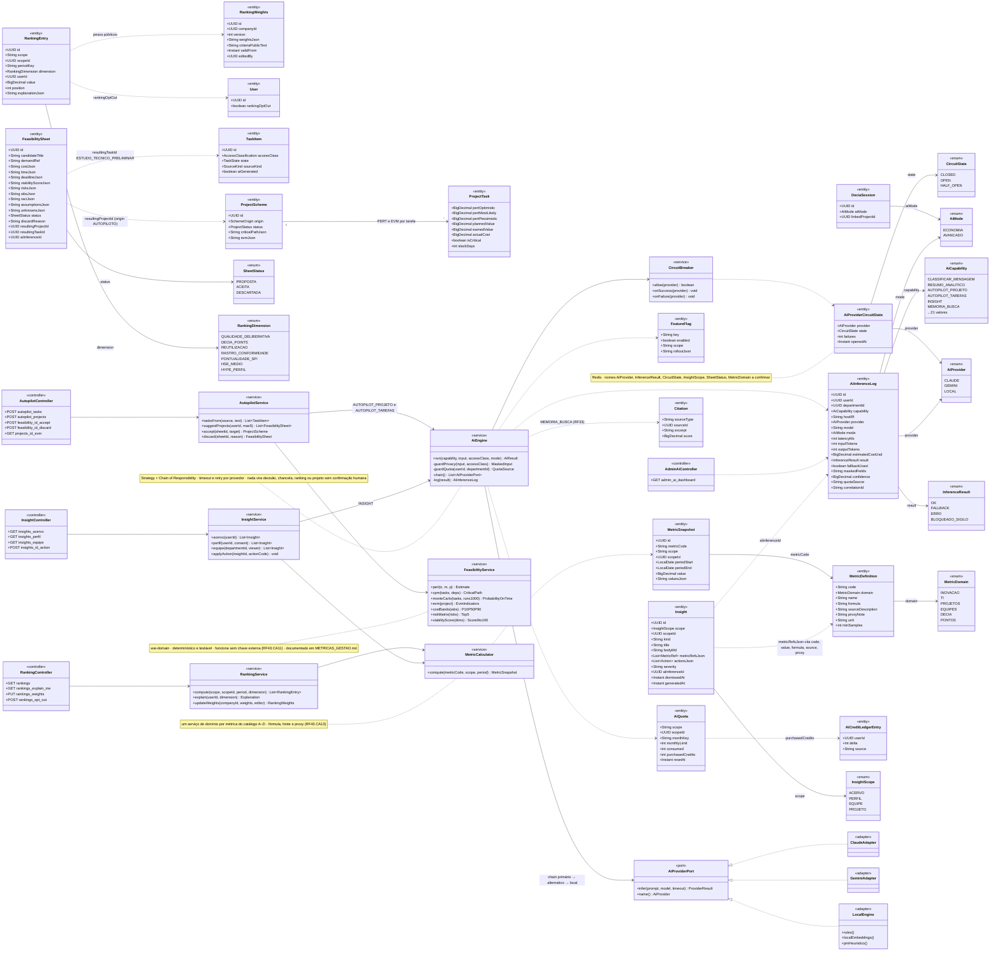
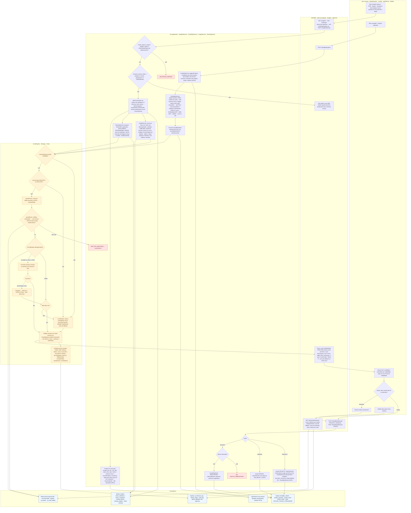
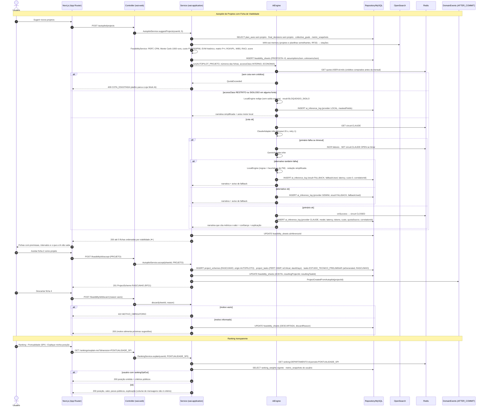
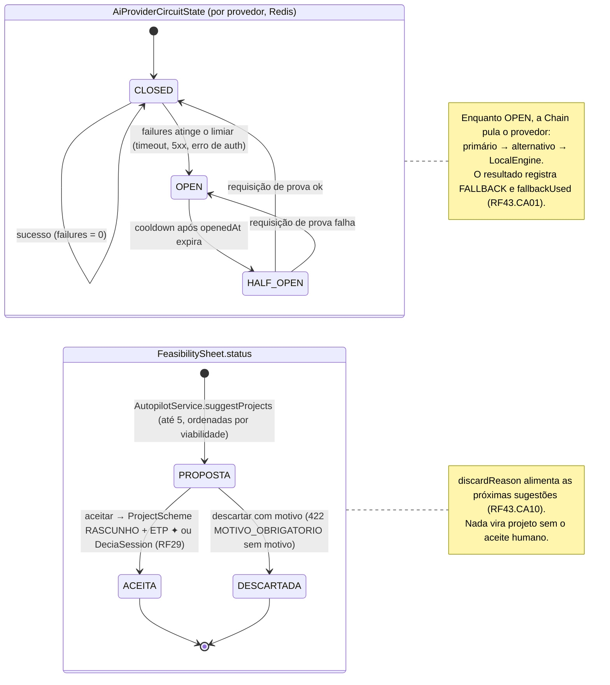
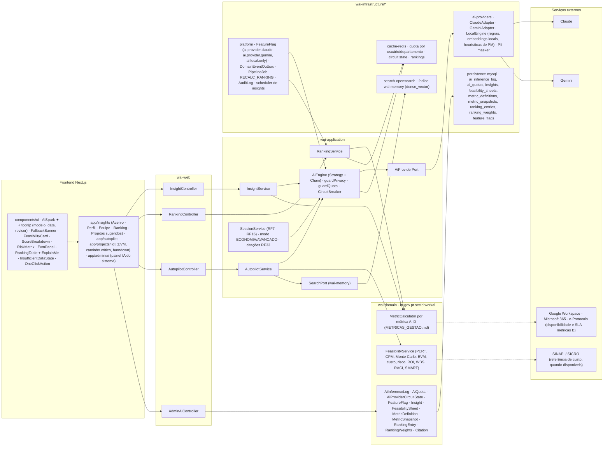

# RF43 — Usar a IA do sistema — insights do Acervo e do Perfil, ranking de usuários, motor do DECIA e Autopilot para criar tarefas e sugerir novos projetos com custo, tempo, prazo e viabilidade (EVM, CPM, PERT, Monte Carlo, ROI, matriz de risco)
**HU:** HU43 · **Sprint (board Work Station):** Product Backlog (não priorizado — pós-Sprint 4) · **Equivalente FAI:** RF24 Usar a IA do sistema (Strategy + Chain of Responsibility primário → alternativa → motor local, `ai_inference_log`, circuit breaker, fallback) + sugestões do Copilot (RF10) + Inventory Score (RF29) + Hype Score · **Aba/rota:** Insights (`/insights`: Acervo · Perfil · Equipe · Ranking · Projetos sugeridos), Autopilot (`/autopilot`, estende o RF30), painel "IA do sistema" no admin (RF18)
**Critérios de aceite cobertos:** RF43.CA01 · RF43.CA02 · RF43.CA03 · RF43.CA04 · RF43.CA05 · RF43.CA06 · RF43.CA07 · RF43.CA08 · RF43.CA09 · RF43.CA10 · RF43.CA11 · RF43.CA12 · RF43.CA13 · RF43.CA14 · RF43.CA15

> Contexto IA do sistema (bounded context 10). Núcleo: `AiEngine` (Strategy + Chain of Responsibility: `ClaudeAdapter` → `GeminiAdapter` → `LocalEngine`) com `AiProviderCircuitState` (CLOSED → OPEN → HALF_OPEN), retry/timeout, `AiQuota` (mensal + créditos comprados, RF42) e `FeatureFlag` por função. **Privacidade:** `accessClass` RESTRITO/SIGILOSO nunca sai para provedor externo. **Regra de ouro:** a IA só redige sobre números calculados por serviços de domínio testáveis (`MetricDefinition`, `FeasibilityService`), nunca inventa. Entidades de saída: `Insight`, `RankingEntry`, `FeasibilitySheet` (status PROPOSTA → ACEITA | DESCARTADA), `AiInferenceLog`.

## 1. Diagrama de classes

## 2. Diagrama de atividades

## 3. Diagrama de sequência

## 4. Máquina de estados

Duas entidades do RF têm estados próprios: `AiProviderCircuitState.state` (circuit breaker por provedor, §1) e `FeasibilitySheet.status` (§7).

## 5. Diagrama de componentes

## 6. Rastreabilidade

| CA | Elemento do diagrama (classe / passo / mensagem / transição / componente) |
|---|---|
| RF43.CA01 | Classes `AiEngine.chain`, `AiProviderPort` + `ClaudeAdapter`/`GeminiAdapter`/`LocalEngine`, `CircuitBreaker`, `AiProviderCircuitState`, `AiInferenceLog` (provider, model, estimatedCostUsd, latencyMs, result FALLBACK, fallbackUsed, correlationId); atividades I5–I10, I12; sequência msgs 16–26 (primário falha → alternativo → local, log completo); máquina de estados `AiProviderCircuitState` (CLOSED → OPEN → HALF_OPEN); componentes `ai-providers`, `FallbackBanner`, `cache-redis · circuit state`. |
| RF43.CA02 | Classes `TaskItem.accessClass`, `AiEngine.guardPrivacy`, `AiInferenceLog.maskedFields/result BLOQUEADO_SIGILO`, enum `InferenceResult`; atividades I2 → I10, I3; sequência msgs 12–14 (LocalEngine, BLOQUEADO_SIGILO, maskedFields); componente `ai-providers · PII masker`. |
| RF43.CA03 | Classes `Insight` (scope ACERVO, metricRefsJson, actionsJson, severity), `InsightService.acervo/applyAction`; atividades U5, W4, S9 (Score 0–100 com decomposição, paradas, duplicadas, fantasma, lacunas, modelos recomendados, ações 1 clique); componentes `ScoreBreakdown`, `OneClickAction`, `app/insights`. |
| RF43.CA04 | Classes `InsightService.perfil(userId, consent)`, `Insight.scope PERFIL`; atividades S10 → E2 (403 só o dono), S12 (comparação anonimizada, resumo profissional só com consentimento); componente `InsightController.GET insights_perfil`. |
| RF43.CA05 | Classes `RankingEntry` (dimension, position, explanationJson), `RankingWeights` (weightsJson, criteriaPublicText, validFrom, editedBy), `User.rankingOptOut`, enum `RankingDimension` (7 dimensões), `RankingService.compute/explain/updateWeights`; atividade S13 (volume bruto nunca é critério); sequência msgs 43–49 (explain-me, opt-out); componentes `RankingTable + ExplainMe`, `PipelineJob RECALC_RANKING`, `AuditLog` (pesos com vigência). |
| RF43.CA06 | Classes `DeciaSession.aiMode`, enum `AiMode`, `Citation`, `AiEngine.guardQuota` (créditos → cota → DECIA Points), `AiQuota`; atividade I4 (modo AVANCADO debita cota ou DP com aviso) e E3; componentes `SessionService · modo ECONOMIA/AVANCADO · citações RF33`, `search-opensearch · wai-memory`. |
| RF43.CA07 | Classes `AutopilotService.tasksFrom`, `TaskItem` (state RASCUNHO, sourceKind AUTOPILOT, aiGenerated), `AiCapability.AUTOPILOT_TAREFAS`; relação `AutopilotService → AiEngine (AUTOPILOT_TAREFAS)`; componente `AutopilotController.POST autopilot_tasks` — nada vira DISPONIVEL sem revisão (RF20/RF41). |
| RF43.CA08 | Classes `FeasibilitySheet` (costJson P10/P50/P90, timeJson PERT/CPM, deadlineJson Monte Carlo 1000, viabilityScoreJson, risksJson top 5, wbsJson, raciJson, assumptionsJson, unknownsJson), `FeasibilityService` (7 métodos), `AutopilotService.suggestProjects(max5)`; atividades S1, S2, S3, W2, U2; sequência msgs 1–7 e 30–32 (até 5 fichas ordenadas); transição `[*] → PROPOSTA`; componentes `FeasibilityCard`, `RiskMatrix`. |
| RF43.CA09 | Classes `ProjectScheme.evmJson/criticalPathJson`, `ProjectTask` (plannedValue, earnedValue, actualCost, isCritical, slackDays), `FeasibilityService.evm/cpm`; atividade S14 (EVM PV, EV, AC, CPI, SPI, EAC, ETC, VAC, TCPI, burndown, alerta SPI menor que 0,9 há 2 semanas → Simulador RF31); componentes `EvmPanel`, `AutopilotController.GET projects_id_evm`. |
| RF43.CA10 | Classes `FeasibilitySheet.status/discardReason/resultingProjectId/resultingTaskId`, `AutopilotService.accept/discard`, `ProjectScheme.origin AUTOPILOTO`, `TaskItem ESTUDO_TECNICO_PRELIMINAR`; atividades U3, W3, S4 → S5/S6, S7 → E1 (422 MOTIVO_OBRIGATORIO), S8; sequência msgs 33–42; transições `PROPOSTA → ACEITA / DESCARTADA` e nota. |
| RF43.CA11 | Nota de `FeasibilityService` (determinístico, sem chave externa), `LocalEngine`; atividades I1 → I10 (flag desabilitada ou sem provedor → motor local, redação simplificada com aviso); sequência msgs 12–14 e 20–22; componentes `wai-domain · FeasibilityService`, `MetricCalculator`, `FeatureFlag ai.local.only`. |
| RF43.CA12 | Classes `AiInferenceLog` (estimatedCostUsd, latencyMs, capability, departmentId, fallbackUsed, quotaSource), `AiQuota`, `FeasibilitySheet.status` (taxa de aceitação), `AdminAiController`; atividades U6, W6; componente `app/admin/ai`. |
| RF43.CA13 | Classes `MetricDefinition` (code, domain, formula, sourceDescription, proxyNote, unit, minSamples), `MetricSnapshot`, `MetricCalculator`, `Insight.metricRefsJson`; atividades S12 (fórmula, fonte, proxy) e I11 (redige só sobre números calculados, cita métrica e valor); nota de `MetricCalculator`; componente `wai-domain · MetricCalculator por métrica A–D (METRICAS_GESTAO.md)`. |
| RF43.CA14 | Classes `InsightService.equipe(departmentId, viewer)`, `Insight.scope EQUIPE`, `MetricDefinition.minSamples`; atividades S10 (CHEFE/EMPRESA) → E2, S11 (pesquisas D: mínimo 5 respondentes), S12 (benchmarks internos anonimizados, tendência, recomendações acionáveis); componente `InsightController.GET insights_equipe`. |
| RF43.CA15 | Classe `MetricDefinition.minSamples` (A/B: 3 projetos ou sinais); atividades S11 → W5 (tela explica o que falta coletar em vez de números vazios); componente `InsufficientDataState`. |
