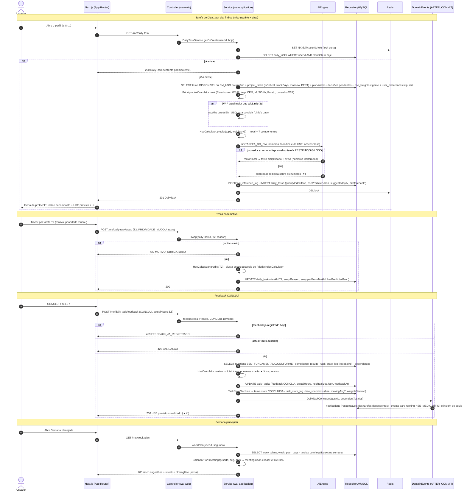
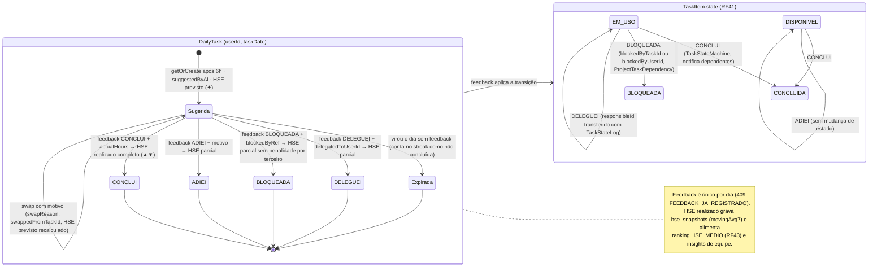
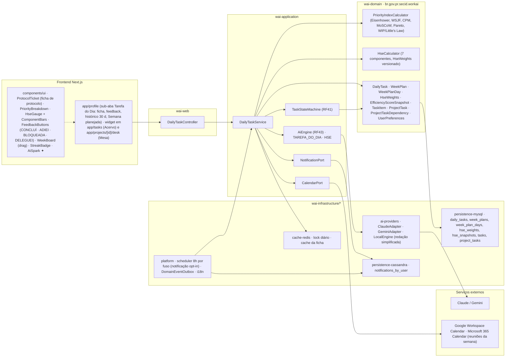

# RF44 — Receber a Tarefa do Dia sugerida pela IA e acompanhar o Hype Score de Eficiência (previsto × realizado), calculado por princípios de gestão empresarial e de projetos, com feedback diário e semana planejada
**HU:** HU44 · **Sprint (board Work Station):** Product Backlog (não priorizado — pós-Sprint 4) · **Equivalente FAI:** Look do Dia (DailyLook: 1 por dia, índice único usuário+data, Hype Score, feedback ADOREI / NAO_USEI / NAO_GOSTEI) + WeekPlan · **Aba/rota:** sub-aba "Tarefa do Dia" no perfil (RF19) e widget no topo do Acervo (RF41) e da Mesa (RF22)
**Critérios de aceite cobertos:** RF44.CA01 · RF44.CA02 · RF44.CA03 · RF44.CA04 · RF44.CA05 · RF44.CA06 · RF44.CA07 · RF44.CA08 · RF44.CA09 · RF44.CA10

> Contexto Gamificação & Reputação (bounded context 9). Entidade central: `DailyTask` (única por `userId + taskDate`), com `priorityIndexJson` (Eisenhower, WSJF, folga CPM, MoSCoW, Pareto, conselho de WIP), `hsePredictedJson` × `hseRealizedJson` e `feedback` (`DailyFeedback` CONCLUI | ADIEI | BLOQUEADA | DELEGUEI). Os cálculos são serviços de domínio determinísticos e testáveis (`PriorityIndexCalculator`, `HseCalculator`) com pesos versionados em `HseWeights` por EMPRESA; o `AiEngine` só redige a explicação (✦) e cai para o motor local sem perder nenhum número (RF44.CA09). `WeekPlan`/`WeekPlanDay` compõem a semana planejada.

## 1. Diagrama de classes

```mermaid
classDiagram
  direction LR

  class DailyTask {
    <<entity>>
    +UUID id
    +UUID userId
    +LocalDate taskDate
    +UUID taskId
    +boolean suggestedByAi
    +String priorityIndexJson
    +String hsePredictedJson
    +String hseRealizedJson
    +DailyFeedback feedback
    +Instant feedbackAt
    +BigDecimal actualHours
    +String swapReason
    +UUID swappedFromTaskId
    +UUID delegatedToUserId
    +String blockedByRef
    +UUID weekPlanDayId
    +UUID aiInferenceId
  }
  class WeekPlan {
    <<entity>>
    +UUID id
    +UUID userId
    +LocalDate weekStart
    +int streak
    +BigDecimal closingHse
    +String recommendation
  }
  class WeekPlanDay {
    <<entity>>
    +UUID id
    +UUID weekPlanId
    +LocalDate date
    +UUID taskId
    +int sortOrder
    +String meetingsJson
    +BigDecimal loadPct
  }
  class HseWeights {
    <<entity>>
    +UUID id
    +UUID companyId
    +int version
    +String weightsJson
    +Instant validFrom
  }
  class EfficiencyScoreSnapshot {
    <<entity>>
    +UUID id
    +UUID userId
    +LocalDate date
    +BigDecimal hse
    +BigDecimal movingAvg7
    +int weightsVersion
  }
  class TaskItem {
    <<entity>>
    +UUID id
    +UUID ownerId
    +UUID responsibleId
    +String title
    +TaskState state
    +LocalDate dueAt
    +LocalDate legalDueAt
    +EffortSize effortSize
    +BigDecimal estimatedHours
    +BigDecimal amountInvolved
    +Priority priority
    +UUID blockedByTaskId
    +UUID blockedByUserId
    +String blockReason
  }
  class ProjectTask {
    <<entity>>
    +UUID projectId
    +UUID taskId
    +BigDecimal pertMostLikely
    +BigDecimal actualHours
    +BigDecimal plannedValue
    +BigDecimal earnedValue
    +boolean isCritical
    +int slackDays
    +String moscow
  }
  class ProjectScheme {
    <<entity>>
    +UUID id
    +UUID planAxisId
    +String criticalPathJson
    +ProjectStatus status
  }
  class ProjectTaskDependency {
    <<entity>>
    +UUID predecessorProjectTaskId
    +UUID successorProjectTaskId
    +String type
  }
  class UserPreferences {
    <<entity>>
    +UUID userId
    +int wipLimit
    +String notificationPrefsJson
    +String timezone
  }
  class ComplianceResult {
    <<entity>>
    +UUID projectId
    +BigDecimal percent
    +int blockingCount
  }
  class Reaction {
    <<entity>>
    +UUID targetId
    +ReactionType reactionType
  }
  class DeciaSession {
    <<entity>>
    +UUID id
    +UUID linkedProjectId
    +SessionStatus status
  }
  class TaskStateLog {
    <<entity>>
    +UUID taskId
    +TaskState fromState
    +TaskState toState
    +String reason
  }
  class Notification {
    <<entity>>
    +UUID recipientId
    +String category
    +String groupKey
  }
  class AiInferenceLog {
    <<entity>>
    +UUID id
    +AiCapability capability
    +String provider
    +String result
    +boolean fallbackUsed
  }

  class DailyFeedback {
    <<enum>>
    CONCLUI
    ADIEI
    BLOQUEADA
    DELEGUEI
  }
  class TaskState {
    <<enum>>
    DISPONIVEL
    EM_USO
    BLOQUEADA
    CONCLUIDA
    ...4 valores
  }
  class EffortSize {
    <<enum>>
    P
    M
    G
  }
  class AiCapability {
    <<enum>>
    TAREFA_DO_DIA
    HSE
    ...25 valores
  }

  class DailyTaskController {
    <<controller>>
    +GET me_daily_task
    +POST me_daily_task_swap
    +POST me_daily_task_feedback
    +GET me_daily_task_history
    +GET me_week_plan
    +PUT me_week_plan_order
  }
  class DailyTaskService {
    <<service>>
    +getOrCreate(userId, today) DailyTask
    +swap(dailyTaskId, newTaskId, reasonCode, reasonText) DailyTask
    +feedback(dailyTaskId, feedback, payload) DailyTask
    +history(userId, days30) List~DailyTask~
    +weekPlan(userId, weekStart) WeekPlan
    +reorder(weekPlanId, order) WeekPlan
    +closeFriday(weekPlanId) WeekPlan
  }
  class PriorityIndexCalculator {
    <<service>>
    +eisenhower(task) Quadrant
    +wsjf(task, siblings) BigDecimal
    +cpmSlack(task) Integer
    +moscow(task) String
    +pareto(tasks) Set~UUID~
    +wipAdvice(wip, limit) Advice
    +rank(candidates, userWeights) List~Scored~
  }
  class HseCalculator {
    <<service>>
    +predict(task, weights) HseBreakdown
    +realize(dailyTask, task, weights) HseBreakdown
    +eficiencia(real, estimadoPertM) int
    +eficacia(task) int
    +valorWsjf(task, siblings) int
    +pontualidadeSpi(task) int
    +qualidade(task) int
    +impactoEquipe(task) int
    +foco(wip, limit, contextSwitches) int
  }
  class TaskStateMachine {
    <<service>>
    +transition(taskId, toState, actor, reason) TaskStateLog
  }
  class AiEngine {
    <<service>>
    +run(capability, input, accessClass) AiResult
  }
  class CalendarPort {
    <<port>>
    +meetings(userId, from, to) List~Meeting~
  }

  DailyTask --> DailyFeedback : feedback
  DailyTask --> TaskItem : taskId
  DailyTask ..> TaskItem : swappedFromTaskId
  DailyTask --> WeekPlanDay : weekPlanDayId
  DailyTask ..> AiInferenceLog : aiInferenceId
  WeekPlan "1" --> "5" WeekPlanDay : weekPlanId
  WeekPlanDay --> TaskItem : taskId
  EfficiencyScoreSnapshot ..> HseWeights : weightsVersion
  TaskItem --> TaskState : state
  TaskItem --> EffortSize : effortSize
  TaskItem "1" --> "*" ProjectTask : taskId
  ProjectTask --> ProjectScheme : projectId
  ProjectTask "1" --> "*" ProjectTaskDependency : desbloqueia
  ProjectScheme ..> ComplianceResult : qualidade
  ProjectScheme ..> DeciaSession : decisão pendente (eficácia)
  Reaction ..> TaskItem : BEM_FUNDAMENTADO e CONFORME (qualidade)
  UserPreferences ..> DailyTask : wipLimit e dailyTaskAt

  DailyTaskController --> DailyTaskService
  DailyTaskService --> PriorityIndexCalculator
  DailyTaskService --> HseCalculator
  DailyTaskService --> TaskStateMachine : CONCLUIDA, BLOQUEADA
  DailyTaskService --> AiEngine : TAREFA_DO_DIA e HSE (redação)
  DailyTaskService --> CalendarPort : reuniões da semana
  HseCalculator ..> HseWeights : versão vigente
  DailyTaskService ..> DailyTask
  DailyTaskService ..> WeekPlan
  DailyTaskService ..> EfficiencyScoreSnapshot
  DailyTaskService ..> Notification
  TaskStateMachine ..> TaskStateLog

  note for DailyTask "tabela daily_tasks · único (userId, taskDate) · hsePredictedJson e hseRealizedJson com total e components[]"
  note for HseWeights "tabela hse_weights · eficiencia 20, eficacia 20, valor 15, pontualidade 15, qualidade 15, impactoEquipe 10, foco 5 · mudar pesos não recalcula dias passados"
  note for PriorityIndexCalculator "wai-domain · determinístico e testável · METRICAS_GESTAO.md"
  note for HseCalculator "wai-domain · Drucker, SAFe/WSJF, EVM, Lean/PDCA, Goldratt, Little's Law"
```

## 2. Diagrama de atividades

```mermaid
flowchart TD
  classDef err fill:#FFE3E3,stroke:#C0392B,color:#5B1A12
  classDef ai fill:#FFF3D6,stroke:#D68910,color:#5C3B00
  classDef store fill:#EEF6FF,stroke:#4A4852,color:#1F2937
  classDef dom fill:#F3F0FA,stroke:#7E57C2,color:#2D2438

  subgraph L_user["Ator humano · EMPREGADO"]
    U1["Abre o app após 6h (perfil, Acervo ou Mesa)"]
    U2["Vê a Tarefa do Dia como ficha de protocolo: índice decomposto + HSE previsto por componente (✦)"]
    U3{"Ação?"}
    U4["Troca por outra tarefa: escolhe motivo (lista + texto)"]
    U5["CONCLUÍ com esforço real em horas"]
    U6["ADIEI (prioridade mudou, falta de tempo, dependência)"]
    U7["BLOQUEADA (por quem ou o quê)"]
    U8["DELEGUEI (para quem)"]
    U9["Abre Semana planejada e reordena por arrastar · sexta: fechamento"]
    U10["Abre histórico de 30 dias na sub-aba"]
  end

  subgraph L_web["Web/BFF · Next.js perfil › Tarefa do Dia · widget Acervo e Mesa"]
    W1["GET /me/daily-task"]
    W2["POST /me/daily-task/swap (newTaskId, reasonCode, reasonText)"]
    W3["POST /me/daily-task/feedback (CONCLUI | ADIEI | BLOQUEADA | DELEGUEI, payload)"]
    W4["GET /me/week-plan · PUT /me/week-plan/order"]
    W5["GET /me/daily-task/history?days=30 → tabela + média móvel 7 d + gráfico de componentes"]
    W6["Notificação diária 8h (fuso do usuário, opt-in em user_preferences) com a Tarefa do Dia (i18n)"]
  end

  subgraph L_app["wai-application · DailyTaskService"]
    S1{"Já existe DailyTask (userId, hoje)?"}
    S2["Candidatas: tarefas DISPONIVEL ou EM_USO do usuário"]
    S3{"Há candidatas?"}
    S4{"WIP atual maior que wipLimit (padrão 3)?"}
    S5["Prioriza concluir uma EM_USO e explica (Little's Law: cycle time subiu com N tarefas em paralelo)"]
    S6["Persiste DailyTask (priorityIndexJson, hsePredictedJson, aiInferenceId) · índice único"]
    S7{"Motivo informado?"}
    S8["swapReason + swappedFromTaskId · ajusta pesos pessoais para os próximos dias (aprendizado)"]
    S9{"Feedback?"}
    S10["HSE realizado completo (7 componentes) · compara ▲▼ com previsto · TaskStateMachine → CONCLUIDA · notifica dependentes · EfficiencyScoreSnapshot movingAvg7"]
    S11["HSE parcial: só componentes aplicáveis · motivo registrado"]
    S12["HSE parcial sem penalizar bloqueio de terceiro (vai para insight de equipe) · TaskStateMachine → BLOQUEADA (blockedByTaskId/blockedByUserId) · ProjectTaskDependency · notifica bloqueador"]
    S13["HSE parcial · responsibleId → delegatedToUserId com TaskStateLog · notifica"]
    S14["WeekPlan: 5 sugestões seg–sex respeitando prazos legais, reuniões (CalendarPort) e carga até 80% · reordenar persiste sortOrder · sexta: closingHse, streak, 1 recomendação"]
    S15["history: 30 dias (tarefa, feedback, previsto × realizado), média móvel 7 d"]
    E1["422 MOTIVO_OBRIGATORIO"]
    E2["422 VALIDACAO (CONCLUI sem actualHours · DELEGUEI sem usuário)"]
    E3["409 FEEDBACK_JA_REGISTRADO"]
    X1(["Estado vazio: nenhuma tarefa disponível"])
  end

  subgraph L_dom["wai-domain · PriorityIndexCalculator · HseCalculator"]
    P1["Eisenhower: urgência (dias até prazo/prazo legal) × importância (eixo do plano, decisão DECIA pendente, chancela pedida)"]
    P2["WSJF = custo do atraso (valor envolvido + risco de prazo legal + tarefas de colegas desbloqueadas) ÷ porte P/M/G"]
    P3["Folga no CPM: tarefas no caminho crítico sobem · MoSCoW Must/Should · Pareto 20/80"]
    P4["rank(candidatas, pesos do usuário) → top 1 + decomposição"]
    H1["HseCalculator.predict/realize com HseWeights vigente: eficiência (real ÷ PERT M), eficácia (eixo +50, crítico +30, decisão +20), valor WSJF normalizado, pontualidade SPI, qualidade first-time-right, impacto na equipe, foco WIP"]
  end

  subgraph L_ai["IA (AiEngine) · TAREFA_DO_DIA · HSE"]
    I1{"Provedor externo disponível e permitido?"}
    I2["Redige a explicação sobre os números calculados (✦)"]
    I3["Motor local: texto simplificado determinístico (✦ com aviso) · nenhum número muda"]
    I4["AiInferenceLog"]
  end

  subgraph L_db["Persistência"]
    D1["MySQL daily_tasks (único userId + taskDate) · Redis lock daily:userId:data"]
    D2["MySQL tasks · project_tasks · project_task_dependencies · task_state_log · hse_snapshots"]
    D3["MySQL week_plans · week_plan_days · hse_weights · user_preferences"]
    D4["MySQL ai_inference_log · DomainEventOutbox → notifications_by_user"]
  end

  U1 --> W1 --> S1
  S1 -- "sim" --> U2
  S1 -- "não" --> S2 --> S3
  S3 -- "não" --> X1
  S3 -- "sim" --> S4
  S4 -- "sim" --> S5 --> P4
  S4 -- "não" --> P1 --> P2 --> P3 --> P4
  P4 --> H1 --> I1
  I1 -- "sim" --> I2 --> I4
  I1 -- "não" --> I3 --> I4
  I4 --> D4
  I2 --> S6
  I3 --> S6
  S6 --> D1 --> U2
  S6 --> W6
  U2 --> U3
  U3 -- "trocar" --> U4 --> W2 --> S7
  S7 -- "não" --> E1
  S7 -- "sim" --> S8 --> H1
  S8 --> D1
  U3 -- "CONCLUÍ" --> U5 --> W3 --> S9
  U3 -- "ADIEI" --> U6 --> W3
  U3 -- "BLOQUEADA" --> U7 --> W3
  U3 -- "DELEGUEI" --> U8 --> W3
  S9 -- "já registrado" --> E3
  S9 -- "inválido" --> E2
  S9 -- "CONCLUI" --> S10 --> H1
  S9 -- "ADIEI" --> S11
  S9 -- "BLOQUEADA" --> S12
  S9 -- "DELEGUEI" --> S13
  S10 --> D2
  S11 --> D1
  S12 --> D2
  S13 --> D2
  S10 --> D4
  S12 --> D4
  S13 --> D4
  U9 --> W4 --> S14 --> D3
  S14 --> P4
  U10 --> W5 --> S15 --> D1
  S15 --> D2

  class E1,E2,E3 err
  class I1,I2,I3,I4 ai
  class D1,D2,D3,D4 store
  class P1,P2,P3,P4,H1 dom
```

## 3. Diagrama de sequência

## 4. Máquina de estados

A `DailyTask` não tem campo `status`: seu ciclo é dado pelo `feedback` (`DailyFeedback`). A região inferior mostra o `TaskItem.state` afetado (RF41).

## 5. Diagrama de componentes

## 6. Rastreabilidade

| CA | Elemento do diagrama (classe / passo / mensagem / transição / componente) |
|---|---|
| RF44.CA01 | Classes `DailyTask` (único userId + taskDate, priorityIndexJson, hsePredictedJson), `DailyTaskService.getOrCreate`, `PriorityIndexCalculator.rank`, `HseCalculator.predict`; atividades U1, W1, S1, S2, S3, P1–P4, H1, S6, U2; sequência msgs 1–17 (lock, índice único, 201 com decomposição); transição `[*] → Sugerida`; componentes `ProtocolTicket`, `PriorityBreakdown`, `HseGauge`. |
| RF44.CA02 | Classes `DailyTask.swapReason/swappedFromTaskId`, `DailyTaskService.swap`, `PriorityIndexCalculator.rank(candidates, userWeights)`; atividades U4, W2, S7 → E1 (422 MOTIVO_OBRIGATORIO), S8 (ajusta pesos pessoais); sequência msgs 18–24; transição `Sugerida → Sugerida` (swap). |
| RF44.CA03 | Classes `DailyTask.feedback/actualHours/hseRealizedJson`, `HseCalculator.realize`, `TaskStateMachine`, `EfficiencyScoreSnapshot`, `ProjectTaskDependency`; atividades U5, W3, S9 → S10 (HSE realizado, ▲▼, CONCLUIDA, notifica dependentes, movingAvg7); sequência msgs 25–36; transições `Sugerida → CONCLUI` e `EM_USO/DISPONIVEL → CONCLUIDA`. |
| RF44.CA04 | Classes `DailyTask.blockedByRef/delegatedToUserId`, `TaskItem.blockedByTaskId/blockedByUserId`, `TaskStateLog`; atividades U6–U8, S11, S12 (sem penalizar bloqueio de terceiro → insight de equipe, dependência com rastro), S13 (transferência com TaskStateLog); transições `Sugerida → ADIEI / BLOQUEADA / DELEGUEI` e `EM_USO → BLOQUEADA`, `EM_USO → EM_USO` (DELEGUEI). |
| RF44.CA05 | Classes `UserPreferences.wipLimit` (padrão 3), `PriorityIndexCalculator.wipAdvice`, `HseCalculator.foco`; atividades S4 → S5 (prioriza concluir EM_USO, explica com Little's Law); sequência msgs 8–9. |
| RF44.CA06 | Classes `WeekPlan` (streak, closingHse, recommendation), `WeekPlanDay` (sortOrder, meetingsJson, loadPct), `CalendarPort`, `DailyTaskService.weekPlan/reorder/closeFriday`; atividades U9, W4, S14 (prazos legais, reuniões, carga até 80%, reordenar persiste, sexta); sequência msgs 37–42; componentes `WeekBoard (drag)`, `StreakBadge`, `Google Workspace Calendar · Microsoft 365 Calendar`. |
| RF44.CA07 | Classes `DailyTaskService.history`, `EfficiencyScoreSnapshot.movingAvg7`; atividades U10, W5, S15 (30 dias, previsto × realizado, média móvel 7 d, gráfico de componentes); componentes `app/profile (histórico 30 d)`, `ComponentBars`. |
| RF44.CA08 | Classes `HseWeights` (companyId, version, weightsJson, validFrom), `EfficiencyScoreSnapshot.weightsVersion`, `PriorityIndexCalculator` e `HseCalculator` em `wai-domain`; notas das classes (determinístico, testável, METRICAS_GESTAO.md, mudar pesos não recalcula dias passados); lane L_dom; componentes `wai-domain · PriorityIndexCalculator`, `HseCalculator (HseWeights versionado)`. |
| RF44.CA09 | Classes `DailyTask.suggestedByAi/aiInferenceId`, `AiInferenceLog`, `AiCapability` TAREFA_DO_DIA e HSE; atividades I1 → I2 (✦) / I3 (motor local, números inalterados), I4; sequência msgs 11–13; componentes `AiSpark ✦`, `LocalEngine (redação simplificada)`. |
| RF44.CA10 | Classes `UserPreferences.notificationPrefsJson (dailyTaskAt 08:00)/timezone`, `Notification`, `NotificationPort`; atividade W6 (notificação 8h no fuso, opt-in, i18n); componentes `platform · scheduler 8h por fuso`, `persistence-cassandra · notifications_by_user`, `i18n`. |
