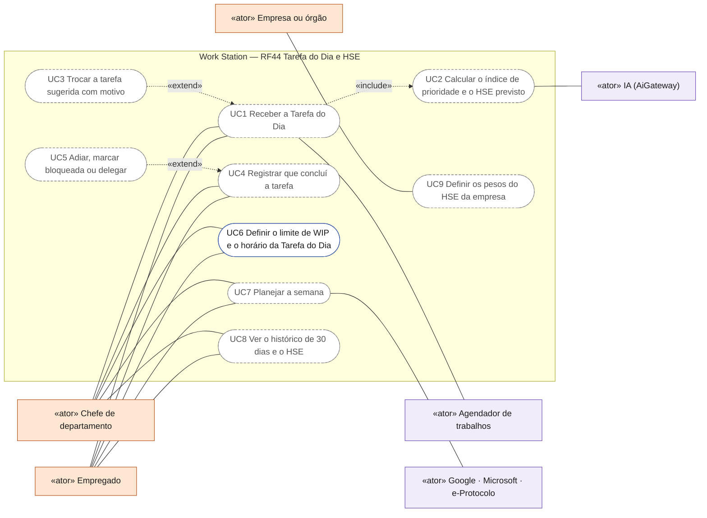
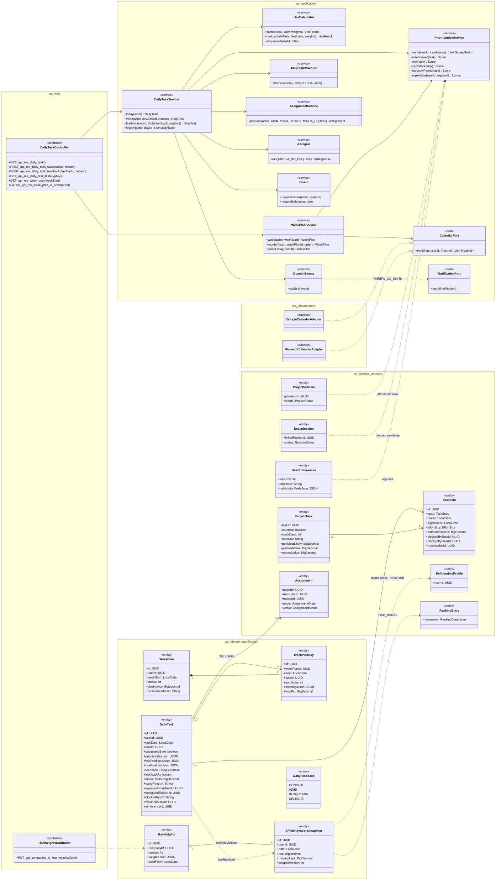
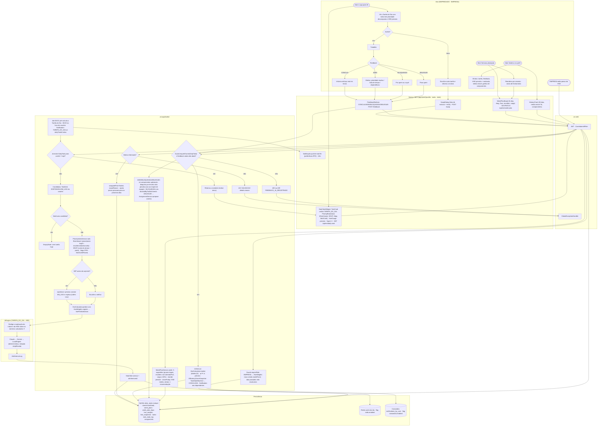
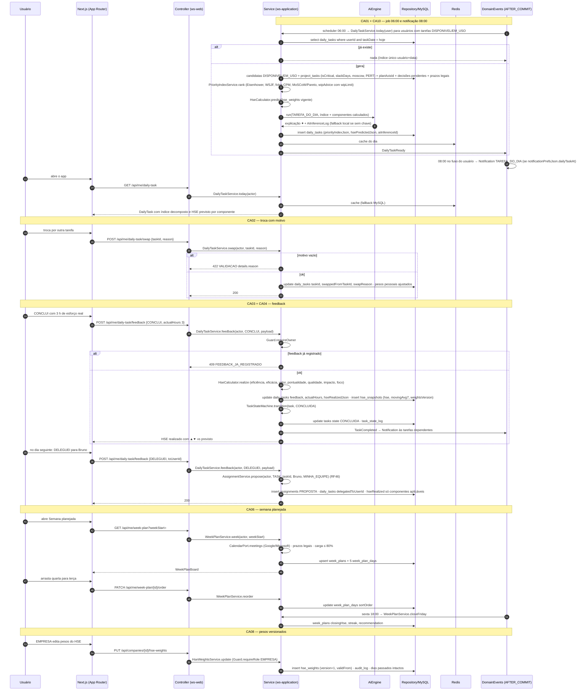
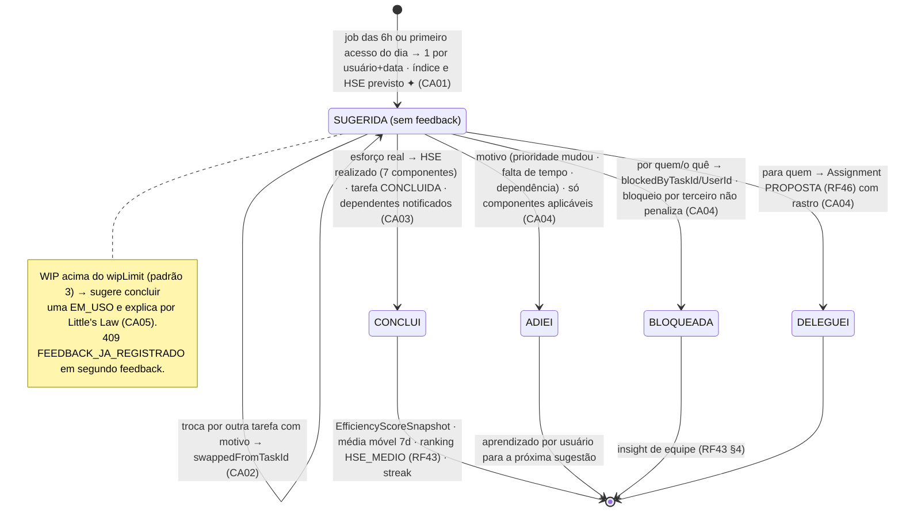
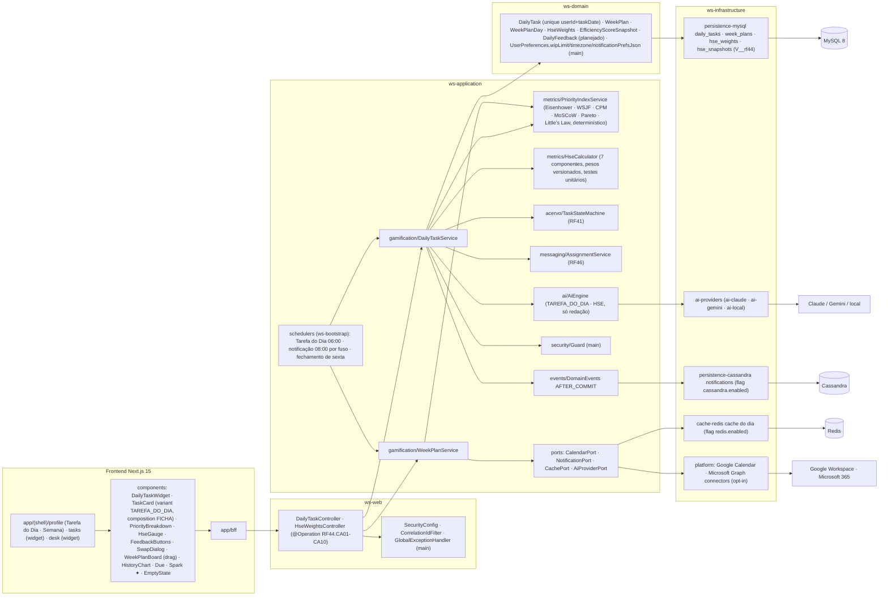

# RF44 — Receber a Tarefa do Dia sugerida pela IA e acompanhar o Hype Score de Eficiência (previsto × realizado), calculado por princípios de gestão empresarial e de projetos, com feedback diário e semana planejada
**HU:** HU44 · **Sprint (board Work Station):** Product Backlog (não comprometido na Sprint 4) · **Equivalente FAI:** Look do Dia (DailyLook: 1 por dia, índice único usuário+data, Hype Score, feedback ADOREI / NAO_USEI / NAO_GOSTEI) + WeekPlan · **Aba/rota:** sub-aba **Tarefa do Dia** no perfil (`/profile?tab=tarefa-do-dia`), widget no topo do Acervo (`/tasks`) e da Mesa (`/desk`), Semana planejada (`/profile?tab=semana`), notificação diária às 8h (preferências RF3)
**Critérios de aceite cobertos:** RF44.CA01 · CA02 · CA03 · CA04 · CA05 · CA06 · CA07 · CA08 · CA09 · CA10 (corpo do card, inalterado) — regra: o **título do card** define o RF e o corpo traz os próprios CAs.

`DailyTask` (único `userId + taskDate`; `taskId` entre as DISPONIVEL/EM_USO; `priorityIndexJson` {eisenhower, wsjf, cpmSlack, moscow, pareto, wipAdvice}; `hsePredictedJson` / `hseRealizedJson` {total, components[]}; `feedback` `DailyFeedback` CONCLUI · ADIEI · BLOQUEADA · DELEGUEI; `actualHours`, `swapReason`, `swappedFromTaskId`, `delegatedToUserId`, `blockedByRef`, `aiInferenceId`). O **índice de prioridade** (Eisenhower × WSJF × folga CPM × MoSCoW/Pareto × WIP/Little's Law, `UserPreferences.wipLimit` padrão 3) e o **HSE** (0–100: eficiência 20 · eficácia 20 · valor WSJF 15 · pontualidade SPI 15 · qualidade 15 · impacto na equipe 10 · foco 5, `HseWeights` por EMPRESA com versão) são **serviços de domínio determinísticos** (`PriorityIndexService`, `HseCalculator`, D-12, `METRICAS_GESTAO.md`); a IA (`TAREFA_DO_DIA`, `HSE`) só redige a explicação ✦. `EfficiencyScoreSnapshot` guarda o HSE diário e a média móvel de 7 dias; `WeekPlan`/`WeekPlanDay` a semana (prazos legais, reuniões Google/Microsoft, carga ≤ 80 %, streak, fechamento de sexta). Feedback CONCLUI → `TaskStateMachine` CONCLUIDA (RF41) e notifica dependentes; BLOQUEADA cria dependência; DELEGUEI cria `Assignment` (RF46) com rastro.

## 0. Diagrama de casos de uso

Quem recebe e governa a Tarefa do Dia e o HSE. Atores do catálogo de [`ATORES_E_ATRIBUTOS.md`](../../arquitetura/ATORES_E_ATRIBUTOS.md) §2 e permissões de [`ABAS_POR_PERFIL.md`](../../produto/ABAS_POR_PERFIL.md) (a Tarefa do Dia é só de contas pessoa, EMPREGADO e CHEFE; a EMPRESA define os pesos do HSE). O caso com borda contínua existe no código (preferências em `/settings?tab=trabalho` e `?tab=notificacoes`); os tracejados são planejados — `DailyTask` existe só como entidade.

| Caso de uso | Ator(es) | CAs | Situação |
|---|---|---|---|
| UC1 Receber a Tarefa do Dia (widget e notificação no horário escolhido) | Empregado, Chefe de departamento, Agendador de trabalhos | RF44.CA01, RF44.CA10 | planejado |
| UC2 Calcular o índice de prioridade e o HSE previsto (IA só redige a explicação) | IA (AiGateway) | RF44.CA01, RF44.CA05, RF44.CA09 | planejado |
| UC3 Trocar a tarefa sugerida com motivo | — (estende UC1) | RF44.CA02 | planejado |
| UC4 Registrar que concluí a tarefa (HSE realizado) | Empregado, Chefe de departamento | RF44.CA03 | planejado |
| UC5 Adiar, marcar bloqueada ou delegar | — (estende UC4) | RF44.CA04 | planejado (delegar cria a atribuição do RF46) |
| UC6 Definir o limite de WIP e o horário da Tarefa do Dia | Empregado, Chefe de departamento | RF44.CA05, RF44.CA10 | real (`wipLimit` e `notificationPrefs.dailyTaskAt` em `/settings`, `PUT /api/me/preferences`) |
| UC7 Planejar a semana (prazos, reuniões da agenda, carga) | Empregado, Chefe de departamento, Google · Microsoft · e-Protocolo | RF44.CA06 | planejado |
| UC8 Ver o histórico de 30 dias e o HSE | Empregado, Chefe de departamento | RF44.CA07 | planejado |
| UC9 Definir os pesos do HSE da empresa (versionados) | Empresa ou órgão | RF44.CA08 | planejado |

## 1. Diagrama de classes

## 2. Diagrama de atividades

## 3. Diagrama de sequência

## 4. Máquina de estados

Entidade central: `DailyTask.feedback` (`DailyFeedback`) — ciclo de um dia; a tarefa em si segue `TaskState` (RF41).

## 5. Diagrama de componentes

## 6. Rastreabilidade

| CA | Classe | Passo | Mensagem | Transição | Componente |
|---|---|---|---|---|---|
| RF44.CA01 | `DailyTask` (único userId+taskDate, priorityIndexJson, hsePredictedJson), `DailyTaskService.today`, `PriorityIndexService.rank`, `HseCalculator.predict` | A0 → A1 → F1 → P1 → P3 → P6 → P9 → P10 → P11 | 1–17 | `[*] → SUGERIDA` | `DTS`, `PIS`, `HSE`, `DailyTaskWidget`, `SCH` |
| RF44.CA02 | `DailyTaskService.swap`, `swappedFromTaskId`, `swapReason` (422 sem motivo), ajuste de pesos pessoais | A2 → A3 → F2 → P12 → P13 | 18–24 | `SUGERIDA → self (troca)` | `SwapDialog` |
| RF44.CA03 | `DailyTaskService.feedback CONCLUI`, `actualHours`, `HseCalculator.realize`, `hseRealizedJson`, `EfficiencyScoreSnapshot`, `TaskStateMachine → CONCLUIDA`, notificação a dependentes | A5 → A6 → F3 → P14 → P15 | 25–36 | `SUGERIDA → CONCLUI` | `HSE`, `TSM`, `FeedbackButtons` |
| RF44.CA04 | feedback ADIEI/BLOQUEADA/DELEGUEI, componentes aplicáveis, `blockedByRef`, `blockedByTaskId/UserId`, `delegatedToUserId`, `AssignmentService.propose` (RF46) com rastro | A7/A8/A9 → F3 → P16 | 37–41 | `SUGERIDA → ADIEI / BLOQUEADA / DELEGUEI` | `ASG`, `DTS` |
| RF44.CA05 | `PriorityIndexService.wipAdvice`, `UserPreferences.wipLimit` (padrão 3), Little's Law | P7 → P8 | 7 | nota de SUGERIDA | `PIS` |
| RF44.CA06 | `WeekPlan`, `WeekPlanDay` (meetingsJson, loadPct), `WeekPlanService.week/reorder/closeFriday`, `CalendarPort`, streak | A10 → A11 → F4 → P17 | 42–52 | `CONCLUI → [*] (streak)` | `WPS`, `WeekPlanBoard`, `PLAT` |
| RF44.CA07 | `DailyTaskService.history` (30 dias), `EfficiencyScoreSnapshot.movingAvg7`, gráfico de componentes | A12 → A13 → F5 | — (GET /history) | — | `HistoryChart`, `R1 profile` |
| RF44.CA08 | `HseWeights` (companyId, version, weightsJson, validFrom), `HseWeightsController`, `METRICAS_GESTAO.md`, serviços de domínio testáveis, passado não recalcula | A14 → P18 | 53–56 | — | `HSE`, `PIS`, `MY (hse_weights)` |
| RF44.CA09 | `DailyTask.aiInferenceId`, `AiCapability TAREFA_DO_DIA/HSE`, `LocalEngine` determinístico com redação simplificada, faísca ✦ | P10 → I1 → I2 → I3 | 9–10 | — | `AIE`, `AIP`, `Spark ✦` |
| RF44.CA10 | `UserPreferences.notificationPrefsJson.dailyTaskAt` (08:00) e `timezone` (RF3), `Notification TAREFA_DO_DIA`, i18n | P19 → F6 | 14 | — | `SCH`, `CASA`, `lib/i18n` |
