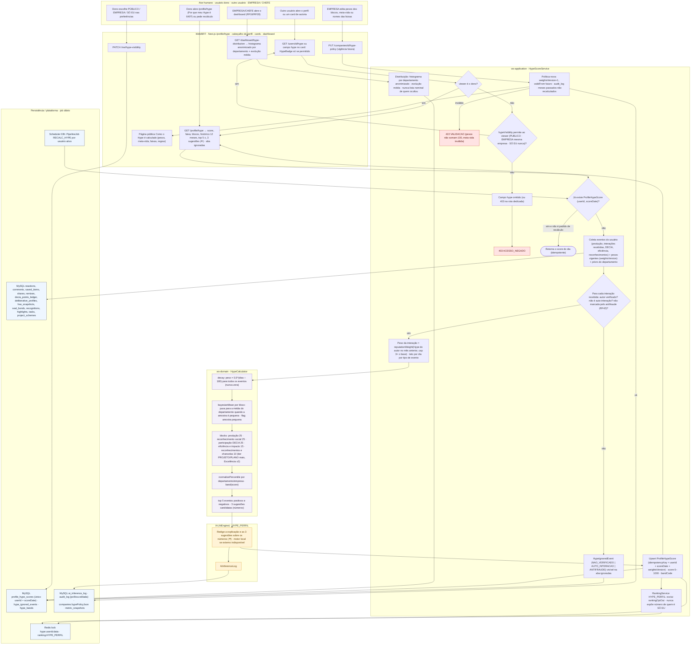
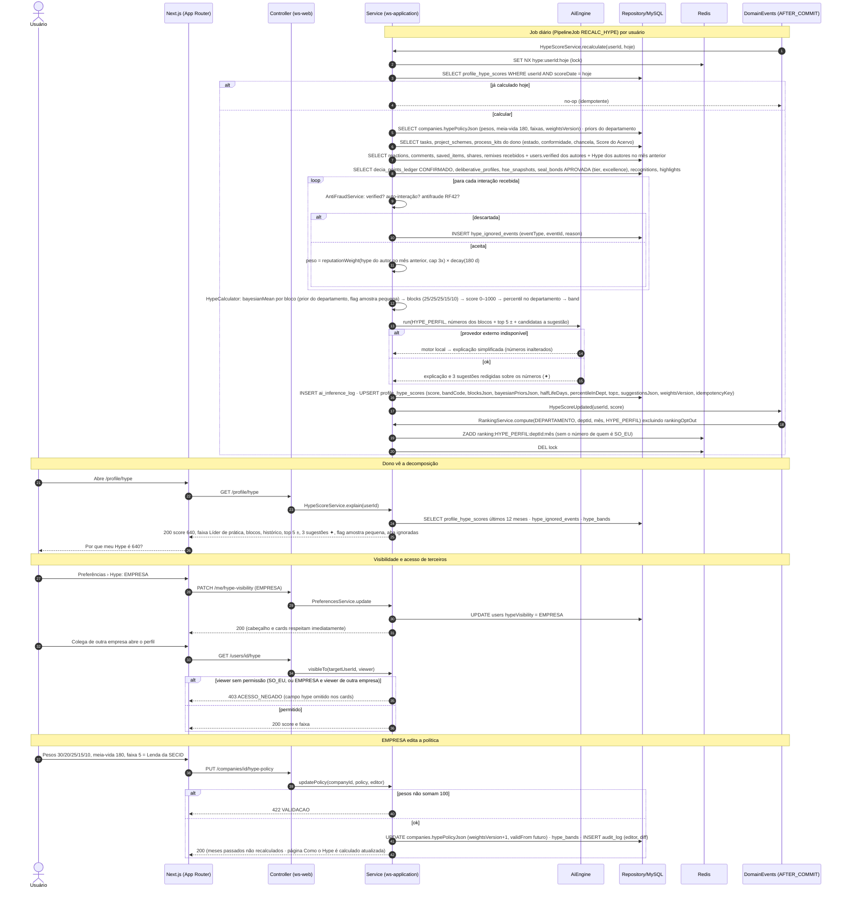
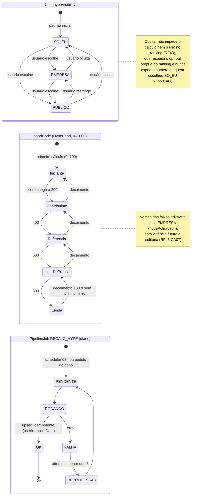
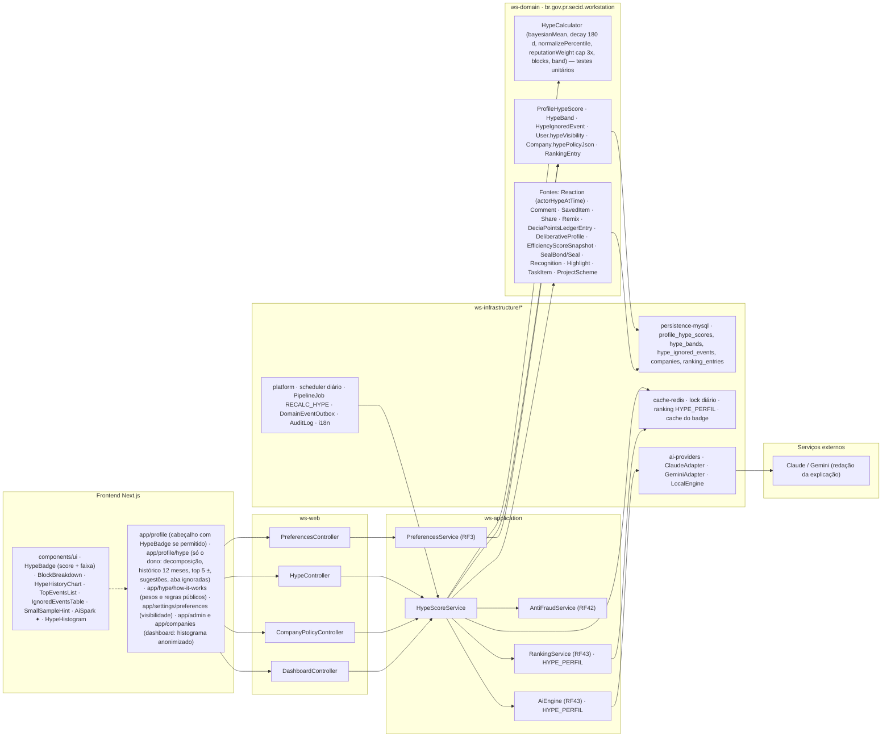

# RF45 — Calcular com a IA o Hype Score do Perfil (0–1000) a partir de tudo o que o usuário produziu, das interações recebidas (curtidas, reações, comentários, salvos, remixes) e da participação no DECIA — exibível ou oculto a critério do usuário, sempre explicável
**HU:** HU45 · **Sprint (board Work Station):** Product Backlog (não priorizado — pós-Sprint 4) · **Equivalente FAI:** Hype Score do look/perfil (RF6 painel do Look do Dia) + Inventory Score (RF29) + contadores sociais (RF19) — consolidados em um índice de reputação profissional por pessoa · **Aba/rota:** cabeçalho do perfil (RF19) com o selo do Hype Score (se exibido), página `/profile/hype` (só o dono) com a decomposição
**Critérios de aceite cobertos:** RF45.CA01 · RF45.CA02 · RF45.CA03 · RF45.CA04 · RF45.CA05 · RF45.CA06 · RF45.CA07 · RF45.CA08 · RF45.CA09 · RF45.CA10

> Contexto Gamificação & Reputação (bounded context 9). Entidade central: `ProfileHypeScore` (única por `userId + scoreDate`, `idempotencyKey`), com `blocksJson` em 5 blocos (produção 25, reconhecimento social 25, participação DECIA 25, eficiência e impacto 15, reconhecimentos e chancelas 10), `bayesianPriorsJson`, `halfLifeDays` 180, `percentileInDept`, `bandCode` (`HypeBand`). Eventos descartados vão para `HypeIgnoredEvent` (NAO_VERIFICADO, AUTO_INTERACAO, ANTIFRAUDE). Visibilidade em `User.hypeVisibility` (`HypeVisibility` PUBLICO | EMPRESA | SO_EU, padrão SO_EU). O job diário é `PipelineJob RECALC_HYPE` → `HypeScoreService`; a IA só redige a explicação.

## 1. Diagrama de classes

```mermaid
classDiagram
  direction LR

  class ProfileHypeScore {
    <<entity>>
    +UUID id
    +UUID userId
    +LocalDate scoreDate
    +int score
    +String bandCode
    +String blocksJson
    +String bayesianPriorsJson
    +int halfLifeDays
    +BigDecimal percentileInDept
    +String topPositiveEventsJson
    +String topNegativeEventsJson
    +String suggestionsJson
    +int weightsVersion
    +UUID aiInferenceId
    +String idempotencyKey
  }
  class HypeBand {
    <<entity>>
    +UUID id
    +UUID companyId
    +int min
    +int max
    +String name
  }
  class HypeIgnoredEvent {
    <<entity>>
    +UUID id
    +UUID userId
    +String eventType
    +UUID eventId
    +IgnoredReason reason
    +Instant at
  }
  class User {
    <<entity>>
    +UUID id
    +boolean verified
    +HypeVisibility hypeVisibility
    +boolean rankingOptOut
    +UUID departmentId
    +UUID companyId
  }
  class Company {
    <<entity>>
    +UUID id
    +String hypePolicyJson
  }
  class Reaction {
    <<entity>>
    +UUID id
    +UUID actorId
    +String targetType
    +UUID targetId
    +ReactionType reactionType
    +Instant at
    +int actorHypeAtTime
    +String ignoredReason
  }
  class Comment {
    <<entity>>
    +UUID authorId
    +UUID targetId
    +UUID parentCommentId
  }
  class SavedItem {
    <<entity>>
    +UUID userId
    +UUID targetId
  }
  class Share {
    <<entity>>
    +UUID actorId
    +UUID targetId
    +ShareChannel channel
  }
  class Remix {
    <<entity>>
    +UUID actorId
    +UUID sourceId
    +UUID modelOfferId
  }
  class DeciaPointsLedgerEntry {
    <<entity>>
    +UUID userId
    +int delta
    +PointsEvent eventCode
    +String status
  }
  class DeliberativeProfile {
    <<entity>>
    +UUID userId
    +String periodKey
    +BigDecimal clarity
    +BigDecimal evidenceUse
    +BigDecimal consistency
  }
  class EfficiencyScoreSnapshot {
    <<entity>>
    +UUID userId
    +LocalDate date
    +BigDecimal hse
    +BigDecimal movingAvg7
  }
  class SealBond {
    <<entity>>
    +UUID targetOwnerId
    +SealBondStatus status
    +UUID sealId
  }
  class Seal {
    <<entity>>
    +UUID id
    +SealTier tier
    +boolean excellence
  }
  class Recognition {
    <<entity>>
    +UUID recipientUserId
    +String source
    +Instant issuedAt
  }
  class Highlight {
    <<entity>>
    +String monthKey
    +String targetType
    +UUID targetId
  }
  class TaskItem {
    <<entity>>
    +UUID ownerId
    +TaskState state
    +String sealIdsJson
    +int reuseCount
    +String aiConfidenceJson
  }
  class ProjectScheme {
    <<entity>>
    +UUID ownerId
    +ProjectStatus status
    +BigDecimal conformityPercent
  }
  class RankingEntry {
    <<entity>>
    +RankingDimension dimension
    +UUID userId
    +BigDecimal value
    +int position
  }
  class PipelineJob {
    <<entity>>
    +String type
    +UUID targetId
    +String status
    +int attempts
  }
  class AiInferenceLog {
    <<entity>>
    +UUID id
    +AiCapability capability
    +String provider
    +String result
  }
  class AuditLog {
    <<entity>>
    +UUID actorId
    +String action
    +String metadataJson
  }
  class MetricSnapshot {
    <<entity>>
    +String metricCode
    +String scope
    +UUID scopeId
    +String valuesJson
  }

  class HypeVisibility {
    <<enum>>
    PUBLICO
    EMPRESA
    SO_EU
  }
  class IgnoredReason {
    <<enum>>
    NAO_VERIFICADO
    AUTO_INTERACAO
    ANTIFRAUDE
  }
  class ReactionType {
    <<enum>>
    CURTIR
    UTIL
    BEM_FUNDAMENTADO
    INOVADOR
    CONFORME
  }
  class RankingDimension {
    <<enum>>
    HYPE_PERFIL
    HSE_MEDIO
    ...5 valores
  }

  class HypeController {
    <<controller>>
    +GET profile_hype
    +GET profile_hype_ignored
    +POST profile_hype_recalculate
    +GET users_id_hype
    +GET hype_how_it_works
  }
  class PreferencesController {
    <<controller>>
    +PATCH me_hype_visibility
  }
  class CompanyPolicyController {
    <<controller>>
    +PUT companies_id_hype_policy
  }
  class DashboardController {
    <<controller>>
    +GET dashboard_hype_distribution
  }
  class HypeScoreService {
    <<service>>
    +recalculate(userId, scoreDate) ProfileHypeScore
    +runDailyJob(companyId) int
    +explain(userId) HypeExplanation
    +ignored(userId) List~HypeIgnoredEvent~
    +visibleTo(targetUserId, viewer) Optional~int~
    +updatePolicy(companyId, policy, editor) Company
  }
  class HypeCalculator {
    <<service>>
    +bayesianMean(values, deptPrior, k) BigDecimal
    +decay(eventAt, halfLifeDays180) BigDecimal
    +normalizePercentile(score, deptScores) BigDecimal
    +reputationWeight(actorHypePrevMonth, base, cap3x) BigDecimal
    +blocks(inputs, weightsVersion) BlocksBreakdown
    +band(score, bands) HypeBand
  }
  class AntiFraudService {
    <<service>>
    +isSelfInteraction(actorId, ownerId) boolean
    +isCollusion(actorId, ownerId, window) boolean
    +isVerified(actorId) boolean
  }
  class RankingService {
    <<service>>
    +compute(scope, scopeId, period, HYPE_PERFIL) List~RankingEntry~
  }
  class AiEngine {
    <<service>>
    +run(capability, input, accessClass) AiResult
  }

  ProfileHypeScore --> User : userId
  ProfileHypeScore ..> HypeBand : bandCode
  ProfileHypeScore ..> AiInferenceLog : aiInferenceId (HYPE_PERFIL)
  HypeIgnoredEvent --> IgnoredReason : reason
  HypeIgnoredEvent --> User : userId (dono)
  User --> HypeVisibility : hypeVisibility
  Company ..> HypeBand : nomes das faixas (hypePolicyJson)
  Company ..> ProfileHypeScore : pesos e meia-vida (weightsVersion)
  Reaction --> ReactionType : reactionType
  Reaction ..> ProfileHypeScore : actorHypeAtTime (peso PageRank)
  Comment ..> ProfileHypeScore : bloco reconhecimento social
  SavedItem ..> ProfileHypeScore : bloco reconhecimento social
  Share ..> ProfileHypeScore : bloco reconhecimento social
  Remix ..> ProfileHypeScore : bloco reconhecimento social
  DeciaPointsLedgerEntry ..> ProfileHypeScore : bloco participação DECIA
  DeliberativeProfile ..> ProfileHypeScore : consistência (objetivo 2)
  EfficiencyScoreSnapshot ..> ProfileHypeScore : bloco eficiência e impacto
  TaskItem ..> ProfileHypeScore : bloco produção e reutilizações
  ProjectScheme ..> ProfileHypeScore : bloco produção (conformidade)
  SealBond --> Seal : sealId
  SealBond ..> ProfileHypeScore : bloco reconhecimentos e chancelas (tier, Excelência x2)
  Recognition ..> ProfileHypeScore : bloco reconhecimentos
  Highlight ..> ProfileHypeScore : destaques do mês
  RankingEntry --> RankingDimension : HYPE_PERFIL
  PipelineJob ..> HypeScoreService : RECALC_HYPE diário

  HypeController --> HypeScoreService
  PreferencesController ..> User : hypeVisibility
  CompanyPolicyController --> HypeScoreService : updatePolicy
  DashboardController --> HypeScoreService : distribuição anonimizada
  HypeScoreService --> HypeCalculator
  HypeScoreService --> AntiFraudService
  HypeScoreService --> RankingService : HYPE_PERFIL (opt-out)
  HypeScoreService --> AiEngine : HYPE_PERFIL (redação)
  HypeScoreService ..> ProfileHypeScore
  HypeScoreService ..> HypeIgnoredEvent
  HypeScoreService ..> MetricSnapshot
  HypeScoreService ..> AuditLog

  note for ProfileHypeScore "tabela profile_hype_scores · único (userId, scoreDate) · blocksJson producao 25, reconhecimentoSocial 25, participacaoDecia 25, eficienciaImpacto 15, reconhecimentosChancelas 10"
  note for HypeCalculator "ws-domain · determinístico e testável (média bayesiana, decaimento 180 d, normalização, antifraude) · METRICAS_GESTAO.md seção Hype do Perfil"
  note for HypeBand "tabela hype_bands · 0–199 Iniciante · 200–399 Contribuinte · 400–599 Referência · 600–799 Líder de prática · 800–1000 Lenda do departamento"
  note for IgnoredReason "nome do enum a confirmar · TAXONOMIA só lista valores em HypeIgnoredEvent.reason"
```

## 2. Diagrama de atividades

## 3. Diagrama de sequência

## 4. Máquina de estados

`ProfileHypeScore` não tem campo de status. Usam-se os estados que o RF afeta: a **faixa** (`ProfileHypeScore.bandCode` ↔ `HypeBand`) e a **visibilidade** (`User.hypeVisibility`), além do ciclo do `PipelineJob RECALC_HYPE`.

## 5. Diagrama de componentes

## 6. Rastreabilidade

| CA | Elemento do diagrama (classe / passo / mensagem / transição / componente) |
|---|---|
| RF45.CA01 | Classes `ProfileHypeScore` (scoreDate, score 0–1000, weightsVersion, blocksJson, idempotencyKey), `HypeScoreService.recalculate/runDailyJob`, `PipelineJob RECALC_HYPE`; atividades J1, U1, S1 → X1 (idempotente), S2, S6; sequência msgs 1–4 e 16 (lock, no-op se já calculado, UPSERT); máquina de estados `PipelineJob RECALC_HYPE`; componentes `platform · scheduler diário · PipelineJob RECALC_HYPE`. |
| RF45.CA02 | Classes `HypeCalculator.bayesianMean/decay`, `ProfileHypeScore.bayesianPriorsJson/halfLifeDays`; atividades H1 (0,5^(dias ÷ 180), nunca zera), H2 (prior do departamento, flag amostra pequena); sequência msgs 11–12; componente `SmallSampleHint`. |
| RF45.CA03 | Classes `HypeIgnoredEvent` (eventType, eventId, reason), enum `IgnoredReason`, `User.verified`, `AntiFraudService` (isVerified, isSelfInteraction, isCollusion), `Reaction.ignoredReason`; atividades S3 → S4 (aba ignoradas com motivo); sequência msgs 9–10; componentes `IgnoredEventsTable`, `HypeController.GET profile_hype_ignored`, `AntiFraudService (RF42)`. |
| RF45.CA04 | Classes `HypeCalculator.reputationWeight(actorHypePrevMonth, base, cap3x)`, `Reaction.actorHypeAtTime`; atividade S5 (Hype do autor no mês anterior, cap 3×); sequência msgs 7 e 11 (Hype dos autores no mês anterior, cap 3x). |
| RF45.CA05 | Classes `ProfileHypeScore.topPositiveEventsJson/topNegativeEventsJson/suggestionsJson/aiInferenceId`, `HypeScoreService.explain`, `AiCapability HYPE_PERFIL`, `AiInferenceLog`; atividades U1, W1, H5, I1, I2; sequência msgs 13–16 e 21–26 (score, faixa, blocos, 12 meses, top 5 ±, 3 sugestões ✦); componentes `app/profile/hype`, `BlockBreakdown`, `HypeHistoryChart`, `TopEventsList`, `AiSpark ✦`. |
| RF45.CA06 | Classes `User.hypeVisibility`, enum `HypeVisibility` (PUBLICO, EMPRESA, SO_EU padrão), `HypeScoreService.visibleTo`, `PreferencesController`; atividades U2, W2, U3, W3, S8, S9, S10 → E1 (403 / campo omitido); sequência msgs 27–36; máquina de estados `User.hypeVisibility`; componentes `HypeBadge`, `app/settings/preferences`. |
| RF45.CA07 | Classes `Company.hypePolicyJson`, `HypeBand.name/min/max`, `ProfileHypeScore.weightsVersion`, `HypeScoreService.updatePolicy`, `CompanyPolicyController`, `AuditLog`; atividades U4, W4, S11 → E2 (422), W6 (página pública); sequência msgs 37–42 (weightsVersion+1, validFrom futuro, audit_log, meses passados não recalculados); nota da máquina de estados `Band`; componente `app/hype/how-it-works`. |
| RF45.CA08 | Classes `RankingEntry` (dimension HYPE_PERFIL), `User.rankingOptOut`, `RankingService.compute`; atividade S7 (exclui opt-out, nunca expõe número de quem é SÓ EU); sequência msgs 17–19 (ranking sem o número de quem é SO_EU); nota da máquina de estados `Vis`; componentes `RankingService (RF43) · HYPE_PERFIL`, `cache-redis · ranking HYPE_PERFIL`. |
| RF45.CA09 | Classe `HypeCalculator` em `ws-domain` (bayesianMean, decay, normalizePercentile, reputationWeight, blocks, band) com nota (determinístico, testável, METRICAS_GESTAO.md seção Hype do Perfil); lane L_dom (H1–H5); atividade I1 (IA só redige); componente `ws-domain · HypeCalculator — testes unitários`. |
| RF45.CA10 | Classes `DashboardController.GET dashboard_hype_distribution`, `MetricSnapshot`; atividades U5, W5, S12 (histograma anonimizado por departamento, evolução média, nunca lista nominal de quem ocultou); componentes `HypeHistogram`, `app/admin e app/companies (dashboard)`. |

Tela/aba: `/profile` (esqueleto em `app/(shell)/profile/page.tsx`)
