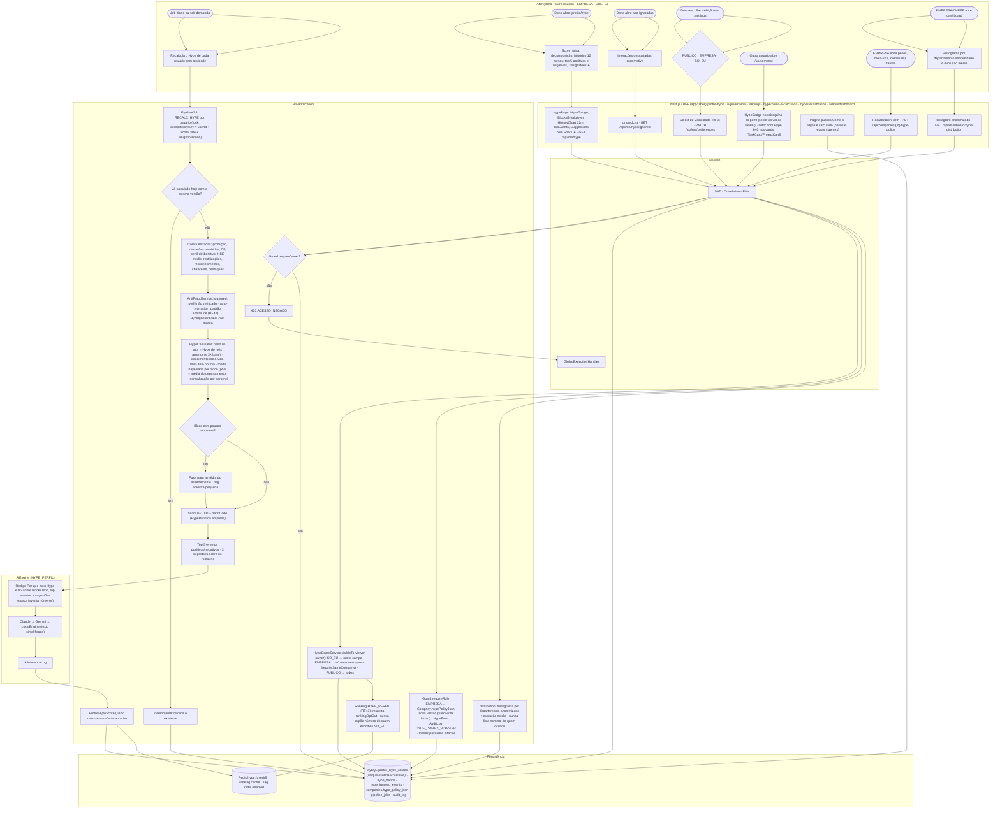
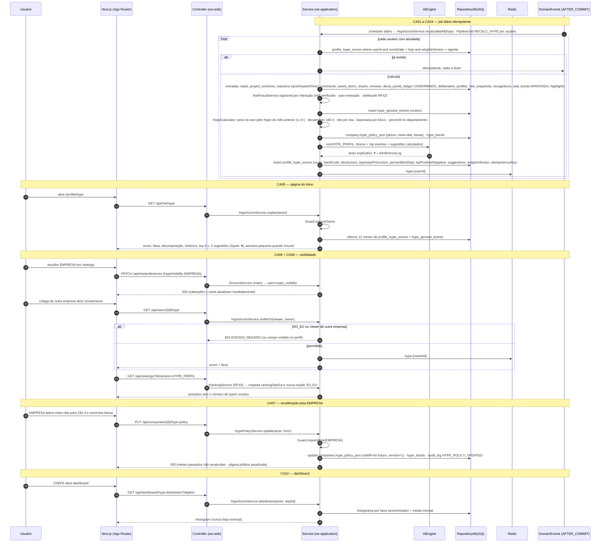
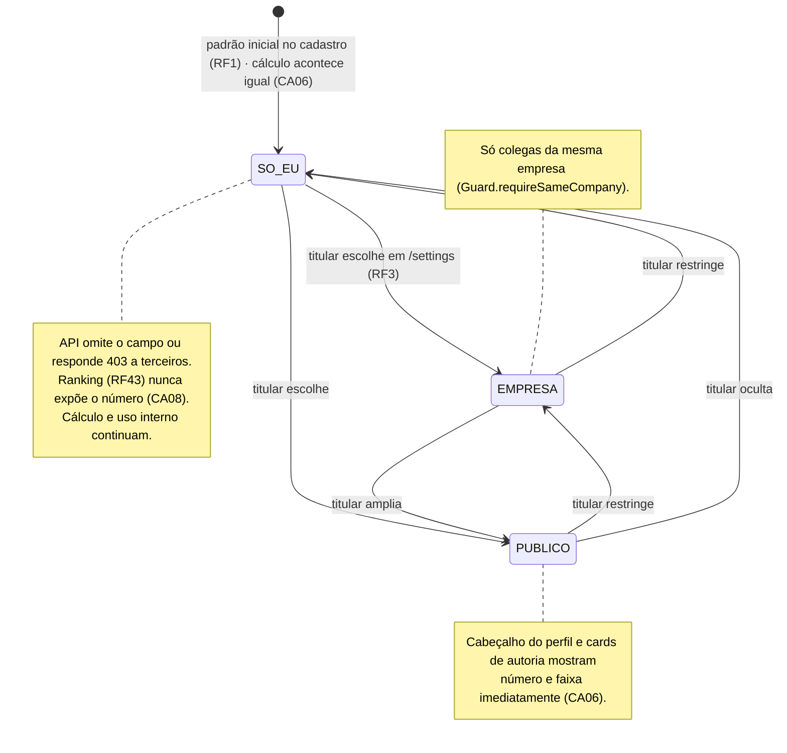
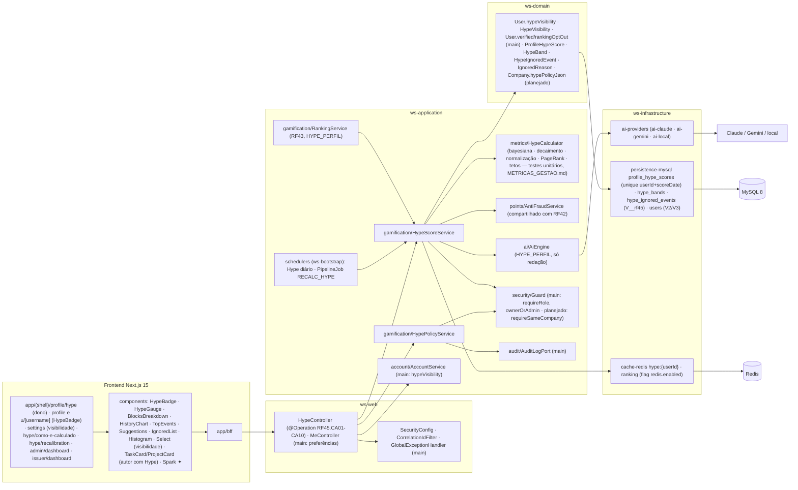

# RF45 — Calcular com a IA o Hype Score do Perfil (0–1000) a partir de tudo o que o usuário produziu, das interações recebidas (curtidas, reações, comentários, salvos, remixes) e da participação no DECIA — exibível ou oculto a critério do usuário, sempre explicável
**HU:** HU45 · **Sprint (board Work Station):** Product Backlog (não comprometido na Sprint 4) · **Equivalente FAI:** Hype Score do look/perfil + Inventory Score (RF29) + contadores sociais (RF19), consolidados em um índice de reputação profissional por pessoa · **Aba/rota:** selo no cabeçalho do perfil (`/profile`, `/u/[username]`, se exibido), página **Por que meu Hype é X?** (`/profile/hype`, só o dono), aba "ignoradas", página pública "Como o Hype é calculado" (`/hype/como-e-calculado`), controle de exibição em `/settings` (RF3), recalibração da EMPRESA (`/hype/recalibration`), histograma no dashboard (`/admin/dashboard`, `/issuer/dashboard`)
**Critérios de aceite cobertos:** RF45.CA01 · CA02 · CA03 · CA04 · CA05 · CA06 · CA07 · CA08 · CA09 · CA10 (corpo do card, inalterado) — regra: o **título do card** define o RF e o corpo traz os próprios CAs.

`ProfileHypeScore` (único `userId + scoreDate`; `score` 0–1000; `bandCode` → `HypeBand` Iniciante · Contribuinte · Referência · Líder de prática · Lenda do departamento, nomes editáveis pela EMPRESA; `blocksJson` produção 25 % · reconhecimento social 25 % · participação no DECIA 25 % · eficiência e impacto 15 % · reconhecimentos e chancelas 10 %; `bayesianPriorsJson`, `halfLifeDays` 180, `percentileInDept`, `topPositiveEventsJson`, `topNegativeEventsJson`, `suggestionsJson`, `weightsVersion`, `aiInferenceId`, `idempotencyKey`). Regras estatísticas em `HypeCalculator` (determinístico, D-12, `METRICAS_GESTAO.md` seção Hype): **média bayesiana** por bloco, **decaimento** meia-vida 180 d, **normalização por departamento/empresa** (percentil), tetos por dia, ponderação **PageRank** pela reputação de quem interage (`Reaction.actorHypeAtTime` do mês anterior, ≤ 3× o peso base), **antifraude** compartilhado com RF42 (`HypeIgnoredEvent` NAO_VERIFICADO · AUTO_INTERACAO · ANTIFRAUDE, só `User.verified`). Exibição: `User.hypeVisibility` PUBLICO · EMPRESA · SO_EU (padrão; **existe no main**: `HypeVisibility`) — a API omite o campo ou responde 403 a quem não pode ver; ocultar não impede o cálculo nem o ranking (RF43, que respeita `rankingOptOut`). A IA (`HYPE_PERFIL`) **só redige** a explicação ✦. Política de uso (LGPD): indicador de reputação e desenvolvimento, não instrumento disciplinar (`Company.hypePolicyJson`); revisão de decisão automatizada via `DataSubjectRequest` target HYPE (RF3).

## 1. Diagrama de classes

```mermaid
classDiagram
direction LR

namespace ws_domain_reputacao {
  class ProfileHypeScore {
    <<entity>>
    +id: UUID
    +userId: UUID
    +scoreDate: LocalDate
    +score: int
    +bandCode: String
    +blocksJson: JSON
    +bayesianPriorsJson: JSON
    +halfLifeDays: int
    +percentileInDept: BigDecimal
    +topPositiveEventsJson: JSON
    +topNegativeEventsJson: JSON
    +suggestionsJson: JSON
    +weightsVersion: int
    +aiInferenceId: UUID
    +idempotencyKey: String
  }
  class HypeBand {
    <<entity>>
    +id: UUID
    +companyId: UUID
    +min: int
    +max: int
    +name: String
  }
  class HypeIgnoredEvent {
    <<entity>>
    +id: UUID
    +userId: UUID
    +eventType: String
    +eventId: UUID
    +reason: IgnoredReason
    +at: Instant
  }
  class IgnoredReason {
    <<enum>>
    NAO_VERIFICADO
    AUTO_INTERACAO
    ANTIFRAUDE
  }
  class HypeVisibility {
    <<enum>>
    PUBLICO
    EMPRESA
    SO_EU
  }
}

namespace ws_domain_entradas {
  class User {
    <<entity>>
    +id: UUID
    +verified: boolean
    +hypeVisibility: HypeVisibility
    +rankingOptOut: boolean
    +companyId: UUID
    +departmentId: UUID
  }
  class Company {
    <<entity>>
    +id: UUID
    +hypePolicyJson: JSON
  }
  class TaskItem {
    <<entity>>
    +ownerId: UUID
    +state: TaskState
    +sealIdsJson: JSON
    +reuseCount: int
  }
  class ProjectScheme {
    <<entity>>
    +ownerId: UUID
    +status: ProjectStatus
    +conformityPercent: BigDecimal
  }
  class Reaction {
    <<entity>>
    +actorId: UUID
    +targetId: UUID
    +reactionType: ReactionType
    +actorHypeAtTime: int
    +ignoredReason: String
  }
  class Comment {
    <<entity>>
    +authorId: UUID
    +targetId: UUID
    +parentCommentId: UUID
  }
  class Remix {
    <<entity>>
    +actorId: UUID
    +sourceId: UUID
  }
  class DeciaPointsLedgerEntry {
    <<entity>>
    +userId: UUID
    +eventCode: PointsEvent
    +status: LedgerStatus
  }
  class DeliberativeProfile {
    <<entity>>
    +userId: UUID
    +consistency: BigDecimal
  }
  class EfficiencyScoreSnapshot {
    <<entity>>
    +userId: UUID
    +movingAvg7: BigDecimal
  }
  class Recognition {
    <<entity>>
    +recipientUserId: UUID
  }
  class SealBond {
    <<entity>>
    +targetOwnerId: UUID
    +status: SealBondStatus
  }
  class Highlight {
    <<entity>>
    +targetType: String
    +targetId: UUID
  }
  class RankingEntry {
    <<entity>>
    +dimension: RankingDimension
    +userId: UUID
  }
  class DataSubjectRequest {
    <<entity>>
    +kind: DsrKind
    +target: DsrTarget
    +targetId: UUID
  }
}

namespace ws_application {
  class HypeScoreService {
    <<service>>
    +recalculateAll(scoreDate) void
    +recalculate(userId, scoreDate) ProfileHypeScore
    +explain(actor) HypeExplanation
    +ignored(actor) List~HypeIgnoredEvent~
    +visibleTo(viewer, ownerId) Optional~HypeView~
    +distribution(actor, deptId) Histogram
  }
  class HypeCalculator {
    <<service>>
    +compute(inputs, weights, priors) HypeResult
    -bayesian(block, samples, prior) BigDecimal
    -decay(event, halfLifeDays) BigDecimal
    -normalize(value, deptDistribution) BigDecimal
    -actorWeight(actorHypePrevMonth) BigDecimal
    -dailyCap(eventType) int
  }
  class AntiFraudService {
    <<service>>
    +isIgnored(interaction) Optional~IgnoredReason~
  }
  class HypePolicyService {
    <<service>>
    +update(actor, HypePolicyForm) Company
    +bands(companyId) List~HypeBand~
  }
  class AiEngine {
    <<service>>
    +run(HYPE_PERFIL) AiResponse
  }
  class Guard {
    <<service>>
    +requireOwner(actor, ownerId)
    +requireRole(actor, role)
    +requireSameCompany(actor, companyId)
  }
  class CachePort {
    <<port>>
    +hype(userId)
  }
  class JobPort {
    <<port>>
    +enqueue(RECALC_HYPE)
  }
  class AuditLogPort {
    <<port>>
    +record(AuditEvent)
  }
}

namespace ws_web {
  class HypeController {
    <<controller>>
    +GET_api_me_hype()
    +GET_api_me_hype_ignored()
    +POST_api_me_hype_recalculate()
    +GET_api_users_id_hype()
    +GET_api_hype_how_it_works()
    +PUT_api_companies_id_hype_policy(form)
    +GET_api_dashboard_hype_distribution(deptId)
  }
}

ProfileHypeScore "0..*" --> "1" User
ProfileHypeScore ..> HypeBand : bandCode
User "1" o-- "0..*" HypeIgnoredEvent
Company "1" o-- "0..*" HypeBand
Company ..> HypeCalculator : hypePolicyJson pesos meia-vida faixas
TaskItem ..> HypeCalculator : bloco producao
ProjectScheme ..> HypeCalculator : bloco producao
Reaction ..> HypeCalculator : bloco social ponderado por actorHypeAtTime
Comment ..> HypeCalculator : bloco social
Remix ..> HypeCalculator : bloco social
DeciaPointsLedgerEntry ..> HypeCalculator : bloco DECIA
DeliberativeProfile ..> HypeCalculator : consistencia
EfficiencyScoreSnapshot ..> HypeCalculator : bloco eficiencia
Recognition ..> HypeCalculator : bloco reconhecimentos
SealBond ..> HypeCalculator : chancelas tier e Excelencia
Highlight ..> HypeCalculator : destaques
ProfileHypeScore ..> RankingEntry : HYPE_PERFIL respeita opt-out
DataSubjectRequest ..> ProfileHypeScore : revisao art 20
HypeController --> HypeScoreService
HypeController --> HypePolicyService
HypeScoreService --> HypeCalculator
HypeScoreService --> AntiFraudService
HypeScoreService --> AiEngine
HypeScoreService --> Guard
HypeScoreService --> CachePort
HypeScoreService --> JobPort
HypePolicyService --> Guard
HypePolicyService --> AuditLogPort
AntiFraudService ..> HypeIgnoredEvent : grava motivo
```

## 2. Diagrama de atividades

## 3. Diagrama de sequência

## 4. Máquina de estados

Entidade central: `User.hypeVisibility` (`HypeVisibility`, enum e coluna **existem no main**) — o único estado que o titular controla; `ProfileHypeScore` é um snapshot diário imutável (recalcular o mesmo dia é idempotente).

## 5. Diagrama de componentes

## 6. Rastreabilidade

| CA | Classe | Passo | Mensagem | Transição | Componente |
|---|---|---|---|---|---|
| RF45.CA01 | `ProfileHypeScore` (único userId+scoreDate, score, weightsVersion, blocksJson, idempotencyKey), `HypeScoreService.recalculateAll/recalculate`, `PipelineJob RECALC_HYPE` | A0 → A1 → P1 → P2 → P3/P4 → P9 → P11 | 1–15 | — (snapshot imutável) | `HSS`, `SCH`, `MY (unique)` |
| RF45.CA02 | `HypeCalculator.bayesian/decay`, `bayesianPriorsJson`, `halfLifeDays` 180, flag amostra pequena | P6 → P7 → P8 | 8, 19 | — | `HCAL` |
| RF45.CA03 | `AntiFraudService.isIgnored`, `HypeIgnoredEvent` (`IgnoredReason` NAO_VERIFICADO · AUTO_INTERACAO · ANTIFRAUDE), `User.verified`, aba ignoradas | P5 · A4 → A5 → F3 | 6–7, 18 | — | `AF`, `IgnoredList` |
| RF45.CA04 | `HypeCalculator.actorWeight`, `Reaction.actorHypeAtTime` (mês anterior, ≤ 3× base) | P6 | 5, 8 | — | `HCAL` |
| RF45.CA05 | `HypeScoreService.explain`, histórico 12 meses, `topPositiveEventsJson/topNegativeEventsJson/suggestionsJson`, `AiCapability HYPE_PERFIL`, `aiInferenceId` | A2 → A3 → F2 → P12 → I1 → I2 → I3 | 10–11, 16–19 | — | `HypePage`, `AIE`, `Spark ✦` |
| RF45.CA06 | `User.hypeVisibility` (`HypeVisibility`, main), `HypeScoreService.visibleTo`, `Guard.requireSameCompany`, 403/omissão do campo | A6 → A7 → F4 · A8 → F1 → P13 | 20–29 | toda a máquina | `ACC`, `HypeBadge`, `Select (visibilidade)` |
| RF45.CA07 | `HypePolicyService.update`, `Company.hypePolicyJson` (pesos, meia-vida, faixas, validFrom), `HypeBand`, `AuditLog HYPE_POLICY_UPDATED`, página "Como o Hype é calculado" | A9 → F6 → P15 · F5 | 34–38 | — | `HPS`, `AUD`, `R1 hype/como-e-calculado` |
| RF45.CA08 | `RankingService` dimensão `HYPE_PERFIL`, `User.rankingOptOut`, nunca expõe SO_EU | P14 | 30–32 | nota de SO_EU | `RK`, `RD` |
| RF45.CA09 | `HypeCalculator` determinístico com testes unitários (bayesiana, decaimento, normalização, antifraude), `METRICAS_GESTAO.md`, IA só redige | P6 · I1 | 8–11 | — | `HCAL`, `AIE` |
| RF45.CA10 | `HypeScoreService.distribution`, histograma anonimizado por departamento e evolução média, nunca lista nominal | A10 → A11 → F7 → P16 | 39–43 | — | `Histogram`, `admin/issuer dashboard` |
