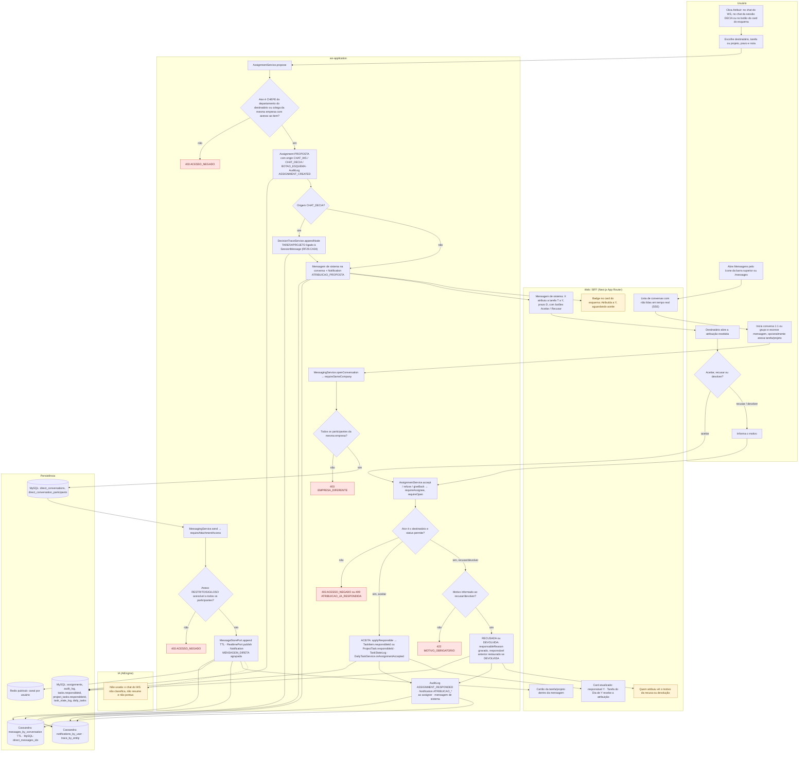
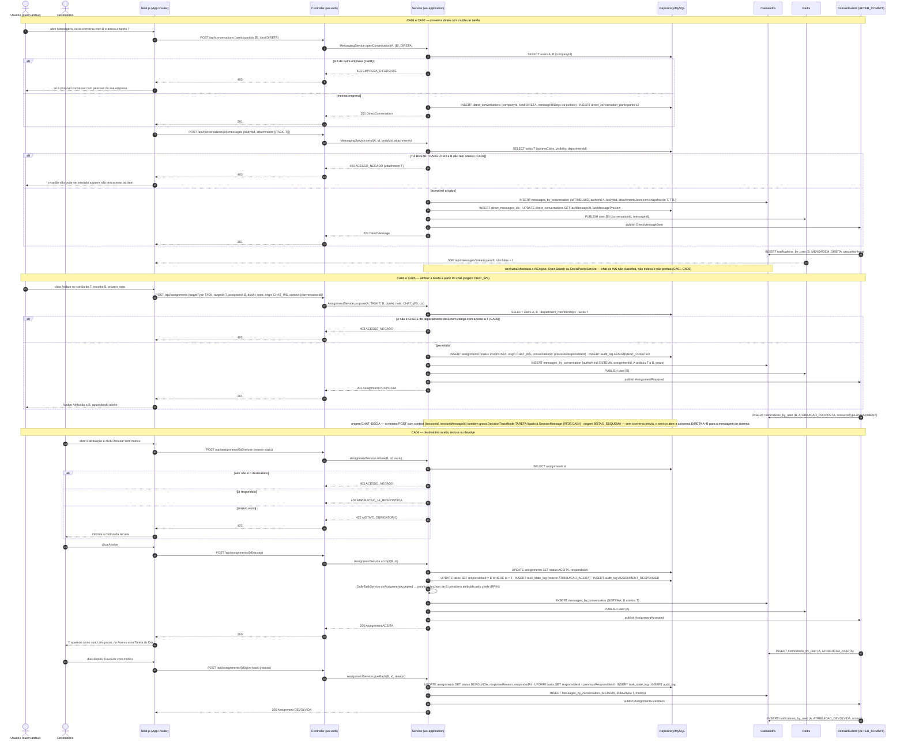
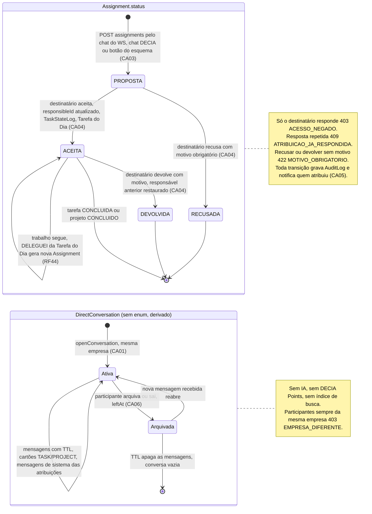
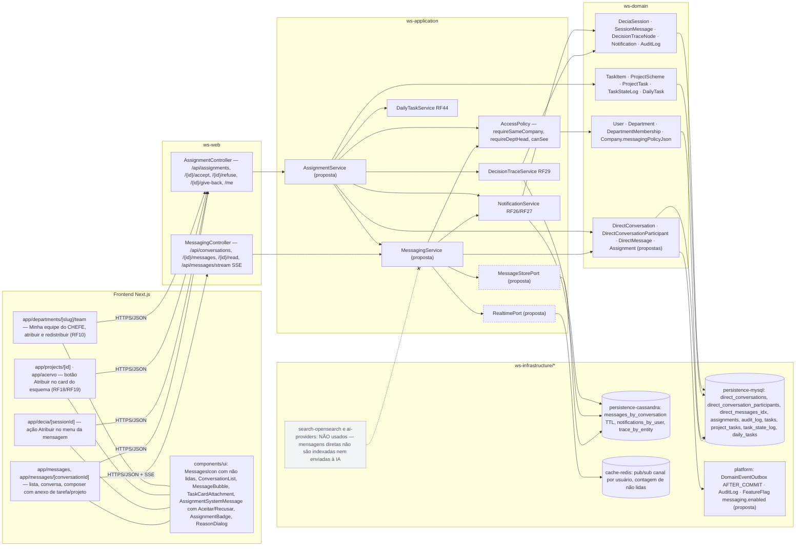

# RF46 — Utilizar chats de mensageria para comunicar-se com outros usuários e atribuir ou receber tarefas e projetos
**HU:** HU46 · **Sprint (board Work Station):** Product Backlog (card novo, sem corpo) · **Equivalente FAI:** — (sem equivalente direto; o mais próximo é o compartilhamento de look com mensagem, RF21 do FAI, e o botão "atribuir" é novo) · **Aba/rota:** **Mensagens** (`/messages`, `/messages/[conversationId]`), ícone na barra superior ao lado de Notificações; ação **Atribuir** no card de tarefa/projeto (RF18/RF19 "atribuir"), dentro do chat da sessão DECIA (`/decia/[sessionId]`) e na aba Minha equipe do CHEFE (RF10)
**Critérios de aceite cobertos:** RF46.CA01 · CA02 · CA03 · CA04 · CA05 · CA06 — **todos "(CA a confirmar)"**, derivados do título + HU46 (corpo do card vazio); relacionados: RF10 (chefe atribui tarefa/projeto, sem corpo), RF18/RF19 (interações "retornar" e "atribuir"), RF44.CA DELEGUEI (caminho inverso), RF29.CA04 (rastro quando a atribuição nasce no DECIA)

HU46: *como usuário do Work Station posso enviar mensagens e atribuir tarefas ou projetos para usuários conectados pelo chat do WS, pelo chat do DECIA ou clicando em botões de interação social em um esquema, para melhorar a gestão e o fluxo de trabalho da equipe.* O RF introduz um **chat de mensageria** (conversa direta 1:1 ou em grupo, **fora** da sessão DECIA) e a **atribuição** como transação com aceite: quem recebe pode **aceitar, recusar com motivo ou devolver**. Entidades novas (**propostas**, a incluir na TAXONOMIA): `DirectConversation`, `DirectConversationParticipant`, `DirectMessage` (Cassandra, TTL) e `Assignment`.

| | Chat do WS (RF46, `DirectConversation`) | Chat da sessão DECIA (RF4–RF17, `DeciaSession`) |
|---|---|---|
| Finalidade | comunicação operacional e atribuição | deliberação com tema, resumo e decisão |
| IA | **nenhuma** (sem classificação, sem perguntas, sem resumo) | classifica, detecta divergência, pergunta, resume, propõe decisão |
| DECIA Points | **não pontua** | pontua por qualidade (RF42) |
| Participantes | 1:1 ou grupo livre, mesma empresa | admin, membros, observadores, IA |
| Mensagens | `DirectMessage` em Cassandra `messages_by_conversation` (TTL) | `SessionMessage` em `messages_by_session` (TTL) |
| Rastro | `AuditLog` + nó `DecisionTrace` só quando a atribuição nasce no DECIA | `DecisionTrace` completo |
| Busca / memória institucional | **não indexado** (privado, LGPD) | indexado após encerramento (RF33) |
| Estados | conversa ativa/arquivada, `Assignment.status` | `SessionStatus` |

Critérios de aceite propostos (a confirmar):

- **RF46.CA01** Posso abrir uma conversa direta (1:1) ou em grupo com usuários **da mesma empresa**, enviar texto e anexar tarefa/projeto como cartão (`attachmentsJson` com `targetType` TASK · PROJECT e snapshot); a conversa fica fora da sessão DECIA, sem IA e sem DECIA Points. Usuário de outra empresa: **403 EMPRESA_DIFERENTE**.
- **RF46.CA02** Anexo com `accessClass` RESTRITO ou SIGILOSO só é aceito se **todos** os participantes têm acesso ao item (mesma visibilidade/departamento); caso contrário **403 ACESSO_NEGADO** e o cartão não é enviado.
- **RF46.CA03** A ação **Atribuir** — pelo chat do WS (`CHAT_WS`), pelo chat da sessão DECIA (`CHAT_DECIA`) ou pelo botão no card do esquema (`BOTAO_ESQUEMA`) — cria `Assignment` com `targetType` TASK · PROJECT, destinatário, prazo e nota, em status **PROPOSTA**, gera `DirectMessage` de sistema na conversa e `Notification ATRIBUICAO_PROPOSTA`.
- **RF46.CA04** O destinatário **aceita** (ACEITA → `TaskItem.responsibleId` / `ProjectTask.responsibleId` atualizados, `TaskStateLog`, alimenta a Tarefa do Dia RF44), **recusa com motivo** (RECUSADA, motivo obrigatório, **422 MOTIVO_OBRIGATORIO**) ou, depois de aceitar, **devolve com motivo** (DEVOLVIDA); quem atribuiu é notificado em cada resposta. Só o destinatário responde (**403**), e uma atribuição já respondida não muda (**409 ATRIBUICAO_JA_RESPONDIDA**).
- **RF46.CA05** CHEFE pode atribuir a membros do seu departamento (RF10, `requireDeptHead`); EMPREGADO pode **propor** a colegas da mesma empresa (sempre com aceite); toda atribuição grava `AuditLog`, e quando a origem é `CHAT_DECIA` também um nó `DecisionTraceNode TAREFA/PROJETO` ligado à mensagem (RF29.CA04).
- **RF46.CA06** Mensagens têm TTL configurável por empresa (`Company.pointsPolicyJson` não; nova chave `messagingPolicyJson`, proposta), não entram no índice de busca nem na memória institucional, e o usuário pode arquivar/sair da conversa; a lista de conversas e as não lidas chegam em tempo real (Redis pub/sub → WebSocket/SSE).

## 1. Diagrama de classes

```mermaid
classDiagram
direction LR

namespace ws_domain_mensageria_proposta {
  class DirectConversation {
    <<entity>>
    +id: UUID
    +companyId: UUID guard mesma empresa
    +kind: ConversationKind
    +title: String só GRUPO
    +createdBy: UUID
    +lastMessageAt: Instant
    +lastMessagePreview: String
    +messageTtlDays: int
    +archived: boolean
  }
  class DirectConversationParticipant {
    <<entity>>
    +id: UUID
    +conversationId: UUID
    +userId: UUID
    +joinedAt: Instant
    +leftAt: Instant
    +lastReadAt: Instant
    +muted: boolean
  }
  class DirectMessage {
    <<entity>>
    +id: TIMEUUID
    +conversationId: UUID partição
    +authorId: UUID
    +authorKind: String HUMANO SISTEMA
    +bodyMd: String
    +attachmentsJson: JSON targetType TASK PROJECT targetId snapshotJson
    +assignmentId: UUID
    +replyToMessageId: TIMEUUID
    +sentAt: Instant cluster
    +editedAt: Instant
    +deleted: boolean
  }
  class Assignment {
    <<entity>>
    +id: UUID
    +targetType: AssignmentTargetType
    +targetId: UUID TaskItem ou ProjectScheme
    +projectTaskId: UUID quando tarefa dentro de projeto
    +assignerId: UUID
    +assigneeId: UUID
    +companyId: UUID
    +departmentId: UUID
    +dueAt: LocalDate
    +note: String
    +origin: AssignmentOrigin
    +status: AssignmentStatus
    +conversationId: UUID
    +messageId: TIMEUUID
    +sessionId: UUID quando CHAT_DECIA
    +sessionMessageId: TIMEUUID
    +traceNodeId: UUID
    +respondedAt: Instant
    +responseReason: String obrigatório se RECUSADA ou DEVOLVIDA
    +previousResponsibleId: UUID
  }
}

namespace ws_domain_existentes {
  class User {
    <<entity>>
    +id: UUID
    +displayName: String
    +profileType: ProfileType
    +companyId: UUID
    +departmentId: UUID
  }
  class Department {
    <<entity>>
    +id: UUID
    +companyId: UUID
    +headUserId: UUID
  }
  class DepartmentMembership {
    <<entity>>
    +userId: UUID
    +departmentId: UUID
    +roleInDept: DeptRole
    +endedAt: Instant
  }
  class TaskItem {
    <<entity>>
    +id: UUID
    +ownerId: UUID
    +responsibleId: UUID
    +accessClass: AccessClassification
    +visibility: Visibility
    +state: TaskState
    +dueAt: LocalDate
  }
  class ProjectScheme {
    <<entity>>
    +id: UUID
    +ownerId: UUID
    +visibility: Visibility
    +status: ProjectStatus
  }
  class ProjectTask {
    <<entity>>
    +id: UUID
    +projectId: UUID
    +taskId: UUID
    +responsibleId: UUID
    +dueAt: LocalDate
  }
  class TaskStateLog {
    <<entity>>
    +taskId: UUID
    +actorId: UUID
    +reason: String ATRIBUICAO_ACEITA
  }
  class DailyTask {
    <<entity>>
    +userId: UUID
    +taskDate: LocalDate
    +taskId: UUID
    +priorityIndexJson: JSON atribuída pelo chefe
    +feedback: DailyFeedback DELEGUEI
    +delegatedToUserId: UUID
  }
  class DeciaSession {
    <<entity>>
    +id: UUID
    +status: SessionStatus
  }
  class SessionMessage {
    <<entity>>
    +id: TIMEUUID
    +sessionId: UUID
    +authorId: UUID
  }
  class DecisionTraceNode {
    <<entity>>
    +id: UUID
    +sessionId: UUID
    +nodeType: TraceNodeType TAREFA PROJETO
    +refId: UUID assignmentId
    +actorId: UUID
  }
  class Notification {
    <<entity>>
    +recipientId: UUID
    +actorId: UUID
    +type: NotificationType
    +category: String SOCIAL
    +resourceType: String ASSIGNMENT CONVERSATION
    +resourceId: UUID
    +groupKey: String
  }
  class AuditLog {
    <<entity>>
    +actorId: UUID
    +action: String ASSIGNMENT_CREATED ASSIGNMENT_RESPONDED
    +resourceType: String
    +resourceId: UUID
  }
  class Company {
    <<entity>>
    +id: UUID
    +messagingPolicyJson: JSON proposta ttlDays allowGroups
  }
}

namespace ws_domain_enums_propostos {
  class ConversationKind {
    <<enum>>
    DIRETA
    GRUPO
  }
  class AssignmentTargetType {
    <<enum>>
    TASK
    PROJECT
  }
  class AssignmentOrigin {
    <<enum>>
    CHAT_WS
    CHAT_DECIA
    BOTAO_ESQUEMA
  }
  class AssignmentStatus {
    <<enum>>
    PROPOSTA
    ACEITA
    RECUSADA
    DEVOLVIDA
  }
  class NotificationType {
    <<enum>>
    MENSAGEM_DIRETA proposta
    ATRIBUICAO_PROPOSTA proposta
    ATRIBUICAO_ACEITA proposta
    ATRIBUICAO_RECUSADA proposta
    ATRIBUICAO_DEVOLVIDA proposta
    MENCAO
    SISTEMA
  }
}

namespace ws_application {
  class MessagingService {
    <<service>>
    +openConversation(actorId, participantIds, kind, title) DirectConversation
    +send(actorId, conversationId, bodyMd, attachments) DirectMessage
    +list(actorId, page) List~DirectConversation~
    +history(actorId, conversationId, before, size) List~DirectMessage~
    +markRead(actorId, conversationId)
    +archive(actorId, conversationId)
    -requireSameCompany(actor, participants) 403 EMPRESA_DIFERENTE
    -requireAttachmentAccess(participants, attachments) 403 ACESSO_NEGADO
  }
  class AssignmentService {
    <<service>>
    +propose(assignerId, target, assigneeId, dueAt, note, origin, context) Assignment
    +accept(assigneeId, assignmentId) Assignment
    +refuse(assigneeId, assignmentId, reason) Assignment
    +giveBack(assigneeId, assignmentId, reason) Assignment
    +listForMe(userId, status) List~Assignment~
    -requireAssignee(actor, assignment) 403 ACESSO_NEGADO
    -requireOpen(assignment) 409 ATRIBUICAO_JA_RESPONDIDA
    -applyResponsible(assignment) TaskItem ou ProjectTask
  }
  class AccessPolicy {
    <<service>>
    +requireSameCompany(a, b)
    +requireDeptHead(user, departmentId)
    +canSee(user, target) boolean
  }
  class NotificationService {
    <<service>>
    +notify(recipientId, type, resource, payload)
  }
  class DailyTaskService {
    <<service>>
    +onAssignmentAccepted(assignment) ajusta índice de prioridade
  }
  class DecisionTraceService {
    <<service>>
    +appendNode(sessionId, nodeType, refId, actorId)
  }
  class RealtimePort {
    <<port>>
    +publish(channel, event)
    +subscribe(userId) Stream
  }
  class MessageStorePort {
    <<port>>
    +append(DirectMessage, ttl)
    +page(conversationId, before, size)
  }
}

namespace ws_web {
  class MessagingController {
    <<controller>>
    +GET_api_conversations()
    +POST_api_conversations(participantIds, kind, title)
    +GET_api_conversations_id_messages(before, size)
    +POST_api_conversations_id_messages(bodyMd, attachments)
    +POST_api_conversations_id_read()
    +GET_api_messages_stream() SSE
  }
  class AssignmentController {
    <<controller>>
    +POST_api_assignments(target, assigneeId, dueAt, note, origin, context)
    +POST_api_assignments_id_accept()
    +POST_api_assignments_id_refuse(reason)
    +POST_api_assignments_id_give_back(reason)
    +GET_api_assignments_me(status)
  }
}

namespace ws_infrastructure {
  class CassandraMessageStore {
    <<adapter>>
    messages_by_conversation TTL
  }
  class RedisPubSubAdapter {
    <<adapter>>
    canal por usuário
  }
  class CassandraNotificationWriter {
    <<adapter>>
    notifications_by_user
  }
}

DirectConversation "1" --> "*" DirectConversationParticipant
DirectConversation "1" --> "*" DirectMessage : Cassandra partição conversationId
DirectConversationParticipant "*" --> "1" User
DirectConversation "*" --> "1" Company : companyId guard
DirectMessage "*" --> "0..1" Assignment : assignmentId mensagem de sistema
DirectMessage ..> TaskItem : attachmentsJson TASK
DirectMessage ..> ProjectScheme : attachmentsJson PROJECT
Assignment "*" --> "1" User : assignerId
Assignment "*" --> "1" User : assigneeId
Assignment "*" --> "0..1" TaskItem : targetId quando TASK
Assignment "*" --> "0..1" ProjectScheme : targetId quando PROJECT
Assignment "*" --> "0..1" ProjectTask : projectTaskId
Assignment "*" --> "0..1" DirectConversation : conversationId
Assignment "*" --> "0..1" DeciaSession : sessionId quando CHAT_DECIA
Assignment "*" --> "0..1" SessionMessage : sessionMessageId
Assignment "*" --> "0..1" DecisionTraceNode : traceNodeId
Assignment ..> TaskStateLog : ACEITA atualiza responsável
Assignment ..> DailyTask : alimenta Tarefa do Dia RF44
Assignment ..> AuditLog : toda criação e resposta
Notification ..> Assignment : resourceType ASSIGNMENT
Notification ..> DirectConversation : resourceType CONVERSATION
Department "1" --> "*" DepartmentMembership
Company ..> DirectConversation : messagingPolicyJson ttlDays
DirectConversation --> ConversationKind
Assignment --> AssignmentTargetType
Assignment --> AssignmentOrigin
Assignment --> AssignmentStatus
Notification --> NotificationType

MessagingController ..> MessagingService
AssignmentController ..> AssignmentService
MessagingService ..> AccessPolicy : requireSameCompany, canSee anexos
MessagingService ..> MessageStorePort
MessagingService ..> RealtimePort
MessagingService ..> NotificationService : MENSAGEM_DIRETA
AssignmentService ..> AccessPolicy : requireDeptHead ou mesma empresa
AssignmentService ..> MessagingService : mensagem de sistema na conversa
AssignmentService ..> NotificationService : ATRIBUICAO_*
AssignmentService ..> DailyTaskService : onAssignmentAccepted
AssignmentService ..> DecisionTraceService : origem CHAT_DECIA
AssignmentService ..> AuditLog
CassandraMessageStore ..|> MessageStorePort
RedisPubSubAdapter ..|> RealtimePort
CassandraNotificationWriter ..> Notification

note for DirectConversation "proposta · tabela direct_conversations (MySQL) · companyId obrigatório, todos os participantes da mesma empresa (CA01) · archived por participante via leftAt (CA06)"
note for DirectMessage "proposta · Cassandra messages_by_conversation (partição conversationId, cluster sentAt, TTL = Company.messagingPolicyJson.ttlDays) + índice MySQL direct_messages_idx · não vai a OpenSearch nem a IA (CA06)"
note for Assignment "proposta · tabela assignments · status PROPOSTA → ACEITA | RECUSADA, ACEITA → DEVOLVIDA (CA04) · origin CHAT_WS, CHAT_DECIA, BOTAO_ESQUEMA (CA03) · responseReason obrigatório ao recusar ou devolver"
note for AssignmentService "CHEFE atribui a membros do departamento (RF10) · EMPREGADO propõe a colegas da mesma empresa · ninguém vira responsável sem aceitar (CA05)"
```

## 2. Diagrama de atividades

## 3. Diagrama de sequência

## 4. Máquina de estados

Entidade central: **`Assignment.status`** (enum proposto `AssignmentStatus` PROPOSTA · ACEITA · RECUSADA · DEVOLVIDA). A `DirectConversation` não tem enum de status (ativa/arquivada por participante via `leftAt` e `archived`), mostrada como composto auxiliar.

## 5. Diagrama de componentes

## 6. Rastreabilidade

| CA | Elemento do diagrama (classe / passo / mensagem / transição / componente) |
|---|---|
| RF46.CA01 (a confirmar — conversa 1:1/grupo na mesma empresa, sem IA e sem pontos) | `DirectConversation` (companyId, kind), `DirectConversationParticipant`, `DirectMessage.attachmentsJson`, enum `ConversationKind`, `MessagingService.openConversation/send/requireSameCompany`, `MessageStorePort`, `CassandraMessageStore` · Atividades `U1 → W1 → U2 → A1 → A2 → A3 403 EMPRESA_DIFERENTE / P1 → A4 → A7 → P2`, `I1` (IA não usada) · Sequência bloco "CA01 e CA02" (`POST /api/conversations`, `alt B é de outra empresa → 403 EMPRESA_DIFERENTE`, `INSERT messages_by_conversation … TTL`, nota "nenhuma chamada a AiEngine …") · Estado *DC* `[*] → Ativa` e nota · Componentes `app/messages`, `ConversationList`, `MessageBubble`, `persistence-cassandra messages_by_conversation`, `I5` (OpenSearch/IA não usados) |
| RF46.CA02 (a confirmar — anexo RESTRITO/SIGILOSO só se todos têm acesso) | `TaskItem.accessClass/visibility`, `MessagingService.requireAttachmentAccess`, `AccessPolicy.canSee` · Atividades `A4 → A5 → A6 403 ACESSO_NEGADO / A7 → W2` · Sequência `alt T é RESTRITO/SIGILOSO e B não tem acesso → 403 ACESSO_NEGADO {attachment T}` · Componente `TaskCardAttachment` |
| RF46.CA03 (a confirmar — Atribuir pelo chat WS, chat DECIA ou botão do esquema) | `Assignment` (targetType, assigneeId, dueAt, note, origin, status PROPOSTA, conversationId, sessionId, sessionMessageId), enums `AssignmentTargetType`, `AssignmentOrigin`, `AssignmentService.propose`, `DirectMessage.assignmentId` (mensagem de sistema), `Notification ATRIBUICAO_PROPOSTA` · Atividades `U3 → U4 → A8 → A11 → P4 → A14 → W3/W4` · Sequência bloco "CA03 e CA05" (`POST /api/assignments {… origin CHAT_WS …}`, `INSERT assignments (status PROPOSTA …)`, mensagem SISTEMA, notificação) e nota sobre `CHAT_DECIA`/`BOTAO_ESQUEMA` · Transição `[*] → PROPOSTA` · Componentes `F2` (Atribuir na mensagem DECIA), `F3` (botão no card), `AssignmentSystemMessage`, `AssignmentBadge`, `AssignmentController` |
| RF46.CA04 (a confirmar — aceitar, recusar com motivo, devolver) | `Assignment.status/respondedAt/responseReason/previousResponsibleId`, enum `AssignmentStatus`, `AssignmentService.accept/refuse/giveBack/requireAssignee/requireOpen/applyResponsible`, `TaskItem.responsibleId`, `ProjectTask.responsibleId`, `TaskStateLog`, `DailyTask`, `DailyTaskService.onAssignmentAccepted` · Atividades `U5 → U6 → A15 → A16 → A17 (403/409)`, `A18 → A19 422 MOTIVO_OBRIGATORIO`, `A20 → P4 → W5`, `A21 → W6` · Sequência bloco "CA04" (`alt … 403 / 409 / 422`, `UPDATE tasks SET responsibleId = B`, `DailyTaskService.onAssignmentAccepted`, `give-back` restaura `previousResponsibleId`) · Transições `PROPOSTA → ACEITA / RECUSADA`, `ACEITA → DEVOLVIDA` e nota · Componentes `ReasonDialog`, `DailyTaskService RF44` |
| RF46.CA05 (a confirmar — permissões CHEFE/EMPREGADO, AuditLog, rastro no DECIA) | `AccessPolicy.requireDeptHead/requireSameCompany`, `DepartmentMembership`, `AuditLog` (ASSIGNMENT_CREATED, ASSIGNMENT_RESPONDED), `DecisionTraceNode` (TAREFA/PROJETO, refId assignmentId), `DecisionTraceService.appendNode`, `Assignment.traceNodeId` · Atividades `A9 → A10 403`, `A11` (AuditLog), `A12 → A13` (rastro RF29.CA04), `A22` · Sequência `alt A não é CHEFE … nem colega com acesso → 403`, `INSERT audit_log ASSIGNMENT_CREATED/RESPONDED`, nota "origem CHAT_DECIA … DecisionTraceNode TAREFA" · Nota do estado *AS* · Componentes `F4` (Minha equipe RF10), `AccessPolicy`, `DecisionTraceService RF29`, `platform AuditLog` |
| RF46.CA06 (a confirmar — TTL por empresa, fora de busca/IA, arquivar, tempo real) | `DirectConversation.messageTtlDays/archived`, `DirectConversationParticipant.leftAt/muted/lastReadAt`, `Company.messagingPolicyJson` (proposta), `RealtimePort`, `RedisPubSubAdapter`, `MessagingService.archive/markRead` · Atividades `A7 → P3` (pub/sub), `W1` (não lidas em tempo real) · Sequência `PUBLISH user:{B}`, `SSE /api/messages/stream`, nota "não indexa" · Estado *DC* `Ativa → Arquivada`, `Arquivada → [*] : TTL apaga` · Componentes `MessagesIcon com não lidas`, `cache-redis pub/sub`, `I5` (search-opensearch e ai-providers não usados), `FeatureFlag messaging.enabled` |

> Dúvidas para `docs/DECISOES.md` (card novo, sem corpo — tudo a confirmar):
> 1. **Entidades propostas para a TAXONOMIA** (novo contexto "13. Mensageria & Atribuição" ou dentro de "8. Social"): `DirectConversation` (`direct_conversations`), `DirectConversationParticipant` (`direct_conversation_participants`), `DirectMessage` (Cassandra `messages_by_conversation`, partição `conversationId`, cluster `sentAt`, TTL + índice MySQL `direct_messages_idx`), `Assignment` (`assignments`); enums `ConversationKind` (DIRETA · GRUPO), `AssignmentTargetType` (TASK · PROJECT), `AssignmentOrigin` (CHAT_WS · CHAT_DECIA · BOTAO_ESQUEMA), `AssignmentStatus` (PROPOSTA · ACEITA · RECUSADA · DEVOLVIDA); novos valores de `NotificationType` (MENSAGEM_DIRETA, ATRIBUICAO_PROPOSTA, ATRIBUICAO_ACEITA, ATRIBUICAO_RECUSADA, ATRIBUICAO_DEVOLVIDA); `Company.messagingPolicyJson` (ttlDays, allowGroups); `TaskStateLog.reason ATRIBUICAO_ACEITA`; serviços `MessagingService`, `AssignmentService`; portas `MessageStorePort`, `RealtimePort`; `FeatureFlag messaging.enabled`.
> 2. Relação com **RF10** (chefe atribui) e com as interações "retornar"/"atribuir" dos cards RF18/RF19: `Assignment` é a mesma entidade para os três; "retornar" = `giveBack` (DEVOLVIDA)? Confirmar (ABAS_POR_PERFIL §9 P-02 e P-14).
> 3. O chat do WS é **separado** do DECIA (sem IA, sem pontos) — modelado assim para não criar dois chats deliberativos concorrentes (ABAS_POR_PERFIL §9 pergunta 10). Alternativa seria uma `DeciaSession` "leve", descartada aqui.
> 4. Grupos: permitir conversas em grupo já na primeira versão ou só 1:1? `ConversationKind.GRUPO` está modelado, mas pode ficar atrás de `messagingPolicyJson.allowGroups`.
> 5. Atribuição de **projeto** inteiro: altera `ProjectScheme.ownerId` ou só cria responsável? Modelei como responsável (sem trocar dono); confirmar. Para tarefa dentro de projeto, atualiza `ProjectTask.responsibleId` (campo `projectTaskId` na `Assignment`).
> 6. Posição no menu (ícone na barra superior + item Mensagens em Descobrir) e códigos HTTP (`403 EMPRESA_DIFERENTE`, `409 ATRIBUICAO_JA_RESPONDIDA`, `422 MOTIVO_OBRIGATORIO`) são propostas.

Tela/aba: `/messages` (esqueleto em `app/(shell)/messages/page.tsx`) · `/messages/[conversationId]` (esqueleto em `app/(shell)/messages/[conversationId]/page.tsx`) · `/decia/[sessionId]` (esqueleto em `app/(shell)/decia/[sessionId]/page.tsx`) · `/departments/[slug]/team` (esqueleto em `app/(shell)/departments/[slug]/team/page.tsx`)
