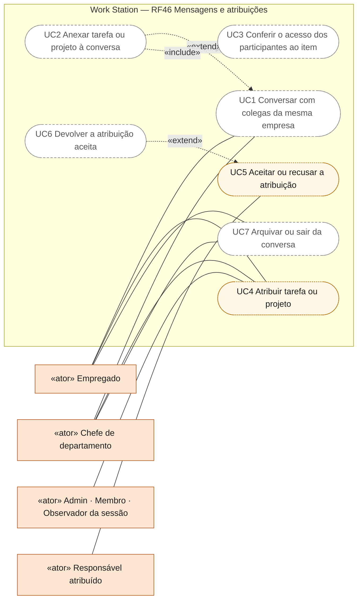
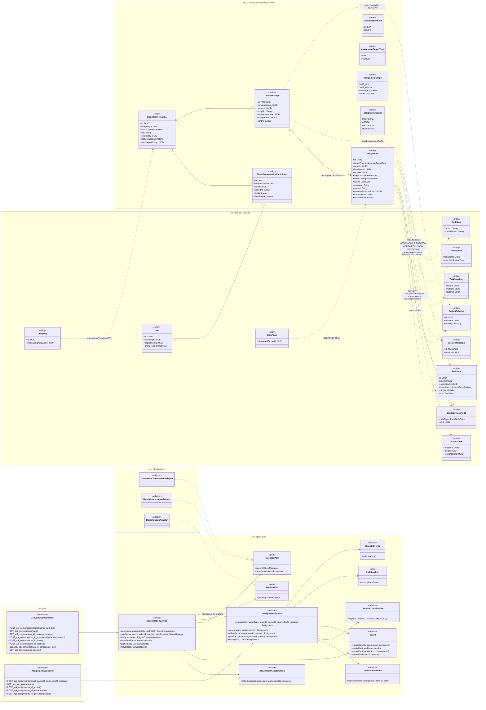
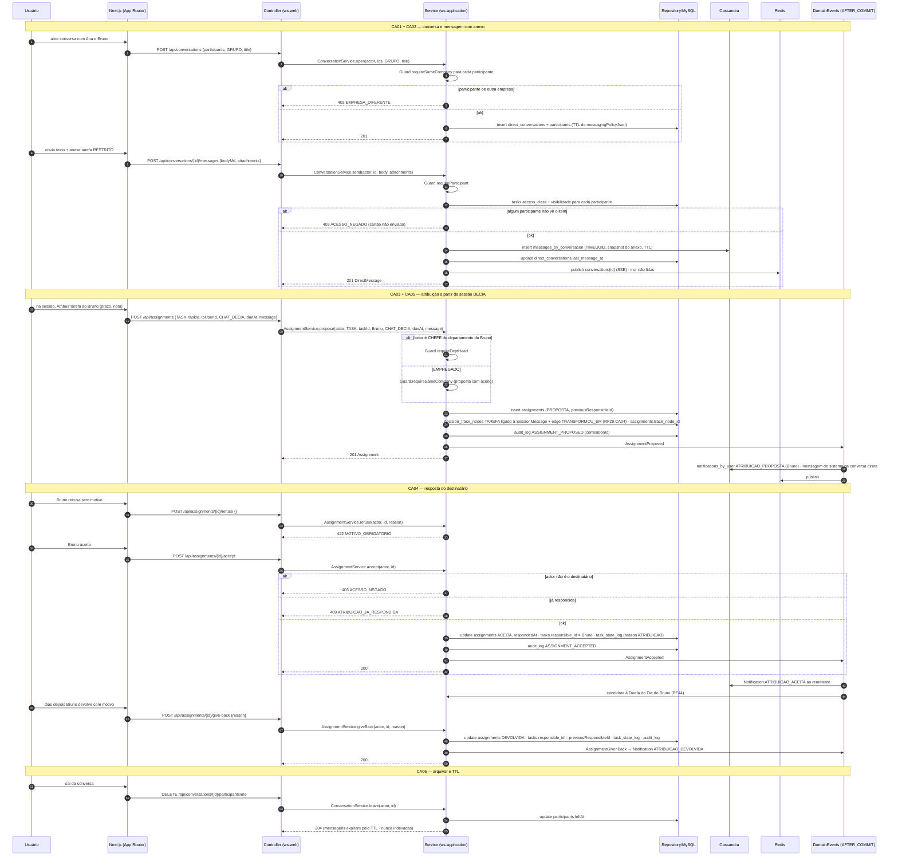
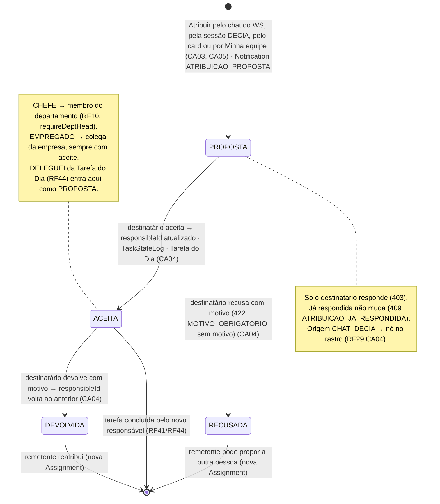
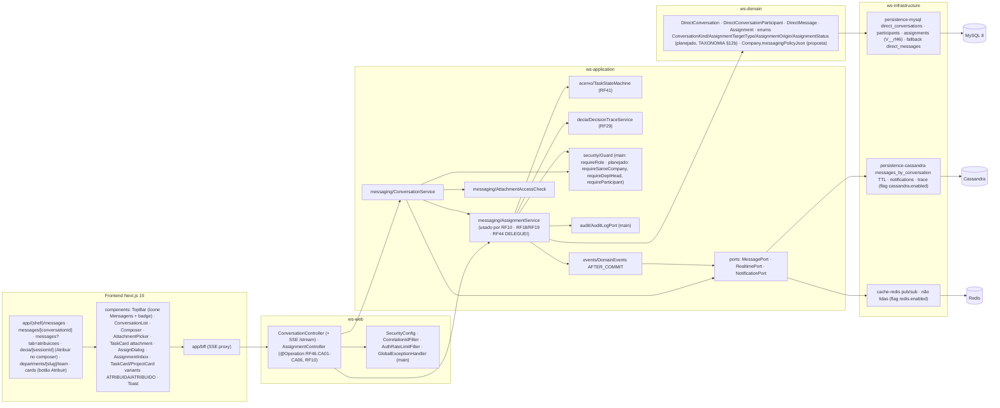

# RF46 — Utilizar chats de mensageria para comunicar-se com outros usuários e atribuir ou receber tarefas e projetos
**HU:** HU46 · **Sprint (board Work Station):** Product Backlog (card novo, sem corpo; fora da Sprint 4) · **Equivalente FAI:** — (sem equivalente direto; o mais próximo é o compartilhamento de look com mensagem, RF21 do FAI; "atribuir" é novo) · **Aba/rota:** **Mensagens** (`/messages`, `/messages/[conversationId]`, ícone na TopBar ao lado de Notificações), ação **Atribuir** no card de tarefa/projeto (RF18/RF19 "atribuir"), no composer da sessão DECIA (`/decia/[sessionId]`) e na aba Minha equipe do CHEFE (`/departments/[slug]/team`, RF10), caixa **Atribuições recebidas** (`/messages?tab=atribuicoes`)
**Critérios de aceite cobertos:** RF46.CA01 · CA02 · CA03 · CA04 · CA05 · CA06 — **todos "(CA a confirmar)"**, derivados do título + HU46 (corpo do card vazio) — regra: o **título do card** define o RF. Relacionados: RF10 (chefe atribui, sem corpo), RF18/RF19 ("retornar" e "atribuir"), RF44.CA04 (DELEGUEI é o caminho inverso), RF29.CA04 (rastro quando a atribuição nasce no DECIA).

HU46: *como usuário do Work Station posso enviar mensagens e atribuir tarefas ou projetos para usuários conectados pelo chat do WS, pelo chat do DECIA ou clicando em botões de interação social em um esquema, para melhorar a gestão e o fluxo de trabalho da equipe.* O RF introduz o **chat de mensageria** (conversa direta 1:1 ou em grupo, **fora** da sessão DECIA) e a **atribuição como transação com aceite**: quem recebe **aceita, recusa com motivo ou devolve**. Entidades da TAXONOMIA §12b (**proposta**): `DirectConversation`, `DirectConversationParticipant`, `DirectMessage` (Cassandra `messages_by_conversation`, TTL), `Assignment` (`AssignmentTargetType` TASK · PROJECT, `AssignmentOrigin` CHAT_WS · CHAT_DECIA · BOTAO_ESQUEMA · MINHA_EQUIPE, `AssignmentStatus` PROPOSTA · ACEITA · RECUSADA · DEVOLVIDA, `previousResponsibleId`, `traceNodeId`). Mesma entidade `Assignment` para RF10, RF18/RF19 e RF46.

| | Chat do WS (RF46, `DirectConversation`) | Chat da sessão DECIA (`DeciaSession`) |
|---|---|---|
| Finalidade | comunicação operacional e atribuição | deliberação com tema, resumo e decisão |
| IA | **nenhuma** | classifica, detecta divergência, pergunta, resume, propõe decisão |
| DECIA Points | **não pontua** | pontua por qualidade (RF42) |
| Participantes | 1:1 ou grupo, mesma empresa | admin, membros, observadores, IA |
| Mensagens | `DirectMessage` em Cassandra `messages_by_conversation` (TTL) | `SessionMessage` em `messages_by_session` (TTL) |
| Rastro | `AuditLog` + nó `DecisionTrace` só quando a atribuição nasce no DECIA | `DecisionTrace` completo |
| Busca / Memória | **não indexado** (privado, LGPD) | indexado após encerramento (RF33) |

**Critérios de aceite propostos (a confirmar):**
- **RF46.CA01** Posso abrir uma conversa direta (1:1) ou em grupo com usuários **da mesma empresa**, enviar texto e anexar tarefa/projeto como cartão (`attachmentsJson` com `targetType` TASK · PROJECT e snapshot); sem IA e sem DECIA Points. Usuário de outra empresa: **403 EMPRESA_DIFERENTE**. **Real (31/10/2026):** conversa 1:1 ou em grupo (até 10 pessoas) entre contas ATIVAS da mesma empresa por `POST /api/conversations` (`ConversationService`, V20 + V59 `direct_messages`/`direct_conversation_pairs`); a 1:1 de um par é única (iniciar de novo devolve a mesma, 200; a corrida é resolvida pelo `INSERT IGNORE` no par). Outra empresa, conta não ativa ou inexistente → a MESMA recusa `422 PARTICIPANTE_INDISPONIVEL`, sem dizer quem nem por quê (no lugar de `403 EMPRESA_DIFERENTE`, que confirmaria a conta). Texto puro até 4000 caracteres (nunca HTML; links aparecem como texto), cifrado em repouso; editar e apagar só a própria mensagem (marca "editada"; apagar deixa "mensagem removida"; de outra pessoa → 403). Só participantes leem e escrevem: quem não participa recebe o mesmo `404` de uma conversa inexistente (`ResourceAuthorizer.requireConversationParticipant`). Tela `/messages` real fora do laboratório (`components/messages`), DEMO igual no laboratório. Sem IA e sem DECIA Points. O cartão de tarefa/projeto anexado fica para depois da Onda 3.
- **RF46.CA02** Anexo com `accessClass` RESTRITO ou SIGILOSO só é aceito se **todos** os participantes têm acesso ao item; caso contrário **403 ACESSO_NEGADO** e o cartão não é enviado. **Real (31/10/2026):** pendente — nesta entrega as mensagens são só texto; anexos dependem da Onda 3.
- **RF46.CA03** A ação **Atribuir** — pelo chat do WS (`CHAT_WS`), pela sessão DECIA (`CHAT_DECIA`) ou pelo botão no card (`BOTAO_ESQUEMA`) — cria `Assignment` PROPOSTA com destinatário, prazo e nota, gera `DirectMessage` de sistema na conversa e `Notification ATRIBUICAO_PROPOSTA`. **Real (31/10/2026):** pendente — a atribuição pelo chat não entrou nesta entrega (só a conversa).
- **RF46.CA04** O destinatário **aceita** (ACEITA → `TaskItem.responsibleId` / `ProjectTask.responsibleId`, `TaskStateLog`, alimenta a Tarefa do Dia RF44), **recusa com motivo** (RECUSADA, **422 MOTIVO_OBRIGATORIO**) ou, depois de aceitar, **devolve com motivo** (DEVOLVIDA); quem atribuiu é notificado. Só o destinatário responde (**403**); atribuição já respondida não muda (**409 ATRIBUICAO_JA_RESPONDIDA**). **Real (31/10/2026):** pendente.
- **RF46.CA05** CHEFE atribui a membros do seu departamento (RF10, `requireDeptHead`); EMPREGADO **propõe** a colegas da mesma empresa (sempre com aceite); toda atribuição grava `AuditLog`, e com origem `CHAT_DECIA` também um nó `DecisionTraceNode TAREFA/PROJETO` ligado à mensagem (RF29.CA04). **Real (31/10/2026):** pendente para atribuições; as conversas já gravam `AuditLog` (CONVERSATION_STARTED, CONVERSATION_LEFT, DIRECT_MESSAGE_EDITED, DIRECT_MESSAGE_DELETED) só com ids e contagens, nunca o texto.
- **RF46.CA06** Mensagens têm TTL por empresa (`Company.messagingPolicyJson`, proposta), não entram em busca nem na Memória Institucional, e o usuário pode arquivar/sair da conversa; lista e não lidas em tempo real (Redis pub/sub → SSE/WebSocket). **Real (31/10/2026):** sair de grupo (`DELETE /api/conversations/{id}/participants/me`; a 1:1 não tem saída → `422 SAIR_SO_DE_GRUPO`); as mensagens não vão a busca, Memória, notificação, log nem auditoria; lista por atividade com última mensagem e não lidas por participante (`lastReadAt`, `POST …/read`); contador real na barra superior e na sidebar (`GET /api/conversations/unread`, a cada 30 s com a aba visível). "Tempo real" sem infraestrutura nova: polling leve de 5 s com a aba visível (`GET …/messages/changes?since=` com o `serverTime` anterior e 5 s de sobreposição; parado com a aba oculta), não Redis/SSE. Notificação `MENSAGEM_DIRETA` agrupada: no máximo UMA não lida por (destinatário, remetente, conversa) — a próxima só nasce depois que a anterior foi lida no sino ou ao ler a conversa (que marca as dela como lidas); nunca leva o texto. A anonimização da conta zera o texto das mensagens da pessoa ("mensagem removida") e a tira de todas as conversas. TTL por empresa (`messagingPolicyJson`) e arquivar seguem pendentes.

## 0. Diagrama de casos de uso

Quem conversa e quem atribui ou recebe trabalho pelo chat. Atores do catálogo de [`ATORES_E_ATRIBUTOS.md`](../../arquitetura/ATORES_E_ATRIBUTOS.md) §2 (o Responsável atribuído é o papel de quem recebe a atribuição); todos os casos são planejados — `/messages` é página-esqueleto e a caixa de atribuições de `components/social` roda só sobre o repositório DEMO.

| Caso de uso | Ator(es) | CAs | Situação |
|---|---|---|---|
| UC1 Conversar com colegas da mesma empresa (1:1 ou grupo, sem IA e sem pontos) | Empregado, Chefe de departamento | RF46.CA01, RF46.CA06 | planejado |
| UC2 Anexar tarefa ou projeto à conversa | — (estende UC1) | RF46.CA01 | planejado |
| UC3 Conferir o acesso dos participantes ao item (RESTRITO e SIGILOSO) | — (incluído por UC2) | RF46.CA02 | planejado |
| UC4 Atribuir tarefa ou projeto (chat do WS, chat do DECIA ou botão no card) | Empregado (propõe), Chefe de departamento (sua equipe), Admin · Membro · Observador da sessão | RF46.CA03, RF46.CA05 | planejado (DEMO em `components/social/DelegateDialog.tsx`) |
| UC5 Aceitar ou recusar a atribuição com motivo | Responsável atribuído | RF46.CA04 | planejado (DEMO em `components/social/AssignmentInbox.tsx`) |
| UC6 Devolver a atribuição aceita | — (estende UC5) | RF46.CA04 | planejado |
| UC7 Arquivar ou sair da conversa | Empregado, Chefe de departamento | RF46.CA06 | planejado |

## 1. Diagrama de classes

## 2. Diagrama de atividades

```mermaid
flowchart TD
  subgraph ATOR["Ator (remetente · destinatário · CHEFE)"]
    A0([Abre Mensagens]) --> A1["Abre conversa 1:1 ou grupo com colegas da empresa"]
    A1 --> A2["Escreve texto, anexa tarefa/projeto"]
    A3([Atribuir]) --> A4{"Origem"}
    A4 -->|chat do WS| A5["Botão Atribuir na conversa"]
    A4 -->|sessão DECIA| A6["Atribuir no composer da sessão"]
    A4 -->|card do esquema| A7["Botão Atribuir no TaskCard/ProjectCard"]
    A4 -->|Minha equipe| A8["CHEFE atribui a membro do departamento"]
    A9([Destinatário recebe]) --> A10{"Responde"}
    A10 -->|aceita| A11["Aceita"]
    A10 -->|recusa| A12["Recusa com motivo"]
    A13([Depois de aceitar]) --> A14["Devolve com motivo"]
    A15([Arquiva ou sai da conversa])
  end

  subgraph FE["Next.js / BFF (app/(shell)/messages · decia/[sessionId] · departments/[slug]/team · cards)"]
    F1["ConversationList (não lidas em tempo real via SSE) · POST /api/conversations"]
    F2["Composer + AttachmentPicker (TaskCard attachment) · POST /messages"]
    F3["AssignDialog (destinatário, prazo, nota) · POST /api/assignments"]
    F4["AssignmentInbox: aceitar / recusar (motivo) / devolver (motivo) · TaskCard variant ATRIBUIDA"]
    F5["TopBar ícone Mensagens com badge"]
  end

  subgraph WEB["ws-web"]
    W1["JWT · CorrelationIdFilter · rate limit por usuário (mensagens)"]
    W2["GlobalExceptionHandler"]
  end

  subgraph APP["ws-application"]
    P1{"Todos os participantes da mesma empresa?"}
    P1 -->|não| E1["403 EMPRESA_DIFERENTE"]
    P1 -->|sim| P2["DirectConversation + participantes · TTL de Company.messagingPolicyJson"]
    P3{"Guard.requireParticipant(conversa)?"}
    P3 -->|não| E2["403 ACESSO_NEGADO"]
    P4{"Anexo RESTRITO/SIGILOSO visível a todos os participantes?"}
    P4 -->|não| E3["403 ACESSO_NEGADO (cartão não enviado)"]
    P4 -->|sim| P5["DirectMessage (snapshot do anexo) · sem IA · sem DP · não indexa"]
    P6["RealtimePort.publish → SSE/WebSocket (lista, não lidas)"]
    P7{"Permissão de atribuir"}
    P7 -->|CHEFE para membro do seu departamento| P8["Guard.requireDeptHead"]
    P7 -->|EMPREGADO para colega da empresa| P9["Guard.requireSameCompany (proposta com aceite)"]
    P7 -->|outra empresa| E4["403 ACESSO_NEGADO"]
    P10["Assignment PROPOSTA (origin, dueAt, message, previousResponsibleId) · DirectMessage de sistema · Notification ATRIBUICAO_PROPOSTA · AuditLog ASSIGNMENT_PROPOSED"]
    P11{"origin = CHAT_DECIA?"}
    P11 -->|sim| P12["DecisionTraceService.append TAREFA/PROJETO ligado à SessionMessage (RF29.CA04) · traceNodeId"]
    P13{"Ator é o destinatário?"}
    P13 -->|não| E5["403 ACESSO_NEGADO"]
    P14{"Já respondida?"}
    P14 -->|sim| E6["409 ATRIBUICAO_JA_RESPONDIDA"]
    P15{"Motivo informado em recusar/devolver?"}
    P15 -->|não| E7["422 MOTIVO_OBRIGATORIO"]
    P16["ACEITA: TaskItem.responsibleId / ProjectTask.responsibleId = destinatário · TaskStateLog · alimenta Tarefa do Dia (RF44) · Notification ATRIBUICAO_ACEITA"]
    P17["RECUSADA: motivo · Notification ATRIBUICAO_RECUSADA ao remetente"]
    P18["DEVOLVIDA (só após ACEITA): responsibleId volta ao previousResponsibleId · Notification ATRIBUICAO_DEVOLVIDA"]
    P19["archive/leave: participante leftAt · conversa some da lista · mensagens expiram pelo TTL"]
  end

  subgraph DB["Persistência"]
    D1[("MySQL direct_conversations · direct_conversation_participants · assignments · tasks · project_tasks · task_state_log · audit_log")]
    D2[("Cassandra messages_by_conversation TTL · notifications_by_user · trace_by_entity · flag cassandra.enabled (fallback MySQL direct_messages)")]
    D3[("Redis pub/sub · não lidas · flag redis.enabled")]
  end

  A0 --> F1 --> W1 --> P1
  P2 --> D1
  A2 --> F2 --> W1 --> P3 -->|sim| P4
  P5 --> D2
  P5 --> P6 --> D3
  A5 --> F3
  A6 --> F3
  A7 --> F3
  A8 --> F3
  F3 --> W1 --> P7
  P8 --> P10
  P9 --> P10 --> D1
  P10 --> D2
  P10 --> P11
  P12 --> D2
  A9 --> F4
  A11 --> F4 --> W1 --> P13 -->|sim| P14 -->|não| P15
  A12 --> F4
  A14 --> F4
  P15 -->|sim ou aceitar| P16
  P15 --> P17
  P15 --> P18
  P16 --> D1
  P17 --> D1
  P18 --> D1
  A15 --> W1 --> P19 --> D1
  F5 -.-> D3
  E1 --> W2
  E2 --> W2
  E3 --> W2
  E4 --> W2
  E5 --> W2
  E6 --> W2
  E7 --> W2
```

## 3. Diagrama de sequência

## 4. Máquina de estados

Entidade central: `Assignment.status` (`AssignmentStatus`). A conversa não tem enum: participante ativo (`leftAt` nulo) ou saiu.

## 5. Diagrama de componentes

## 6. Rastreabilidade

| CA | Classe | Passo | Mensagem | Transição | Componente |
|---|---|---|---|---|---|
| RF46.CA01 (a confirmar) | `DirectConversation`, `DirectConversationParticipant`, `DirectMessage.attachmentsJson`, `ConversationService.open/send`, `Guard.requireSameCompany` (403 EMPRESA_DIFERENTE), sem IA/DP | A0 → A1 → A2 → F1 → F2 → P1 (403) → P2 → P3 → P5 | 1–8, 9–18 | — | `CS`, `ConversationList`, `Composer`, `CASA` |
| RF46.CA02 (a confirmar) | `AttachmentAccessCheck.allParticipantsCanSee`, `TaskItem.accessClass/visibility` (403 ACESSO_NEGADO, cartão não enviado) | P4 → E3 | 12–14 | — | `AAC` |
| RF46.CA03 (a confirmar) | `Assignment` (targetType, origin, dueAt, message), `AssignmentService.propose`, `DirectMessage` de sistema, `Notification ATRIBUICAO_PROPOSTA` | A3 → A4 → A5/A6/A7/A8 → F3 → P7 → P10 | 19–31 | `[*] → PROPOSTA` | `AS`, `AssignDialog`, `DE` |
| RF46.CA04 (a confirmar) | `AssignmentService.accept/refuse/giveBack`, `AssignmentStatus`, `TaskItem.responsibleId`/`ProjectTask.responsibleId`, `TaskStateLog`, `previousResponsibleId`, 403 · 409 ATRIBUICAO_JA_RESPONDIDA · 422 MOTIVO_OBRIGATORIO, RF44 | A9 → A10 → A11/A12 → A13 → A14 → F4 → P13 → P14 → P15 → P16/P17/P18 | 32–51 | `PROPOSTA → ACEITA / RECUSADA` · `ACEITA → DEVOLVIDA` | `AssignmentInbox`, `TSM` |
| RF46.CA05 (a confirmar) | `Guard.requireDeptHead` (RF10) / `requireSameCompany`, `AuditLog ASSIGNMENT_*`, `DecisionTraceService.append` com `traceNodeId` quando `origin CHAT_DECIA` (RF29.CA04) | P7 → P8/P9 · P11 → P12 | 22–27 | nota de ACEITA | `GD`, `AUD`, `TS` |
| RF46.CA06 (a confirmar) | `Company.messagingPolicyJson` (TTL), Cassandra TTL, não indexado (RF27/RF33), `ConversationService.archive/leave`, `RealtimePort` (Redis pub/sub → SSE) | P2 · P6 · A15 → P19 · F5 | 16–17, 52–56 | — | `RD`, `CASA`, `BFF (SSE proxy)` |
