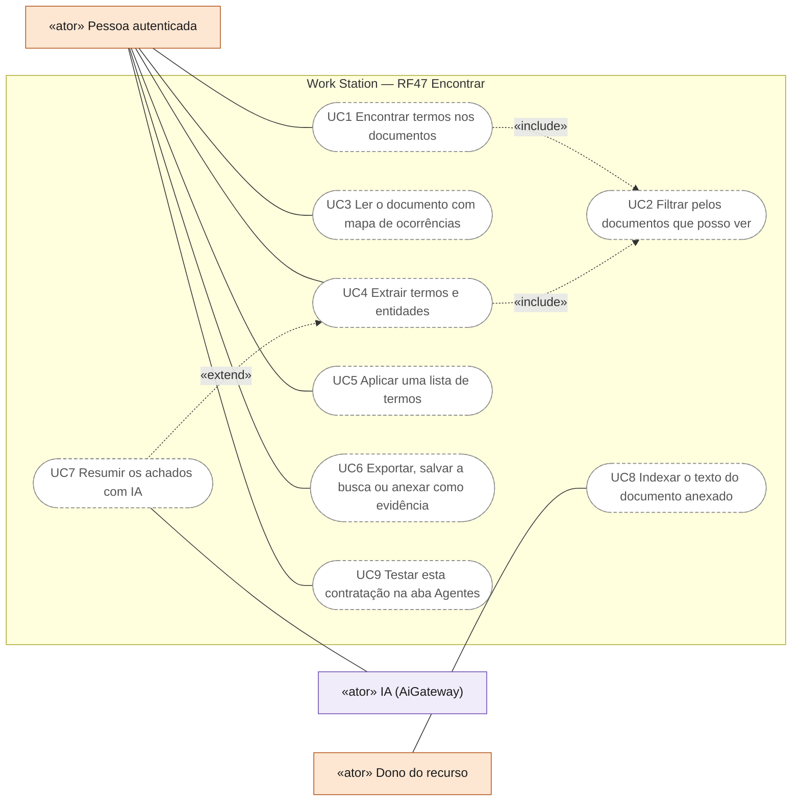
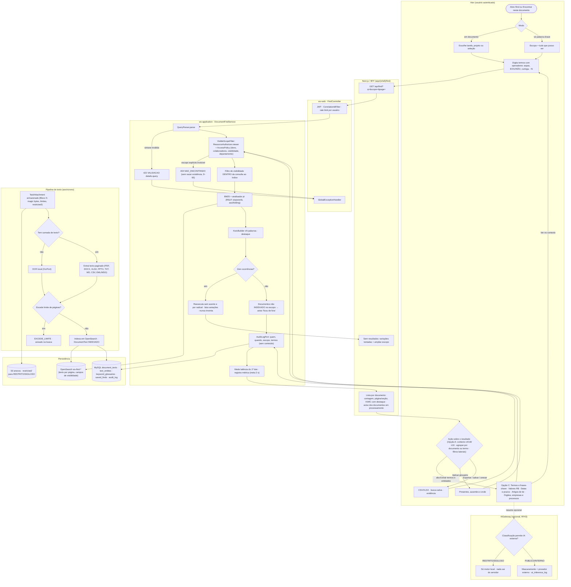
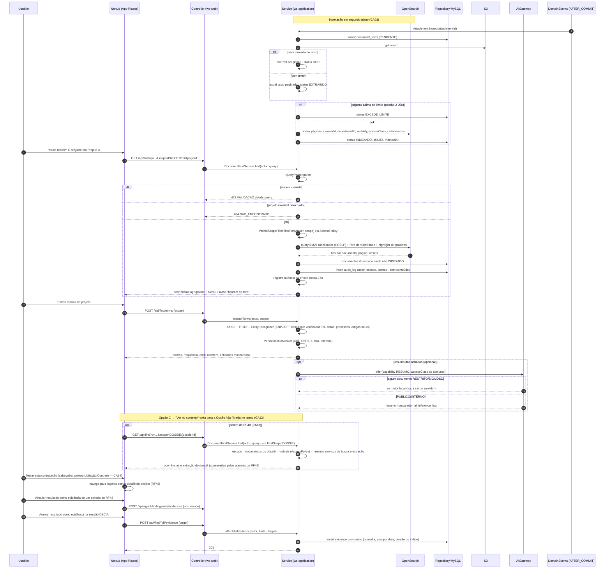
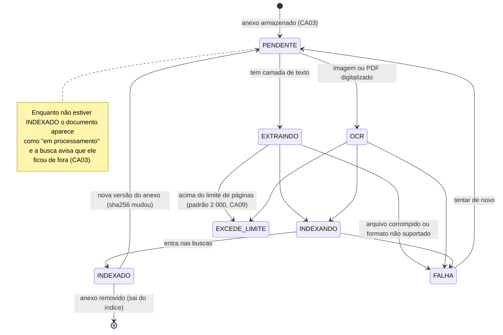
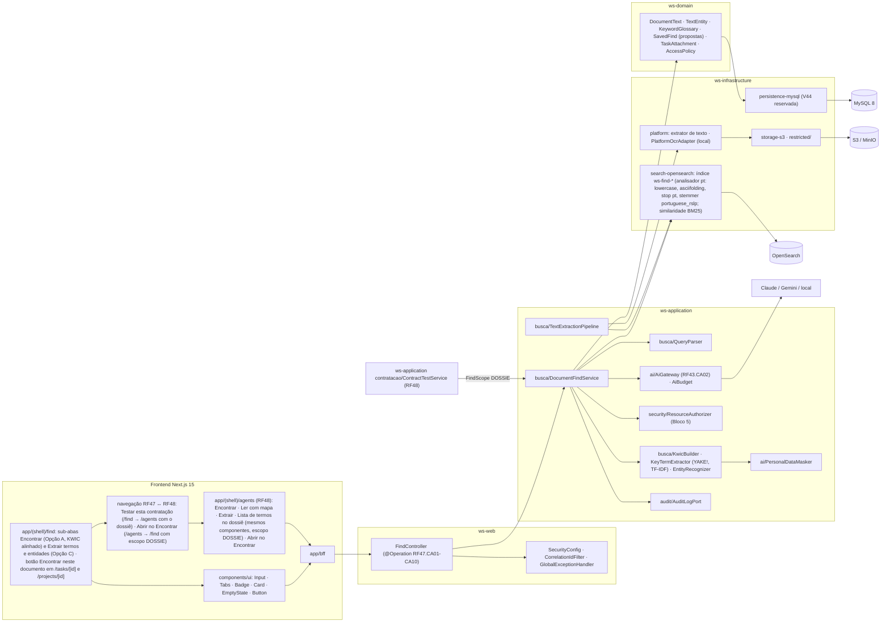

# RF47 — Encontrar palavras-chave em documentos — varrer documentos longos de tarefas e projetos para localizar e extrair termos, frases e palavras (com contexto e fonte)
**HU:** HU47 · **Sprint (board Work Station):** Product Backlog (card novo de 2026-10-06; fora da Sprint 4) · **Equivalente FAI:** — (sem equivalente; nasce do trabalho com documentos longos no setor público: editais, contratos, TRs, pareceres, atas) · **Aba/rota:** **Encontrar** (`/find`; também como botão "Encontrar neste documento" dentro de uma tarefa ou projeto — `/tasks/[id]`, `/projects/[id]`)
**Critérios de aceite cobertos:** RF47.CA01 · CA02 · CA03 · CA04 · CA05 · CA06 · CA07 · CA08 · CA09 · CA10 · CA11 · CA12 · CA13 · CA14 (corpo do card, inalterado; CA11–CA13 acrescentados pelo dono em 2026-10-06 com a escolha da interface; CA14 em comentário do card de 2026-10-06) — regra: o **título do card** define o RF e o corpo traz os próprios CAs.

> **HU47** — COMO: usuário autenticado POSSO: encontrar palavras-chave dentro dos documentos das minhas tarefas e projetos (ou em tudo que posso ver), ver cada ocorrência no seu contexto e extrair os termos, frases, valores, prazos e artigos de lei citados PARA: varrer documentos longos (editais, contratos, TRs, pareceres, atas) sem ler página por página e anexar o que encontrei como evidência

O Encontrar complementa o **Buscar** (RF27, que acha *itens*), a **Memória Institucional** (RF33, busca semântica) e a **detecção de palavras-chave do Criador de Tarefas** (RF20 · CA02): aqui o foco é **dentro do texto** dos anexos (`TaskAttachment`, RF41). **Modos** (card): (1) **Encontrar palavra-chave em documento** — escolho uma tarefa/projeto (ou vários) e procuro termos; (2) **Só encontrar palavra-chave** — procuro em todos os documentos que posso ver. **Base** (card): recuperação de informação clássica, **sem depender de IA** — índice invertido com ranking BM25 e analisador em português (stemming RSLP, stopwords, sem acento), concordância KWIC e extração de termos-chave sem treino (YAKE!). A IA é opcional (resumo dos achados) e passa pelo gate do RF43 (`AiGateway`, D-69). A visibilidade de cada documento é decidida pela mesma política do Bloco 5 (`AccessPolicy.visible` via `ResourceAuthorizer`, D-65/D-66), **aplicada como filtro dentro da consulta ao índice**, nunca depois da paginação.

**Interface escolhida (card, 2026-10-06): Opção A + Opção C.** A = tela principal de busca com palavra no contexto (KWIC); C = aba "Extrair termos e entidades" na mesma tela. As duas também existem dentro do RF48 (dossiê da contratação). Com o comentário do RF47.CA14 as ferramentas passam a quatro — A busca com palavra no contexto, **B leitor com mapa**, C extrair e **lista de termos** (CA05) —, e o esqueleto `/find` mostra as quatro como sub-abas (**Encontrar** · **Ler com mapa** · **Extrair termos e entidades** · **Lista de termos**) com o botão **Testar esta contratação** no cabeçalho; no RF48 são reaproveitadas com `FindScope.DOSSIE` (mesmos serviços, escopo fixado nos documentos do dossiê).

**Critérios de aceite (copiados do card RF47, sem alteração):**
- **RF47.CA01** Dado um usuário autenticado na aba Encontrar, quando informa um ou mais termos (com operadores: frase exata entre aspas, E/OU/NÃO, curinga `*`, proximidade "termo1 termo2"~N) e o escopo (uma tarefa, um projeto, uma seleção ou "tudo que posso ver"), então recebe a lista de ocorrências agrupada por documento, com contagem, página/seção e **trecho em contexto** (KWIC, ±N palavras) com o termo destacado.
- **RF47.CA02** Dado o escopo, quando a busca roda, então **só entram documentos que o usuário pode ver** (mesma política de acesso do Bloco 5: dono, colaboradores, visibilidade, departamento); documento invisível nunca aparece nem é contado.
- **RF47.CA03** Dado um documento PDF, DOCX, XLSX, PPTX, TXT, MD, CSV, EML/MSG ou imagem/PDF digitalizado, quando é anexado, então o texto é extraído (com OCR quando não há camada de texto) e indexado em segundo plano; enquanto não indexa, o documento aparece como "em processamento" e a busca avisa que ele ficou de fora.
- **RF47.CA04** Dado "Extrair termos" sobre um documento ou projeto, quando acionado, então o sistema lista os **termos e frases-chave** mais relevantes (YAKE!/TF-IDF) com frequência e onde ocorrem, e as **entidades** reconhecidas por padrão: CNPJ/CPF (mascarados conforme LGPD), valores em R$, datas e prazos, números de processo/protocolo, artigos de lei citados ("art. 75 da Lei 14.133/2021"), e-mails e telefones (mascarados).
- **RF47.CA05** Dado um **glossário/lista de termos** salvo (ex.: "cláusulas de risco": multa, rescisão, reajuste, garantia, subcontratação), quando aplico a lista a um documento, então vejo quais termos aparecem, quais **não** aparecem e onde — útil para conferir cláusulas obrigatórias.
- **RF47.CA06** Dado o resultado, quando exporto, então baixo CSV/XLSX com termo, documento, página, trecho e link; e posso **salvar a busca** e **anexar o resultado como evidência** numa tarefa, projeto ou sessão DECIA (RF29), com o rastro de origem.
- **RF47.CA07** Dado um documento classificado RESTRITO ou SIGILOSO, quando é indexado ou resumido, então todo o processamento fica no servidor do Work Station (nunca vai a IA externa — RF43.CA02); o trecho em contexto respeita a classificação de quem vê.
- **RF47.CA08** Dado que a busca não acha nada, quando o resultado volta, então o sistema mostra variações tentadas (sem acento, radical) e sugere ampliar o escopo — sem inventar ocorrência.
- **RF47.CA09** Dado um documento longo (até o limite configurado, padrão 2 000 páginas), quando busco, então a resposta da busca vem em até 2 s para o primeiro lote (paginação dos demais), medida e registrada.
- **RF47.CA10** Dado qualquer busca ou extração, quando executada, então fica na trilha de auditoria (quem, quando, escopo e termos — sem guardar o conteúdo dos documentos no log).
- **RF47.CA11 (Opção A — tela principal)** Dado a aba Encontrar, quando busco, então os resultados aparecem como linhas KWIC alinhadas (referência da página · contexto à esquerda · **termo** ao centro · contexto à direita), com controle do tamanho do contexto (±4 / ±8 / ±16 palavras), alternância **agrupar por documento / por termo**, filtros laterais (documentos com contagem, classificação) e as ações exportar, salvar busca e anexar como evidência; cada linha abre o documento na posição da ocorrência.
- **RF47.CA12 (Opção C — aba Extrair)** Dado a aba "Extrair termos e entidades" da mesma tela, quando aberta para o escopo atual, então vejo abas **Termos e frases-chave** (relevância e ocorrências), **Valores (R$)**, **Datas e prazos**, **Artigos de lei citados** e **Órgãos, empresas e processos** (CPF/CNPJ mascarados), cada linha com "onde aparece" e **"Ver no contexto"**, que abre a Opção A já filtrada naquele termo; sem IA, com "Resumir com IA" opcional.
- **RF47.CA13** Dado o RF48 (aba Agentes), quando abro um dossiê de contratação, então as Opções A e C estão disponíveis com o escopo fixado nos documentos daquele dossiê (ver RF48.CA13–CA15).

**Critério adicional (comentário do dono no card RF47, 2026-10-06, copiado sem alteração):**
- **RF47.CA14 (Conexão RF47 ↔ RF48)** Dado o Encontrar aberto num projeto de categoria Licitação/Contrato, quando aciono **"Testar esta contratação"** (botão no cabeçalho), então a aba Agentes (RF48) abre com o dossiê daquele projeto; e cada resultado do Encontrar pode ser "Vinculado como evidência" de um achado do RF48. As quatro ferramentas (A busca com palavra no contexto, B leitor com mapa, C extrair, lista de termos) são as mesmas usadas dentro do RF48 (RF48.CA13–CA19).

Entidades **propostas** (TAXONOMIA ainda não as tem; entram na onda do RF47 com a migration reservada V44, `docs/PLANO_EXECUCAO.md` §6): `DocumentText` (texto extraído por anexo e página, `IndexingStatus`), `TextEntity` (entidade reconhecida, valor mascarado), `KeywordGlossary`/`GlossaryTerm`, `SavedFind`. O conteúdo indexado vive no OpenSearch (`ws-find-*`); o MySQL guarda só metadados, status e hash.

## 0. Diagrama de casos de uso

Quem usa o Encontrar e para quê. Atores do catálogo de [`ATORES_E_ATRIBUTOS.md`](../../arquitetura/ATORES_E_ATRIBUTOS.md) §2 e permissões de [`ABAS_POR_PERFIL.md`](../../produto/ABAS_POR_PERFIL.md) (todos os perfis autenticados; visitante não vê, D-128); todos os casos são planejados — `/find` é página-esqueleto com as quatro ferramentas descritas e o link "Testar esta contratação".

| Caso de uso | Ator(es) | CAs | Situação |
|---|---|---|---|
| UC1 Encontrar termos nos documentos (palavra no contexto) | Pessoa autenticada | RF47.CA01, RF47.CA08, RF47.CA09, RF47.CA10, RF47.CA11 | planejado |
| UC2 Filtrar pelos documentos que posso ver (dentro da consulta ao índice) | — (incluído por UC1 e UC4) | RF47.CA02, RF47.CA07 | planejado |
| UC3 Ler o documento com mapa de ocorrências | Pessoa autenticada | RF47.CA11, RF47.CA14 | planejado |
| UC4 Extrair termos e entidades | Pessoa autenticada | RF47.CA04, RF47.CA10, RF47.CA12 | planejado |
| UC5 Aplicar uma lista de termos | Pessoa autenticada | RF47.CA05 | planejado |
| UC6 Exportar, salvar a busca ou anexar como evidência | Pessoa autenticada | RF47.CA06 | planejado |
| UC7 Resumir os achados com IA (opcional) | — (estende UC4), IA (AiGateway) | RF47.CA07, RF47.CA12 | planejado (RESTRITO e SIGILOSO nunca vão a provedor externo) |
| UC8 Indexar o texto do documento anexado (com OCR) | Dono do recurso | RF47.CA03 | planejado |
| UC9 Testar esta contratação na aba Agentes | Pessoa autenticada | RF47.CA13, RF47.CA14 | planejado (o esqueleto só tem o link `DossierLink`) |

## 1. Diagrama de classes

```mermaid
classDiagram
direction LR

namespace ws_domain_busca {
  class DocumentText {
    <<entity>>
    +id: UUID
    +attachmentId: UUID
    +taskId: UUID
    +pageCount: int
    +sha256: String
    +extractor: String
    +ocrUsed: boolean
    +status: IndexingStatus
    +accessClass: AccessClassification
    +indexedAt: Instant
    +failureReason: String
  }
  class IndexingStatus {
    <<enum>>
    PENDENTE
    EXTRAINDO
    OCR
    INDEXANDO
    INDEXADO
    FALHA
    EXCEDE_LIMITE
  }
  class FindQuery {
    <<value>>
    +raw: String
    +terms: List
    +operators: List
    +phrases: List
    +wildcards: List
    +proximity: int
    +scope: FindScope
    +kwicWindow: int
    +groupBy: String
    +dossierId: UUID
  }
  class FindScope {
    <<enum>>
    TAREFA
    PROJETO
    SELECAO
    TUDO_QUE_POSSO_VER
    DOSSIE
  }
  class Occurrence {
    <<value>>
    +documentId: UUID
    +page: int
    +section: String
    +offset: int
    +left: String
    +match: String
    +right: String
    +score: double
  }
  class TextEntity {
    <<entity>>
    +documentId: UUID
    +kind: EntityKind
    +maskedValue: String
    +normalized: String
    +page: int
    +validCheckDigit: boolean
  }
  class EntityKind {
    <<enum>>
    CNPJ
    CPF
    VALOR_BRL
    DATA
    PRAZO
    PROCESSO
    PROTOCOLO
    ARTIGO_LEI
    EMAIL
    TELEFONE
  }
  class KeyTerm {
    <<value>>
    +term: String
    +yakeScore: double
    +tfidf: double
    +frequency: int
    +pages: List
  }
  class KeywordGlossary {
    <<entity>>
    +id: UUID
    +ownerId: UUID
    +departmentId: UUID
    +name: String
    +visibility: Visibility
    +version: int
  }
  class GlossaryTerm {
    <<entity>>
    +glossaryId: UUID
    +term: String
    +variantsJson: JSON
    +required: boolean
  }
  class SavedFind {
    <<entity>>
    +id: UUID
    +ownerId: UUID
    +queryJson: JSON
    +scopeJson: JSON
    +createdAt: Instant
  }
}

namespace ws_domain_acervo {
  class TaskAttachment {
    <<entity>>
    +id: UUID
    +taskId: UUID
    +mediaObjectId: UUID
    +mimeType: String
    +sha256: String
    +ocrStatus: String
    +ocrTextRef: String
  }
  class TaskItem {
    <<entity>>
    +id: UUID
    +ownerId: UUID
    +departmentId: UUID
    +visibility: Visibility
    +accessClass: AccessClassification
    .. +45 campos ..
  }
}

namespace ws_domain_security {
  class AccessPolicy {
    <<service>>
    +visible(viewer, resource) boolean
    +decide(viewer, resource, action) AccessDecision
    +effectiveVisibility(visibility, classification)
  }
}

namespace ws_application {
  class DocumentFindService {
    <<service>>
    +find(actor, FindQuery) FindResultPage
    +extractTerms(actor, scope) TermReport
    +extractEntities(actor, scope, kind) EntityReport
    +seeInContext(actor, term, scope) FindResultPage
    +readWithMap(actor, documentId, query) ReaderView
    +linkToFinding(actor, occurrence, findingId) Evidence
    +applyGlossary(actor, glossaryId, documentId) GlossaryReport
    +export(actor, findId, format) Media
    +saveFind(actor, FindQuery) SavedFind
    +attachAsEvidence(actor, findId, target) Evidence
  }
  class QueryParser {
    <<service>>
    +parse(raw) FindQuery
  }
  class TextExtractionPipeline {
    <<service>>
    +onAttachmentStored(attachmentId)
    +extract(media) PagedText
  }
  class KwicBuilder {
    <<service>>
    +window(text, offset, n) Occurrence
  }
  class KeyTermExtractor {
    <<service>>
    +yake(text) List
    +tfidf(corpus, doc) List
  }
  class EntityRecognizer {
    <<service>>
    +recognize(text) List
  }
  class VisibleScopeFilter {
    <<service>>
    +filterFor(viewer, scope) IndexFilter
  }
  class ResourceAuthorizer {
    <<service>>
    +viewer(actor) Viewer
  }
  class PersonalDataMasker {
    <<service>>
    +mask(text) Masked
  }
  class AiGateway {
    <<service>>
    +infer(AiRequest) AiResult
  }
  class SearchIndexPort {
    <<port>>
    +index(DocumentText, pages)
    +query(FindQuery, IndexFilter, page) Hits
  }
  class OcrPort {
    <<port>>
    +ocr(media) PagedText
  }
  class AuditLogPort {
    <<port>>
    +record(AuditEvent)
  }
  class JobPort {
    <<port>>
    +enqueue(PipelineJob)
  }
}

namespace ws_web {
  class FindController {
    <<controller>>
    +GET_api_find(q, scope, page)
    +POST_api_find_terms(scope)
    +POST_api_find_glossaries_id_apply(documentId)
    +GET_api_find_id_export(format)
    +POST_api_find_saved()
    +POST_api_find_id_evidence(target)
  }
}

namespace ws_infrastructure {
  class OpenSearchFindAdapter {
    <<adapter>>
  }
  class DocumentTextExtractorAdapter {
    <<adapter>>
  }
  class PlatformOcrAdapter {
    <<adapter>>
  }
}

TaskItem "1" o-- "0..*" TaskAttachment
TaskAttachment "1" --> "0..1" DocumentText : texto extraido
DocumentText "1" o-- "0..*" TextEntity
KeywordGlossary "1" o-- "1..*" GlossaryTerm
FindController --> DocumentFindService
DocumentFindService --> QueryParser
DocumentFindService --> VisibleScopeFilter
DocumentFindService --> KwicBuilder
DocumentFindService --> KeyTermExtractor
DocumentFindService --> EntityRecognizer
DocumentFindService --> SearchIndexPort
DocumentFindService --> AuditLogPort
DocumentFindService --> AiGateway : resumo opcional
VisibleScopeFilter --> ResourceAuthorizer
VisibleScopeFilter --> AccessPolicy
EntityRecognizer --> PersonalDataMasker
TextExtractionPipeline --> OcrPort
TextExtractionPipeline --> SearchIndexPort
TextExtractionPipeline --> JobPort
OpenSearchFindAdapter ..|> SearchIndexPort
PlatformOcrAdapter ..|> OcrPort
DocumentTextExtractorAdapter ..> TextExtractionPipeline
```

## 2. Diagrama de atividades

## 3. Diagrama de sequência

## 4. Máquina de estados

Entidade central: `DocumentText.status` (`IndexingStatus`, **proposta**) — o RF47 não muda o estado da tarefa; o que ele controla é se o documento está pronto para ser encontrado.

## 5. Diagrama de componentes

## 6. Rastreabilidade

| CA | Classe | Passo | Mensagem | Transição | Componente |
|---|---|---|---|---|---|
| RF47.CA01 | `QueryParser` (aspas, E/OU/NÃO, `*`, `~N`), `FindQuery`, `FindScope`, `Occurrence`, `KwicBuilder.window` | A1 → A4 → F1 → P1 → P4 → P5 → F2 | 9–21 | — | `FS`, `QP`, `KW`, `OSA` |
| RF47.CA02 | `VisibleScopeFilter`, `ResourceAuthorizer.viewer`, `AccessPolicy.visible` (Bloco 5, D-65/D-66) — filtro **na consulta**, não depois | P2 → P3 · E2 | 15–16 | — | `RA`, `OSA` |
| RF47.CA03 | `TextExtractionPipeline`, `OcrPort`, `DocumentText`, `IndexingStatus` | X1 → X2 → X3/X4 → X5 → X7 · P8 | 1–8, 18 | `[*] → PENDENTE → … → INDEXADO` | `TEP`, `PLAT` |
| RF47.CA04 | `KeyTermExtractor.yake/tfidf`, `KeyTerm`, `EntityRecognizer`, `TextEntity`, `EntityKind`, `PersonalDataMasker` | A5 → A6 | 22–27 | — | `KW`, `MSK` |
| RF47.CA05 | `KeywordGlossary`, `GlossaryTerm.required`, `DocumentFindService.applyGlossary` | A5 → A7 | — (mesmo fluxo de busca por termo) | — | `FS` |
| RF47.CA06 | `DocumentFindService.export/saveFind/attachAsEvidence`, `SavedFind`, evidência com rastro (RF29) | A5 → A8 → P9 | 39–43 | — | `FS`, `MY` |
| RF47.CA07 | `AiGateway` (`allowsExternalAi`), `TextExtractionPipeline` e OCR **locais**, `restricted/` | I1 → I2 | 28–30 | — | `AIG`, `PLAT`, `S3A` |
| RF47.CA08 | `DocumentFindService` (reexecução sem acento e por radical), sugestão de ampliar escopo | P6 → P7 → F3 | — | — | `FS`, `OSA` |
| RF47.CA09 | limite de páginas, paginação, métrica de latência do 1º lote | X5 → X6 · P10 | 5, 20 | `→ EXCEDE_LIMITE` | `OSA`, `FS` |
| RF47.CA10 | `AuditLogPort.record` (actor, escopo, termos; **sem** conteúdo) | P9 | 19 | — | `AUD` |
| RF47.CA11 | Opção A: `Occurrence` (página, esquerda, termo, direita), `FindQuery.kwicWindow` (4/8/16), `FindQuery.groupBy` (documento/termo), filtros por documento e classificação, export/salvar/anexar | A4 → F1 → P5 → F2 → A5 | 9–21 | — | `R1`, `FS`, `KW` |
| RF47.CA12 | Opção C: `DocumentFindService.extractTerms/extractEntities/seeInContext`, `KeyTerm`, `TextEntity`/`EntityKind`, `PersonalDataMasker`; "Resumir com IA" via `AiGateway` | A5 → A6 → A4 | 22–30 | — | `R1`, `KW`, `MSK`, `AIG` |
| RF47.CA13 | `FindScope.DOSSIE`, `FindQuery.dossierId`, reuso por `ContractTestService` (RF48) | — | 31–34 | — | `R3`, `RF48S` → `FS` |
| RF47.CA14 | botão Testar esta contratação (→ `/agents` com o dossiê), `DocumentFindService.linkToFinding`, `readWithMap` (leitor B) e lista de termos compartilhados com o RF48 | A5 → A8 | 35–38 | — | `NAV`, `R1`, `R3`, `FS` |

### 6.1 Relação com RFs e blocos existentes

| Origem | Como o RF47 se liga | Diferença / regra |
|---|---|---|
| RF20 · CA02 (detecção por IA no Criador de Tarefas) | reaproveita o texto extraído do anexo (`ocrTextRef`) e a mesma fila de pipeline | RF20 detecta campos **para pré-preencher** uma tarefa; o RF47 **procura e extrai** termos sob demanda, sem IA |
| RF27 (Buscar) | mesma política de visibilidade (RF27.CA04) | Buscar acha **itens** (tarefa, projeto, pessoa); Encontrar acha **ocorrências dentro do texto** |
| RF29 (DECIA, Rastro de Decisão) | o resultado vira evidência numa sessão/decisão com rastro de origem (CA06) | a evidência guarda consulta, escopo e data — não um julgamento |
| RF33 (Memória Institucional) | complementar: semântica (embeddings) × lexical (BM25) | RF47 não usa embeddings; o RF33 pode reaproveitar o índice de texto |
| RF41 (Acervo, Anexos & Evidências) | os documentos são os `TaskAttachment` do acervo | nada muda no estado da tarefa |
| RF43 (IA do sistema) | resumo opcional passa pelo `AiGateway` (CA02 do RF43) | RESTRITO/SIGILOSO só motor local |
| Bloco 5 (`AccessPolicy`, `ResourceAuthorizer`, upload, `AiGateway`) | visibilidade, upload seguro e gate de IA | pré-requisito; o RF47 não cria política própria |

## 7. Matriz bibliográfica (referência → regra → onde → teste)

Regra do DECIA (`docs/decia/02_MATRIZ_BIBLIOGRAFICA.md`): toda referência produz uma regra **concreta e testável**; o que não tem fonte é marcado **HIPÓTESE DE PRODUTO** ou **PROPOSTA DE DESIGN**. Os testes listados são **planejados** (o RF47 ainda é só esqueleto; implementação na onda 4 do plano) e devem falhar sem a regra.

| # | Referência (§8) | Regra concreta | Onde se aplica | Teste que verifica (planejado) |
|---|---|---|---|---|
| B47-01 | Manning, Raghavan & Schütze (2008), cap. 1 (índice invertido, consulta booleana) | E/OU/NÃO viram consulta booleana sobre listas de postings; `NÃO` sozinho é recusado (exige pelo menos um termo positivo) → `422 VALIDACAO` | `QueryParser`, `OpenSearchFindAdapter` | `QueryParserTest.naoIsoladoE422` · `operadoresBooleanosViramBoolQuery` |
| B47-02 | Manning, Raghavan & Schütze (2008), §2.4 (índice posicional, consultas de frase) | frase entre aspas e proximidade `"a b"~N` exigem posições; o índice guarda offsets e N ≤ 50 (acima → 422) | mapeamento do índice `ws-find-*`, `QueryParser` | `QueryParserTest.proximidadeAcimaDe50E422` · `FindIT.fraseExataNaoCasaPalavrasSeparadas` |
| B47-03 | Manning, Raghavan & Schütze (2008), §3.2 (consultas com curinga) | curinga só no fim do termo (`rescis*`), com prefixo de ≥ 3 caracteres; curinga inicial recusado (custo) | `QueryParser` | `QueryParserTest.curingaComPrefixoCurtoE422` |
| B47-04 | Manning, Raghavan & Schütze (2008), §2.2 (stop words, normalização, stemming) + Orengo & Huyck (2001) | analisador pt: `lowercase` → `asciifolding` → stop words pt → `stemmer` **portuguese_rslp** (implementação RSLP do Lucene); o mesmo analisador na indexação e na consulta | `OpenSearchFindAdapter` (settings do índice) | `AnalisadorPtIT.contratacoesEContratacaoTemMesmoRadical` · `semAcentoCasaComAcento` |
| B47-05 | Robertson & Zaragoza (2009), BM25; Manning, Raghavan & Schütze (2008), §11.4.3 | ranking por BM25 com k1 = 1,2 e b = 0,75 (padrão do Lucene, dentro da faixa recomendada pelas fontes), versionados no mapeamento; mudança de parâmetro exige reindexação registrada | `OpenSearchFindAdapter` | `RankingBm25IT.documentoComMaisOcorrenciasRelativasSobe` · `parametrosBm25Versionados` |
| B47-06 | Luhn (1960), KWIC; Manning, Raghavan & Schütze (2008), §8.7 (snippets) | cada ocorrência mostra ±N palavras à esquerda e à direita (N ∈ {4, 8, 16}, padrão 8 — CA11) com o termo destacado e alinhado ao centro, sem cortar palavra ao meio | `KwicBuilder`, `Occurrence` | `KwicBuilderTest.janelaDeNPalavrasSemCortarPalavra` · `termoNoInicioDoDocumento` |
| B47-07 | Campos et al. (2020), YAKE! | termos-chave por YAKE! **sem treino e por documento** (n-gramas até 3, deduplicação por similaridade); menor escore = mais relevante; resultado determinístico para o mesmo texto | `KeyTermExtractor.yake` | `YakeTest.mesmoTextoMesmaLista` · `menorEscorePrimeiro` |
| B47-08 | Manning, Raghavan & Schütze (2008), §6.2 (tf-idf) | no escopo PROJETO/SELECAO, TF-IDF sobre o conjunto de documentos do escopo complementa o YAKE! (termos que distinguem um documento dos demais) | `KeyTermExtractor.tfidf` | `TfIdfTest.termoPresenteEmTodosTemIdfZero` |
| B47-09 | Lei 13.709/2018 (LGPD), art. 6º, III (necessidade) e art. 46 (segurança) | CPF, e-mail e telefone **sempre mascarados** na lista de entidades e na exportação; CNPJ mascarado parcialmente (pessoa jurídica, mas pode identificar empresário individual); valor completo nunca vai ao `audit_log` | `EntityRecognizer`, `PersonalDataMasker`, exportação | `EntityRecognizerTest.cpfSempreMascarado` · `ExportTest.csvSemCpfAberto` · `AuditTest.semConteudoNoLog` |
| B47-10 | Resolução CNJ nº 65/2008 (numeração única de processos) | número de processo judicial reconhecido no formato `NNNNNNN-DD.AAAA.J.TR.OOOO` e marcado válido só se o dígito verificador (módulo 97) confere | `EntityRecognizer` (`EntityKind.PROCESSO`) | `EntityRecognizerTest.processoCnjComDvInvalidoNaoValida` |
| B47-11 | Lei 14.133/2021 (exemplo do card: "art. 75 da Lei 14.133/2021") | citação de lei reconhecida como `ARTIGO_LEI` com normalização `{lei, artigo, parágrafo, inciso}`; o RF47 **só reconhece**, não interpreta | `EntityRecognizer` | `EntityRecognizerTest.art75DaLei14133Normalizado` |

**Sem fonte — marcados:**

| Ideia | Marcação | Onde |
|---|---|---|
| CNPJ/CPF validados por dígito verificador (módulo 11) antes de virar entidade | PROPOSTA DE DESIGN (algoritmo público da Receita Federal; referência normativa a confirmar) | `EntityRecognizer` |
| Janela KWIC padrão de ±8 palavras (entre as três do CA11), N de proximidade ≤ 50, prefixo de curinga ≥ 3 | PROPOSTA DE DESIGN (calibrar com uso real) | `KwicBuilder`, `QueryParser` |
| Meta de 2 s para o 1º lote e limite de 2 000 páginas | HIPÓTESE DE PRODUTO (do card; sem fonte bibliográfica) — medida e registrada (CA09) | métrica `find.first_page.latency` |
| Variações "sem acento, radical" quando nada é achado | PROPOSTA DE DESIGN (derivada de B47-04) | `DocumentFindService` |
| Glossários por departamento ("cláusulas de risco") | HIPÓTESE DE PRODUTO (do card) | `KeywordGlossary` |
| Motor de OCR local (ex.: Tesseract) e extrator de texto | PROPOSTA DE DESIGN — escolha registrada em D-127 | `PlatformOcrAdapter` |
| Leitor com mapa (B), as quatro ferramentas compartilhadas com o RF48 e o botão Testar esta contratação | HIPÓTESE DE PRODUTO (comentário do card, RF47.CA14) | `readWithMap`, navegação |

Para a Opção A (CA11), B47-06 rege as janelas ±4/±8/±16 (o "N" do KWIC passa a ser uma das três); para a Opção C (CA12), B47-07…B47-11 regem as abas de termos e entidades.

**Tamanho da matriz:** 7 referências bibliográficas/normativas → 11 regras (B47-01…B47-11), cada uma com teste planejado; 7 itens marcados sem fonte.

## 8. Referências (ABNT NBR 6023)

BRASIL. Lei nº 13.709, de 14 de agosto de 2018. Lei Geral de Proteção de Dados Pessoais (LGPD). **Diário Oficial da União**: seção 1, Brasília, DF, 15 ago. 2018.

BRASIL. Lei nº 14.133, de 1º de abril de 2021. Lei de Licitações e Contratos Administrativos. **Diário Oficial da União**: seção 1, Brasília, DF, 1 abr. 2021.

CAMPOS, Ricardo; MANGARAVITE, Vítor; PASQUALI, Arian; JORGE, Alípio; NUNES, Célia; JATOWT, Adam. YAKE! Keyword extraction from single documents using multiple local features. **Information Sciences**, v. 509, p. 257-289, 2020.

CONSELHO NACIONAL DE JUSTIÇA (Brasil). Resolução nº 65, de 16 de dezembro de 2008. Dispõe sobre a uniformização do número dos processos nos órgãos do Poder Judiciário. Brasília, DF: CNJ, 2008. (data a confirmar)

LUHN, H. P. Keyword-in-context index for technical literature (KWIC index). **American Documentation**, v. 11, n. 4, p. 288-295, 1960.

MANNING, Christopher D.; RAGHAVAN, Prabhakar; SCHÜTZE, Hinrich. **Introduction to information retrieval**. Cambridge: Cambridge University Press, 2008.

ORENGO, Viviane Moreira; HUYCK, Christian. A stemming algorithm for the Portuguese language. *In*: INTERNATIONAL SYMPOSIUM ON STRING PROCESSING AND INFORMATION RETRIEVAL, 8., 2001, Laguna de San Rafael. **Proceedings** […]. Los Alamitos: IEEE, 2001. p. 186-193. (páginas a confirmar)

ROBERTSON, Stephen; ZARAGOZA, Hugo. The probabilistic relevance framework: BM25 and beyond. **Foundations and Trends in Information Retrieval**, v. 3, n. 4, p. 333-389, 2009.

Tela/aba: `/find` (esqueleto em `app/(shell)/find/page.tsx`, sub-abas Encontrar (A) · Ler com mapa (B) · Extrair termos e entidades (C) · Lista de termos, botão Testar esta contratação)
