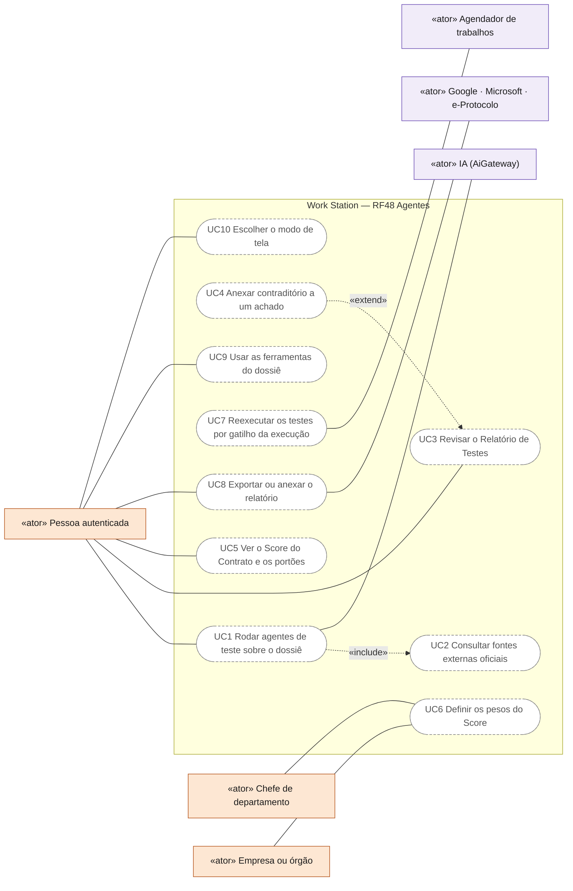
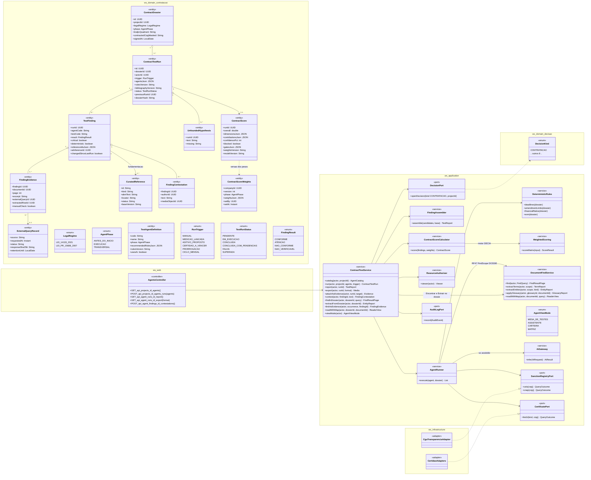
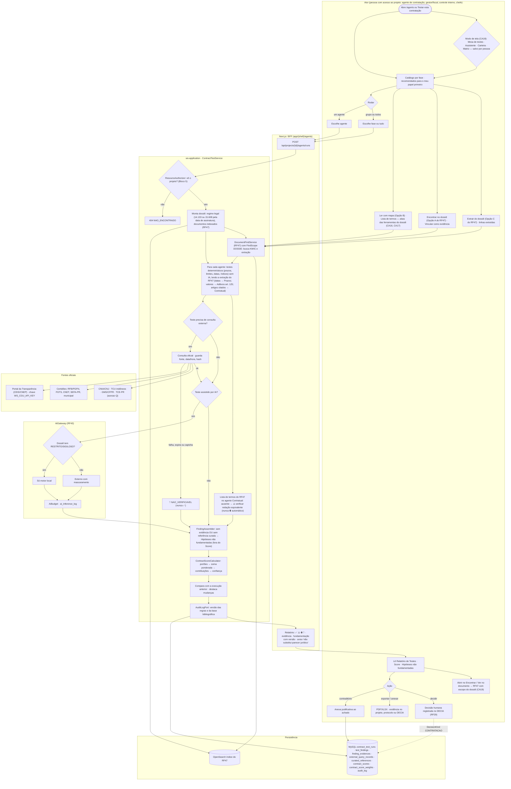
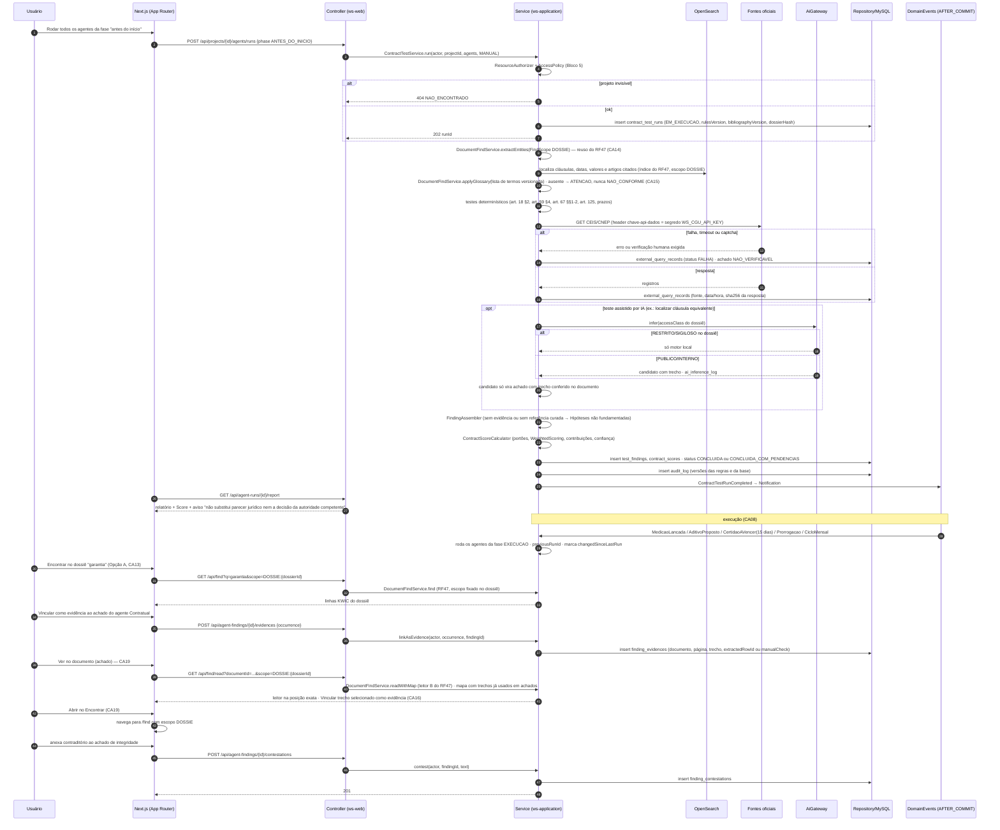
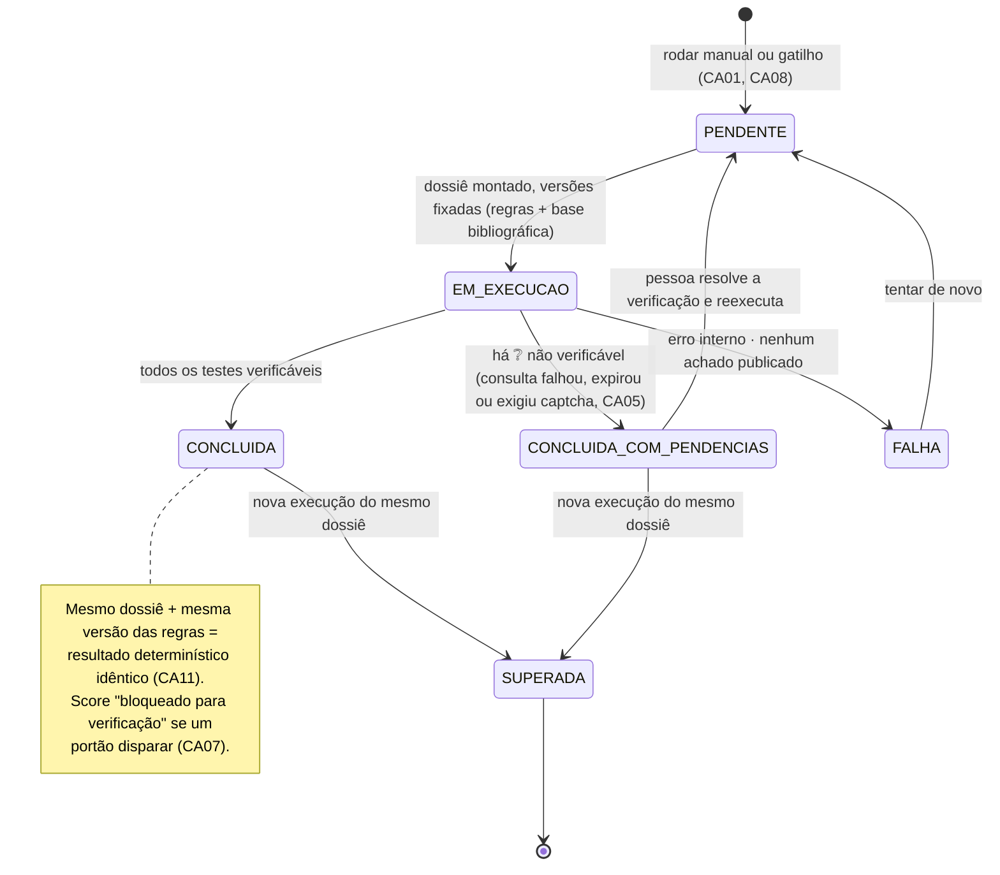
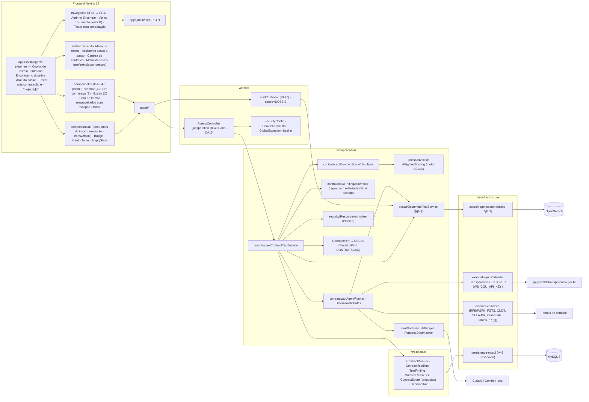

# RF48 — Utilizar a aba Agentes (Copilot de testes) para testar uma contratação antes do início e durante a execução — testes contratuais, orçamentários, comportamentais, de integridade e Score do Contrato, sempre com fundamentação bibliográfica
**HU:** HU48 · **Sprint (board Work Station):** Product Backlog (card novo de 2026-10-06; fora da Sprint 4) · **Equivalente FAI:** — (sem equivalente) · **Aba/rota:** **Agentes** (`/agents`; também "Testar esta contratação" dentro de um projeto de categoria Licitação/Contrato — `/projects/[id]`)
**Critérios de aceite cobertos:** RF48.CA01 · CA02 · CA03 · CA04 · CA05 · CA06 · CA07 · CA08 · CA09 · CA10 · CA11 · CA12 · CA13 · CA14 · CA15 · CA16 · CA17 · CA18 · CA19 (corpo do card, inalterado; CA13–CA15 acrescentados pelo dono em 2026-10-06 com a escolha da interface do RF47; CA16–CA19 em comentário do card de 2026-10-06) — regra: o **título do card** define o RF e o corpo traz os próprios CAs.

> **HU48** — COMO: agente de contratação, gestor/fiscal de contrato, controle interno ou chefe POSSO: rodar o Copilot de testes da aba Agentes sobre uma contratação, antes do início e na execução (testes contratuais, orçamentários, comportamentais, de integridade e Score do Contrato), com evidência e bibliografia real em cada achado PARA: saber se vale a pena contratar e acompanhar o contrato com base verificável, com a decisão mantida pela autoridade competente

**Não é o Copilot sugestivo do RF26: aqui o Copilot testa.** Cada agente executa uma bateria de testes sobre o dossiê de uma contratação (tarefas e anexos do projeto: ETP, TR, edital, proposta, contrato, medições, aditivos, certidões) e devolve **achados verificáveis, nunca uma decisão**. Contexto do card: contratações do **Governo do Estado do Paraná** — Lei 14.133/2021, regulamentação estadual (Decreto Estadual 10.086/2022) e, para contratos antigos, Lei Estadual 15.608/2007. **Regra de ouro (IA é crítica, não decisora):** todo achado traz evidência (trecho do documento, certidão ou consulta com data) **e** fundamentação normativa e bibliográfica real (artigo de lei, norma técnica, obra acadêmica ou profissional, com seção/página quando houver). **Sem referência, não é achado.** Pessoas cuidam do jurídico: o Copilot não decide questão jurídica, não aprova nem reprova empresa ou contrato e não redige conteúdo.

**Encontrar e Extrair no dossiê (card — Opções A + C do RF47, escolhidas em 2026-10-06):** a mesa de testes traz "Encontrar no dossiê" (busca com palavra no contexto) e "Extrair do dossiê" (termos, valores, prazos, artigos de lei, entidades), com o escopo fixado nos documentos da contratação; a extração alimenta os testes e cada ocorrência pode virar evidência de um achado. Implementação: o RF48 **não tem busca própria** — chama `DocumentFindService.find/extractTerms/extractEntities` do RF47 com `FindScope.DOSSIE` (documentos do dossiê ∩ visíveis pela `AccessPolicy`).

**Critérios de aceite (copiados do card RF48, sem alteração):**
- **RF48.CA01** Dado um usuário com acesso ao projeto, quando abre a aba Agentes, então vê o catálogo por fase (antes do início / execução / transversais) com o que cada agente testa, a base normativa e a bibliografia, e pode rodar um agente, um grupo ou todos sobre o dossiê.
- **RF48.CA02** Dado um teste executado, quando termina, então o **Relatório de Testes** lista cada achado com: teste, resultado (✅ conforme · ⚠️ atenção · ⛔ não conforme · ❔ não verificável), **evidência** (documento e trecho, ou consulta externa com fonte, data e hora) e **fundamentação** (artigo e/ou referência bibliográfica real da base curada, com versão).
- **RF48.CA03** Dado qualquer achado sem evidência ou sem referência da base bibliográfica curada, quando o relatório é montado, então ele **não aparece como achado**; no máximo aparece em "Hipóteses não fundamentadas", rotulado assim e fora do Score.
- **RF48.CA04** Dado o papel do Copilot, quando ele responde, então **não sugere nem redige conteúdo** (isso é RF26/RF13), não aprova nem reprova empresa ou contrato e não emite parecer jurídico; o relatório traz "não substitui parecer jurídico nem a decisão da autoridade competente" e a decisão é humana, registrada (RF29).
- **RF48.CA05** Dado uma consulta externa (ex.: CEIS/CNEP pela API do Portal da Transparência, certidões), quando falha, expira ou exige verificação humana (captcha), então o teste fica ❔ **não verificado**, nunca ✅; cada consulta guarda fonte, data e hora e o hash da resposta.
- **RF48.CA06** Dado o agente de Integridade, quando roda, então usa **só fontes oficiais públicas**, descreve fatos ("sanção X registrada no CEIS em dd/mm/aaaa, vigente até…") sem juízo moral sobre pessoas, mascara dados pessoais (LGPD) e permite à área anexar contraditório ou justificativa ao achado.
- **RF48.CA07** Dado o Score do Contrato, quando calculado, então mostra o valor geral, cada dimensão, o peso e a contribuição de cada uma, e a confiança (proporção de testes verificáveis). **Portões não se compensam**: sanção impeditiva vigente, certidão obrigatória vencida ou ⛔ crítico marcam o contrato "bloqueado para verificação", qualquer que seja o número. Pesos versionados e definidos por EMPRESA/CHEFE.
- **RF48.CA08** Dado um contrato em execução, quando ocorre um gatilho (medição lançada, aditivo proposto, certidão a vencer em 15 dias, prorrogação ou ciclo mensal), então os agentes da fase rodam de novo e as mudanças desde a última execução aparecem destacadas.
- **RF48.CA09** Dado um dossiê com documento RESTRITO ou SIGILOSO, quando um agente usa IA, então o processamento é só local (RF43.CA02), com orçamento de IA (RF43) e registro em `ai_inference_log`; os testes determinísticos (prazos, limites, datas, índices) rodam sem IA.
- **RF48.CA10** Dado o relatório, quando exporto ou anexo, então gero PDF/XLSX com sumário, achados, evidências e bibliografia citada (ABNT NBR 6023), e posso anexá-lo como evidência no projeto, no processo (protocolo) ou numa sessão DECIA.
- **RF48.CA11** Dado o mesmo dossiê e a mesma versão das regras, quando reexecuto os testes determinísticos, então o resultado é idêntico (reprodutível); a versão das regras e da base bibliográfica fica no relatório e na trilha de auditoria.
- **RF48.CA12** Dado o perfil de quem roda (agente de contratação, gestor ou fiscal do contrato, controle interno, chefe), quando o catálogo abre, então os agentes recomendados para aquele papel vêm primeiro (art. 8, art. 117, art. 169); o acesso ao dossiê segue a política de autorização do Bloco 5.
- **RF48.CA13 (Opção A no dossiê)** Dado o dossiê aberto na aba Agentes, quando aciono **"Encontrar no dossiê"**, então uso a busca com palavra no contexto do RF47 (CA11) com o escopo fixado nos documentos da contratação; cada ocorrência tem **"Vincular como evidência"**, que a liga a um achado existente ou a uma verificação manual registrada no relatório.
- **RF48.CA14 (Opção C no dossiê)** Dado o dossiê, quando aciono **"Extrair do dossiê"**, então vejo a extração do RF47 (CA12) — termos, valores, datas e prazos, artigos de lei, órgãos/empresas/processos — e os agentes determinísticos a usam como entrada (ex.: Prazos e vigência lê as datas; Aditivos compara valores com o limite do art. 125; Contratual confere artigos citados); cada achado aponta a linha extraída e o trecho de origem.
- **RF48.CA15** Dado uma lista de termos do RF47 (ex.: "cláusulas de risco"), quando o agente Contratual a aplica, então termo ausente vira ⚠️ atenção ("verificar redação equivalente"), nunca ⛔ automático, e o resultado entra no relatório com a lista e a versão usadas.

**Critérios adicionais (comentário do dono no card RF48, 2026-10-06 — "todas as opções do RF47 entram no Copilot e o RF48 ganha alternativas de tela"; copiados sem alteração):**
- **RF48.CA16 (Opção B no dossiê)** Dado o dossiê, quando aciono **"Ler com mapa"**, então abro o leitor do RF47 com as ocorrências destacadas, o mapa lateral mostrando também os trechos já usados em achados (cor e forma pelo resultado) e a ação "Vincular trecho selecionado como evidência" de um achado ou de uma verificação manual.
- **RF48.CA17 (Ferramentas do dossiê em abas)** Dado o dossiê, quando abro as ferramentas, então vejo as abas **Encontrar (A) · Ler com mapa (B) · Extrair (C) · Lista de termos**, todas com escopo fixo nos documentos da contratação e com a mesma política de acesso e de sigilo do RF47.
- **RF48.CA18 (Modos de tela principal)** Dado a aba Agentes, quando escolho o modo de visualização, então posso alternar entre: **Mesa de testes** (dossiê · agentes por fase · score), **Assistente passo a passo** (contratação → fase e papel → testes recomendados → rodar → revisar), **Carteira de contratos** (várias contratações com score, portões, achados abertos e próximo gatilho; para gestor, controle interno e chefe) e **Matriz de testes** (agentes × documentos com o pior resultado em cada célula); o modo escolhido fica salvo por pessoa.
- **RF48.CA19 (Conexão RF47 ↔ RF48)** Dado qualquer tela do RF48, quando aciono "Abrir no Encontrar", então o RF47 abre com o escopo do dossiê; e, dado o RF47 aberto num projeto de categoria Licitação/Contrato, quando aciono **"Testar esta contratação"**, então a aba Agentes abre com aquele dossiê. "Ver no documento" num achado abre o leitor (B) na posição exata; uma linha do Extrair (C) leva ao achado que a usou.

Entidades **propostas** (TAXONOMIA ainda não as tem; migration reservada V45, `docs/PLANO_EXECUCAO.md` §6): `ContractDossier` (projeto + documentos + regime legal), `TestAgentDefinition` (17 agentes, versão), `ContractTestRun`, `TestFinding` (`FindingResult` CONFORME · ATENCAO · NAO_CONFORME · NAO_VERIFICAVEL), `FindingEvidence`, `ExternalQueryRecord` (fonte, data/hora, hash), `CuratedReference` (base bibliográfica curada e versionada), `UnfoundedHypothesis`, `FindingContestation` (contraditório), `ContractScore` + `ContractScoreWeights` (versionados). Os achados usam o índice de texto e a extração do RF47 (escopo `DOSSIE`) para localizar cláusulas e trechos; `FindingEvidence` guarda `extractedRowId` (linha extraída) e o trecho de origem (CA14).

## 0. Diagrama de casos de uso

Quem usa a aba Agentes e para quê. Atores do catálogo de [`ATORES_E_ATRIBUTOS.md`](../../arquitetura/ATORES_E_ATRIBUTOS.md) §2 (agente de contratação, gestor, fiscal e controle interno são pessoas autenticadas com acesso ao projeto; os pesos do Score são de EMPRESA e CHEFE); todos os casos são planejados — `/agents` é página-esqueleto (o modo de tela vale só na visita).

| Caso de uso | Ator(es) | CAs | Situação |
|---|---|---|---|
| UC1 Rodar agentes de teste sobre o dossiê (um, um grupo ou todos) | Pessoa autenticada (com acesso ao projeto), IA (AiGateway) | RF48.CA01, RF48.CA09, RF48.CA11, RF48.CA12 | planejado |
| UC2 Consultar fontes externas oficiais (sanções, certidões) | — (incluído por UC1) | RF48.CA05, RF48.CA06 | planejado |
| UC3 Revisar o Relatório de Testes (achado só com evidência e referência) | Pessoa autenticada | RF48.CA02, RF48.CA03, RF48.CA04 | planejado |
| UC4 Anexar contraditório a um achado | — (estende UC3) | RF48.CA06 | planejado |
| UC5 Ver o Score do Contrato e os portões | Pessoa autenticada | RF48.CA07 | planejado |
| UC6 Definir os pesos do Score (versionados) | Chefe de departamento, Empresa ou órgão | RF48.CA07 | planejado |
| UC7 Reexecutar os testes por gatilho da execução | Agendador de trabalhos | RF48.CA08 | planejado |
| UC8 Exportar ou anexar o relatório (projeto, protocolo ou sessão DECIA) | Pessoa autenticada, Google · Microsoft · e-Protocolo | RF48.CA10 | planejado |
| UC9 Usar as ferramentas do dossiê (Encontrar, Ler com mapa, Extrair, Lista de termos) | Pessoa autenticada | RF48.CA13, RF48.CA14, RF48.CA15, RF48.CA16, RF48.CA17, RF48.CA19 | planejado (abas descritas no esqueleto) |
| UC10 Escolher o modo de tela (Mesa, Assistente, Carteira, Matriz) | Pessoa autenticada | RF48.CA18 | planejado (o esqueleto alterna o modo sem salvar por pessoa) |

## 1. Diagrama de classes

## 2. Diagrama de atividades

## 3. Diagrama de sequência

## 4. Máquina de estados

Entidade central: `ContractTestRun.status` (`TestRunStatus`, **proposta**).

## 5. Diagrama de componentes

## 6. Rastreabilidade

| CA | Classe | Passo | Mensagem | Transição | Componente |
|---|---|---|---|---|---|
| RF48.CA01 | `ContractTestService.catalog/run`, `TestAgentDefinition`, `AgentPhase` | A0 → A1 → A2 → F1 | 1–6 | `[*] → PENDENTE` | `CTS`, Tabs por fase |
| RF48.CA02 | `TestFinding`, `FindingResult`, `FindingEvidence`, `CuratedReference` (com `baseVersion`) | P8 → F2 → A5 | 21, 23, 26–27 | — | `FA` |
| RF48.CA03 | `FindingAssembler.assemble`, `UnfoundedHypothesis` (fora do Score) | P8 | 21 | — | `FA` |
| RF48.CA04 | aviso fixo no relatório, ausência de ação "redigir"/"aprovar", `DecisionPort` só abre decisão humana | A9 · F2 | 27 | — | `CTS`, `DEC` |
| RF48.CA05 | `SanctionRegistryPort`, `CertificatePort`, `ExternalQueryRecord` (fonte, data/hora, sha256) | P4 → P5 → P6 | 12–16 | `EM_EXECUCAO → CONCLUIDA_COM_PENDENCIAS` | `CGU`, `CERT` |
| RF48.CA06 | agente Integridade só com fontes oficiais, `PersonalDataMasker`, `FindingContestation` | P5 · A6 → A7 | 12–16, 44–48 | — | `CGU`, `AIG` |
| RF48.CA07 | `ContractScoreCalculator`, `ContractScore` (geral, dimensões, pesos, contribuições, confiança, portões), `ContractScoreWeights` versionado, `WeightedScoring` | P9 | 22 | nota de CONCLUIDA | `CSC`, `WS` |
| RF48.CA08 | `RunTrigger`, `previousRunId`, `TestFinding.changedSinceLastRun` | P10 | 28–29 | `CONCLUIDA → SUPERADA` | `CTS` |
| RF48.CA09 | `AiGateway` (`allowsExternalAi`), `AiBudget`, `ai_inference_log`, `DeterministicRules` sem IA | P3 · I1 → I2/I3 → I4 | 17–20 | — | `AIG`, `AR` |
| RF48.CA10 | `ContractTestService.export/attachAsEvidence`, bibliografia ABNT NBR 6023 de `CuratedReference.abntText` | A6 → A8 | 26–27 | — | `CTS` |
| RF48.CA11 | `ContractTestRun.rulesVersion/bibliographyVersion/dossierHash`, `DeterministicRules` puras, `AuditLogPort` | P11 | 6, 24 | nota de CONCLUIDA | `AR`, `MY` |
| RF48.CA12 | `TestAgentDefinition.recommendedRolesJson` (art. 8, art. 117, art. 169), `ResourceAuthorizer` | A1 · P1 | 3–4 | — | `RA`, `CTS` |
| RF48.CA13 | `ContractTestService.findInDossier/linkAsEvidence`, `DocumentFindService.find` (RF47.CA11) com `FindScope.DOSSIE`, `FindingEvidence.manualCheck` | A10 → P12 | 30–37 | — | `R1`, `R4`, `FC`, `DFS` |
| RF48.CA14 | `ContractTestService.extractFromDossier`, `DocumentFindService.extractEntities` (RF47.CA12), `DeterministicRules` lendo datas/valores/artigos, `FindingEvidence.extractedRowId` | A11 → P12 → P3 | 8–9 | — | `DFS`, `AR` |
| RF48.CA15 | `DocumentFindService.applyGlossary` (RF47.CA05) no agente Contratual; ausente → `ATENCAO`, nunca `NAO_CONFORME`; lista e versão no relatório | P13 | 10 | — | `AR`, `FA` |
| RF48.CA16 | `DocumentFindService.readWithMap` (leitor B do RF47) com escopo DOSSIE, mapa com trechos já usados em achados (cor e forma pelo `FindingResult`), `linkAsEvidence` / `FindingEvidence.manualCheck` | A12 → P12 | 38–41 | — | `R4`, `DFS` |
| RF48.CA17 | abas Encontrar · Ler com mapa · Extrair · Lista de termos (`AGENTS_TABS`), `FindScope.DOSSIE`, mesma `AccessPolicy`/classificação do RF47 | A12 · A10 · A11 → P12 | 30–33, 38–41 | — | `R4`, `FC`, `DFS` |
| RF48.CA18 | `AgentViewMode` (MESA_DE_TESTES · ASSISTENTE · CARTEIRA · MATRIZ), preferência por pessoa | A0 → A13 → A1 | — | — | `R5` |
| RF48.CA19 | navegação Abrir no Encontrar (→ `/find` com escopo DOSSIE), Testar esta contratação (RF47.CA14 → `/agents`), Ver no documento (leitor B na posição), linha do Extrair → achado (`FindingEvidence.extractedRowId`) | A5 → A14 | 38–43 | — | `R6`, `R7` |

### 6.1 Relação com RFs e blocos existentes

| Origem | Como o RF48 se liga | Diferença / regra |
|---|---|---|
| RF26 (Copilot do WS) | **diferença explícita**: o RF26 **sugere** tarefas e projetos; o RF48 **testa** e devolve achados | nenhuma ação do RF48 cria, redige ou altera conteúdo (CA04) |
| RF13 (Gerar artefato) | não gera artefato; só exporta o próprio relatório | — |
| RF29 (DECIA) | "Vale a pena contratar?" abre decisão com `DecisionKind.CONTRATACAO` (já existe em `ws-domain/.../decisao/DecisionKind.java`); relatório anexável como evidência | a decisão continua humana, com responsável e motivo (G1 do DECIA) |
| RF32 (Espelho de Conformidade) | ambos usam checklists legais; o Espelho mede o **esquema do projeto** e sugere tarefas faltantes | o RF48 testa o **dossiê da contratação** com evidência e não sugere tarefas |
| RF33 (Memória Institucional) | lições aprendidas do agente 15 vão para a Memória | só após encerramento, com a mesma visibilidade |
| RF41 (Acervo) | os documentos do dossiê são anexos de tarefas do projeto | — |
| RF43 (IA do sistema) | gate de IA (RF43.CA02), `AiBudget`, `ai_inference_log` | IA só **assiste** testes; resultado sempre conferido contra o documento |
| RF47 (Encontrar) | os agentes localizam cláusulas, valores, datas e artigos pelo índice e pelos glossários do RF47 | pré-requisito |
| RF20 · CA02 / RF27 | mesma extração de texto e mesma política de visibilidade | — |
| Bloco 5 (`AccessPolicy`, `ResourceAuthorizer`, `AiGateway`, mascaramento) | autorização do dossiê, mídia `restricted/`, gate e mascaramento | pré-requisito |
| DECIA (`lib/decia/rules.ts`, `WeightedScoring`) | Score do Contrato reaproveita a soma ponderada com contribuições, `r2` e `confidenceBand` | portões e confiança são acrescentados por fora do motor (§9) |

## 7. Catálogo dos agentes (17 baterias do card)

Legenda: **D** = teste determinístico (regra pura, reprodutível, sem IA) · **IA** = assistido por IA (o candidato só vira achado com trecho conferido no documento e referência curada) · fontes marcadas **Q** têm forma de acesso desconhecida (ver §8 e Q-230).

| # | Agente | Fase | O que testa (D / IA) | Entradas (documentos · fontes) | Saída | Base legal e bibliográfica (card) | Guarda-corpos |
|---|---|---|---|---|---|---|---|
| 1 | Vale a pena contratar? | Antes do início | **D**: ETP tem os elementos mínimos do art. 18 §2 (incisos I, IV, VI, VIII e XIII do §1) ou justificativa; **IA**: localizar no ETP a análise de alternativas e fazer-ou-comprar | ETP, TR, DFD | achados + abre decisão DECIA `CONTRATACAO` (RF29) | art. 18 §1; PMBOK 6ª ed. §12.1 (fazer-ou-comprar); Williamson (1985) | não responde "contrate/não contrate"; só aponta o que o ETP traz ou não |
| 2 | Orçamentário / preço | Antes do início | **D**: estimativa cita parâmetro do art. 23; dispersão por mediana e quartis; obras: proposta < 75% do orçado (art. 59 §4) | planilha orçamentária, pesquisa de preços, propostas | achados por item com mediana, IQR e outliers | art. 23; art. 59 §4; TCU, *Licitações & Contratos*; estatística robusta (Tukey, 1977) | não afirma sobrepreço como fato: "fora da faixa interquartil" |
| 3 | Contratual (cláusulas) | Antes do início | **D**: presença das cláusulas necessárias (art. 92) pela lista de termos do RF47 — termo ausente = ⚠️ "verificar redação equivalente", nunca ⛔ automático (CA15); artigos citados lidos da extração (CA14); garantia nos limites (arts. 96–102); índice de reajuste (art. 25 §7) e repactuação (§8); **IA**: cláusula com redação equivalente | minuta/contrato, edital | presentes, ausentes e onde (RF47.CA05) | art. 92; arts. 96–102; art. 25 §§7–8; Justen Filho | doutrina só como leitura; o achado cita o artigo |
| 4 | Matriz de riscos | Antes do início | **D**: matriz existe quando exigida (art. 22), cada risco com alocação, probabilidade, impacto e tratamento; **IA**: risco do pre-mortem sem correspondência na matriz | matriz de riscos, edital, contrato | lacunas de alocação | art. 6 XXVII; art. 22; ISO 31000:2018 §6.4–6.5; PMBOK 6ª ed. cap. 11 | não classifica risco por conta própria; compara com a matriz |
| 5 | Habilitação e certidões | Antes do início · execução | **D**: validade e coerência de CND federal, FGTS, CNDT, estadual PR, municipal, falência; CEIS/CNEP antes de formalizar/prorrogar | certidões anexadas; consultas: RFB/PGFN, FGTS/Caixa, CNDT/TST, SEFA-PR (Q), municipal (Q), falência/TJPR (Q), CEIS/CNEP (API) | ✅/⛔ por certidão, ❔ se a consulta falhar ou pedir captcha | arts. 62–70; art. 91 §4 | portão G2 (certidão obrigatória vencida); nunca ✅ sem resposta da fonte |
| 6 | Econômico-financeiro | Antes do início | **D**: índices exigidos no edital (LG, SG, LC, PL mínimo); auxiliares Kanitz e Altman | balanço, DRE, edital | índices calculados e comparados ao edital | art. 69; Kanitz (1978); Altman (1968) | **indicadores auxiliares nunca são critério de inabilitação** (card); rotulados "auxiliar" |
| 7 | Integridade (ética e moral) | Antes do início · execução | **D**: sanções e impedimentos em fontes oficiais; programa de integridade exigido (art. 25 §4, grande vulto); quadro societário | CEIS/CNEP (API CGU), CNIA/CNJ (Q), TCU inidôneos (Q), GMS/CFPR (Q), TCE-PR (Q); documentos do programa | fatos com fonte e data; contraditório anexável | Lei 12.846/2013; art. 25 §4; art. 156; Decreto 11.129/2022 art. 57; ISO 37001:2016; CGU (2015); OCDE (2015) | só fontes oficiais públicas; sem juízo moral; dados pessoais mascarados; portão G1 |
| 8 | Capacidade técnica e competitividade | Antes do início | **D**: parcela de maior relevância ≥ 4% do valor (art. 67 §1); quantitativo mínimo ≤ 50% (§2); objeto divisível com adjudicação global sem justificativa (Súmula 247); **IA**: cláusula possivelmente restritiva | edital, TR, atestados | achados com o trecho do edital | art. 67 §§1–2; art. 9; Súmulas TCU 247 e 263 | aponta, não declara ilegalidade |
| 9 | Desempenho físico-financeiro | Execução | **D**: medido × previsto, CPI, SPI, EAC, curva S | cronograma físico-financeiro, medições, pagamentos | indicadores EVM e curva S | art. 117; ANSI/EIA-748; Fleming & Koppelman; PMBOK 6ª ed. §7.4 | limiares versionados; sem projeção como certeza |
| 10 | Aditivos e reequilíbrio | Execução | **D**: valores da extração do RF47 (CA14) comparados ao limite do art. 125 — acréscimos/supressões ≤ 25% (≤ 50% reforma) acumulados; justificativa presente; **IA**: localizar fundamentação de álea extraordinária | aditivos, contrato, pareceres | percentual acumulado por tipo | arts. 124–125; Justen Filho | não opina sobre mérito do reequilíbrio |
| 11 | Prazos e vigência | Execução | **D**: datas e prazos lidos da extração do RF47 (CA14); vencimentos, limites de duração e prorrogação (arts. 105–107), certidões a vencer em 15 dias | contrato, aditivos, certidões | calendário de vencimentos + gatilhos (CA08) | arts. 105–107; art. 91 §4 | — |
| 12 | Trabalhista e previdenciário | Execução (mão de obra dedicada) | **D**: comprovantes mensais exigíveis (art. 50) presentes por competência; medidas do art. 121 §3 previstas | folhas, FGTS, INSS, contrato | competências sem comprovante | art. 50; art. 121 §§2–3; Súmula TST 331 | não calcula passivo trabalhista |
| 13 | Comportamental do contratado | Execução | **D**: atrasos, notificações, ocorrências, reincidência, tempo de resposta a solicitações | registro de ocorrências do fiscal (art. 117 §1), notificações, medições | indicadores objetivos por período | art. 88 §3; Williamson (oportunismo); Kraljic (1983); Dickson (1966) | descreve **comportamento contratual registrado**, nunca pessoas |
| 14 | Sanções e processo | Execução | **D**: infração tipificada no art. 155, sanção do rol do art. 156, defesa prévia e prazos garantidos | processo sancionador, notificações | etapas presentes/ausentes | arts. 155–163 | não sugere sanção nem dosimetria |
| 15 | Recebimento e encerramento | Execução | **D**: termos de recebimento provisório e definitivo (art. 140); lições aprendidas registradas | termos, relatório final | achados + lições → Memória (RF33) | art. 140; PMBOK (lições aprendidas, §4.4) | lições só com autor humano |
| 16 | Score do Contrato (0–100) | Transversal | **D**: soma ponderada por dimensão com contribuições, portões e confiança (§9) | achados dos agentes 1–15 | Score geral, dimensões, pesos, contribuições, confiança, "bloqueado para verificação" | Keeney & Raiffa (1976); art. 88 §3; motor DECIA | portões não se compensam; pesos versionados por EMPRESA/CHEFE |
| 17 | Contra-teste (pre-mortem) | Transversal | **IA** assistida + pessoas: "imagine que este contrato fracassou: por quê?" | dossiê, matriz de riscos | causas candidatas → **Hipóteses não fundamentadas** até ganharem evidência | Klein (HBR, 2007) | nunca entra no Score; alimenta a revisão da matriz (agente 4) |

## 8. Fontes de dados externas

Credenciais só pelo **nome** (cofre/variável de ambiente); nenhum valor em código, log ou relatório. Cada consulta grava `ExternalQueryRecord` (fonte, data/hora, status, SHA-256 da resposta) — CA05.

| Fonte | O que dá | Acesso conhecido | Credencial (nome) | Situação |
|---|---|---|---|---|
| Portal da Transparência (CGU) — CEIS e CNEP | sanções vigentes e históricas por CNPJ/CPF | API REST `api.portaldatransparencia.gov.br/api-de-dados/ceis` e `/cnep`, cabeçalho `chave-api-dados` | `WS_CGU_API_KEY` | pronta para integrar (chave a pedir — §7 do plano) |
| CND federal (RFB/PGFN) | débitos federais e dívida ativa | portal de emissão com verificação humana (captcha) | — | **Q-232** (sem API pública conhecida; captcha → ❔) |
| CRF do FGTS (Caixa) | regularidade do FGTS | portal de consulta com captcha | — | **Q-232** |
| CNDT (TST) | débitos trabalhistas | portal de emissão com captcha | — | **Q-232** |
| Certidão estadual (Receita Estadual PR / SEFA-PR) | débitos estaduais | **Q** | — | **Q-230** |
| Certidão municipal | débitos municipais (varia por município) | **Q** | — | **Q-230** |
| Certidão de falência (TJPR) | recuperação judicial/falência | **Q** | — | **Q-230** |
| CNIA (CNJ) | condenações por improbidade | consulta pública no portal do CNJ; API **Q** | — | **Q-230** |
| TCU — licitantes inidôneos | declarações de inidoneidade pelo TCU | consulta pública; API **Q** | — | **Q-230** |
| GMS / CFPR (Cadastro de Fornecedores do Estado do Paraná) | cadastro e sanções estaduais | **Q** | — | **Q-230** |
| TCE-PR | impedimentos e decisões do tribunal estadual | **Q** | — | **Q-230** |

Retenção das respostas externas (prazo, o que guardar além do hash): **Q-233**.

## 9. Score do Contrato — desenho

1. **Dimensões** (card): Integridade · Regularidade · Saúde financeira · Conformidade contratual · Desempenho · Risco. Mapeamento dos agentes (**PROPOSTA DE DESIGN**): Integridade ← 7 · Regularidade ← 5, 11, 12 · Saúde financeira ← 6 · Conformidade contratual ← 1, 2, 3, 8, 10, 14, 15 · Desempenho ← 9, 13 · Risco ← 4. O agente 17 (pre-mortem) e as "Hipóteses não fundamentadas" ficam **fora** do Score (CA03).
2. **Nota da dimensão** (0–100, **PROPOSTA DE DESIGN**): média dos testes verificáveis da dimensão com ✅ = 100, ⚠️ = 50, ⛔ = 0; ❔ não entra no numerador nem no denominador.
3. **Score geral**: soma ponderada pelo motor do DECIA — `scoreMatrix` de `lib/decia/rules.ts` / `WeightedScoring` (ws-domain), com uma "alternativa" (o contrato), as dimensões como critérios e uma avaliação por dimensão. Isso reaproveita sem mudança: pesos somando 100 (`PESOS_NAO_SOMAM_100`, `PESO_INVALIDO`), arredondamento `r2`, **contribuição de cada dimensão** (`contributions`) e "incompleto" quando uma dimensão não tem teste verificável (Score geral "não calculável", nunca um número inventado).
4. **Portões não compensatórios** (CA07), avaliados **antes** da soma: G1 sanção impeditiva vigente (CEIS/CNEP/TCU/CNIA com efeito de impedimento ou inidoneidade); G2 certidão obrigatória vencida; G3 qualquer ⛔ em teste marcado `critical`. Qualquer portão → "bloqueado para verificação", com o número exibido ao lado mas sem cor de aprovação. Base: o modelo aditivo de Keeney & Raiffa (1976) só vale com independência preferencial entre atributos; condições que nenhuma nota compensa saem da soma e viram portão.
5. **Confiança** = testes verificáveis ÷ testes executados (CA07), em %, com a faixa `confidenceBand` do DECIA (BAIXA < 40 · MÉDIA < 70 · ALTA).
6. **Versionamento**: `ContractScoreWeights` por empresa e fase, `version` incremental, `setBy`/`setAt`, editável por EMPRESA/CHEFE (CA07); o Score grava `weightsVersion` e `modelVersion = contract-score-v1` (mesma convenção de `MODEL_VERSION` do DECIA). Pesos iniciais **PROPOSTA DE DESIGN** (Q-231): antes do início — Integridade 25 · Regularidade 25 · Saúde financeira 20 · Conformidade contratual 20 · Risco 10 (Desempenho não se aplica); execução — Integridade 15 · Regularidade 20 · Saúde financeira 10 · Conformidade contratual 20 · Desempenho 25 · Risco 10.

## 10. Matriz bibliográfica (referência → regra → onde → teste)

Regra do DECIA (`docs/decia/02_MATRIZ_BIBLIOGRAFICA.md`): toda referência produz uma regra **concreta e testável**; nada decorativo; o que não tem fonte é **HIPÓTESE DE PRODUTO** ou **PROPOSTA DE DESIGN**. Os testes são **planejados** (implementação na onda 5 do plano) e devem falhar sem a regra. Dispositivos marcados "(a confirmar)" precisam de conferência humana no texto oficial antes de entrar na base curada (Q-228).

| # | Referência (§11) | Regra concreta | Onde se aplica | Teste que verifica (planejado) |
|---|---|---|---|---|
| B48-01 | Lei 14.133/2021, art. 18 §§1–2 | ETP sem os incisos I, IV, VI, VIII e XIII do §1 e sem justificativa → ⛔ no agente 1 | `DeterministicRules`, agente 1 | `EtpRulesTest.semIncisoXiiiNemJustificativaENaoConforme` |
| B48-02 | Lei 14.133/2021, art. 23 (§§1–2) | estimativa sem nenhum parâmetro de pesquisa de preços citado → ⛔; obras sem referência a sistema oficial de custos (§2) → ⚠️ | agente 2 | `PriceRulesTest.estimativaSemParametroENaoConforme` |
| B48-03 | Lei 14.133/2021, art. 59 §4 (e §5) | obra/serviço de engenharia com proposta < 75% do orçado → ⚠️ "presunção de inexequibilidade a verificar"; < 85% sem garantia adicional (§5) → ⚠️ | agente 2 | `PriceRulesTest.propostaAbaixoDe75PorCentoEAtencao` |
| B48-04 | Tukey (1977), faixa interquartil | item com preço fora de [Q1 − 1,5·IQR; Q3 + 1,5·IQR] é marcado "fora da faixa"; nunca "sobrepreço" | agente 2 | `RobustStatsTest.outlierPorIqr` · `rotuloNuncaDizSobrepreco` |
| B48-05 | TCU, *Licitações & Contratos: Orientações e Jurisprudência* | cada teste de preço cita a seção do guia na base curada; a mediana é a referência de comparação, não a média | agente 2, `CuratedReference` | `PriceRulesTest.comparaComMediana` |
| B48-06 | Lei 14.133/2021, art. 92 | cada inciso do art. 92 vira um termo da lista "cláusulas necessárias" (RF47.CA05); ausente → ⚠️ "verificar redação equivalente" com o inciso, **nunca ⛔ automático** (CA15); lista e versão no relatório | agente 3 | `ClauseRulesTest.incisoAusenteGeraAtencaoNuncaNaoConforme` |
| B48-07 | Lei 14.133/2021, arts. 96–102 (art. 98; art. 99) | garantia > 5% sem justificativa de complexidade, > 10% fora do art. 99, ou > 30% → ⛔ | agente 3 | `GuaranteeRulesTest.limitesDoArt98EArt99` |
| B48-08 | Lei 14.133/2021, art. 25 §§7–8 | edital/contrato sem índice de reajuste → ⛔; serviço contínuo com dedicação exclusiva de mão de obra sem repactuação prevista → ⚠️ | agente 3 | `ClauseRulesTest.semIndiceDeReajusteENaoConforme` |
| B48-09 | Justen Filho, *Comentários à Lei de Licitações e Contratações Administrativas* | doutrina entra só como "leitura recomendada" do achado; achado jurídico **exige** um dispositivo legal na fundamentação (doutrina sozinha → Hipóteses) | `FindingAssembler` | `FindingAssemblerTest.doutrinaSemArtigoViraHipotese` |
| B48-10 | Lei 14.133/2021, art. 6 XXVII e art. 22; ISO 31000:2018 §6.4–6.5 | matriz exigida e ausente → ⛔; risco sem alocação, probabilidade, impacto ou tratamento → ⚠️ por campo | agente 4 | `RiskMatrixRulesTest.riscoSemAlocacaoEAtencao` |
| B48-11 | PMI, PMBOK 6ª ed., cap. 11 (§11.3, matriz probabilidade × impacto) | severidade calculada pela mesma matriz do DECIA (`riskSeverity`), nunca atribuída pela IA | agente 4 | `RiskMatrixRulesTest.severidadeVemDaMatriz` |
| B48-12 | Lei 14.133/2021, arts. 62–70 e art. 91 §4 | antes de formalizar ou prorrogar: CEIS, CNEP e certidões (inidoneidade, impedimento, débitos trabalhistas) consultados e válidos; vencida → ⛔ e portão G2; sem resposta → ❔ | agentes 5 e 11 | `CertificateRulesTest.vencidaDisparaPortaoG2` · `semRespostaNuncaConforme` |
| B48-13 | Lei 14.133/2021, art. 69 (vedação de índices de rentabilidade/lucratividade — § a confirmar) | índices só comparados com os **exigidos no edital**; o agente nunca cria índice novo de habilitação | agente 6 | `FinancialRulesTest.semIndiceNoEditalNaoHaTesteDeHabilitacao` |
| B48-14 | Kanitz (1978), termômetro de insolvência | FI = 0,05·RP + 1,65·LG + 3,55·LS − 1,06·LC − 0,33·GE (fórmula a confirmar no original); faixas solvente > 0 · penumbra 0 a −3 · insolvente < −3; rótulo "auxiliar" | agente 6 | `KanitzTest.faixas` · `rotuloAuxiliarSempre` |
| B48-15 | Altman (1968), Z-score | Z = 1,2X1 + 1,4X2 + 3,3X3 + 0,6X4 + 1,0X5; zonas > 2,99 · 1,81–2,99 · < 1,81; aviso "modelo calibrado em indústrias norte-americanas de capital aberto" | agente 6 | `AltmanTest.zonas` · `avisoDeContexto` |
| B48-16 | Lei 12.846/2013 (arts. 22–23, CNEP e CEIS) e Lei 14.133/2021, art. 156 | registro vigente com efeito de impedimento ou inidoneidade → portão G1; registro extinto aparece como histórico, sem penalizar a nota | agente 7, `ContractScoreCalculator` | `IntegrityRulesTest.sancaoVigenteDisparaG1` · `sancaoExtintaSoHistorico` |
| B48-17 | Lei 14.133/2021, art. 25 §4; Decreto 11.129/2022, art. 57 | contrato de grande vulto: programa de integridade comprovado até 6 meses da assinatura; depois do prazo sem comprovação → ⚠️; cada parâmetro do art. 57 vira item de checklist (sem nota de "ética") | agente 7 | `IntegrityRulesTest.grandeVultoSemProgramaApos6MesesEAtencao` |
| B48-18 | ISO 37001:2016, §8.2 (due diligence) | due diligence de integridade é **proporcional ao risco**: Kraljic estratégico/gargalo exige todas as fontes; demais, CEIS/CNEP + CNIA | agente 7 | `IntegrityRulesTest.profundidadePorQuadrante` |
| B48-19 | CGU, *Programa de Integridade: Diretrizes para Empresas Privadas* (2015) | os cinco pilares do guia organizam a leitura humana do programa; o agente só confere a **presença** de documentos por pilar | agente 7 | `IntegrityRulesTest.checklistPorPilarSemNota` |
| B48-20 | OCDE, *Recommendation of the Council on Public Procurement* (2015) | integridade e transparência: o achado descreve fato e fonte oficial pública, nunca juízo sobre pessoas; dados pessoais mascarados | agente 7, `PersonalDataMasker` | `IntegrityRulesTest.textoSemAdjetivoMoral` · `cpfMascarado` |
| B48-21 | Lei 14.133/2021, art. 67 §§1–2; Súmula TCU 263 | parcela de maior relevância com valor < 4% do total → ⚠️; quantitativo mínimo > 50% da parcela → ⛔ | agente 8 | `TechnicalRulesTest.quantitativoAcimaDe50ENaoConforme` |
| B48-22 | Lei 14.133/2021, art. 9; Súmula TCU 247 | objeto divisível adjudicado por preço global sem justificativa → ⚠️ com o trecho do edital | agente 8 | `CompetitionRulesTest.globalSemJustificativaEAtencao` |
| B48-23 | ANSI/EIA-748; Fleming & Koppelman; PMBOK 6ª ed. §7.4 | CPI = EV/AC, SPI = EV/PV, EAC = BAC/CPI calculados por medição; linha de base só muda por aditivo registrado | agente 9 | `EvmTest.indicadores` · `linhaDeBaseSoMudaPorAditivo` |
| B48-24 | Lei 14.133/2021, art. 117 | gestor/fiscal designado é pré-condição dos agentes de execução; sem designação → ⚠️ e catálogo de execução avisa | agentes 9–15, CA12 | `ExecutionRulesTest.semFiscalDesignadoEAtencao` |
| B48-25 | Lei 14.133/2021, arts. 124–125 | acréscimos/supressões acumulados > 25% (> 50% em reforma de edifício ou equipamento) → ⛔ crítico (G3) | agente 10 | `AmendmentRulesTest.acumuladoAcimaDe25EPortaoG3` |
| B48-26 | Lei 14.133/2021, arts. 105–107 | vigência além do limite (5 anos para contínuos, prorrogável até 10) → ⛔; vencimento ≤ 15 dias dispara gatilho | agente 11, `RunTrigger` | `DeadlineRulesTest.limiteDeDezAnos` · `gatilho15Dias` |
| B48-27 | Lei 14.133/2021, art. 50 e art. 121 §§2–3; Súmula TST 331 | competência sem comprovante exigível (FGTS, INSS, salários) → ⚠️ "fiscalização sem registro" (risco de responsabilidade subsidiária) | agente 12 | `LaborRulesTest.competenciaSemComprovanteEAtencao` |
| B48-28 | Lei 14.133/2021, art. 88 §3 | indicadores comportamentais **objetivos e registrados** (atraso em dias, notificações, reincidência, tempo de resposta); nada subjetivo | agente 13 | `BehaviorRulesTest.soIndicadoresObjetivos` |
| B48-29 | Williamson (1985) — oportunismo e custos de transação | agente 1 pergunta pelos três atributos da transação (especificidade de ativos, incerteza, frequência) no ETP; agente 13 conta pleitos repetidos como sinal a verificar | agentes 1 e 13 | `TransactionCostTest.atributosAusentesViramNaoVerificavel` |
| B48-30 | Kraljic (HBR, 1983) | quadrante (estratégico, gargalo, alavancagem, não crítico) define frequência mínima do ciclo (estratégico/gargalo: mensal; demais: por gatilho) | `RunTrigger`, agente 13 | `KraljicTest.estrategicoTemCicloMensal` |
| B48-31 | Dickson (1966) | indicadores do agente 13 cobrem qualidade (rejeições no recebimento), entrega (atrasos) e histórico de desempenho (avaliações do art. 88 §3) | agente 13 | `BehaviorRulesTest.tresCriteriosDeDickson` |
| B48-32 | Lei 14.133/2021, arts. 155–163 | processo sancionador sem tipificação no art. 155, sanção fora do rol do art. 156 ou sem defesa prévia → ⛔; o agente nunca sugere sanção | agente 14 | `SanctionProcessRulesTest.semDefesaENaoConforme` |
| B48-33 | Lei 14.133/2021, art. 140; PMI, PMBOK 6ª ed. §4.4 (lições aprendidas) | encerramento sem termo definitivo → ⚠️; lições com autor humano vão para a Memória (RF33) | agente 15 | `ClosureRulesTest.semTermoDefinitivoEAtencao` |
| B48-34 | Keeney & Raiffa (1976) | Score aditivo com pesos somando 100 e contribuições; condições não compensáveis viram portões G1–G3 (§9) | agente 16, `ContractScoreCalculator` | `ContractScoreTest.portaoBloqueiaQualquerNumero` · `contribuicoesSomamOGeral` |
| B48-35 | Klein (HBR, 2007), premortem | causas do pre-mortem entram como `UnfoundedHypothesis`; só viram achado com evidência e referência; nunca no Score | agente 17, `FindingAssembler` | `PremortemTest.causaSemEvidenciaFicaForaDoScore` |
| B48-36 | PMI, PMBOK 6ª ed. §12.1 e §12.3; NCMA, *CMBOK* | fases do catálogo seguem o ciclo de vida do contrato (pré-contratação → execução/administração → encerramento) | `TestAgentDefinition.phase` | `AgentCatalogTest.todaFaseTemAgente` |
| B48-37 | PMI, PMBOK 7ª ed. (domínio de desempenho Incerteza e Medição) | toda métrica do relatório traz fonte e data de medição; métrica sem data → ❔ | `FindingAssembler` | `FindingAssemblerTest.metricaSemDataNaoVerificavel` |
| B48-38 | Lei 14.133/2021, arts. 8, 117 e 169 | ordem do catálogo por papel: agente de contratação → 1–8; gestor/fiscal → 9–15; controle interno → 5, 7, 10, 14, 16; chefe → 16, 1, 17 (CA12) | `TestAgentDefinition.recommendedRolesJson` | `AgentCatalogTest.ordemPorPapel` |
| B48-39 | Lei 14.133/2021, art. 190; Lei Estadual PR 15.608/2007 | contrato assinado sob a lei anterior é testado pelo conjunto de regras `LEI_PR_15608_2007`; teste sem regra mapeada para o regime → ❔ (nunca usa a regra nova) | `ContractDossier.legalRegime` | `LegalRegimeTest.contratoAntigoNaoUsaRegraNova` |
| B48-40 | Decreto Estadual PR 10.086/2022 (artigos a confirmar) | regras estaduais entram na base curada com `status VERIFICADA` só após conferência humana; referência não verificada não fundamenta achado | `CuratedReference.status`, `FindingAssembler` | `FindingAssemblerTest.referenciaNaoVerificadaViraHipotese` |
| B48-41 | Lei 13.709/2018 (LGPD), art. 6º, III e art. 23 | CPF de sócios e dados pessoais mascarados no relatório e na exportação; tratamento justificado pela competência legal do órgão | agente 7, exportação | `ExportTest.relatorioSemCpfAberto` |

**Sem fonte — marcados:**

| Ideia | Marcação | Onde |
|---|---|---|
| Mapeamento agente → dimensão do Score; nota ✅ 100 · ⚠️ 50 · ⛔ 0 | PROPOSTA DE DESIGN | §9 |
| Pesos iniciais por fase | PROPOSTA DE DESIGN (Q-231) | §9 |
| Limiares de CPI/SPI para ⚠️ (< 0,95) e ⛔ (< 0,85) | PROPOSTA DE DESIGN (calibrar com uso real) | agente 9 |
| Ordem de recomendação por papel (B48-38 dá os papéis; a ordem é nossa) | PROPOSTA DE DESIGN | CA12 |
| Gatilho "certidão a vencer em 15 dias" e "ciclo mensal" | HIPÓTESE DE PRODUTO (do card) | CA08 |
| "Score do Contrato" como número único de 0 a 100 | HIPÓTESE DE PRODUTO (do card) | agente 16 |
| Texto do aviso jurídico | PROPOSTA DE DESIGN (redação a validar, Q-234) | relatório |
| Quatro modos de tela (Mesa de testes · Assistente · Carteira · Matriz) e ferramentas do dossiê em abas | HIPÓTESE DE PRODUTO (comentário do card, RF48.CA16–CA19) | `AgentViewMode`, abas |

**Tamanho da matriz:** 28 referências bibliográficas/normativas (Lei 14.133/2021 contada uma vez) → 41 regras (B48-01…B48-41), cada uma com teste planejado; 8 itens marcados sem fonte.

**Aviso fixo no relatório (CA04; redação proposta, Q-234):** "Este relatório não substitui parecer jurídico nem a decisão da autoridade competente. Pessoas cuidam do jurídico: o Copilot de testes aponta fatos verificáveis com evidência e fonte; você não decide questão jurídica com base nele."

## 11. Referências (ABNT NBR 6023)

ALTMAN, Edward I. Financial ratios, discriminant analysis and the prediction of corporate bankruptcy. **The Journal of Finance**, v. 23, n. 4, p. 589-609, 1968.

AMERICAN NATIONAL STANDARDS INSTITUTE; ELECTRONIC INDUSTRIES ALLIANCE. **ANSI/EIA-748**: earned value management systems. Arlington: SAE International. (revisão vigente a confirmar)

BRASIL. Controladoria-Geral da União. **Programa de integridade**: diretrizes para empresas privadas. Brasília, DF: CGU, 2015.

BRASIL. Decreto nº 11.129, de 11 de julho de 2022. Regulamenta a Lei nº 12.846, de 1º de agosto de 2013. **Diário Oficial da União**: seção 1, Brasília, DF, 12 jul. 2022.

BRASIL. Lei nº 12.846, de 1º de agosto de 2013. Dispõe sobre a responsabilização administrativa e civil de pessoas jurídicas pela prática de atos contra a administração pública. **Diário Oficial da União**: seção 1, Brasília, DF, 2 ago. 2013.

BRASIL. Lei nº 13.709, de 14 de agosto de 2018. Lei Geral de Proteção de Dados Pessoais (LGPD). **Diário Oficial da União**: seção 1, Brasília, DF, 15 ago. 2018.

BRASIL. Lei nº 14.133, de 1º de abril de 2021. Lei de Licitações e Contratos Administrativos. **Diário Oficial da União**: seção 1, Brasília, DF, 1 abr. 2021.

BRASIL. Tribunal de Contas da União. **Licitações & contratos**: orientações e jurisprudência do TCU. Brasília, DF: TCU. (edição vigente, posterior à Lei 14.133/2021, a confirmar)

BRASIL. Tribunal de Contas da União. **Súmula nº 247**. Brasília, DF: TCU, 2004. (ano a confirmar)

BRASIL. Tribunal de Contas da União. **Súmula nº 263**. Brasília, DF: TCU, 2011. (ano a confirmar)

BRASIL. Tribunal Superior do Trabalho. **Súmula nº 331**: contrato de prestação de serviços — legalidade. Brasília, DF: TST, 1993 (redação revisada em 2011).

DICKSON, Gary W. An analysis of vendor selection systems and decisions. **Journal of Purchasing**, v. 2, n. 1, p. 5-17, 1966.

FLEMING, Quentin W.; KOPPELMAN, Joel M. **Earned value project management**. 4. ed. Newtown Square: Project Management Institute, 2010. (edição a confirmar)

INTERNATIONAL ORGANIZATION FOR STANDARDIZATION. **ISO 31000**: risk management — guidelines. Geneva: ISO, 2018.

INTERNATIONAL ORGANIZATION FOR STANDARDIZATION. **ISO 37001**: anti-bribery management systems — requirements with guidance for use. Geneva: ISO, 2016.

JUSTEN FILHO, Marçal. **Comentários à Lei de Licitações e Contratações Administrativas**: Lei 14.133/2021. São Paulo: Thomson Reuters Brasil. (edição e ano a confirmar)

KANITZ, Stephen Charles. **Como prever falências**. São Paulo: McGraw-Hill do Brasil, 1978.

KEENEY, Ralph L.; RAIFFA, Howard. **Decisions with multiple objectives**: preferences and value tradeoffs. New York: John Wiley & Sons, 1976.

KLEIN, Gary. Performing a project premortem. **Harvard Business Review**, v. 85, n. 9, p. 18-19, set. 2007.

KRALJIC, Peter. Purchasing must become supply management. **Harvard Business Review**, v. 61, n. 5, p. 109-117, set./out. 1983.

NATIONAL CONTRACT MANAGEMENT ASSOCIATION. **Contract management body of knowledge (CMBOK)**. Ashburn: NCMA. (edição e ano a confirmar)

ORGANISATION FOR ECONOMIC CO-OPERATION AND DEVELOPMENT. **Recommendation of the Council on Public Procurement**. Paris: OECD, 2015. (OECD/LEGAL/0411)

PARANÁ. Decreto nº 10.086, de 17 de janeiro de 2022. Regulamenta, no âmbito da Administração Pública estadual, a Lei nº 14.133, de 1º de abril de 2021. **Diário Oficial do Estado do Paraná**, Curitiba, 2022. (data e ementa a confirmar)

PARANÁ. Lei nº 15.608, de 16 de agosto de 2007. Estabelece normas sobre licitações, contratos administrativos e convênios no âmbito dos Poderes do Estado do Paraná. **Diário Oficial do Estado do Paraná**, Curitiba, 2007. (data a confirmar)

PROJECT MANAGEMENT INSTITUTE. **A guide to the project management body of knowledge (PMBOK guide)**. 6. ed. Newtown Square: PMI, 2017.

PROJECT MANAGEMENT INSTITUTE. **The standard for project management and a guide to the project management body of knowledge (PMBOK guide)**. 7. ed. Newtown Square: PMI, 2021.

TUKEY, John W. **Exploratory data analysis**. Reading: Addison-Wesley, 1977.

WILLIAMSON, Oliver E. **The economic institutions of capitalism**: firms, markets, relational contracting. New York: Free Press, 1985.

Observação: Keeney & Raiffa (1976) e G. Klein (2007) estavam listados como "referência que faltaria" na `docs/decia/02_MATRIZ_BIBLIOGRAFICA.md` §5 (Q-156); o card RF48 os cita expressamente, e aqui cada um gera regra (B48-34, B48-35). A inclusão na `docs/produto/BIBLIOGRAFIA.md` segue a curadoria da Q-228.

Tela/aba: `/agents` (esqueleto em `app/(shell)/agents/page.tsx`, sub-abas por fase + Encontrar no dossiê + Extrair do dossiê)
