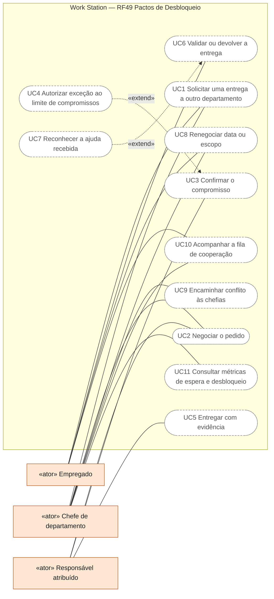
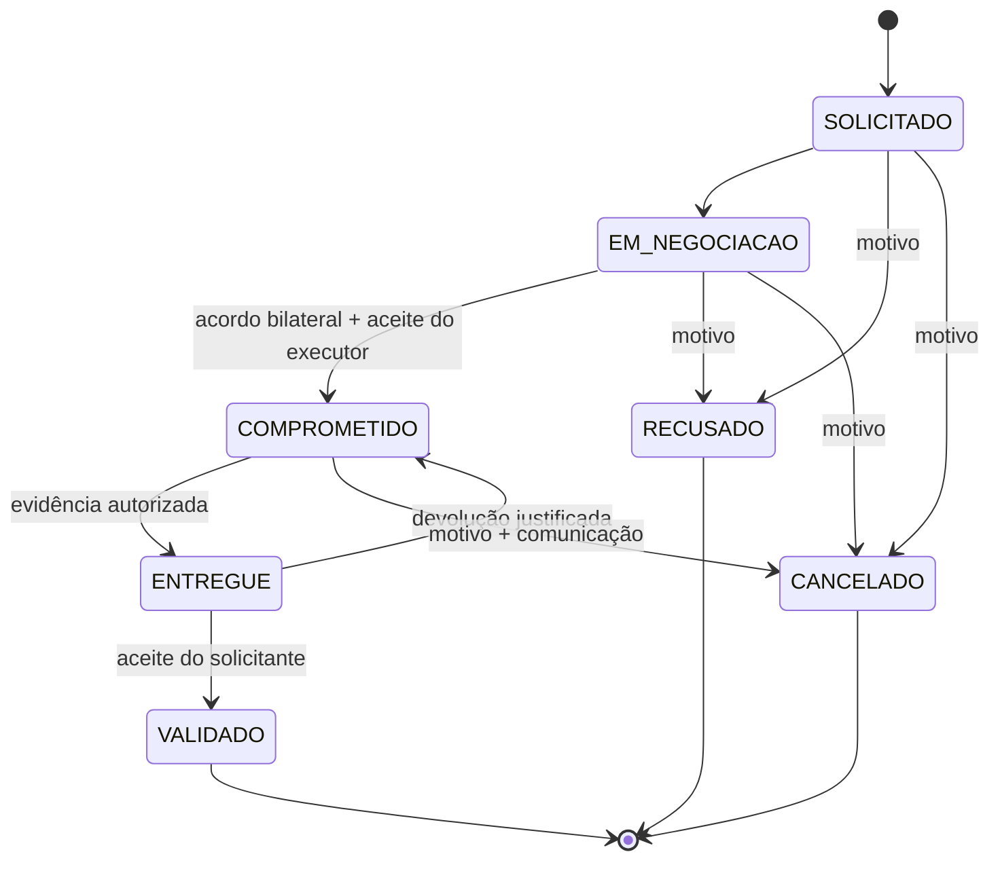

# RF49 — Coordenar Pactos de Desbloqueio entre usuários, chefes e departamentos
**HU:** — · **Aba/rota:** Metas & objetivos (`/goals`; pacto vinculado a tarefas/projetos dependentes) · **Página-esqueleto:** registrada em 17/10/2026; jornada ainda não implementada.

**Trello:** [RF49 Coordenar Pactos de Desbloqueio entre usuários, chefes e departamentos](https://trello.com/c/S9YYpa32/204-rf49-coordenar-pactos-de-desbloqueio-entre-usu%C3%A1rios-chefes-e-departamentos).

**Estado:** novo requisito especificado; implementação pendente. **Escopo inicial:** cooperação entre departamentos da mesma empresa. **Estudo:** [Work Station: da decisão ao trabalho que destrava outras equipes](../../produto/ESTUDO_WORK_STATION_RF49.md).

**História de usuário:** Como participante de uma equipe, quero combinar uma entrega de que outra equipe depende, com responsável, prazo negociado e evidência verificável, para destravar trabalho e reconhecer uma contribuição útil.

**Experiência central:** “Quem eu posso destravar hoje?” para o empregado; “O que precisamos receber e o que prometemos entregar?” para o chefe. O pacto vincula trabalho existente. Negociar cooperação não concede acesso a recursos nem transfere responsabilidade automaticamente.

## Critérios de aceite

| CA | Dado / quando / então |
|---|---|
| RF49.CA01 | Dado um usuário ativo com acesso ao recurso dependente, quando solicita uma entrega a outro departamento ativo da mesma empresa, então informa entrega esperada, justificativa, critério de aceitação e prazo desejado; o servidor deriva identidade e empresa da sessão e registra SOLICITADO. Alvos inacessíveis não revelam existência. |
| RF49.CA02 | Dado um pedido, quando o destinatário responde, então aceita, propõe outra data, pede esclarecimento ou recusa com motivo. Só participantes autorizados e chefias atuais dos departamentos envolvidos podem negociar. Propor data não equivale a compromisso aceito. |
| RF49.CA03 | Dado o acordo das equipes e o aceite explícito do executor autorizado, quando o pacto é confirmado, então registra COMPROMETIDO, responsável e data acordada. Não substitui atribuições ou lotações existentes. |
| RF49.CA04 | Dado o limite configurado de compromissos simultâneos da equipe, quando uma aceitação o excederia, então bloqueia com conflito explicável. Exceção exige decisão justificada do chefe; a contagem exclui pactos encerrados. |
| RF49.CA05 | Dado um pacto comprometido, quando o executor apresenta evidência a que os envolvidos possuem acesso, então registra ENTREGUE e a versão do recurso entregue. O solicitante valida ou devolve com critério não atendido e justificativa; cada tentativa permanece no histórico. |
| RF49.CA06 | Dado o recebimento, quando o solicitante valida a entrega, então registra VALIDADO e permite confirmar separadamente se o trabalho dependente voltou a avançar. Não conclui tarefas nem remove bloqueios automaticamente. |
| RF49.CA07 | Dado um compromisso vigente, quando alguém propõe outra data ou escopo, então requer novo aceite dos envolvidos, preservando acordo anterior, motivo e autoria. O instante de criação não é reiniciado para reduzir artificialmente o tempo de espera. |
| RF49.CA08 | Dado uma dependência circular ou um conflito de prioridade não resolvido, quando o sistema o identifica, então informa a causa com dados autorizados e permite encaminhar o conflito às chefias. Dependências circulares são rejeitadas antes do commit. Prioridade não é decidida automaticamente pela IA. |
| RF49.CA09 | Dado uma conta ou chefia que perdeu vínculo, quando tenta agir, então as permissões são relidas no servidor. SIGILOSO exige concessão explícita do proprietário também para chefes, administradores e colaboradores do pacto. Agregações e notificações não expõem conteúdo protegido. |
| RF49.CA10 | Dado edições simultâneas ou repetição de requisição, quando o servidor processa uma operação, então utiliza controle de versão e idempotência, sem duplicar compromisso, evidência ou notificação. Evento, alteração de estado e notificação ficam atomicamente persistidos. |
| RF49.CA11 | Dado o usuário autenticado, quando abre a fila de cooperação, então vê apenas pactos autorizados, com filtros por recebidos/enviados, departamento, estado e prazo, paginação, estados vazio/erro/carregamento e ações operáveis por teclado. “Quem eu posso destravar hoje?” exibe demandas compatíveis com vínculos e permissões atuais. |
| RF49.CA12 | Dado pactos com datas e eventos verificáveis, quando consulta métricas autorizadas, então mostra mediana/p90 de espera, amostra, devoluções, renegociações e desbloqueios confirmados. Casos abertos/cancelados ficam visíveis no agregado. Ausência de dados não vira zero; atraso evitado estimado não vira resultado comprovado. |
| RF49.CA13 | Dado um pacto validado, quando o solicitante deseja reconhecer a ajuda, então pode registrar reconhecimento contextual vinculado à entrega, integrado ao RF35. Não distribui pontos por criar solicitações nem gera classificação individual de velocidade. |
| RF49.CA14 | Dado mudanças relevantes, quando notificadas, então participantes autorizados recebem mensagens genéricas e agrupadas; lembretes respeitam preferências e limites de frequência. Cancelamento, recusa e devolução exigem motivo, com histórico auditável. |

## 0. Diagrama de casos de uso

Quem coordena um Pacto de Desbloqueio e para quê. Atores do catálogo de [`ATORES_E_ATRIBUTOS.md`](../../arquitetura/ATORES_E_ATRIBUTOS.md) §2 (o executor do pacto é o Responsável atribuído); todos os casos são planejados — `/goals` é página-esqueleto e a jornada não foi implementada.

| Caso de uso | Ator(es) | CAs | Situação |
|---|---|---|---|
| UC1 Solicitar uma entrega a outro departamento | Empregado, Chefe de departamento | RF49.CA01, RF49.CA09, RF49.CA10 | planejado |
| UC2 Negociar o pedido (aceitar, propor data, esclarecer, recusar) | Chefe de departamento, Responsável atribuído | RF49.CA02, RF49.CA14 | planejado |
| UC3 Confirmar o compromisso | Responsável atribuído | RF49.CA03, RF49.CA04 | planejado |
| UC4 Autorizar exceção ao limite de compromissos | — (estende UC3; decisão do chefe) | RF49.CA04 | planejado |
| UC5 Entregar com evidência | Responsável atribuído | RF49.CA05 | planejado |
| UC6 Validar ou devolver a entrega | Empregado (solicitante) | RF49.CA05, RF49.CA06, RF49.CA14 | planejado |
| UC7 Reconhecer a ajuda recebida | — (estende UC6) | RF49.CA13 | planejado |
| UC8 Renegociar data ou escopo | Empregado, Chefe de departamento | RF49.CA07 | planejado |
| UC9 Encaminhar conflito ou dependência circular às chefias | Chefe de departamento | RF49.CA08 | planejado |
| UC10 Acompanhar a fila de cooperação | Empregado, Chefe de departamento | RF49.CA11, RF49.CA14 | planejado |
| UC11 Consultar métricas de espera e desbloqueio | Chefe de departamento | RF49.CA12 | planejado |

## Fluxo principal

## Dependências e entrega

MVP manual: RF9/RF28 (vínculos), RF10/RF46 (atribuições e comunicação), RF21/RF22/RF41 (recursos persistentes), autorização e notificações reais. RF24 recebe métricas de fluxo; RF35 recebe reconhecimento após validação. IA opcional reutiliza RF43 com consentimento, orçamento e revisão, sem necessidade de chamadas pagas no MVP.

Plano: persistência/eventos e guardas → negociação/aceite → entrega/validação → fila e limites → métricas → piloto com duas equipes e um processo recorrente. Cobrir isolamento institucional, SIGILOSO, revogação de chefia, concorrência, ciclos, idempotência, acessibilidade e cálculo das métricas.

O estudo não promete exclusividade de mercado, aumento percentual comprovado ou conclusão dos RF anteriores. A auditoria original de 48 RF permanece como linha de base; este requisito novo é acompanhado separadamente até a próxima revisão da matriz.
