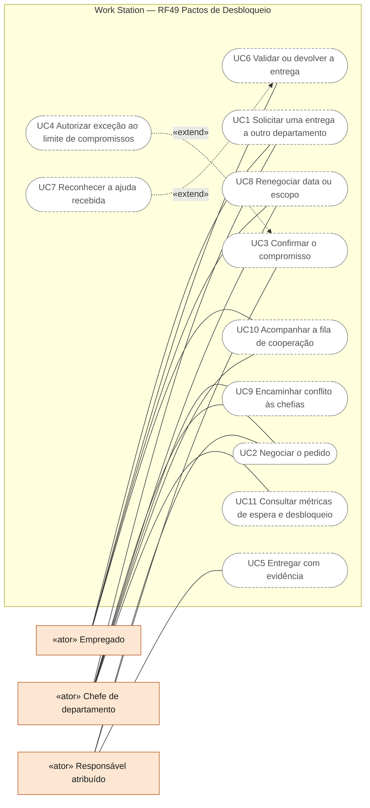
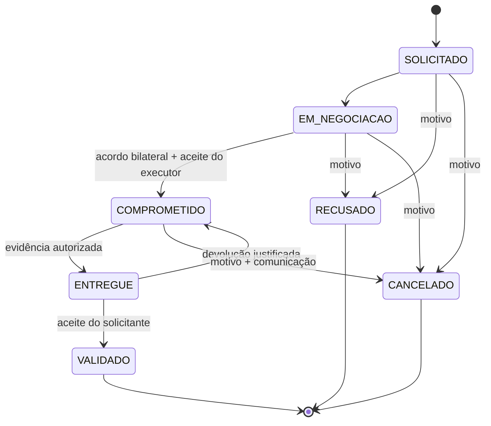
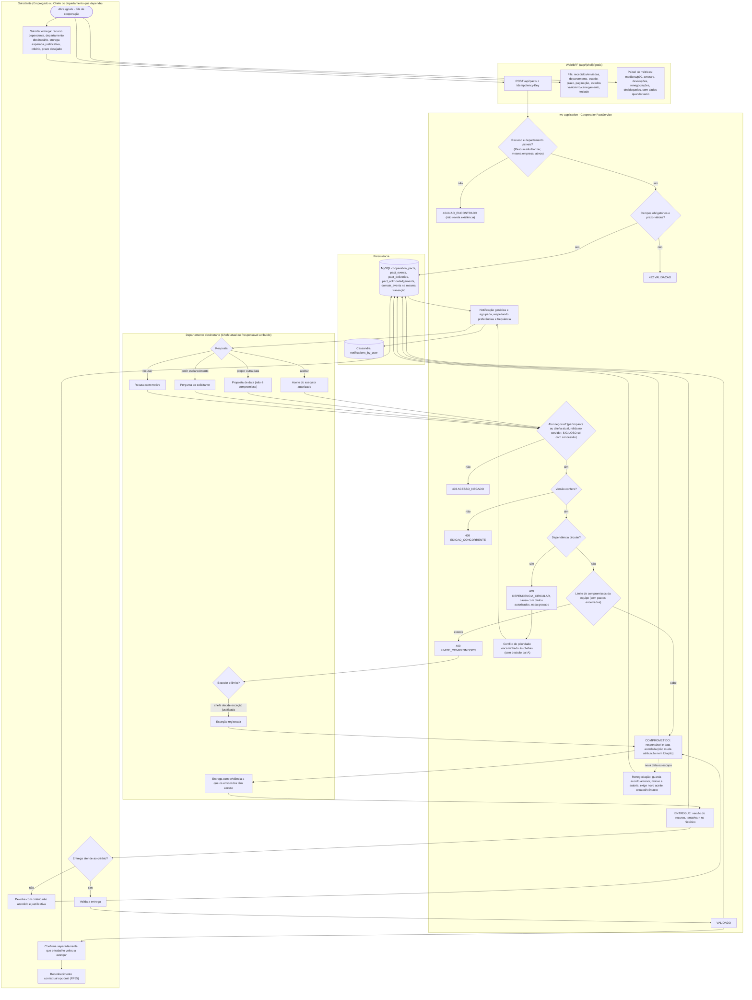
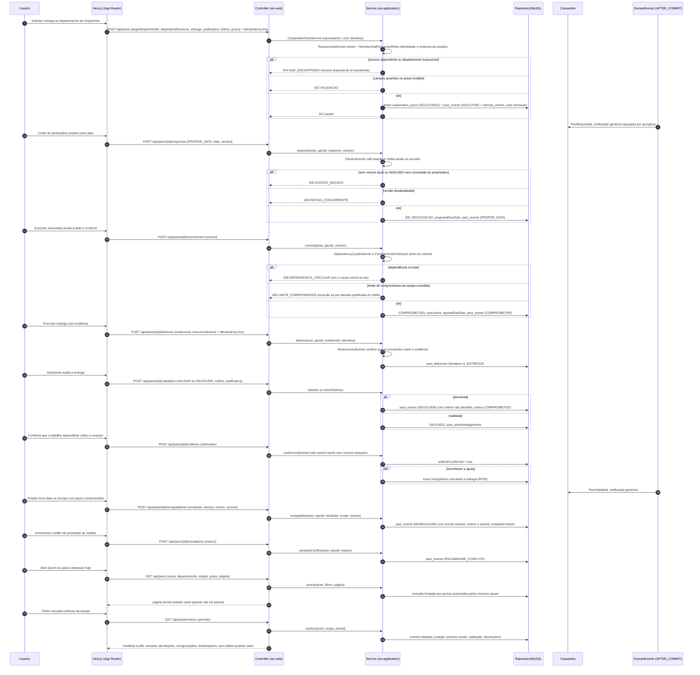
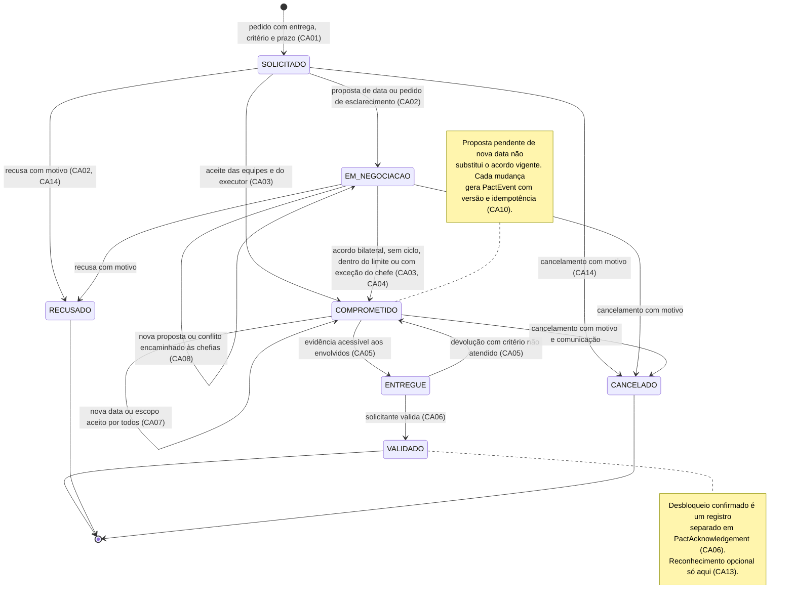
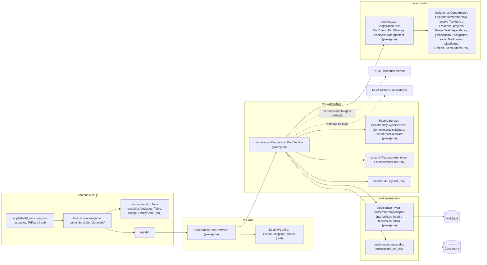

# RF49 — Coordenar Pactos de Desbloqueio entre usuários, chefes e departamentos
**HU:** — · **Aba/rota:** Metas & objetivos (`/goals`; pacto vinculado a tarefas/projetos dependentes) · **Página-esqueleto:** registrada em 17/10/2026; jornada ainda não implementada.
**Critérios de aceite cobertos:** RF49.CA01 … RF49.CA14 — CAs da especificação deste README (requisito novo do estudo de 12/10/2026, sem HU no board), sem alteração; todos planejados: no código só existem o domínio de apoio (lotações, tarefas, dependências, evidências, reconhecimento, notificação) e as guardas de acesso.

**Trello:** [RF49 Coordenar Pactos de Desbloqueio entre usuários, chefes e departamentos](https://trello.com/c/S9YYpa32/204-rf49-coordenar-pactos-de-desbloqueio-entre-usu%C3%A1rios-chefes-e-departamentos).

**Estado:** novo requisito especificado; implementação pendente. **Escopo inicial:** cooperação entre departamentos da mesma empresa. **Estudo:** [Work Station: da decisão ao trabalho que destrava outras equipes](../../produto/ESTUDO_WORK_STATION_RF49.md).

**História de usuário:** Como participante de uma equipe, quero combinar uma entrega de que outra equipe depende, com responsável, prazo negociado e evidência verificável, para destravar trabalho e reconhecer uma contribuição útil.

**Experiência central:** “Quem eu posso destravar hoje?” para o empregado; “O que precisamos receber e o que prometemos entregar?” para o chefe. O pacto vincula trabalho existente. Negociar cooperação não concede acesso a recursos nem transfere responsabilidade automaticamente.

## Critérios de aceite

| CA | Dado / quando / então |
|---|---|
| RF49.CA01 | Dado um usuário ativo com acesso ao recurso dependente, quando solicita uma entrega a outro departamento ativo da mesma empresa, então informa entrega esperada, justificativa, critério de aceitação e prazo desejado; o servidor deriva identidade e empresa da sessão e registra SOLICITADO. Alvos inacessíveis não revelam existência. |
| RF49.CA02 | Dado um pedido, quando o destinatário responde, então aceita, propõe outra data, pede esclarecimento ou recusa com motivo. Só participantes autorizados e chefias atuais dos departamentos envolvidos podem negociar. Propor data não equivale a compromisso aceito. |
| RF49.CA03 | Dado o acordo das equipes e o aceite explícito do executor autorizado, quando o pacto é confirmado, então registra COMPROMETIDO, responsável e data acordada. Não substitui atribuições ou lotações existentes. |
| RF49.CA04 | Dado o limite configurado de compromissos simultâneos da equipe, quando uma aceitação o excederia, então bloqueia com conflito explicável. Exceção exige decisão justificada do chefe; a contagem exclui pactos encerrados. |
| RF49.CA05 | Dado um pacto comprometido, quando o executor apresenta evidência a que os envolvidos possuem acesso, então registra ENTREGUE e a versão do recurso entregue. O solicitante valida ou devolve com critério não atendido e justificativa; cada tentativa permanece no histórico. |
| RF49.CA06 | Dado o recebimento, quando o solicitante valida a entrega, então registra VALIDADO e permite confirmar separadamente se o trabalho dependente voltou a avançar. Não conclui tarefas nem remove bloqueios automaticamente. |
| RF49.CA07 | Dado um compromisso vigente, quando alguém propõe outra data ou escopo, então requer novo aceite dos envolvidos, preservando acordo anterior, motivo e autoria. O instante de criação não é reiniciado para reduzir artificialmente o tempo de espera. |
| RF49.CA08 | Dado uma dependência circular ou um conflito de prioridade não resolvido, quando o sistema o identifica, então informa a causa com dados autorizados e permite encaminhar o conflito às chefias. Dependências circulares são rejeitadas antes do commit. Prioridade não é decidida automaticamente pela IA. |
| RF49.CA09 | Dado uma conta ou chefia que perdeu vínculo, quando tenta agir, então as permissões são relidas no servidor. SIGILOSO exige concessão explícita do proprietário também para chefes, administradores e colaboradores do pacto. Agregações e notificações não expõem conteúdo protegido. |
| RF49.CA10 | Dado edições simultâneas ou repetição de requisição, quando o servidor processa uma operação, então utiliza controle de versão e idempotência, sem duplicar compromisso, evidência ou notificação. Evento, alteração de estado e notificação ficam atomicamente persistidos. |
| RF49.CA11 | Dado o usuário autenticado, quando abre a fila de cooperação, então vê apenas pactos autorizados, com filtros por recebidos/enviados, departamento, estado e prazo, paginação, estados vazio/erro/carregamento e ações operáveis por teclado. “Quem eu posso destravar hoje?” exibe demandas compatíveis com vínculos e permissões atuais. |
| RF49.CA12 | Dado pactos com datas e eventos verificáveis, quando consulta métricas autorizadas, então mostra mediana/p90 de espera, amostra, devoluções, renegociações e desbloqueios confirmados. Casos abertos/cancelados ficam visíveis no agregado. Ausência de dados não vira zero; atraso evitado estimado não vira resultado comprovado. |
| RF49.CA13 | Dado um pacto validado, quando o solicitante deseja reconhecer a ajuda, então pode registrar reconhecimento contextual vinculado à entrega, integrado ao RF35. Não distribui pontos por criar solicitações nem gera classificação individual de velocidade. |
| RF49.CA14 | Dado mudanças relevantes, quando notificadas, então participantes autorizados recebem mensagens genéricas e agrupadas; lembretes respeitam preferências e limites de frequência. Cancelamento, recusa e devolução exigem motivo, com histórico auditável. |

## 0. Diagrama de casos de uso

Quem coordena um Pacto de Desbloqueio e para quê. Atores do catálogo de [`ATORES_E_ATRIBUTOS.md`](../../arquitetura/ATORES_E_ATRIBUTOS.md) §2 (o executor do pacto é o Responsável atribuído); todos os casos são planejados — `/goals` é página-esqueleto e a jornada não foi implementada.

| Caso de uso | Ator(es) | CAs | Situação |
|---|---|---|---|
| UC1 Solicitar uma entrega a outro departamento | Empregado, Chefe de departamento | RF49.CA01, RF49.CA09, RF49.CA10 | planejado |
| UC2 Negociar o pedido (aceitar, propor data, esclarecer, recusar) | Chefe de departamento, Responsável atribuído | RF49.CA02, RF49.CA14 | planejado |
| UC3 Confirmar o compromisso | Responsável atribuído | RF49.CA03, RF49.CA04 | planejado |
| UC4 Autorizar exceção ao limite de compromissos | — (estende UC3; decisão do chefe) | RF49.CA04 | planejado |
| UC5 Entregar com evidência | Responsável atribuído | RF49.CA05 | planejado |
| UC6 Validar ou devolver a entrega | Empregado (solicitante) | RF49.CA05, RF49.CA06, RF49.CA14 | planejado |
| UC7 Reconhecer a ajuda recebida | — (estende UC6) | RF49.CA13 | planejado |
| UC8 Renegociar data ou escopo | Empregado, Chefe de departamento | RF49.CA07 | planejado |
| UC9 Encaminhar conflito ou dependência circular às chefias | Chefe de departamento | RF49.CA08 | planejado |
| UC10 Acompanhar a fila de cooperação | Empregado, Chefe de departamento | RF49.CA11, RF49.CA14 | planejado |
| UC11 Consultar métricas de espera e desbloqueio | Chefe de departamento | RF49.CA12 | planejado |

## Fluxo principal

## Dependências e entrega

MVP manual: RF9/RF28 (vínculos), RF10/RF46 (atribuições e comunicação), RF21/RF22/RF41 (recursos persistentes), autorização e notificações reais. RF24 recebe métricas de fluxo; RF35 recebe reconhecimento após validação. IA opcional reutiliza RF43 com consentimento, orçamento e revisão, sem necessidade de chamadas pagas no MVP.

Plano: persistência/eventos e guardas → negociação/aceite → entrega/validação → fila e limites → métricas → piloto com duas equipes e um processo recorrente. Cobrir isolamento institucional, SIGILOSO, revogação de chefia, concorrência, ciclos, idempotência, acessibilidade e cálculo das métricas.

O estudo não promete exclusividade de mercado, aumento percentual comprovado ou conclusão dos RF anteriores. A auditoria original de 48 RF permanece como linha de base; este requisito novo é acompanhado separadamente até a próxima revisão da matriz.

## 1. Diagrama de classes

Entidade central proposta no [estudo](../../produto/ESTUDO_WORK_STATION_RF49.md) (§ Modelo funcional): `CooperationPact` com `PactEvent`, `PactDelivery` e `PactAcknowledgement` — ainda **não** constam de [`TAXONOMIA.md`](../../arquitetura/TAXONOMIA.md) e entram lá quando o RF49 for implementado; `TeamCommitmentLimit` é a forma proposta para o "limite configurado de compromissos simultâneos da equipe" (CA04). **(real)** no código hoje: só o domínio de apoio — `Department`, `DepartmentMembership`/`DeptRole`, `TaskItem`, `ProjectTaskDependency`, `Evidence`, `Recognition`, `Notification`, `DomainEventOutbox`, `AccessClassification` (`ws-domain` + entidades JPA) — e as guardas `ResourceAuthorizer`, `MembershipPort` (`JpaMembershipAdapter`) e `AuditLogPort` (`JpaAuditLog`). Tudo o que tem nome de pacto, o serviço, o controlador e as rotas `/api/pacts` é **(planejado)**; `grep` em `ws-domain`, `ws-application`, `ws-web` e `components/` não encontra nada de pacto.

```mermaid
classDiagram
direction LR

namespace ws_domain_cooperacao {
  class CooperationPact {
    <<entity>>
    +id: UUID
    +companyId: UUID
    +requesterDepartmentId: UUID
    +targetDepartmentId: UUID
    +requesterId: UUID
    +executorId: UUID
    +dependentResourceType: TargetType
    +dependentResourceId: UUID
    +expectedDelivery: String
    +justification: String
    +acceptanceCriterion: String
    +requestedDueDate: LocalDate
    +proposedDueDate: LocalDate
    +agreedDueDate: LocalDate
    +classification: AccessClassification
    +status: PactStatus
    +createdAt: Instant
    +version: long
  }
  class PactStatus {
    <<enum>>
    SOLICITADO
    EM_NEGOCIACAO
    COMPROMETIDO
    ENTREGUE
    VALIDADO
    RECUSADO
    CANCELADO
  }
  class PactEvent {
    <<entity>>
    +id: UUID
    +pactId: UUID
    +actorId: UUID
    +kind: PactEventKind
    +fromStatus: PactStatus
    +toStatus: PactStatus
    +previousAgreementJson: JSON
    +reason: String
    +idempotencyKey: String
    +at: Instant
  }
  class PactEventKind {
    <<enum>>
    SOLICITAR
    ACEITAR
    PROPOR_DATA
    PEDIR_ESCLARECIMENTO
    RECUSAR
    COMPROMETER
    EXCECAO_LIMITE
    ENTREGAR
    DEVOLVER
    VALIDAR
    CONFIRMAR_DESBLOQUEIO
    RENEGOCIAR
    ENCAMINHAR_CONFLITO
    CANCELAR
  }
  class PactDelivery {
    <<entity>>
    +id: UUID
    +pactId: UUID
    +attempt: int
    +evidenceId: UUID
    +resourceVersion: String
    +submittedBy: UUID
    +submittedAt: Instant
    +unmetCriterion: String
    +returnReason: String
  }
  class PactAcknowledgement {
    <<entity>>
    +pactId: UUID
    +validatedBy: UUID
    +validatedAt: Instant
    +unblockConfirmed: boolean
    +unblockConfirmedAt: Instant
    +recognitionId: UUID
  }
  class TeamCommitmentLimit {
    <<entity>>
    +departmentId: UUID
    +maxActive: int
    +setBy: UUID
    +validFrom: Instant
  }
}

namespace ws_domain_existente {
  class Department {
    <<entity>>
    +id: UUID
    +companyId: UUID
    +name: String
    +headUserId: UUID
    +active: boolean
  }
  class DepartmentMembership {
    <<entity>>
    +userId: UUID
    +departmentId: UUID
    +roleInDept: DeptRole
    +startedAt: Instant
    +endedAt: Instant
  }
  class TaskItem {
    <<entity>>
    +id: UUID
    +ownerId: UUID
    +departmentId: UUID
    +state: TaskState
    +blockedByTaskId: UUID
    +accessClass: AccessClassification
    +version: long
  }
  class ProjectTaskDependency {
    <<entity>>
    +projectId: UUID
    +predecessorProjectTaskId: UUID
    +successorProjectTaskId: UUID
    +type: String
  }
  class Evidence {
    <<entity>>
    +id: UUID
    +ownerId: UUID
    +mediaObjectId: UUID
    +linkedTaskId: UUID
    +linkedProjectId: UUID
  }
  class Recognition {
    <<entity>>
    +issuerUserId: UUID
    +recipientUserId: UUID
    +criterion: String
    +source: RecognitionSource
    +sourceId: UUID
  }
  class Notification {
    <<entity>>
    +recipientId: UUID
    +type: NotificationType
    +resourceType: String
    +resourceId: UUID
    +groupKey: String
  }
  class AccessClassification {
    <<enum>>
    PUBLICO
    INTERNO
    RESTRITO
    SIGILOSO
  }
}

namespace ws_application {
  class CooperationPactService {
    <<service>>
    +request(actor, RequestPact, idemKey) CooperationPact
    +respond(actor, pactId, PactResponse, version) CooperationPact
    +commit(actor, pactId, version) CooperationPact
    +authorizeLimitException(actor, pactId, reason) PactEvent
    +deliver(actor, pactId, evidenceId, idemKey) PactDelivery
    +validate(actor, pactId, version) PactAcknowledgement
    +returnDelivery(actor, pactId, criterion, reason) PactDelivery
    +confirmUnblocked(actor, pactId) PactAcknowledgement
    +renegotiate(actor, pactId, newDate, scope, reason) PactEvent
    +escalateConflict(actor, pactId, reason) PactEvent
    +cancel(actor, pactId, reason) CooperationPact
    +queue(actor, PactFilter, page) PactPage
    +metrics(actor, scope, period) PactMetrics
    +recognize(actor, pactId, text) Recognition
  }
  class PactAuthorizer {
    <<service>>
    +canNegotiate(viewer, pact) boolean
    +canSee(viewer, pact) boolean
  }
  class DependencyCycleDetector {
    <<service>>
    +wouldCycle(pact, graph) CycleReport
  }
  class CommitmentLimitGuard {
    <<service>>
    +check(departmentId) LimitResult
  }
  class PactMetricsCalculator {
    <<service>>
    +waitTimes(events) MedianP90
    +returns(events) Ratio
  }
  class ResourceAuthorizer {
    <<service>>
    +viewer(actor) Viewer
    +require(viewer, resource, action)
  }
  class MembershipPort {
    <<port>>
    +activeRoles(userId) Map
  }
  class PactRepositoryPort {
    <<port>>
    +save(pact, events, outbox)
    +findVisible(viewer, filter, page) PactPage
  }
  class NotificationPort {
    <<port>>
    +notifyGrouped(recipients, type, pactId)
  }
  class AuditLogPort {
    <<port>>
    +record(AuditEvent)
  }
}

namespace ws_web {
  class CooperationPactController {
    <<controller>>
    +POST_api_pacts(body, idemKey)
    +POST_api_pacts_id_responses(body)
    +POST_api_pacts_id_commitment(version)
    +POST_api_pacts_id_deliveries(body, idemKey)
    +POST_api_pacts_id_validation(body)
    +POST_api_pacts_id_renegotiations(body)
    +POST_api_pacts_id_escalations(body)
    +GET_api_pacts(filters, page)
    +GET_api_pacts_metrics(period)
  }
}

namespace ws_infrastructure {
  class JpaPactAdapter {
    <<adapter>>
  }
  class JpaMembershipAdapter {
    <<adapter>>
  }
  class JpaAuditLog {
    <<adapter>>
  }
}

CooperationPact "1" o-- "1..*" PactEvent
CooperationPact "1" o-- "0..*" PactDelivery
CooperationPact "1" --> "0..1" PactAcknowledgement
CooperationPact ..> PactStatus
PactEvent ..> PactEventKind
CooperationPact "0..*" --> "2" Department : solicitante e destinatario
CooperationPact "0..*" --> "1" TaskItem : recurso dependente
PactDelivery "0..*" --> "1" Evidence : referencia sem copiar
PactAcknowledgement "0..1" --> "0..1" Recognition : RF35
TeamCommitmentLimit "0..1" --> "1" Department
DepartmentMembership "0..*" --> "1" Department
CooperationPactController --> CooperationPactService
CooperationPactService --> PactAuthorizer
CooperationPactService --> DependencyCycleDetector
CooperationPactService --> CommitmentLimitGuard
CooperationPactService --> PactMetricsCalculator
CooperationPactService --> PactRepositoryPort
CooperationPactService --> NotificationPort
CooperationPactService --> AuditLogPort
PactAuthorizer --> ResourceAuthorizer
PactAuthorizer --> MembershipPort
DependencyCycleDetector ..> ProjectTaskDependency : grafo existente
CommitmentLimitGuard ..> TeamCommitmentLimit
NotificationPort ..> Notification
JpaPactAdapter ..|> PactRepositoryPort
JpaMembershipAdapter ..|> MembershipPort
JpaAuditLog ..|> AuditLogPort
note for Department "real - ws-domain institutional e JPA"
note for ResourceAuthorizer "real - Bloco 5 e MembershipPort"
note for CooperationPact "planejado - estudo RF49"
```

## 2. Diagrama de atividades

Sem raia de IA: o MVP funciona sem IA e sem créditos (estudo, § Mecânica); apoio opcional do RF43 fica fora deste fluxo. Tudo **(planejado)**, exceto a releitura de lotação/papel (`ResourceAuthorizer` + `MembershipPort`, **real**).

## 3. Diagrama de sequência

## 4. Máquina de estados

Entidade central: `CooperationPact.status` (`PactStatus`, **planejado**). Detalha o diagrama de "Fluxo principal" acima com as guardas de cada transição.

## 5. Diagrama de componentes

## 6. Rastreabilidade

Mensagens = números do `autonumber` da §3. Passos = nós da §2. Componentes = nós da §5.

| CA | Classe | Passo | Mensagem | Transição | Componente |
|---|---|---|---|---|---|
| RF49.CA01 | `CooperationPactService.request`, `CooperationPact` (entrega, justificativa, critério, prazo desejado, empresa e departamentos), `ResourceAuthorizer` (real) | A1 → F1 → P1 → P2 · E1 · E2 | 1–8 | `[*] → SOLICITADO` | `PC`, `CPS`, `RA` |
| RF49.CA02 | `respond`, `PactEventKind` (ACEITAR · PROPOR_DATA · PEDIR_ESCLARECIMENTO · RECUSAR), `proposedDueDate` separado de `agreedDueDate`, `PactAuthorizer` | B1 → B2/B3/B4/B5 → P3 | 10–16 | `SOLICITADO → EM_NEGOCIACAO`, `→ RECUSADO` | `CPS`, `GUARDS` |
| RF49.CA03 | `commit`, `CooperationPact.executorId/agreedDueDate`; não altera `Assignment` nem `DepartmentMembership` | B2 → P7 | 17–19, 23 | `EM_NEGOCIACAO → COMPROMETIDO` | `CPS` |
| RF49.CA04 | `CommitmentLimitGuard`, `TeamCommitmentLimit`, `authorizeLimitException` (`PactEventKind.EXCECAO_LIMITE`) | P6 · E6 → B7 → B8 | 20, 22 | `EM_NEGOCIACAO → COMPROMETIDO` (exceção do chefe) | `GUARDS` |
| RF49.CA05 | `deliver`, `returnDelivery`, `PactDelivery` (attempt, evidenceId, resourceVersion, unmetCriterion), `Evidence` (real) | B6 → P8 → A9 → A10 | 24–32 | `COMPROMETIDO → ENTREGUE`, `ENTREGUE → COMPROMETIDO` | `CPS`, `BASE` |
| RF49.CA06 | `validate`, `confirmUnblocked`, `PactAcknowledgement.unblockConfirmed`; `TaskItem.state` não muda | A11 → P9 → A12 | 33–37 | `ENTREGUE → VALIDADO` (nota) | `CPS` |
| RF49.CA07 | `renegotiate`, `PactEvent.previousAgreementJson/reason/actorId`, `createdAt` imutável | P10 | 40–43 | `COMPROMETIDO → COMPROMETIDO` | `CPS` |
| RF49.CA08 | `DependencyCycleDetector` sobre `ProjectTaskDependency` (real) e pactos, `escalateConflict` (`ENCAMINHAR_CONFLITO`) | P5 · E5 → P11 | 20–21, 44–47 | `EM_NEGOCIACAO → EM_NEGOCIACAO` | `GUARDS` |
| RF49.CA09 | `PactAuthorizer` → `ResourceAuthorizer` + `MembershipPort` (real, relidos a cada ação), `AccessClassification.SIGILOSO` com concessão explícita | P1 · P3 · E3 | 4, 13–14, 27 | — | `RA`, `MY` (`JpaMembershipAdapter`) |
| RF49.CA10 | `CooperationPact.version`, `PactEvent.idempotencyKey`, `PactRepositoryPort.save(pact, events, outbox)`, `DomainEventOutbox` (real) | P4 · E4 · D1 | 2, 7, 15, 25 | nota de COMPROMETIDO | `CPS`, `MY` |
| RF49.CA11 | `queue`, `PactRepositoryPort.findVisible`, `CooperationPactController.GET_api_pacts` | A0 → F2 | 48–52 | — | `R2`, `R3`, `PC` |
| RF49.CA12 | `metrics`, `PactMetricsCalculator` (mediana/p90, amostra, devoluções, renegociações, desbloqueios, sem dados ≠ zero) | A0 → F3 | 53–57 | — | `GUARDS`, `RF24` |
| RF49.CA13 | `recognize`, `Recognition` (real, `sourceId` = pacto), `PactAcknowledgement.recognitionId`; sem pontos por solicitação | A12 → A13 | 38 | nota de VALIDADO | `RF35` |
| RF49.CA14 | `NotificationPort.notifyGrouped`, `Notification.groupKey` (real), motivo obrigatório em RECUSAR · CANCELAR · DEVOLVER, `AuditLogPort` (real) | P12 → D2 · B5 · A10 | 9, 39 | `→ RECUSADO`, `→ CANCELADO` | `CAS`, `AUD` |

## Estado da implementação (12/11/2026)

Front DEMO, sem API (`/api/pacts` continua planejada): `/goals` › **Pactos de desbloqueio** é funcional sobre comandos PUROS e testados (`lib/pacts/rules.ts`) aplicados ao estado da aba; os dados de exemplo são montados executando os próprios comandos. Além dos CAs, o pedido do dono do produto de 12/11/2026 entrou assim: **impedimentos** do Acervo DEMO (tarefa BLOQUEADA com causa), da Mesa do projeto DEMO (atividade não iniciada esperando predecessora não iniciada de outra pessoa; quem depende = ela e as sucessoras) e registro manual (o que trava, desde quando, quem depende); **partes** pessoa, equipe, chefia ou departamento; **mediação em rodadas** em que cada lado propõe compromissos de PRAZO, SUPORTE ou RECURSO, contraproposta substitui a anterior, acordo só com aceite BILATERAL (pessoas diferentes) e aceite pessoal de quem executa; **acompanhamento** com marcos, check-ins, cumprido/descumprido (prazo do destinatário conferido na validação pela data da entrega), renegociação e **escalonamento à chefia acima**; **"Mediar no DECIA"** gera `/decia/<sessão>?pacto=<id>` (sessão sugerida `mediacao-<id>`; a tela da sessão é de outra frente). Metas coletivas (RF35) continuam na sub-aba "Metas coletivas" como estado vazio.

| CA | Situação | Onde |
|---|---|---|
| RF49.CA01 | DEMO: pedido com entrega esperada, justificativa, critério de aceite e prazo desejado (validação por campo); identidade e empresa vêm do ator (o `userId` enviado é trocado); destino de outra empresa, inativo ou inexistente → "não encontrado"; SOLICITADO | `lib/pacts/rules.ts` (`ABRIR`), `components/pacts/OpenPactDialog.tsx` |
| RF49.CA02 | DEMO: aceitar, propor outra data/pacote (contraproposta), pedir esclarecimento, recusar com motivo; só representantes e chefias ATUAIS negociam; proposta não é compromisso | `lib/pacts/rules.ts`, `lib/pacts/access.ts`, `components/pacts/ProposalEditor.tsx`, `components/pacts/PactDetail.tsx` |
| RF49.CA03 | DEMO: COMPROMETIDO só quando a mesma proposta tem aceite do solicitante e do destinatário (a mesma pessoa não aceita pelos dois lados) e o aceite pessoal do executor; registra executor e data acordada; não mexe em atribuição nem lotação | `lib/pacts/rules.ts` (`ACEITAR`) |
| RF49.CA04 | DEMO: limite de compromissos simultâneos por unidade destinatária (GOF e CPOE no limite no exemplo); aceite que excede é bloqueado com contagem e limite; exceção só pela chefia, com justificativa; encerrados não contam | `lib/pacts/rules.ts` (`limitCheck`, `EXCECAO_LIMITE`), `lib/pacts/fixtures.ts` |
| RF49.CA05 | DEMO: entrega só do executor, com evidência por referência (SIGILOSO recusada; RESTRITO só entre partes da mesma unidade) e versão; devolução com critério não atendido e justificativa volta a COMPROMETIDO; tentativas no histórico | `lib/pacts/rules.ts` (`ENTREGAR`, `DEVOLVER`), `components/pacts/forms.tsx` |
| RF49.CA06 | DEMO: VALIDADO; confirmação de desbloqueio separada; nada conclui tarefa nem remove bloqueio | `lib/pacts/rules.ts` (`VALIDAR`, `CONFIRMAR_DESBLOQUEIO`) |
| RF49.CA07 | DEMO: renegociação com motivo exige novo aceite dos dois lados e do executor; até lá vale o acordo anterior; o anterior fica preservado com autoria e motivo; `createdAt` nunca muda | `lib/pacts/rules.ts` (`RENEGOCIAR`) |
| RF49.CA08 | DEMO: dependência circular entre tarefas (pactos abertos + dependências da Mesa) recusada antes de gravar, com o caminho; conflito encaminhado às chefias de cada lado (ou à conta da empresa quando as partes já são chefias) e decisão registrada por elas, sem decisão automática. Detecção automática de conflito de prioridade não feita (o escalonamento é manual) | `lib/pacts/cycle.ts`, `lib/pacts/access.ts` (`escalationTargets`), `lib/pacts/rules.ts` (`ESCALAR`, `RESOLVER_ESCALONAMENTO`) |
| RF49.CA09 | DEMO: lotação e chefia relidas do diretório a cada ação (quem perde a chefia deixa de negociar); SIGILOSO só com concessão explícita, inclusive para chefias, empresa e administração; ADMIN não lê pacto (só números agregados); avisos sem conteúdo. A garantia no servidor depende da API | `lib/pacts/access.ts`, `lib/pacts/org.ts` |
| RF49.CA10 | DEMO: versão (EDICAO_CONCORRENTE) e chave de idempotência por ação (repetir não duplica evento nem aviso); evento, estado e aviso saem juntos do mesmo comando puro. Persistência transacional com outbox depende do backend | `lib/pacts/rules.ts` |
| RF49.CA11 | DEMO: fila só com pactos autorizados, filtros recebidos/enviados, unidade, estado e prazo (vencidos, 7 dias), paginação, estados vazio/carregando/"não encontrado", tudo por teclado; "Quem eu posso destravar hoje?" e a visão da chefia ("o que precisamos receber e o que prometemos entregar"); detalhe por `/goals?pacto=<id>` | `lib/pacts/queue.ts`, `lib/pacts/available.ts`, `components/pacts/PactsWorkspace.tsx` |
| RF49.CA12 | DEMO: mediana e p90 (posto mais próximo) da espera até o primeiro compromisso e até a validação, com amostra; devoluções, renegociações pedidas/aceitas, desbloqueios confirmados, validados no prazo e contagem por estado (abertos, recusados e cancelados visíveis); "sem dados" nunca vira zero; atraso evitado não é estimado; sem placar individual | `lib/pacts/metrics.ts`, `components/pacts/MetricsPanel.tsx` |
| RF49.CA13 | Parcial: reconhecimento contextual pelo solicitante depois da validação, ligado à entrega, sem pontos nem ranking. Integração com a entidade `Recognition` do RF35 não feita (RF35 ainda não implementado) | `lib/pacts/rules.ts` (`RECONHECER`) |
| RF49.CA14 | Parcial: avisos genéricos (sem conteúdo do pacto) agrupados — um não lido por pessoa e pacto, com contagem —, lembrete limitado a um por pessoa a cada 24 h, motivo obrigatório em recusa, cancelamento e devolução, histórico auditável de eventos. Ligação com a central de notificações do app e com as preferências de aviso de cada pessoa não feita (os avisos DEMO vivem no estado dos pactos) | `lib/pacts/rules.ts` (`commit`, `LEMBRAR`), `components/pacts/PactsWorkspace.tsx` (aba Avisos) |

Testes: `lib/pacts/*.test.ts` (máquina de estados, aceite bilateral e do executor, contraproposta, recusa/cancelamento com motivo, entrega/devolução/validação, descumprimento, renegociação, escalonamento, limite, ciclo, permissões relidas, SIGILOSO, versão e idempotência, avisos e lembrete, fila, métricas, impedimentos, dados DEMO) e `components/pacts/pacts.test.tsx` (telas e página `/goals`).
