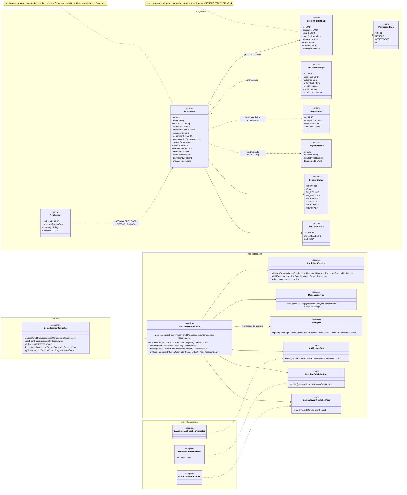
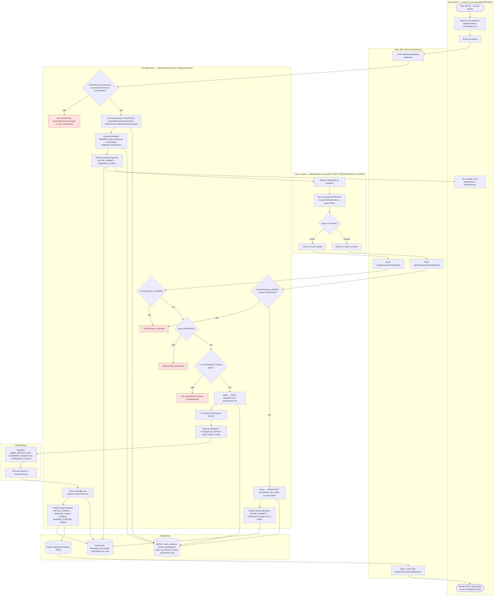
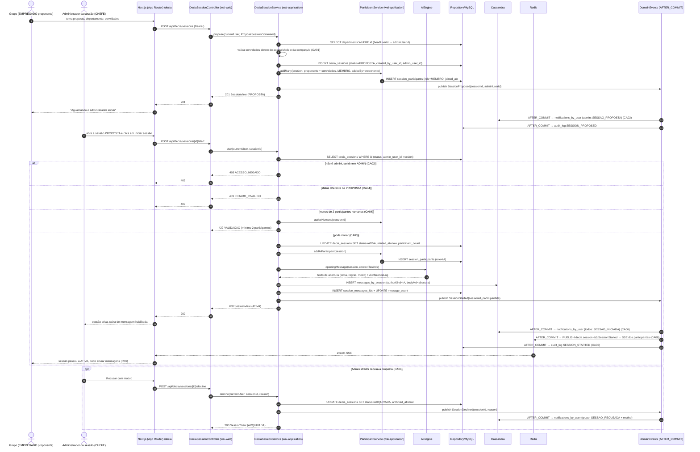
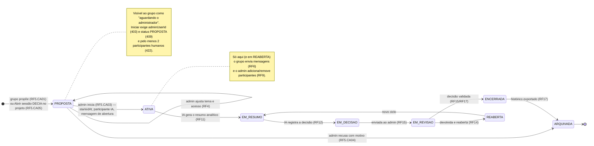
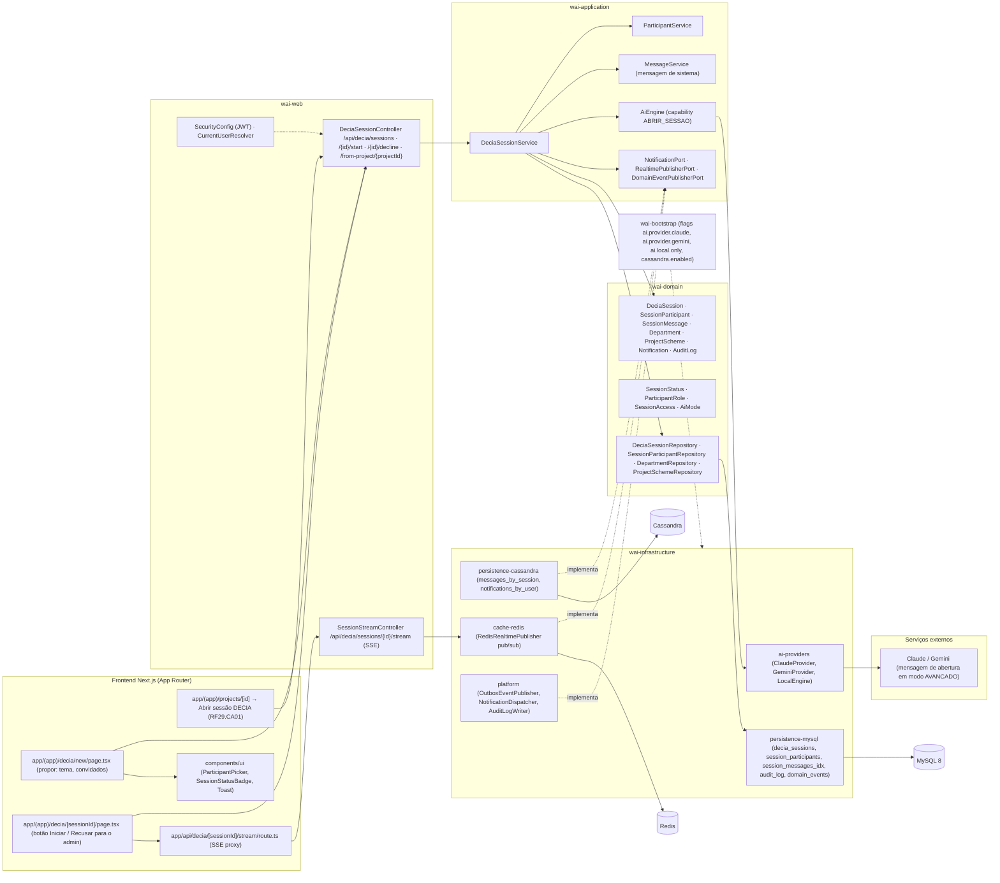

# RF5 — Iniciar, junto ao Administrador da sessão, uma nova sessão de conversa do DECIA.
**HU:** HU5 · **Sprint (board Work Station):** 1 · **Equivalente FAI:** RF10 Copilot (`CopilotService` abre a conversa; aqui a abertura é em grupo, com proposta → confirmação do administrador) · **Aba/rota:** DECIA (`/decia/new` para propor, `/decia/[sessionId]` com o botão "Iniciar sessão" para o admin; `/projects/[id]` → "Abrir sessão DECIA", RF29.CA01) — rotas sugeridas
**Critérios de aceite cobertos:** RF5.CA01 … RF5.CA06 (RF1–RF18 não têm CAs no board: derivados da HU5 e marcados "CA a confirmar")

> **HU5** — COMO grupo da conversa (conjunto de usuários vinculados a um tema) POSSO iniciar uma nova sessão de conversa em conjunto com o administrador da sessão PARA dar início à discussão estruturada sobre o tema definido.

> **Nota de modelagem (TAXONOMIA §14):** o "grupo da conversa" é modelado como `SessionParticipant` com `role MEMBRO`; não existe entidade `Group`. O "em conjunto" vira o par **proposta** (`createdByUserId`, status `PROPOSTA`) → **confirmação** (`adminUserId`, status `ATIVA`). Confirmar em `DECISOES.md`.

## Critérios de aceite derivados da HU5 (todos "CA a confirmar")

| CA | Enunciado (Dado / Quando / Então) |
|---|---|
| **RF5.CA01** (CA a confirmar) | Dado um EMPREGADO autenticado, quando propõe uma sessão informando tema proposto, departamento e convidados (≥ 1 colega dentro do `accessMode`), então a `DeciaSession` é criada em `PROPOSTA` com `createdByUserId` = ele, `adminUserId` = CHEFE do departamento (`Department.headUserId`) e os convidados viram `SessionParticipant role MEMBRO` (`addedBy` = proponente); o proponente também entra como MEMBRO. |
| **RF5.CA02** (CA a confirmar) | Dado a proposta criada, então o administrador recebe `Notification` (categoria DECIA, "sessão proposta") e o grupo vê a sessão como "aguardando o administrador"; o administrador pode **ajustar tema e acesso (RF4)** antes de iniciar. |
| **RF5.CA03** (CA a confirmar) | Dado o administrador na sessão `PROPOSTA`, quando clica em "Iniciar sessão" (`POST /api/decia/sessions/{id}/start`), então o status passa a `ATIVA`, `startedAt` = agora, é criado o `SessionParticipant role IA` e a IA publica a mensagem de abertura com o tema, as regras e o modo (ECONOMIA/AVANCADO); quem não é `adminUserId`/ADMIN recebe `403 ACESSO_NEGADO`. |
| **RF5.CA04** (CA a confirmar) | Dado a proposta, quando o administrador **recusa** (`POST …/decline` com motivo obrigatório), então a sessão vai a `ARQUIVADA` com `archivedAt` e o motivo é notificado ao grupo; iniciar uma sessão que não está em `PROPOSTA` → `409 ESTADO_INVALIDO`; iniciar com menos de 2 participantes humanos → `422 VALIDACAO`. |
| **RF5.CA05** (CA a confirmar) | Dado um projeto (RF29.CA01), quando o responsável clica em "Abrir sessão DECIA", então o mesmo fluxo cria a sessão com `topic` = objetivo do projeto, `linkedProjectId`, participantes = responsáveis + chefe do departamento, anexa as tarefas como contexto da IA e o projeto passa a `EM_DECISAO`. |
| **RF5.CA06** (CA a confirmar) | Dado o início da sessão, então `SessionStarted` (AFTER_COMMIT) notifica todos os participantes, grava `AuditLog SESSION_STARTED`, atualiza `participantCount` e abre o canal em tempo real (SSE) da sessão; a lista "Minhas sessões" separa PROPOSTA (aguardando) de ATIVA; tudo i18n. |

## 1. Diagrama de classes

## 2. Diagrama de atividades

Raias: Grupo (EMPREGADO proponente) · Administrador da sessão · Web/BFF · `wai-application` · IA (AiEngine) · Persistência.

## 3. Diagrama de sequência

Caminho feliz proposta → notificação → início, com os `alt` de erro do CA03 (403) e do CA04 (409 / 422) e a recusa em `opt`.

## 4. Máquina de estados

Entidade central: `DeciaSession.status` (`SessionStatus`). O RF5 é dono de `PROPOSTA → ATIVA` (iniciar) e `PROPOSTA → ARQUIVADA` (recusar); o restante é contexto dos RF11–RF17.

## 5. Diagrama de componentes

## 6. Rastreabilidade

| CA | Classe (§1) | Passo da atividade (§2) | Mensagem da sequência (§3) | Transição de estado (§4) | Componente (§5) |
|---|---|---|---|---|---|
| RF5.CA01 | `DeciaSessionService.propose`, `DeciaSession.createdByUserId/adminUserId`, `Department.headUserId`, `ParticipantService.addMany`, `SessionParticipant role MEMBRO` | `A2`, `A3`, `B1`, `C1` → `E422`, `C2`, `C3` | 1–11 (`POST /api/decia/sessions`, 201 PROPOSTA) | `[*] → PROPOSTA` | `FE1`, `W1`, `S1`, `S2`, `I1` |
| RF5.CA02 | `Notification` (SESSAO_PROPOSTA), `NotificationPort`, `DeciaSessionService` (RF4 em PROPOSTA) | `C4`, `H1`, `H2`, `A10` | 12–14 | `PROPOSTA → PROPOSTA` (ajustes do RF4) | `I2 notifications_by_user`, `I5 NotificationDispatcher`, `FE2` |
| RF5.CA03 | `DeciaSessionService.start`, `ParticipantService.addAiParticipant`, `SessionParticipant role IA`, `AiEngine.openingMessage`, `MessageService.postSystemMessage` | `H4`, `B2`, `C5` → `E403`, `C8`–`C12`, `I1`, `I2` | 15–19, 26–37 | `PROPOSTA → ATIVA` | `W1 /start`, `S4 AiEngine`, `I4 ai-providers`, `X1` |
| RF5.CA04 | `DeciaSessionService.decline`, `ParticipantService.activeHumans`, `DeciaSession.archivedAt` | `C6` → `E409`, `C7` → `E422b`, `H5`, `B3`, `C13`–`C15` | 20–25, 43–50 (`opt` recusa) | `PROPOSTA → ARQUIVADA` | `W1 /decline` |
| RF5.CA05 | `DeciaSessionService.openFromProject`, `DeciaSession.linkedProjectId`, `ProjectScheme.objective/status` | (variante de `C2`: topic = objetivo, participantes = responsáveis + chefe) | 1–11 com origem `FE3` | `[*] → PROPOSTA` (via projeto) | `FE3`, `W1 /from-project`, `D3 ProjectSchemeRepository` |
| RF5.CA06 | `DomainEventPublisherPort`, `RealtimePublisherPort`/`RedisRealtimePublisher`, `AuditLog`, `DeciaSession.participantCount` | `C12`, `D3`, `B4`, `A30` | 38–42 (AFTER_COMMIT → notificações, PUBLISH, audit_log, SSE) | nota em `ATIVA` | `W2 SessionStreamController`, `FE4`, `I3 cache-redis`, `I5` |
