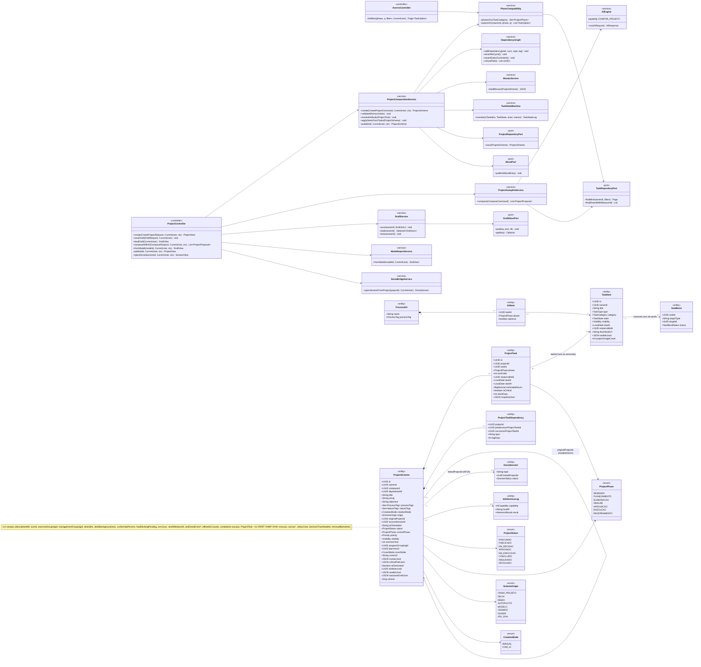
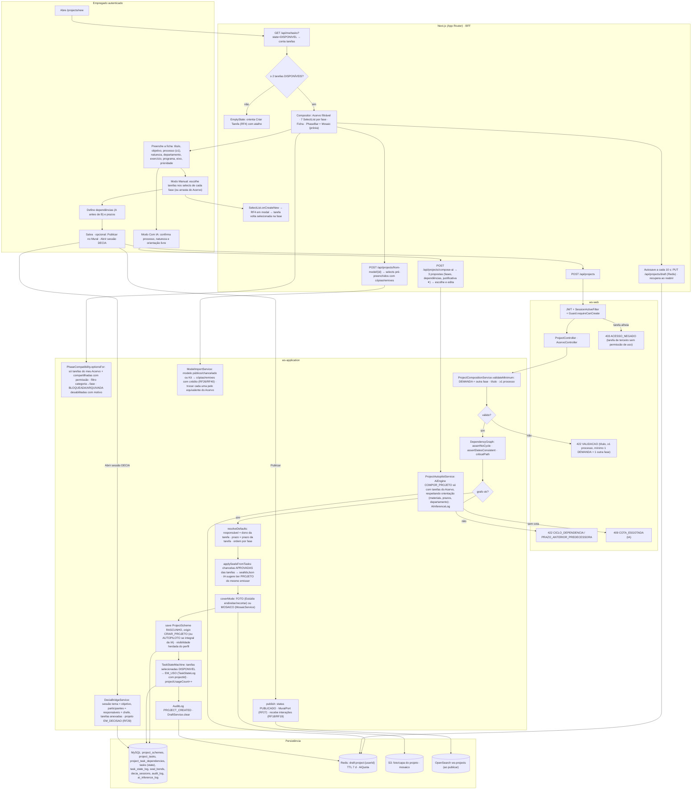
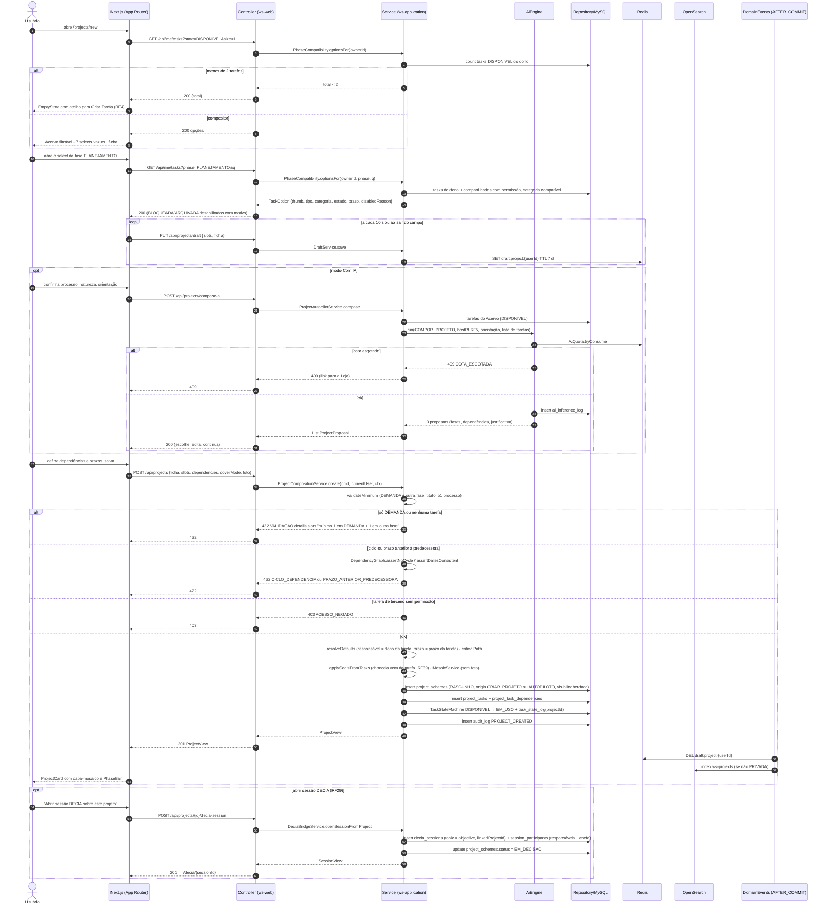
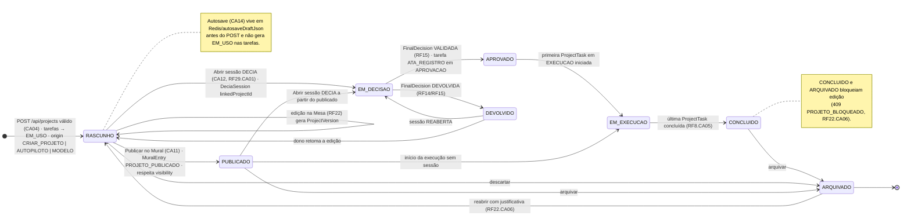
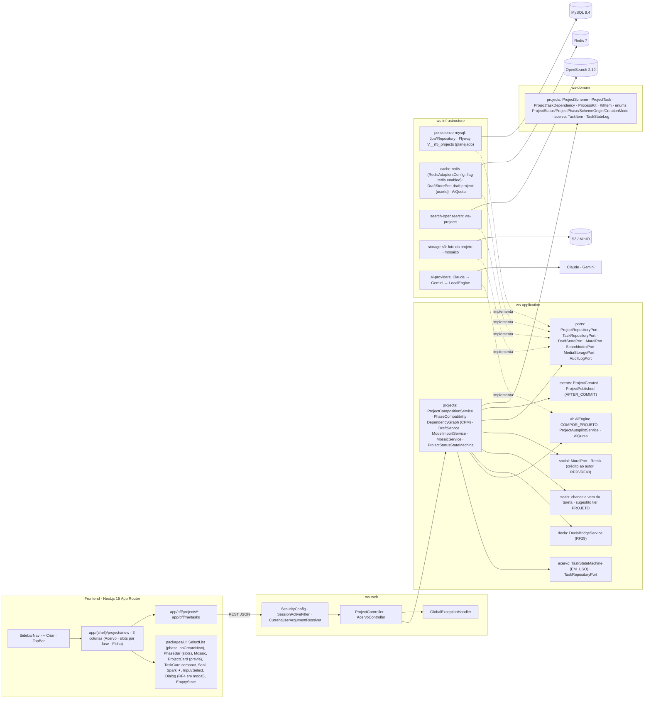

# RF5 — Utilizar o criador de projetos, escolhendo em cada fase do projeto as unidades de tarefa, em modo manual ou com IA
**HU:** HU5 · **Sprint (board Work Station):** lista *Requisitos Funcionais* sem sprint atribuída (o card "SPRINT 1" cita "RF5 Iniciar sessão", escopo antigo — `RENUMERACAO.md`; fase (e) da ARQUITETURA §6) · **Equivalente FAI:** RF5 Criar esquema (aba "Criar Look": slots por tipo com uma peça de cada, selects alimentados pelo Closet, modo Manual / Com IA, título, ocasião, estilo, orientação livre, foto opcional, capa = composição das peças, selos vindos das peças, pré-visualização do card, cadastrar nova peça inline, mínimo de 2 peças) · **Aba/rota:** Criar Projeto (`/projects/new`; folha "+ Criar"); API `POST /api/projects`, `PUT /api/projects/draft`, `GET /api/me/tasks?phase=&q=` (selects), `POST /api/projects/compose-ai`, `POST /api/projects/from-model/{id}`, `POST /api/projects/{id}/publish`, `POST /api/projects/{id}/decia-session` (RF29)
**Critérios de aceite cobertos:** RF21.CA01 · CA02 · CA03 · CA04 · CA05 · CA06 · CA07 · CA08 · CA09 · CA10 · CA11 · CA12 · CA13 · CA14 — **corpo do card = antigo RF21** (o card RF5 traz os CAs escritos como RF21.CA01–14 e são citados como estão no board; ver `RENUMERACAO.md`). Todas as classes do RF são **(planejado)**; transversais reais do Bloco 1–3: `SecurityConfig`, `SessionActiveFilter`, `Guard`, `CorrelationIdFilter`, `AuditLogPort`, `RedisAdaptersConfig`, `AiProvidersConfig`.

> **HU5** — COMO usuário logado dentro do sistema WS POSSO acessar a aba criar novo projeto PARA criar um esquema de projeto único e personalizado conforme as diretrizes de minha equipe de trabalho.

O **Esquema de Projeto** (`ProjectScheme`, TAXONOMIA §3.1) é a composição ordenada de tarefas (`ProjectTask`) por **7 fases** (`ProjectPhase`: DEMANDA · PLANEJAMENTO · ELABORAÇÃO · ANÁLISE · APROVAÇÃO · EXECUÇÃO · ENCERRAMENTO). Os selects de cada fase listam **somente as unidades de tarefa do Acervo do usuário** (RF6/RF41) compatíveis com a fase (mapa categoria → fase, `PhaseCompatibility`, como `SLOT_BY_CATEGORY` do FAI): Ofício/Protocolo → DEMANDA; ETP/TR/Cronograma → PLANEJAMENTO; Projeto básico/Planilha/Parecer → ELABORAÇÃO/ANÁLISE; Ata/Portaria → APROVAÇÃO; Contrato/Vistoria → EXECUÇÃO; Relatório final → ENCERRAMENTO; OUTRO em qualquer fase. Layout: **Acervo filtrável** (esquerda) · **slots por fase** (centro, `SelectList` + arrastar) · **Ficha do projeto** (direita: título, emoji, objetivo, processo ≤ 2, natureza ≤ 2, departamento, exercício, programa RF25, eixo RF24, prioridade, visibilidade herdada do perfil RF3, **Manual / Com IA**, orientação livre, foto, chancelas vindas das tarefas RF39, pré-visualização com capa-mosaico e `PhaseBar` RF38).

## 1. Diagrama de classes

## 2. Diagrama de atividades

## 3. Diagrama de sequência

## 4. Máquina de estados

Entidade central: **`ProjectScheme.status`** (`ProjectStatus`, TAXONOMIA §3.1/§13), com `ProjectStatusStateMachine`. O criador cria em `RASCUNHO`; `PUBLICADO` (CA11) e `EM_DECISAO` (CA12) nascem daqui; os demais são do RF22 (edição), RF15 (decisão validada) e RF8/RF12 (conclusão). O rascunho de autosave (CA14) **não** é um estado: é `autosaveDraftJson`/Redis antes de existir a entidade.

## 5. Diagrama de componentes

## 6. Rastreabilidade

| CA (card RF5, escrito como RF21) | Classe (§1) | Passo da atividade (§2) | Mensagem da sequência (§3) | Transição de estado (§4) | Componente (§5) | Situação |
|---|---|---|---|---|---|---|
| RF21.CA01 | `PhaseCompatibility.optionsFor`, `TaskRepositoryPort.findMine` | `A1`→`F1`→`F2`→`F4` | 1–9 | — | `PG`, `UI` (`SelectList`, `PhaseBar`) | planejado |
| RF21.CA02 | `PhaseCompatibility` (contagem), `EmptyState` | `F2`→`F3` | 5–7 | — | `UI` (`EmptyState`) | planejado |
| RF21.CA03 | `PhaseCompatibility.phasesFor/optionsFor`, `TaskOption.disabledReason`, `TaskRepositoryPort.findSharedWithMe` | `S1` | 10–14 | — | `ACV`, `UI` (`SelectList`) | planejado |
| RF21.CA04 | `ProjectCompositionService.create/resolveDefaults`, `ProjectTask`, `TaskStateMachine`, `SchemeOrigin.CRIAR_PROJETO` | `S2`→`S6`→`S9`→`S10`→`S11` | 33–34, 44–52 | `[*]`→`RAS`, `TaskState` DISPONIVEL→EM_USO | `PRJ`, `ACV`, `MY` | planejado |
| RF21.CA05 | `ProjectCompositionService.validateMinimum` | `S2`→`S3`→`E422` | 35–37 | — | `GEH` | planejado |
| RF21.CA06 | `ProjectAutopilotService`, `AiEngine` (COMPOR_PROJETO), `AiInferenceLog`, `SchemeOrigin.AUTOPILOTO` | `A4`→`F7`→`IA1`, `E409` | 19–32 | `[*]`→`RAS` (origin AUTOPILOTO) | `AIE`, `AIP`, `RDS` (cota) | planejado |
| RF21.CA07 | `SelectList.onCreateNew`, `TaskCreationService` (RF4) | `F5` | — | — | `UI` (`Dialog` com RF4) | planejado |
| RF21.CA08 | `DependencyGraph.assertNoCycle/assertDatesConsistent/criticalPath`, `ProjectTaskDependency`, `ProjectScheme.criticalPathJson` | `A5`→`S4`→`S5`→`E422C` | 38–40, 44 | — | `PRJ` (CPM) | planejado |
| RF21.CA09 | `ProjectCompositionService.applySealsFromTasks`, `SealBond`, `ProjectScheme.sealIdsJson` | `S7` | 45 | — | `SEAL`, `UI` (`Seal`) | planejado (RF39) |
| RF21.CA10 | `MosaicService`, `ProjectScheme.coverMode/coverUrl/mosaicJson` | `S8` | 45 | — | `UI` (`Mosaic`), `S3` | planejado (RF38) |
| RF21.CA11 | `ProjectCompositionService.publish`, `MuralPort`, `ProjectStatus.PUBLICADO` | `A6`→`S12` | 53 | `RAS`→`PUB` | `SOC`, `OSE` | planejado (RF27, RF18/RF19) |
| RF21.CA12 | `DeciaBridgeService.openSessionFromProject`, `DeciaSession.linkedProjectId`, `ProjectStatus.EM_DECISAO` | `A6`→`S13` | 56–62 | `RAS`→`DEC`, `PUB`→`DEC` | `DEC` | planejado (RF29) |
| RF21.CA13 | `ModelImportService.fromModel`, `ProcessKit`, `KitItem`, `SchemeOrigin.MODELO`, `Remix` | `F8`→`M1` | — | `[*]`→`RAS` (origin MODELO) | `SOC`, `PRJ` | planejado (RF26/RF40) |
| RF21.CA14 | `DraftService`, `DraftStorePort`, `ProjectScheme.autosaveDraftJson` | `F6`, `S11` | 15–18, 52 | nota de `RAS` | `RDS` (`draft:project:{userId}`) | planejado |
