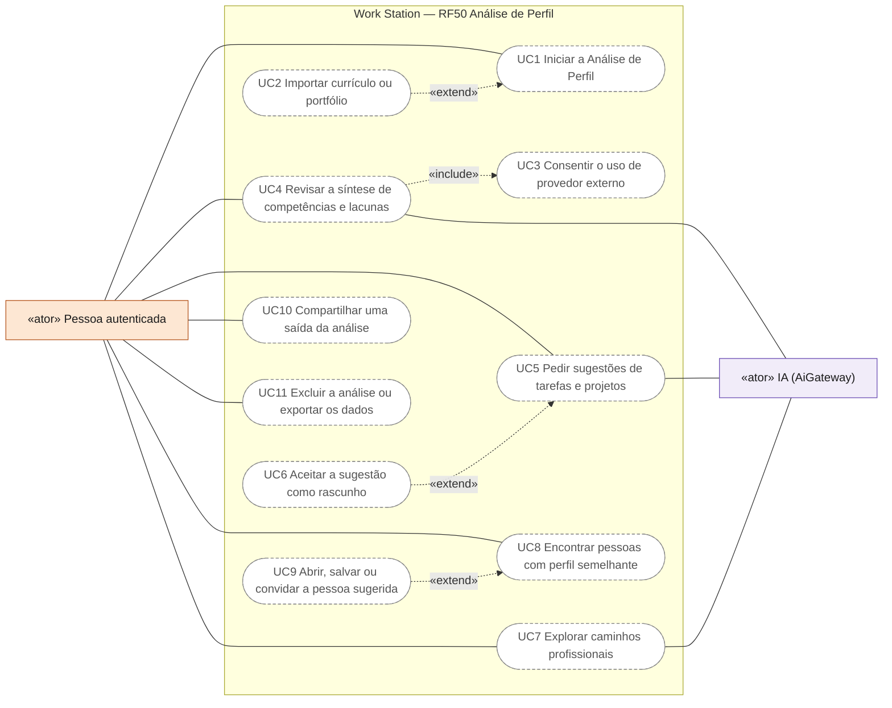
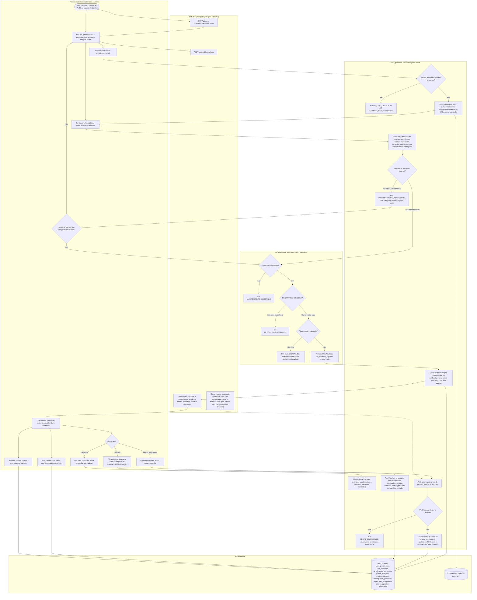
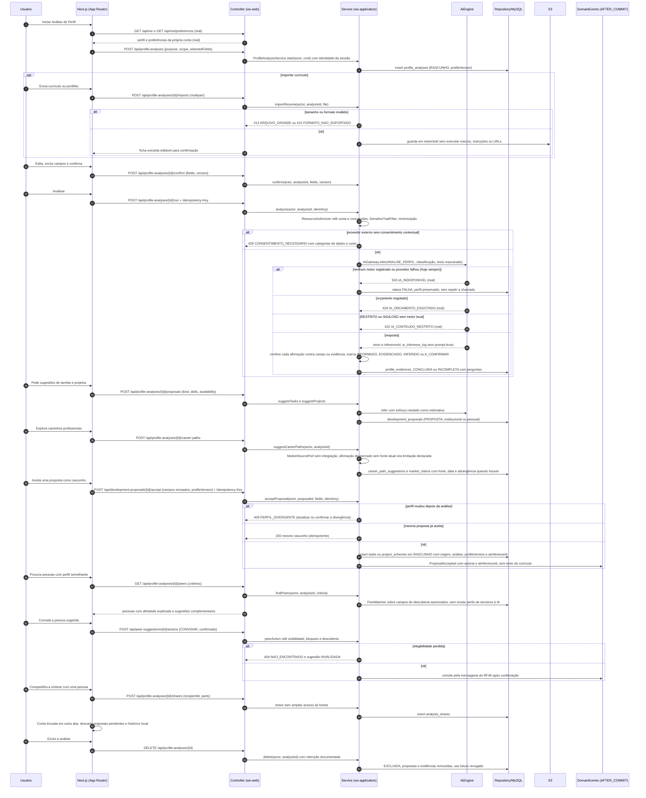
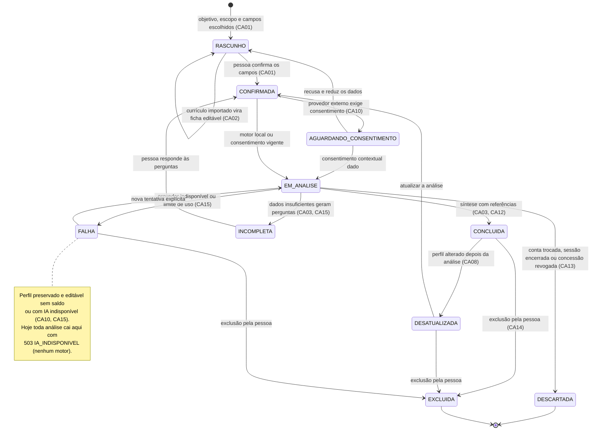
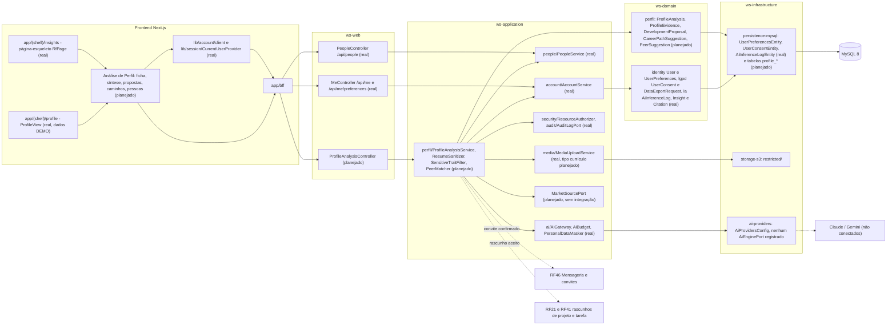

# RF50 — Analisar o perfil no Copilot e recomendar tarefas, projetos, pessoas da rede e caminhos profissionais
**HU:** — · **Aba/rota:** Insights da IA (`/insights`; Análise de Perfil a partir de `/profile`) · **Página-esqueleto:** registrada em 17/10/2026; jornada ainda não implementada.
**Critérios de aceite cobertos:** RF50.CA01 … RF50.CA18 — CA01–CA15 da tabela principal e CA16–CA18 de "Pessoas com perfil semelhante", sem alteração (requisito solicitado pelo usuário em 12/10/2026, sem HU no board); reais só o perfil e as preferências em /api/me, a busca em /api/people e o AiGateway, que não tem motor registrado.

**Trello:** [Análise de Perfil — RF50](https://trello.com/c/5c7pGk9p/205-rf50-analisar-o-perfil-da-pessoa-no-copilot-e-sugerir-tarefas-projetos-e-caminhos-profissionais).

**Estado:** requisito especificado; implementação pendente. **Nome de produto:** Análise de Perfil. **Origem:** solicitação do usuário em 12/10/2026.

**História de usuário:** Como pessoa usuária do Work Station, quero fornecer meus dados de perfil a um Copilot para compreender minhas competências e receber sugestões de tarefas, projetos, pessoas com perfil semelhante na rede e possíveis caminhos de carreira no mercado de trabalho, com justificativas e próximos passos que eu possa revisar.

## Dados e experiência

O Copilot recebe competências declaradas, experiências, formação, certificações, interesses, objetivos, disponibilidade e portfólio que a própria pessoa seleciona. Pode utilizar tarefas/projetos do Work Station somente quando a pessoa possui acesso e opta por incluí-los. Currículo importado gera uma ficha editável para confirmação; o documento não é aceito como comando de sistema. Dados ausentes aparecem como não informados e geram perguntas, sem fatos inventados.

A análise distingue **o que a pessoa informou**, **o que o portfólio evidencia**, **o que a IA está inferindo** e **o que precisa de confirmação**. Ela pode identificar forças, lacunas e oportunidades, mas não concede qualificações nem certifica aptidão profissional. Cada recomendação informa os dados que a sustentam e suas limitações.

O Copilot oferece quatro saídas relacionadas:

1. **Tarefas:** exercícios e entregas concretas para aprender, demonstrar ou aplicar uma competência, com objetivo, esforço estimado, critério de aceite e evidência esperada.
2. **Projetos:** propostas coerentes com objetivos e disponibilidade, com resultado esperado, fases, tarefas sugeridas, pré-requisitos e riscos. Podem ser projetos do trabalho ou projetos pessoais de portfólio, conforme escopo escolhido.
3. **Caminhos profissionais:** possibilidades de funções/áreas, competências já demonstradas, requisitos a desenvolver e próximos passos. São alternativas para exploração; não prometem emprego, salário, promoção ou sucesso.

4. **Pessoas na rede:** perfis semelhantes por competências, interesses, experiências e objetivos declarados, com explicação da afinidade e possibilidades concretas de colaboração, como trocar conhecimento ou participar de um projeto. Contato ou convite depende da iniciativa e da autorização dos envolvidos.

A pessoa pode perguntar “Que projeto demonstra essa habilidade?”, “Como desenvolver essa lacuna?” ou “Que caminhos combinam com meus interesses?”. A resposta vira proposta editável. Aceitar uma sugestão cria um rascunho de tarefa/projeto após confirmação, mantendo origem, análise e versão do perfil utilizada. Alterações na carreira, candidaturas, contatos ou compartilhamentos não são executados automaticamente.

## Critérios de aceite

| CA | Dado / quando / então |
|---|---|
| RF50.CA01 | Dado o usuário autenticado, quando inicia Análise de Perfil, então escolhe objetivo da análise, escopo profissional/pessoal e dados que deseja utilizar. O servidor deriva identidade da sessão; a pessoa pode editar e excluir campos antes de confirmar. |
| RF50.CA02 | Dado currículo, portfólio ou conteúdo selecionado, quando importado, então valida tamanho/formato, sanitiza conteúdo e apresenta dados extraídos para confirmação. Não executa macros, instruções embutidas ou URLs fornecidas como comandos. Recurso inacessível não integra o contexto. |
| RF50.CA03 | Dado o perfil confirmado, quando analisado, então gera síntese com competências declaradas/evidenciadas, interesses, objetivos, lacunas e incertezas. Cada afirmação referencia campo ou evidência autorizada; informações insuficientes geram perguntas. Inferências ficam identificadas e podem ser corrigidas pelo usuário. |
| RF50.CA04 | Dado competências e objetivos selecionados, quando pede sugestões de tarefas, então recebe propostas com título, finalidade, competência trabalhada, esforço estimado, pré-requisitos e critério verificável de aceite. Estimativa é identificada como tal; não cria tarefas automaticamente. |
| RF50.CA05 | Dado disponibilidade e objetivo, quando pede sugestões de projetos, então recebe propostas com escopo, resultado, fases, tarefas, riscos e dependências, distinguindo trabalho institucional de projeto pessoal. Não atribui colegas nem compromete recursos da empresa sem autorização e confirmação nos fluxos correspondentes. |
| RF50.CA06 | Dado interesses, experiência e competências, quando pede caminhos de carreira, então apresenta alternativas com justificativa, requisitos, lacunas e ações de desenvolvimento. A pessoa compara, discorda, refina e escolhe alternativas; não há classificação automática de empregabilidade, aptidão definitiva ou promessa de contratação. |
| RF50.CA07 | Dado uma afirmação sobre vagas, demanda de mercado, remuneração ou requisito atual, quando apresentada, então cita fonte, data e abrangência geográfica verificáveis. Sem fonte atual disponível, informa a limitação e não apresenta conhecimento geral do modelo como pesquisa atual de mercado. Faixas e projeções são explicitamente estimativas. |
| RF50.CA08 | Dado uma proposta, quando a pessoa aceita, então revisa campos e confirma a criação de rascunho, com proveniência da análise, versão do perfil e inferência utilizada. Aceitar novamente a mesma proposta é idempotente. Sugestão baseada em perfil alterado exige atualização ou confirmação explícita da divergência. |
| RF50.CA09 | Dado dados de perfil e recomendações pessoais, quando armazenados ou consultados, então permanecem privados por padrão. Chefes, empresa e administradores não recebem acesso automático. Compartilhar uma saída exige seleção explícita de destinatário e conteúdo; não amplia acesso às fontes. |
| RF50.CA10 | Dado uso de provedor externo, quando uma análise é solicitada, então pede consentimento contextual, mostra quais categorias de dados serão enviadas, aplica minimização, política de classificação e limites de custo. Conteúdo RESTRITO/SIGILOSO não vai ao provedor externo na política atual. Edição do perfil permanece disponível sem saldo ou com IA indisponível. |
| RF50.CA11 | Dado dados sensíveis ou características protegidas, quando presentes no material, então não os usa para inferir aptidão ou restringir possibilidades de carreira. O Copilot não infere saúde, religião, orientação sexual ou outras características sensíveis. Necessidades de acessibilidade podem orientar preferências informadas, sem reduzir oportunidades por presunção de incapacidade. |
| RF50.CA12 | Dado resposta da IA, quando exibida, então apresenta propostas separadas de fatos confirmados, fontes, limitações e controles para corrigir, rejeitar ou pedir explicação. Não utiliza Hype Score, pontos ou popularidade como medida de potencial profissional. Não transforma a análise em avaliação de desempenho ou decisão de contratação. |
| RF50.CA13 | Dado conta trocada, sessão encerrada ou concessão revogada, quando há resposta pendente, então descarta atualizações da sessão anterior e relê autorização antes de persistir ou aplicar propostas. Eventos guardam autoria e referência de inferência sem copiar currículo ou texto sensível para logs. |
| RF50.CA14 | Dado o usuário, quando deseja excluir análise ou revogar uso futuro dos dados, então consegue fazê-lo nas regras de retenção documentadas. Exportação informa os dados fornecidos e as recomendações produzidas. Histórico e propostas não ficam disponíveis a outra conta no mesmo dispositivo. |
| RF50.CA15 | Dado análise incompleta, falha de provedor ou limite de uso, quando ocorre, então preserva o perfil, informa o estado e oferece nova tentativa explícita, sem repetir automaticamente chamadas cobradas. A interface funciona por teclado, tem estrutura semântica e distingue visualmente informação, hipótese e proposta. |

## Pessoas com perfil semelhante: critérios adicionais

| CA | Dado / quando / então |
|---|---|
| RF50.CA16 | Dado um perfil confirmado, quando solicita pessoas semelhantes, então recomenda somente usuários descobríveis na rede autorizada, não bloqueados e que permitem uso dos campos exibidos para descoberta. Usa competências, interesses, objetivos e experiências compartilhados para esse fim; análise privada de carreira, currículo privado, Hype Score e características sensíveis não entram no pareamento. Não revela nomes, contagens ou evidências de perfis inacessíveis. |
| RF50.CA17 | Dado uma pessoa recomendada, quando a sugestão aparece, então explica a afinidade com campos visíveis — por exemplo “ambos trabalham com orçamento e têm interesse em BIM” — e pode propor atividade colaborativa concreta. Similaridade é afinidade por critérios declarados, não percentual de personalidade, aptidão ou valor profissional. A pessoa filtra critérios, descarta sugestão e pode explorar perfis complementares para não limitar a descoberta a um grupo homogêneo. |
| RF50.CA18 | Dado uma recomendação de pessoa, quando o usuário decide interagir, então pode abrir o perfil autorizado, salvar a sugestão ou enviar convite pelos mecanismos de rede/mensageria com confirmação. Não cria vínculo, segue, atribui trabalho, envia mensagem ou compartilha sua análise automaticamente. Revogação da descoberta, alteração de visibilidade, bloqueio ou perda de acesso remove elegibilidade e invalida recomendações pendentes no servidor. |

O MVP utiliza pareamento explicável sobre campos autorizados, sem precisar enviar os perfis de terceiros ao provedor de IA. A ajuda textual do Copilot pode orientar critérios de busca, mas a lista final deve ser filtrada pelo servidor. Sugerir uma pessoa não concede acesso às tarefas, projetos ou documentos dela.

## 0. Diagrama de casos de uso

Quem usa a Análise de Perfil e para quê. Atores do catálogo de [`ATORES_E_ATRIBUTOS.md`](../../arquitetura/ATORES_E_ATRIBUTOS.md) §2 (a análise é privada da própria pessoa; chefe, empresa e administrador não têm acesso automático); todos os casos são planejados — `/insights` é página-esqueleto e a jornada não foi implementada.

| Caso de uso | Ator(es) | CAs | Situação |
|---|---|---|---|
| UC1 Iniciar a Análise de Perfil (objetivo, escopo e dados escolhidos) | Pessoa autenticada | RF50.CA01 | planejado |
| UC2 Importar currículo ou portfólio (ficha editável) | — (estende UC1) | RF50.CA02 | planejado |
| UC3 Consentir o uso de provedor externo (categorias, minimização, custo) | — (incluído por UC4) | RF50.CA10 | planejado |
| UC4 Revisar a síntese de competências e lacunas | Pessoa autenticada, IA (AiGateway) | RF50.CA03, RF50.CA11, RF50.CA12, RF50.CA15 | planejado |
| UC5 Pedir sugestões de tarefas e projetos | Pessoa autenticada, IA (AiGateway) | RF50.CA04, RF50.CA05 | planejado |
| UC6 Aceitar a sugestão como rascunho | — (estende UC5) | RF50.CA08, RF50.CA13 | planejado |
| UC7 Explorar caminhos profissionais (com fontes de mercado identificadas) | Pessoa autenticada, IA (AiGateway) | RF50.CA06, RF50.CA07 | planejado |
| UC8 Encontrar pessoas com perfil semelhante | Pessoa autenticada | RF50.CA16, RF50.CA17 | planejado |
| UC9 Abrir, salvar ou convidar a pessoa sugerida | — (estende UC8) | RF50.CA18 | planejado |
| UC10 Compartilhar uma saída da análise | Pessoa autenticada | RF50.CA09 | planejado |
| UC11 Excluir a análise ou exportar os dados | Pessoa autenticada | RF50.CA13, RF50.CA14 | planejado |

## Integração com o Work Station

- RF3 fornece dados de perfil editáveis; RF41 e RF21/RF22 fornecem evidências e rascunhos autorizados.
- RF26/RF43 fornecem a experiência de Copilot e a infraestrutura de IA, consentimento, cotas e logs de inferência.
- RF44 pode utilizar tarefas de desenvolvimento que o usuário tenha aceitado, sem transformar recomendações de carreira em prioridade institucional obrigatória.
- RF33 pode fornecer referências institucionais autorizadas. Pesquisa atual de mercado exige fonte ou integração adicional identificada; não está presumida como disponível.
- O RF50 concentra avaliação pessoal revisável e caminhos de carreira, ampliando a finalidade dos insights gerais de perfil já descritos no RF43. Reutiliza esses serviços e não cria outro cadastro de usuário.

## Modelo e plano propostos

`ProfileAnalysis` preserva proprietário, finalidade, seleção/versão de dados, estado e referência de inferência. `ProfileEvidence` referencia a origem autorizada. `CareerPathSuggestion` guarda alternativa e justificativa; `DevelopmentProposal` guarda tarefa/projeto sugerido, revisão e rascunho resultante. Classificação, retenção e controles de acesso são comuns ao restante da aplicação.

Entrega incremental: ficha revisável e consentimento → análise estruturada com dados simulados em testes → propostas de tarefas/projetos com aceite → caminhos de carreira e fontes identificadas → importação de currículo → piloto. O MVP de carreira pode funcionar com possibilidades gerais, declarando ausência de pesquisa atual de mercado; sugestões de vagas específicas dependem da integração correspondente.

Validar com perfis iniciantes, experientes, em transição e com dados incompletos. Medir utilidade percebida, correções de inferências, propostas aceitas e desenvolvimento efetivamente concluído, sem tratar esses números como comprovação de empregabilidade. Testar isolamento entre contas, consentimento, fontes, custos, vieses, revogação, idempotência e acessibilidade.

A criação deste requisito não comprova implementação, integração com plataformas de emprego, pesquisa atual de vagas ou eficácia das recomendações. Nenhuma chamada paga de IA é necessária para redigir a especificação.

## 1. Diagrama de classes

`ProfileAnalysis`, `ProfileEvidence`, `CareerPathSuggestion` e `DevelopmentProposal` vêm de "Modelo e plano propostos" acima; `ResumeImport`, `MarketClaim`, `PeerSuggestion` e `AnalysisShare` detalham CA02, CA07, CA16–CA18 e CA09. Nenhuma delas consta ainda de [`TAXONOMIA.md`](../../arquitetura/TAXONOMIA.md) — todas **(planejado)**. **(real)** no código hoje: `User` e `UserPreferences` lidos e gravados por `MeController`/`AccountService` (`GET/PATCH /api/me`, `GET/PUT /api/me/preferences`); a busca de pessoas `PeopleService`/`PeopleController` (`GET /api/people`); `AiGateway` com `AiBudget`, `PersonalDataMasker` e `AiInferenceLog` — **sem nenhum `AiEnginePort` registrado** (o módulo `ai-providers` só tem `AiProvidersConfig`), então toda inferência hoje responde `503 IA_INDISPONIVEL`; `UserConsent`/`ConsentPurpose`, `DataExportRequest`, `Citation`, `AccessClassification`, `ResourceAuthorizer`, `AuditLogPort` e `MediaUploadService`. Valores novos de enum (`AiCapability.ANALISE_PERFIL`, `ConsentPurpose.ANALISE_PERFIL_IA`) são planejados.

```mermaid
classDiagram
direction LR

namespace ws_domain_perfil {
  class ProfileAnalysis {
    <<entity>>
    +id: UUID
    +ownerId: UUID
    +purpose: AnalysisPurpose
    +scope: AnalysisScope
    +selectedFieldsJson: JSON
    +includedResourcesJson: JSON
    +profileVersion: long
    +status: AnalysisStatus
    +aiInferenceId: UUID
    +consentEventId: UUID
    +classification: AccessClassification
    +createdAt: Instant
    +version: long
  }
  class AnalysisScope {
    <<enum>>
    PROFISSIONAL
    PESSOAL
  }
  class AnalysisPurpose {
    <<enum>>
    COMPREENDER_COMPETENCIAS
    DESENVOLVER_LACUNA
    EXPLORAR_CARREIRA
    ENCONTRAR_PESSOAS
  }
  class AnalysisStatus {
    <<enum>>
    RASCUNHO
    CONFIRMADA
    AGUARDANDO_CONSENTIMENTO
    EM_ANALISE
    CONCLUIDA
    INCOMPLETA
    FALHA
    DESATUALIZADA
    DESCARTADA
    EXCLUIDA
  }
  class ResumeImport {
    <<entity>>
    +analysisId: UUID
    +mediaObjectId: UUID
    +mimeType: String
    +sizeBytes: long
    +sanitized: boolean
    +extractedFieldsJson: JSON
    +confirmedAt: Instant
  }
  class ProfileEvidence {
    <<entity>>
    +analysisId: UUID
    +statement: String
    +kind: StatementKind
    +sourceType: String
    +sourceId: UUID
    +field: String
    +correctedByUser: boolean
  }
  class StatementKind {
    <<enum>>
    INFORMADO
    EVIDENCIADO
    INFERIDO
    A_CONFIRMAR
  }
  class DevelopmentProposal {
    <<entity>>
    +id: UUID
    +analysisId: UUID
    +kind: ProposalKind
    +title: String
    +purpose: String
    +skill: String
    +estimatedEffort: String
    +prerequisitesJson: JSON
    +acceptanceCriterion: String
    +institutional: boolean
    +status: ProposalStatus
    +profileVersion: long
    +resultingTaskId: UUID
    +resultingProjectId: UUID
    +idempotencyKey: String
  }
  class ProposalKind {
    <<enum>>
    TAREFA
    PROJETO
  }
  class ProposalStatus {
    <<enum>>
    PROPOSTA
    ACEITA
    REJEITADA
    DESATUALIZADA
  }
  class CareerPathSuggestion {
    <<entity>>
    +analysisId: UUID
    +title: String
    +justification: String
    +requirementsJson: JSON
    +gapsJson: JSON
    +actionsJson: JSON
    +userStance: String
  }
  class MarketClaim {
    <<entity>>
    +careerPathId: UUID
    +text: String
    +citation: Citation
    +sourceDate: LocalDate
    +geography: String
    +estimate: boolean
    +noCurrentSource: boolean
  }
  class PeerSuggestion {
    <<entity>>
    +analysisId: UUID
    +candidateUserId: UUID
    +affinityFieldsJson: JSON
    +collaborationIdea: String
    +complementary: boolean
    +status: PeerSuggestionStatus
  }
  class PeerSuggestionStatus {
    <<enum>>
    SUGERIDA
    SALVA
    CONVIDADA
    DESCARTADA
    INVALIDADA
  }
  class AnalysisShare {
    <<entity>>
    +analysisId: UUID
    +recipientId: UUID
    +partsJson: JSON
    +sharedAt: Instant
    +revokedAt: Instant
  }
}

namespace ws_domain_existente {
  class User {
    <<entity>>
    +id: UUID
    +fullName: String
    +jobTitle: String
    +bio: String
    +hypeVisibility: HypeVisibility
    +status: AccountStatus
    +version: long
  }
  class UserPreferences {
    <<entity>>
    +language: UiLanguage
    +notificationPrefsJson: JSON
    +aiModeDefault: AiMode
  }
  class UserConsent {
    <<entity>>
    +userId: UUID
    +purpose: ConsentPurpose
    +granted: boolean
    +revokedAt: Instant
  }
  class AiInferenceLog {
    <<entity>>
    +id: UUID
    +userId: UUID
    +capability: AiCapability
    +provider: AiProvider
    +result: InferenceResult
    +maskedFieldsJson: JSON
  }
  class Citation {
    <<entity>>
    +sourceType: String
    +sourceId: String
    +excerpt: String
    +url: String
  }
  class DataExportRequest {
    <<entity>>
    +userId: UUID
    +status: ExportStatus
    +format: ExportFormat
  }
}

namespace ws_application {
  class ProfileAnalysisService {
    <<service>>
    +start(actor, StartAnalysis) ProfileAnalysis
    +importResume(actor, analysisId, file) ResumeImport
    +confirm(actor, analysisId, fields, version) ProfileAnalysis
    +grantConsent(actor, analysisId, categories) UserConsent
    +analyze(actor, analysisId, idemKey) ProfileAnalysis
    +suggestTasks(actor, analysisId, skills) List
    +suggestProjects(actor, analysisId, availability) List
    +suggestCareerPaths(actor, analysisId) List
    +acceptProposal(actor, proposalId, fields, idemKey) DraftRef
    +findPeers(actor, analysisId, criteria) List
    +peerAction(actor, suggestionId, action) PeerSuggestion
    +share(actor, analysisId, recipientId, parts) AnalysisShare
    +delete(actor, analysisId)
    +export(actor) DataExportRequest
  }
  class ResumeSanitizer {
    <<service>>
    +extract(media) ExtractedFields
  }
  class PeerMatcher {
    <<service>>
    +match(profile, discoverableUsers, criteria) List
  }
  class SensitiveTraitFilter {
    <<service>>
    +strip(fields) Fields
  }
  class AccountService {
    <<service>>
    +me(current) UserView
    +update(current, ProfileUpdate, ctx) UserView
    +preferences(current) UserPreferences
  }
  class PeopleService {
    <<service>>
    +search(actor, query, limit) List
  }
  class AiGateway {
    <<service>>
    +infer(AiRequest) AiResult
  }
  class AiBudget {
    <<service>>
    +reserve(userId, companyId, tokens) Reservation
  }
  class AiEnginePort {
    <<port>>
    +complete(prompt, maxOutputTokens) Completion
  }
  class MarketSourcePort {
    <<port>>
    +lookup(role, region) MarketClaim
  }
  class ResourceAuthorizer {
    <<service>>
    +viewer(actor) Viewer
    +requireSelfOrAdmin(actor, userId) Viewer
  }
  class AuditLogPort {
    <<port>>
    +record(AuditEvent)
  }
}

namespace ws_web {
  class MeController {
    <<controller>>
    +GET_api_me()
    +PATCH_api_me(body)
    +GET_api_me_preferences()
    +PUT_api_me_preferences(body)
  }
  class PeopleController {
    <<controller>>
    +GET_api_people(q)
  }
  class ProfileAnalysisController {
    <<controller>>
    +POST_api_profile_analyses(body)
    +POST_api_profile_analyses_id_imports(file)
    +POST_api_profile_analyses_id_confirm(body)
    +POST_api_profile_analyses_id_run(idemKey)
    +POST_api_profile_analyses_id_proposals(body)
    +POST_api_profile_analyses_id_career_paths()
    +POST_api_development_proposals_id_accept(body, idemKey)
    +GET_api_profile_analyses_id_peers(criteria)
    +POST_api_peer_suggestions_id_actions(body)
    +POST_api_profile_analyses_id_shares(body)
    +DELETE_api_profile_analyses_id()
  }
}

ProfileAnalysis "1" o-- "0..1" ResumeImport
ProfileAnalysis "1" o-- "0..*" ProfileEvidence
ProfileAnalysis "1" o-- "0..*" DevelopmentProposal
ProfileAnalysis "1" o-- "0..*" CareerPathSuggestion
CareerPathSuggestion "1" o-- "0..*" MarketClaim
MarketClaim ..> Citation : fonte, data e abrangencia
ProfileAnalysis "1" o-- "0..*" PeerSuggestion
ProfileAnalysis "1" o-- "0..*" AnalysisShare
ProfileAnalysis ..> AnalysisStatus
ProfileAnalysis ..> AnalysisScope
ProfileAnalysis ..> AnalysisPurpose
ProfileEvidence ..> StatementKind
DevelopmentProposal ..> ProposalKind
DevelopmentProposal ..> ProposalStatus
PeerSuggestion ..> PeerSuggestionStatus
ProfileAnalysis "0..*" --> "1" User : dono
ProfileAnalysis ..> AiInferenceLog : referencia de inferencia
ProfileAnalysis ..> UserConsent : consentimento contextual
PeerSuggestion "0..*" --> "1" User : candidato descobrivel
ProfileAnalysisController --> ProfileAnalysisService
MeController --> AccountService
PeopleController --> PeopleService
ProfileAnalysisService --> AccountService : perfil e preferencias
ProfileAnalysisService --> ResumeSanitizer
ProfileAnalysisService --> SensitiveTraitFilter
ProfileAnalysisService --> PeerMatcher
PeerMatcher --> PeopleService : base da busca autorizada
ProfileAnalysisService --> AiGateway
ProfileAnalysisService --> MarketSourcePort
ProfileAnalysisService --> ResourceAuthorizer
ProfileAnalysisService --> AuditLogPort
ProfileAnalysisService ..> DataExportRequest
AiGateway --> AiBudget
AiGateway --> AiEnginePort : nenhum motor registrado
AccountService ..> User
AccountService ..> UserPreferences
note for AiGateway "real - sem motor, responde 503 IA_INDISPONIVEL"
note for MeController "real - api me e preferencias"
note for ProfileAnalysis "planejado - RF50"
```

## 2. Diagrama de atividades

**(real)**: leitura e edição do perfil e das preferências (`/api/me`), troca de conta entre abas no front (`CurrentUserProvider`) e o `AiGateway` com orçamento, classificação e mascaramento — que hoje termina sempre em `503 IA_INDISPONIVEL`. O resto é **(planejado)**.

## 3. Diagrama de sequência

## 4. Máquina de estados

Entidade central: `ProfileAnalysis.status` (`AnalysisStatus`, **planejado**).

## 5. Diagrama de componentes

## 6. Rastreabilidade

Mensagens = números do `autonumber` da §3. Passos = nós da §2. Componentes = nós da §5.

| CA | Classe | Passo | Mensagem | Transição | Componente |
|---|---|---|---|---|---|
| RF50.CA01 | `ProfileAnalysisService.start/confirm`, `ProfileAnalysis` (purpose, scope, selectedFieldsJson), `AccountService.me/preferences` e `MeController` (real) | A0 → F1 → A1 → F2 · A3 | 1–6, 13–15 | `[*] → RASCUNHO`, `RASCUNHO → CONFIRMADA` | `MEC`, `ACC`, `PAC`, `PAS` |
| RF50.CA02 | `importResume`, `ResumeImport`, `ResumeSanitizer`, `MediaUploadService` (real, tipo currículo planejado) | A2 → P1 · E1 → P2 → D2 | 7–12 | `RASCUNHO → RASCUNHO` | `MED`, `S3A` |
| RF50.CA03 | `ProfileEvidence` + `StatementKind` (INFORMADO · EVIDENCIADO · INFERIDO · A_CONFIRMAR), `correctedByUser` | P5 → F4 → A5 | 26–28 | `EM_ANALISE → CONCLUIDA`, `→ INCOMPLETA` | `PAS`, `ENT` |
| RF50.CA04 | `suggestTasks`, `DevelopmentProposal` (kind TAREFA, skill, estimatedEffort, prerequisitesJson, acceptanceCriterion) | A6 → A7 | 29–33 | — | `PAS` |
| RF50.CA05 | `suggestProjects`, `DevelopmentProposal` (kind PROJETO, `institutional`), sem atribuir colegas | A6 → A7 | 29–33 | — | `PAS`, `RF21` |
| RF50.CA06 | `suggestCareerPaths`, `CareerPathSuggestion` (justificativa, requisitos, lacunas, ações, `userStance`) | A6 → A8 | 34–38 | — | `PAS` |
| RF50.CA07 | `MarketClaim` (citation, sourceDate, geography, estimate, noCurrentSource), `Citation` (real), `MarketSourcePort` sem integração | A8 → P8 | 37–38 | — | `MKT` |
| RF50.CA08 | `acceptProposal`, `DevelopmentProposal.profileVersion/idempotencyKey/resultingTaskId/resultingProjectId` | A7 → P10 → P6 · E3 → P7 | 39–45 | `CONCLUIDA → DESATUALIZADA` | `PAS`, `RF21` |
| RF50.CA09 | `share`, `AnalysisShare` (recipientId, partsJson), dono único da `ProfileAnalysis`, `ResourceAuthorizer` (real) | A5 → A10 | 56–59 | — | `RA`, `PAS` |
| RF50.CA10 | `grantConsent`, `UserConsent`/`ConsentPurpose` (real, valor ANALISE_PERFIL_IA planejado), `AiGateway` classificação e `PersonalDataMasker` (real), `AiBudget` (real) | P4 · E2 → A4 · I2 · E5 · I4 | 19–21, 25 | `CONFIRMADA → AGUARDANDO_CONSENTIMENTO → EM_ANALISE` | `AIG`, `BASE` |
| RF50.CA11 | `SensitiveTraitFilter` (sem saúde, religião, orientação sexual), acessibilidade só como preferência informada | P3 | 19 | — | `PAS` |
| RF50.CA12 | `ProfileEvidence.kind` separa fato, fonte, limitação e proposta; sem `ProfileHypeScore`, pontos ou popularidade | P5 → F4 | 27 | `EM_ANALISE → CONCLUIDA` | `R3`, `PAS` |
| RF50.CA13 | `CurrentUserProvider` (real, troca de conta entre abas), releitura em `ResourceAuthorizer` antes de persistir, evento com autoria e `aiInferenceId` sem currículo | F3 → P10 | 45, 60 | `EM_ANALISE → DESCARTADA` | `R4`, `RA` |
| RF50.CA14 | `delete`, `export` → `DataExportRequest` (real), retenção documentada | A11 → D1 | 61–64 | `CONCLUIDA → EXCLUIDA` | `PAS`, `BASE` |
| RF50.CA15 | `AiGateway` (real, `503 IA_INDISPONIVEL` sem motor, `429 IA_ORCAMENTO_ESGOTADO`), `ProfileAnalysis.status` FALHA, nova tentativa explícita com `Idempotency-Key` | I1 · E4 · I3 · E6 | 17, 22–24 | `EM_ANALISE → FALHA`, `FALHA → EM_ANALISE` | `AIG`, `AIP` |
| RF50.CA16 | `findPeers`, `PeerMatcher` sobre `PeopleService.search` (real) com campos de descoberta, sem análise privada, currículo, Hype Score ou dados sensíveis | A9 → P9 | 46–49 | — | `PPL`, `PPC`, `PAS` |
| RF50.CA17 | `PeerSuggestion` (affinityFieldsJson, collaborationIdea, complementary), filtros e descarte | A9 → P9 | 50 | — | `R3`, `PAS` |
| RF50.CA18 | `peerAction`, `PeerSuggestionStatus` (SALVA · CONVIDADA · DESCARTADA · INVALIDADA), convite só com confirmação via RF46 | A9 → P9 | 51–55 | — | `RF46`, `PAS` |
