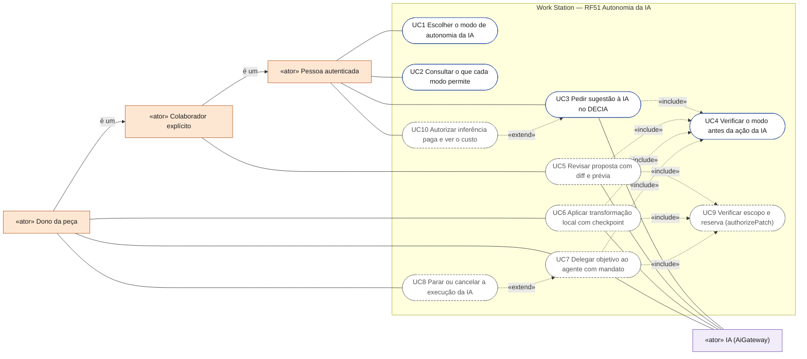
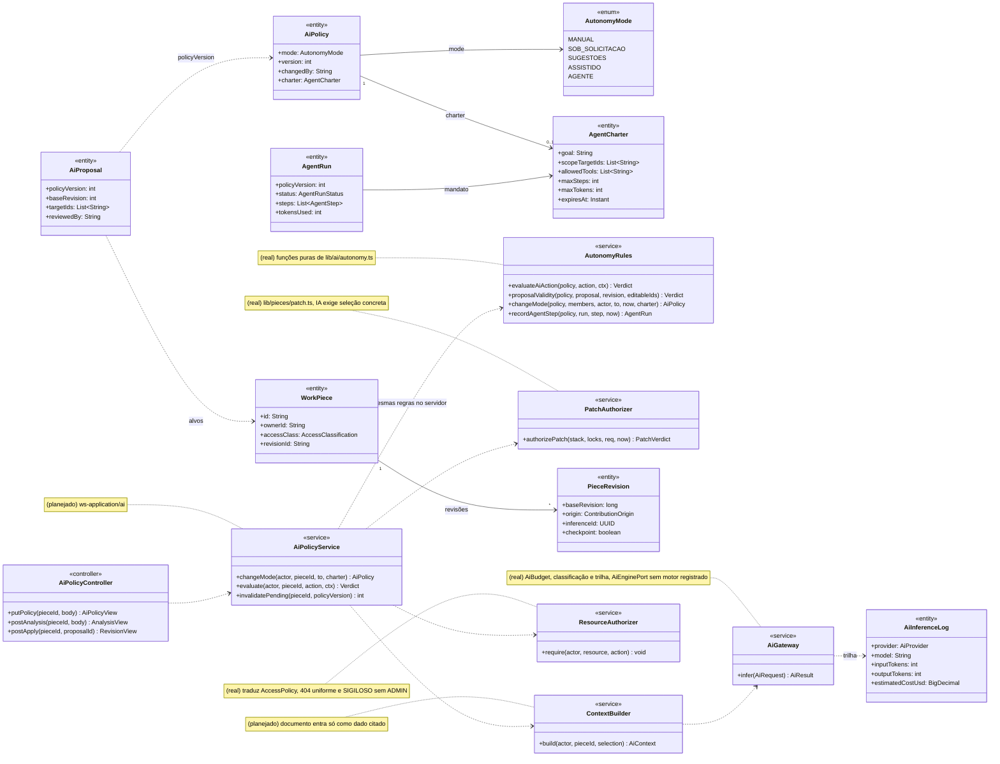
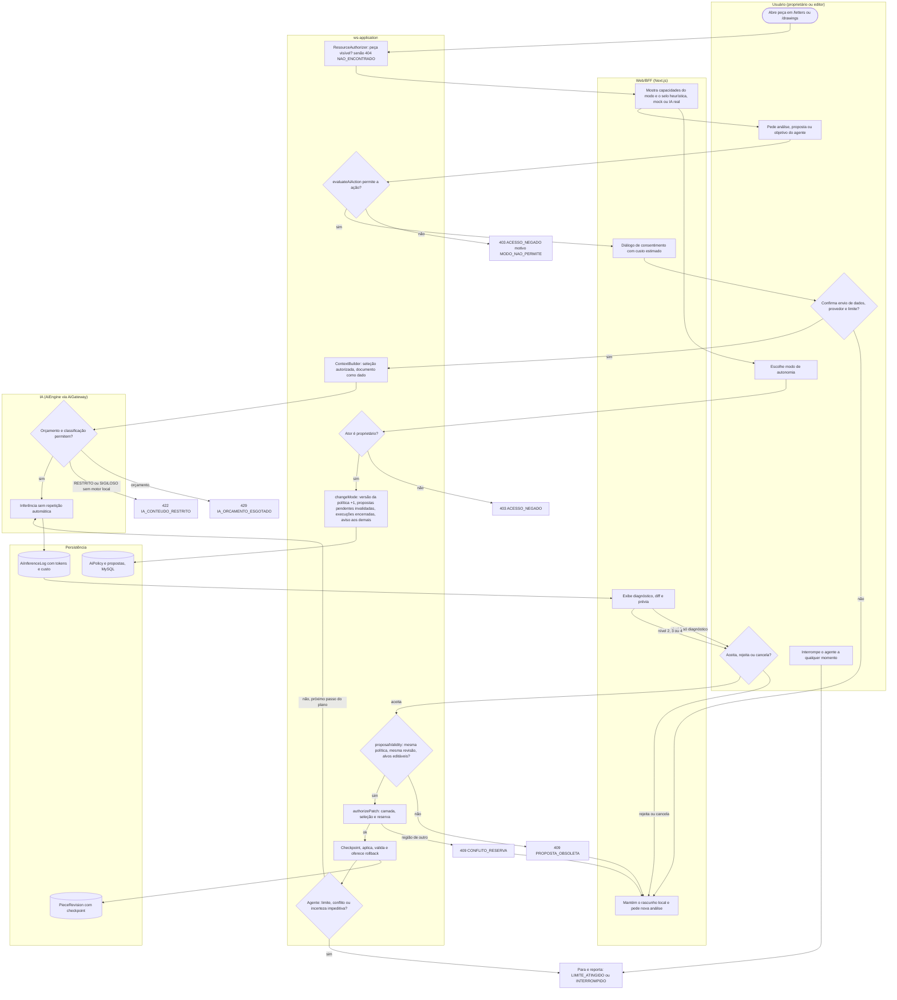
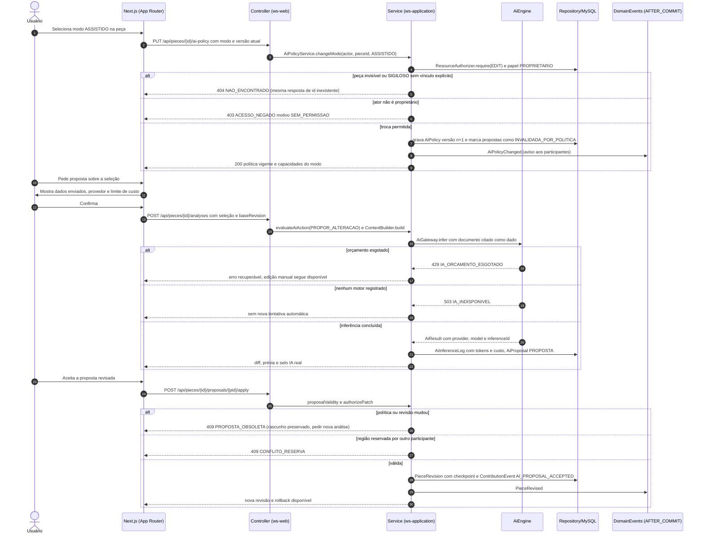
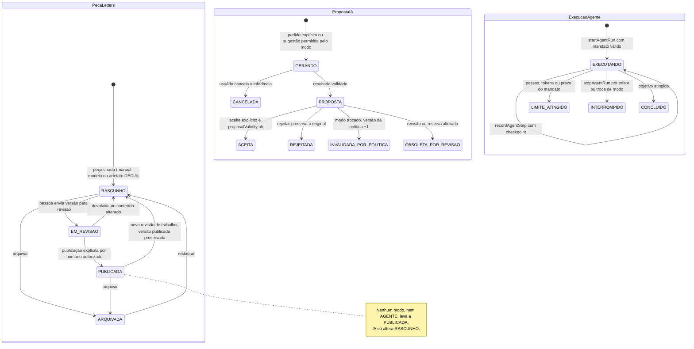
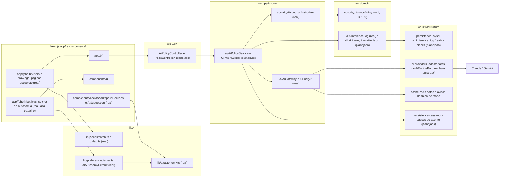

# RF51 — Controlar autonomia, escopo e execução da IA em Letters e Drawings
**HU:** — (sem HU no board; RF especificado em 15/10/2026) · **Sprint (board Work Station):** lista *Requisitos Funcionais* sem sprint atribuída · **Equivalente FAI:** — · **Aba/rota:** Configurações › Trabalho › Autonomia da IA (`/settings?tab=trabalho`), Letters (`/letters`) e Drawings (`/drawings`) · **Página-esqueleto:** registrada em 17/10/2026 (`/letters` e `/drawings`); política real em `lib/ai/autonomy.ts`, aplicação no servidor e nos editores pendente (Onda 6 do PLANO_ONDAS)
**Critérios de aceite cobertos:** RF51.CA01 … RF51.CA07 — corpo do card = especificação de docs/produto/requisitos-studio/RF51.md (CAs copiados como estão escritos); classes reais: `lib/ai/autonomy.ts` (AiPolicy, AgentCharter, AgentRun, AiProposal, evaluateAiAction, proposalValidity, changeMode), `lib/pieces/patch.ts` (authorizePatch), `lib/pieces/authorship.ts`, `lib/preferences/types.ts` (aiAutonomyDefault), `components/decia/WorkspaceSections.tsx`, `AiGateway`/`AiBudget`/`AiEnginePort` (sem motor registrado), `ResourceAuthorizer`, `AccessPolicy`; o restante (planejado)

A pessoa escolhe, antes de qualquer análise ou alteração de uma peça Letters ou Drawings, em que modo a IA pode atuar (Manual, Sob solicitação, Sugestões, Assistido ou Agente, D-136), vê o que cada modo pode fazer, recebe só diagnósticos, propostas com diff ou execuções limitadas conforme o modo, e qualquer troca de modo, revisão ou reserva invalida as propostas pendentes sem perder o rascunho; a autorização e a política valem no servidor, e nada é publicado automaticamente.

**Estado em 17/10/2026.** Real: os cinco modos e suas capacidades (`MODE_CAPABILITIES`), a decisão única `evaluateAiAction` usada pela UI do DECIA (`WorkspaceSections` mostra a ação de IA como bloqueada em Manual e explica o modo Sob solicitação), a preferência pessoal `aiAutonomyDefault` (padrão `SOB_SOLICITACAO`, persistida em `notificationPrefsJson`; o seletor hoje fica na aba **Trabalho**, `/settings?tab=trabalho` — a aba própria `?tab=ia` é planejada), o mandato do agente (`validateCharter`: passos ≤ 50, tokens ≤ 200 000, prazo ≤ 8 h) e a porta `AiGateway` (orçamento `429 IA_ORCAMENTO_ESGOTADO`, classificação `422 IA_CONTEUDO_RESTRITO`, trilha `AiInferenceLog`). Planejado: `AiPolicyService` no servidor, persistência de propostas e execuções, editores Letters/Drawings que consumam a política e um motor registrado em `AiEnginePort` (hoje nenhum adaptador implementa a porta, portanto toda chamada responde `503 IA_INDISPONIVEL`).

**Heurística × mock × IA real.** Diagnósticos locais (regras determinísticas no cliente ou no servidor) aparecem com o selo *heurística*; testes usam motores simulados (*mock*) e nunca são exibidos como resultado de modelo; *IA real* só quando `AiGateway` devolve `AiResult` com `provider`/`model` e `inferenceId`. O selo acompanha cada diagnóstico e cada proposta.

Correspondência entre os níveis do card e os modos implementados (D-136):

| Nível do card | Modo(s) em `AutonomyMode` | Ação permitida (`AiAction`) | Altera conteúdo? |
|---|---|---|---|
| 0 (IA desligada) | `MANUAL` | nenhuma | não |
| 1 Diagnóstico | `SOB_SOLICITACAO` (a pedido) ou `SUGESTOES` (espontâneo) | `RESPONDER`, `SUGESTAO_ESPONTANEA` | não |
| 2 Proposta | `SOB_SOLICITACAO`, `SUGESTOES` | `PROPOR_ALTERACAO` | só pelo aceite humano explícito |
| 3 Transformação local | `ASSISTIDO` | `APLICAR_ALTERACAO` (proposta revisada, seleção editável, mesma revisão) | sim, com checkpoint e rollback |
| 4 Agente | `AGENTE` | `EXECUTAR_PASSO` dentro do `AgentCharter` | sim, só rascunho, com log e parada |

## Critérios de aceite

| CA | Enunciado (Dado / Quando / Então) |
|---|---|
| **RF51.CA01** | Dado o nível 1, quando a análise termina, então somente diagnósticos e métricas explicáveis são exibidos; texto e geometria permanecem idênticos. |
| **RF51.CA02** | Dado o nível 2, quando uma proposta é gerada, então mostra diff e prévia, e só altera conteúdo após aceite explícito; rejeitar preserva o original. |
| **RF51.CA03** | Dado o nível 3, quando executa uma transformação local autorizada, então restringe objetos/blocos à seleção e registra checkpoint, validações e rollback. |
| **RF51.CA04** | Dado o nível 4, quando recebe um objetivo, então apresenta plano, ferramentas permitidas, escopo e orçamento; para ao atingir limite, conflito ou incerteza impeditiva. |
| **RF51.CA05** | Dada uma revisão ou reserva alterada, quando uma proposta antiga é aplicada, então rejeita a proposta sem perder o rascunho e solicita nova análise. |
| **RF51.CA06** | Dado um documento ou imagem contendo instruções, quando entra no contexto, então é tratado como dado e não altera permissões, ferramentas ou política do agente. |
| **RF51.CA07** | Dada uma inferência paga, quando é solicitada, então informa envio de dados, provedor e limite; registra tokens/custo quando disponíveis, permite cancelamento e não faz repetição automática ilimitada. |

## 0. Diagrama de casos de uso

A pessoa escolhe em Configurações › Trabalho o modo de autonomia da IA, e o DECIA já respeita esse modo ao oferecer sugestões; revisão de propostas, transformação local, agente e inferência paga nos editores Letters e Drawings são planejados. A IA só propõe; nada é publicado sem aceite humano.

| Caso de uso | Ator(es) | CAs | Situação |
|---|---|---|---|
| UC1 Escolher o modo de autonomia da IA | `autenticado` | RF51.CA01 · CA02 · CA03 · CA04 | real — `/settings?tab=trabalho`, `aiAutonomyDefault` |
| UC2 Consultar o que cada modo permite | `autenticado` | RF51.CA01 · CA04 | real — `MODE_CAPABILITIES` nas dicas do seletor |
| UC3 Pedir sugestão à IA no DECIA | `autenticado`, `ia` | RF51.CA01 · CA02 | real — `WorkspaceSections` + `AiSuggestion` (sem motor registrado: `503 IA_INDISPONIVEL`) |
| UC4 Verificar o modo antes da ação da IA | — (incluído por UC3, UC5, UC6, UC7) | RF51.CA01 · CA02 · CA03 · CA04 | real — `evaluateAiAction` (`lib/ai/autonomy.ts`) |
| UC5 Revisar proposta com diff e prévia | `colaborador`, `ia` | RF51.CA02 · CA05 · CA06 | planejado — `AiProposal`/`proposalValidity` sem tela |
| UC6 Aplicar transformação local com checkpoint | `dono`, `ia` | RF51.CA03 | planejado |
| UC7 Delegar objetivo ao agente com mandato | `dono`, `ia` | RF51.CA04 · CA06 | planejado — `validateCharter` sem tela |
| UC8 Parar ou cancelar a execução da IA | `dono` (estende UC7) | RF51.CA04 · CA07 | planejado |
| UC9 Verificar escopo e reserva (authorizePatch) | — (incluído por UC5, UC6, UC7) | RF51.CA03 · CA05 | planejado — função pura `lib/pieces/patch.ts` |
| UC10 Autorizar inferência paga e ver o custo | `autenticado` (estende UC3) | RF51.CA07 | planejado — `AiBudget` no servidor, sem tela |

## 1. Diagrama de classes

Legenda: **(real)** `AutonomyMode`, `AiPolicy`, `AgentCharter`, `AgentRun`, `AiProposal`, `AutonomyRules` (agrupa as funções de `lib/ai/autonomy.ts`), `PatchAuthorizer` (`lib/pieces/patch.ts`), `WorkPiece` (interface TS em memória de `lib/pieces/service.ts`), `AiGateway` (com `AiBudget` e a porta `AiEnginePort`), `AiInferenceLog`, `ResourceAuthorizer` (sobre `AccessPolicy`). **(planejado)** `PieceRevision`, `AiPolicyService`, `ContextBuilder`, `AiPolicyController` e a versão Java de `WorkPiece` (modelo canônico de `LETTERS_DRAWINGS_ENGENHARIA.md` §3; ainda fora da TAXONOMIA).

## 2. Diagrama de atividades

## 3. Diagrama de sequência

## 4. Máquina de estados

Entidades afetadas: a peça Letters/Drawings (`WorkPiece.state`, planejado), a proposta de IA (`AiProposal`, real como validação pura; estados persistidos planejados) e a execução do agente (`AgentRunStatus`, real).

## 5. Diagrama de componentes

## 6. Rastreabilidade

| CA | Classe | Passo (atividade) | Mensagem (sequência) | Transição | Componente |
|---|---|---|---|---|---|
| **RF51.CA01** | `AiAction.RESPONDER/SUGESTAO_ESPONTANEA`, `MODE_CAPABILITIES` (proposes/applies), selo heurística × IA real | A2 → S4 → I2 → W3 “nível 1 só diagnóstico” | 10–22 (sem apply) | `PropostaIA` não é criada; `PecaLetters` permanece | `AUT`, `WS` |
| **RF51.CA02** | `AiProposal`, `AiPolicyService.evaluate(PROPOR_ALTERACAO)`, diff e prévia | W3 → A4 → S6 | 20–22 e 23–30 | `PROPOSTA → ACEITA` ou `PROPOSTA → REJEITADA` | `WS`, `APS` |
| **RF51.CA03** | `ASSISTIDO`, `PatchAuthorizer.authorizePatch` (IA_SEM_SELECAO), `PieceRevision.checkpoint` | S6 → S7 → S8 → P3 | 25 e 28–30 | `PROPOSTA → ACEITA` | `PAT`, `APS`, `MY` |
| **RF51.CA04** | `AgentCharter` (goal, allowedTools, scopeTargetIds, maxSteps, maxTokens, expiresAt), `AgentRun`, `stopAgentRun` | S9 → STOP, A5 | 1–9 (mandato exigido na troca para AGENTE) | `EXECUTANDO → LIMITE_ATINGIDO / INTERROMPIDO / CONCLUIDO` | `AUT`, `APS`, `CA` |
| **RF51.CA05** | `proposalValidity` (PROPOSTA_OBSOLETA_POLITICA, PROPOSTA_OBSOLETA_REVISAO, FORA_DO_ESCOPO), `RegionLock` | S6 → E409 → W4, S7 → E409R | 7 e 25–27 | `PROPOSTA → OBSOLETA_POR_REVISAO`, `PROPOSTA → INVALIDADA_POR_POLITICA` | `APS`, `PAT` |
| **RF51.CA06** | `ContextBuilder.build` (documento como dado citado), `AiPolicy` alterável só por `changeMode` do proprietário | S5 | 14–15 | nenhuma transição disparada por conteúdo | `APS`, `GW` |
| **RF51.CA07** | `AiGateway`, `AiBudget`, `AiInferenceLog` (inputTokens, outputTokens, estimatedCostUsd), cancelamento | W2 → A3 → I1 → E429/E422, I2 sem repetição | 10–19 e 21 | `GERANDO → CANCELADA` | `GW`, `RD`, `AIP` |

Regras transversais refletidas: autorização no servidor (`ResourceAuthorizer`, 404 uniforme D-141); SIGILOSO só dono e colaboradores explícitos, sem ADMIN implícito (D-139); troca de modo invalida propostas e encerra execuções (D-136); nenhuma publicação automática (nota em `PUBLICADA`); conteúdo RESTRITO/SIGILOSO não vai a provedor externo (`AiGateway`).
