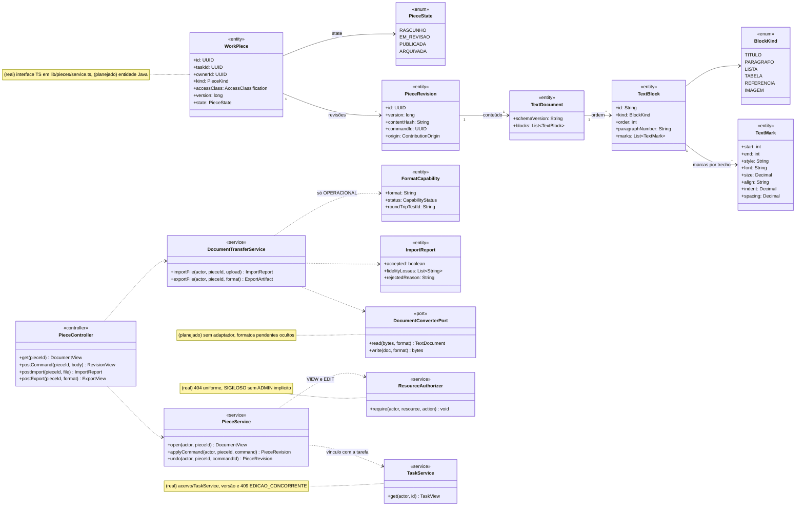
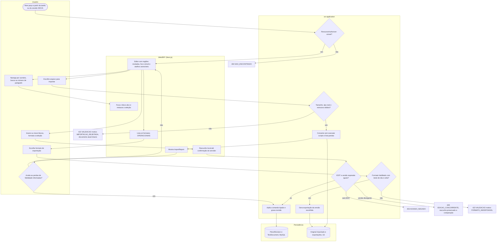
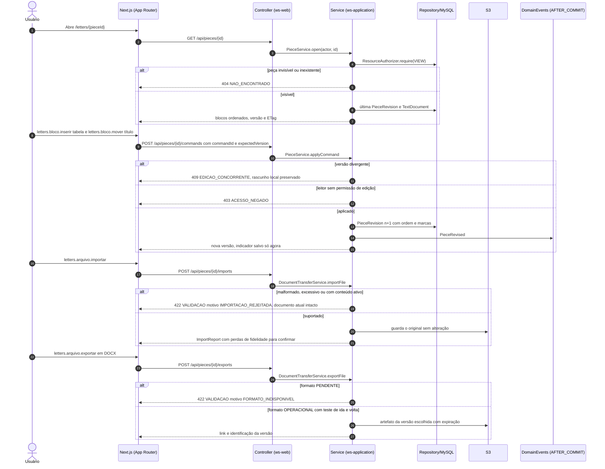
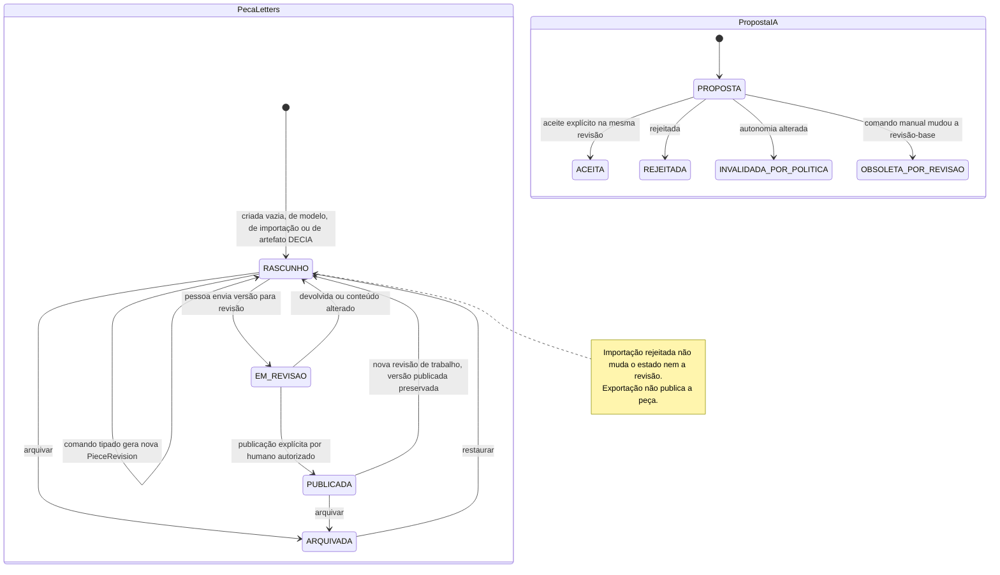
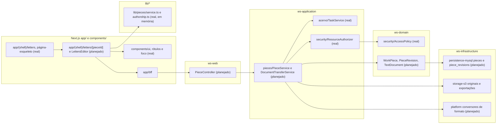

# RF52 — Editar documentos estruturados no Work Station Letters
**HU:** — (sem HU no board; RF especificado em 15/10/2026) · **Sprint (board Work Station):** lista *Requisitos Funcionais* sem sprint atribuída · **Equivalente FAI:** — · **Aba/rota:** Letters (`/letters`, `/letters/[pieceId]`; peça aberta a partir de `/tasks/[id]` e da sessão DECIA `/decia/[sessionId]`) · **Página-esqueleto:** registrada em 17/10/2026; editor ainda não implementado (Onda 4 do PLANO_ONDAS)
**Critérios de aceite cobertos:** RF52.CA01 … RF52.CA07 — corpo do card = especificação de docs/produto/requisitos-studio/RF52.md (CAs copiados como estão escritos); classes reais: `lib/pieces/service.ts` (WorkPiece, PiecesService em memória), `lib/pieces/authorship.ts`, `TaskService`, `ResourceAuthorizer`, `AccessPolicy`, página-esqueleto `app/(shell)/letters/page.tsx`; o restante (planejado)

A pessoa abre no Letters um documento vinculado a uma tarefa ou a uma sessão DECIA, insere e reorganiza títulos, parágrafos, listas, tabelas, referências e imagens em blocos com identificador estável, formata só o trecho selecionado com desfazer, navega por sumário, busca e numeração de parágrafos sem perder a seleção, importa e exporta apenas formatos habilitados com relatório de fidelidade, e cada gravação é uma revisão autorizada e versionada no servidor.

**Estado em 17/10/2026.** O app não tem editor Letters (MATRIZ_RF: AUSENTE, nota 0,00): existe só a página-esqueleto `/letters` com os CAs e, fora do app, o protótipo `docs/exemplo_drawings_letters/work_station_letters_drawings.tsx` (texto plano, sem blocos persistidos). Reais e reaproveitados: `WorkPiece`/`PiecesService` em memória (`lib/pieces/service.ts`, sem rota HTTP), a cadeia de autoria (`lib/pieces/authorship.ts`), `TaskService` (primeiro chamador de `ResourceAuthorizer`, 409 `EDICAO_CONCORRENTE` por versão, D-135) e `AccessPolicy` (SIGILOSO só dono e colaboradores explícitos, D-139). Planejado: modelo `TextDocument` de blocos (LETTERS_DRAWINGS_ENGENHARIA §3), comandos tipados idempotentes, importação/exportação com teste de ida e volta.

**Heurística × mock × IA real.** Este RF não usa IA: formatação, sumário, busca, numeração e validação de importação são determinísticas (cliente e servidor). Conversores de formato em testes são *mock* e o formato só aparece como operacional quando o adaptador real passa no teste de ida e volta.

Comandos com nomes do próprio produto (não prometem paridade com outros editores): `letters.bloco.inserir`, `letters.bloco.mover`, `letters.trecho.formatar`, `letters.historico.desfazer`, `letters.navegar.sumario`, `letters.navegar.buscar`, `letters.navegar.paragrafo`, `letters.arquivo.importar`, `letters.arquivo.exportar`.

## Critérios de aceite

| CA | Enunciado (Dado / Quando / Então) |
|---|---|
| **RF52.CA01** | Dado um documento, quando insere e reorganiza títulos, parágrafos, listas, tabelas, referências e imagens, então mantém estrutura semântica e ordem na reabertura. |
| **RF52.CA02** | Dada seleção de texto, quando formata estilo, fonte, tamanho, alinhamento, recuo e espaçamento, então afeta apenas o trecho e permite desfazer. |
| **RF52.CA03** | Dado documento longo, quando navega no sumário, busca ou numeração de parágrafos, então foca o trecho correto sem perder seleção. |
| **RF52.CA04** | Dada importação de formato suportado, quando valida e abre, então informa limitações de fidelidade e não descarta conteúdo silenciosamente. |
| **RF52.CA05** | Dada exportação TXT, PDF, DOCX ou formato nativo, quando o formato está habilitado, então preserva o conteúdo previsto e tem teste de ida e volta; formatos pendentes não aparecem como operacionais. |
| **RF52.CA06** | Dado uso por teclado e leitor de tela, quando percorre ferramentas e editor, então há rótulos, foco visível e ações acessíveis. |
| **RF52.CA07** | Dado conteúdo malformado ou excessivo, quando é importado, então rejeita com motivo, preserva o documento atual e não executa scripts. |

## 1. Diagrama de classes

Legenda: **(real)** `WorkPiece` (só a interface TS em memória), `ResourceAuthorizer`, `TaskService`; o contrato de revisão por versão segue o já usado em `TaskService`. **(planejado)** `PieceState`, `PieceRevision`, `TextDocument`, `TextBlock`, `BlockKind`, `TextMark`, `FormatCapability`, `ImportReport`, `PieceService`, `DocumentTransferService`, `DocumentConverterPort`, `PieceController` (modelo canônico de `LETTERS_DRAWINGS_ENGENHARIA.md` §3; nenhum HTML arbitrário é fonte confiável).

## 2. Diagrama de atividades

## 3. Diagrama de sequência

## 4. Máquina de estados

Entidade central: a peça Letters (`WorkPiece.state`, planejado). RF52 não gera propostas de IA; a proposta é mostrada porque o mesmo documento recebe propostas de RF53–RF55 e cada comando manual muda a revisão-base delas.

## 5. Diagrama de componentes

## 6. Rastreabilidade

| CA | Classe | Passo (atividade) | Mensagem (sequência) | Transição | Componente |
|---|---|---|---|---|---|
| **RF52.CA01** | `TextDocument`, `TextBlock` (id estável, `order`, `BlockKind`), `PieceRevision` | A1 → W2 → S2 → S3 → P1 | 1–7 e 8–15 | `RASCUNHO → RASCUNHO` (nova revisão) | `LE`, `PSV`, `MY` |
| **RF52.CA02** | `TextMark` (start, end, style, font, size, align, indent, spacing), `PieceService.undo` | A1 → S3 | 8–15 | `RASCUNHO → RASCUNHO` | `LE`, `PSV` |
| **RF52.CA03** | `TextBlock.paragraphNumber`, sumário derivado dos `TITULO` | A2 → W3 | — (navegação local sobre a versão aberta) | — | `LE` |
| **RF52.CA04** | `ImportReport.fidelityLosses`, `DocumentConverterPort.read`, original preservado | A3 → S4 → S5 → W5 → A4 | 16–21 | `RASCUNHO → RASCUNHO` só após aceite | `PSV`, `PLT`, `S3A` |
| **RF52.CA05** | `FormatCapability` (status, roundTripTestId), `DocumentTransferService.exportFile` | W4 → A5 → S6 → S7, E422F | 22–27 | nenhuma (exportar não publica) | `PSV`, `PLT`, `S3A` |
| **RF52.CA06** | comandos `letters.*` com rótulo acessível e atalho, região nomeada sem `main` aninhado (ARQUITETURA_PAINEIS_EDITOR_IA) | W1 | — | — | `UI`, `LE` |
| **RF52.CA07** | `ImportReport.rejectedReason`, validação de tamanho, tipo real e estrutura | S4 → E422 | 18–19 | nenhuma (documento atual intacto) | `PSV`, `PLT` |

Regras transversais refletidas: autorização no servidor em toda leitura e comando (`ResourceAuthorizer`, 404 uniforme); SIGILOSO só dono e colaboradores explícitos (D-139); macros e scripts nunca executados; exportação e importação não publicam; nenhuma publicação automática.
