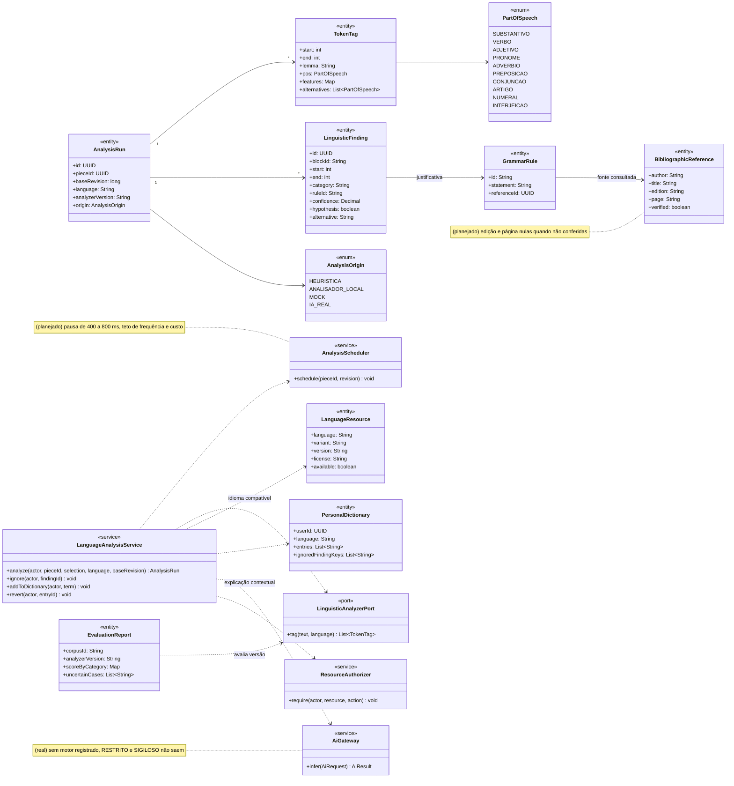
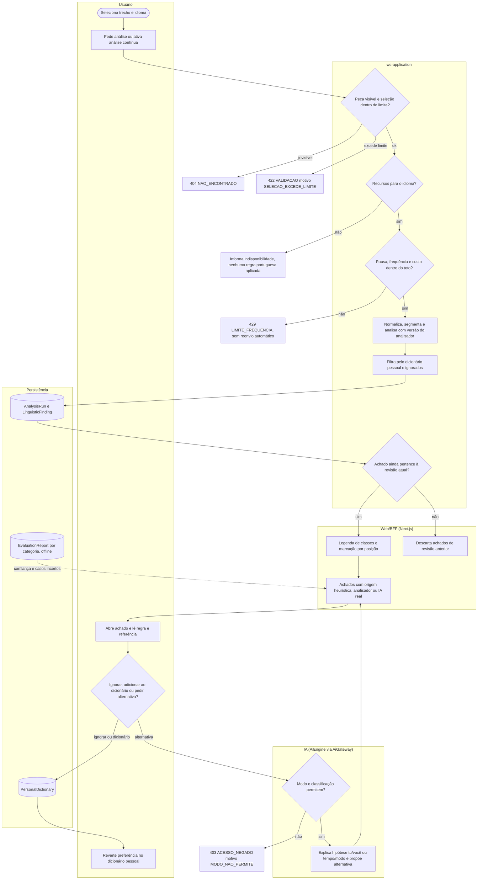
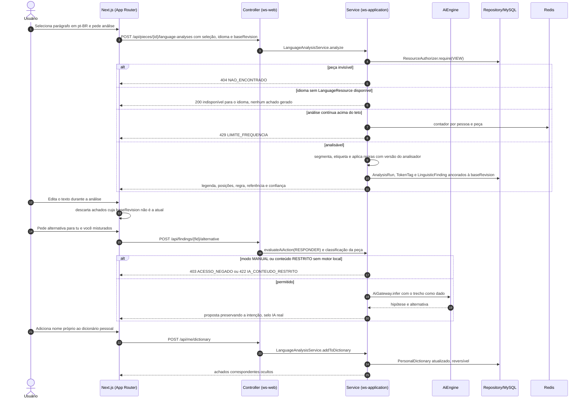
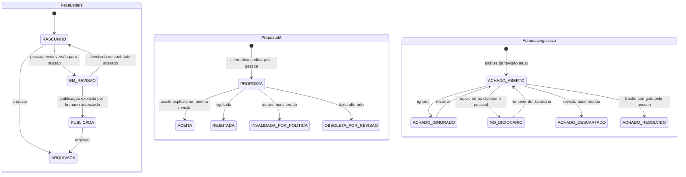
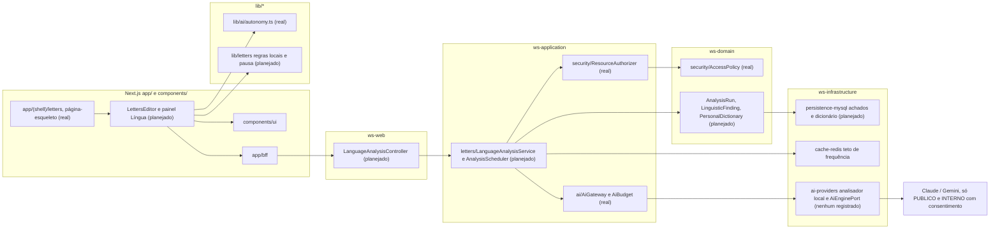

# RF53 — Analisar língua, morfossintaxe e gramática no Letters
**HU:** — (sem HU no board; RF especificado em 15/10/2026) · **Sprint (board Work Station):** lista *Requisitos Funcionais* sem sprint atribuída · **Equivalente FAI:** — · **Aba/rota:** Letters (`/letters`, `/letters/[pieceId]`; peça aberta a partir de `/tasks/[id]` e da sessão DECIA `/decia/[sessionId]`) · **Página-esqueleto:** registrada em 17/10/2026; editor ainda não implementado (Onda 4 do PLANO_ONDAS)
**Critérios de aceite cobertos:** RF53.CA01 … RF53.CA07 — corpo do card = especificação de docs/produto/requisitos-studio/RF53.md (CAs copiados como estão escritos); classes reais: `AiGateway`/`AiBudget` (sem motor registrado), `ResourceAuthorizer`, `AccessPolicy`, `lib/ai/autonomy.ts` (evaluateAiAction), página-esqueleto `app/(shell)/letters/page.tsx`; o restante (planejado)

A pessoa seleciona um trecho em português no Letters e pede a análise linguística: o painel marca as classes de palavras com legenda e posição, aponta sujeito, predicado, regência, concordância, crase, flexões, tratamento e tempos verbais como achados ancorados à revisão analisada, explica cada hipótese com regra e referência verificável, troca de idioma só quando há recursos compatíveis e respeita o que a pessoa ignora ou adiciona ao dicionário pessoal, sem enviar cada tecla a um provedor.

**Estado em 17/10/2026.** Nada da análise linguística existe no app (MATRIZ_RF: AUSENTE, 0,00; PLANO_ONDAS Onda 4: “análise linguística local cobre poucos padrões”). Fora do app, o protótipo `docs/exemplo_drawings_letters/work_station_letters_drawings.tsx` colore classes gramaticais por um dicionário fixo de palavras (`posDict`) — é **heurística** de demonstração, não análise. O script de consulta bibliográfica citado em `LETTERS_LINGUA_PORTUGUESA.md` não está versionado neste repositório e nenhum analisador morfossintático está instalado. Reais e reaproveitados: `AiGateway` (orçamento, classificação, trilha; nenhum motor registrado), `evaluateAiAction` (modo da autonomia) e a autorização por recurso.

**Heurística × mock × IA real.** Cada achado traz `origin`: *HEURISTICA* (regra local determinística), *ANALISADOR_LOCAL* (modelo versionado, licença e corpus documentados), *MOCK* (só em testes, nunca exibido como resultado) ou *IA_REAL* (explicação contextual via `AiGateway`, com `inferenceId`). Uma LLM não é apresentada como autoridade gramatical; métricas de acerto vêm só da avaliação em corpus.

## Critérios de aceite

| CA | Enunciado (Dado / Quando / Então) |
|---|---|
| **RF53.CA01** | Dado português selecionado, quando analisa, então diferencia substantivos, verbos, adjetivos, pronomes, advérbios, preposições, conjunções, artigos, numerais e interjeições com legenda e posições no texto. |
| **RF53.CA02** | Dado um corpus de referência anotado, quando identifica sujeito, predicado, regência, concordância, crase e flexões, então mede desempenho por categoria e expõe casos incertos. |
| **RF53.CA03** | Dado tratamento tu/você e tempos/modos distintos, quando há inconsistência contextual, então explica a hipótese e oferece alternativa preservando intenção. |
| **RF53.CA04** | Dada uma correção, quando informa a justificativa, então identifica regra e referência bibliográfica consultada; não inventa edição, página ou citação. |
| **RF53.CA05** | Dada outra língua, quando troca o idioma, então carrega recursos compatíveis ou informa indisponibilidade, sem aplicar regras portuguesas como universais. |
| **RF53.CA06** | Dada análise em tempo real, quando o texto muda, então atualiza somente achados da revisão correta e não reenvia a cada tecla sem controle de frequência/custo. |
| **RF53.CA07** | Dado nome próprio, variedade regional ou falso positivo, quando o usuário ignora ou adiciona ao dicionário pessoal, então respeita a preferência e permite reversão. |

## 1. Diagrama de classes

Legenda: **(real)** `AiGateway` (com `AiBudget`), `ResourceAuthorizer` (sobre `AccessPolicy`). **(planejado)** todas as demais classes (`LETTERS_DRAWINGS_ENGENHARIA.md` §4, pipeline linguístico; taxonomia funcional em `LETTERS_LINGUA_PORTUGUESA.md`).

## 2. Diagrama de atividades

## 3. Diagrama de sequência

## 4. Máquina de estados

Entidades afetadas: a peça Letters (`WorkPiece.state`, planejado), a proposta de IA (alternativa contextual do CA03) e o achado linguístico (`LinguisticFinding`, planejado). A análise não muda o estado da peça.

## 5. Diagrama de componentes

## 6. Rastreabilidade

| CA | Classe | Passo (atividade) | Mensagem (sequência) | Transição | Componente |
|---|---|---|---|---|---|
| **RF53.CA01** | `TokenTag` (start, end, pos), `PartOfSpeech` (dez classes), legenda | S4 → W1 | 1–11 | `[*] → ACHADO_ABERTO` | `LE`, `LAS`, `AIP` |
| **RF53.CA02** | `EvaluationReport` (scoreByCategory, uncertainCases), `LinguisticFinding.confidence` | P3 → W2 | 11 (confiança exibida) | — | `LAS`, `AIP` |
| **RF53.CA03** | `LinguisticFinding.hypothesis/alternative`, `AiGateway`, `evaluateAiAction(RESPONDER)` | A3 → I1 → I2 | 14–20 | `PROPOSTA → ACEITA / REJEITADA / OBSOLETA_POR_REVISAO` | `GW`, `AUT` |
| **RF53.CA04** | `GrammarRule`, `BibliographicReference` (edition e page só quando verified) | A2 | 11 | — | `LAS`, `ENT` |
| **RF53.CA05** | `LanguageResource` (language, variant, available) | S2 → W0 | 6 | nenhuma (sem achados) | `LAS` |
| **RF53.CA06** | `AnalysisScheduler`, `AnalysisRun.baseRevision` | S3 → E429, S6 → W3 | 7–8 e 12–13 | `ACHADO_ABERTO → ACHADO_DESCARTADO` | `LH`, `RD`, `LAS` |
| **RF53.CA07** | `PersonalDictionary` (entries, ignoredFindingKeys), `revert` | A3 → P2 → A4 | 21–25 | `ACHADO_ABERTO → ACHADO_IGNORADO / NO_DICIONARIO` e volta | `LAS`, `MY` |

Regras transversais refletidas: autorização no servidor (404 uniforme); SIGILOSO só dono e colaboradores explícitos (D-139) e nunca enviado a provedor externo; instruções dentro do texto analisado são dados; análise não publica nem marca nada como concluído.
