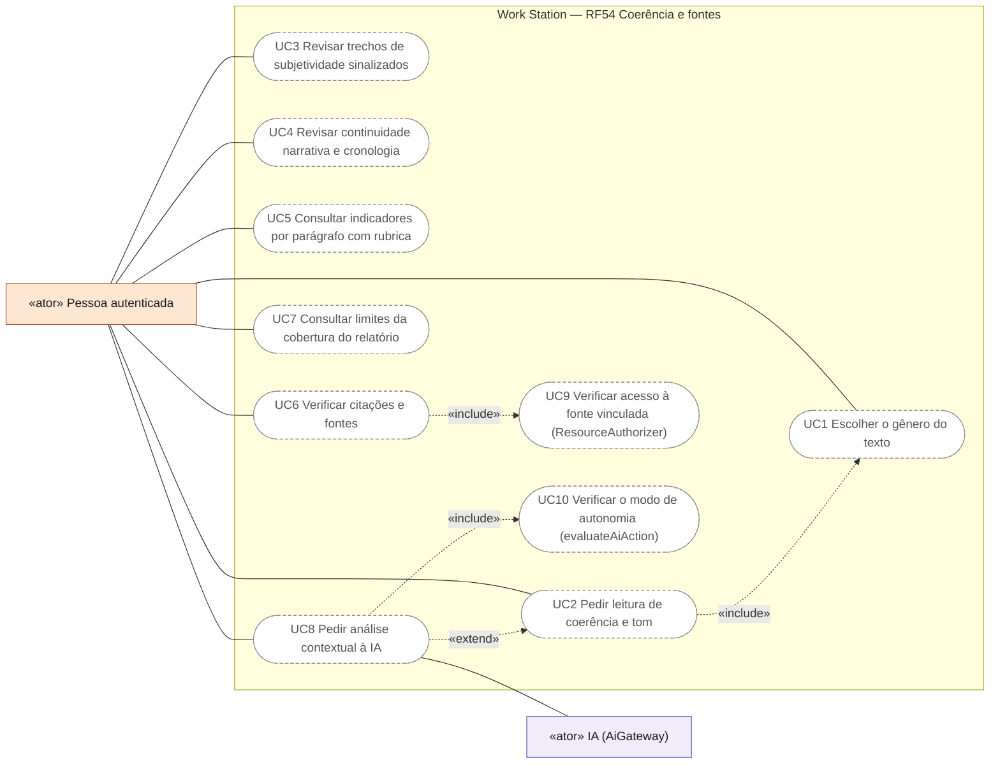
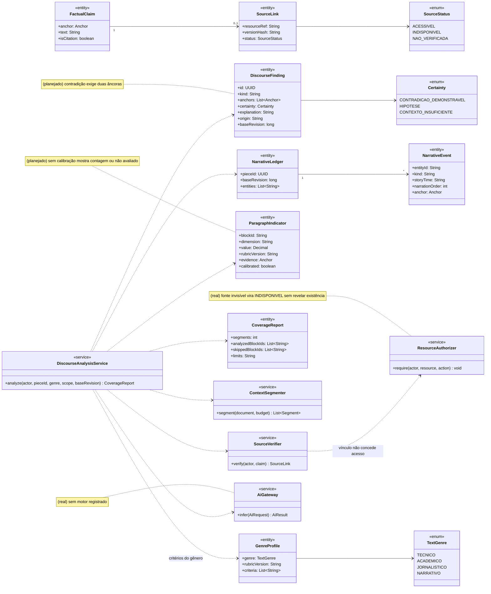
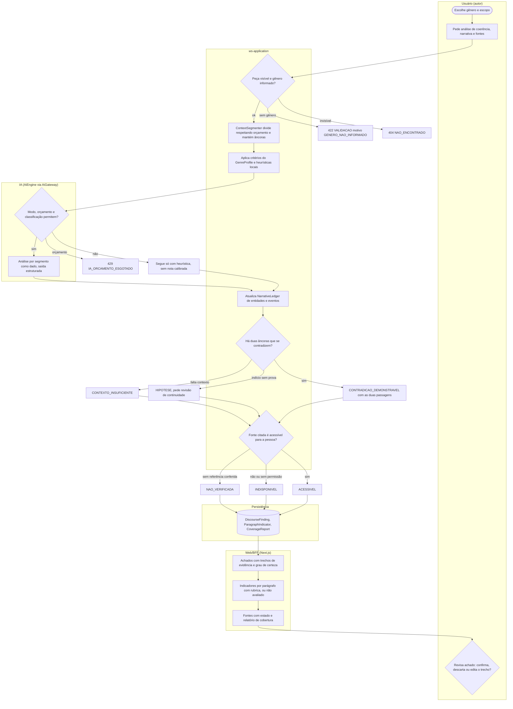
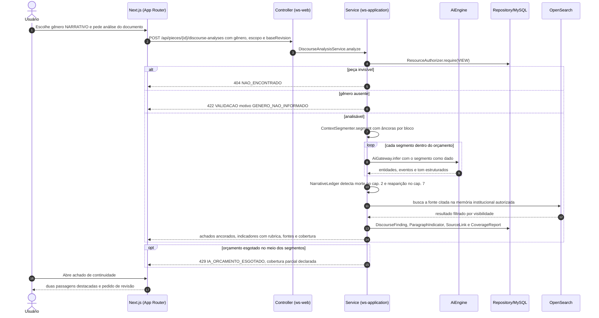
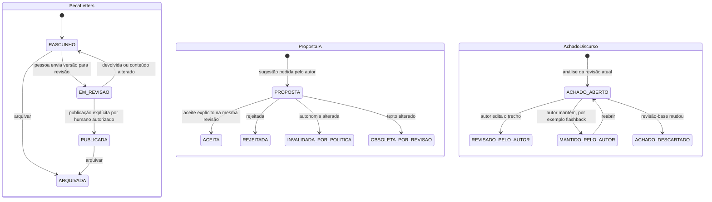
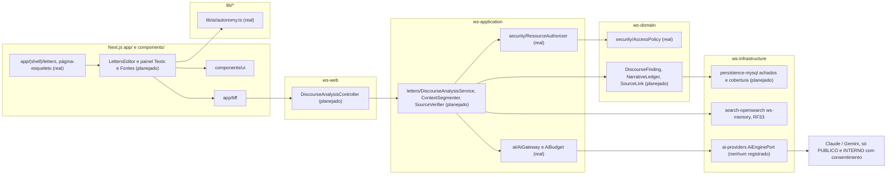

# RF54 — Analisar coerência, narrativa, gênero e fontes no Letters
**HU:** — (sem HU no board; RF especificado em 15/10/2026) · **Sprint (board Work Station):** lista *Requisitos Funcionais* sem sprint atribuída · **Equivalente FAI:** — · **Aba/rota:** Letters (`/letters`, `/letters/[pieceId]`; peça aberta a partir de `/tasks/[id]` e da sessão DECIA `/decia/[sessionId]`) · **Página-esqueleto:** registrada em 17/10/2026; editor ainda não implementado (Onda 4 do PLANO_ONDAS)
**Critérios de aceite cobertos:** RF54.CA01 … RF54.CA07 — corpo do card = especificação de docs/produto/requisitos-studio/RF54.md (CAs copiados como estão escritos); classes reais: `AiGateway`/`AiBudget` (sem motor registrado), `ResourceAuthorizer`, `AccessPolicy`, `lib/ai/autonomy.ts` (evaluateAiAction), página-esqueleto `app/(shell)/letters/page.tsx`; o restante (planejado)

A pessoa escolhe o gênero do texto (técnico, acadêmico, jornalístico ou narrativo) e pede ao Letters uma leitura de coerência, tom, continuidade e fontes: cada achado aponta os trechos de evidência, separa contradição demonstrável de hipótese e de contexto insuficiente, cada indicador por parágrafo mostra rubrica e evidência, cada citação recebe o estado acessível, indisponível ou não verificada, e o relatório declara o que ficou fora da cobertura, sem substituir o julgamento do autor nem reescrever o texto.

**Estado em 17/10/2026.** Nada deste RF existe no app (MATRIZ_RF: AUSENTE, 0,00). PLANO_ONDAS (Onda 4) registra que os alertas de gênero do protótipo são heurísticos e que continuidade narrativa e fontes não são analisadas. Reais e reaproveitados: `AiGateway` (orçamento `429 IA_ORCAMENTO_ESGOTADO`, classificação `422 IA_CONTEUDO_RESTRITO`, trilha `AiInferenceLog`; nenhum `AiEnginePort` registrado), `evaluateAiAction` e `ResourceAuthorizer` (um vínculo de fonte não concede acesso: a fonte que a pessoa não vê é “indisponível”, sem revelar existência).

**Heurística × mock × IA real.** Contagens de primeira pessoa, conectores e comprimento de frase são *heurística* e aparecem como contagem de avisos ou “não avaliado”, nunca como nota calibrada; testes usam ledgers e respostas *mock*; *IA real* só com `inferenceId` e após consentimento, e mesmo assim a nota só é exibida com rubrica e versão.

## Critérios de aceite

| CA | Enunciado (Dado / Quando / Então) |
|---|---|
| **RF54.CA01** | Dado gênero técnico, acadêmico, jornalístico ou narrativo, quando analisa, então usa critérios do gênero escolhido e explica mudanças de tom. |
| **RF54.CA02** | Dada notícia neutra com primeira pessoa, quando detecta subjetividade, então sinaliza o trecho sem declarar todo uso como erro obrigatório. |
| **RF54.CA03** | Dado personagem morto que reaparece depois, quando não há explicação narrativa identificada, então aponta as duas passagens e pede revisão de continuidade. |
| **RF54.CA04** | Dadas cronologia e entidades ao longo de capítulos, quando analisa, então diferencia contradição demonstrável de hipótese e contexto insuficiente. |
| **RF54.CA05** | Dado indicador por parágrafo de coerência, clareza, sintaxe e tom, quando apresenta nota, então informa rubrica e evidência; heurística não aparece como nota calibrada de IA. |
| **RF54.CA06** | Dadas citações e afirmações factuais, quando verifica fontes, então distingue referência acessível, indisponível e não verificada. |
| **RF54.CA07** | Dado documento longo, quando segmenta contexto, então mantém vínculos entre achados e trechos e informa limites da cobertura. |

## 0. Diagrama de casos de uso

Quem tem acesso à peça escolhe o gênero e pede a leitura de coerência, continuidade e fontes; o relatório aponta evidências e limites sem reescrever o texto. A análise contextual pela IA estende a leitura e depende do modo de autonomia. Nada disto existe em tela hoje.

| Caso de uso | Ator(es) | CAs | Situação |
|---|---|---|---|
| UC1 Escolher o gênero do texto | `autenticado` (incluído por UC2) | RF54.CA01 | planejado |
| UC2 Pedir leitura de coerência e tom | `autenticado` | RF54.CA01 · CA02 | planejado |
| UC3 Revisar trechos de subjetividade sinalizados | `autenticado` | RF54.CA02 | planejado |
| UC4 Revisar continuidade narrativa e cronologia | `autenticado` | RF54.CA03 · CA04 | planejado |
| UC5 Consultar indicadores por parágrafo com rubrica | `autenticado` | RF54.CA05 | planejado |
| UC6 Verificar citações e fontes | `autenticado` | RF54.CA06 | planejado |
| UC7 Consultar limites da cobertura do relatório | `autenticado` | RF54.CA07 | planejado |
| UC8 Pedir análise contextual à IA | `autenticado`, `ia` (estende UC2) | RF54.CA04 · CA05 | planejado |
| UC9 Verificar acesso à fonte vinculada (ResourceAuthorizer) | — (incluído por UC6) | RF54.CA06 | planejado — `ResourceAuthorizer` real; fonte invisível = indisponível |
| UC10 Verificar o modo de autonomia (evaluateAiAction) | — (incluído por UC8) | RF54.CA05 | planejado — função real `lib/ai/autonomy.ts`, sem editor |

## 1. Diagrama de classes

Legenda: **(real)** `AiGateway` (com `AiBudget`), `ResourceAuthorizer` (sobre `AccessPolicy`). **(planejado)** todas as demais (`LETTERS_DRAWINGS_ENGENHARIA.md` §4 itens 4–5, ledger de entidades e eventos; `SourceLink` do modelo canônico §3; fontes institucionais via RF33).

## 2. Diagrama de atividades

## 3. Diagrama de sequência

## 4. Máquina de estados

Entidades afetadas: a peça Letters (`WorkPiece.state`, planejado), a proposta de IA (eventual sugestão de redação) e o achado de discurso (`DiscourseFinding`, planejado). A análise nunca altera o texto nem o estado da peça.

## 5. Diagrama de componentes

## 6. Rastreabilidade

| CA | Classe | Passo (atividade) | Mensagem (sequência) | Transição | Componente |
|---|---|---|---|---|---|
| **RF54.CA01** | `GenreProfile` (genre, rubricVersion, criteria), `TextGenre` | A0 → S1 → S3 | 1–3 e 7 | — | `LE`, `DAS` |
| **RF54.CA02** | `DiscourseFinding` kind SUBJETIVIDADE com `Certainty.HIPOTESE`, sem correção obrigatória | S3 → W1 → A2 | 14 | `ACHADO_ABERTO → MANTIDO_PELO_AUTOR` | `DAS`, `LE` |
| **RF54.CA03** | `NarrativeLedger`, `NarrativeEvent` (MORTE, APARICAO), duas `anchors` | S4 → S5 → C2 | 10 e 16–17 | `ACHADO_ABERTO → REVISADO_PELO_AUTOR` | `DAS`, `ENT` |
| **RF54.CA04** | `Certainty` (CONTRADICAO_DEMONSTRAVEL, HIPOTESE, CONTEXTO_INSUFICIENTE) | S5 → C1 / C2 / C3 | 10 | — | `DAS` |
| **RF54.CA05** | `ParagraphIndicator` (rubricVersion, evidence, calibrated), origem heurística | HEU → W2 | 13–14 | — | `DAS`, `LE` |
| **RF54.CA06** | `FactualClaim`, `SourceLink.status`, `SourceVerifier`, `ResourceAuthorizer` | S6 → SA / SI / SN | 11–12 | — | `DAS`, `OS`, `RA` |
| **RF54.CA07** | `ContextSegmenter`, `CoverageReport` (analyzedBlockIds, skippedBlockIds, limits) | S2 → P1 → W3 | 7–9 e 15 | `ACHADO_ABERTO → ACHADO_DESCARTADO` quando a revisão muda | `DAS`, `MY` |

Regras transversais refletidas: autorização no servidor (404 uniforme, fonte invisível sem revelar existência); SIGILOSO só dono e colaboradores explícitos (D-139) e fora do provedor externo; texto analisado é dado, nunca comando; a análise não reescreve, não publica e não marca revisão como concluída.
