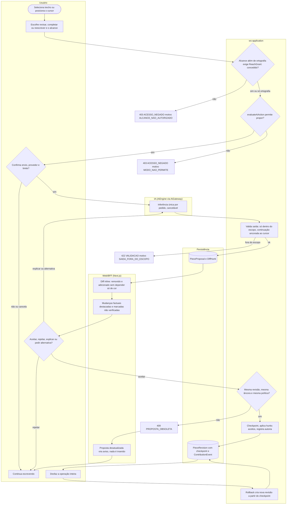
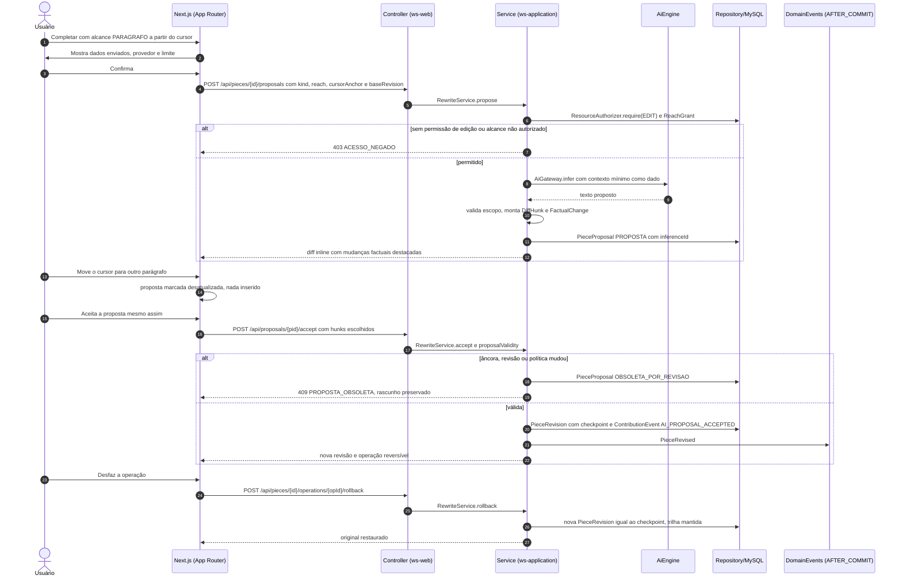
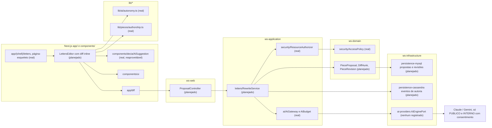

# RF55 — Revisar, completar e reescrever texto com IA no Letters
**HU:** — (sem HU no board; RF especificado em 15/10/2026) · **Sprint (board Work Station):** lista *Requisitos Funcionais* sem sprint atribuída · **Equivalente FAI:** — · **Aba/rota:** Letters (`/letters`, `/letters/[pieceId]`; peça aberta a partir de `/tasks/[id]` e da sessão DECIA `/decia/[sessionId]`) · **Página-esqueleto:** registrada em 17/10/2026; editor ainda não implementado (Onda 4 do PLANO_ONDAS)
**Critérios de aceite cobertos:** RF55.CA01 … RF55.CA07 — corpo do card = especificação de docs/produto/requisitos-studio/RF55.md (CAs copiados como estão escritos); classes reais: `lib/ai/autonomy.ts` (AiProposal, evaluateAiAction, proposalValidity), `lib/pieces/authorship.ts` (ContributionEvent, AI_PROPOSAL_ACCEPTED), `components/decia/AiSuggestion.tsx`, `AiGateway`/`AiBudget` (sem motor registrado), `ResourceAuthorizer`, `AccessPolicy`; o restante (planejado)

A pessoa pede ao Letters uma revisão (ortografia, gramática, parágrafo ou documento), uma continuação a partir do cursor (palavra, frase, parágrafo ou documento) ou uma reescrita autorizada; recebe uma proposta ancorada à revisão e ao trecho de origem, compara removido e adicionado no diff inline, vê destacadas as mudanças em números, nomes e citações, aceita, rejeita, pede explicação ou alternativa, e pode desfazer a operação inteira; proposta desatualizada nunca é inserida em outro trecho e nenhuma nova chamada paga é feita sem pedido.

**Estado em 17/10/2026.** No app não há editor Letters (MATRIZ_RF: AUSENTE, 0,00). PLANO_ONDAS (Onda 4) registra que revisão e completar com diff existiam no protótipo fora do app, sem avaliação de precisão nem fontes reais. Reais e reaproveitados: `AiProposal` com `policyVersion`/`baseRevision`/`targetIds`/`reviewedBy` e `proposalValidity` (proposta vale só na mesma política, mesma revisão e alvos editáveis), a cadeia de autoria com origem `AI_PROPOSAL_ACCEPTED` e `computeAuthorship`, o cartão `AiSuggestion` (aceitar/descartar, usado no DECIA) e `AiGateway` (orçamento, classificação, trilha; nenhum motor registrado, logo `503 IA_INDISPONIVEL`).

**Heurística × mock × IA real.** A revisão ortográfica básica pode ser *heurística* local (regras explícitas, selo próprio); testes de diff, cursor e obsolescência usam respostas *mock*; *IA real* só via `AiGateway`, com consentimento, provedor, modelo, `inferenceId` e consumo registrados. Texto gerado não recebe aprovação humana automática.

## Critérios de aceite

| CA | Enunciado (Dado / Quando / Então) |
|---|---|
| **RF55.CA01** | Dado nível básico, quando revisa ortografia, então não reescreve estilo, argumento ou parágrafos sem autorização adicional. |
| **RF55.CA02** | Dada sugestão, quando abre o diff inline, então distingue removido/adicionado, permite aceitar, rejeitar, explicar motivo e pedir alternativa. |
| **RF55.CA03** | Dado modo completar, quando escolhe palavra, frase, parágrafo ou documento, então gera continuação a partir do cursor e preserva o texto fora do escopo. |
| **RF55.CA04** | Dada revisão avançada autorizada, quando substitui parágrafos ou documento, então preserva original e permite rollback integral da operação. |
| **RF55.CA05** | Dado foco/cursor ou seleção alterado durante inferência, quando a resposta retorna, então não a insere automaticamente em outro trecho. |
| **RF55.CA06** | Dada reescrita com números, nomes e citações, quando propõe mudanças factuais, então destaca essas mudanças e não apresenta invenções como fatos. |
| **RF55.CA07** | Dada proposta rejeitada ou cancelada, quando o usuário segue escrevendo, então mantém seu rascunho e não dispara nova chamada paga automaticamente. |

## 1. Diagrama de classes

```mermaid
classDiagram
direction LR

class ProposalKind {
  <<enum>>
  REVISAO_ORTOGRAFICA
  REVISAO_GRAMATICAL
  REESCRITA_PARAGRAFO
  REESCRITA_DOCUMENTO
  COMPLETAR
}
class Reach {
  <<enum>>
  PALAVRA
  FRASE
  PARAGRAFO
  DOCUMENTO
}
class PieceProposal {
  <<entity>>
  +id: UUID
  +kind: ProposalKind
  +reach: Reach
  +baseRevision: long
  +anchorHash: String
  +cursorAnchor: String
  +policyVersion: int
  +status: String
  +inferenceId: UUID
}
class DiffHunk {
  <<entity>>
  +op: String
  +text: String
  +factual: boolean
}
class FactualChange {
  <<entity>>
  +kind: String
  +before: String
  +after: String
  +sourceRef: String
}
class ReachGrant {
  <<entity>>
  +reach: Reach
  +grantedBy: UUID
  +expiresAt: Instant
}
class PieceRevision {
  <<entity>>
  +version: long
  +checkpoint: boolean
  +operationId: UUID
  +origin: ContributionOrigin
}
class ContributionEvent {
  <<entity>>
  +origin: ContributionOrigin
  +inferenceId: String
  +scope: List~String~
  +hash: String
}
class AiProposal {
  <<entity>>
  +policyVersion: int
  +baseRevision: int
  +targetIds: List~String~
  +reviewedBy: String
}
class RewriteService {
  <<service>>
  +propose(actor, pieceId, kind, reach, selection, baseRevision) PieceProposal
  +accept(actor, proposalId, hunkIds) PieceRevision
  +reject(actor, proposalId) void
  +explain(actor, proposalId, hunkId) String
  +alternative(actor, proposalId) PieceProposal
  +rollback(actor, operationId) PieceRevision
}
class AutonomyRules {
  <<service>>
  +evaluateAiAction(policy, action, ctx) Verdict
  +proposalValidity(policy, proposal, revision, editableIds) Verdict
}
class AiGateway {
  <<service>>
  +infer(AiRequest) AiResult
}
class ResourceAuthorizer {
  <<service>>
  +require(actor, resource, action) void
}

PieceProposal --> ProposalKind
PieceProposal --> Reach
PieceProposal "1" --> "*" DiffHunk
DiffHunk "1" --> "0..1" FactualChange
PieceProposal ..> AiProposal : mesma validade
RewriteService ..> ReachGrant : nível avançado
RewriteService ..> AutonomyRules
RewriteService ..> AiGateway
RewriteService ..> ResourceAuthorizer
RewriteService ..> PieceRevision : checkpoint e rollback
RewriteService ..> ContributionEvent : AI_PROPOSAL_ACCEPTED

note for AiProposal "(real) lib/ai/autonomy.ts"
note for ContributionEvent "(real) lib/pieces/authorship.ts, cadeia com hash"
note for AutonomyRules "(real) evaluateAiAction e proposalValidity"
note for FactualChange "(planejado) sem fonte é marcada como não verificada"
```

Legenda: **(real)** `AiProposal`, `ContributionEvent`, `AutonomyRules` (funções de `lib/ai/autonomy.ts`), `AiGateway` (com `AiBudget`), `ResourceAuthorizer` (sobre `AccessPolicy`) e, no front, `AiSuggestion`. **(planejado)** `ProposalKind`, `Reach`, `PieceProposal` (forma persistida de `AiProposal`, `PieceProposal` do modelo canônico), `DiffHunk`, `FactualChange`, `ReachGrant`, `PieceRevision`, `RewriteService`.

## 2. Diagrama de atividades

## 3. Diagrama de sequência

## 4. Máquina de estados

Entidades afetadas: a peça Letters (`WorkPiece.state`, planejado) e a proposta de IA (`PieceProposal.status`, planejado sobre a validade real de `AiProposal`).

```mermaid
stateDiagram-v2
  state PecaLetters {
    [*] --> RASCUNHO
    RASCUNHO --> RASCUNHO: aceite ou rollback gera nova PieceRevision
    RASCUNHO --> EM_REVISAO: pessoa envia versão para revisão
    EM_REVISAO --> RASCUNHO: devolvida ou conteúdo alterado
    EM_REVISAO --> PUBLICADA: publicação explícita por humano autorizado
    RASCUNHO --> ARQUIVADA: arquivar
    PUBLICADA --> ARQUIVADA: arquivar
    note right of RASCUNHO
      Texto gerado por IA entra só no rascunho.
      Aprovação e publicação são sempre humanas.
    end note
  }
  state PropostaIA {
    [*] --> GERANDO: pedido explícito
    GERANDO --> CANCELADA: usuário cancela, sem nova chamada
    GERANDO --> PROPOSTA: saída validada no escopo
    PROPOSTA --> ACEITA: aceite explícito na mesma âncora e revisão
    PROPOSTA --> REJEITADA: rejeitada, rascunho mantido
    PROPOSTA --> INVALIDADA_POR_POLITICA: autonomia alterada
    PROPOSTA --> OBSOLETA_POR_REVISAO: cursor, seleção ou texto mudou
    ACEITA --> DESFEITA: rollback integral da operação
  }
```

## 5. Diagrama de componentes

## 6. Rastreabilidade

| CA | Classe | Passo (atividade) | Mensagem (sequência) | Transição | Componente |
|---|---|---|---|---|---|
| **RF55.CA01** | `ProposalKind.REVISAO_ORTOGRAFICA`, `ReachGrant` exigido para os demais alcances | S1 → E403 | 6–7 | — | `RS`, `RA` |
| **RF55.CA02** | `DiffHunk` (op, text), `RewriteService.accept/reject/explain/alternative`, `AiSuggestion` | W1 → A3 | 12 e 15–17 | `PROPOSTA → ACEITA / REJEITADA` | `LE`, `SUG`, `RS` |
| **RF55.CA03** | `ProposalKind.COMPLETAR`, `Reach`, `PieceProposal.cursorAnchor` | A0 → A1 → S3 | 1–12 | `GERANDO → PROPOSTA` | `LE`, `RS` |
| **RF55.CA04** | `PieceRevision.checkpoint/operationId`, `RewriteService.rollback` | S5 → P2 → A5 → S6 | 20–27 | `ACEITA → DESFEITA` | `RS`, `MY` |
| **RF55.CA05** | `proposalValidity` (PROPOSTA_OBSOLETA_REVISAO), `anchorHash`, `cursorAnchor` | S4 → E409 → W3 | 13–14 e 17–19 | `PROPOSTA → OBSOLETA_POR_REVISAO` | `AUT`, `RS` |
| **RF55.CA06** | `FactualChange` (kind, before, after, sourceRef), `DiffHunk.factual` | S3 → W2 | 10–12 | — | `LE`, `RS` |
| **RF55.CA07** | `AiGateway` sem repetição automática, `PieceProposal` REJEITADA ou CANCELADA | A2 → A4, A3 → A4 | 2–3 | `GERANDO → CANCELADA`, `PROPOSTA → REJEITADA` | `GW`, `LE` |

Regras transversais refletidas: autorização no servidor em propor, aceitar e desfazer; SIGILOSO só dono e colaboradores explícitos (D-139) e nunca enviado a provedor externo; troca de autonomia invalida propostas (D-136); instruções no texto são dados; nenhuma publicação automática.
