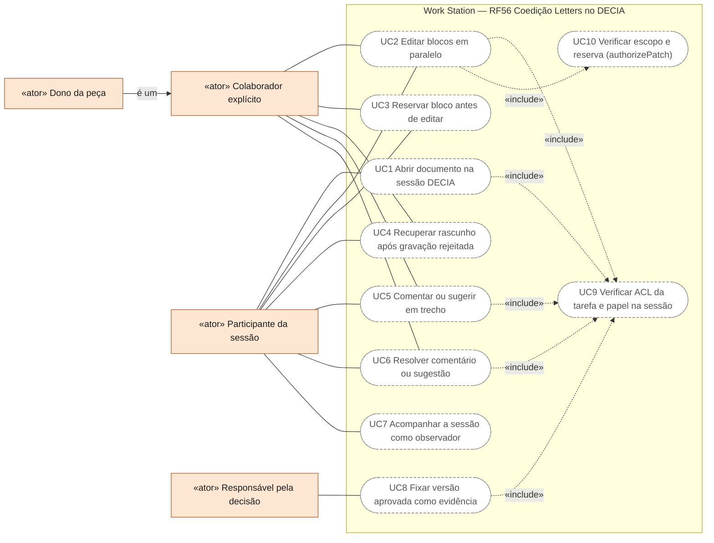
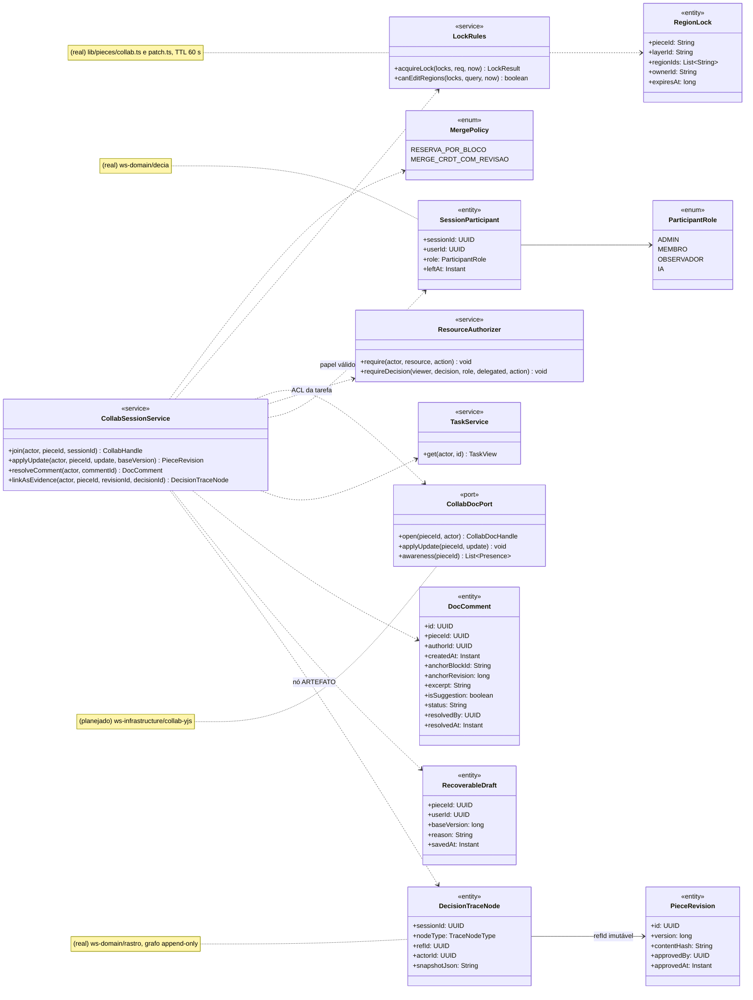
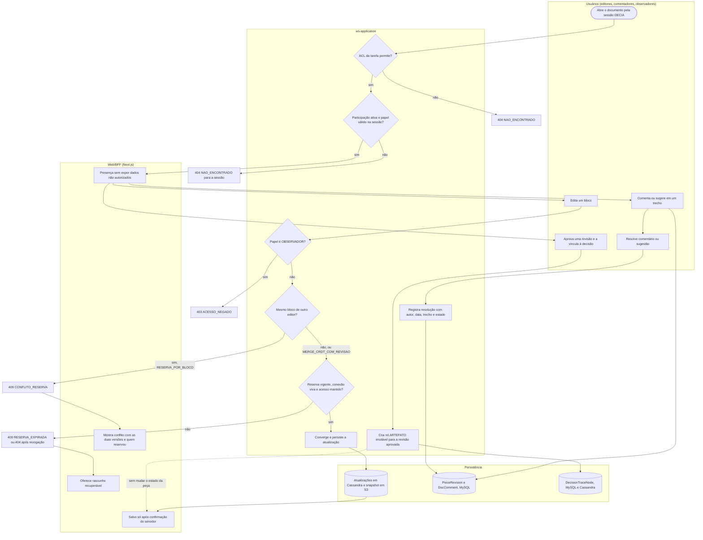
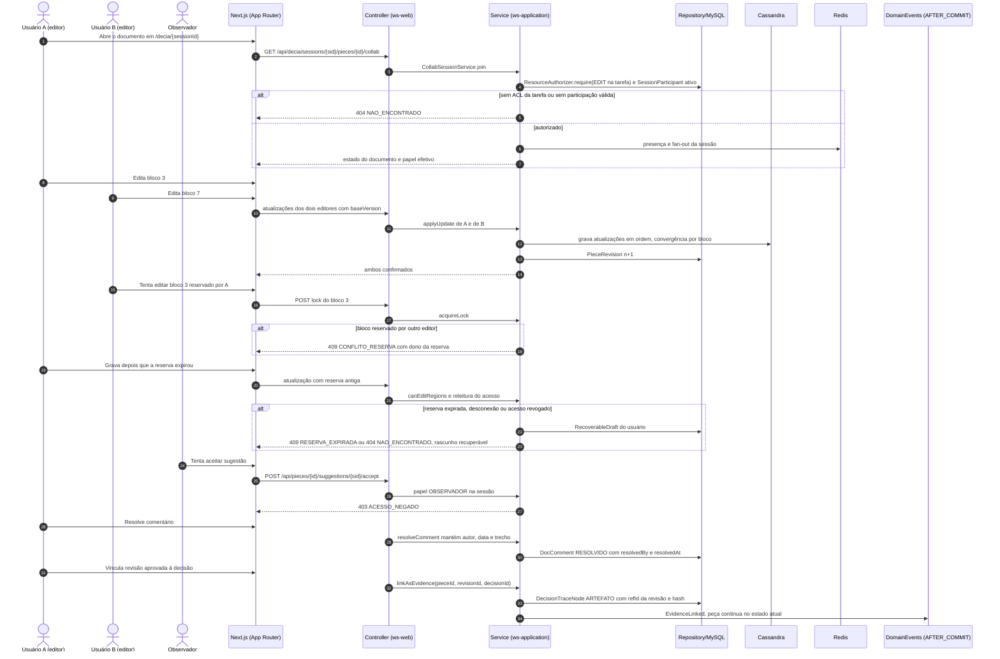
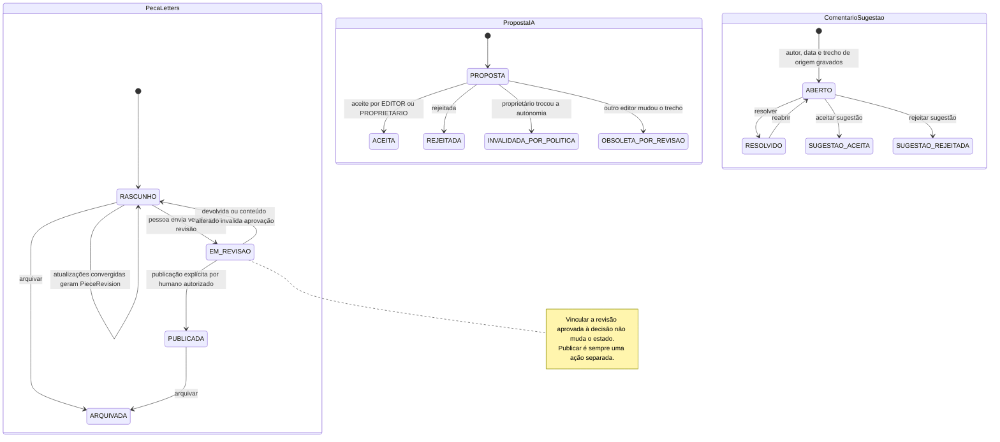
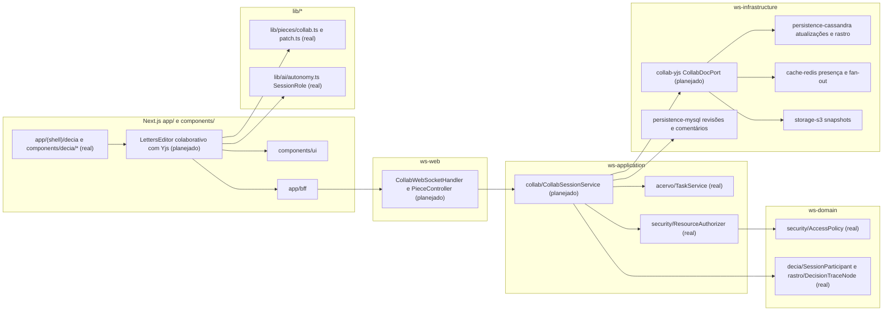

# RF56 — Colaborar, comentar e resolver conflitos em documentos Letters no DECIA
**HU:** — (sem HU no board; RF especificado em 15/10/2026) · **Sprint (board Work Station):** lista *Requisitos Funcionais* sem sprint atribuída · **Equivalente FAI:** — · **Aba/rota:** Letters (`/letters`, `/letters/[pieceId]`; peça aberta a partir de `/tasks/[id]` e da sessão DECIA `/decia/[sessionId]`) · **Página-esqueleto:** registrada em 17/10/2026; editor ainda não implementado (Onda 4 do PLANO_ONDAS)
**Critérios de aceite cobertos:** RF56.CA01 … RF56.CA07 — corpo do card = especificação de docs/produto/requisitos-studio/RF56.md (CAs copiados como estão escritos); classes reais: `lib/pieces/collab.ts` (RegionLock, acquireLock, canEditRegions, LOCK_TTL_MS), `lib/pieces/patch.ts` (authorizePatch, REGIAO_RESERVADA), `lib/pieces/authorship.ts`, `lib/ai/autonomy.ts` (SessionRole), `ws-domain` `SessionParticipant`/`ParticipantRole`/`DecisionTraceNode`, `TaskService`, `ResourceAuthorizer`, `AccessPolicy`, `components/decia/*`; o restante (planejado)

Editores autorizados de uma tarefa abrem o mesmo documento Letters dentro de uma sessão DECIA: alterações em blocos diferentes convergem e são persistidas, o mesmo bloco segue uma política explícita de reserva ou merge sem sobrescrita silenciosa, gravações com reserva expirada, desconexão ou acesso revogado são rejeitadas no servidor com rascunho recuperável, comentários e sugestões guardam autor, data, trecho e resolução, observadores só leem, e a versão aprovada vira evidência imutável da decisão sem ser publicada automaticamente.

**Estado em 17/10/2026.** Não há colaboração Letters no app (MATRIZ_RF: AUSENTE, 0,00; PLANO_ONDAS Onda 4). Reais e reaproveitados: reserva de regiões com prazo (`lib/pieces/collab.ts`, TTL de 60 s renovável só pelo dono) e a porta única `authorizePatch` que aplica camada, seleção e reserva juntas, ambas funções puras sem servidor; papéis de sessão `SessionRole` (`lib/ai/autonomy.ts`) e, no backend, `SessionParticipant`/`ParticipantRole` (ADMIN · MEMBRO · OBSERVADOR · IA) e `DecisionTraceNode` (grafo imutável do RF29) em `ws-domain`; `ResourceAuthorizer` com 404 uniforme e `AccessPolicy` (SIGILOSO só dono e colaboradores explícitos, D-139); a UI DECIA em `components/decia/*` (`DecisionWorkspace`, `DecisionCard`). Planejado: `CollabDocPort` com Yjs e transporte WebSocket no Spring, presença via Redis, snapshots em S3 e atualizações em Cassandra (`COEDICAO_TECNICA.md`).

**Heurística × mock × IA real.** Convergência, reservas e autorização são determinísticas e testáveis sem IA; testes de concorrência usam dois clientes simulados (*mock*) contra o mesmo serviço; nenhuma IA participa deste RF, e propostas de IA de outros RF dentro da sessão continuam sujeitas à autonomia do proprietário (D-136).

## Critérios de aceite

| CA | Enunciado (Dado / Quando / Então) |
|---|---|
| **RF56.CA01** | Dados dois editores autorizados, quando alteram blocos diferentes, então as alterações convergem e são persistidas. |
| **RF56.CA02** | Dados dois editores no mesmo bloco, quando há concorrência, então usa política explícita de bloqueio ou merge e não sobrescreve silenciosamente. |
| **RF56.CA03** | Dada reserva expirada, desconexão ou revogação, quando tenta gravar, então servidor rejeita e preserva rascunho recuperável. |
| **RF56.CA04** | Dado comentário ou sugestão, quando é resolvido, então mantém autor, data, trecho de origem e estado de resolução. |
| **RF56.CA05** | Dada sessão DECIA vinculada, quando compartilha documento, então aplica simultaneamente ACL da tarefa e participação/papel válido da sessão. |
| **RF56.CA06** | Dado usuário observador, quando tenta editar ou aceitar proposta, então bloqueia no servidor. |
| **RF56.CA07** | Dada versão aprovada, quando vira evidência de decisão, então mantém vínculo imutável à revisão, sem publicar o documento automaticamente. |

## 0. Diagrama de casos de uso

Na sessão DECIA, editar exige ao mesmo tempo o vínculo de colaborador na tarefa e o papel na sessão; o observador só lê e o responsável pela decisão fixa a versão aprovada como evidência. Reserva e autorização existem como funções puras; a coedição em tela é planejada.

| Caso de uso | Ator(es) | CAs | Situação |
|---|---|---|---|
| UC1 Abrir documento na sessão DECIA | `participante_sessao` | RF56.CA05 | planejado |
| UC2 Editar blocos em paralelo | `colaborador`, `participante_sessao` | RF56.CA01 · CA02 | planejado |
| UC3 Reservar bloco antes de editar | `colaborador`, `participante_sessao` | RF56.CA02 | planejado — `acquireLock` (`lib/pieces/collab.ts`), sem tela |
| UC4 Recuperar rascunho após gravação rejeitada | `colaborador`, `participante_sessao` | RF56.CA03 | planejado |
| UC5 Comentar ou sugerir em trecho | `colaborador`, `participante_sessao` | RF56.CA04 | planejado |
| UC6 Resolver comentário ou sugestão | `colaborador`, `participante_sessao` | RF56.CA04 | planejado |
| UC7 Acompanhar a sessão como observador | `participante_sessao` | RF56.CA06 | planejado |
| UC8 Fixar versão aprovada como evidência | `decisor` | RF56.CA07 | planejado — `DecisionTraceNode` imutável no `ws-domain` |
| UC9 Verificar ACL da tarefa e papel na sessão | — (incluído por UC1, UC2, UC5, UC6, UC8) | RF56.CA05 · CA06 | planejado — `ResourceAuthorizer` e `ParticipantRole` reais, sem tela |
| UC10 Verificar escopo e reserva (authorizePatch) | — (incluído por UC2) | RF56.CA02 · CA03 | planejado — função pura `lib/pieces/patch.ts` |

## 1. Diagrama de classes

Legenda: **(real)** `ParticipantRole`, `SessionParticipant`, `DecisionTraceNode` (records de `ws-domain`), `RegionLock` e `LockRules` (funções de `lib/pieces/collab.ts` e `lib/pieces/patch.ts`), `ResourceAuthorizer`, `TaskService`. **(planejado)** `MergePolicy`, `DocComment`, `RecoverableDraft`, `PieceRevision`, `CollabSessionService`, `CollabDocPort` (`COEDICAO_TECNICA.md` §9).

## 2. Diagrama de atividades

## 3. Diagrama de sequência

## 4. Máquina de estados

Entidades afetadas: a peça Letters (`WorkPiece.state`, planejado), a proposta de IA (aceite bloqueado para observadores) e o comentário ou sugestão (`DocComment.status`, planejado).

## 5. Diagrama de componentes

## 6. Rastreabilidade

| CA | Classe | Passo (atividade) | Mensagem (sequência) | Transição | Componente |
|---|---|---|---|---|---|
| **RF56.CA01** | `CollabSessionService.applyUpdate`, `CollabDocPort`, `PieceRevision` | A1 → S4 (não) → S5 → S6 → P1 | 8–14 | `RASCUNHO → RASCUNHO` | `CSS`, `YJS`, `CA` |
| **RF56.CA02** | `MergePolicy`, `RegionLock`, `LockRules.acquireLock` | S4 → E409 → W3 | 15–18 | `PROPOSTA → OBSOLETA_POR_REVISAO` | `COL`, `CSS` |
| **RF56.CA03** | `LockRules.canEditRegions`, `RecoverableDraft` (reason), releitura da ACL | S5 → E409X → W4 | 19–23 | — | `CSS`, `MY` |
| **RF56.CA04** | `DocComment` (authorId, createdAt, anchorBlockId, excerpt, status, resolvedBy, resolvedAt) | A2 → A3 → S7 → P2 | 28–30 | `ABERTO → RESOLVIDO / SUGESTAO_ACEITA / SUGESTAO_REJEITADA` | `CSS`, `MY` |
| **RF56.CA05** | `ResourceAuthorizer` (ACL da tarefa) e `SessionParticipant` ativo com `ParticipantRole` | S1 → S2 | 1–7 | — | `RA`, `DEC`, `TS` |
| **RF56.CA06** | `ParticipantRole.OBSERVADOR`, `SessionRole.LEITOR` | S3 → E403 | 24–27 | aceite só por EDITOR ou PROPRIETARIO | `CSS`, `AUT` |
| **RF56.CA07** | `DecisionTraceNode` (nodeType ARTEFATO, refId da revisão, snapshotJson com hash), `PieceRevision.approvedBy` | A4 → S8 → P3 | 31–34 | nota em `EM_REVISAO`, nenhuma ida a `PUBLICADA` | `DEC`, `CSS` |

Regras transversais refletidas: autorização no servidor em toda conexão e gravação (dupla ACL tarefa e sessão, 404 uniforme D-141); SIGILOSO só dono e colaboradores explícitos, sem ADMIN implícito (D-139); revogação encerra atualizações futuras; conflitos preservam os dois trabalhos; nenhuma publicação automática.
