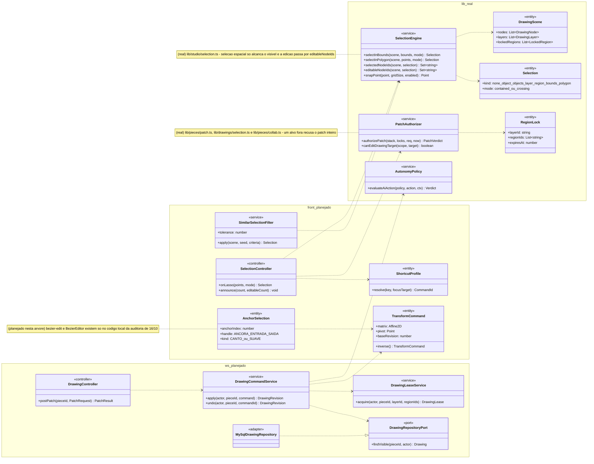
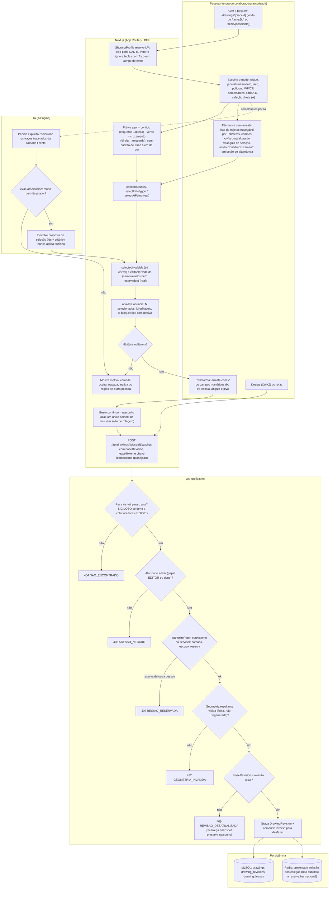
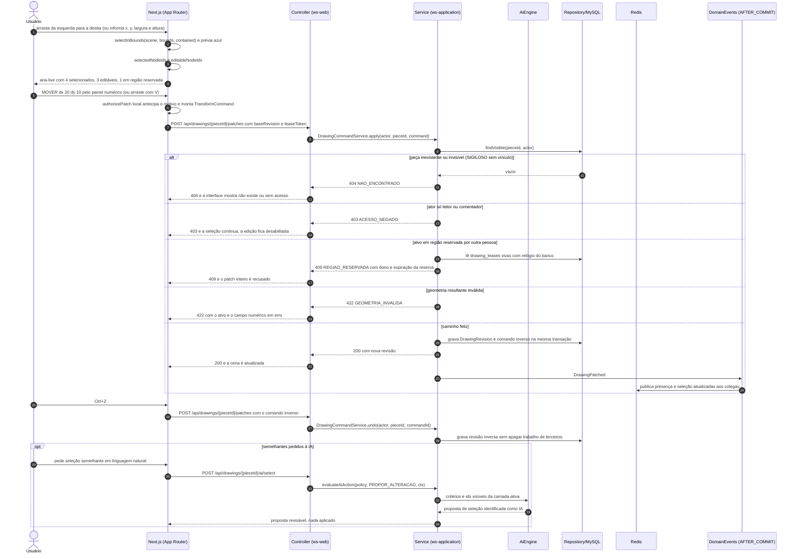
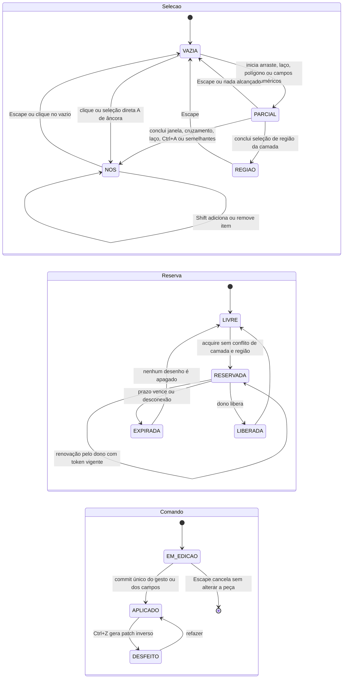
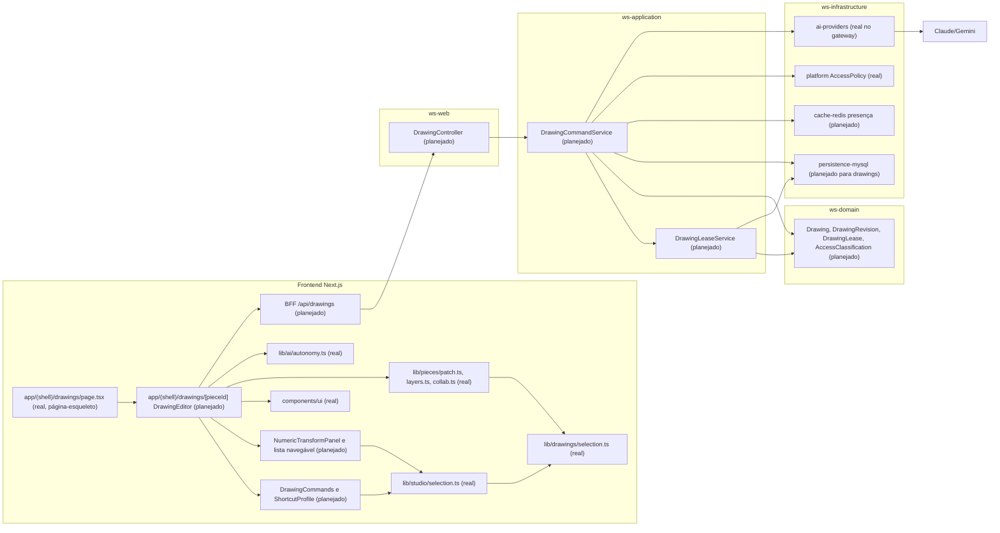

# RF57 — Selecionar objetos, pontos e regiões no Drawings
**HU:** — (sem HU no board; RF especificado em 15/10/2026) · **Sprint (board Work Station):** lista *Requisitos Funcionais* sem sprint atribuída · **Equivalente FAI:** — · **Aba/rota:** Drawings (`/drawings`, `/drawings/[pieceId]`; peça aberta a partir de `/tasks/[id]` e da sessão DECIA `/decia/[sessionId]`) · **Página-esqueleto:** registrada em 17/10/2026; editor ainda não implementado (Onda 5 do PLANO_ONDAS)
**Critérios de aceite cobertos:** RF57.CA01 … RF57.CA09 — corpo do card = especificação de docs/produto/requisitos-studio/RF57.md (CAs copiados como estão escritos); classes reais: `DrawingScene`, `DrawingNode`, `DrawingLayer`, `Selection`, `selectAtPoint`, `selectInBounds`, `selectInPolygon`, `selectedNodeIds`, `editableNodeIds`, `snapPoint` (`lib/studio/selection.ts`), `DrawingEditScope`/`canEditDrawingTarget` (`lib/drawings/selection.ts`), `LayerStack` (`lib/pieces/layers.ts`), `RegionLock` (`lib/pieces/collab.ts`), `authorizePatch` (`lib/pieces/patch.ts`), `evaluateAiAction` (`lib/ai/autonomy.ts`); o restante (planejado)

O RF57 define como a pessoa escolhe o que vai editar no Drawings: clique, janela (arraste esquerda→direita, só objetos totalmente contidos), cruzamento (direita→esquerda, objetos que tocam ou cruzam a borda), laço livre e polígono WP/CP, seleção por atributo (`SELECIONAR_SEMELHANTES`, com tolerância e contagem), `SELECIONAR_TUDO` e seleção direta de âncoras, segmentos e alças Bézier. Seleção e permissão são eixos distintos: `selectedNodeIds` só devolve o que está visível e `editableNodeIds` ainda retira camadas e nós travados e regiões reservadas por outra pessoa; o servidor repete a decisão com a mesma regra de `authorizePatch` antes de gravar qualquer transformação (`MOVER`, `REDIMENSIONAR`, `GIRAR`). Todo gesto de arraste tem alternativa por teclado e campos numéricos (WCAG 2.5.7) e o resultado é anunciado ao leitor de tela. Os nomes de comando são inspiração semântica de Illustrator/AutoCAD (referência de 17/10/2026), nunca promessa de paridade.

Estado real (MATRIZ_RF de 17/10/2026: LÓGICA SEM INTERFACE, 0,30): existem só as bibliotecas puras e testadas citadas no cabeçalho; não há canvas, rota `/drawings/[pieceId]`, BFF nem backend de Drawings. Fontes: `docs/auditoria/2026-10-17/referencias/COMANDOS_REFERENCIA_ILLUSTRATOR_AUTOCAD.md` §4, `docs/produto/DRAWINGS_CAMADAS_COLABORACAO_DECIA.md`, `docs/produto/ARQUITETURA_PAINEIS_EDITOR_IA.md`, `docs/auditoria/2026-10-16/paineis-bezier/` (Bézier no código local da auditoria, ainda fora desta árvore), D-136 (autonomia) e D-139/D-141 (SIGILOSO sem ADMIN implícito; invisível = 404). 3D: seleção de faces, arestas e vértices de sólidos é capacidade futura declarada por operação (RF60/RF61).

## Critérios de aceite

| CA | Enunciado (Dado / Quando / Então) |
|---|---|
| **RF57.CA01** | Dado arraste esquerda-direita, quando termina, então seleciona somente objetos totalmente contidos; direita-esquerda inclui objetos que cruzam ou tocam a borda. |
| **RF57.CA02** | Dado laço livre ou WP/CP, quando conclui, então aplica contenção/cruzamento conforme modo visível e desenha prévia azul/verde. |
| **RF57.CA03** | Dado QSELECT/FILTER ou seleção semelhante, quando filtra por camada, cor, espessura, opacidade, tipo, raio ou bloco, então usa tolerância explícita e mostra a contagem. |
| **RF57.CA04** | Dado V, quando transforma seleção múltipla, então move/escala/rotaciona o conjunto no escopo permitido e permite desfazer. |
| **RF57.CA05** | Dado A, quando seleciona âncora ou segmento, então edita somente os pontos/controladores escolhidos e preserva os demais. |
| **RF57.CA06** | Dado Ctrl+A, quando há camadas ocultas, bloqueadas ou regiões de outra pessoa, então não autoriza modificá-las; seleção e permissão são eixos distintos. |
| **RF57.CA07** | Dado perfil de atalhos CAD ou vetor, quando L/A têm significados diferentes, então resolve por perfil e não intercepta digitação em campos de texto. |
| **RF57.CA08** | Dados pontos de ancoragem e hastes Bézier, quando converte canto/suave com Shift+C, move âncora ou manipula alça com Alt/Option e Shift, então preserva vizinhos, permite alças independentes, recolher um controle e restringir a múltiplos de 45 graus; cada arraste é uma ação reversível e não causa salto de rolagem. |
| **RF57.CA09** | Dado guia de pontos e alças, quando utiliza teclado ou leitor de tela, então identifica âncora, entrada, saída e coordenadas, com controles equivalentes ao arraste e indicação clara dos tipos de curva suportados. |

## 1. Diagrama de classes

Classes do front marcadas **(real)** existem hoje em `lib/`; as demais são **(planejado)**. `DrawingScene`/`DrawingNode` ainda não constam de `docs/arquitetura/TAXONOMIA.md`: as entidades de servidor abaixo são proposta para a Onda 5.

## 2. Diagrama de atividades

## 3. Diagrama de sequência

## 4. Máquina de estados

Três máquinas: a **seleção** no cliente (lógica real em `lib/studio/selection.ts`, estados planejados), a **reserva** de região (`RegionLock` real como função pura; `DrawingLease` planejado no servidor) e o **comando** de transformação (planejado).

## 5. Diagrama de componentes

## 6. Rastreabilidade

| CA | Classe (§1) | Passo da atividade (§2) | Mensagem da sequência (§3) | Transição (§4) | Componente (§5) | Situação |
|---|---|---|---|---|---|---|
| RF57.CA01 | `SelectionEngine.selectInBounds` com `Selection.mode` contained/crossing, `selectedNodeIds` | `A2`, `F2`, `F3`, `F4`, `A3` (campos numéricos) | 1–4 | `VAZIA`→`PARCIAL`→`NOS` | `SEL`, `ED` | lógica real (`lib/studio/selection.ts`); direção do arraste e UI planejadas |
| RF57.CA02 | `SelectionEngine.selectInPolygon`, `SelectionController.onLasso` | `F2` (prévia azul/verde com padrão de traço), `F3` | 2–4 | `PARCIAL`→`NOS` | `SEL`, `ED` | lógica real; laço livre e prévia planejados |
| RF57.CA03 | `SimilarSelectionFilter` (tolerance, criteria) | `A2`, `F5` (contagem), `I1`–`I3` | 4, 29–34 (opt IA) | `PARCIAL`→`NOS` | `CMD`, `SEL`, `AIP` | planejado |
| RF57.CA04 | `TransformCommand.inverse`, `DrawingCommandService.apply/undo` | `A4`, `F7`, `F8`, `S3`–`S6`, `A5` | 5–9, 20–28 | `EM_EDICAO`→`APLICADO`→`DESFEITO` | `NUM`, `DC`, `DCS`, `MY` | planejado (`authorizePatch` real) |
| RF57.CA05 | `AnchorSelection`, `TransformCommand` | `A2` (seleção direta A), `F7` | 5–8 | `VAZIA`→`NOS` | `ED`, `NUM` | planejado nesta árvore |
| RF57.CA06 | `editableNodeIds`, `PatchAuthorizer.authorizePatch` (`CAMADA_OCULTA`, `CAMADA_TRAVADA`, `REGIAO_RESERVADA`), `RegionLock`, `DrawingLeaseService` | `F4`, `F6`, `F9`, `S1`–`S3`, `E404`, `E403`, `E409` | 3–4, 9–17 | `LIVRE`→`RESERVADA` | `SEL`, `PATCH`, `DLS`, `PLT` | lógica real; servidor planejado |
| RF57.CA07 | `ShortcutProfile.resolve` | `F1` | — (resolvido no cliente) | — | `CMD` | planejado |
| RF57.CA08 | `AnchorSelection.kind` canto/suave, `TransformCommand` com commit único | `F7` (rascunho local, sem salto de rolagem), `A5` | 5–8, 20–28 | `EM_EDICAO`→`APLICADO`, `APLICADO`→`DESFEITO` | `ED`, `NUM` | planejado nesta árvore (evidência local em paineis-bezier) |
| RF57.CA09 | `AnchorSelection`, `SelectionController.announce` | `A3`, `F5` | 4 | — | `NUM`, `UI` | planejado |

Erros nomeados: `404 NAO_ENCONTRADO` (D-141), `403 ACESSO_NEGADO`, `409 REGIAO_RESERVADA` (motivo de `PatchDenial`), `422 GEOMETRIA_INVALIDA`, `409 REVISAO_DESATUALIZADA`. Nenhum CA é marcado como concluído por este diagrama.
