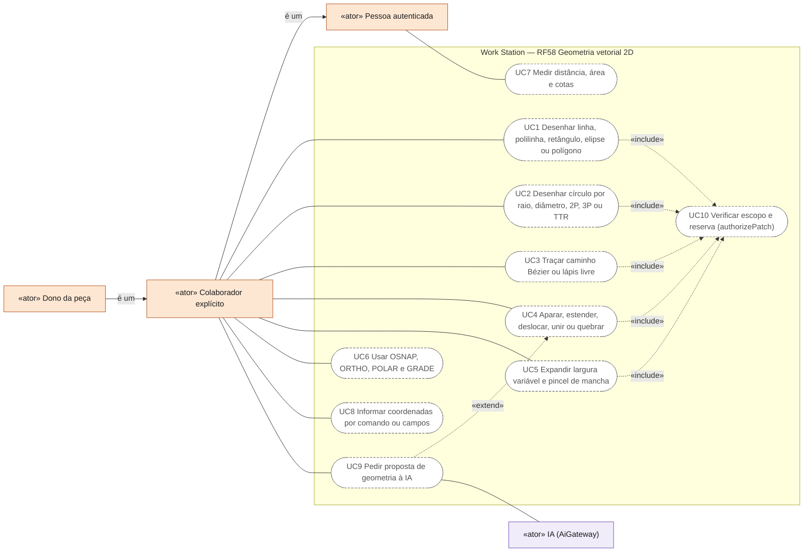
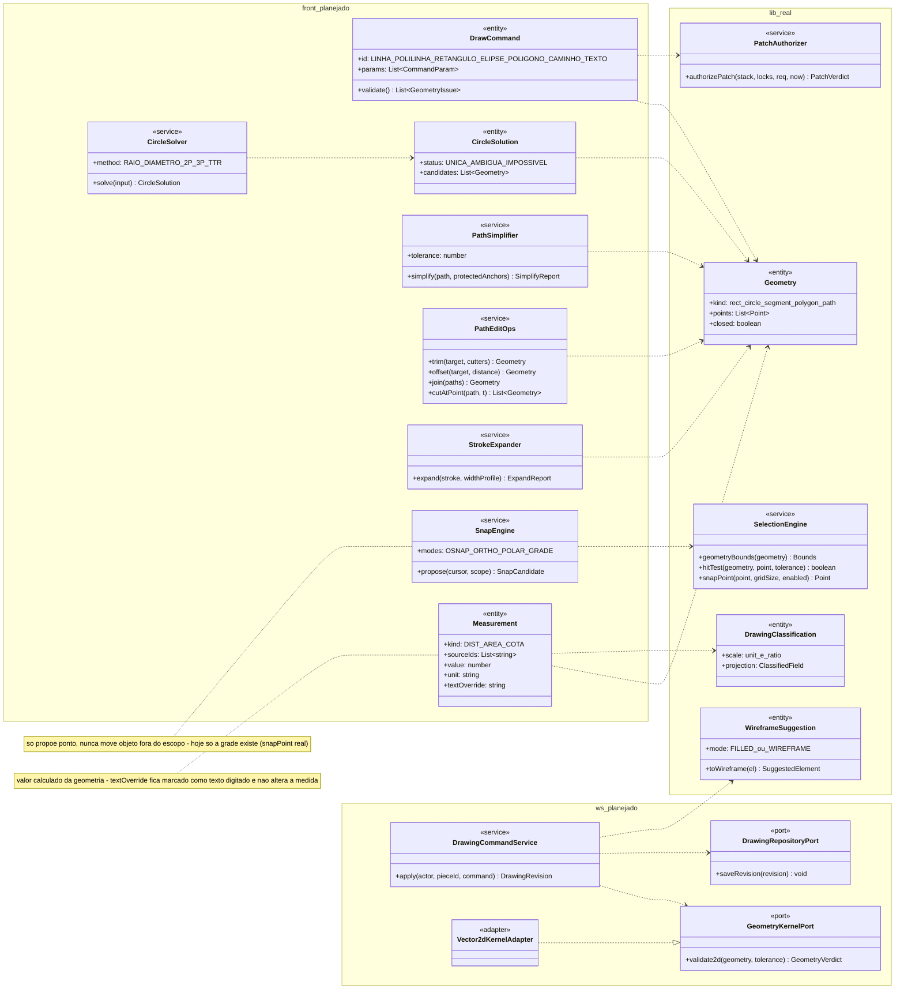
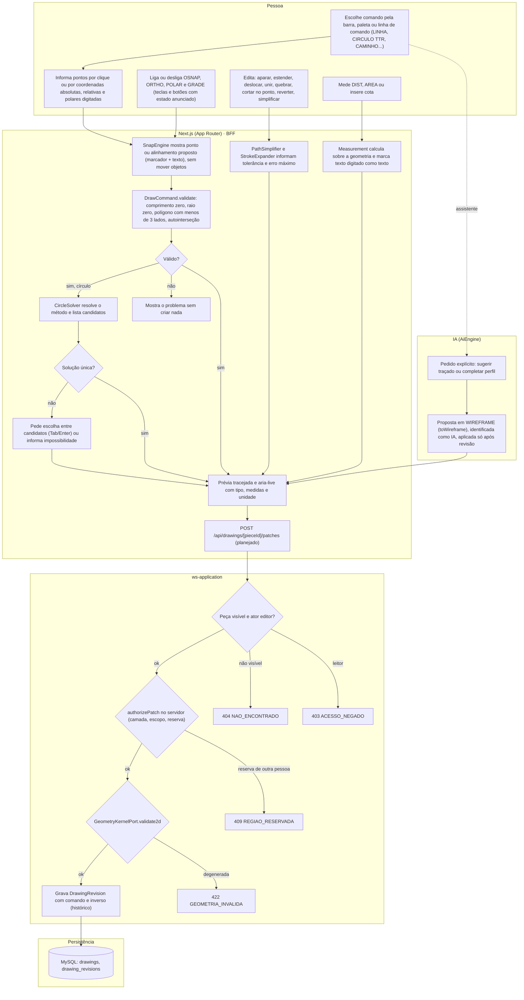
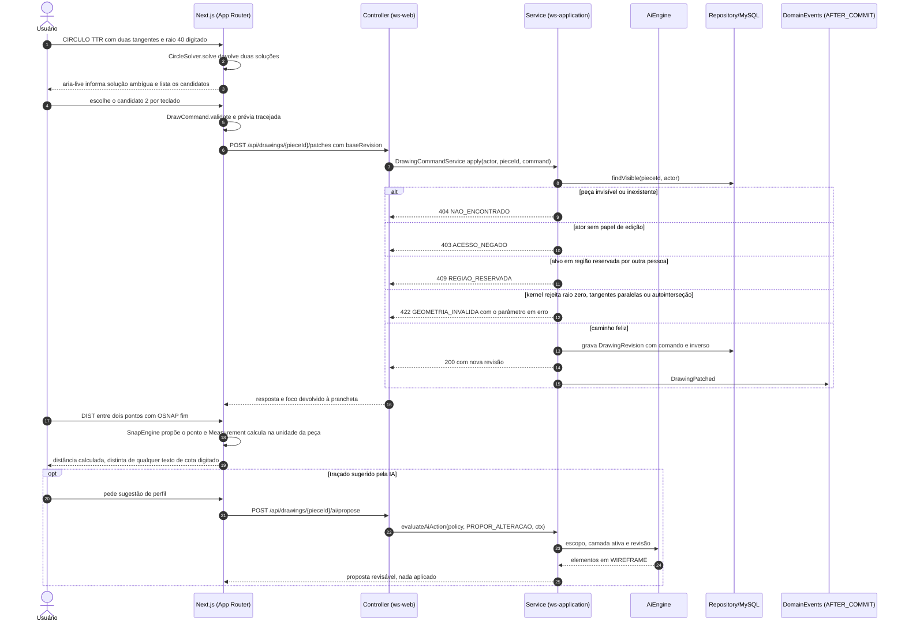
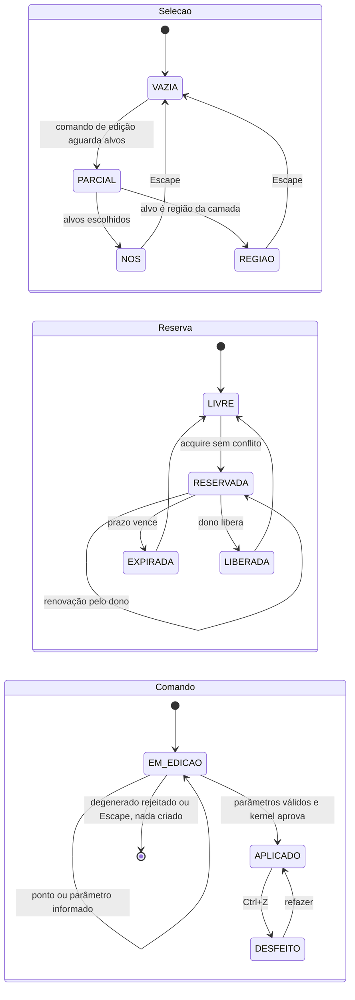
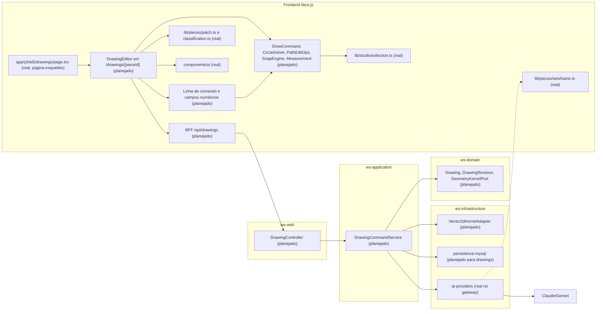

# RF58 — Criar e editar geometria vetorial e desenho técnico 2D
**HU:** — (sem HU no board; RF especificado em 15/10/2026) · **Sprint (board Work Station):** lista *Requisitos Funcionais* sem sprint atribuída · **Equivalente FAI:** — · **Aba/rota:** Drawings (`/drawings`, `/drawings/[pieceId]`; peça aberta a partir de `/tasks/[id]` e da sessão DECIA `/decia/[sessionId]`) · **Página-esqueleto:** registrada em 17/10/2026; editor ainda não implementado (Onda 5 do PLANO_ONDAS)
**Critérios de aceite cobertos:** RF58.CA01 … RF58.CA07 — corpo do card = especificação de docs/produto/requisitos-studio/RF58.md (CAs copiados como estão escritos); classes reais: `Geometry` (rect, circle, segment, polygon, path), `geometryBounds`, `hitTest`, `snapPoint` (`lib/studio/selection.ts`), `authorizePatch` (`lib/pieces/patch.ts`), `DrawingClassification.scale` (`lib/pieces/classification.ts`), `toWireframe`/`RenderMode` (`lib/pieces/wireframe.ts`), `evaluateAiAction` (`lib/ai/autonomy.ts`); o restante (planejado)

O RF58 cobre a construção de traçados e perfis 2D com coordenadas e precisão: o núcleo da primeira entrega são os comandos `LINHA`, `POLILINHA`, `RETANGULO`, `ELIPSE`, `POLIGONO`, `CAMINHO` (Bézier) e `TEXTO`, seguidos de círculo por raio, diâmetro, 2P, 3P e TTR, arco, linha de construção e ponto; edição por aparar, estender, deslocar, unir, quebrar, `CORTAR_NO_PONTO` e reverter; largura variável e pincel de mancha expandidos em contornos editáveis; auxílios de precisão (OSNAP, ORTHO, POLAR, `GRADE`, `ORIGEM`) que só propõem pontos; e medição (DIST, AREA, cotas) calculada sobre a geometria real, nunca sobre o texto digitado. Cada comando aceita entrada numérica por linha de comando ou campos (alternativa ao arraste, WCAG 2.5.7), anuncia o resultado ao leitor de tela e passa pela mesma autorização de patch (camada ativa, escopo, reserva). Nomes como LINE, PLINE e TRIM são inspiração semântica de AutoCAD/Illustrator, sem promessa de paridade.

Estado real (MATRIZ_RF de 17/10/2026: AUSENTE, 0,00): nenhuma ferramenta de desenho existe nesta árvore; só o tipo `Geometry`, o hit-test e o `snapPoint` de grade (`lib/studio/selection.ts`) servem de base. A evidência local de 15/10 (`docs/auditoria/2026-10-15/comandos-do-zero/`, `caminhos-compostos/`) foi produzida em código ainda fora deste repositório. Fontes: `COMANDOS_REFERENCIA_ILLUSTRATOR_AUTOCAD.md` §5, `docs/produto/DRAWINGS_ESTUDO_TECNICO_ACADEMICO.md` (unidade de tela ≠ milímetro, cota ligada à geometria), D-136 (autonomia). 3D: as mesmas ferramentas com coordenada Z ou plano UCS são capacidade futura declarada por operação (RF60/RF62).

## Critérios de aceite

| CA | Enunciado (Dado / Quando / Então) |
|---|---|
| **RF58.CA01** | Dados LINE, PLINE, CIRCLE, ARC, RECTANG, POLYGON, ELLIPSE, SPLINE, XLINE e POINT, quando executados com parâmetros válidos, então criam a geometria esperada e rejeitam degenerações. |
| **RF58.CA02** | Dado círculo, quando escolhe raio, diâmetro, 2P, 3P ou TTR, então resolve o método e informa ambiguidade ou impossibilidade. |
| **RF58.CA03** | Dada caneta Bézier ou lápis livre, quando edita controles e simplifica, então informa tolerância/erro máximo e preserva fechamento e pontos protegidos. |
| **RF58.CA04** | Dados TRIM, EXTEND, OFFSET, JOIN/PEDIT, BREAK, tesoura e reversão, quando aplicados, então preservam topologia prevista e mantêm histórico. |
| **RF58.CA05** | Dados largura variável e pincel de mancha, quando expande, então gera contornos editáveis e mantém aparência dentro da tolerância declarada. |
| **RF58.CA06** | Dados OSNAP, ORTHO, POLAR, SNAP/GRID, quando habilitados, então mostram ponto/alinhamento proposto sem deslocar objetos fora do escopo. |
| **RF58.CA07** | Dados DIST, AREA, cotas, unidades e escala, quando mede, então calcula sobre geometria real e distingue medida de valor textual digitado. |

## 0. Diagrama de casos de uso

O colaborador explícito (e o dono) desenha e edita geometria 2D com entrada numérica e auxílios de precisão; medir é leitura e vale para quem tem acesso à peça. Toda gravação passa pela verificação de escopo e reserva. Não há ferramenta de desenho no app.

| Caso de uso | Ator(es) | CAs | Situação |
|---|---|---|---|
| UC1 Desenhar linha, polilinha, retângulo, elipse ou polígono | `colaborador` | RF58.CA01 | planejado |
| UC2 Desenhar círculo por raio, diâmetro, 2P, 3P ou TTR | `colaborador` | RF58.CA02 | planejado |
| UC3 Traçar caminho Bézier ou lápis livre | `colaborador` | RF58.CA03 | planejado |
| UC4 Aparar, estender, deslocar, unir ou quebrar | `colaborador` | RF58.CA04 | planejado |
| UC5 Expandir largura variável e pincel de mancha | `colaborador` | RF58.CA05 | planejado |
| UC6 Usar OSNAP, ORTHO, POLAR e GRADE | `colaborador` | RF58.CA06 | planejado — `snapPoint` de grade em `lib/studio/selection.ts` |
| UC7 Medir distância, área e cotas | `autenticado` | RF58.CA07 | planejado |
| UC8 Informar coordenadas por comando ou campos | `colaborador` | RF58.CA01 · CA02 | planejado |
| UC9 Pedir proposta de geometria à IA | `colaborador`, `ia` (estende UC4) | RF58.CA04 · CA06 | planejado — `evaluateAiAction` real, sem editor |
| UC10 Verificar escopo e reserva (authorizePatch) | — (incluído por UC1, UC2, UC3, UC4, UC5) | RF58.CA04 · CA06 | planejado — função pura `lib/pieces/patch.ts` |

## 1. Diagrama de classes

**(real)**: `Geometry`, `SelectionEngine` (funções de `lib/studio/selection.ts`), `PatchAuthorizer`, `DrawingClassification`, `WireframeSuggestion`. Demais classes **(planejado)**; não constam de `docs/arquitetura/TAXONOMIA.md` e são proposta da Onda 5.

## 2. Diagrama de atividades

## 3. Diagrama de sequência

## 4. Máquina de estados

Seleção e reserva seguem o RF57; o **comando de desenho** (planejado) é a entidade central aqui.

## 5. Diagrama de componentes

## 6. Rastreabilidade

| CA | Classe (§1) | Passo da atividade (§2) | Mensagem da sequência (§3) | Transição (§4) | Componente (§5) | Situação |
|---|---|---|---|---|---|---|
| RF58.CA01 | `DrawCommand.validate`, `GeometryKernelPort.validate2d`, `Geometry` | `A1`, `A2`, `F2`, `F3`, `F11`, `S1`–`S3`, `E404`, `E403`, `E409`, `E422` | 5–16 | `EM_EDICAO`→`APLICADO`, `EM_EDICAO`→`[*]`, `LIVRE`→`RESERVADA` | `TOOLS`, `CLI`, `KER` | planejado (`Geometry` real) |
| RF58.CA02 | `CircleSolver`, `CircleSolution` | `F4`, `F5`, `F6` | 1–4 | `EM_EDICAO`→`EM_EDICAO` | `TOOLS` | planejado |
| RF58.CA03 | `PathSimplifier` (tolerance, protectedAnchors) | `A4`, `F8` | 5 | `EM_EDICAO`→`APLICADO` | `TOOLS` | planejado (Bézier só no código local de 16/10) |
| RF58.CA04 | `PathEditOps`, `DrawingCommandService.apply` com inverso | `A4`, `F8`, `S4` | 13–15 | `APLICADO`→`DESFEITO`→`APLICADO` | `TOOLS`, `DCS`, `MY` | planejado |
| RF58.CA05 | `StrokeExpander` | `A4`, `F8` | 5 | `EM_EDICAO`→`APLICADO` | `TOOLS`, `KER` | planejado |
| RF58.CA06 | `SnapEngine.propose`, `SelectionEngine.snapPoint` | `A3`, `F1` | 17–18 | — (só proposta, nenhum objeto se move) | `TOOLS`, `SEL` | `snapPoint` de grade real; OSNAP/ORTHO/POLAR planejados |
| RF58.CA07 | `Measurement` (value, unit, textOverride), `DrawingClassification.scale` | `A5`, `F9` | 17–19 | — | `TOOLS`, `PATCH` | planejado (`scale` real como metadado) |

IA (bloco opt, mensagens 20–25) só propõe em `WIREFRAME`; aplicar segue `evaluateAiAction` (`APLICAR_ALTERACAO` exige revisão e seleção editável). Nenhum CA é marcado como concluído por este diagrama.
