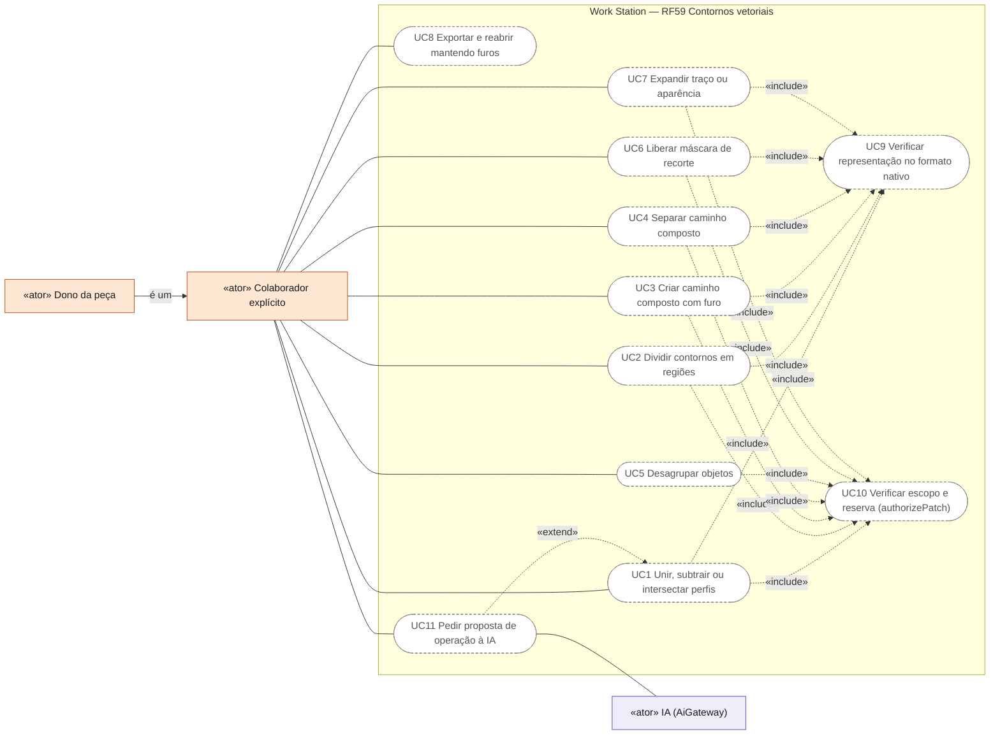
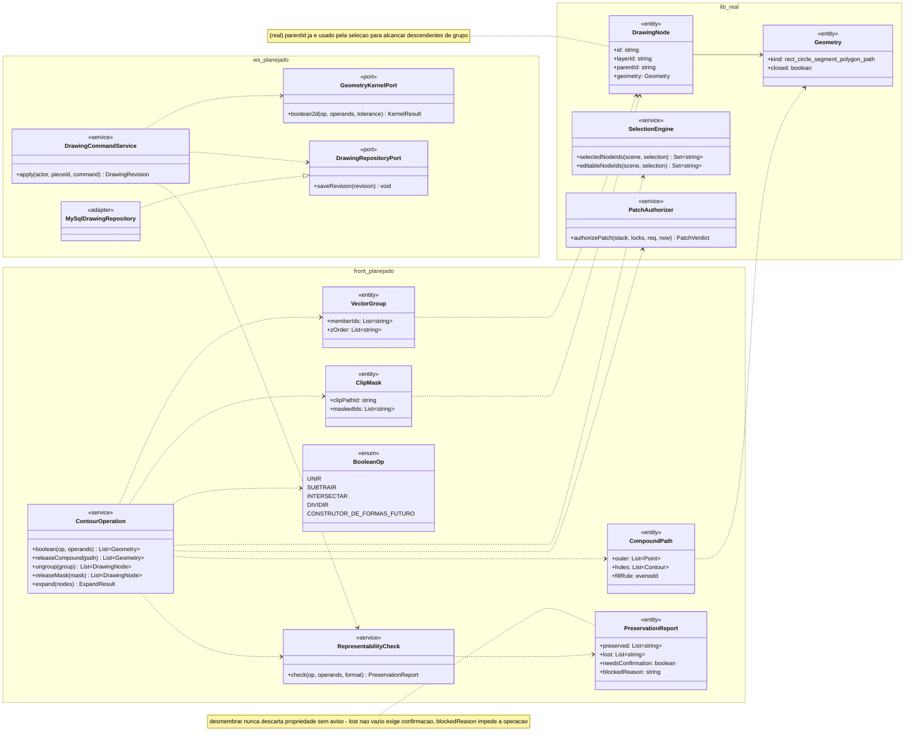
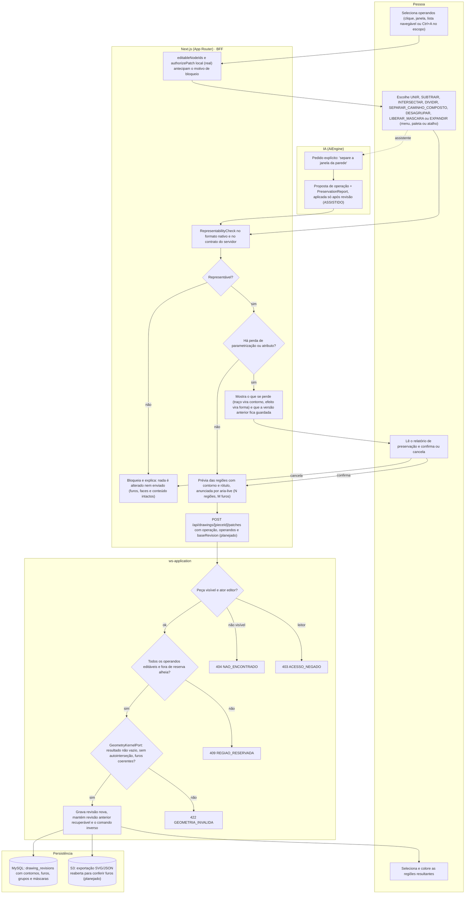
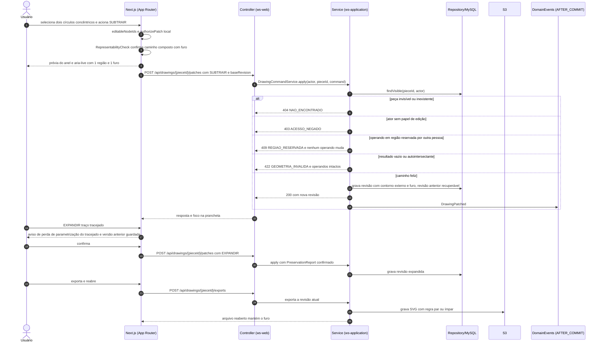
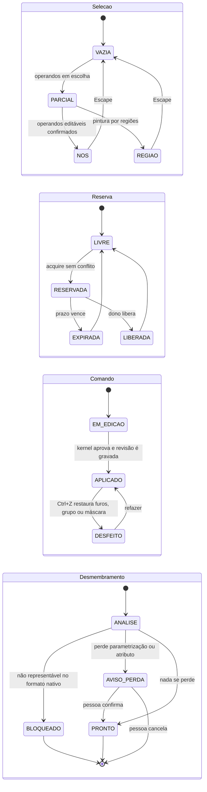
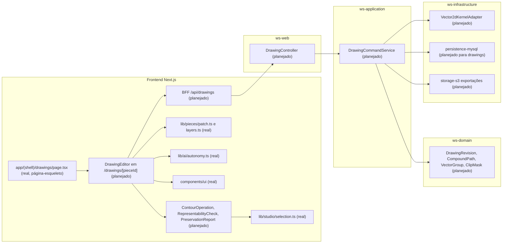

# RF59 — Construir, dividir e desmembrar contornos vetoriais
**HU:** — (sem HU no board; RF especificado em 15/10/2026) · **Sprint (board Work Station):** lista *Requisitos Funcionais* sem sprint atribuída · **Equivalente FAI:** — · **Aba/rota:** Drawings (`/drawings`, `/drawings/[pieceId]`; peça aberta a partir de `/tasks/[id]` e da sessão DECIA `/decia/[sessionId]`) · **Página-esqueleto:** registrada em 17/10/2026; editor ainda não implementado (Onda 5 do PLANO_ONDAS)
**Critérios de aceite cobertos:** RF59.CA01 … RF59.CA07 — corpo do card = especificação de docs/produto/requisitos-studio/RF59.md (CAs copiados como estão escritos); classes reais: `Geometry` e `DrawingNode.parentId` com resolução de descendentes de grupo em `selectedNodeIds` (`lib/studio/selection.ts`), `authorizePatch` (`lib/pieces/patch.ts`), `LayerStack` (`lib/pieces/layers.ts`), `evaluateAiAction`/`proposalValidity` (`lib/ai/autonomy.ts`); o restante (planejado)

O RF59 trata as operações que constroem, dividem e desmembram contornos 2D: booleanas `UNIR`, `SUBTRAIR` e `INTERSECTAR` (Shape Builder fica como `CONSTRUTOR_DE_FORMAS`, fase posterior), `DIVIDIR` em regiões independentes, caminho composto com furo (regra par/ímpar) e `SEPARAR_CAMINHO_COMPOSTO`, `DESAGRUPAR` que só remove o vínculo de grupo, `LIBERAR_MASCARA` que devolve os vetores selecionáveis, e `EXPANDIR` traço ou aparência com aviso de perda de parametrização e versão anterior preservada. Regra central, comum ao RF61: desmembrar nunca descarta propriedades (furos, faces, texto, ordem, estilo) sem avisar; operação que o formato nativo não representa é bloqueada antes de qualquer alteração. Toda operação é acionável por menu, paleta e teclado sobre a seleção corrente (sem exigir arraste, WCAG 2.5.7), com o relatório de preservação lido pelo leitor de tela. Nomes de comando inspirados em Illustrator (Pathfinder, Release Compound Path) e AutoCAD (UNION, EXPLODE), sem promessa de paridade.

Estado real (MATRIZ_RF de 17/10/2026: AUSENTE, 0,00): nesta árvore só existe a hierarquia `parentId` usada pela seleção para alcançar descendentes de grupo e o tipo `path.closed`; não há modelo de furo, máscara nem booleanas. A evidência de 15/10 (`docs/auditoria/2026-10-15/caminhos-compostos/`) mostra furos preservados, liberação de contornos, agrupamento, tesoura e expansão no código local, ainda fora do repositório, e registra que o contrato do servidor não aceita grupos/furos (envio bloqueado para não perder dados). Fontes: `COMANDOS_REFERENCIA_ILLUSTRATOR_AUTOCAD.md` §1, PLANO_ONDAS Onda 5. 3D: booleanas de sólidos e separação de corpos são capacidade futura declarada por operação (RF60.CA05, RF61.CA03).

## Critérios de aceite

| CA | Enunciado (Dado / Quando / Então) |
|---|---|
| **RF59.CA01** | Dados UNION/Shape Builder, SUBTRACT e INTERSECT, quando combina perfis fechados, então o resultado corresponde à área geométrica esperada. |
| **RF59.CA02** | Dado Pathfinder Divide ou pintura por regiões, quando cruza contornos, então produz regiões independentes selecionáveis e coloríveis. |
| **RF59.CA03** | Dado caminho composto com furo, quando exporta/reabre, então mantém o furo; liberar caminho composto separa contornos explicitamente. |
| **RF59.CA04** | Dado grupo, quando UNGROUP é executado, então remove apenas o vínculo de agrupamento e preserva geometria, texto e ordem. |
| **RF59.CA05** | Dada máscara, quando libera recorte, então mantém os vetores originais e torna os elementos liberados selecionáveis. |
| **RF59.CA06** | Dado Expand/Expand Appearance, quando converte traços ou efeitos, então informa perda de parametrização e preserva versão anterior. |
| **RF59.CA07** | Dada operação não representável no formato nativo, quando é solicitada, então bloqueia sem descartar furos, faces ou conteúdo silenciosamente. |

## 0. Diagrama de casos de uso

O colaborador explícito (e o dono) combina, divide e desmembra contornos 2D; cada operação confere antes se o formato nativo representa o resultado e passa pela verificação de escopo e reserva. Nenhuma dessas operações existe no app.

| Caso de uso | Ator(es) | CAs | Situação |
|---|---|---|---|
| UC1 Unir, subtrair ou intersectar perfis | `colaborador` | RF59.CA01 | planejado |
| UC2 Dividir contornos em regiões | `colaborador` | RF59.CA02 | planejado |
| UC3 Criar caminho composto com furo | `colaborador` | RF59.CA03 | planejado |
| UC4 Separar caminho composto | `colaborador` | RF59.CA03 | planejado |
| UC5 Desagrupar objetos | `colaborador` | RF59.CA04 | planejado — hierarquia `parentId` em `lib/studio/selection.ts` |
| UC6 Liberar máscara de recorte | `colaborador` | RF59.CA05 | planejado |
| UC7 Expandir traço ou aparência | `colaborador` | RF59.CA06 | planejado |
| UC8 Exportar e reabrir mantendo furos | `colaborador` | RF59.CA03 | planejado |
| UC9 Verificar representação no formato nativo | — (incluído por UC1, UC2, UC3, UC4, UC6, UC7) | RF59.CA06 · CA07 | planejado |
| UC10 Verificar escopo e reserva (authorizePatch) | — (incluído por UC1, UC2, UC3, UC4, UC5, UC6, UC7) | RF59.CA01 · CA04 | planejado — função pura `lib/pieces/patch.ts` |
| UC11 Pedir proposta de operação à IA | `colaborador`, `ia` (estende UC1) | RF59.CA01 · CA07 | planejado — `evaluateAiAction`/`proposalValidity` reais, sem editor |

## 1. Diagrama de classes

**(real)**: `Geometry`, `DrawingNode`, `SelectionEngine`, `PatchAuthorizer`. Demais **(planejado)**; as entidades de servidor não constam de `docs/arquitetura/TAXONOMIA.md`.

## 2. Diagrama de atividades

## 3. Diagrama de sequência

## 4. Máquina de estados

Seleção, reserva e comando seguem o RF57; acrescenta-se o **desmembramento** (planejado), que impede perda silenciosa.

## 5. Diagrama de componentes

## 6. Rastreabilidade

| CA | Classe (§1) | Passo da atividade (§2) | Mensagem da sequência (§3) | Transição (§4) | Componente (§5) | Situação |
|---|---|---|---|---|---|---|
| RF59.CA01 | `ContourOperation.boolean`, `BooleanOp`, `GeometryKernelPort.boolean2d` | `A1`, `A2`, `S3`, `E422` | 1–16 | `EM_EDICAO`→`APLICADO` | `OPS`, `KER` | planejado |
| RF59.CA02 | `BooleanOp.DIVIDIR`, `ContourOperation.boolean` | `F7`, `A4` | 4 | `PARCIAL`→`REGIAO` | `OPS`, `SEL` | planejado |
| RF59.CA03 | `CompoundPath` (holes, fillRule), `ContourOperation.releaseCompound` | `F2`, `F7`, `D2` | 3, 12, 22–26 | `APLICADO`→`DESFEITO` | `OPS`, `ST` | planejado (evidência só no código local de 15/10) |
| RF59.CA04 | `VectorGroup`, `ContourOperation.ungroup`, `DrawingNode.parentId` | `A2`, `F5`→`F7` | 5–15 | `ANALISE`→`PRONTO` | `OPS`, `SEL` | `parentId` real; desagrupar planejado |
| RF59.CA05 | `ClipMask`, `ContourOperation.releaseMask` | `A2`, `F7`, `A4` | 5–15 | `ANALISE`→`PRONTO`, `PARCIAL`→`NOS` | `OPS` | planejado |
| RF59.CA06 | `ContourOperation.expand`, `PreservationReport.lost` | `F5`, `F6`, `A3`, `S4` | 16–21 | `ANALISE`→`AVISO_PERDA`→`PRONTO` | `OPS`, `DCS`, `MY` | planejado |
| RF59.CA07 | `RepresentabilityCheck`, `PreservationReport.blockedReason` | `F2`, `F3`, `F4`, `S1`, `S2`, `E404`, `E403`, `E409` | 3, 8–11 | `ANALISE`→`BLOQUEADO` | `OPS`, `DCS` | planejado |

Erros nomeados: `404 NAO_ENCONTRADO`, `403 ACESSO_NEGADO`, `409 REGIAO_RESERVADA`, `422 GEOMETRIA_INVALIDA`; em todos, nenhum operando muda. Nenhum CA é marcado como concluído por este diagrama.
