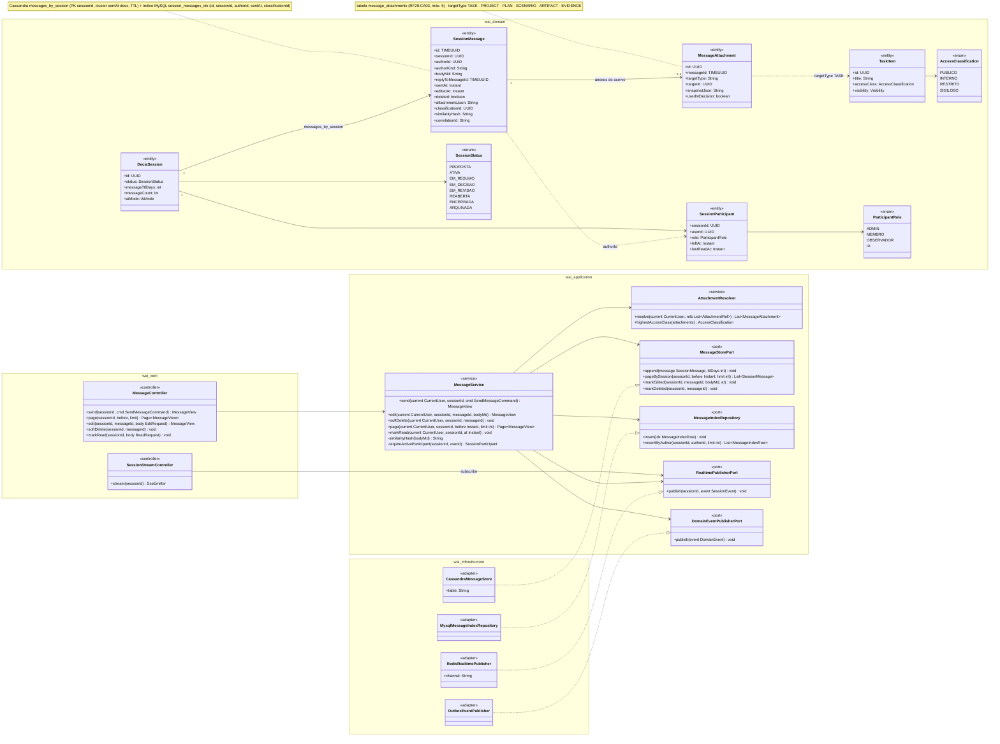
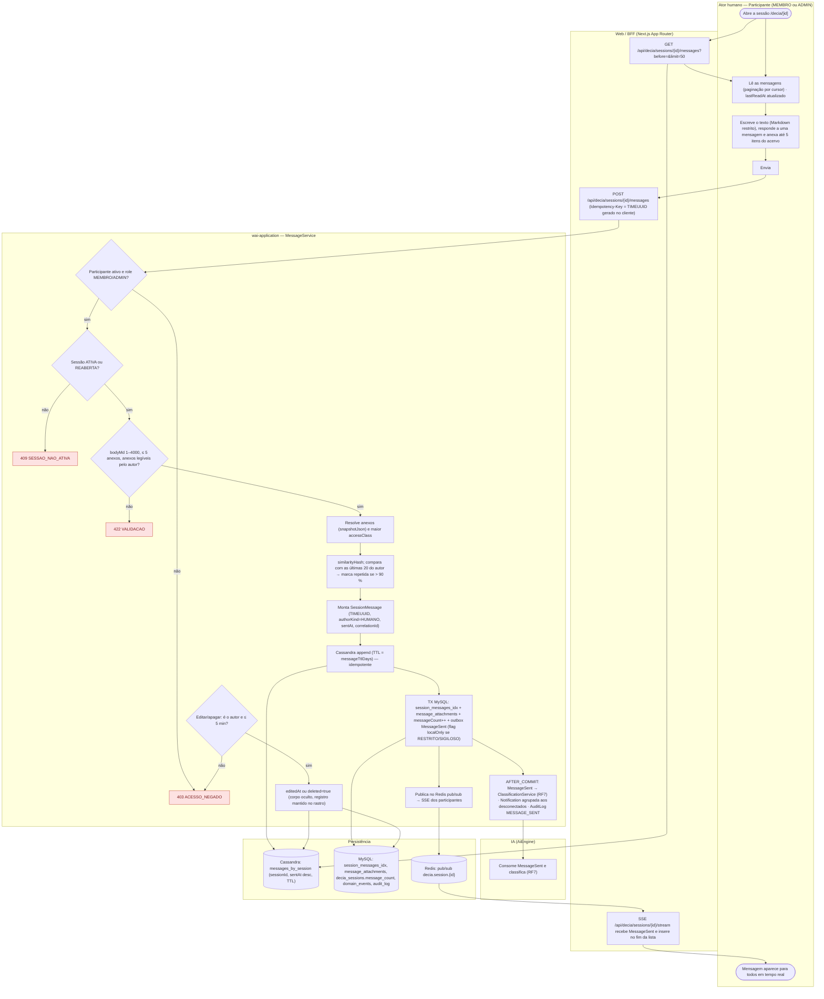
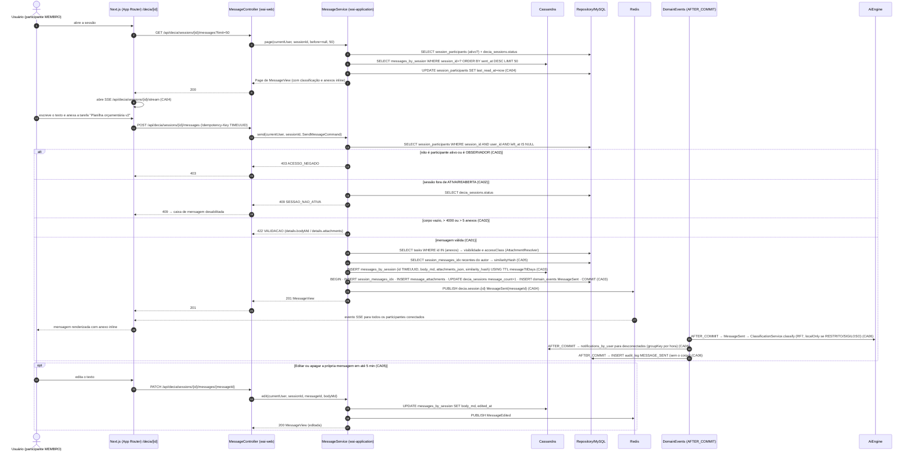
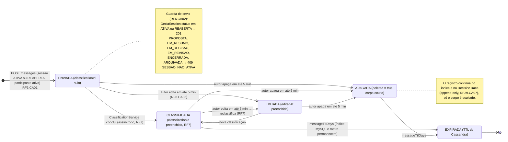
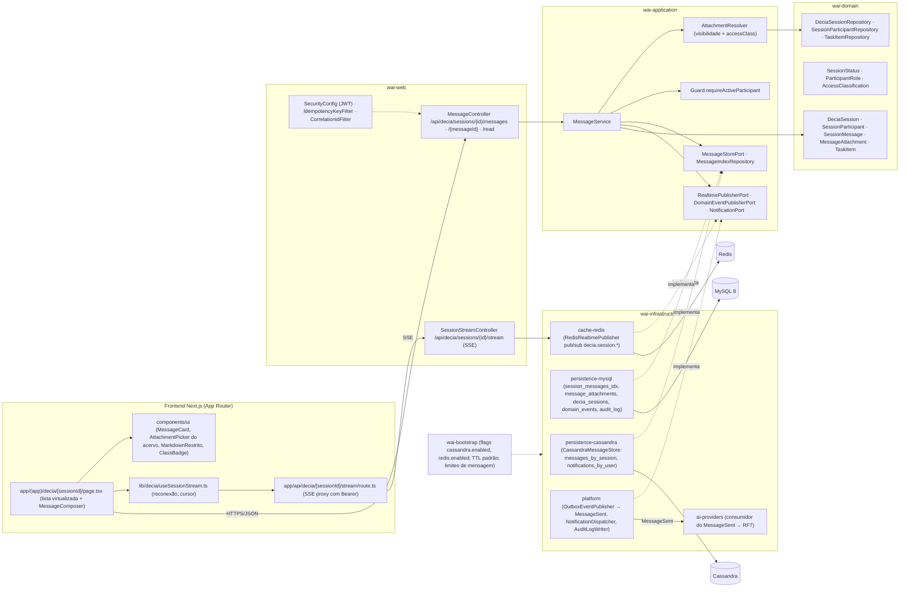

# RF6 — Enviar mensagens dentro do chat, enquanto a sessão estiver ativa.
**HU:** HU6 · **Sprint (board Work Station):** 1 · **Equivalente FAI:** RF10 Copilot — "Mensagem do Copilot" → **Mensagem do DECIA** (toda mensagem pode carregar tarefa/artefato anexado e é classificada, RF7) · **Aba/rota:** DECIA (`/decia/[sessionId]`, caixa de mensagem + anexos do acervo) — rota sugerida
**Critérios de aceite cobertos:** RF6.CA01 … RF6.CA06 (RF1–RF18 não têm CAs no board: derivados da HU6 e marcados "CA a confirmar")

> **HU6** — COMO usuário participante do grupo da conversa POSSO enviar mensagens no chat enquanto a sessão estiver ativa PARA contribuir com argumentos, opiniões e informações sobre o tema da sessão.

## Critérios de aceite derivados da HU6 (todos "CA a confirmar")

| CA | Enunciado (Dado / Quando / Então) |
|---|---|
| **RF6.CA01** (CA a confirmar) | Dado um `SessionParticipant` ativo (`leftAt` nulo, `role` MEMBRO ou ADMIN) numa sessão `ATIVA` (ou `REABERTA`), quando envia `bodyMd` (1–4000 caracteres, Markdown restrito), opcionalmente `replyToMessageId` e até **5 anexos do acervo** (`MessageAttachment` TASK · PROJECT · PLAN, RF29.CA03), então a `SessionMessage` é criada com `id` TIMEUUID, `authorKind HUMANO`, `sentAt` e `correlationId`, e a API responde `201` com a mensagem renderizada. |
| **RF6.CA02** (CA a confirmar) | Dado a sessão fora de `ATIVA`/`REABERTA` → `409 SESSAO_NAO_ATIVA`; usuário que não é participante ativo ou é `OBSERVADOR` → `403 ACESSO_NEGADO`; corpo vazio, acima do limite, mais de 5 anexos ou anexo sem permissão de leitura → `422 VALIDACAO`. |
| **RF6.CA03** (CA a confirmar) | Dado a mensagem aceita, então ela é gravada no **Cassandra** `messages_by_session` (partição `sessionId`, cluster `sentAt` desc, TTL = `DeciaSession.messageTtlDays`) e indexada no **MySQL** `session_messages_idx` (id, sessionId, authorId, sentAt, classificationId) na mesma unidade de trabalho que incrementa `messageCount` e grava o evento `MessageSent` no outbox; a escrita é idempotente pelo TIMEUUID (reenvio não duplica). |
| **RF6.CA04** (CA a confirmar) | Dado participantes conectados, então a mensagem chega em **tempo real** (SSE via Redis pub/sub) a todos os participantes ativos da sessão; ao abrir a sessão, as mensagens são paginadas por cursor (`?before=<sentAt>&limit=50`) a partir do Cassandra e `SessionParticipant.lastReadAt` é atualizado. |
| **RF6.CA05** (CA a confirmar) | Dado a mensagem aceita, então o `similarityHash` é calculado e, se for > 90 % similar a uma mensagem recente do mesmo autor na sessão, ela é marcada como repetida (não pontua, RF42); anexos com `accessClass RESTRITO`/`SIGILOSO` marcam a mensagem para classificação **só no motor local** (RF43.CA02); o autor pode editar (`editedAt`) ou apagar (`deleted` = true, corpo oculto) a própria mensagem em até 5 min, mantendo o registro no rastro (RF29.CA07). |
| **RF6.CA06** (CA a confirmar) | Dado o commit, então `MessageSent` (AFTER_COMMIT) dispara a classificação assíncrona da IA (RF7), a notificação dos participantes desconectados (agrupada por hora, `Notification.groupKey`) e `AuditLog MESSAGE_SENT` (sem o corpo); tudo i18n e com `correlationId` fim a fim. |

## 1. Diagrama de classes

## 2. Diagrama de atividades

Raias: Participante · Web/BFF · `wai-application` · Persistência · IA (AiEngine) só como destino do evento (a classificação é o RF7).

## 3. Diagrama de sequência

Caminho feliz do envio com anexo, entrega em tempo real e `alt` de erro dos CA02 (409/403/422); leitura paginada e edição em `opt`.

## 4. Máquina de estados

Entidade central: `SessionMessage`. Ela não tem enum de status na TAXONOMIA; os estados são **implícitos pelos campos** `classificationId`, `editedAt` e `deleted`, e o envio depende do `SessionStatus` da sessão (ATIVA/REABERTA), mostrado como guarda.

## 5. Diagrama de componentes

## 6. Rastreabilidade

| CA | Classe (§1) | Passo da atividade (§2) | Mensagem da sequência (§3) | Transição de estado (§4) | Componente (§5) |
|---|---|---|---|---|---|
| RF6.CA01 | `MessageService.send`, `SessionMessage` (TIMEUUID, authorKind, sentAt, correlationId), `MessageAttachment`, `AttachmentResolver.resolve` | `A3`, `A4`, `B2`, `C3`, `C4`, `C6` | 10–12, 21–27 (`POST …/messages`, 201) | `[*] → ENVIADA` | `FE1`, `FE2 AttachmentPicker`, `W1`, `S1`, `S2` |
| RF6.CA02 | `MessageService.requireActiveParticipant`, `SessionParticipant.leftAt/role`, `DeciaSession.status`, `SessionStatus` | `C1` → `E403`, `C2` → `E409`, `C3` → `E422` | 13–20 (`403`, `409 SESSAO_NAO_ATIVA`, `422`) | guarda em `ENVIADA` | `S3 Guard`, `W3` |
| RF6.CA03 | `MessageStorePort`/`CassandraMessageStore`, `MessageIndexRepository`/`MysqlMessageIndexRepository`, `DeciaSession.messageCount/messageTtlDays` | `C7`, `C8`, `D1`, `D2` | 23–24 (INSERT Cassandra USING TTL, TX MySQL + outbox) | `CLASSIFICADA → EXPIRADA` (TTL) | `I1`, `I2`, `W3 IdempotencyKeyFilter` |
| RF6.CA04 | `RealtimePublisherPort`/`RedisRealtimePublisher`, `SessionStreamController`, `MessageService.page/markRead`, `SessionParticipant.lastReadAt` | `A2`, `B1`, `B3`, `C9`, `D3` | 1–9 (paginação, lastReadAt, SSE), 25–29 (PUBLISH → SSE) | — | `W2`, `FE3`, `FE4`, `I3` |
| RF6.CA05 | `SessionMessage.similarityHash/editedAt/deleted`, `MessageService.edit/softDelete`, `AttachmentResolver.highestAccessClass`, `AccessClassification` | `C4`, `C5`, `C11`, `C12` | 22 (similarityHash), 33–38 (`opt` editar) | `→ EDITADA`, `→ APAGADA` | `S1`, `S2`, `I1` (UPDATE) |
| RF6.CA06 | `DomainEventPublisherPort`/`OutboxEventPublisher` (`MessageSent`), `Notification.groupKey`, `AuditLog` | `C10`, `I1` | 30–32 (AFTER_COMMIT → RF7, notificações agrupadas, audit_log) | `ENVIADA → CLASSIFICADA` (efeito do evento) | `I4`, `I5`, `I1 notifications_by_user` |
