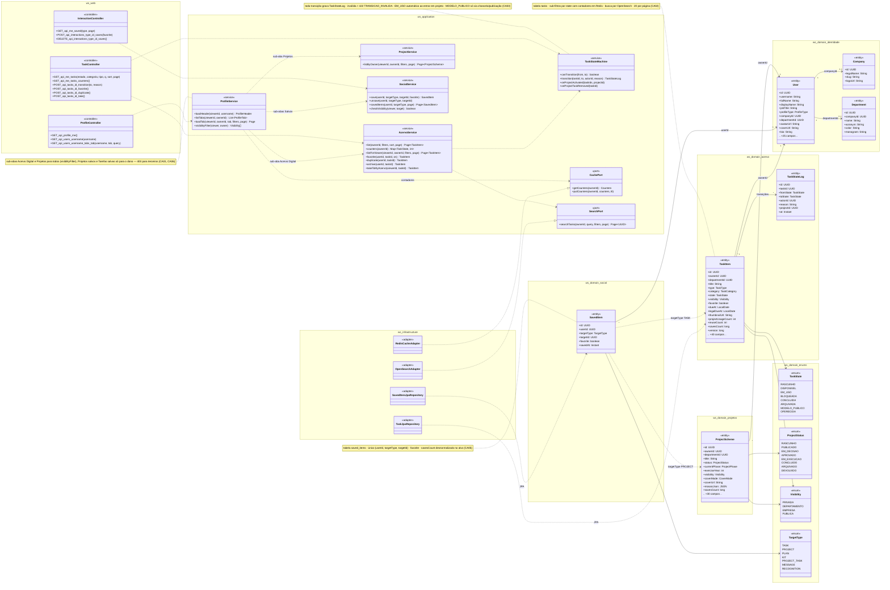
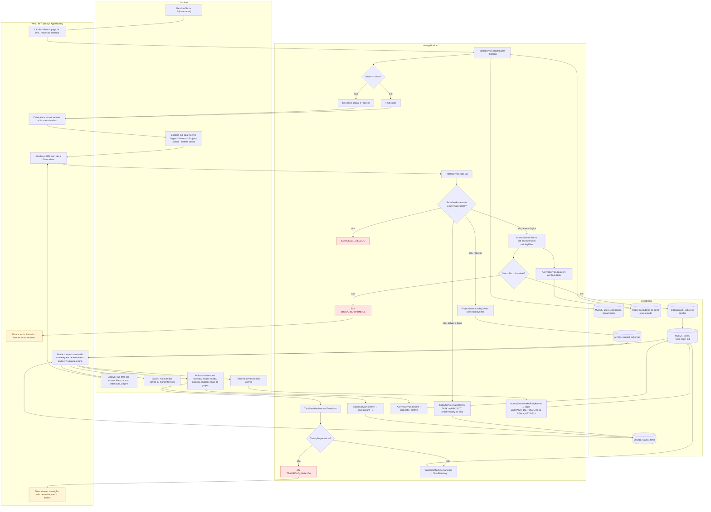
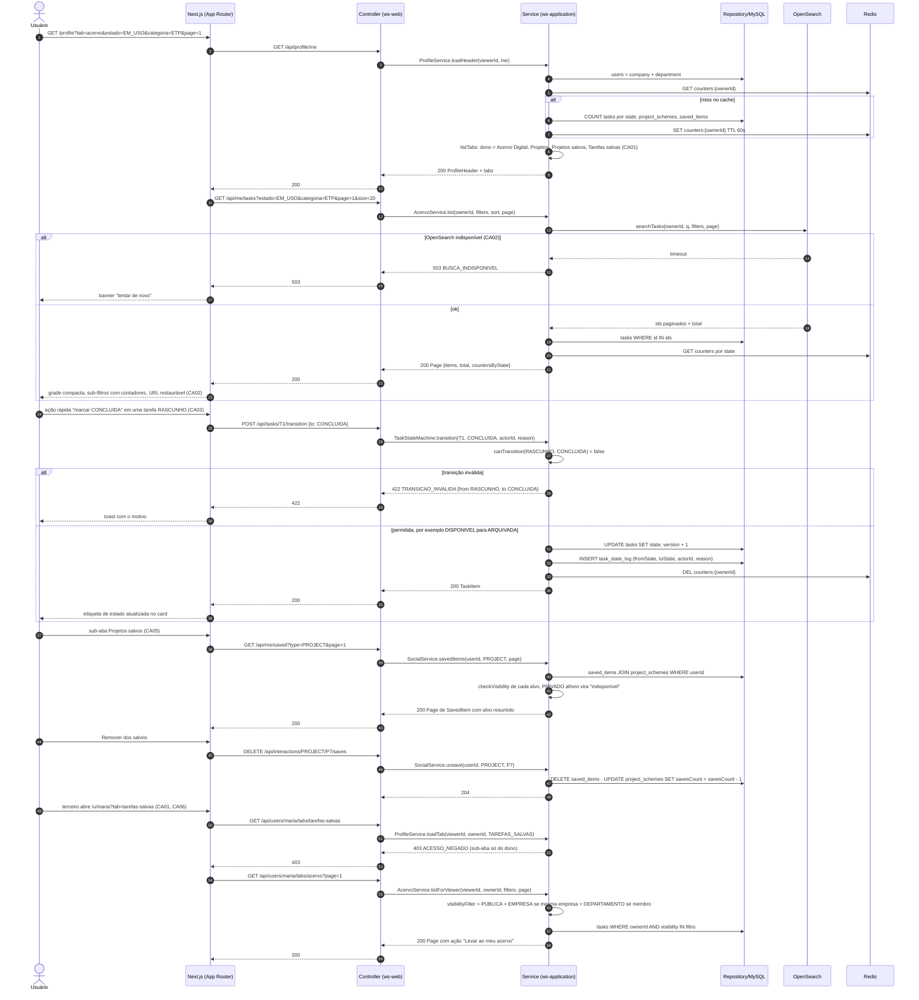
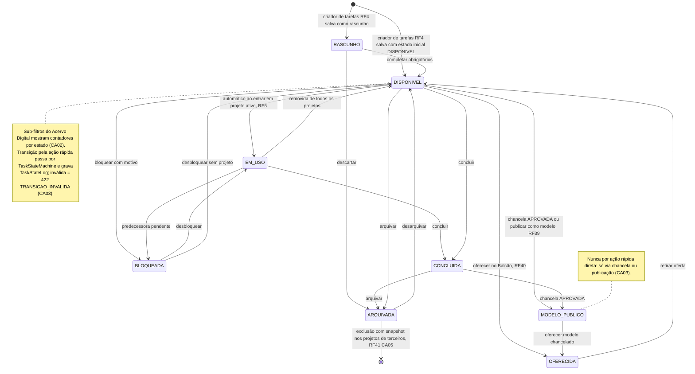
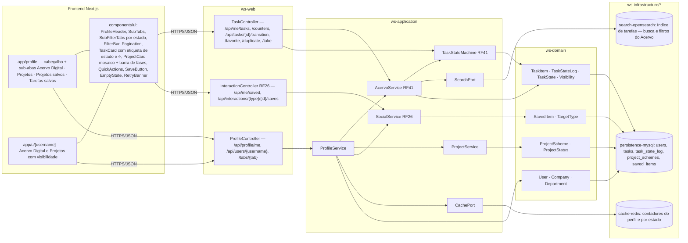

# RF6 — Acessar e gerenciar o Perfil  Empresarial (Acervo Digital + Projetos Salvos)
**HU:** HU6 · **Sprint (board Work Station):** lista *Requisitos Funcionais* (sem sprint atribuída) · **Equivalente FAI:** RF6 Perfil Lookbook (Closet Digital + Looks Salvos): abas Closet · Looks · Looks salvos · Peças salvas, toggles de estado no topo do card · **Aba/rota:** Meu perfil (`/profile`, sub-abas `?tab=acervo|projetos|projetos-salvos|tarefas-salvas`), perfil de terceiros em `/u/[username]`; Acervo também em `/tasks`
**Critérios de aceite cobertos:** RF6.CA01 … RF6.CA06 — **todos "(CA a confirmar)"**: o corpo do card RF6 está vazio; os CAs foram derivados do título + HU6 e reaproveitam o já validado em `_anterior/RF19` (sub-abas 1–2 e 7–8), RF41 (estados do Acervo) e RF26.CA04 (salvar)

> **HU6** — COMO usuário autenticado dentro do sistema POSSO visualizar meu perfil com tudo o que criei (tarefas, projetos, planos, decisões) em sub-abas e o meu perfil deliberativo gerado pela IA PARA acompanhar e mostrar minha produção e minha evolução desde que entrei no sistema.

O **Perfil Empresarial** é o perfil de trabalho do usuário (= Perfil Lookbook do FAI): cabeçalho (avatar, nome, cargo, empresa, departamento, contadores) e as sub-abas que o título do card recorta — **Acervo Digital** (sub-aba 1 do RF19: `TaskItem` do dono com os 8 estados do `TaskState`, RF41) e **Projetos** (sub-aba 2: `ProjectScheme`) para todos, mais **Projetos salvos / Tarefas salvas** (sub-abas 7–8: `SavedItem`, RF26.CA04) só para o dono. "Gerenciar" = ações rápidas do card (favoritar, mudar estado via `TaskStateMachine`, arquivar, duplicar, levar ao projeto, remover dos salvos). As demais sub-abas da HU6 (planos, decisões, perfil deliberativo) ficam no card RF26 (corpo = antigo RF19) e não são repetidas aqui.

## Critérios de aceite derivados do título + HU6 (todos "CA a confirmar")

| CA | Enunciado (Dado / Quando / Então) | Fonte reaproveitada |
|---|---|---|
| **RF6.CA01** (CA a confirmar) | Dado um usuário autenticado, quando abre `/profile`, então vê o cabeçalho (avatar, nome, `jobTitle`, empresa, departamento, contadores de tarefas, projetos e salvos via Redis) e as sub-abas **Acervo Digital**, **Projetos**, **Projetos salvos** e **Tarefas salvas**; em `/u/[username]` um terceiro vê só Acervo Digital e Projetos, com itens filtrados por `Visibility`; sub-aba restrita acessada por terceiro → `403 ACESSO_NEGADO`. | RF19.CA01, RF19.CA02 |
| **RF6.CA02** (CA a confirmar) | Dado a sub-aba Acervo Digital, então ela lista os `TaskItem` do dono em grade compacta com **sub-filtros por estado** (`TaskState`: RASCUNHO · DISPONIVEL · EM_USO · BLOQUEADA · CONCLUIDA · ARQUIVADA · MODELO_PUBLICO · OFERECIDA) com contadores, filtros por categoria/tipo/processo/natureza, ordenação (recentes, mais usadas, nome, prazo), busca (OpenSearch), paginação de 20 e querystring restaurável; skeleton, estado vazio ilustrado e "tentar de novo" em `503 BUSCA_INDISPONIVEL`. | RF41.CA01, RF41.CA09 |
| **RF6.CA03** (CA a confirmar) | Dado um card do meu Acervo, quando aciono uma ação rápida (favoritar ⭐, mudar estado, arquivar, duplicar, levar ao projeto), então a transição passa por `TaskStateMachine` e grava `TaskStateLog`; transição inválida → `422 TRANSICAO_INVALIDA`; EM_USO é automático ao entrar em projeto ativo e MODELO_PUBLICO só via chancela/publicação; a etiqueta de estado aparece em texto no topo do card. | RF41.CA02, RF41.CA07, RF38.CA05 |
| **RF6.CA04** (CA a confirmar) | Dado a sub-aba Projetos, então ela lista os `ProjectScheme` do dono com capa-mosaico, barra de fases, `status` e `currentPhase`, filtráveis por status/fase/exercício e paginados; abrir um card leva ao detalhe do projeto (lista por fase, RF7) e, para o dono, à edição (RF8/RF22). | RF19 sub-aba 2, RF21.CA10 |
| **RF6.CA05** (CA a confirmar) | Dado a sub-aba Projetos salvos ou Tarefas salvas, então ela lista os `SavedItem` do dono (`targetType` PROJECT ou TASK) com marcador `favorite`, respeitando a visibilidade atual do alvo (alvo que ficou PRIVADO aparece como "indisponível"); "Remover dos salvos" apaga o `SavedItem` e decrementa `savesCount`; só o dono acessa (`requireOwner`). | RF26.CA04, RF19 sub-abas 7–8 |
| **RF6.CA06** (CA a confirmar) | Dado o perfil de um terceiro, quando vejo seu Acervo Digital, então só aparecem tarefas com `visibility` compatível (PUBLICA; EMPRESA se mesma empresa; DEPARTAMENTO se membro), nunca PRIVADA; cada card oferece **"Levar ao meu acervo"** (RF7/RF23) e interações sociais (RF19 atual); a API devolve `403 ACESSO_NEGADO` para item fora da visibilidade. | RF41.CA08, RF26.CA08 |

## 1. Diagrama de classes

## 2. Diagrama de atividades

## 3. Diagrama de sequência

## 4. Máquina de estados

Entidade central: **`TaskItem.state`** (enum `TaskState`), que o Acervo Digital exibe como sub-filtros e etiqueta de estado e que a ação rápida "mudar estado" altera via `TaskStateMachine` (RF41.CA02). `ProjectScheme.status` e `SavedItem` não têm máquina própria neste RF — o perfil só os lê.

## 5. Diagrama de componentes

## 6. Rastreabilidade

| CA | Elemento do diagrama (classe / passo / mensagem / transição / componente) |
|---|---|
| RF6.CA01 (a confirmar) | Classes `User` (jobTitle, companyId, departmentId), `Company`, `Department`, `ProfileService.loadHeader/listTabs/loadTab`, `CachePort` · Atividades `U1 → W1 → A1 → A2 → A3/A4 → W2`, `A6 → A7 403 ACESSO_NEGADO` · Sequência msgs 1–11 (header, contadores Redis, listTabs) e `GET /api/users/maria/tabs/tarefas-salvas → 403` · Componentes `app/profile`, `app/u/[username]`, `ProfileHeader`, `SubTabs`, `cache-redis` |
| RF6.CA02 (a confirmar) | Classes `TaskItem.state/favorite/thumbnailUrl`, enum `TaskState`, `AcervoService.list/counters`, `SearchPort` · Atividades `A8 → A9 → P2`, `A10 → A11 503 BUSCA_INDISPONIVEL → W5` / `A10 → P4 → P3 → W3`, `U3 → W4` (URL restaurável) · Sequência `GET /api/me/tasks?estado=EM_USO…` com `alt OpenSearch indisponível` · Nota do estado DISPONIVEL · Componentes `SubFilterTabs`, `FilterBar`, `Pagination`, `EmptyState`, `RetryBanner`, `search-opensearch` |
| RF6.CA03 (a confirmar) | Classes `TaskStateMachine` (canTransition, transition), `TaskStateLog`, `AcervoService.favorite/duplicate/archive` · Atividades `U4 → A14 → A15 → A16 422 TRANSICAO_INVALIDA → W6` / `A15 → A17 → P3`, `A18` · Sequência `POST /api/tasks/T1/transition` com `alt transição inválida` / `else permitida` · Máquina de estados inteira e notas (MODELO_PUBLICO só via chancela) · Componentes `QuickActions`, `TaskCard` (etiqueta de estado em texto, ⭐ só dono), `TaskStateMachine RF41` |
| RF6.CA04 (a confirmar) | Classes `ProjectScheme` (status, currentPhase, coverMode, mosaicJson), enum `ProjectStatus`, `ProjectService.listByOwner` · Atividades `A6 → A12 → P5 → W3` · Componentes `ProjectCard mosaico + barra de fases`, `ProjectService` |
| RF6.CA05 (a confirmar) | Classes `SavedItem` (favorite, savedAt, nota de unicidade), enum `TargetType`, `SocialService.save/unsave/savedItems`, `InteractionController` · Atividades `A6 → A13 → P6 → W3`, `U5 → A19 → P6` · Sequência `GET /api/me/saved?type=PROJECT` → checkVisibility → `DELETE …/saves` → `savesCount - 1` · Componentes `SaveButton`, `InteractionController RF26`, `SocialService RF26` |
| RF6.CA06 (a confirmar) | `ProfileService.visibilityFilter`, `AcervoService.listForViewer/takeToMyAcervo`, enum `Visibility`, `SocialService.checkVisibility` · Atividades `A2 (não) → A4`, `A8` (visibilityFilter), `U6 → A20 → P3` · Sequência `GET /api/users/maria/tabs/acervo` → "visibilityFilter = PUBLICA + EMPRESA + DEPARTAMENTO" → "Levar ao meu acervo" · Componente `app/u/[username]` |
