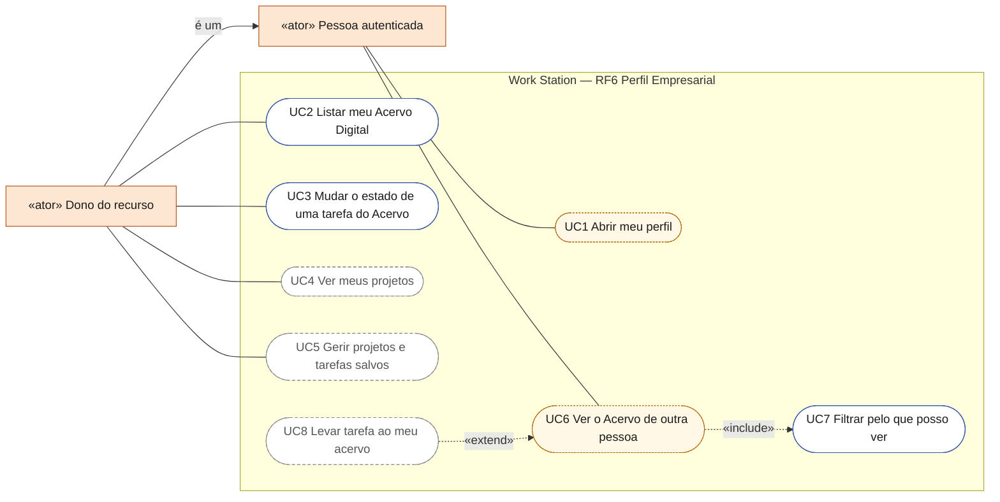
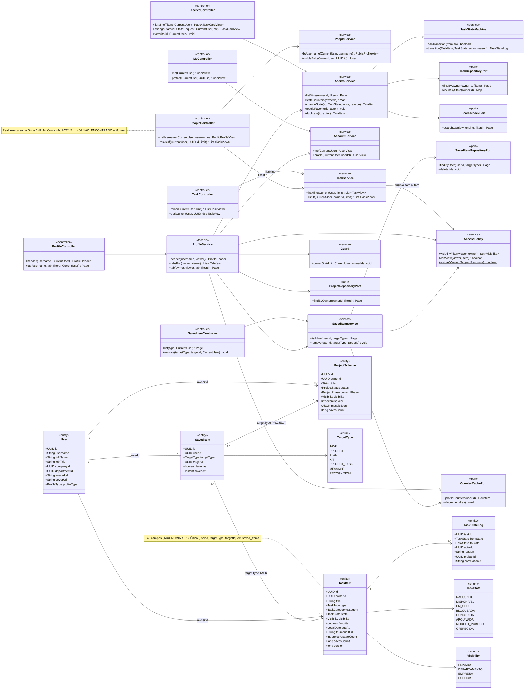
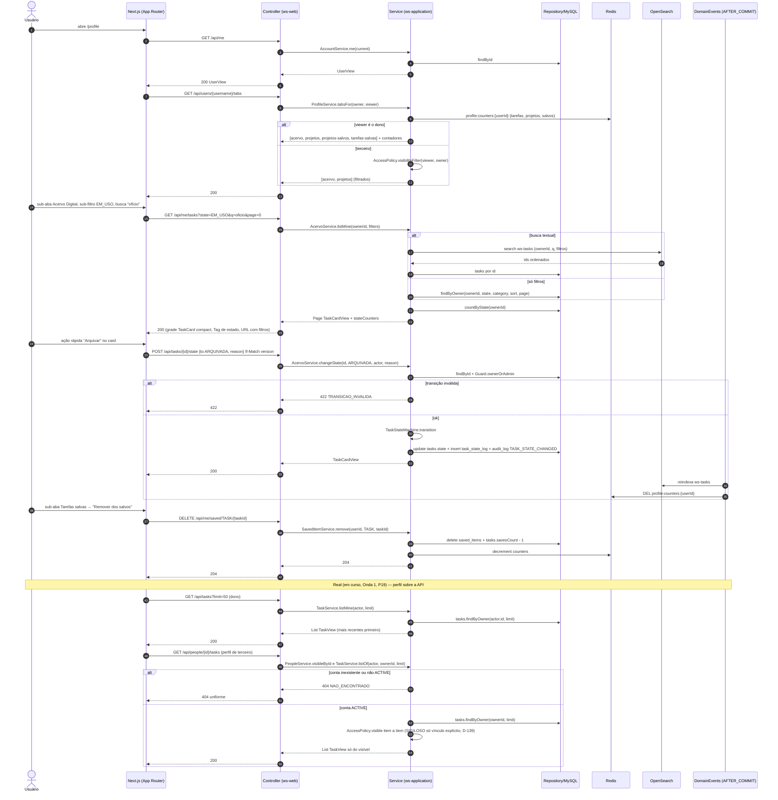
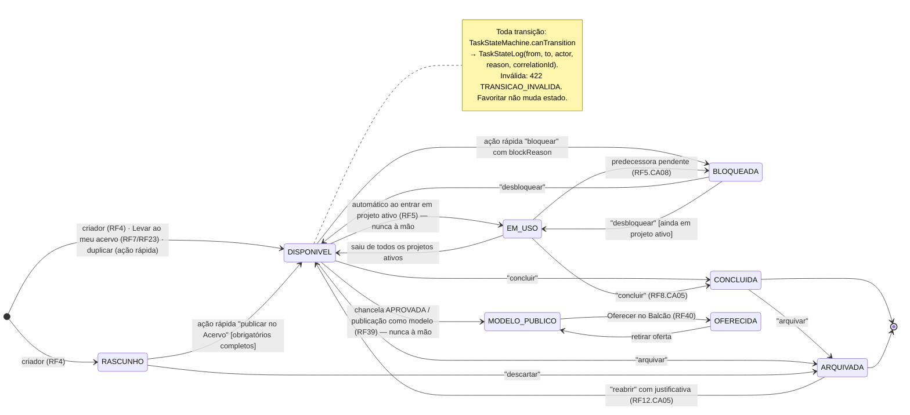
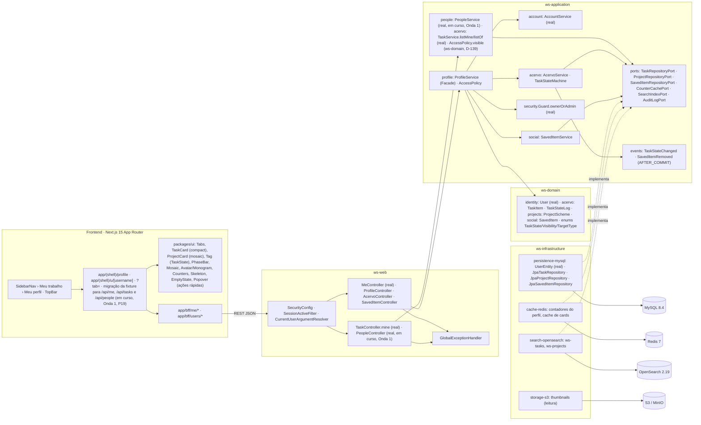

# RF6 — Acessar e gerenciar o Perfil Empresarial (Acervo Digital + Projetos Salvos)
**HU:** HU6 · **Sprint (board Work Station):** lista *Requisitos Funcionais* sem sprint atribuída (o card "SPRINT 1" cita "RF6 Enviar mensagens", escopo antigo — `RENUMERACAO.md`; fase (d) da ARQUITETURA §6 junto com RF41) · **Equivalente FAI:** RF6 Perfil Lookbook (Closet Digital + Looks Salvos: abas Closet · Looks · Looks salvos · Peças salvas, toggles de estado no topo do card) · **Aba/rota:** Meu perfil (`/profile`, sub-abas `?tab=acervo|projetos|projetos-salvos|tarefas-salvas`, Matriz B de ABAS_POR_PERFIL §3), perfil de terceiros `/u/[username]` (RF16); Acervo também em `/tasks` (RF41); API `GET /api/me` (real), `GET /api/me/tasks`, `GET /api/me/projects`, `GET /api/me/saved?type=`, `POST /api/tasks/{id}/state` · **real:** `GET /api/tasks?limit` (`TaskController.mine` → `TaskService.listMine`, tarefas do dono) e, para terceiros, `GET /api/people/by-username/{username}` + `GET /api/people/{id}/tasks` (`PeopleController`); `/profile` e `/u/[username]` sobre essa API **(em curso, Onda 1)**
**Critérios de aceite cobertos:** RF6.CA01 … RF6.CA06 — **todos "(CA a confirmar)"**: o corpo do card está vazio; os CAs foram derivados do título + HU6 e reaproveitam `_anterior/RF19` (sub-abas 1–2 e 7–8), RF41 (estados do Acervo) e RF26.CA04 (salvar). Real: `MeController.me`, `AccountService.me/profile`, `UserView` (Bloco 3); o resto **(planejado)**. Atualização 17/10/2026: `TaskController.mine`/`TaskService.listMine` **(real)**; `PeopleService`, `PeopleController` e `TaskService.listOf` **(real, em curso, Onda 1)** — achado P19.

> **HU6** — COMO usuário autenticado dentro do sistema POSSO visualizar meu perfil com tudo o que criei (tarefas, projetos, planos, decisões) em sub-abas e o meu perfil deliberativo gerado pela IA PARA acompanhar e mostrar minha produção e minha evolução desde que entrei no sistema.

O título do card recorta, das 15 sub-abas do perfil (Matriz B), as quatro do **Perfil Empresarial**: **Acervo Digital** (= Closet: inventário `TaskItem` com sub-filtros por `TaskState`), **Projetos** (`ProjectScheme` do dono), **Projetos salvos** e **Tarefas salvas** (`SavedItem`). As demais sub-abas (planos, decisões, perfil deliberativo, pontos…) ficam no RF16 (terceiros) e nos RFs de origem (RF24, RF29, RF42, RF45).

**Atualização 17/10/2026 — perfil real (em curso, Onda 1).** O achado **P19** (`docs/auditoria/2026-10-17/PROBLEMAS.md`: "Meu perfil" mostrava a fixture "Pessoa Exemplo" em vez da conta logada) é o alvo da Onda 1 do `docs/auditoria/2026-10-17/PLANO_ONDAS.md`. Fontes **(real)** no backend: `GET /api/me` (`MeController.me`) para o cabeçalho e `GET /api/tasks?limit` (`TaskController.mine` → `TaskService.listMine`) para o Acervo do dono; para o perfil de terceiro, `PeopleController` (`GET /api/people/by-username/{username}` → `PeopleService.byUsername` → `PublicProfileView`; `GET /api/people/{id}/tasks` → `PeopleService.visibleById` + `TaskService.listOf`, filtro item a item por `AccessPolicy.visible`, SIGILOSO sem acesso implícito do ADMIN — D-139), com `404 NAO_ENCONTRADO` uniforme para conta não `ACTIVE`. O front `/profile` e `/u/[username]` sobre essas rotas está **(em curso, Onda 1)**; até lá a tela da §7 segue na fixture, já com contadores e composição de projeto filtrados pela ACL (`lib/social/rules.ts`, `lib/social/view-model.ts`, commit `b602d34`). Sub-filtros por estado, projetos, salvos e ações rápidas pela API seguem **(planejado)**.

## Critérios de aceite derivados da HU6 (todos "CA a confirmar")

| CA | Enunciado (Dado / Quando / Então) | Origem |
|---|---|---|
| **RF6.CA01** (CA a confirmar) | Dado um usuário autenticado, quando abre `/profile`, então vê o cabeçalho (`UserView`: avatar, nome, `jobTitle`, empresa, departamento; contadores de tarefas, projetos e salvos via Redis) e as sub-abas **Acervo Digital**, **Projetos**, **Projetos salvos** e **Tarefas salvas**; em `/u/[username]` um terceiro vê só Acervo Digital e Projetos, filtrados por `Visibility` (RF16); sub-aba reservada ao dono → `403 ACESSO_NEGADO` (`Guard.ownerOrAdmin`). **Real (em curso, Onda 1, P19):** cabeçalho do dono por `GET /api/me`; cabeçalho de terceiro por `GET /api/people/by-username/{username}` (`PublicProfileView`, sem contato; conta não `ACTIVE` → `404 NAO_ENCONTRADO`); contadores pela API planejados (no front já contam só o que o viewer vê, `b602d34`). | `_anterior/RF19` CA01, Matriz B |
| **RF6.CA02** (CA a confirmar) | Dado a sub-aba Acervo Digital, então ela lista os `TaskItem` do dono em grade compacta (`TaskCard` compact) com **sub-filtros por estado** (`TaskState`: RASCUNHO · DISPONIVEL · EM_USO · BLOQUEADA · CONCLUIDA · ARQUIVADA · MODELO_PUBLICO · OFERECIDA) com contadores, filtros por categoria/tipo/processo/natureza, ordenação (recentes, mais usadas, nome, prazo), busca (OpenSearch `ws-tasks`) e paginação (20); a URL reflete filtros e página. **Real (base):** `GET /api/tasks?limit` (`TaskController.mine` → `TaskService.listMine`, mais recentes primeiro, sem filtros nem contadores por estado); a sub-aba sobre ela está em curso (Onda 1). | RF41.CA01/CA04 |
| **RF6.CA03** (CA a confirmar) | Dado um card do meu Acervo, quando aciono uma ação rápida (favoritar ⭐, mudar estado, arquivar, duplicar, levar ao projeto), então a transição passa por `TaskStateMachine` e grava `TaskStateLog`; transição inválida → `422 TRANSICAO_INVALIDA`; EM_USO é automático ao entrar em projeto ativo e MODELO_PUBLICO só via chancela/publicação; a etiqueta de estado (`Tag`) aparece no card. | RF41.CA02 |
| **RF6.CA04** (CA a confirmar) | Dado a sub-aba Projetos, então ela lista os `ProjectScheme` do dono (`ProjectCard` mosaic) com capa-mosaico, `PhaseBar`, `status` e `currentPhase`, filtráveis por status/fase/exercício e paginados; abrir um card leva ao detalhe (lista por fase, RF7) e, para o dono, à edição (RF8/RF12/RF22). | `_anterior/RF19` sub-aba 2, RF21.CA10 |
| **RF6.CA05** (CA a confirmar) | Dado a sub-aba Projetos salvos ou Tarefas salvas, então ela lista os `SavedItem` do dono (`targetType` PROJECT ou TASK) com marcador `favorite`, respeitando a visibilidade atual do alvo (alvo que ficou PRIVADA aparece como "indisponível"); "Remover dos salvos" apaga o `SavedItem` e decrementa `savesCount`; só o dono acessa. | RF26.CA04, `_anterior/RF19` sub-abas 7–8 |
| **RF6.CA06** (CA a confirmar) | Dado o perfil de um terceiro, quando vejo seu Acervo Digital, então só aparecem tarefas com `visibility` compatível (`AccessPolicy.visibilityFilter`: PUBLICA; EMPRESA se mesma empresa; DEPARTAMENTO se membro), nunca PRIVADA; cada card oferece **"Levar ao meu acervo"** (RF7/RF23) e interações sociais (RF18/RF19); item fora da visibilidade → `403 ACESSO_NEGADO`. **Real (17/10/2026):** `GET /api/people/{id}/tasks` → `TaskService.listOf` devolve só o que `AccessPolicy.visible` admite (SIGILOSO só dono e colaboradores explícitos, nem ADMIN — `AccessPolicy.sigiloso`, D-139) **(em curso, Onda 1)**; abrir item invisível responde `404 NAO_ENCONTRADO` uniforme, não 403 (`GET /api/tasks/{id}`, front `components/social/TaskDetail.tsx`, D-141). | RF41.CA08, RF26.CA08 |

## 0. Diagrama de casos de uso

Quem usa o Perfil Empresarial e o que consegue fazer nele. Borda contínua: existe no código em 17/10/2026; tracejada: planejado ou em curso (a tela `/profile` ainda lê a fixture DEMO, achado P19).

| Caso de uso | Ator(es) | CAs | Situação |
|---|---|---|---|
| UC1 Abrir meu perfil | autenticado | RF6.CA01 | em curso (Onda 1): `GET /api/me` é real; a tela ainda mostra a fixture DEMO |
| UC2 Listar meu Acervo Digital | dono | RF6.CA02 | real parcial: `/tasks` lista as tarefas do dono por `GET /api/tasks` (`TaskService.listMine`); sub-filtros, contadores e busca planejados |
| UC3 Mudar o estado de uma tarefa do Acervo | dono | RF6.CA03 | real parcial: `POST /api/tasks/{id}/transitions` no detalhe da tarefa; favoritar, duplicar e levar ao projeto planejados |
| UC4 Ver meus projetos | dono | RF6.CA04 | planejado (sem API de projetos) |
| UC5 Gerir projetos e tarefas salvos | dono | RF6.CA05 | planejado (`SavedItem`) |
| UC6 Ver o Acervo de outra pessoa | autenticado | RF6.CA06 | em curso (Onda 1): `GET /api/people/{id}/tasks` é real; a tela `/u/[username]` ainda é DEMO |
| UC7 Filtrar pelo que posso ver | — (incluído por UC6) | RF6.CA06 | real: `TaskService.listOf` filtra por `AccessPolicy.visible` (SIGILOSO só dono e colaboradores, D-139) |
| UC8 Levar tarefa ao meu acervo | autenticado | RF6.CA06 | planejado (RF7/RF23) |

## 1. Diagrama de classes

## 2. Diagrama de atividades

```mermaid
flowchart TD
  subgraph ATOR["Usuário autenticado (dono) · Terceiro"]
    A1["Abre /profile (ou /u/{username})"]
    A2["Escolhe a sub-aba: Acervo Digital · Projetos · Projetos salvos · Tarefas salvas"]
    A3["Aplica sub-filtro por estado, categoria, ordenação ou busca"]
    A4["Ação rápida no card: ⭐ favoritar · mudar estado · arquivar · duplicar · levar ao projeto"]
    A5["Remover dos salvos"]
  end
  subgraph FE["Next.js (App Router) · BFF"]
    F1["GET /api/me (cabeçalho) + GET /api/users/{username}/tabs (lista de sub-abas permitidas)"]
    F2["GET /api/me/tasks?state=&category=&sort=&q=&page= · URL reflete filtros"]
    F3["GET /api/me/projects?status=&phase=&exercise=&page="]
    F4["GET /api/me/saved?type=PROJECT|TASK"]
    F5["POST /api/tasks/{id}/state {to, reason} · POST /api/tasks/{id}/favorite"]
    F6["DELETE /api/me/saved/{targetType}/{targetId}"]
    F7["Grade TaskCard compact com Tag de estado · ProjectCard mosaic com PhaseBar · Skeleton · EmptyState"]
    F8["Real (em curso, Onda 1, P19): GET /api/me + GET /api/tasks?limit (dono) · GET /api/people/by-username/{username} + GET /api/people/{id}/tasks (terceiro)"]
  end
  subgraph WEB["ws-web"]
    W1["JWT + SessionActiveFilter + CurrentUserArgumentResolver"]
    W2["ProfileController · AcervoController · SavedItemController"]
    E403["403 ACESSO_NEGADO (sub-aba do dono vista por terceiro · item fora da visibilidade)"]
    E404["404 USUARIO_NAO_ENCONTRADO"]
    E422["422 TRANSICAO_INVALIDA"]
    E409["409 CONFLITO_VERSAO (If-Match)"]
    W3["MeController.me · TaskController.mine (real) · PeopleController (real, em curso, Onda 1)"]
    E404N["404 NAO_ENCONTRADO uniforme (conta não ACTIVE · tarefa invisível, D-141)"]
  end
  subgraph APP["ws-application"]
    S1["ProfileService.header: UserView + CounterCachePort (tarefas, projetos, salvos)"]
    S2{"viewer == dono?"}
    S3["tabsFor: 4 sub-abas"]
    S4["tabsFor: Acervo Digital + Projetos · AccessPolicy.visibilityFilter"]
    S5["AcervoService.listMine: TaskRepositoryPort/SearchIndexPort · stateCounters"]
    S6["ProjectRepositoryPort.findByOwner"]
    S7["SavedItemService.listMine: alvo PRIVADO para o viewer → 'indisponível'"]
    S8["TaskStateMachine.canTransition?"]
    S9{"transição válida?"}
    S10["transition → TaskStateLog · AuditLog TASK_STATE_CHANGED"]
    S11["SavedItemService.remove → CounterCachePort.decrement(savesCount)"]
    S12["TaskService.listMine (dono) · PeopleService.byUsername/visibleById + TaskService.listOf → AccessPolicy.visible (terceiro, SIGILOSO sem ADMIN, D-139)"]
    EV["AFTER_COMMIT: TaskStateChanged → reindexa ws-tasks · invalida contadores Redis · atualiza snapshot nos projetos de terceiros"]
  end
  subgraph PERS["Persistência"]
    P1[("MySQL: users, tasks, task_state_log, project_schemes, saved_items, audit_log")]
    P2[("Redis: profile:counters:{userId} · card cache")]
    P3[("OpenSearch ws-tasks · ws-projects")]
  end

  A1 --> F1 --> W1 --> W2 --> S1 --> S2
  W2 -->|"username inexistente"| E404
  S2 -->|"sim"| S3
  S2 -->|"não"| S4
  S1 --> P2
  S3 --> A2
  S4 --> A2
  A2 -->|"Acervo"| F2 --> S5 --> P3
  S5 --> P1
  A2 -->|"Projetos"| F3 --> S6 --> P1
  A2 -->|"Salvos"| F4 --> S7 --> P1
  S4 -->|"sub-aba do dono"| E403
  A3 --> F2
  S5 --> F7
  S6 --> F7
  S7 --> F7
  A4 --> F5 --> W2 --> S8 --> S9
  S9 -->|"não"| E422
  S9 -->|"versão antiga"| E409
  S9 -->|"sim"| S10 --> P1
  S10 --> EV --> P2
  EV --> P3
  A5 --> F6 --> S11 --> P1
  S11 --> P2
  A1 -.->|"em curso, Onda 1"| F8 --> W3 --> S12 --> P1
  S12 --> F7
  S12 -->|"conta não ACTIVE ou item invisível"| E404N
```

## 3. Diagrama de sequência

## 4. Máquina de estados

Entidade central: **`TaskItem.state`** (`TaskState`), operado pelas ações rápidas do Acervo Digital (CA03) via `TaskStateMachine`; a máquina completa com origem no criador está no RF4 §4 e a visão do inventário no RF41. `SavedItem` não tem estados (existe/não existe; `favorite` é um marcador).

## 5. Diagrama de componentes

## 6. Rastreabilidade

| CA | Classe (§1) | Passo da atividade (§2) | Mensagem da sequência (§3) | Transição de estado (§4) | Componente (§5) | Situação |
|---|---|---|---|---|---|---|
| RF6.CA01 | `MeController.me/profile`, `AccountService`, `UserView`, `ProfileService.header/tabsFor`, `CounterCachePort`, `Guard.ownerOrAdmin` | `A1`→`F1`→`S1`→`S2`→`S3`/`S4`, `E403`, `E404` | 1–16 | — | `MC`, `PF`, `AC`, `RDS`, `UI` (`Avatar`, `Counters`), `TPC`, `PS` | cabeçalho real (`GET /api/me`, `GET /api/users/{id}`); terceiro por `GET /api/people/by-username/{username}` (`PeopleController`/`PeopleService`, passo `F8`→`W3`, `PeopleServiceTest`) **(em curso, Onda 1, P19)**; sub-abas planejadas; **Real (31/10/2026):** para a conta EMPRESA, `/profile` mostra abaixo do cabeçalho e separada do portfólio a **parte institucional** por `GET /api/me/institution` (`MyInstitutionView`): empresa da qual é dona (com link e situação), departamentos ativos com link e os totais devolvidos pela API (departamentos, pessoas ativas); demais contas veem a lotação vigente (empresa e departamentos); sem vínculo, nada é inventado. Especialidades (RF3) no cabeçalho. |
| RF6.CA02 | `AcervoService.listMine/stateCounters`, `TaskRepositoryPort`, `SearchIndexPort`, `TaskState` | `A2`→`F2`→`S5`→`F7`, `A3` | 17–27 | — | `ACV`, `OSE`, `UI` (`TaskCard`, `Tag`), `TPC` | planejado (RF41); base **real**: `GET /api/tasks` → `TaskService.listMine` (passo `S12`, mensagens 43–47), tela sobre ela em curso (Onda 1) |
| RF6.CA03 | `AcervoService.changeState/toggleFavorite/duplicate`, `TaskStateMachine`, `TaskStateLog` | `A4`→`F5`→`S8`→`S9`→`S10`, `E422`, `E409` | 28–38 | todas as transições com aspas (ações rápidas) e as automáticas anotadas | `ACV`, `EVT`, `MY` | planejado |
| RF6.CA04 | `ProjectRepositoryPort.findByOwner`, `ProjectScheme.status/currentPhase/mosaicJson` | `A2`→`F3`→`S6`→`F7` | — | — | `UI` (`ProjectCard`, `PhaseBar`, `Mosaic`) | planejado |
| RF6.CA05 | `SavedItemService.listMine/remove`, `SavedItem`, `CounterCachePort.decrement` | `A2`→`F4`→`S7`, `A5`→`F6`→`S11` | 39–44 | — | `SOC`, `RDS` | planejado (RF18/RF19, origem RF26.CA04) |
| RF6.CA06 | `AccessPolicy.visibilityFilter/canView`, `Visibility`, `AccessPolicy.visible`, `TaskService.listOf`, `PeopleController.tasksOf` | `S4`, `E403`, `S12`→`E404N` | 12–15, 48–55 | — | `PF`, `PS`, `TPC` | planejado (RF16, RF7); **real (em curso, Onda 1)**: `GET /api/people/{id}/tasks` filtrado por `AccessPolicy.visible` (D-139, `AccessPolicyMatrixTest`); invisível = `404 NAO_ENCONTRADO` (D-141) |

## 7. Front implementado (onda Social, DEMO)

`/profile` (`components/social/ProfileView.tsx`) funcional sobre o repositório DEMO: cabeçalho com contadores reais (CA01), **Acervo Digital** em grade/lista de `TaskSchemeCard` com sub-filtros por `TaskState` e contadores (CA02, filtros locais), inclusive as tarefas aceitas por delegação ("delegada por"), **Projetos** (`ProjectCard`, CA04), **Projetos salvos** / **Tarefas salvas** com "indisponível" + "Remover dos salvos" (CA05), **Decisões** com atalho ao DECIA, e os painéis "Delegadas a mim" e notificações da rede. Remixes feitos em perfis de terceiros entram aqui (RASCUNHO, PRIVADA, crédito ao original). Captura `40-perfil-proprio.png`. Em 17/10/2026 (`b602d34`) os contadores e o mosaico/total do card de projeto passaram a contar só o que o viewer vê (SIGILOSO = PRIVADA); a troca da fixture pelas rotas reais (`/api/me`, `/api/tasks`, `/api/people/*`) é a Onda 1 **(em curso)**.
