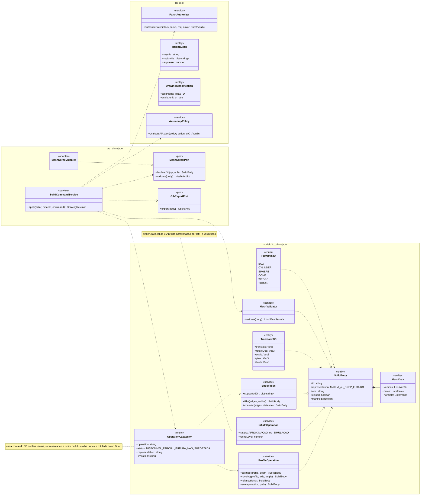
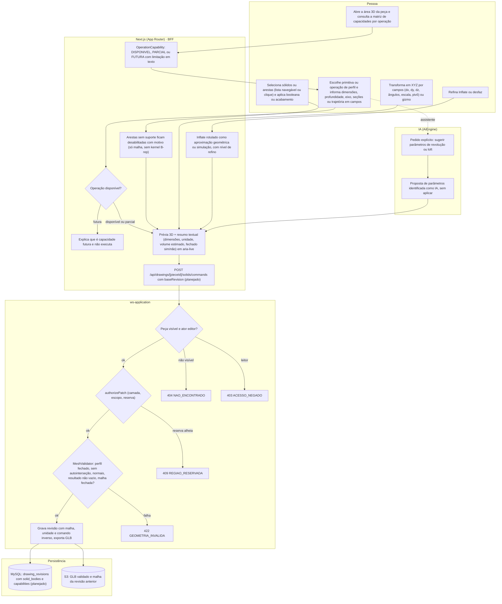
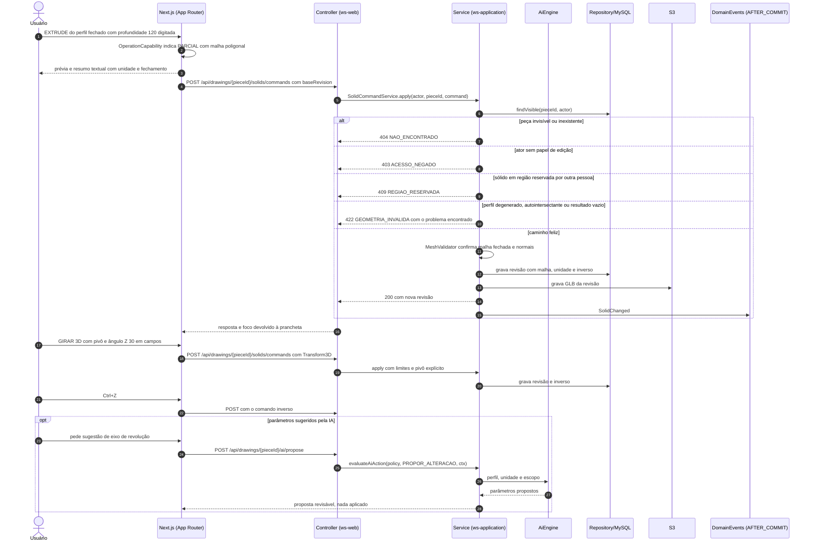
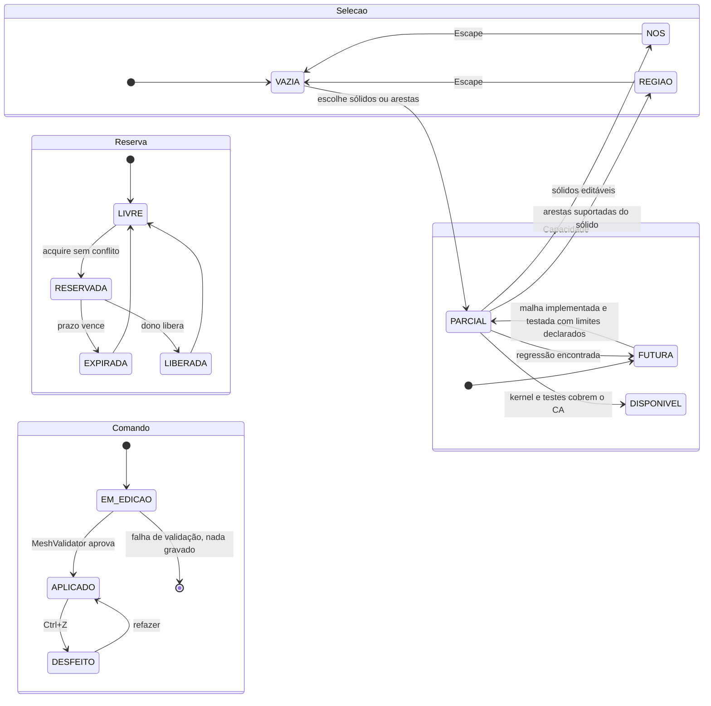
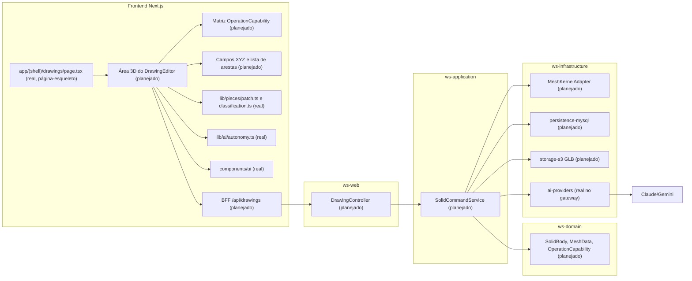

# RF60 — Modelar sólidos, superfícies e malhas 3D no Drawings
**HU:** — (sem HU no board; RF especificado em 15/10/2026) · **Sprint (board Work Station):** lista *Requisitos Funcionais* sem sprint atribuída · **Equivalente FAI:** — · **Aba/rota:** Drawings (`/drawings`, `/drawings/[pieceId]`; peça aberta a partir de `/tasks/[id]` e da sessão DECIA `/decia/[sessionId]`) · **Página-esqueleto:** registrada em 17/10/2026; editor ainda não implementado (Onda 5 do PLANO_ONDAS)
**Critérios de aceite cobertos:** RF60.CA01 … RF60.CA07 — corpo do card = especificação de docs/produto/requisitos-studio/RF60.md (CAs copiados como estão escritos); classes reais: `authorizePatch` (`lib/pieces/patch.ts`), `LayerStack` (`lib/pieces/layers.ts`), `RegionLock` (`lib/pieces/collab.ts`), `DrawingClassification` com técnica `TRES_D` (`lib/pieces/classification.ts`), `evaluateAiAction` (`lib/ai/autonomy.ts`); o restante (planejado)

O RF60 descreve a modelagem 3D do Drawings: primitivas (caixa, cilindro, esfera, cone, cunha, toro), operações de perfil (extrusão/PRESSPULL, revolução, loft e varredura), volume almofadado (Inflate) identificado como aproximação ou simulação, booleanas de sólidos (`UNIR`, `SUBTRAIR`, `INTERSECTAR`) validadas antes de gravar, acabamento de arestas apenas onde suportado, e transformações 3D (`MOVER`, `GIRAR`, `REDIMENSIONAR` em XYZ) com seleção múltipla, pivô explícito, limites e desfazer. Toda a modelagem 3D é **capacidade futura declarada por operação**: cada comando expõe na interface se está disponível, parcial ou futuro, qual representação usa (malha poligonal; B-rep só quando houver kernel) e suas limitações, sem prometer equivalência com AutoCAD ou Illustrator. Cada parâmetro tem campo numérico equivalente ao gizmo (WCAG 2.5.7) e o resultado (dimensões, volume, fechamento) é anunciado ao leitor de tela.

Estado real (MATRIZ_RF de 17/10/2026: AUSENTE, 0,00): não há código 3D nesta árvore. A evidência local de 15/10 (`docs/auditoria/2026-10-15/comandos-do-zero/` e `caminhos-compostos/`: BOX, CYLINDER, SUBTRACT, extrusão vazada com teste de volume e GLB validado pelo Khronos) usa malhas poligonais em código ainda fora do repositório, separado da peça e da colaboração 2D. Fontes: `COMANDOS_REFERENCIA_ILLUSTRATOR_AUTOCAD.md` §5, `DRAWINGS_ESTUDO_TECNICO_ACADEMICO.md` (volume exige geometria 3D e câmera; retângulo com sombra não é volume), PLANO_ONDAS Onda 5 (persistir malha/B-rep com unidades e tolerâncias).

## Critérios de aceite

| CA | Enunciado (Dado / Quando / Então) |
|---|---|
| **RF60.CA01** | Dados BOX, CYLINDER, SPHERE, CONE, WEDGE e TORUS, quando dimensiona, então gera malhas válidas com normais e escala consistente. |
| **RF60.CA02** | Dados EXTRUDE/PRESSPULL e perfil fechado, quando aplica profundidade, então gera volume e rejeita perfil degenerado ou autointersectante. |
| **RF60.CA03** | Dados REVOLVE, LOFT e SWEEP, quando fornece eixo, seções ou trajetória, então informa correspondência/orientação e valida continuidade e fechamento. |
| **RF60.CA04** | Dado Inflate, quando cria volume almofadado, então identifica se é aproximação geométrica ou simulação e permite refino. |
| **RF60.CA05** | Dadas UNION, SUBTRACT e INTERSECT, quando opera sólidos, então valida resultado vazio, fechamento e interseções antes de gravar. |
| **RF60.CA06** | Dados FILLETEDGE e CHAMFEREDGE, quando seleciona arestas, então aplica raio/chanfro nas arestas suportadas e não promete kernel B-rep onde há apenas malha. |
| **RF60.CA07** | Dados 3DMOVE, 3DROTATE e 3DSCALE, quando usa campos ou gizmos XYZ, então permite seleção múltipla, pivô explícito, limites e desfazer. |

## 1. Diagrama de classes

**(real)**: `PatchAuthorizer`, `RegionLock`, `DrawingClassification`, `AutonomyPolicy`. Todo o modelo 3D é **(planejado)** e não consta de `docs/arquitetura/TAXONOMIA.md`.

## 2. Diagrama de atividades

## 3. Diagrama de sequência

## 4. Máquina de estados

Seleção, reserva e comando seguem o RF57; a **capacidade por operação** (planejado) é a entidade que este RF acrescenta.

## 5. Diagrama de componentes

## 6. Rastreabilidade

| CA | Classe (§1) | Passo da atividade (§2) | Mensagem da sequência (§3) | Transição (§4) | Componente (§5) | Situação |
|---|---|---|---|---|---|---|
| RF60.CA01 | `Primitive3D`, `MeshData.normals`, `SolidBody.unit`, `MeshValidator` | `A2`, `F4`, `S3`, `S4` | 11–16 | `EM_EDICAO`→`APLICADO`, `FUTURA`→`PARCIAL` | `FIELDS`, `MK` | planejado (capacidade futura) |
| RF60.CA02 | `ProfileOperation.extrude`, `MeshValidator` | `A2`, `F7`, `S3`, `E422` | 1–11 | `EM_EDICAO`→`[*]` | `SCS`, `MK` | planejado |
| RF60.CA03 | `ProfileOperation.revolve/loft/sweep` | `A2`, `F4`, `S3` | 1–3, 23–28 (opt IA) | `EM_EDICAO`→`APLICADO` | `FIELDS`, `MK` | planejado |
| RF60.CA04 | `InflateOperation` (nature, refineLevel) | `A5`, `F5` | 2–3 | `PARCIAL`→`DISPONIVEL` | `CAP` | planejado |
| RF60.CA05 | `MeshKernelPort.boolean3d`, `MeshValidator` | `A3`, `S2`, `S3`, `E409`, `E422` | 6–16 | `EM_EDICAO`→`APLICADO`, `LIVRE`→`RESERVADA` | `SCS`, `MK` | planejado |
| RF60.CA06 | `EdgeFinish.supportedOn`, `SolidBody.representation`, `OperationCapability` | `A3`, `F6`, `F1` | 2 | `PARCIAL`→`REGIAO` | `CAP`, `FIELDS` | planejado |
| RF60.CA07 | `Transform3D` (pivot, limits), `SolidCommandService.apply` com inverso | `A4`, `A5`, `F4`, `S1`, `E404`, `E403` | 7–8, 17–22 | `VAZIA`→`PARCIAL`→`NOS`, `APLICADO`→`DESFEITO` | `FIELDS`, `SCS` | planejado |

Toda operação 3D aparece na matriz de capacidades com status, representação e limitação; nenhuma malha é rotulada como sólido B-rep. Nenhum CA é marcado como concluído por este diagrama.
