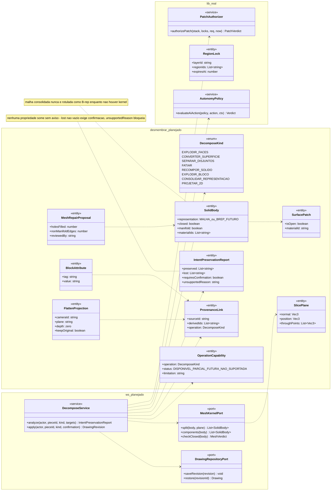
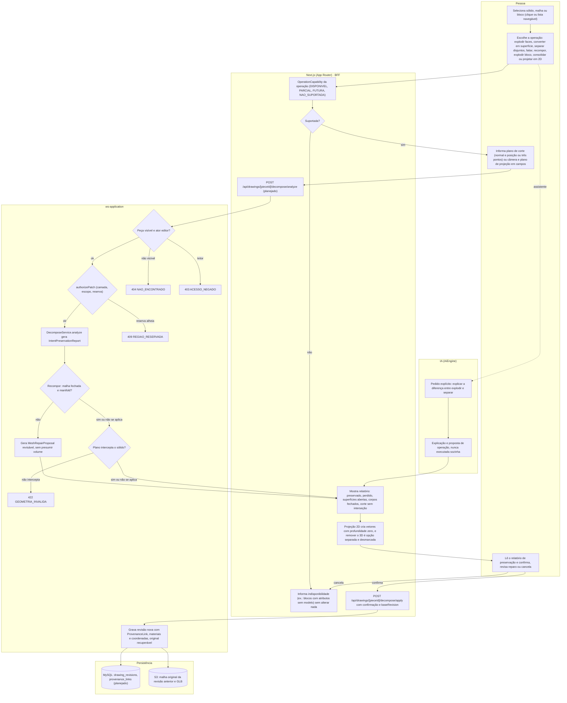
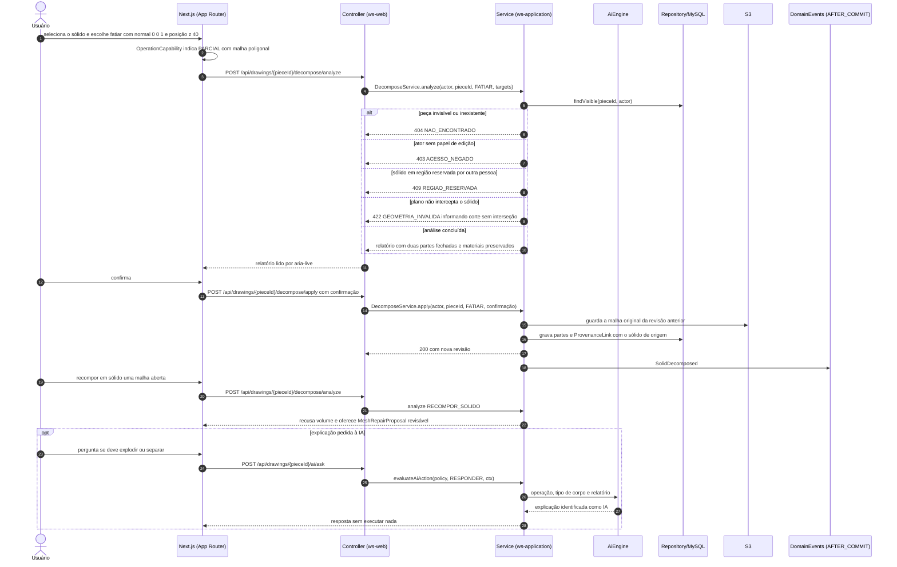
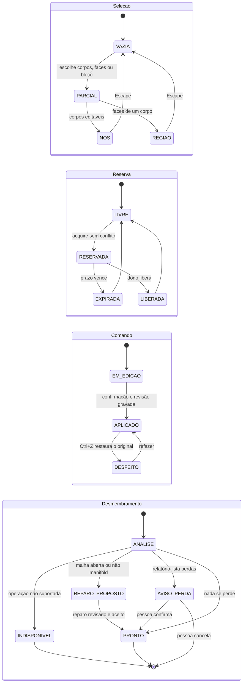
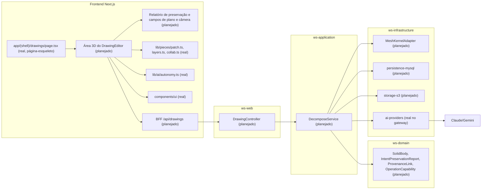

# RF61 — Desmembrar e converter estruturas 3D preservando intenção
**HU:** — (sem HU no board; RF especificado em 15/10/2026) · **Sprint (board Work Station):** lista *Requisitos Funcionais* sem sprint atribuída · **Equivalente FAI:** — · **Aba/rota:** Drawings (`/drawings`, `/drawings/[pieceId]`; peça aberta a partir de `/tasks/[id]` e da sessão DECIA `/decia/[sessionId]`) · **Página-esqueleto:** registrada em 17/10/2026; editor ainda não implementado (Onda 5 do PLANO_ONDAS)
**Critérios de aceite cobertos:** RF61.CA01 … RF61.CA08 — corpo do card = especificação de docs/produto/requisitos-studio/RF61.md (CAs copiados como estão escritos); classes reais: `authorizePatch` (`lib/pieces/patch.ts`), `LayerStack` (`lib/pieces/layers.ts`), `RegionLock` (`lib/pieces/collab.ts`), `evaluateAiAction`/`proposalValidity` (`lib/ai/autonomy.ts`); o restante (planejado)

O RF61 separa operações que a referência CAD costuma misturar: `EXPLODIR` uma malha em faces independentes (superfícies abertas não são sólidos), converter em superfície preservando coordenadas e materiais, `SEPARAR_DISJUNTOS` corpos mantendo-os volumétricos, fatiar por plano (SLICE) com original recuperável, recompor em sólido só com malha fechada ou reparo revisável, explodir blocos preservando atributos como texto (BURST), consolidar representação explicando o que se remove e projetar o 3D em vetores 2D editáveis com profundidade zero (FLATTEN/Expand Appearance). Regra central: **desmembrar nunca descarta propriedades sem avisar** — cada operação gera um relatório de preservação (o que fica, o que se perde, o que exige confirmação) e mantém vínculo de proveniência com o objeto de origem. Toda operação é **capacidade futura declarada por operação**: a interface informa disponível, parcial, futura ou não suportada (por exemplo, blocos com atributos ainda sem modelo). Plano de corte e câmera de projeção têm campos numéricos equivalentes ao arraste (WCAG 2.5.7) e o relatório é lido pelo leitor de tela. Nomes AutoCAD (EXPLODE, CONVTOSURFACE, SOLIDEDIT, BREP) são inspiração semântica, sem paridade.

Estado real (MATRIZ_RF de 17/10/2026: AUSENTE, 0,00): não há código 3D nesta árvore; só a autorização de patch, camadas, reservas e autonomia (funções puras) servem de base. A evidência local de 15/10 (`docs/auditoria/2026-10-15/comandos-do-zero/`, etapas 13–15: SLICE, EXPLODE em faces e CONVTOSOLID com verificação de fechamento, sem provar ausência de autointerseção) está em código ainda fora do repositório. Fontes: `COMANDOS_REFERENCIA_ILLUSTRATOR_AUTOCAD.md` §1 (aviso do usuário: explodir sólido destrói o volume, para corpos disjuntos usa-se Separate), PLANO_ONDAS Onda 5.

## Critérios de aceite

| CA | Enunciado (Dado / Quando / Então) |
|---|---|
| **RF61.CA01** | Dado EXPLODE/X ou MESHELEMENTS, quando desmembra malha, então gera faces independentes e identifica que superfícies abertas não são sólidos. |
| **RF61.CA02** | Dado CONVTOSURFACE, quando converte, então preserva coordenadas, materiais e correspondência com objeto de origem. |
| **RF61.CA03** | Dado SEPARATE/SOLIDEDIT Body Separate, quando há corpos disjuntos, então separa componentes mantendo-os volumétricos quando fechados. |
| **RF61.CA04** | Dado SLICE, quando define plano por normal/posição ou pontos, então cria partes corretas, preserva original recuperável e informa corte sem interseção. |
| **RF61.CA05** | Dado CONVTOSOLID, quando recebe malha aberta/não manifold, então recusa ou oferece reparo revisável; não presume volume válido. |
| **RF61.CA06** | Dado BURST, quando existem atributos de bloco, então converte seus valores para texto sem perda; sem suporte a blocos deve informar indisponibilidade. |
| **RF61.CA07** | Dado BREP, quando consolida representação suportada, então explica o que é removido; malha consolidada não é rotulada como sólido B-rep. |
| **RF61.CA08** | Dado FLATTEN/Expand Appearance, quando projeta na câmera/plano escolhido, então cria vetores 2D editáveis com profundidade zero e sem remover o 3D original sem confirmação. |

## 1. Diagrama de classes

**(real)**: `PatchAuthorizer`, `RegionLock`, `AutonomyPolicy`. Demais **(planejado)**; `SolidBody` e `OperationCapability` são os mesmos do RF60 e não constam de `docs/arquitetura/TAXONOMIA.md`.

## 2. Diagrama de atividades

## 3. Diagrama de sequência

## 4. Máquina de estados

Seleção, reserva e comando seguem o RF57; o **desmembramento** (planejado) garante que nenhuma propriedade se perca sem aviso.

## 5. Diagrama de componentes

## 6. Rastreabilidade

| CA | Classe (§1) | Passo da atividade (§2) | Mensagem da sequência (§3) | Transição (§4) | Componente (§5) | Situação |
|---|---|---|---|---|---|---|
| RF61.CA01 | `DecomposeKind.EXPLODIR_FACES`, `SurfacePatch.isOpen`, `IntentPreservationReport` | `A2`, `S3`, `F5` | 3–11 | `ANALISE`→`AVISO_PERDA`→`PRONTO` | `REP`, `DS`, `MK` | planejado (capacidade futura) |
| RF61.CA02 | `DecomposeKind.CONVERTER_SUPERFICIE`, `ProvenanceLink`, `SolidBody.materialIds` | `S7` | 15–17 | `ANALISE`→`PRONTO` | `DS`, `MY` | planejado |
| RF61.CA03 | `MeshKernelPort.components`, `SolidBody.closed` | `S3`, `F5` | 3–11 | `ANALISE`→`PRONTO` | `DS`, `MK` | planejado |
| RF61.CA04 | `SlicePlane`, `MeshKernelPort.split`, `DrawingRepositoryPort.restore` | `A3`, `S6`, `E422`, `S7` | 1–18 | `EM_EDICAO`→`APLICADO`→`DESFEITO` | `REP`, `MK`, `ST` | planejado |
| RF61.CA05 | `MeshKernelPort.checkClosed`, `MeshRepairProposal` | `S4`, `S5` | 19–22 | `ANALISE`→`REPARO_PROPOSTO`→`PRONTO` | `DS`, `MK` | planejado |
| RF61.CA06 | `BlockAttribute`, `OperationCapability.status` NAO_SUPORTADA | `F1`, `F2`, `F3` | 2 | `ANALISE`→`INDISPONIVEL` | `REP` | planejado (sem modelo de blocos hoje) |
| RF61.CA07 | `DecomposeKind.CONSOLIDAR_REPRESENTACAO`, `SolidBody.representation`, `IntentPreservationReport.lost` | `S3`, `F5`, `A4` | 10–11 | `ANALISE`→`AVISO_PERDA` | `REP`, `DS` | planejado |
| RF61.CA08 | `FlattenProjection` (depth zero, keepOriginal), `ProvenanceLink` | `A3`, `F6`, `A4`, `S1`, `S2`, `E404`, `E403`, `E409` | 5–8, 12–17 | `AVISO_PERDA`→`PRONTO` | `REP`, `DS`, `PATCH` | planejado |

Desmembrar nunca descarta propriedades sem avisar: toda perda listada no relatório exige confirmação e a revisão anterior permanece recuperável. Nenhum CA é marcado como concluído por este diagrama.
