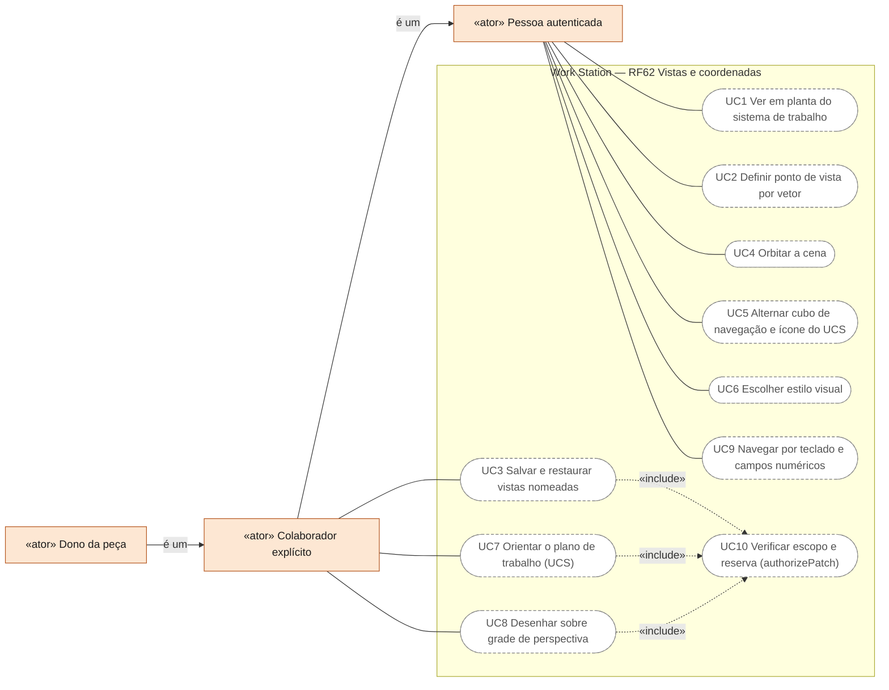
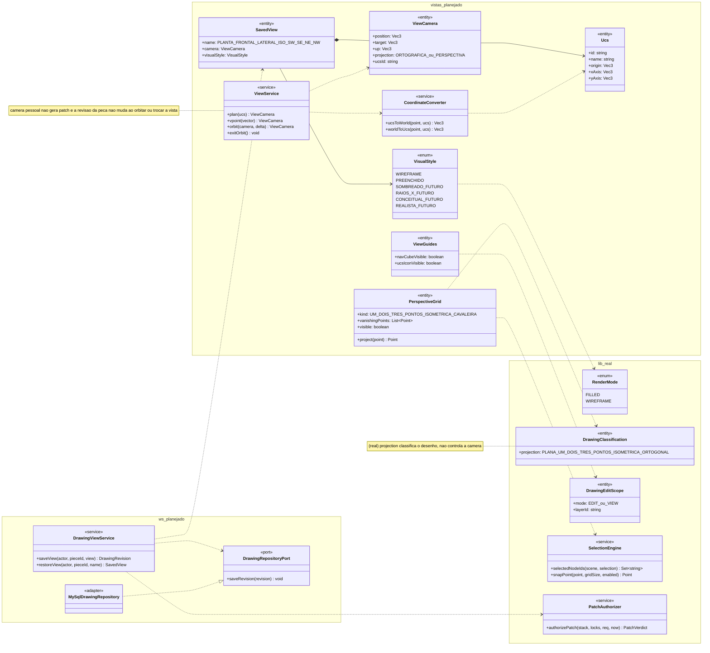
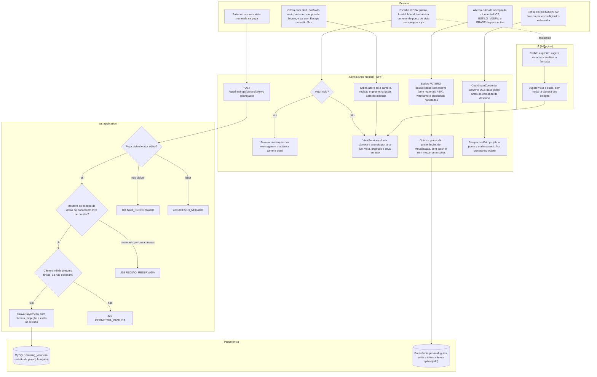
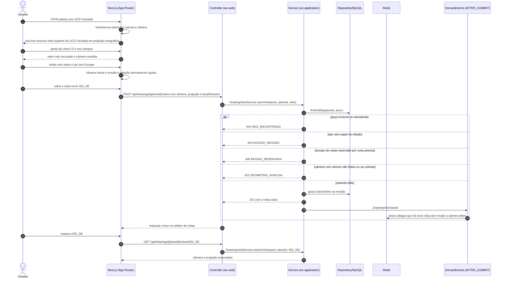
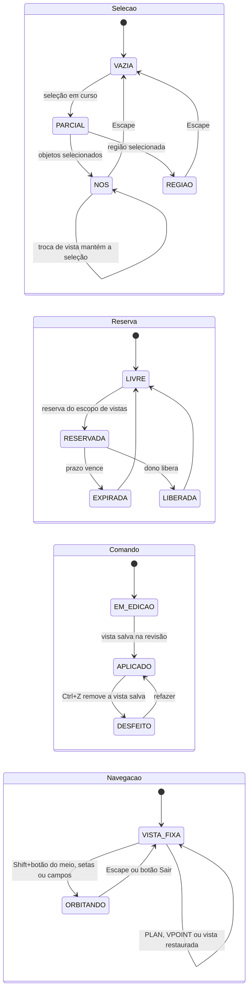
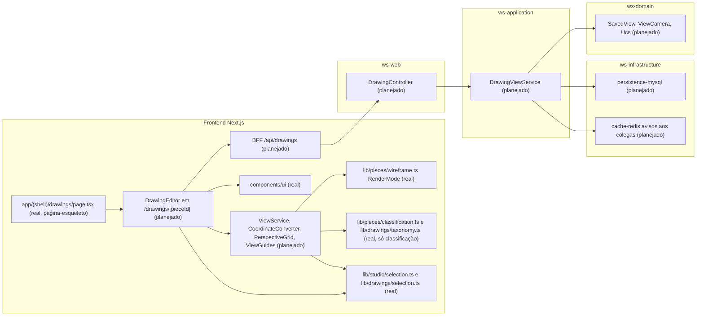

# RF62 — Controlar vistas, câmera, perspectiva e coordenadas no Drawings
**HU:** — (sem HU no board; RF especificado em 15/10/2026) · **Sprint (board Work Station):** lista *Requisitos Funcionais* sem sprint atribuída · **Equivalente FAI:** — · **Aba/rota:** Drawings (`/drawings`, `/drawings/[pieceId]`; peça aberta a partir de `/tasks/[id]` e da sessão DECIA `/decia/[sessionId]`) · **Página-esqueleto:** registrada em 17/10/2026; editor ainda não implementado (Onda 5 do PLANO_ONDAS)
**Critérios de aceite cobertos:** RF62.CA01 … RF62.CA08 — corpo do card = especificação de docs/produto/requisitos-studio/RF62.md (CAs copiados como estão escritos); classes reais: `RenderMode`/`toWireframe` (`lib/pieces/wireframe.ts`), `DrawingClassification.projection` (`lib/pieces/classification.ts`), `DRAWING_TAXONOMY.perspective` (`lib/drawings/taxonomy.ts`), `DrawingEditScope` modo `VIEW` (`lib/drawings/selection.ts`), `snapPoint` e `selectedNodeIds` (`lib/studio/selection.ts`), `authorizePatch` (`lib/pieces/patch.ts`); o restante (planejado)

O RF62 garante que alternar a representação nunca altera a geometria: `VISTA` orienta a câmera em planta (superior do sistema de coordenadas de trabalho, com o UCS identificado), ponto de vista por vetor (vetor nulo rejeitado), vistas nomeadas (planta, frontal, lateral, isométricas SW/SE/NE/NW) salvas com câmera e projeção, órbita que não move objetos e tem saída explícita, guias visuais (cubo de navegação, ícone do UCS) que não mexem em permissões, `ESTILO_VISUAL` que só habilita modos implementados (hoje a base é wireframe × preenchido), `ORIGEM`/UCS orientado por face ou eixos com conversão consistente para o espaço global, e `GRADE`/grade de perspectiva de 1, 2 ou 3 pontos, isométrica ou cavaleira, cuja ocultação não remove alinhamentos. Câmera pessoal é estado de visualização (não gera patch); salvar uma vista na peça é edição do documento e passa pela reserva de escopo. Toda navegação tem alternativa por teclado e campos numéricos (WCAG 2.5.7) e a vista ativa é anunciada ao leitor de tela. 3D: órbita, estilos sombreado/realista e UCS por face são capacidade futura declarada por operação; nomes PLAN, VPOINT, VIEW e 3DORBIT são inspiração semântica de AutoCAD, sem paridade.

Estado real (MATRIZ_RF de 17/10/2026: AUSENTE, 0,00): não há câmera nem vistas nesta árvore. Existem o `RenderMode` FILLED/WIREFRAME (base do estilo visual), os vocabulários de projeção e perspectiva usados só para **classificar** desenhos (não controlam câmera), o modo `VIEW` do escopo de edição (nada editável ao visualizar composição) e o `snapPoint` de grade. A evidência local de 15/10 (`comandos-do-zero`: VS wireframe, PLAN, VPOINT; NAVVCUBE só como botões; sem UCS orientável nem grade de perspectiva) está fora do repositório. Fontes: `COMANDOS_REFERENCIA_ILLUSTRATOR_AUTOCAD.md` §2, `DRAWINGS_ESTUDO_TECNICO_ACADEMICO.md` (zoom muda a vista, nunca a dimensão da peça), `DRAWINGS_CAMADAS_COLABORACAO_DECIA.md` (câmera global exige reserva de escopo).

**Atualização 31/10/2026 (parcial):** o modelo 3D do `/drawings` tem câmera em perspectiva com órbita, zoom e pan (com amortecimento e sem atravessar o piso), enquadramento do todo ou do selecionado (F) e coordenadas numéricas no inspetor. Ainda faltam vistas ortográficas nomeadas (topo, frente, lateral), cubo de navegação, UCS orientável e reserva de escopo para a câmera global.

## Critérios de aceite

| CA | Enunciado (Dado / Quando / Então) |
|---|---|
| **RF62.CA01** | Dado PLAN, quando executa, então orienta vista superior do sistema de coordenadas de trabalho, identificando o UCS utilizado. |
| **RF62.CA02** | Dado VPOINT, quando informa vetor válido, então orienta a câmera e rejeita vetor nulo. |
| **RF62.CA03** | Dado VIEW, quando salva/restaura planta, frontal, lateral ou isométricas SW/SE/NE/NW, então mantém câmera e projeção associadas. |
| **RF62.CA04** | Dado 3DORBIT/Shift+botão do meio, quando arrasta, então orbita sem mover objetos e permite sair do modo. |
| **RF62.CA05** | Dado NAVVCUBE/UCSICON, quando alterna, então controla guias visuais e não altera permissões nem geometrias. |
| **RF62.CA06** | Dado VISUALSTYLES/VS, quando escolhe wireframe, sombreado, raios X, conceitual ou realista, então só habilita modos implementados e identifica limitações de materiais/PBR. |
| **RF62.CA07** | Dado UCS, quando orienta plano de trabalho por face/eixos, então novas geometrias usam esse plano, com conversão consistente para o espaço global. |
| **RF62.CA08** | Dada grade de perspectiva 1/2/3 pontos ou plano isométrico/cavaleiro, quando desenha, então aplica transformação correta; ocultar grade não remove alinhamentos existentes. |

## 0. Diagrama de casos de uso

Quem tem acesso à peça muda a própria câmera, a vista e o estilo visual sem gerar patch; salvar vista na peça, orientar o plano de trabalho e desenhar sobre a grade são edições do colaborador explícito (e do dono) e passam pela verificação de escopo e reserva. Não há câmera nem vistas no app.

| Caso de uso | Ator(es) | CAs | Situação |
|---|---|---|---|
| UC1 Ver em planta do sistema de trabalho | `autenticado` | RF62.CA01 | planejado |
| UC2 Definir ponto de vista por vetor | `autenticado` | RF62.CA02 | planejado |
| UC3 Salvar e restaurar vistas nomeadas | `colaborador` | RF62.CA03 | planejado |
| UC4 Orbitar a cena | `autenticado` | RF62.CA04 | planejado |
| UC5 Alternar cubo de navegação e ícone do UCS | `autenticado` | RF62.CA05 | planejado |
| UC6 Escolher estilo visual | `autenticado` | RF62.CA06 | planejado — base `RenderMode` FILLED/WIREFRAME em `lib/pieces/wireframe.ts` |
| UC7 Orientar o plano de trabalho (UCS) | `colaborador` | RF62.CA07 | planejado |
| UC8 Desenhar sobre grade de perspectiva | `colaborador` | RF62.CA08 | planejado |
| UC9 Navegar por teclado e campos numéricos | `autenticado` | RF62.CA01 · CA02 · CA04 | planejado |
| UC10 Verificar escopo e reserva (authorizePatch) | — (incluído por UC3, UC7, UC8) | RF62.CA03 · CA07 · CA08 | planejado — função pura `lib/pieces/patch.ts` |

## 1. Diagrama de classes

**(real)**: `RenderMode`, `DrawingClassification`, `DrawingEditScope`, `SelectionEngine`, `PatchAuthorizer`. Demais **(planejado)**; câmera, vistas e UCS não constam de `docs/arquitetura/TAXONOMIA.md`.

## 2. Diagrama de atividades

## 3. Diagrama de sequência

## 4. Máquina de estados

Seleção, reserva e comando seguem o RF57 (aqui o comando é salvar vista); acrescenta-se a **navegação** da câmera (planejado), que nunca altera a geometria.

## 5. Diagrama de componentes

## 6. Rastreabilidade

| CA | Classe (§1) | Passo da atividade (§2) | Mensagem da sequência (§3) | Transição (§4) | Componente (§5) | Situação |
|---|---|---|---|---|---|---|
| RF62.CA01 | `ViewService.plan`, `Ucs`, `ViewCamera.ucsId` | `A1`, `F3` | 1–3 | `VISTA_FIXA`→`VISTA_FIXA` | `VIEW` | planejado |
| RF62.CA02 | `ViewService.vpoint` | `A1`, `F1`, `F2`, `S3`, `E422` | 4–5, 15 | `VISTA_FIXA`→`VISTA_FIXA` | `VIEW` | planejado |
| RF62.CA03 | `SavedView`, `DrawingViewService.saveView/restoreView` | `A5`, `F9`, `S1`–`S4`, `E404`, `E403`, `E409` | 8–24 | `LIVRE`→`RESERVADA`, `EM_EDICAO`→`APLICADO` | `DVS`, `MY` | planejado |
| RF62.CA04 | `ViewService.orbit/exitOrbit` | `A2`, `F4` | 6–7 | `VISTA_FIXA`→`ORBITANDO`→`VISTA_FIXA`, `NOS`→`NOS` | `VIEW`, `SEL` | planejado (capacidade 3D futura) |
| RF62.CA05 | `ViewGuides`, `DrawingEditScope` | `A3`, `F6`, `D2` | — (preferência local, sem patch) | — | `VIEW` | planejado |
| RF62.CA06 | `VisualStyle`, `RenderMode` | `A3`, `F5` | — | — | `VIEW`, `WF` | `RenderMode` real; demais estilos futuros |
| RF62.CA07 | `Ucs`, `CoordinateConverter` | `A4`, `F7` | 1–3 | — | `VIEW` | planejado (UCS por face é capacidade 3D futura) |
| RF62.CA08 | `PerspectiveGrid`, `SelectionEngine.snapPoint`, `DrawingClassification.projection` | `A3`, `A4`, `F8` | — | — | `VIEW`, `SEL`, `CL` | grade de `snapPoint` real; perspectiva planejada |

Trocar vista, orbitar, alternar guias ou estilo nunca gera patch nem altera geometria ou permissão; só salvar vista na peça é edição do documento. Nenhum CA é marcado como concluído por este diagrama.
