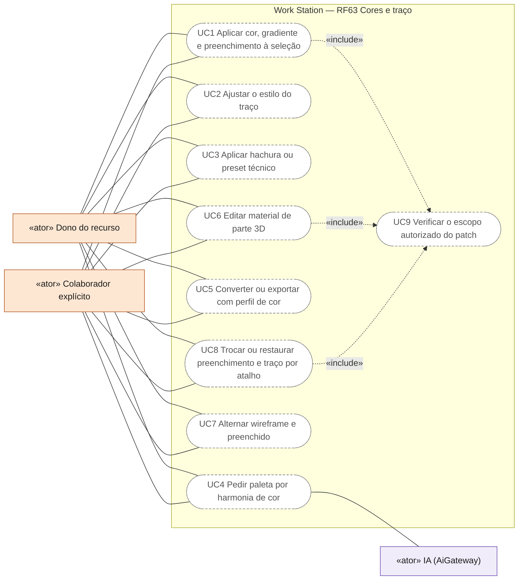
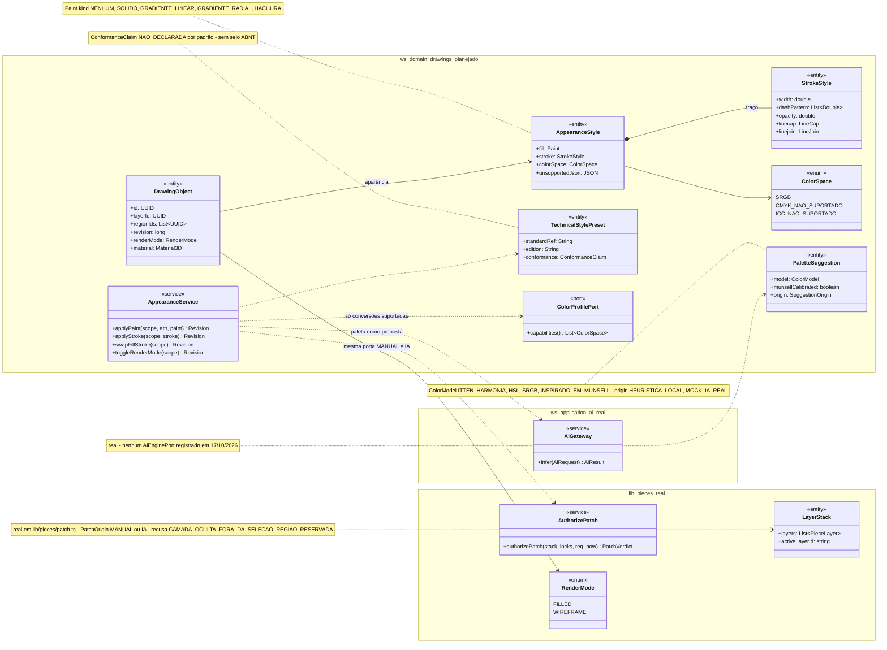
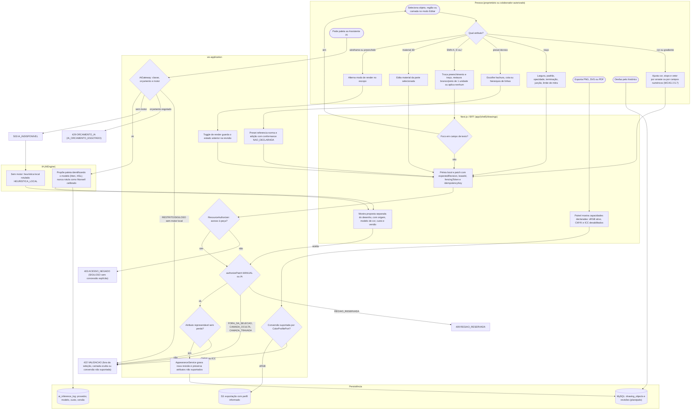
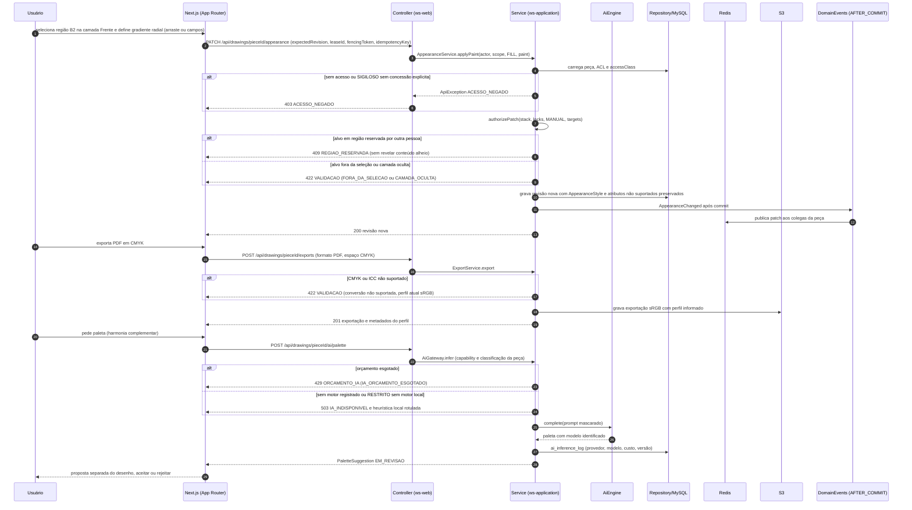
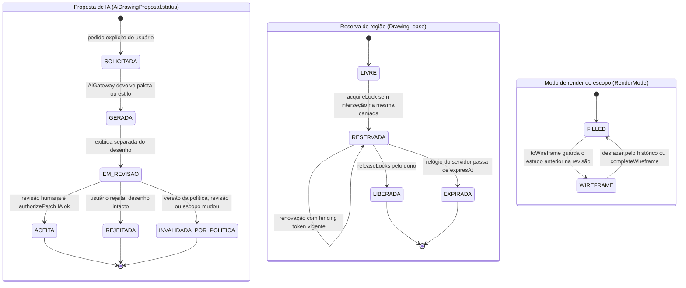
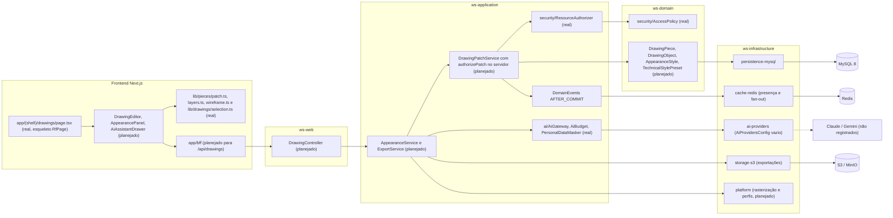

# RF63 — Editar cores, gradientes, materiais e estilos de traço
**HU:** — (sem HU no board; RF especificado em 15/10/2026) · **Sprint (board Work Station):** lista *Requisitos Funcionais* sem sprint atribuída · **Equivalente FAI:** — · **Aba/rota:** Drawings (`/drawings`, `/drawings/[pieceId]`; peça aberta a partir de `/tasks/[id]` e da sessão DECIA `/decia/[sessionId]`) · **Página-esqueleto:** registrada em 17/10/2026; editor ainda não implementado (Onda 5 do PLANO_ONDAS)
**Critérios de aceite cobertos:** RF63.CA01 … RF63.CA08 — corpo do card = especificação de docs/produto/requisitos-studio/RF63.md (CAs copiados como estão escritos); classes reais: `authorizePatch`/`PatchOrigin`/`PatchDenial` (`lib/pieces/patch.ts`), `PieceLayer`/`LayerStack` (`lib/pieces/layers.ts`), `canEditDrawingTarget` (`lib/drawings/selection.ts`), `editableNodeIds` (`lib/studio/selection.ts`), `RenderMode`/`toWireframe` (`lib/pieces/wireframe.ts`), `DrawingClassification.accessibility` (`lib/pieces/classification.ts`), `AiGateway`/`AiEnginePort`/`AiBudget` (ws-application, sem motor registrado); o restante (planejado)

O RF63 define como a pessoa autorizada refina a aparência de uma peça do Drawings — cor sólida, gradientes linear e radial, preenchimento, traço (largura, padrão, opacidade, terminações e junções), hachuras e presets técnicos, paletas inspiradas em Itten, materiais de partes 3D e a alternância wireframe/preenchido — sempre dentro do escopo autorizado pela mesma porta de patch (`authorizePatch`) que vale para edição manual e para propostas de IA. Toda conversão de cor declara o perfil usado e só é oferecida quando é de fato suportada.

**Estado em 17/10/2026:** a MATRIZ_RF registra RF63 como AUSENTE (nota 0.00) neste repositório; a nota 6.0 do PLANO_ONDAS (Onda 5) refere-se ao protótipo local (`docs/exemplo_drawings_letters/work_station_letters_drawings.tsx`: cor, espessura e opacidade de traço em um painel de propriedades), que não é o editor do produto. A rota `/drawings` é só página-esqueleto (`app/(shell)/drawings/page.tsx`, `RfPage`). As referências a Illustrator/AutoCAD (`COMANDOS_REFERENCIA_ILLUSTRATOR_AUTOCAD.md`) são inspiração semântica, nunca promessa de paridade. Nenhum motor de IA está registrado (`CONECTORES.md`: `AiGateway` sem chamador de produção, `AiProvidersConfig` vazio).

**Atualização 31/10/2026 (parcial):** o modelo 3D do `/drawings` tem 15 materiais fisicamente baseados (metais, vidro, cerâmica, mármore, madeira, concreto, plástico, borracha, veludo). Os valores são físicos e testados, e madeira, concreto, aço escovado e mármore têm texturas procedurais. A visualização vai de PBR em tempo real a path tracing fotorrealista. Gradientes e estilos de traço 2D continuam ausentes.

## Critérios de aceite

| CA | Enunciado (Dado / Quando / Então) |
|---|---|
| **RF63.CA01** | Dada seleção de objeto, região ou camada, quando altera cor sólida, gradiente linear/radial e preenchimento, então afeta somente o escopo autorizado. |
| **RF63.CA02** | Dado traço, quando ajusta largura, padrão, opacidade, terminações e junções, então renderiza e exporta a mesma aparência dentro das capacidades declaradas. |
| **RF63.CA03** | Dadas hachuras de seção, cotas e hierarquia de linhas, quando usa preset técnico, então referencia norma/edição aplicável e não declara conformidade sem validação. |
| **RF63.CA04** | Dadas harmonias Itten e controles inspirados em Munsell, quando recomenda paleta, então identifica o modelo e não confunde HSL/RGB com Munsell calibrado. |
| **RF63.CA05** | Dado RGB/CMYK/ICC, quando converte ou exporta, então informa perfil utilizado e só habilita conversão efetivamente suportada. |
| **RF63.CA06** | Dado material de parte 3D, quando edita, então conserva geometria, seleção e ordem de camadas. |
| **RF63.CA07** | Dada alternância wireframe/preenchido, quando ocorre, então mantém estruturas selecionáveis e permite recuperar o estado anterior pelo histórico. |
| **RF63.CA08** | Dada seleção e atributo ativo (preenchimento ou traço), quando usa Shift+X, D ou /, então troca os atributos suportados, restaura branco/preto de 1 unidade ou aplica nenhum ao atributo escolhido; não intercepta texto em campos e rejeita conversões não suportadas sem perda da aparência. |

## Suporte de cor e aparência declarado

| Recurso | Situação declarada na interface | Observação |
|---|---|---|
| sRGB (prévia, PNG, SVG) | Suportado no plano da primeira entrega | Espaço de trabalho único; perfil informado na exportação como `sRGB IEC 61966-2.1` |
| HSL/HSV como seletor | Suportado como controle de entrada | Rotulado HSL; nunca rotulado como Munsell |
| CMYK | **Não implementado** — conversão desabilitada | Nenhuma fórmula RGB→CMYK; fidelidade de impressão não é declarada |
| Perfis ICC | **Não implementado** — leitura e aplicação de perfil desabilitadas | Exportação informa “sem perfil ICC incorporado” |
| Munsell calibrado | **Não implementado** | Controles “inspirados em Munsell” (matiz, valor, croma aproximados) identificam o modelo real usado |
| Harmonias Itten | Heurística declarada | Complementar, análoga, tríade, claro/escuro, quente/frio; não é nota de qualidade |
| Hachuras e presets técnicos | Referência a norma/edição a verificar | NBR 10067/10126/12298 vieram do prompt; nenhum selo “ABNT aprovado” |
| Traço composto exigido por gradiente/hachura | Recusado sem perda | Atalhos Shift+X, D e / preservam a aparência original |

Cada arraste (alças de gradiente, vetor, ponto de stop, espessura) tem alternativa numérica equivalente por teclado e campo (WCAG 2.5.7). Cor nunca é o único sinal: reservas, erros e estados aparecem com texto.

## 0. Diagrama de casos de uso

Casos de uso derivados dos CAs. Todos são planejados: o editor do Drawings ainda não existe, só as regras puras de `lib/pieces/` e `lib/drawings/`.

| Caso de uso | Ator(es) | CAs | Situação |
|---|---|---|---|
| UC1 Aplicar cor, gradiente e preenchimento à seleção | `dono`, `colaborador` | RF63.CA01 | planejado |
| UC2 Ajustar o estilo do traço | `dono`, `colaborador` | RF63.CA02 | planejado |
| UC3 Aplicar hachura ou preset técnico | `dono`, `colaborador` | RF63.CA03 | planejado |
| UC4 Pedir paleta por harmonia de cor | `dono`, `colaborador`, `ia` | RF63.CA04 | planejado (IA só como proposta revisável; nenhum motor registrado) |
| UC5 Converter ou exportar com perfil de cor | `dono`, `colaborador` | RF63.CA05 | planejado (só sRGB no plano; CMYK e ICC desabilitados) |
| UC6 Editar material de parte 3D | `dono`, `colaborador` | RF63.CA06 | planejado |
| UC7 Alternar wireframe e preenchido | `dono`, `colaborador` | RF63.CA07 | planejado (conversão pura em `lib/pieces/wireframe.ts`) |
| UC8 Trocar ou restaurar preenchimento e traço por atalho | `dono`, `colaborador` | RF63.CA08 | planejado |
| UC9 Verificar o escopo autorizado do patch | — (incluído por UC1, UC6, UC8) | RF63.CA01, RF63.CA06, RF63.CA08 | planejado (regra pura `authorizePatch` em `lib/pieces/patch.ts`, sem editor) |

## 1. Diagrama de classes

## 2. Diagrama de atividades

## 3. Diagrama de sequência

## 4. Máquina de estados

Entidades: a proposta de paleta/estilo da IA (`AiDrawingProposal.status`, planejado, sobre `AiProposal`/`proposalValidity` reais de `lib/ai/autonomy.ts`), a reserva de região (`DrawingLease`, planejado sobre `RegionLock` real) e o modo de render do escopo (`RenderMode` real).

Falhas `429 ORCAMENTO_IA` e `503 IA_INDISPONIVEL` não criam proposta: a solicitação termina sem estado novo e a nova tentativa é explícita (sem repetição automática de chamada cobrada). Expirar ou liberar uma reserva nunca apaga o desenho.

## 5. Diagrama de componentes

## 6. Rastreabilidade

| CA | Classe | Passo | Mensagem | Transição | Componente |
|---|---|---|---|---|---|
| RF63.CA01 | `AppearanceService.applyPaint`, `Paint.kind` (nota de `AppearanceStyle`), `AuthorizePatch` (real), `canEditDrawingTarget` (real) | P0 → P1 → P2 → B2 → S1 → S2 → S4 | PATCH appearance, `authorizePatch`, alt 409/422 | LEASE `RESERVADA` | `PS`, `LIB`, `RA` |
| RF63.CA02 | `StrokeStyle` (largura, padrão, opacidade, linecap, linejoin), `ColorProfilePort` | P3 → B2 → S3 → S4; P9 → B3 → S6 | POST exports, alt 422 conversão | — | `AS`, `PLAT`, `S3A` |
| RF63.CA03 | `TechnicalStylePreset` (standardRef, edition, conformance `NAO_DECLARADA`) | P4 → S5 → B2 | PATCH appearance com preset | — | `ENT`, `AS` |
| RF63.CA04 | `PaletteSuggestion` (model, munsellCalibrated=false, origin), `AiGateway` (real) | P8 → S7 → I1/I2 → B4 | POST ai/palette, alt 429/503 | PROP `SOLICITADA → GERADA → EM_REVISAO` | `GW`, `AIP`, `EXT` |
| RF63.CA05 | `ColorSpace` (SRGB, CMYK_NAO_SUPORTADO, ICC_NAO_SUPORTADO), `ColorProfilePort.capabilities` | P9 → B3 → S6 → D3 ou E422 | alt 422 conversão não suportada, exportação com perfil informado | — | `PLAT`, `S3A` |
| RF63.CA06 | `DrawingObject.material` (`Material3D`), `DrawingObject.layerId/regionIds`, `LayerStack` (real) | P6 → B2 → S2 → S4 | PATCH appearance (material) | — | `AS`, `ENT` |
| RF63.CA07 | `RenderMode`/`toWireframe`/`completeWireframe` (real), `editableNodeIds` (real), revisão anterior | P7 → S8 → B2; P10 → D1 | PATCH appearance (render) | RENDER `FILLED ⇄ WIREFRAME` | `LIB`, `MY` |
| RF63.CA08 | `AppearanceService.swapFillStroke` (Shift+X), restaurar padrão (D) e nenhum (/), `AppearanceStyle.unsupportedJson` | P5 → B1 → B2 → S3 → E422 sem perda ou S4 | PATCH appearance, alt 422 | — | `ED`, `AS` |
