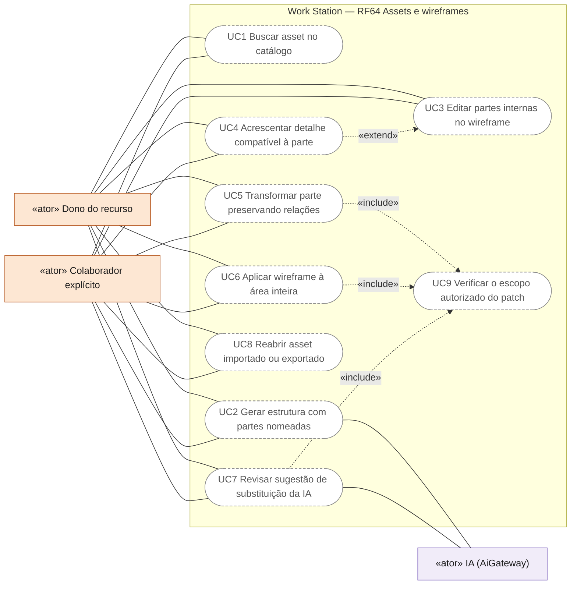
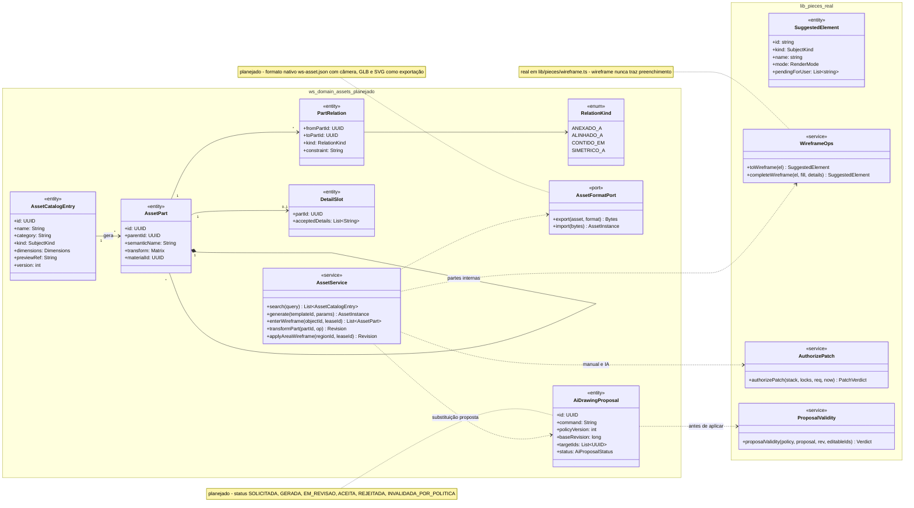
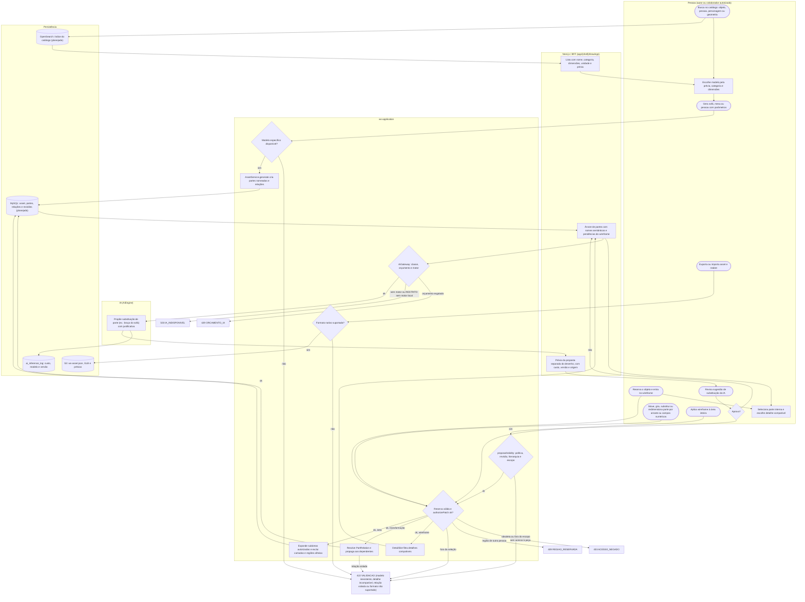
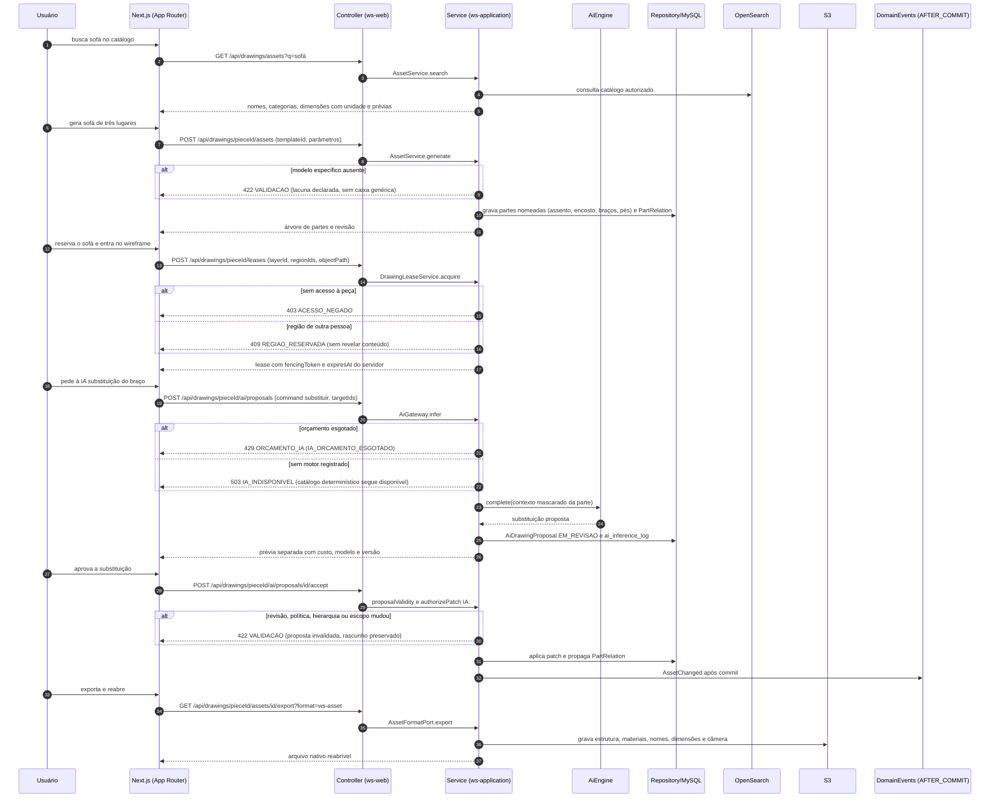
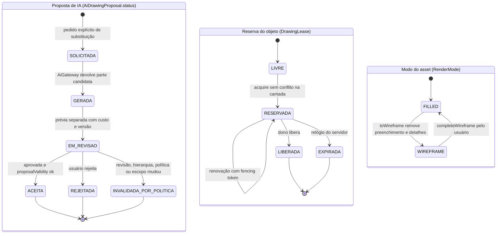
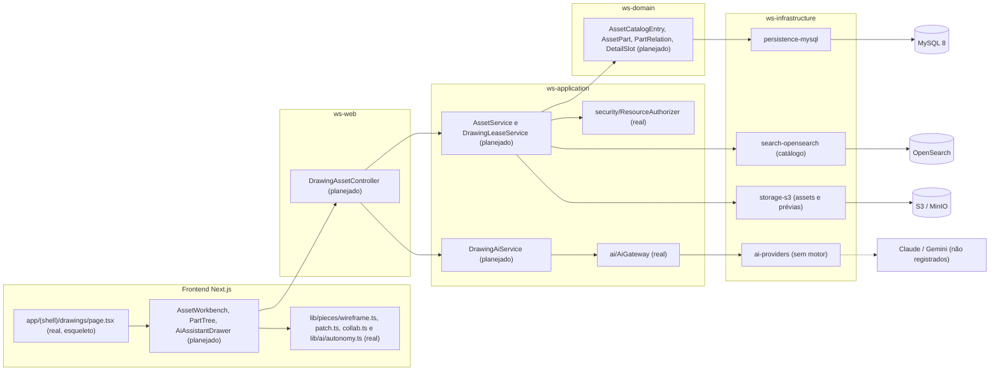

# RF64 — Gerar assets, wireframes e detalhes internos parametrizados
**HU:** — (sem HU no board; RF especificado em 15/10/2026) · **Sprint (board Work Station):** lista *Requisitos Funcionais* sem sprint atribuída · **Equivalente FAI:** — · **Aba/rota:** Drawings (`/drawings`, `/drawings/[pieceId]`; peça aberta a partir de `/tasks/[id]` e da sessão DECIA `/decia/[sessionId]`) · **Página-esqueleto:** registrada em 17/10/2026; editor ainda não implementado (Onda 5 do PLANO_ONDAS)
**Critérios de aceite cobertos:** RF64.CA01 … RF64.CA07 — corpo do card = especificação de docs/produto/requisitos-studio/RF64.md (CAs copiados como estão escritos); classes reais: `SuggestedElement`/`RenderMode`/`SubjectKind`/`toWireframe`/`completeWireframe` (`lib/pieces/wireframe.ts`), `authorizePatch`/`PatchOrigin` (`lib/pieces/patch.ts`), `RegionLock`/`canEditRegions` (`lib/pieces/collab.ts`), `DrawingEditTarget.objectPath` (`lib/drawings/selection.ts`), `DrawingNode.parentId`/`editableNodeIds` (`lib/studio/selection.ts`), `AiProposal`/`proposalValidity` (`lib/ai/autonomy.ts`), `AiGateway` (ws-application, sem motor registrado); o restante (planejado)

O RF64 cobre o catálogo de assets parametrizados do Drawings: buscar objetos, pessoas, personagens e geometrias com nome, categoria, dimensões e prévia; gerar estruturas específicas (sofá, mesa, pessoa) com partes semanticamente nomeadas, nunca uma caixa genérica; entrar no wireframe de um objeto reservado para editar partes internas e acrescentar só detalhes compatíveis; transformar partes preservando relações explícitas; aplicar wireframe a uma área inteira respeitando subáreas autorizadas; e reabrir assets importados ou exportados sem perder estrutura.

**Estado em 17/10/2026:** a MATRIZ_RF registra RF64 como LÓGICA SEM INTERFACE (0.30): só `lib/pieces/wireframe.ts` existe, com a conversão para esqueleto (`toWireframe` remove preenchimento e detalhes e lista pendências) e o retorno a preenchido (`completeWireframe`). O catálogo `docs/auditoria/2026-10-15/catalogo-elementos-ia.json` (formas, `subjectKinds` object/person, modos FILLED/WIREFRAME, sete estilos) é evidência de protótipo, não biblioteca de produto; as capturas de `jardim-wireframe` (149 elementos, 43 partes de sete geradores, GLB validado) vêm do checkout de desenvolvimento local. A nota 5.7 do PLANO_ONDAS (Onda 5) pede expandir assets por caso profissional e validar componentes internos, escala e edições com fontes técnicas. Sugestão de substituição por IA é sempre proposta revisável, passa por `authorizePatch` com origem IA e nunca sai do escopo autorizado.

## Critérios de aceite

| CA | Enunciado (Dado / Quando / Então) |
|---|---|
| **RF64.CA01** | Dado catálogo, quando busca por objeto, pessoa, personagem ou geometria, então oferece nomes, categorias, dimensões e prévia de modelos disponíveis. |
| **RF64.CA02** | Dado sofá, mesa ou pessoa, quando gera, então cria estrutura específica com partes semanticamente nomeadas, sem substituí-la por caixa genérica. |
| **RF64.CA03** | Dado objeto reservado, quando entra no wireframe, então seleciona partes internas e oferece somente detalhes compatíveis, como olhos, lábios, puxadores e gavetas. |
| **RF64.CA04** | Dada parte, quando move, rotaciona, substitui ou redimensiona, então preserva relações explícitas com componentes dependentes. |
| **RF64.CA05** | Dado wireframe de área inteira, quando aplica, então abrange objetos das subáreas autorizadas e exclui camadas/regiões alheias. |
| **RF64.CA06** | Dada sugestão de substituição por IA, quando aprovada, então valida limites, revisão, hierarquia e escopo antes de aplicar. |
| **RF64.CA07** | Dado asset importado/exportado, quando reabre, então mantém estrutura, materiais, nomes, dimensões e câmera em formato nativo suportado. |

## Regras de produto

- Gerador sem modelo específico para o pedido responde com a lacuna declarada (“modelo de mesa dobrável ainda não disponível”), nunca com uma caixa genérica rotulada como o objeto.
- Dimensões vêm do modelo paramétrico com unidade explícita (convenção de trabalho, por exemplo 1 unidade = 10 mm); não são medidas certificadas nem normas inferidas.
- Detalhes compatíveis são definidos por `DetailSlot` da parte (rosto aceita olhos e lábios; gaveteiro aceita puxadores e gavetas); detalhes incompatíveis não aparecem na lista.
- Mover, girar, substituir ou redimensionar parte tem alternativa numérica (posição, ângulo, largura, altura) além do arraste (WCAG 2.5.7).
- Conteúdo RESTRITO/SIGILOSO nunca vai a provedor externo: a geração por IA usa motor local ou é recusada; o catálogo determinístico continua disponível.

## 0. Diagrama de casos de uso

Casos de uso derivados dos CAs. Todos são planejados: só a conversão para esqueleto (`lib/pieces/wireframe.ts`) existe, sem catálogo nem editor.

| Caso de uso | Ator(es) | CAs | Situação |
|---|---|---|---|
| UC1 Buscar asset no catálogo | `dono`, `colaborador` | RF64.CA01 | planejado |
| UC2 Gerar estrutura com partes nomeadas | `dono`, `colaborador`, `ia` | RF64.CA02 | planejado (gerador sem modelo declara a lacuna) |
| UC3 Editar partes internas no wireframe | `dono`, `colaborador` | RF64.CA03 | planejado |
| UC4 Acrescentar detalhe compatível à parte | `dono`, `colaborador` | RF64.CA03 | planejado |
| UC5 Transformar parte preservando relações | `dono`, `colaborador` | RF64.CA04 | planejado |
| UC6 Aplicar wireframe à área inteira | `dono`, `colaborador` | RF64.CA05 | planejado |
| UC7 Revisar sugestão de substituição da IA | `dono`, `colaborador`, `ia` | RF64.CA06 | planejado (proposta revisável; nenhum motor registrado) |
| UC8 Reabrir asset importado ou exportado | `dono`, `colaborador` | RF64.CA07 | planejado |
| UC9 Verificar o escopo autorizado do patch | — (incluído por UC5, UC6, UC7) | RF64.CA05, RF64.CA06 | planejado (regra pura `authorizePatch` e `canEditRegions`, sem editor) |

## 1. Diagrama de classes

## 2. Diagrama de atividades

## 3. Diagrama de sequência

## 4. Máquina de estados

Entidades: proposta de substituição da IA (`AiDrawingProposal.status`, planejado sobre `AiProposal` real), reserva do objeto (`DrawingLease`, planejado sobre `RegionLock` real) e modo do asset (`RenderMode` real em `lib/pieces/wireframe.ts`).

Entrar no wireframe exige reserva `RESERVADA`; ao expirar, o editor volta a somente leitura e o rascunho local é preservado. Falhas 429/503 não criam proposta.

## 5. Diagrama de componentes

## 6. Rastreabilidade

| CA | Classe | Passo | Mensagem | Transição | Componente |
|---|---|---|---|---|---|
| RF64.CA01 | `AssetCatalogEntry` (name, category, kind, dimensions, previewRef), `AssetService.search` | P0 → D1 → B1 → P1 | GET assets?q= | — | `OSA`, `ED` |
| RF64.CA02 | `AssetService.generate`, `AssetPart.semanticName`, `PartRelation` | P2 → S1 → S2 → D2 → B2 (ou E422) | POST assets, alt 422 lacuna declarada | — | `AS`, `ENT` |
| RF64.CA03 | `DetailSlot.acceptedDetails`, `SuggestedElement.pendingForUser` (real), `editableNodeIds` (real) | P3 → S3 → S4 → B2 → P4 | POST leases, alt 403/409 | LEASE `LIVRE → RESERVADA`; RENDER `FILLED → WIREFRAME` | `LIB`, `AS` |
| RF64.CA04 | `PartRelation` (ANEXADO_A, ALINHADO_A, CONTIDO_EM, SIMETRICO_A), `AssetService.transformPart` | P5 → S3 → S5 → D2 (ou E422) | aplica patch e propaga PartRelation | — | `AS`, `MY` |
| RF64.CA05 | `AssetService.applyAreaWireframe`, `canEditRegions` (real), `canEditDrawingTarget` (real) | P6 → S3 → S6 → D2 | POST leases | LEASE `RESERVADA` | `AS`, `LIB` |
| RF64.CA06 | `AiDrawingProposal`, `ProposalValidity` (real), `AuthorizePatch` origem IA (real), `AiGateway` (real) | B2 → S8 → I1 → B3 → P7 → P8 → S7 → S3 | ai/proposals, accept, alt 422/429/503 | PROP `EM_REVISAO → ACEITA / INVALIDADA_POR_POLITICA` | `AIS`, `GW`, `AIP` |
| RF64.CA07 | `AssetFormatPort` (ws-asset.json nativo, GLB, SVG) | P9 → S9 → D3 (ou E422) | GET export?format=ws-asset | — | `S3A` |
