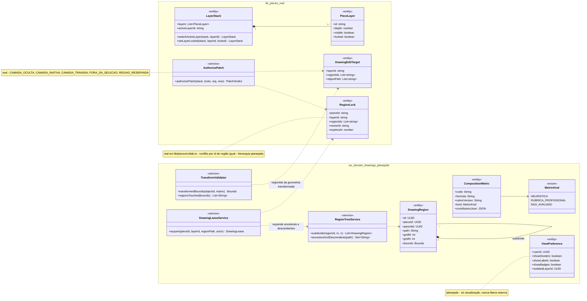
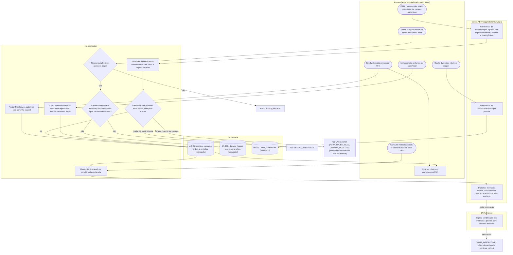
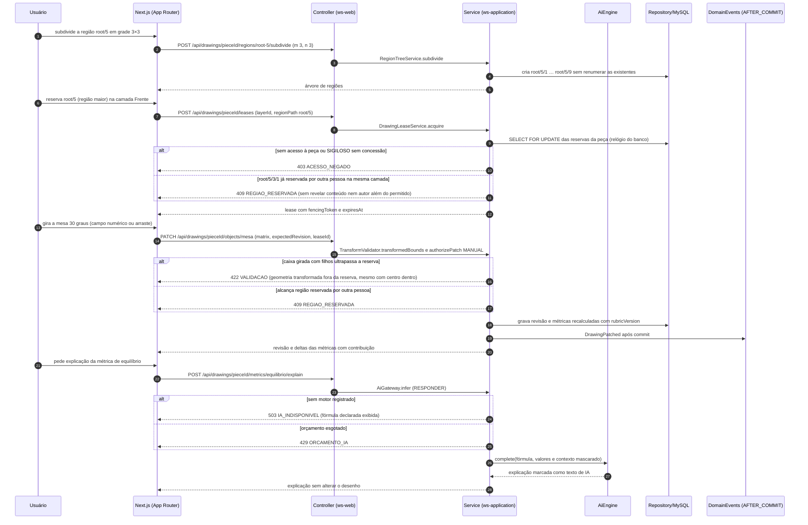
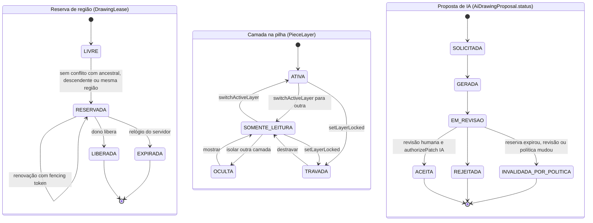
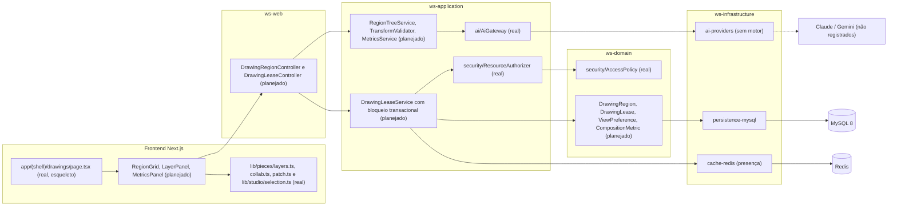

# RF65 — Editar regiões hierárquicas e camadas sobrepostas no Drawings
**HU:** — (sem HU no board; RF especificado em 15/10/2026) · **Sprint (board Work Station):** lista *Requisitos Funcionais* sem sprint atribuída · **Equivalente FAI:** — · **Aba/rota:** Drawings (`/drawings`, `/drawings/[pieceId]`; peça aberta a partir de `/tasks/[id]` e da sessão DECIA `/decia/[sessionId]`) · **Página-esqueleto:** registrada em 17/10/2026; editor ainda não implementado (Onda 5 do PLANO_ONDAS)
**Critérios de aceite cobertos:** RF65.CA01 … RF65.CA07 — corpo do card = especificação de docs/produto/requisitos-studio/RF65.md (CAs copiados como estão escritos); classes reais: `PieceLayer`/`LayerStack`/`switchActiveLayer`/`setLayerLocked`/`canEditInActiveLayer` (`lib/pieces/layers.ts`), `RegionLock`/`acquireLock`/`canEditRegions` (`lib/pieces/collab.ts`), `authorizePatch`/`PatchDenial` (`lib/pieces/patch.ts`), `DrawingEditScope`/`DrawingEditTarget` (`lib/drawings/selection.ts`), `geometryBounds`/`editableNodeIds` (`lib/studio/selection.ts`), `ClassifiedField.rubricVersion` (`lib/pieces/classification.ts`); o restante (planejado)

O RF65 organiza o contexto espacial de uma peça do Drawings em quatro eixos independentes — camada, região, objeto e detalhe (`DRAWINGS_CAMADAS_COLABORACAO_DECIA.md`): subdividir regiões em grades M×N com caminho hierárquico estável, reservar regiões menores ou maiores respeitando reservas alheias, isolar camadas profundas ou superficiais sem perder as demais, ocultar divisórias e rótulos sem liberar reservas e recalcular métricas globais com fórmula declarada. Seleção nunca é autorização: o servidor decide pela geometria transformada inteira, não pelo centro.

**Estado em 17/10/2026:** a MATRIZ_RF registra RF65 como LÓGICA SEM INTERFACE (0.30). `lib/pieces/layers.ts` (camada ativa, travada, ordem por `depth`), `lib/pieces/collab.ts` (reserva por região e camada com lease de 60 s) e `lib/pieces/patch.ts` (porta única para edição manual e IA, recusa atômica com `CAMADA_OCULTA`, `CAMADA_INATIVA`, `FORA_DA_SELECAO`, `REGIAO_RESERVADA`) são funções puras testadas, sem editor nem servidor. `acquireLock` compara ids de região iguais; o conflito entre ancestral e descendente (região maior contendo menor) exige expandir o caminho hierárquico no servidor (planejado). O PLANO_ONDAS (Onda 5, nota 5.7) pede unificar a árvore cena → camada → região → objeto em um modelo persistente. A IA, quando existir, só explica métricas ou propõe alterações dentro da reserva vigente, sempre como proposta revisável e sem enviar RESTRITO/SIGILOSO a provedor externo.

## Critérios de aceite

| CA | Enunciado (Dado / Quando / Então) |
|---|---|
| **RF65.CA01** | Dada grade M×N, quando subdivide região, então cria caminho hierárquico estável e permite focar qualquer nível. |
| **RF65.CA02** | Dada reserva de região menor, quando edita, então limita objetos e geometria à região e camada permitidas. |
| **RF65.CA03** | Dada reserva de região maior, quando transforma, então considera as subáreas incluídas, sem ignorar reservas conflitantes. |
| **RF65.CA04** | Dadas camadas profundas/superficiais, quando isola uma, então preserva objetos das demais e mantém composição e ordem na reabertura. |
| **RF65.CA05** | Dadas divisórias, rótulos e badges, quando oculta, então limpa a visualização sem liberar reservas ou alterar a geometria. |
| **RF65.CA06** | Dada alteração local, quando atualiza métricas globais, então usa fórmula/rubrica declarada, distingue heurística de qualidade profissional e explica a contribuição de cada métrica. |
| **RF65.CA07** | Dado movimento/rotação, quando o limite físico ultrapassa reserva, então servidor rejeita considerando a geometria transformada, não apenas o centro. |

## Regras de produto

- Caminho de região estável e legível (`root/5/3/1`): subdividir de novo não renumera regiões existentes; foco e reserva referenciam o caminho.
- Camada é organização autoral, não classificação de acesso: ocultar uma camada não esconde conteúdo de colaboradores; isso exige política de acesso separada.
- Divisórias, rótulos e badges são preferências de visualização por pessoa; ocultá-los não toca `DrawingLease` nem a geometria.
- Métricas globais (equilíbrio, densidade, ocupação) são heurísticas com fórmula e `rubricVersion` publicadas; dimensão não avaliada aparece como “não avaliado”, nunca como zero.
- Mover e girar oferecem campos numéricos (posição, ângulo, pivô) além do arraste (WCAG 2.5.7); a validação usa a caixa transformada do objeto com filhos.

## 1. Diagrama de classes

## 2. Diagrama de atividades

## 3. Diagrama de sequência

## 4. Máquina de estados

Entidades: reserva de região (`DrawingLease`, planejado sobre `RegionLock` real), estado de cada camada na pilha (`PieceLayer` real: `visible`, `locked`, camada ativa) e proposta de IA (`AiDrawingProposal.status`, planejado), que neste RF só ocorre quando a IA propõe alterar objetos da região reservada.

Ocultar divisórias, rótulos e badges não é transição de nenhuma dessas máquinas: só muda `ViewPreference`. Camada `OCULTA` recusa patch com `CAMADA_OCULTA` (não se altera o que não se vê).

## 5. Diagrama de componentes

## 6. Rastreabilidade

| CA | Classe | Passo | Mensagem | Transição | Componente |
|---|---|---|---|---|---|
| RF65.CA01 | `DrawingRegion` (path, gridM, gridN, parentId), `RegionTreeService.subdivide` | P0 → S1 → D1 → P1 | POST regions/root-5/subdivide | — | `RT`, `ENT` |
| RF65.CA02 | `DrawingEditTarget` (real), `AuthorizePatch` (real), `canEditInActiveLayer` (real) | P2 → S2 → S3 → D2; P3 → S5 | POST leases, PATCH objects, alt 422 | LEASE `LIVRE → RESERVADA` | `LS`, `LIB` |
| RF65.CA03 | `RegionTreeService.ancestorsAndDescendants`, `DrawingLeaseService.acquire`, `RegionLock` (real) | P2 → S3 → E409 ou D2 | alt 409 root/5/3/1 já reservada | LEASE `LIVRE → RESERVADA` só sem conflito | `LS` |
| RF65.CA04 | `LayerStack.switchActiveLayer` (real), `PieceLayer.depth` (real), `ViewPreference.isolatedLayerId` | P4 → S6 → D1 | — | LAYER `SOMENTE_LEITURA → OCULTA` | `ED`, `MY` |
| RF65.CA05 | `ViewPreference` (showDividers, showLabels, showBadges) | P5 → B2 → D3 | — | nenhuma transição de LEASE | `ED` |
| RF65.CA06 | `CompositionMetric` (formula, rubricVersion, kind, contributionJson), `MetricKind`, `ClassifiedField.rubricVersion` (real) | P6 → S7 → B3 → I1 | revisão e deltas das métricas, explain com alt 503/429 | — | `RT`, `GW` |
| RF65.CA07 | `TransformValidator.transformedBounds/regionsTouched`, `geometryBounds` (real) | P3 → B1 → S4 → S5 → E422 ou E409 | PATCH objects/mesa, alt 422 e 409 | — | `RT`, `LIB` |
