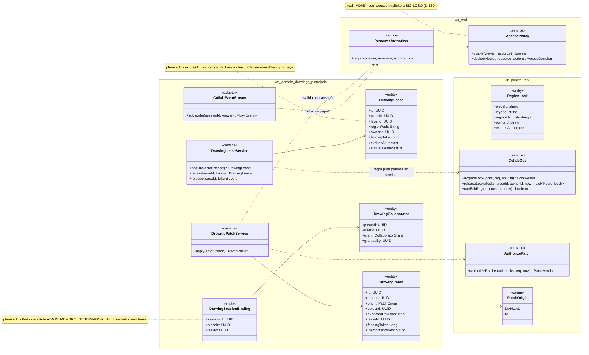
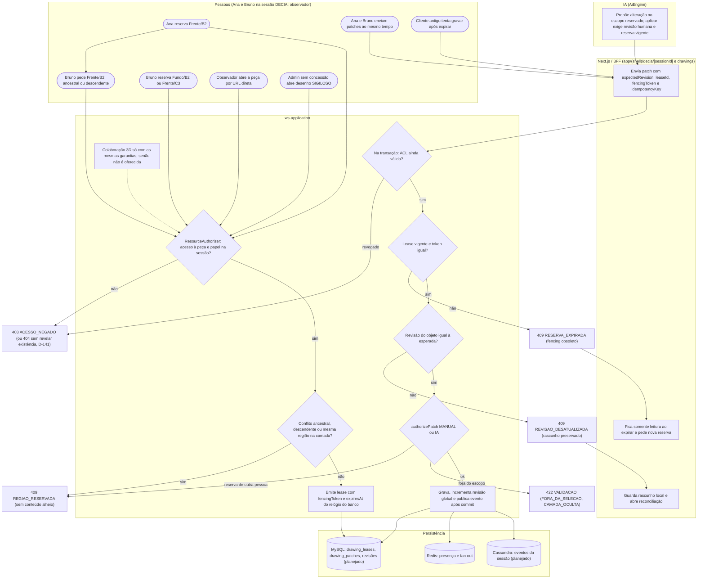
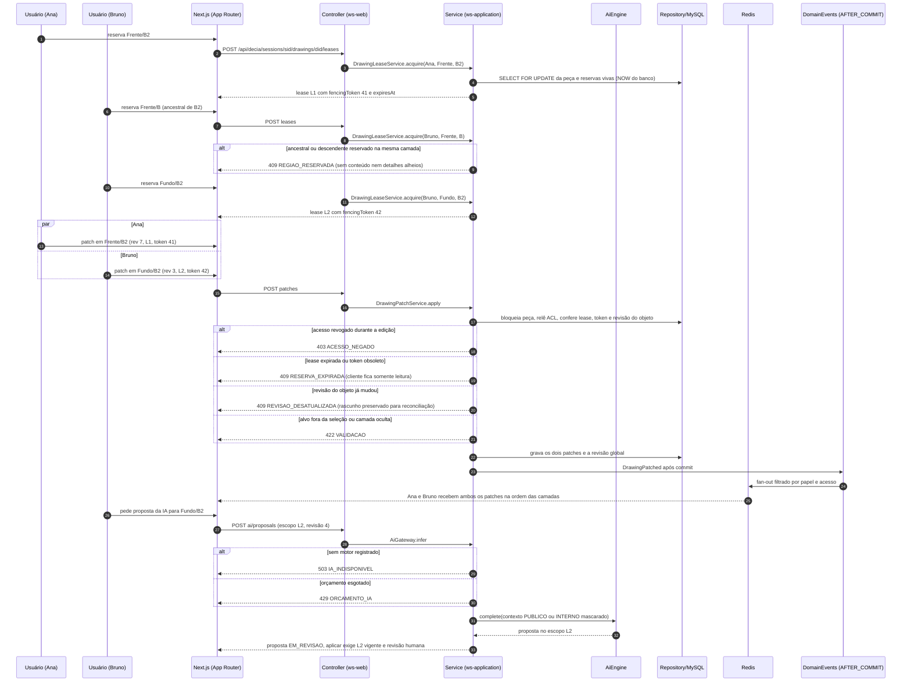
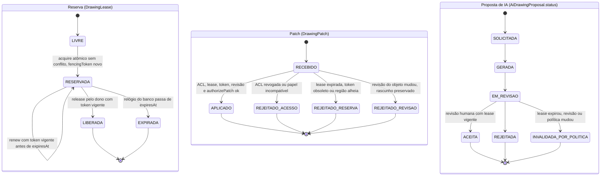
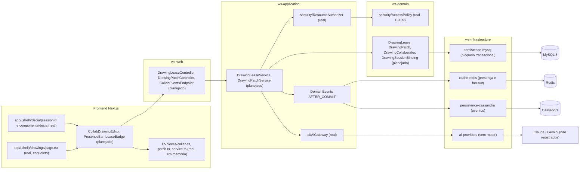

# RF66 — Editar desenhos simultaneamente no DECIA com reservas transacionais
**HU:** — (sem HU no board; RF especificado em 15/10/2026) · **Sprint (board Work Station):** lista *Requisitos Funcionais* sem sprint atribuída · **Equivalente FAI:** — · **Aba/rota:** Drawings (`/drawings`, `/drawings/[pieceId]`; peça aberta a partir de `/tasks/[id]` e da sessão DECIA `/decia/[sessionId]`) · **Página-esqueleto:** registrada em 17/10/2026; editor ainda não implementado (Onda 5 do PLANO_ONDAS)
**Critérios de aceite cobertos:** RF66.CA01 … RF66.CA08 — corpo do card = especificação de docs/produto/requisitos-studio/RF66.md (CAs copiados como estão escritos); classes reais: `RegionLock`/`acquireLock`/`releaseLocks`/`canEditRegions`/`LOCK_TTL_MS` (`lib/pieces/collab.ts`), `authorizePatch`/`PatchOrigin`/`PatchDenial` (`lib/pieces/patch.ts`), `LayerStack` (`lib/pieces/layers.ts`), `PiecesService` em memória (`lib/pieces/service.ts`), `SessionRole`/`AiProposal`/`proposalValidity` (`lib/ai/autonomy.ts`), `ResourceAuthorizer` (ws-application) e `AccessPolicy` (ws-domain, D-139), `DecisionWorkspace`/`AiSuggestion` (`components/decia/*`), `AiGateway` (sem motor registrado); o restante (planejado)

O RF66 leva a edição de uma mesma peça do Drawings para várias pessoas ao mesmo tempo, dentro de uma sessão DECIA, com reservas transacionais por camada e região: patches em escopos disjuntos convivem e mantêm a ordem visual; reservas sobrepostas, ancestrais ou descendentes são recusadas sem revelar conteúdo; renovação, liberação e expiração usam relógio do servidor e token de fencing; patch antigo nunca sobrescreve revisão nova; revogação de acesso, SIGILOSO e papel de observador são revalidados no servidor em cada gravação. A IA participa só como proponente, sob as mesmas reservas.

**Estado em 17/10/2026:** a MATRIZ_RF registra RF66 como LÓGICA SEM INTERFACE (0.30): `lib/pieces/collab.ts` (lease de 60 s, conflito por interseção de regiões na mesma camada, renovação só pelo dono) e `lib/pieces/patch.ts` (porta única manual e IA que passou a checar seleção, camada e reserva em conjunto) são funções puras testadas, com `PiecesService` em memória; não há endpoints, tabela de reservas, token de fencing nem relógio de banco. A prova de `docs/auditoria/2026-10-15/colaboracao-2d` (duas contas, tarefa SIGILOSO com concessão explícita, conflito na região maior, dois patches preservados, reabertura na revisão 2) veio do checkout de desenvolvimento local e não usou sessão DECIA real. O PLANO_ONDAS (Onda 5, nota 5.7) pede integrar edição e IA às mesmas reservas, concorrência estrita, reconexão e sessão DECIA real. Colaboração 3D não é oferecida até cumprir as mesmas garantias no servidor.

## Critérios de aceite

| CA | Enunciado (Dado / Quando / Então) |
|---|---|
| **RF66.CA01** | Dados usuários autorizados em áreas/camadas disjuntas, quando enviam patches simultâneos, então preserva ambos e mantém ordem visual. |
| **RF66.CA02** | Dados escopos sobrepostos ou ancestrais/descendentes na mesma camada, quando o segundo tenta reservar, então rejeita com mensagem sem revelar conteúdo não autorizado. |
| **RF66.CA03** | Dada reserva, quando renova/libera/expira, então usa relógio do servidor e token de fencing; cliente antigo não escreve depois da expiração. |
| **RF66.CA04** | Dada revisão de objeto alterada, quando chega patch antigo, então rejeita sem sobrescrever e preserva rascunho para reconciliação. |
| **RF66.CA05** | Dada revogação de acesso durante edição, quando tenta gravar, então autorização é revalidada transacionalmente. |
| **RF66.CA06** | Dado desenho SIGILOSO, quando administrador sem concessão explícita tenta acessar, então nega; proprietário e colaboradores autorizados seguem a política definida. |
| **RF66.CA07** | Dada sessão DECIA, quando entra observador/não participante, então só recebe operações compatíveis com papel e acesso à tarefa; URLs diretas não contornam a regra. |
| **RF66.CA08** | Dada colaboração 3D, quando é oferecida, então implementa as mesmas garantias no servidor; demonstração 3D local não satisfaz esse aceite. |

## Contrato de servidor (planejado)

Endpoints propostos em `DRAWINGS_CAMADAS_COLABORACAO_DECIA.md`, ainda não publicados: `POST /api/decia/sessions/{sessionId}/drawings/{drawingId}/leases` (reservar), `PATCH …/leases/{leaseId}` (renovar com token vigente), `DELETE …/leases/{leaseId}` (liberar), `POST …/patches` (revisão esperada, token e chave idempotente) e `GET …/events` (presença, reservas e patches autorizados por SSE/WebSocket). A gravação bloqueia a peça (`SELECT … FOR UPDATE`), relê a ACL, confere reserva, token e revisão do objeto e só então grava; Redis transmite presença, mas não substitui o controle transacional. Mensagens de conflito dizem “região reservada por outra pessoa até hh:mm” sem mostrar o conteúdo nem o nome quando a pessoa não pode vê-lo. Presença usa cor com nome em texto.

## 1. Diagrama de classes

## 2. Diagrama de atividades

## 3. Diagrama de sequência

## 4. Máquina de estados

Entidades: reserva (`DrawingLease.status`, planejado sobre `RegionLock` real), patch recebido (`DrawingPatch`, planejado) e proposta de IA (`AiDrawingProposal.status`, planejado sobre `AiProposal` real).

Expirar a reserva não apaga desenho; reconectar exige nova reserva. Desfazer é patch inverso próprio, nunca restauração cega de revisão que apagaria trabalho alheio.

## 5. Diagrama de componentes

## 6. Rastreabilidade

| CA | Classe | Passo | Mensagem | Transição | Componente |
|---|---|---|---|---|---|
| RF66.CA01 | `DrawingPatchService.apply`, revisão por objeto e global, `CollabEventStream` | P3 → B1 → S4 → S5 → S6 → S7 → S8 | par patches simultâneos, grava os dois, fan-out | PATCH `RECEBIDO → APLICADO` | `LS`, `RD`, `MY` |
| RF66.CA02 | `DrawingLeaseService.acquire`, `CollabOps.acquireLock` (real), `RegionLock` (real) | P1 → S1 → S2 → E409R | alt 409 ancestral ou descendente | LEASE `LIVRE` mantido | `LS` |
| RF66.CA03 | `DrawingLease` (fencingToken, expiresAt do banco), `renew`/`release` | P4 → B1 → S5 → E409L → B3 | alt 409 RESERVA_EXPIRADA | LEASE `RESERVADA → EXPIRADA / LIBERADA` | `MY` |
| RF66.CA04 | `DrawingPatch.expectedRevision`, rascunho local | S6 → E409V → B2 | alt 409 REVISAO_DESATUALIZADA | PATCH `RECEBIDO → REJEITADO_REVISAO` | `ED`, `LS` |
| RF66.CA05 | `ResourceAuthorizer` (real) relido na transação | S4 → E403 | alt 403 acesso revogado | PATCH `RECEBIDO → REJEITADO_ACESSO` | `RA` |
| RF66.CA06 | `AccessPolicy` (real, D-139), `DrawingCollaborator` | P6 → S1 → E403 | alt 403 (ou 404, D-141) | — | `AP`, `RA` |
| RF66.CA07 | `DrawingSessionBinding`, `ParticipantRole` OBSERVADOR, `CollabEventStream` filtrado | P5 → S1 → E403 | fan-out filtrado por papel e acesso | — | `DEC`, `DC`, `RA` |
| RF66.CA08 | mesmas classes de servidor exigidas para 3D; demonstração local não conta | S9 → S1 | — | mesmas máquinas LEASE e PATCH | `LS`, `MY` |
