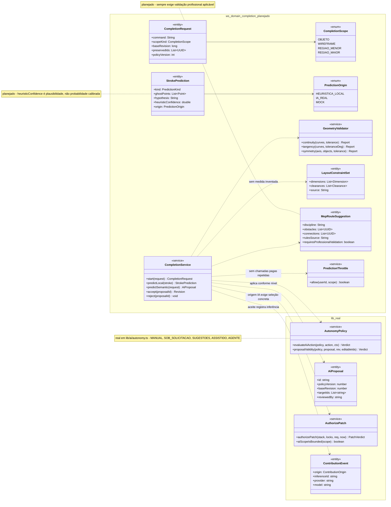
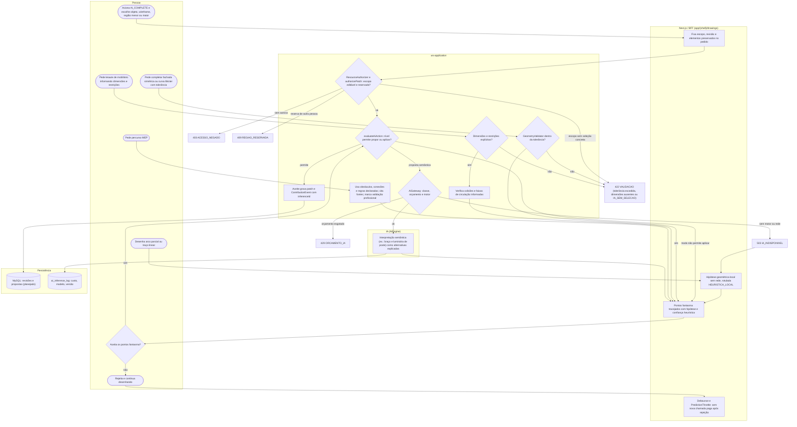
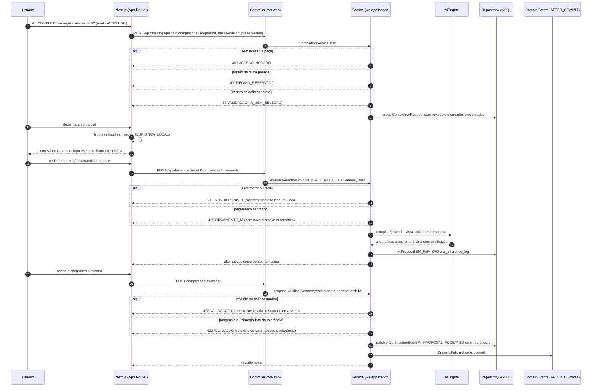
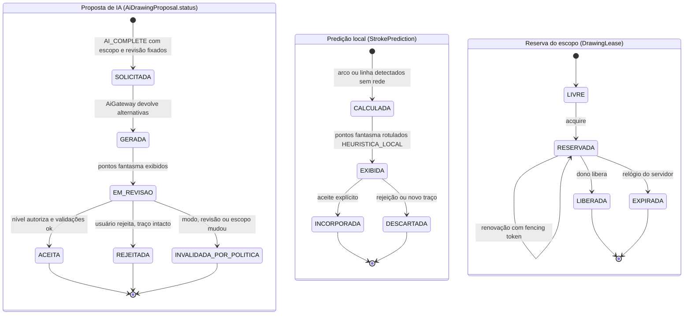
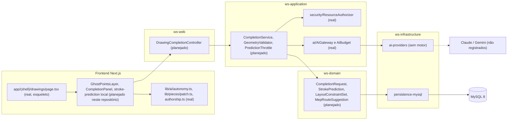

# RF67 — Completar geometria e prever traçados no Drawings
**HU:** — (sem HU no board; RF especificado em 15/10/2026) · **Sprint (board Work Station):** lista *Requisitos Funcionais* sem sprint atribuída · **Equivalente FAI:** — · **Aba/rota:** Drawings (`/drawings`, `/drawings/[pieceId]`; peça aberta a partir de `/tasks/[id]` e da sessão DECIA `/decia/[sessionId]`) · **Página-esqueleto:** registrada em 17/10/2026; editor ainda não implementado (Onda 5 do PLANO_ONDAS)
**Critérios de aceite cobertos:** RF67.CA01 … RF67.CA07 — corpo do card = especificação de docs/produto/requisitos-studio/RF67.md (CAs copiados como estão escritos); classes reais: `AutonomyMode`/`MODE_CAPABILITIES`/`AiProposal`/`proposalValidity`/`evaluateAiAction` (`lib/ai/autonomy.ts`), `authorizePatch`/`aiScopeIsBounded` (`lib/pieces/patch.ts`), `DrawingEditScope` (`lib/drawings/selection.ts`), `Geometry`/`snapPoint`/`editableNodeIds` (`lib/studio/selection.ts`), `ContributionEvent`/`ContributionOrigin` (`lib/pieces/authorship.ts`), `AiGateway`/`AiBudget` (ws-application, sem motor registrado); o restante (planejado)

O RF67 define o comando de completar (AI_COMPLETE/AICOMP) e a previsão de traçados no Drawings: o escopo (objeto, wireframe, região menor ou maior) fixa revisão e elementos preservados; arcos e traços lineares recebem pontos fantasma com hipótese e confiança heurística; fachadas simétricas e curvas Bézier são validadas por continuidade, tangência e simetria com tolerância informada; leiautes de mobiliário e roteamentos MEP só usam dimensões, restrições, obstáculos e regras explícitas, com fontes e validação profissional. Nada é aplicado além do nível de autonomia autorizado.

**Estado em 17/10/2026:** a MATRIZ_RF registra RF67 como LÓGICA SEM INTERFACE (0.30) e o PLANO_ONDAS (Onda 5, nota 4.65) aponta que a previsão é geométrica local e que intenção semântica e cenas complexas não estão validadas. `COMPLETAR_E_PREVISIBILIDADE.md` cita `lib/studio/stroke-prediction.ts` e `components/studio/GeometryComposer.tsx`, que **não existem neste repositório** (ficaram no checkout de desenvolvimento local); aqui são (planejado). Real neste repositório: a autonomia em cinco modos (`lib/ai/autonomy.ts`, D-136), a exigência de seleção concreta para IA (`aiScopeIsBounded`, `IA_SEM_SELECAO`) e a cadeia de autoria com `inferenceId`, provedor e modelo (`lib/pieces/authorship.ts`). Hipótese algorítmica local roda sem rede e é rotulada como tal; plausibilidade heurística nunca é apresentada como probabilidade calibrada.

## Critérios de aceite

| CA | Enunciado (Dado / Quando / Então) |
|---|---|
| **RF67.CA01** | Dado AI_COMPLETE/AICOMP, quando escolhe objeto, wireframe, região menor ou maior, então fixa escopo, revisão e elementos preservados. |
| **RF67.CA02** | Dado arco parcial ou traço linear, quando prevê continuação, então mostra pontos fantasma com hipótese/confiança e só aplica conforme nível autorizado. |
| **RF67.CA03** | Dada fachada simétrica ou curva Bézier, quando completa, então valida continuidade, tangência e simetria dentro de tolerância informada. |
| **RF67.CA04** | Dado arranjo de mobiliário, quando sugere layout, então recebe dimensões e restrições explícitas e verifica colisões e circulação; não inventa medidas ou normas. |
| **RF67.CA05** | Dado roteamento MEP, quando sugere percurso, então usa obstáculos, conexões e regras da disciplina, identifica fontes e exige validação profissional aplicável. |
| **RF67.CA06** | Dado usuário que rejeita a predição, quando continua desenhando, então não altera o traço nem repete chamadas pagas sem controle. |
| **RF67.CA07** | Dado custo/rede indisponível, quando usa hipótese algorítmica local, então identifica sua origem e não a rotula como inferência de LLM. |

## Nível de autonomia e aplicação (RF51, `lib/ai/autonomy.ts`)

| Modo | Previsão de traçado | Aplicação |
|---|---|---|
| MANUAL | Só hipótese local se a pessoa acionar; sem IA | Nunca automática |
| SOB_SOLICITACAO | Proposta só quando pedida | Aceite explícito, manual |
| SUGESTOES | Pontos fantasma espontâneos | Aceite explícito, manual |
| ASSISTIDO | Pontos fantasma espontâneos | Após revisão, só na seleção editável e na mesma revisão |
| AGENTE | Passos do mandato | Dentro do mandato, com log e parada |

O nome do comando não amplia autonomia. Aceitar pontos fantasma tem alternativa por teclado (Tab percorre os pontos, Enter aceita, Esc rejeita) e campos numéricos para ajustar cada ponto (WCAG 2.5.7).

## 1. Diagrama de classes

## 2. Diagrama de atividades

## 3. Diagrama de sequência

## 4. Máquina de estados

Entidades: proposta de completar (`AiDrawingProposal.status`, planejado sobre `AiProposal` real), predição local de traçado (`StrokePrediction`, planejado) e reserva do escopo (`DrawingLease`, planejado sobre `RegionLock` real).

Rejeitar (`REJEITADA` ou `DESCARTADA`) não altera o traço e alimenta `PredictionThrottle`: nenhuma chamada paga é repetida sem novo pedido explícito.

## 5. Diagrama de componentes

## 6. Rastreabilidade

| CA | Classe | Passo | Mensagem | Transição | Componente |
|---|---|---|---|---|---|
| RF67.CA01 | `CompletionRequest` (command, scopeKind, baseRevision, preservedIds), `CompletionScope`, `aiScopeIsBounded` (real) | P0 → B1 → S1 | POST completions, alt 403/409/422 | PROP `[*] → SOLICITADA`; LEASE `RESERVADA` | `CS`, `LIB` |
| RF67.CA02 | `StrokePrediction` (ghostPoints, hypothesis, heuristicConfidence), `evaluateAiAction` (real), `MODE_CAPABILITIES` (real) | P1 → B2 → B3 → P5 → S2 | pontos fantasma, aceite | LOCAL `EXIBIDA → INCORPORADA`; PROP `EM_REVISAO → ACEITA` | `ED`, `LIB` |
| RF67.CA03 | `GeometryValidator.continuity/tangency/symmetry` com tolerância | P2 → S3 → B3 ou E422 | alt 422 relatório de tolerância | — | `CS` |
| RF67.CA04 | `LayoutConstraintSet` (dimensions, clearances, source), verificação de colisão e circulação | P3 → S4 → S5 ou E422 | — | — | `CS`, `ENT` |
| RF67.CA05 | `MepRouteSuggestion` (obstacles, connections, rulesSource, requiresProfessionalValidation) | P4 → S6 → B3 | — | — | `CS`, `ENT` |
| RF67.CA06 | `PredictionThrottle`, `CompletionService.reject` | P5 → P6 → B4 | alt 429 sem nova tentativa automática | PROP `EM_REVISAO → REJEITADA`; LOCAL `EXIBIDA → DESCARTADA` | `CS`, `GW` |
| RF67.CA07 | `PredictionOrigin.HEURISTICA_LOCAL`, `ContributionEvent` sem inferenceId para heurística (real) | S7 → E503 → B2 | alt 503 mantém hipótese local rotulada | LOCAL `CALCULADA → EXIBIDA` | `ED`, `GW` |
