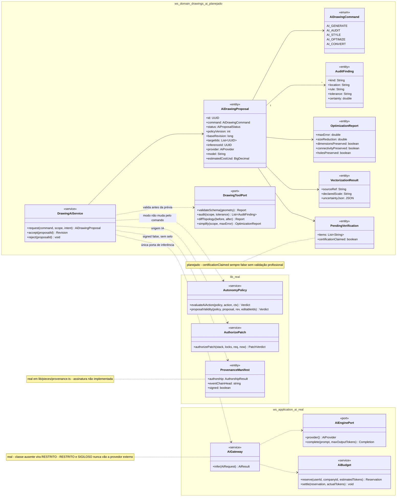
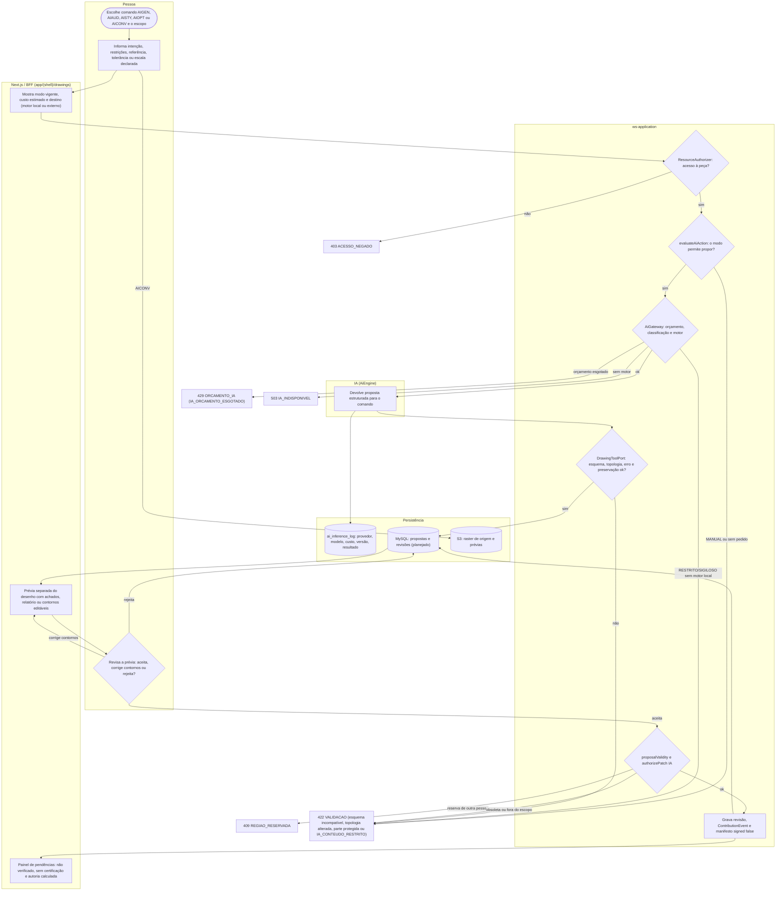
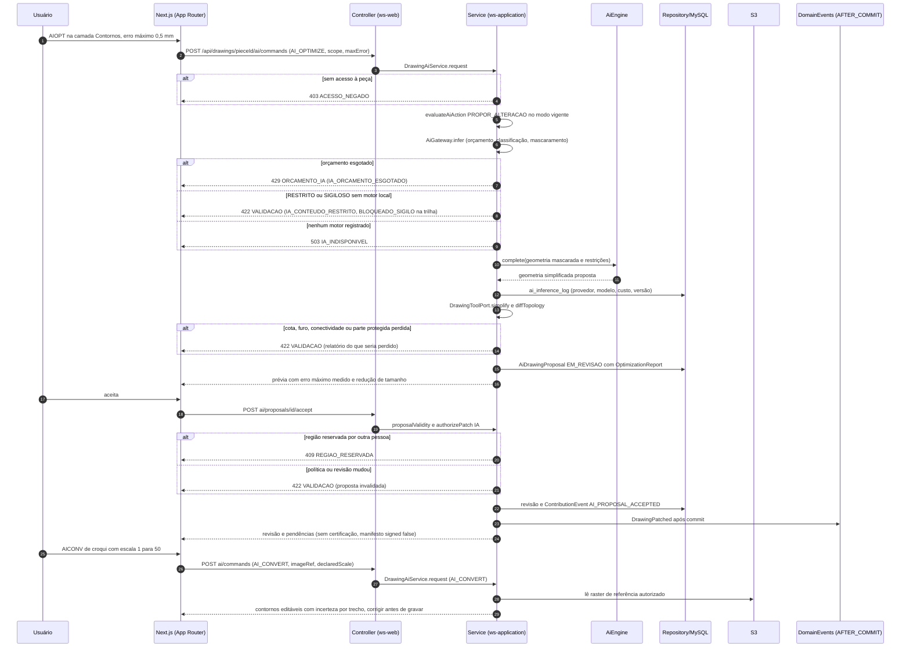
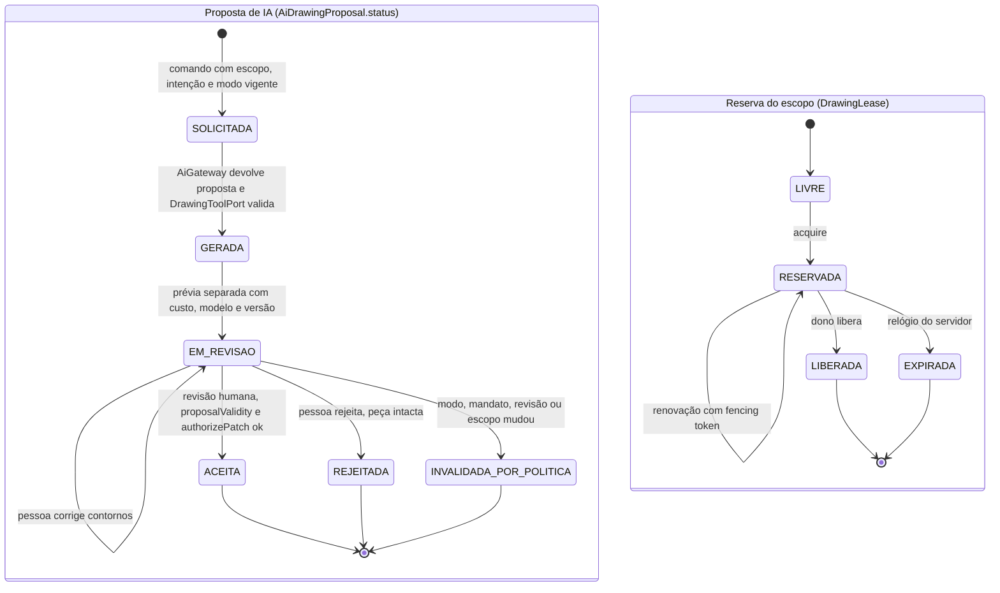
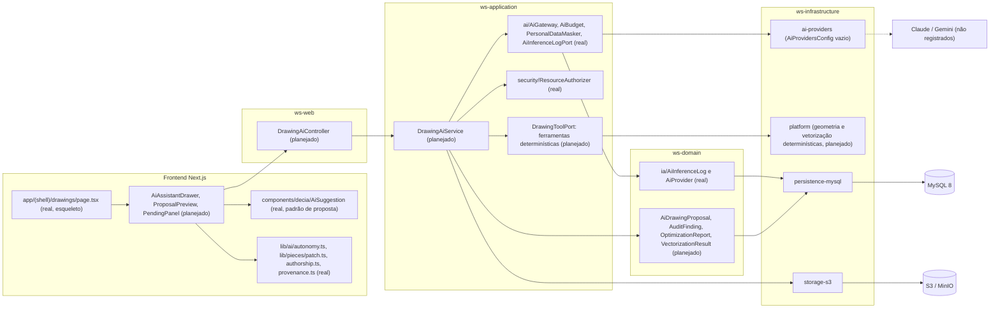

# RF68 — Gerar, auditar, estilizar, otimizar e converter desenhos com IA
**HU:** — (sem HU no board; RF especificado em 15/10/2026) · **Sprint (board Work Station):** lista *Requisitos Funcionais* sem sprint atribuída · **Equivalente FAI:** — · **Aba/rota:** Drawings (`/drawings`, `/drawings/[pieceId]`; peça aberta a partir de `/tasks/[id]` e da sessão DECIA `/decia/[sessionId]`) · **Página-esqueleto:** registrada em 17/10/2026; editor ainda não implementado (Onda 5 do PLANO_ONDAS)
**Critérios de aceite cobertos:** RF68.CA01 … RF68.CA07 — corpo do card = especificação de docs/produto/requisitos-studio/RF68.md (CAs copiados como estão escritos); classes reais: `AiGateway`/`AiEnginePort`/`AiBudget`/`AiInferenceLogPort`/`PersonalDataMasker` (ws-application, sem motor registrado), `AutonomyMode`/`evaluateAiAction`/`proposalValidity` (`lib/ai/autonomy.ts`), `authorizePatch`/`PatchOrigin` (`lib/pieces/patch.ts`), `computeAuthorship`/`ContributionEvent` (`lib/pieces/authorship.ts`), `buildProvenanceManifest` (`lib/pieces/provenance.ts`), `ClassifiedField` (`lib/pieces/classification.ts`), `DrawingAnnotation` (`lib/drawings/taxonomy.ts`), `AiSuggestion` (`components/decia`); o restante (planejado)

O RF68 reúne os cinco comandos de IA do Drawings — gerar (AI_GENERATE/AIGEN), auditar (AI_AUDIT/AIAUD), estilizar (AI_STYLE/AISTY), otimizar (AI_OPTIMIZE/AIOPT) e converter raster ou croqui em vetor (AI_CONVERT/AICONV) — como pedidos rastreáveis que devolvem propostas estruturadas e revisáveis, validadas por ferramentas determinísticas antes de tocar a peça. Cada comando respeita o nível de autonomia do RF51, passa por `authorizePatch` com origem IA, registra custo, provedor, modelo e versão e nunca publica certificação, aprovação técnica ou autoria humana presumida.

**Estado em 17/10/2026:** a MATRIZ_RF registra RF68 como AUSENTE (0.00) e o PLANO_ONDAS o coloca na **Onda 6 — IA no servidor** (nota 4.5 do protótipo local), pedindo ferramentas determinísticas por comando, contratos de IA e validação de topologia, fontes e custo. `CONECTORES.md`: nenhum provedor de IA ativo — `AiGateway` existe e é testado (orçamento `429 IA_ORCAMENTO_ESGOTADO`, sigilo `422 IA_CONTEUDO_RESTRITO` com registro `BLOQUEADO_SIGILO`, mascaramento, trilha sem prompt, `503 IA_INDISPONIVEL` sem motor local), mas não tem chamador de produção e `AiProvidersConfig` está vazio. RESTRITO/SIGILOSO nunca vão a provedor externo; classificação ausente é tratada como RESTRITO. As referências a Illustrator e AutoCAD são inspiração semântica, não paridade.

## Critérios de aceite

| CA | Enunciado (Dado / Quando / Então) |
|---|---|
| **RF68.CA01** | Dado AI_GENERATE/AIGEN, quando envia intenção e restrições, então recebe proposta estruturada de geometrias compatíveis com o motor e uma prévia revisável. |
| **RF68.CA02** | Dado AI_AUDIT/AIAUD, quando analisa, então aponta duplicatas, perfis abertos, colisões e achados técnicos com localização, regra, tolerância e grau de certeza. |
| **RF68.CA03** | Dado AI_STYLE/AISTY, quando seleciona referência, então propõe materiais/traços/hachuras sem modificar topologia ou acesso silenciosamente. |
| **RF68.CA04** | Dado AI_OPTIMIZE/AIOPT, quando simplifica, então mede erro máximo, redução de tamanho e preserva cotas, conectividade, furos e partes protegidas. |
| **RF68.CA05** | Dado AI_CONVERT/AICONV, quando vetoriza raster/croqui, então mantém referência, escala declarada e incertezas; permite corrigir contornos antes de gravar. |
| **RF68.CA06** | Dado nível 1 a 4, quando executa esses comandos, então respeita RF51 e não amplia autonomia por causa do nome do comando. |
| **RF68.CA07** | Dado resultado não verificável, quando conclui, então informa pendências e não publica certificação ABNT, aprovação técnica ou autoria humana presumida. |

## Contrato por comando (planejado)

| Comando | Ferramenta determinística que valida | Saída revisável | Nunca faz |
|---|---|---|---|
| AI_GENERATE | Esquema de geometria do motor (tipos suportados, unidades, camada alvo) | Prévia vetorial separada | Gravar sem aceite |
| AI_AUDIT | Detectores de duplicata, perfil aberto e colisão com tolerância | Lista de achados com localização, regra, tolerância e certeza | Corrigir sozinho |
| AI_STYLE | Comparação de topologia e ACL antes e depois | Materiais, traços e hachuras propostos | Alterar geometria ou acesso |
| AI_OPTIMIZE | Erro máximo (Hausdorff), contagem de nós, cotas, conectividade, furos e partes protegidas | Relatório antes/depois | Remover parte protegida |
| AI_CONVERT | Referência da imagem, escala declarada e incerteza por contorno | Contornos editáveis antes de gravar | Inventar escala |

O nível de autonomia vem da política da peça ou sessão (cinco modos de `lib/ai/autonomy.ts`, D-136, que substituem os níveis 1 a 4 da especificação): o nome do comando nunca muda o modo. Revisar a prévia tem equivalente por teclado e campos numéricos para cada ajuste de contorno (WCAG 2.5.7).

## 1. Diagrama de classes

## 2. Diagrama de atividades

## 3. Diagrama de sequência

## 4. Máquina de estados

Entidades: proposta de comando de IA (`AiDrawingProposal.status`, planejado sobre `AiProposal` real) e reserva do escopo alvo (`DrawingLease`, planejado sobre `RegionLock` real). A categoria de autoria final vem de `computeAuthorship` (real) e pode ser `UNVERIFIED` quando os logs estão incompletos.

`429 ORCAMENTO_IA`, `503 IA_INDISPONIVEL` e `422 IA_CONTEUDO_RESTRITO` encerram o pedido sem proposta; não há repetição automática de chamada cobrada. `ACEITA` não equivale a aprovação técnica: pendências continuam abertas.

## 5. Diagrama de componentes

## 6. Rastreabilidade

| CA | Classe | Passo | Mensagem | Transição | Componente |
|---|---|---|---|---|---|
| RF68.CA01 | `AiDrawingCommand.AI_GENERATE`, `DrawingToolPort.validateSchema`, `AiDrawingProposal` | P0 → P1 → S3 → I1 → S4 → B2 | POST ai/commands, alt 422 esquema | PROP `SOLICITADA → GERADA → EM_REVISAO` | `AIS`, `TP`, `GW` |
| RF68.CA02 | `AuditFinding` (kind, location, rule, tolerance, certainty), `DrawingToolPort.audit` | S4 → B2 | prévia com achados | PROP `GERADA → EM_REVISAO` | `TP`, `PLAT` |
| RF68.CA03 | `DrawingToolPort.diffTopology`, `ResourceAuthorizer` (real) | S4 → E422 ou B2 | alt 422 topologia ou acesso alterado | — | `TP`, `RA` |
| RF68.CA04 | `OptimizationReport` (maxError, sizeReduction, cotas, conectividade, furos) | S4 → B2 → P2 | DrawingToolPort.simplify, alt 422 perda | PROP `EM_REVISAO → ACEITA` | `TP`, `PLAT` |
| RF68.CA05 | `VectorizationResult` (sourceRef, declaredScale, uncertaintyJson) | P1 → D3 → B2 → P2 corrige | AICONV, contornos editáveis | PROP `EM_REVISAO → EM_REVISAO` | `S3A`, `PLAT` |
| RF68.CA06 | `AutonomyPolicy.evaluateAiAction` (real), `AuthorizePatch` origem IA (real) | S2 → E422 ou S3; S5 | evaluateAiAction no modo vigente | PROP `EM_REVISAO → INVALIDADA_POR_POLITICA` | `LIB`, `AIS` |
| RF68.CA07 | `PendingVerification`, `ProvenanceManifest.signed=false` (real), `computeAuthorship` (real) | S6 → B3 | revisão e pendências sem certificação | PROP `ACEITA` sem aprovação técnica | `LIB`, `ED` |
