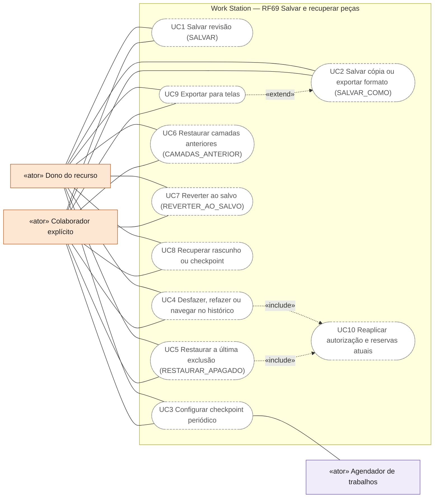
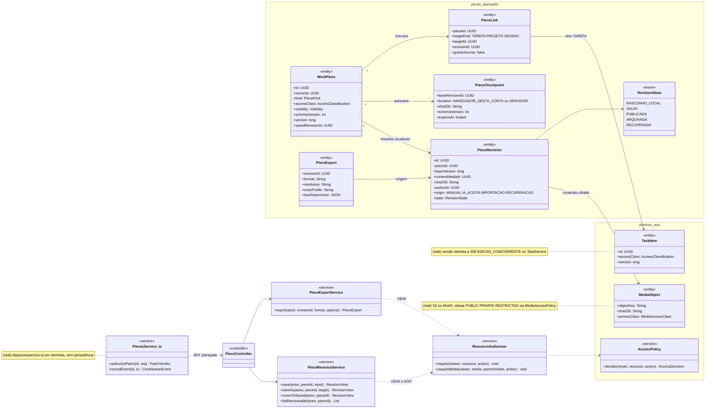
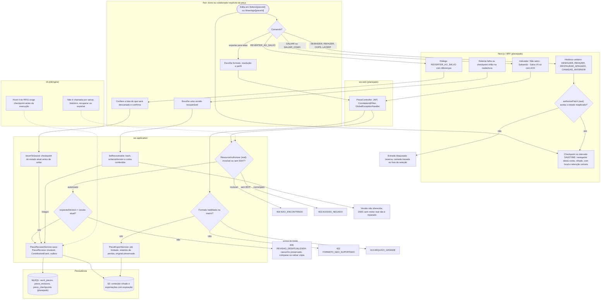
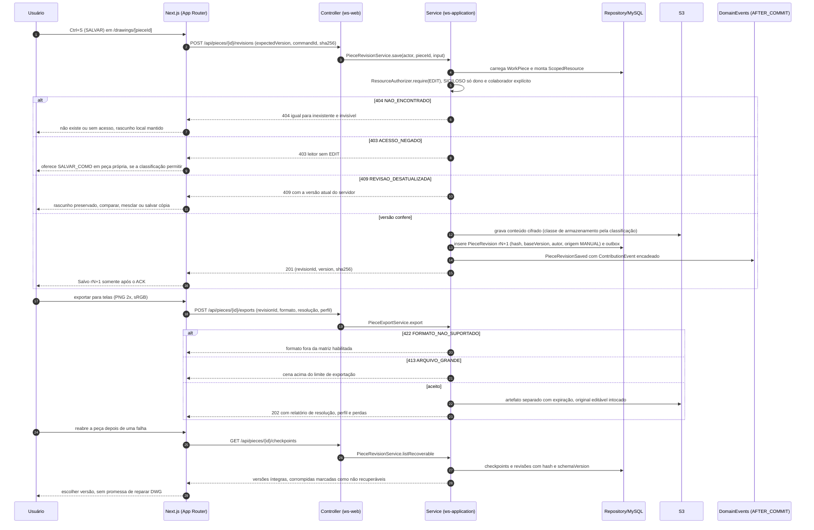
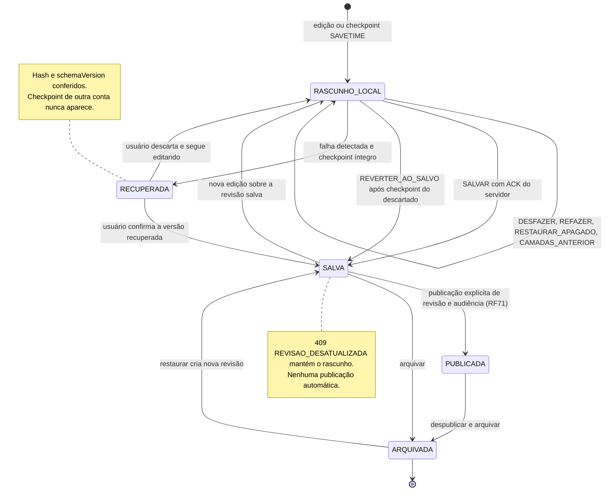
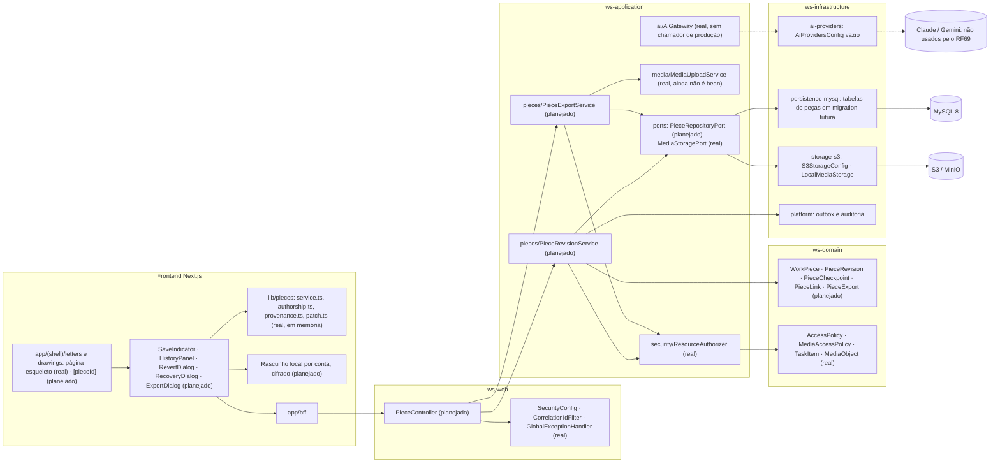

# RF69 — Salvar, exportar, recuperar e navegar no histórico das peças
**HU:** — (sem HU no board; RF especificado em 15/10/2026) · **Sprint (board Work Station):** lista *Requisitos Funcionais* sem sprint atribuída · **Equivalente FAI:** — · **Aba/rota:** Letters (`/letters`, `/letters/[pieceId]`) e Drawings (`/drawings`, `/drawings/[pieceId]`); peça aberta a partir de `/tasks/[id]`, `/projects/[id]` e da sessão DECIA `/decia/[sessionId]` · **Página-esqueleto:** registrada em 17/10/2026; editores ainda não implementados (Ondas 3–5 do PLANO_ONDAS)
**Critérios de aceite cobertos:** RF69.CA01 … RF69.CA08 — corpo do card = especificação de docs/produto/requisitos-studio/RF69.md (CAs copiados como estão escritos); classes reais: `TaskItem.version` e o 409 `EDICAO_CONCORRENTE` do `TaskService`/`TaskController` (padrão de concorrência a reutilizar), `ResourceAuthorizer`, `AccessPolicy`, `MediaAccessPolicy`, `MediaObject`, `MediaUploadService` (escrito, ainda não é bean — D-67), `lib/pieces/service.ts` (`WorkPiece`/`PiecesService` em memória), `lib/pieces/authorship.ts`, `lib/pieces/provenance.ts`, `lib/pieces/patch.ts`; o restante (planejado)

Protege o trabalho de Letters e Drawings contra falhas e alterações indesejadas. `SALVAR` grava uma `PieceRevision` imutável no servidor e a interface só mostra "Salvo" depois do ACK. `SALVAR_COMO` cria uma cópia com origem ou exporta um formato identificado. Checkpoints periódicos ficam em local declarado, com política de acesso e retenção. `DESFAZER`, `REFAZER`, `RESTAURAR_APAGADO`, `CAMADAS_ANTERIOR`, `REVERTER_AO_SALVO` e a recuperação de rascunho nunca apagam a trilha, nunca duplicam IDs e nunca concedem acesso. Toda transição registra autoria (`ContributionEvent`) e proveniência.

**Estado em 17/10/2026:** a MATRIZ_RF classifica o RF69 como AUSENTE (0,00): o app não tem rota de editor, autosave, exportação nem recuperação. O protótipo local de 16/10, fora do app, exportava JSON e PNG, mas perdia a peça ao recarregar e tinha histórico 2D/3D fragmentado (PLANO_ONDAS, Onda 3, nota de referência 5,25). A meta da Onda 3 é persistir documento e revisões com autosave recuperável, backup e importação/exportação auditáveis. Já existem no repositório o modelo de concorrência por versão das tarefas (`TaskService`, 409 `EDICAO_CONCORRENTE`, D-135), a autorização por recurso (`ResourceAuthorizer` + `AccessPolicy`, em que SIGILOSO não admite ADMIN implícito, D-139) e as bibliotecas puras de peça em `lib/pieces/` (autoria encadeada por hash, manifesto de proveniência sem assinatura, `authorizePatch`). A conclusão do RF segue a prova do RF72: CA → teste → evidência.

## Critérios de aceite

| CA | Enunciado (Dado / Quando / Então) |
|---|---|
| **RF69.CA01** | Dados QSAVE/Ctrl+S e SAVEAS/Save a Copy, quando executa, então salva versão persistida ou exporta formato identificado, sem simular escrita em servidor. |
| **RF69.CA02** | Dado SAVETIME/autosalvamento, quando configurado, então registra checkpoints no intervalo, identifica onde estão armazenados e aplica política de acesso e retenção. |
| **RF69.CA03** | Dado UNDO/REDO ou painel histórico, quando retorna a um estado, então preserva versões e reaplica autorizações/reservas atuais. |
| **RF69.CA04** | Dado OOPS, quando restaura última exclusão, então não desfaz edições posteriores nem duplica IDs ou recria conteúdo fora de permissão. |
| **RF69.CA05** | Dado LAYERP, quando restaura visibilidade/configuração anterior, então não altera geometria nem concede acesso. |
| **RF69.CA06** | Dado Revert/F12, quando volta à última versão salva, então mostra o que será descartado e mantém ponto recuperável. |
| **RF69.CA07** | Dado RECOVER/RECOVERALL/DRAWINGRECOVERY, quando arquivo/checkpoint falha, então valida integridade, oferece versões recuperáveis e não promete reparar DWG sem suporte real. |
| **RF69.CA08** | Dada exportação para telas, quando otimiza, então mantém original editável e informa resolução, perfil e perdas. |

## Comandos e matriz de exportação

Os comandos de referência vêm de `docs/auditoria/2026-10-17/referencias/COMANDOS_REFERENCIA_ILLUSTRATOR_AUTOCAD.md` §3. Servem de inspiração semântica, não de promessa de paridade: a interface usa os nomes próprios do Work Station e descreve o que cada comando faz de fato.

| Referência | Comando do Work Station | O que faz de fato (planejado) | CA |
|---|---|---|---|
| QSAVE / Ctrl+S | `SALVAR` | `POST /api/pieces/{id}/revisions` com `expectedVersion` e `commandId` idempotente; "Salvo rN" só com ACK (versão + hash) | CA01 |
| SAVEAS / Save a Copy | `SALVAR_COMO` | nova `WorkPiece` com `PieceLink` de origem ou exportação de formato da matriz | CA01, CA08 |
| SAVETIME / AUTOSAVE | checkpoint periódico | intervalo configurável; mostra onde está (navegador desta conta ou servidor) e a retenção | CA02 |
| UNDO / REDO / History panel | `DESFAZER`, `REFAZER`, painel de histórico | navega entradas unitárias; reaplicar passa de novo por `authorizePatch` (camada, seleção, reserva) | CA03 |
| OOPS | `RESTAURAR_APAGADO` | recria só os objetos da última exclusão, com os IDs originais, se continuam livres e permitidos | CA04 |
| LAYERP | `CAMADAS_ANTERIOR` | restaura visibilidade, trava e ordem das camadas; não toca geometria nem ACL | CA05 |
| Revert (F12) | `REVERTER_AO_SALVO` | lista o que será descartado e grava checkpoint do estado atual antes de voltar | CA06 |
| RECOVER / RECOVERALL / DRAWINGRECOVERY | recuperação de rascunho | valida hash e `schemaVersion`; oferece versões íntegras; DWG sem motor validado não é "reparado" | CA07 |
| Export for Screens | exportação para telas | artefato separado com resolução, perfil de cor e perdas declaradas; original editável preservado | CA08 |

Matriz de escrita usada pelo `SALVAR_COMO`. Formato pendente não aparece como opção operacional na interface. A matriz completa de leitura/escrita/fidelidade é do RF70.

| Formato | Escrita no app hoje | Escrita planejada | Fidelidade a declarar antes do aceite |
|---|---|---|---|
| `ws-studio` / `ws-asset` (JSON nativo) | não há (só no protótipo fora do app) | Onda 3 | IDs, camadas, metadados e `schemaVersion` preservados |
| PNG (telas) | não há | Onda 3 | resolução, escala, perfil sRGB, fundo transparente ou não, vetores rasterizados |
| SVG | não há | pendente (RF70) | efeitos e hachuras achatados |
| PDF / DOCX (Letters) | não há | pendente (RF70) | paginação e estilos aproximados |
| GLB | não há | pendente (RF70) | unidades, normais e materiais compatíveis |
| DWG | não há | sem motor/SDK validado: não oferecido | — |

## 0. Diagrama de casos de uso

Casos de uso derivados dos CAs. Todos são planejados: não há rota de editor, autosave, exportação nem recuperação; os nomes dos comandos são do Work Station, sem promessa de paridade com Illustrator ou AutoCAD.

| Caso de uso | Ator(es) | CAs | Situação |
|---|---|---|---|
| UC1 Salvar revisão (SALVAR) | `dono`, `colaborador` | RF69.CA01 | planejado |
| UC2 Salvar cópia ou exportar formato (SALVAR_COMO) | `dono`, `colaborador` | RF69.CA01, RF69.CA08 | planejado |
| UC3 Configurar checkpoint periódico | `dono`, `colaborador`, `agendador` | RF69.CA02 | planejado |
| UC4 Desfazer, refazer ou navegar no histórico | `dono`, `colaborador` | RF69.CA03 | planejado |
| UC5 Restaurar a última exclusão (RESTAURAR_APAGADO) | `dono`, `colaborador` | RF69.CA04 | planejado |
| UC6 Restaurar camadas anteriores (CAMADAS_ANTERIOR) | `dono`, `colaborador` | RF69.CA05 | planejado |
| UC7 Reverter ao salvo (REVERTER_AO_SALVO) | `dono`, `colaborador` | RF69.CA06 | planejado |
| UC8 Recuperar rascunho ou checkpoint | `dono`, `colaborador` | RF69.CA07 | planejado |
| UC9 Exportar para telas | `dono`, `colaborador` | RF69.CA08 | planejado |
| UC10 Reaplicar autorização e reservas atuais | — (incluído por UC4, UC5) | RF69.CA03, RF69.CA04 | planejado (regra pura `authorizePatch`) |

## 1. Diagrama de classes

Legenda: **(real)** = código no repositório em 17/10/2026; demais classes **(planejado)**. `WorkPiece`, `PieceRevision` e `PieceLink` seguem `docs/produto/LETTERS_DRAWINGS_ENGENHARIA.md` §3 e ainda não estão na TAXONOMIA; `TaskItem`, `MediaObject`, `DeciaSession` e `ProjectScheme` usam os nomes e atributos da TAXONOMIA.

## 2. Diagrama de atividades

## 3. Diagrama de sequência

## 4. Máquina de estados

Entidade central: `PieceRevision.state` (`RevisionState`, planejado). Cada transição grava `ContributionEvent` (cadeia SHA-256 de `lib/pieces/authorship.ts`, real) e auditoria; restaurar ou recuperar cria nova revisão, nunca reescreve a anterior.

## 5. Diagrama de componentes

## 6. Rastreabilidade

| CA | Classe | Passo | Mensagem | Transição | Componente | Prova exigida (RF72) |
|---|---|---|---|---|---|---|
| **RF69.CA01** | `PieceRevisionService.save/saveAs`, `PieceRevision`, `PieceExport`, `commandId` idempotente | A1 → F4 → W1 → P1 → P2 → P3 | `POST /api/pieces/{id}/revisions` até "Salvo rN+1" | `RASCUNHO_LOCAL → SALVA` | `PC`, `PRS`, `MY`, `S3A` | teste de serviço (salvar, reabrir após reinício, ACK) e E2E de recarregar a página sem perder a peça |
| **RF69.CA02** | `PieceCheckpoint` (`location`, `expiresAt`), `CheckpointLocation` | A0 → F1 | `GET /api/pieces/{id}/checkpoints` | `[*] → RASCUNHO_LOCAL` | `R4`, `PRS` | teste do intervalo com relógio controlado; tela mostra local e retenção; outra conta no mesmo navegador não vê o checkpoint |
| **RF69.CA03** | histórico unitário, `authorizePatch` (real, `lib/pieces/patch.ts`), `RegionLock` | A1 → F2 → F3 | — (local) | `RASCUNHO_LOCAL → RASCUNHO_LOCAL` | `R2`, `R3` | teste: refazer contra camada travada ou região reservada é bloqueado; versões salvas intactas |
| **RF69.CA04** | `RESTAURAR_APAGADO`, IDs preservados, `authorizePatch` | A1 → F2 → F3 → E3 | — (local) | `RASCUNHO_LOCAL → RASCUNHO_LOCAL` | `R2`, `R3` | teste: excluir, editar outro objeto, restaurar; edição posterior permanece, sem ID duplicado |
| **RF69.CA05** | `CAMADAS_ANTERIOR` sobre `LayerStack` (`lib/pieces/layers.ts`, real) | A1 → F2 | — (local) | `RASCUNHO_LOCAL → RASCUNHO_LOCAL` | `R2`, `R3` | teste: hash da geometria igual antes e depois; ACL da peça inalterada |
| **RF69.CA06** | `PieceRevisionService.revertToSaved`, `PieceCheckpoint` | A1 → F5 → A2 → P4 → P3 | — (`POST /api/pieces/{id}/restore`) | `RASCUNHO_LOCAL → SALVA` (após checkpoint) | `R2`, `PRS` | teste: diálogo lista diferenças; o estado descartado continua recuperável |
| **RF69.CA07** | `PieceRevisionService.listRecoverable` (verifica integridade), `sha256`, `schemaVersion` | F6 → A3 → P5 → E5 | `GET /api/pieces/{id}/checkpoints` e versões íntegras | `RASCUNHO_LOCAL → RECUPERADA → SALVA` | `PRS`, `R4` | teste com checkpoint truncado e hash divergente; mensagem sem promessa de reparo DWG |
| **RF69.CA08** | `PieceExportService.export`, `PieceExport.lossReportJson`, `MediaUploadService` (real) | A4 → W1 → P6 → P7 | `POST /api/pieces/{id}/exports` com 422, 413 e 202 | — (revisão inalterada) | `PES`, `S3A`, `MUS` | teste: PNG exportado é PNG verdadeiro (assinatura, dimensões, perfil); original editável reabre igual |
