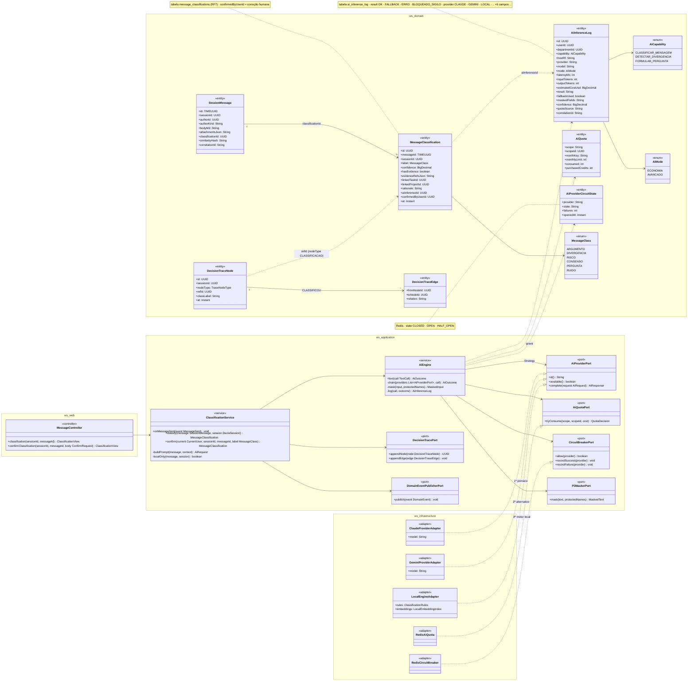
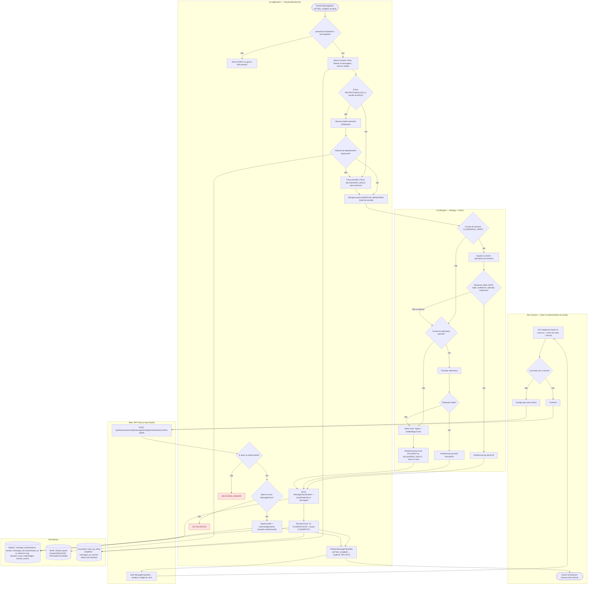
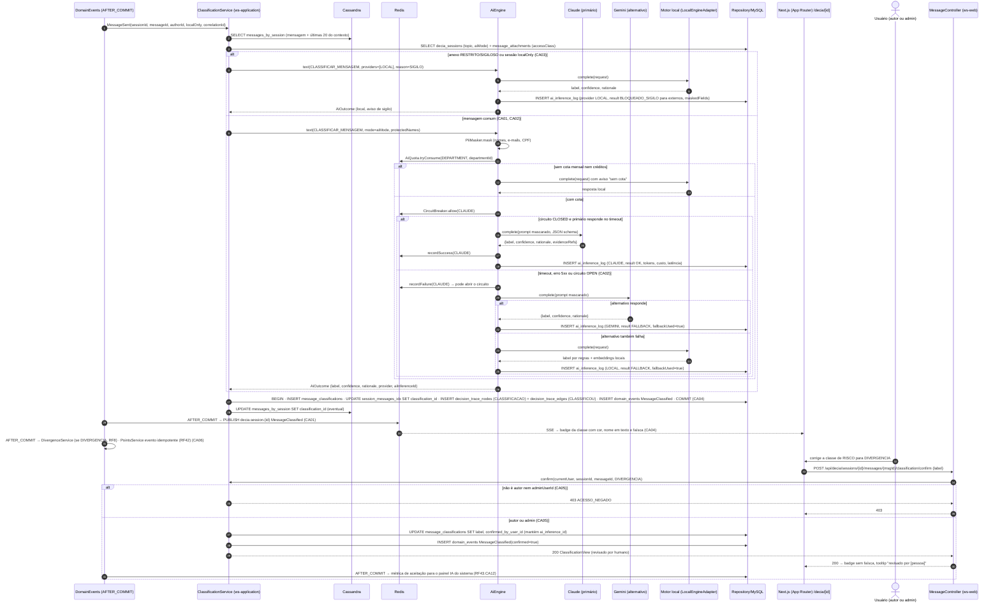
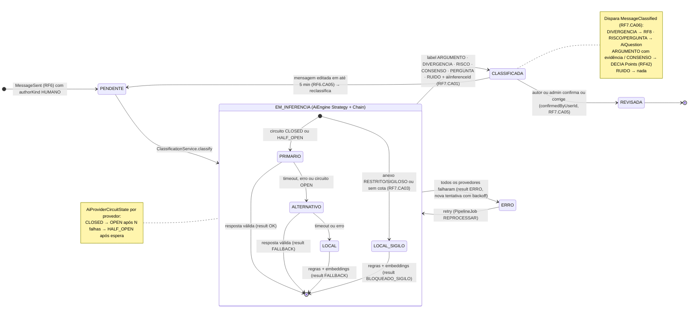
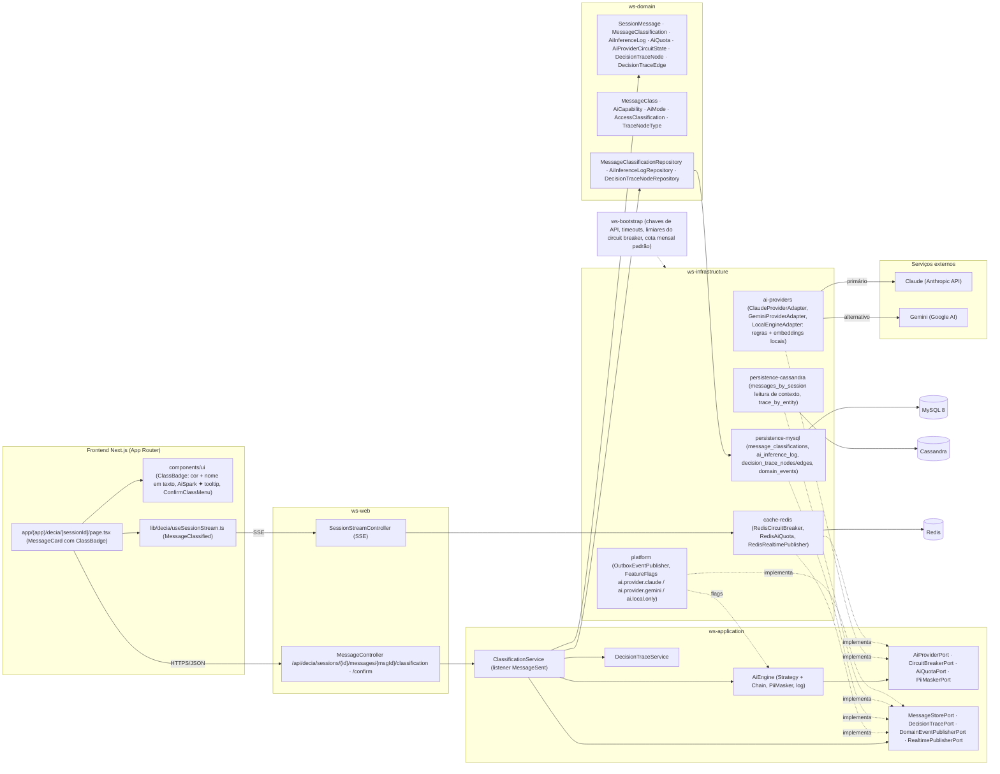

# RF7 — Classificar as mensagens enviadas em diferentes categorias, tais como: argumento, divergência, risco, consenso.
**HU:** HU7 · **Sprint (board Work Station):** 2 · **Equivalente FAI:** RF24 Usar a IA do sistema (`AiEngine` Strategy + Chain of Responsibility: provedor primário → alternativo → motor local, `ai_inference_log`, circuit breaker, fallback) + RF10 Copilot (classificação das mensagens) · **Aba/rota:** DECIA (`/decia/[sessionId]` — badge de classe no card da mensagem, painel "IA do sistema" no admin RF18/RF43) — rota sugerida
**Critérios de aceite cobertos:** RF7.CA01 … RF7.CA06 (RF1–RF18 não têm CAs no board: derivados da HU7 + RF29/RF42/RF43 e marcados "CA a confirmar")

> **HU7** — COMO IA do sistema POSSO classificar automaticamente as mensagens enviadas em categorias como argumento, divergência, risco e consenso PARA estruturar a discussão e subsidiar análises e decisões fundamentadas.

## Critérios de aceite derivados da HU7 (todos "CA a confirmar")

| CA | Enunciado (Dado / Quando / Então) |
|---|---|
| **RF7.CA01** (CA a confirmar) | Dado o evento `MessageSent` (RF6) de uma mensagem `authorKind HUMANO`, então o `ClassificationService` classifica de forma **assíncrona** em `MessageClass` ARGUMENTO · DIVERGENCIA · RISCO · CONSENSO · PERGUNTA · RUIDO, gravando `MessageClassification` (label, `confidence` 0–1, `rationale`, `hasEvidence`, `evidenceRefsJson`) e preenchendo `SessionMessage.classificationId`; o card da mensagem recebe o badge em até 5 s (p95) via SSE. |
| **RF7.CA02** (CA a confirmar) | Dado o `AiEngine` (Strategy + Chain), então a inferência tenta o **provedor primário** (Claude ou Gemini, conforme `FeatureFlag ai.provider.*`), depois o **alternativo** e por fim o **motor local** (regras + embeddings locais); timeout, erro, cota esgotada ou `AiProviderCircuitState OPEN` avançam a cadeia; cada chamada gera `AiInferenceLog` (capability CLASSIFICAR_MENSAGEM, provider, model, mode, latencyMs, tokens, estimatedCostUsd, result OK/FALLBACK/ERRO, fallbackUsed, correlationId). |
| **RF7.CA03** (CA a confirmar) | Dado uma mensagem cujo anexo tem `accessClass RESTRITO` ou `SIGILOSO` (ou sessão marcada `localOnly`), então a classificação roda **somente no motor local** (`provider LOCAL`, `result BLOQUEADO_SIGILO` para a tentativa externa) com aviso no card; em qualquer chamada externa, dados pessoais são **mascarados** antes (`maskedFields`), conforme RF43.CA02 e LGPD. |
| **RF7.CA04** (CA a confirmar) | Dado a classificação concluída, então ela liga o argumento ao item citado (`linkedTaskId`/`linkedProjectId`, RF29) e é exibida com a cor da classe (argumento azul, divergência laranja, risco vermelho, consenso verde, pergunta roxa) **com o nome em texto** (RF38.CA05/CA07) e a faísca ✦ com tooltip "gerado por IA em [data]" (RF38.CA04); o nó `DecisionTrace CLASSIFICACAO` e a aresta `CLASSIFICOU` são gravados (append-only). |
| **RF7.CA05** (CA a confirmar) | Dado o autor da mensagem ou o administrador da sessão, quando confirma ou corrige a classe (`POST …/classification/confirm {label}`), então `confirmedByUserId` e o novo `label` são gravados mantendo o `aiInferenceId` original, o badge perde a faísca (revisado por humano) e a taxa de aceitação alimenta o painel "IA do sistema" (RF43.CA12); outros participantes não podem corrigir (`403 ACESSO_NEGADO`). |
| **RF7.CA06** (CA a confirmar) | Dado a classificação, então ela dispara os efeitos via `MessageClassified` (AFTER_COMMIT): DIVERGENCIA → `DivergenceService` (RF8), RISCO/PERGUNTA → candidata a `AiQuestion` (RF8/RF16), ARGUMENTO com `hasEvidence` ou CONSENSO confirmado → evento pontuável idempotente (RF42.CA01); RUIDO e mensagens repetidas (`similarityHash`) não pontuam; a cota `AiQuota` do departamento é consumida (sem cota → motor local com aviso). |

## 1. Diagrama de classes

## 2. Diagrama de atividades

Raias: Participante (autor/admin, só na confirmação) · Web/BFF · `ws-application` · IA (AiEngine) · Persistência. O gatilho é o evento `MessageSent` do RF6, não uma ação humana.

## 3. Diagrama de sequência

Caminho feliz (primário responde), `alt` de fallback em cadeia (CA02), `alt` de sigilo (CA03) e confirmação humana (CA05). Sem ponto e vírgula nas mensagens.

## 4. Máquina de estados

Entidade central: `MessageClassification`. Não há enum de status na TAXONOMIA, então os estados são **implícitos**: pendente (mensagem sem `classificationId`), em inferência (cadeia do AiEngine), classificada (`label` + `aiInferenceId`) e revisada (`confirmedByUserId`). O estado composto mostra a cadeia primário → alternativo → local e o circuito do provedor.

## 5. Diagrama de componentes

## 6. Rastreabilidade

| CA | Classe (§1) | Passo da atividade (§2) | Mensagem da sequência (§3) | Transição de estado (§4) | Componente (§5) |
|---|---|---|---|---|---|
| RF7.CA01 | `ClassificationService.onMessageSent/classify`, `MessageClassification.label/confidence/rationale/hasEvidence`, `MessageClass`, `SessionMessage.classificationId` | `C0`, `C1`, `C3`, `C8`, `C12`, `B1` | 1–3, 12, 30–33 | `[*] → PENDENTE → EM_INFERENCIA → CLASSIFICADA` | `S1`, `W2`, `FE3`, `I3 message_classifications` |
| RF7.CA02 | `AiEngine.text/chain`, `AiProviderPort` (Claude → Gemini → Local), `CircuitBreakerPort`/`AiProviderCircuitState`, `AiInferenceLog` | `I1`–`I7c` | 17–29 (`alt` timeout/erro → alternativo → local, `ai_inference_log` OK/FALLBACK) | composto `EM_INFERENCIA` (PRIMARIO → ALTERNATIVO → LOCAL), `→ ERRO` | `S2`, `I1 ai-providers`, `I2 RedisCircuitBreaker`, `X1`, `X2` |
| RF7.CA03 | `ClassificationService.localOnly`, `PiiMaskerPort`, `AiInferenceLog.maskedFields/result BLOQUEADO_SIGILO`, `AccessClassification` | `C4` → `C5`, `C6` | 4–9 (`alt` sigilo → só LOCAL), 13 (mask) | `[*] → LOCAL_SIGILO` | `I1 LocalEngineAdapter`, `S2 PiiMasker`, `I5 ai.local.only` |
| RF7.CA04 | `MessageClassification.linkedTaskId/linkedProjectId`, `DecisionTraceNode CLASSIFICACAO`, `DecisionTraceEdge CLASSIFICOU`, `DecisionTracePort` | `C13`, `B1`, `A1` | 30 (nós/arestas do trace), 33 (badge cor + texto + faísca) | nota em `CLASSIFICADA` | `FE2 ClassBadge/AiSpark`, `S3`, `I3 decision_trace_*`, `I4 trace_by_entity` |
| RF7.CA05 | `ClassificationService.confirm`, `MessageClassification.confirmedByUserId`, `MessageController.confirmClassification` | `A2`–`A4`, `B2`, `C15` → `E403`, `C16` → `E422`, `C17` | 35–44 (`confirm`, 403, revisado por humano) | `CLASSIFICADA → REVISADA` | `W1 /confirm`, `FE2 ConfirmClassMenu` |
| RF7.CA06 | `DomainEventPublisherPort` (`MessageClassified`), `AiQuotaPort`/`RedisAiQuota`/`AiQuota`, `SessionMessage.similarityHash` | `C1` → `C2`, `C7`, `C14` | 14–16 (cota), 34 (→ RF8, RF42) | nota em `CLASSIFICADA` | `I2 RedisAiQuota`, `I5 OutboxEventPublisher` |
