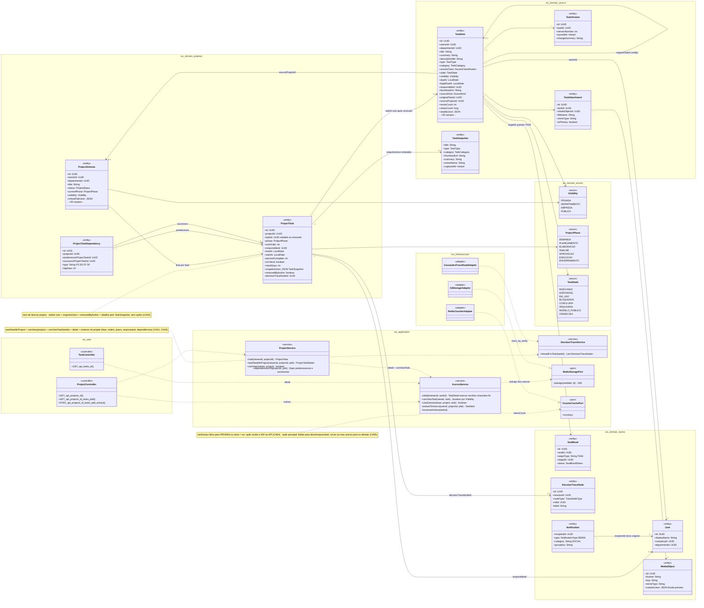
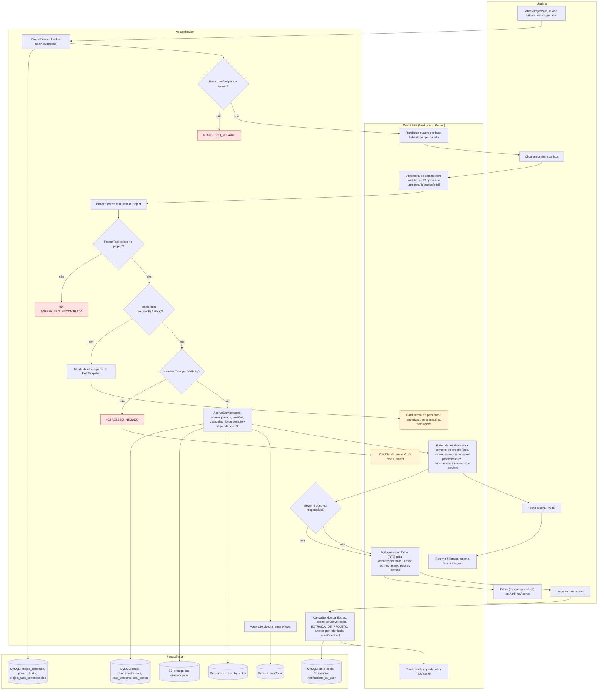
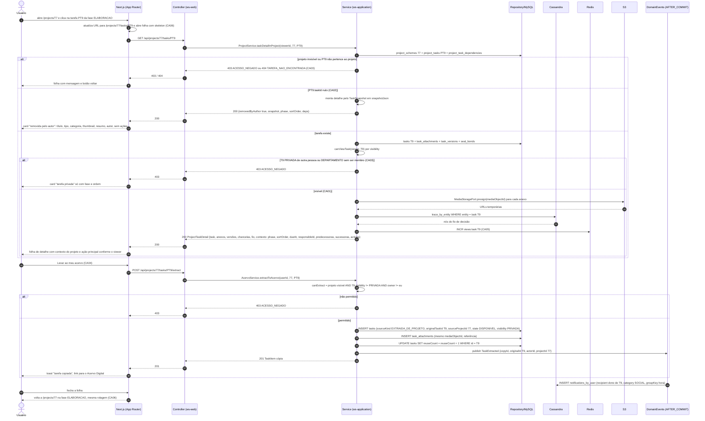
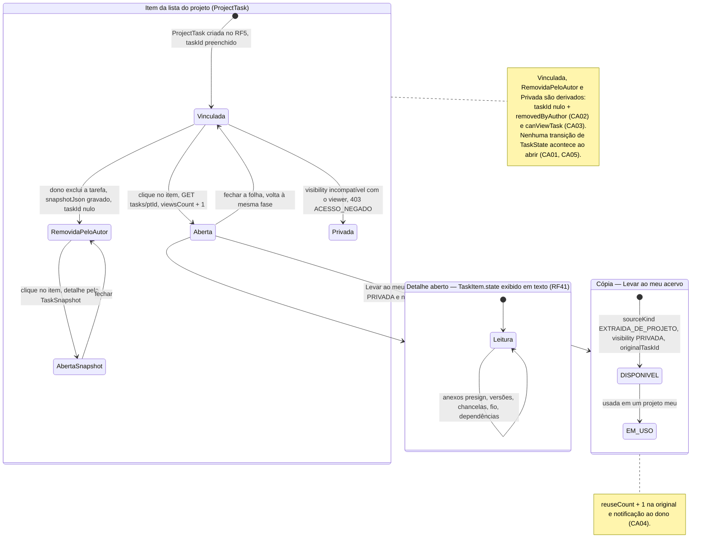
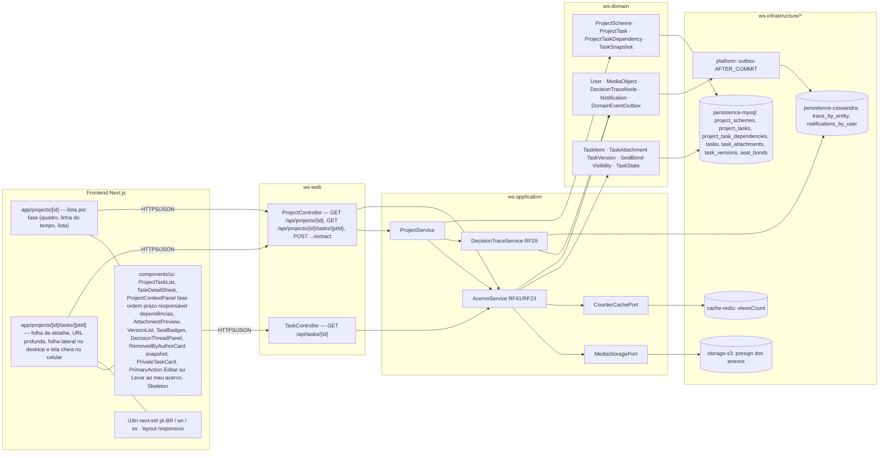

# RF7 — Abrir um esquema de tarefa a partir da lista de um esquema de projeto
**HU:** HU7 · **Sprint (board Work Station):** lista *Requisitos Funcionais* (sem sprint atribuída) · **Equivalente FAI:** RF7 Peça a partir do esquema (clicar numa peça do look abre o detalhe da peça com "Adicionar ao meu closet"; snapshot quando a peça foi excluída) · **Aba/rota:** detalhe do projeto `/projects/[id]` → lista de tarefas por fase → `/projects/[id]/tasks/[ptId]` (folha de detalhe, URL profunda), com atalho para `/tasks/[id]` e ação "Levar ao meu acervo" (destino: Acervo Digital, RF6/RF41)
**Critérios de aceite cobertos:** RF7.CA01 … RF7.CA06 — **todos "(CA a confirmar)"**: o corpo do card RF7 está vazio; os CAs foram derivados do título + HU7 e reaproveitam `_anterior/RF23` (snapshot RF23.CA03, "Levar ao meu acervo" RF23.CA01/CA05) e RF41.CA03 (detalhe da tarefa)

> **HU7** — COMO usuário visualizando um esquema de projeto POSSO clicar em um item da lista de tarefas PARA visualizar detalhes de uma tarefa e então compreender melhor o escopo do projeto.

A lista de um **Esquema de Projeto** (`ProjectScheme`) é a sequência de `ProjectTask` por fase (`ProjectPhase`). Clicar num item abre o **detalhe da tarefa** (`TaskItem`, RF41.CA03) **no contexto do projeto**: além dos dados da tarefa (resumo, anexos com preview via `MediaStoragePort.presign`, versões `TaskVersion`, chancelas `SealBond`, fio de decisão `DecisionTraceNode`), a folha mostra a fase, a ordem, o responsável e o prazo **daquele projeto** e as dependências (`ProjectTaskDependency`) predecessoras/sucessoras. Se a tarefa original foi excluída pelo autor (`ProjectTask.taskId` nulo, `removedByAuthor = true`), o detalhe é renderizado a partir do `TaskSnapshot` em `snapshotJson` (RF23.CA03). Para tarefas não-PRIVADAS de outras pessoas, a ação principal é **"Levar ao meu acervo"** (cópia `EXTRAIDA_DE_PROJETO` com crédito, RF23.CA01); para o dono/responsável, "Editar" (RF8). O RF7 **não altera estado** de nenhuma entidade além de `viewsCount` e da cópia opcional.

## Critérios de aceite derivados do título + HU7 (todos "CA a confirmar")

| CA | Enunciado (Dado / Quando / Então) | Fonte reaproveitada |
|---|---|---|
| **RF7.CA01** (CA a confirmar) | Dado um projeto visível para mim, quando clico num item da lista de tarefas (quadro por fase, linha do tempo ou lista), então abre a folha de detalhe da tarefa com título, tipo, categoria, resumo (3 linhas), estado (`TaskState` em texto), prazo (⚖ se legal), responsável, anexos com pré-visualização (`presign`), versões, chancelas, interações e o **contexto no projeto**: fase, ordem, prazo e responsável do `ProjectTask`, predecessoras e sucessoras; a URL fica profunda (`/projects/[id]/tasks/[ptId]`) e compartilhável. | RF41.CA03, RF22.CA03 |
| **RF7.CA02** (CA a confirmar) | Dado um `ProjectTask` com `taskId` nulo (tarefa excluída pelo autor), quando o abro, então o detalhe mostra o `TaskSnapshot` (título, tipo, categoria, thumbnail, resumo, autor, `capturedAt`) com o aviso "removida pelo autor", sem anexos nem ações de cópia/edição; fases e dependências do projeto continuam íntegras. | RF23.CA03, RF41.CA05 |
| **RF7.CA03** (CA a confirmar) | Dado que a tarefa tem `visibility` incompatível com o viewer (PRIVADA de outra pessoa, DEPARTAMENTO sem ser membro), quando clico no item, então o card aparece como "tarefa privada" (só fase e ordem) e a API responde `403 ACESSO_NEGADO`; `ProjectTask` inexistente no projeto → `404 TAREFA_NAO_ENCONTRADA`. | RF26.CA08, RF41.CA08 |
| **RF7.CA04** (CA a confirmar) | Dado o detalhe de uma tarefa não-PRIVADA que não é minha, quando aciono **"Levar ao meu acervo"**, então nasce uma cópia (`sourceKind EXTRAIDA_DE_PROJETO`, `originalTaskId`, `sourceProjectId`, `state DISPONIVEL`, `visibility PRIVADA`, anexos por referência ao mesmo `MediaObject`), `reuseCount` da original incrementa e o dono é notificado; ação oculta para PRIVADA (403 na API). | RF23.CA01, CA02, CA04, CA05 |
| **RF7.CA05** (CA a confirmar) | Dado que sou o dono da tarefa ou responsável no projeto, então a ação principal é **"Editar"** (abre RF8) e a alternativa "Abrir no Acervo" (`/tasks/[id]`); para os demais a ação principal é "Levar ao meu acervo" e as interações sociais (RF19 atual); toda abertura incrementa `viewsCount` (contador desnormalizado, sem evento). | RF41.CA07, RF26.CA07 |
| **RF7.CA06** (CA a confirmar) | Dado a folha aberta, quando fecho ou uso "voltar", então retorno à lista do projeto na mesma fase e posição de rolagem; a folha carrega com skeleton, respeita i18n pt-BR/en/es e layout responsivo (folha lateral no desktop, tela cheia no celular). | RF19.CA03, RF19.CA07 |

## 1. Diagrama de classes

## 2. Diagrama de atividades

## 3. Diagrama de sequência

## 4. Máquina de estados

O RF7 **não tem estados próprios**: ele lê `TaskItem.state` (`TaskState`, RF41) e o marcador derivado do `ProjectTask` (vinculada × removida pelo autor, RF23.CA03). A única escrita de estado é a da **cópia** criada por "Levar ao meu acervo", que nasce `DISPONIVEL`. O diagrama mostra o item da lista do projeto como entidade afetada e, aninhado, o que o detalhe exibe.

## 5. Diagrama de componentes

## 6. Rastreabilidade

| CA | Elemento do diagrama (classe / passo / mensagem / transição / componente) |
|---|---|
| RF7.CA01 (a confirmar) | Classes `ProjectTask` (phase, sortOrder, dueAt, responsibleId), `ProjectTaskDependency`, `TaskItem`, `TaskAttachment`, `TaskVersion`, `SealBond`, `DecisionTraceNode`, `ProjectService.taskDetailInProject/dependenciesOf`, `AcervoService.detail`, `MediaStoragePort.presign` · Atividades `U1 → A1 → W1 → U2 → W2 → A4 → A9 (sim) → A11 → P2/P3/P4 → W3` · Sequência msgs 1–5 e `else visível (CA01)` · Transição `Vinculada → Aberta → Detalhe` · Componentes `TaskDetailSheet`, `ProjectContextPanel`, `AttachmentPreview`, `VersionList`, `SealBadges`, `DecisionThreadPanel`, `storage-s3`, `persistence-cassandra` |
| RF7.CA02 (a confirmar) | Classes `ProjectTask.taskId nullable/snapshotJson/removedByAuthor`, `TaskSnapshot` · Atividades `A7 (sim) → A8 → W4` · Sequência `else PT9.taskId nulo (CA02)` · Transição `RemovidaPeloAutor → AbertaSnapshot` e nota · Componente `RemovedByAuthorCard snapshot` |
| RF7.CA03 (a confirmar) | `ProjectService.canView`, `AcervoService.canViewTask`, enum `Visibility` · Atividades `A2 (não) → A3 403`, `A5 (não) → A6 404 TAREFA_NAO_ENCONTRADA`, `A9 (não) → A10 403 → W5` · Sequência `alt projeto invisível ou PT9 não pertence` e `alt T9 PRIVADA … → 403` · Estado `Privada` · Componente `PrivateTaskCard` |
| RF7.CA04 (a confirmar) | Classes `TaskItem.sourceKind EXTRAIDA_DE_PROJETO/originalTaskId/sourceProjectId/reuseCount`, `TaskAttachment.mediaObjectId` (referência), `Notification`, `AcervoService.canExtract/extractToAcervo`, `ProjectController POST …/extract` · Atividades `U3 → A14 → P6 → W8` · Sequência `POST /api/projects/77/tasks/PT9/extract` com `alt não permitido → 403` / `else permitido` → INSERT tasks, task_attachments, reuseCount + 1, TaskExtracted → notifications_by_user · Estado composto `Copia` e nota · Componentes `PrimaryAction Levar ao meu acervo`, `outbox AFTER_COMMIT` |
| RF7.CA05 (a confirmar) | `AcervoService.incrementViews`, `CounterCachePort`, `RedisCounterAdapter`, `TaskItem.viewsCount` · Atividades `A12 → P5`, `A13 → W6 → U4/U3` · Sequência `INCR views:task:T9` e "ação principal conforme o viewer" · Transição `Vinculada → Aberta : viewsCount + 1` · Componentes `PrimaryAction Editar ou Levar ao meu acervo`, `cache-redis` |
| RF7.CA06 (a confirmar) | Atividades `W2` (skeleton + URL profunda), `U5 → W7` (mesma fase e rolagem) · Sequência msg 2 (URL profunda, skeleton) e msgs finais (fecha a folha → volta à fase) · Transição `Aberta → Vinculada : fechar a folha` · Componentes `app/projects/[id]/tasks/[ptId]`, `Skeleton`, `F4` (i18n, responsivo) |
