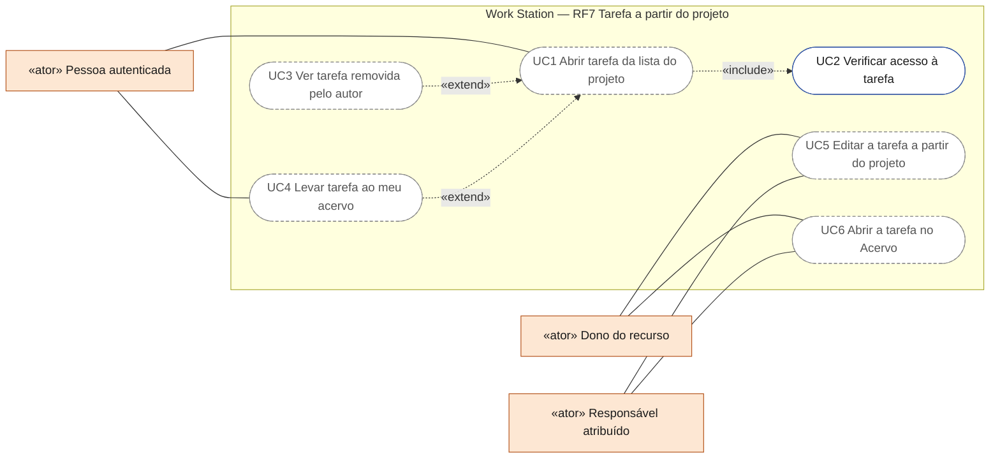
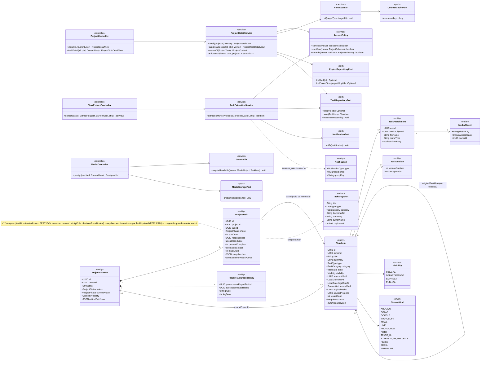
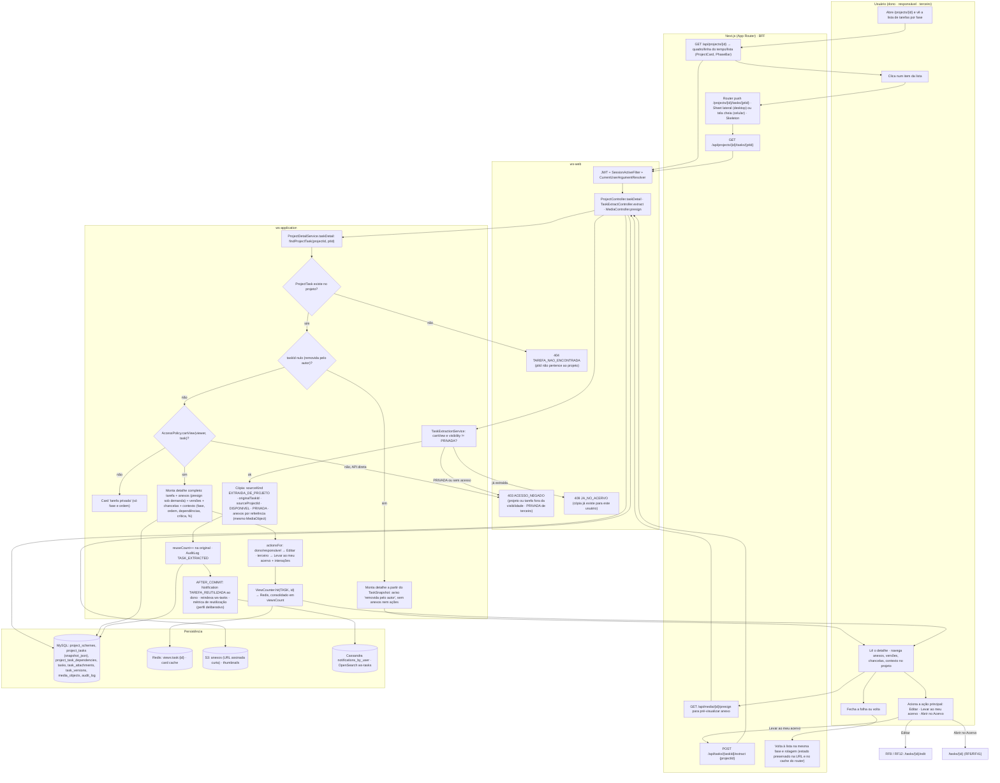
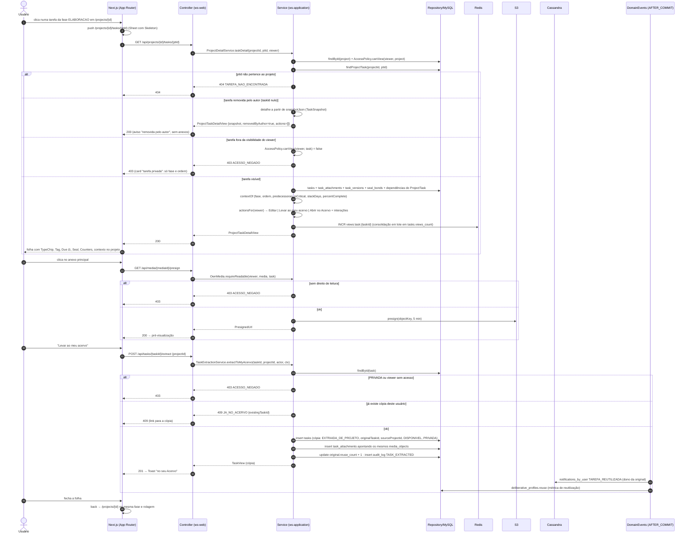
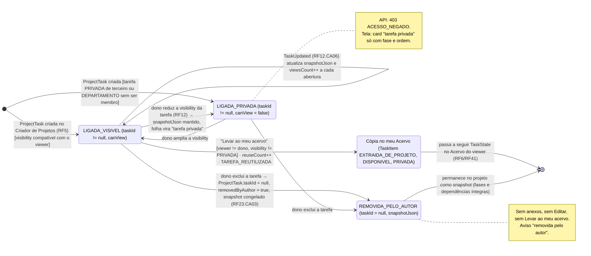
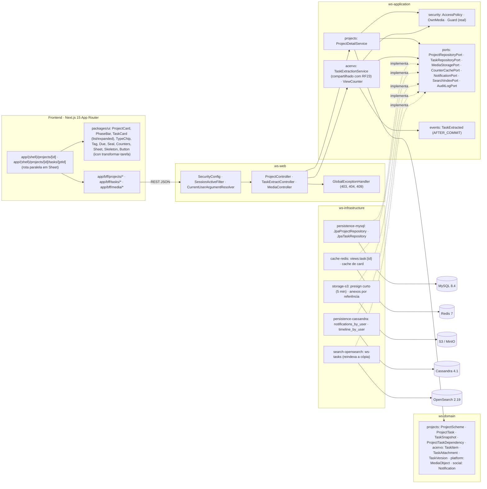

# RF7 — Abrir um esquema de tarefa a partir da lista de um esquema de projeto
**HU:** HU7 · **Sprint (board Work Station):** lista *Requisitos Funcionais* sem sprint atribuída (o card "SPRINT 2" cita "RF7 Classificar mensagens", escopo antigo — `RENUMERACAO.md`; fase (e) da ARQUITETURA §6) · **Equivalente FAI:** RF7 Peça a partir do esquema (clicar numa peça do look abre o detalhe da peça com "Adicionar ao meu closet"; snapshot quando a peça foi excluída) · **Aba/rota:** detalhe do projeto `/projects/[id]` → lista de tarefas por fase → `/projects/[id]/tasks/[ptId]` (folha de detalhe com URL profunda), atalho para `/tasks/[id]`, ação "Levar ao meu acervo" (destino: Acervo Digital, RF6/RF41); API `GET /api/projects/{id}`, `GET /api/projects/{id}/tasks/{ptId}`, `POST /api/tasks/{id}/extract` (compartilhado com RF23), `GET /api/media/{id}/presign`
**Critérios de aceite cobertos:** RF7.CA01 … RF7.CA06 — **todos "(CA a confirmar)"**: o corpo do card está vazio; os CAs foram derivados do título + HU7 e reaproveitam `_anterior/RF23` (snapshot RF23.CA03, "Levar ao meu acervo" RF23.CA01/CA05) e RF41.CA03 (detalhe da tarefa). Todas as classes do RF são **(planejado)**; reais só os transversais (`SecurityConfig`, `SessionActiveFilter`, `Guard`, `CorrelationIdFilter`, `AuditLogPort`).

> **HU7** — COMO usuário visualizando um esquema de projeto POSSO clicar em um item da lista de tarefas PARA visualizar detalhes de uma tarefa e então compreender melhor o escopo do projeto.

A lista do projeto é a lista de `ProjectTask` por fase (quadro, linha do tempo ou lista — RF22 §"Três visões"); clicar num item abre a **folha de detalhe** da `TaskItem` ligada (`ProjectTask.taskId`) ou, se o autor a excluiu, o `TaskSnapshot` guardado em `ProjectTask.snapshotJson` (TAXONOMIA §2.8). O que o viewer vê e pode fazer depende de `AccessPolicy` (visibilidade da tarefa) e do papel no projeto (dono, responsável, terceiro).

## Critérios de aceite derivados da HU7 (todos "CA a confirmar")

| CA | Enunciado (Dado / Quando / Então) | Origem |
|---|---|---|
| **RF7.CA01** (CA a confirmar) | Dado um projeto visível para mim, quando clico num item da lista de tarefas (quadro por fase, linha do tempo ou lista), então abre a folha de detalhe da tarefa com título, tipo (`TypeChip`), categoria, resumo (3 linhas), estado (`Tag` com nome em texto), prazo (`Due`, ⚖ se legal), responsável, anexos com pré-visualização (`GET /api/media/{id}/presign`), versões, chancelas (`Seal`), interações (`Counters`) e o **contexto no projeto** (fase, ordem, dependências, caminho crítico, `percentComplete`); a URL fica `/projects/{id}/tasks/{ptId}`. | RF41.CA03, RF22 |
| **RF7.CA02** (CA a confirmar) | Dado um `ProjectTask` com `taskId` nulo (tarefa excluída pelo autor, `removedByAuthor`), quando o abro, então o detalhe mostra o `TaskSnapshot` (título, tipo, categoria, thumbnail, resumo, `ownerName`, `capturedAt`) com o aviso "removida pelo autor", sem anexos nem ações de cópia/edição; fases e dependências do projeto continuam íntegras. | RF23.CA03, RF41.CA05 |
| **RF7.CA03** (CA a confirmar) | Dado que a tarefa tem `visibility` incompatível com o viewer (PRIVADA de outra pessoa, DEPARTAMENTO sem ser membro), quando clico no item, então o card aparece como "tarefa privada" (só fase e ordem) e a API responde `403 ACESSO_NEGADO`; `ProjectTask` inexistente no projeto → `404 TAREFA_NAO_ENCONTRADA`; projeto fora da minha visibilidade → `403`. | RF26.CA08, RF41.CA08 |
| **RF7.CA04** (CA a confirmar) | Dado o detalhe de uma tarefa não-PRIVADA que não é minha, quando aciono **"Levar ao meu acervo"**, então nasce uma cópia (`sourceKind EXTRAIDA_DE_PROJETO`, `originalTaskId`, `sourceProjectId`, `state DISPONIVEL`, `visibility PRIVADA`, anexos por referência ao mesmo `MediaObject`), `reuseCount` da original incrementa e o dono é notificado (`Notification TAREFA_REUTILIZADA`); ação oculta para PRIVADA (403 na API). | RF23.CA01/CA02/CA04/CA05 |
| **RF7.CA05** (CA a confirmar) | Dado que sou o dono da tarefa ou responsável no projeto, então a ação principal é **"Editar"** (abre RF8/RF12) e a alternativa "Abrir no Acervo" (`/tasks/[id]`); para os demais a ação principal é "Levar ao meu acervo" e as interações sociais (RF18/RF19); toda abertura incrementa `viewsCount` (contador desnormalizado, Redis → MySQL em lote). | RF41.CA07, RF26.CA07 |
| **RF7.CA06** (CA a confirmar) | Dado a folha aberta, quando fecho ou uso "voltar", então retorno à lista do projeto na mesma fase e posição de rolagem; a folha carrega com `Skeleton`, respeita i18n pt-BR/en/es e layout responsivo (`Sheet` lateral no desktop, tela cheia no celular). | RF19.CA03, RF19.CA07 |

## 0. Diagrama de casos de uso

Quem abre uma tarefa a partir da lista de um projeto e o que cada um pode fazer com ela. Borda contínua: existe no código em 17/10/2026; tracejada: planejado (não há API de projetos).

| Caso de uso | Ator(es) | CAs | Situação |
|---|---|---|---|
| UC1 Abrir tarefa da lista do projeto | autenticado | RF7.CA01, RF7.CA06 | planejado (`/projects/[id]/tasks/[ptId]`) |
| UC2 Verificar acesso à tarefa | — (incluído por UC1) | RF7.CA03 | real para a tarefa: `GET /api/tasks/{id}` com `ResourceAuthorizer`/`AccessPolicy` (invisível → `404 NAO_ENCONTRADO`, D-141); no contexto do projeto, planejado |
| UC3 Ver tarefa removida pelo autor | autenticado | RF7.CA02 | planejado (`TaskSnapshot`) |
| UC4 Levar tarefa ao meu acervo | autenticado | RF7.CA04 | planejado (`EXTRAIDA_DE_PROJETO`, RF23) |
| UC5 Editar a tarefa a partir do projeto | dono, responsavel | RF7.CA05 | planejado (a edição em si é real no RF12 para dono e colaborador) |
| UC6 Abrir a tarefa no Acervo | dono, responsavel | RF7.CA05 | planejado (o destino `/tasks/[id]` já é real; o atalho a partir do projeto não) |

## 1. Diagrama de classes

## 2. Diagrama de atividades

## 3. Diagrama de sequência

## 4. Máquina de estados

Entidade central: a **ligação `ProjectTask` → `TaskItem`** vista pelo leitor — estados derivados de `taskId`, `removedByAuthor` e `AccessPolicy.canView` (não há enum; `ProjectTask` não tem `status`). A tarefa em si segue `TaskState` (RF4/RF6 §4); a cópia extraída nasce `DISPONIVEL`.

## 5. Diagrama de componentes

## 6. Rastreabilidade

| CA | Classe (§1) | Passo da atividade (§2) | Mensagem da sequência (§3) | Transição de estado (§4) | Componente (§5) | Situação |
|---|---|---|---|---|---|---|
| RF7.CA01 | `ProjectDetailService.taskDetail/contextOf`, `ProjectTask`, `ProjectTaskDependency`, `TaskAttachment`, `TaskVersion`, `MediaController.presign` | `A2`→`F2`→`F3`→`S1`→`S7`→`A3`, `F4` | 1–6, 17–24, 25–33 | `[*]`→`VIS` | `PG`, `UI` (`TypeChip`, `Tag`, `Due`, `Seal`, `Counters`), `S3` | planejado |
| RF7.CA02 | `ProjectTask.taskId/snapshotJson/removedByAuthor`, `TaskSnapshot` | `S3`→`S4` | 10–13 | `VIS`→`REM`, nota de `REM` | `PRJ`, `DOM` | planejado (RF23.CA03) |
| RF7.CA03 | `AccessPolicy.canView`, `ProjectRepositoryPort.findProjectTask` | `S2`→`E404`, `S5`→`S6`/`E403` | 7–9, 14–16 | `[*]`→`PRIV`, `VIS`→`PRIV` | `SECU`, `GEH` | planejado |
| RF7.CA04 | `TaskExtractionService.extractToMyAcervo`, `TaskItem.sourceKind/originalTaskId/sourceProjectId/reuseCount`, `NotificationPort` | `A4`→`F5`→`X1`→`X3`→`EV`, `E403`, `E409` | 34–50 | `VIS`→`COPIA` | `ACV`, `EVT`, `CAS`, `OSE` | planejado (RF23.CA01/CA02/CA04/CA05) |
| RF7.CA05 | `ProjectDetailService.actionsFor`, `AccessPolicy.canEdit`, `ViewCounter`, `CounterCachePort` | `S8`→`S9`, `A4`→`RF8`/`RF41` | 20–21 | `VIS`→`VIS` (viewsCount) | `RDS`, `UI` (`Button`) | planejado |
| RF7.CA06 | rota paralela `/projects/[id]/tasks/[ptId]`, `Sheet`, `Skeleton`, `lib/i18n` | `F2`, `A5`→`F6` | 2, 51–52 | — | `PG`, `UI` (`Sheet`, `Skeleton`) | planejado |
