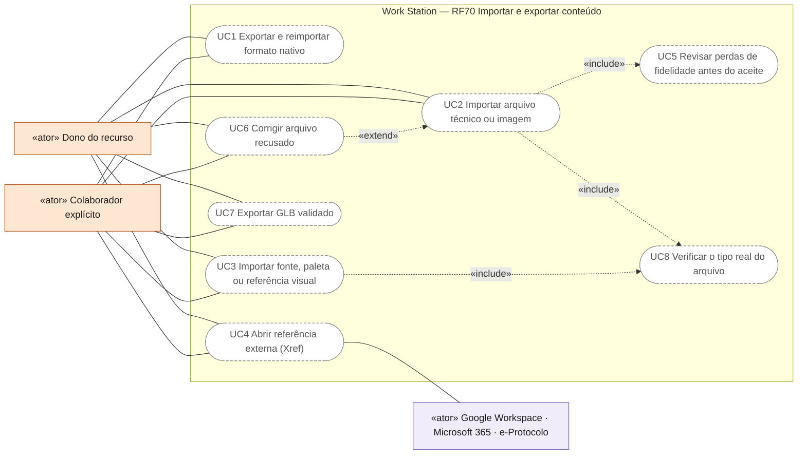
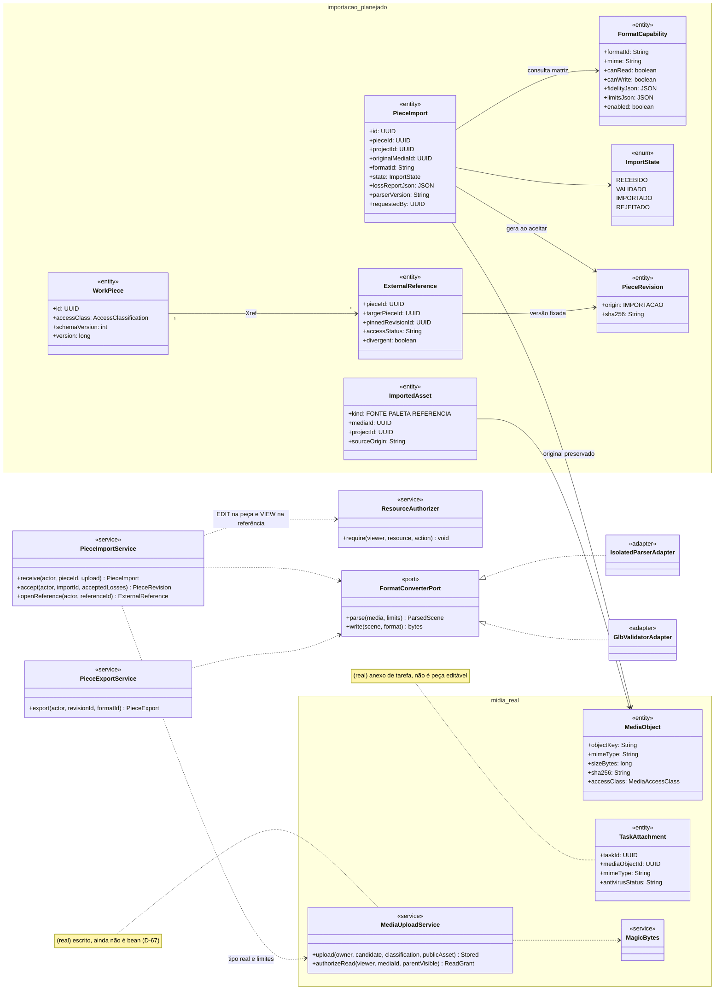
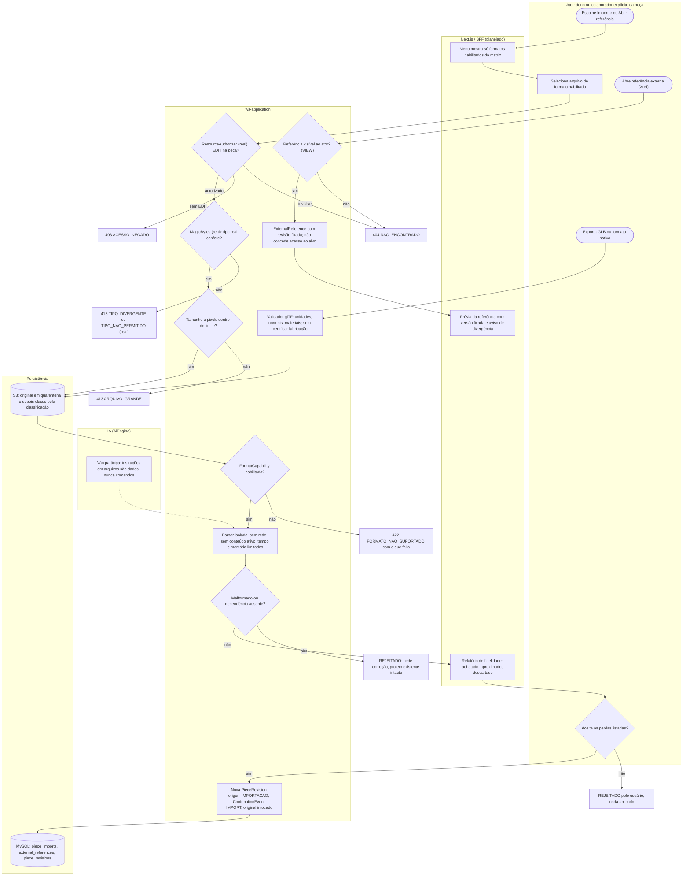
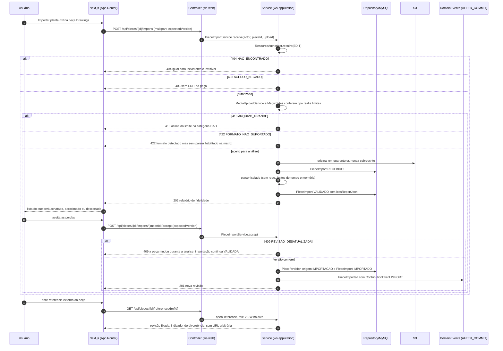
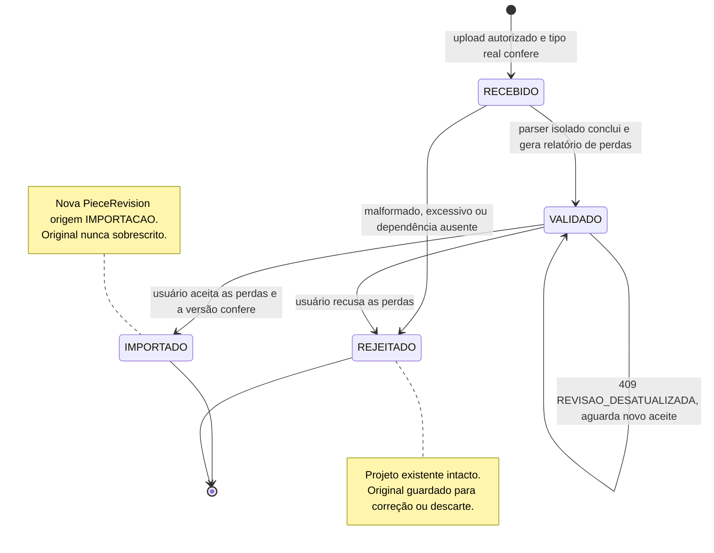
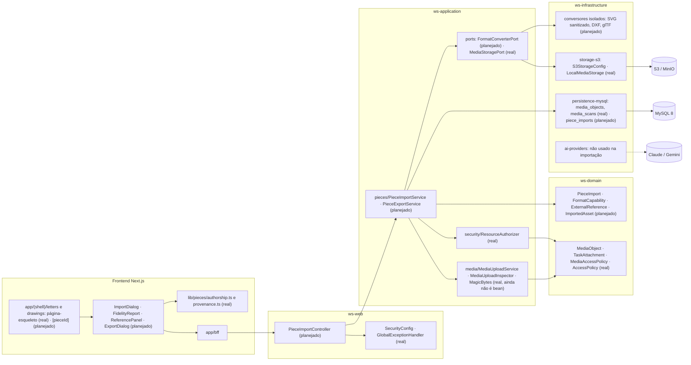

# RF70 — Importar, exportar e referenciar conteúdo técnico nas peças
**HU:** — (sem HU no board; RF especificado em 15/10/2026) · **Sprint (board Work Station):** lista *Requisitos Funcionais* sem sprint atribuída · **Equivalente FAI:** — · **Aba/rota:** Letters (`/letters`, `/letters/[pieceId]`) e Drawings (`/drawings`, `/drawings/[pieceId]`); peça aberta a partir de `/tasks/[id]`, `/projects/[id]` e da sessão DECIA `/decia/[sessionId]` · **Página-esqueleto:** registrada em 17/10/2026; editores ainda não implementados (Ondas 3–5 do PLANO_ONDAS)
**Critérios de aceite cobertos:** RF70.CA01 … RF70.CA07 — corpo do card = especificação de docs/produto/requisitos-studio/RF70.md (CAs copiados como estão escritos); classes reais: `MediaUploadService` (escrito, ainda não é bean — D-67), `MediaUploadInspector` e `MagicBytes` (tipo real por assinatura, limites por categoria), `MediaAccessPolicy`, `MediaObject`, `TaskAttachment`, `ResourceAuthorizer`, `AccessPolicy`, `lib/pieces/authorship.ts` (origem `IMPORT`, categoria `IMPORTED`), `lib/pieces/provenance.ts` (`c2pa.opened`); o restante (planejado)

Permite usar formatos e referências externas nas peças com fidelidade e limites verificáveis. Cada formato tem parser ou conversor validado, limites e mensagem clara para o que não é suportado. O original importado nunca é sobrescrito pela conversão, e as perdas (achatado, aproximado, descartado) aparecem antes do aceite. Referências externas (Xref) guardam vínculo, versão e permissão, sem acesso arbitrário a arquivos ou URLs. Conteúdo ativo (scripts SVG, macros, links remotos) não é executado, e instruções dentro de documentos são dados, nunca comandos.

**Estado em 17/10/2026:** a MATRIZ_RF classifica o RF70 como AUSENTE (0,00): não há importador, conversor nem conector (CONECTORES.md: nenhum adapter de terceiros; Word e Excel são formatos ainda sem fluxo). O que existe é a inspeção de upload do D-67: `MagicBytes` reconhece PNG, JPEG, GIF, WEBP, PDF, ZIP/DOCX/XLSX/PPTX, DWG, DXF, IFC e GLB pelo conteúdo, recusa extensão divergente (`415 TIPO_DIVERGENTE`) ou tipo fora da lista (`415 TIPO_NAO_PERMITIDO`), limita tamanho por categoria (`413`) e pixels (`422 IMAGEM_GRANDE_DEMAIS`). O `MediaUploadService` ainda não é bean. Detectar o tipo não equivale a ler o formato. Pelo PLANO_ONDAS o RF70 entra na Onda 9 (conectores e documentos técnicos), com a meta de publicar a matriz de leitura/escrita/fidelidade e implementar parsers isolados por formato com proveniência. A conclusão segue a prova do RF72: CA → teste → evidência.

## Critérios de aceite

| CA | Enunciado (Dado / Quando / Então) |
|---|---|
| **RF70.CA01** | Dados formatos nativos ws-studio/ws-asset, quando exporta e reimporta, então preserva IDs, topologia, camadas, materiais, metadados e câmera suportados. |
| **RF70.CA02** | Dados SVG, PNG/JPEG/WebP, PDF, DXF/DWG, GLB/IFC, quando o formato está habilitado, então existe parser/conversor validado, limites e mensagem clara para recursos não suportados. |
| **RF70.CA03** | Dadas fontes WOFF2, paletas JSON e referências visuais, quando importa, então valida origem/formato, não executa conteúdo ativo e mantém associação ao projeto. |
| **RF70.CA04** | Dado XOPEN/Xref, quando abre referência externa, então preserva vínculo, versão e permissão, sem acesso arbitrário a arquivos ou URLs. |
| **RF70.CA05** | Dado arquivo malformado, excessivo ou com dependências ausentes, quando abre, então rejeita/solicita correção sem destruir o projeto existente. |
| **RF70.CA06** | Dada perda de fidelidade, quando converte, então informa o que será achatado, aproximado ou descartado antes do aceite. |
| **RF70.CA07** | Dada exportação GLB, quando valida, então passa validador de formato e preserva unidades, normais e materiais compatíveis; isso não certifica fabricação ou projeto. |

## Matriz de leitura, escrita e fidelidade por formato

Fontes: `docs/auditoria/2026-10-15/catalogo-conteudo-importavel.json` (tipos e sanitização), D-67 (detecção real) e `docs/produto/DRAWER_EDITOR_DE_PECAS.md` (DWG exige motor validado). **Só formatos com estado "habilitado" aparecem como operação na interface.** Em 17/10/2026 nenhum está habilitado: todos os pendentes ficam fora dos menus "Importar" e "Exportar", sem logo nem promessa.

| Formato | Detecção no upload (real) | Leitura para edição | Escrita (exportação) | Fidelidade a provar antes de habilitar | Estado |
|---|---|---|---|---|---|
| `ws-studio` / `ws-asset` (JSON nativo) | não reconhecido (fora do D-67) | pendente | pendente | round-trip de IDs, topologia, camadas, materiais, metadados e câmera | pendente (Onda 3) |
| SVG | recusado (`415 TIPO_NAO_PERMITIDO`) | pendente: sanitizar scripts, `foreignObject`, links externos | pendente | efeitos, filtros e texto em caminho achatados | pendente |
| PNG / JPEG / WebP | sim | pendente: camada raster ancorada | pendente | dimensões, perfil sRGB, alpha (PNG/WebP) | pendente |
| PDF | sim | pendente: referência visual, sem edição de conteúdo | pendente (Letters) | paginação e fontes; JavaScript e anexos descartados | pendente |
| DXF | sim | pendente: parser isolado, entidades suportadas listadas | pendente | camadas, unidades, blocos; entidades sem suporte descartadas e listadas | pendente |
| DWG | sim (`AC10xx`) | sem motor/SDK licenciado e validado: não oferecido | não oferecido | versões suportadas a definir após avaliação | não oferecido |
| GLB | sim (glTF v2) | pendente: inspeção de cena | pendente | validador glTF, unidades, normais, materiais compatíveis | pendente |
| IFC | sim (`ISO-10303-21`) | pendente: só visualização de referência | não oferecido | entidades e propriedades listadas, sem certificação | pendente |
| WOFF2 | recusado (fora do D-67) | pendente: validar tabela de fontes e licença | — | — | pendente |
| Paleta JSON | não reconhecido | pendente: esquema fechado, sem expressões | pendente | espaço de cor e nomes preservados | pendente |
| Referência visual (`image/*`) | sim (PNG/JPEG/WEBP/GIF) | pendente: referência, não geometria | — | associação ao projeto e à revisão | pendente |
| DOCX / XLSX | sim (subtipo pelo conteúdo) | pendente | pendente | estilos e fórmulas aproximados; macros nunca executadas | pendente |

## 0. Diagrama de casos de uso

Casos de uso derivados dos CAs. Todos são planejados: não há importador, conversor nem conector; existe só a detecção do tipo real no upload (D-67), ainda sem serviço ativo.

| Caso de uso | Ator(es) | CAs | Situação |
|---|---|---|---|
| UC1 Exportar e reimportar formato nativo | `dono`, `colaborador` | RF70.CA01 | planejado |
| UC2 Importar arquivo técnico ou imagem | `dono`, `colaborador` | RF70.CA02, RF70.CA05 | planejado |
| UC3 Importar fonte, paleta ou referência visual | `dono`, `colaborador` | RF70.CA03 | planejado |
| UC4 Abrir referência externa (Xref) | `dono`, `colaborador`, `conectores` | RF70.CA04 | planejado (conectores na Onda 9) |
| UC5 Revisar perdas de fidelidade antes do aceite | — (incluído por UC2) | RF70.CA06 | planejado |
| UC6 Corrigir arquivo recusado | `dono`, `colaborador` | RF70.CA05 | planejado |
| UC7 Exportar GLB validado | `dono`, `colaborador` | RF70.CA07 | planejado |
| UC8 Verificar o tipo real do arquivo | — (incluído por UC2, UC3) | RF70.CA02, RF70.CA03, RF70.CA05 | planejado (detecção real em `MagicBytes`; `MediaUploadService` ainda não é bean, D-67) |

## 1. Diagrama de classes

Legenda: **(real)** = código no repositório em 17/10/2026; demais classes **(planejado)**. `WorkPiece` e `PieceRevision` seguem `LETTERS_DRAWINGS_ENGENHARIA.md` §3; `MediaObject` e `TaskAttachment` seguem a TAXONOMIA.

## 2. Diagrama de atividades

## 3. Diagrama de sequência

## 4. Máquina de estados

Entidade central: `PieceImport.state` (`ImportState`, planejado). Cada transição registra autor, formato, versão do parser e hash do original; o aceite gera `ContributionEvent` de origem `IMPORT` (real em `lib/pieces/authorship.ts`), e a autoria da peça fica `IMPORTED` até haver log completo, como manda o catálogo de 15/10.

## 5. Diagrama de componentes

## 6. Rastreabilidade

| CA | Classe | Passo | Mensagem | Transição | Componente | Prova exigida (RF72) |
|---|---|---|---|---|---|---|
| **RF70.CA01** | `FormatCapability` de `ws-studio`/`ws-asset`, `PieceExportService`, `PieceImportService` | A4 → P10; A0 → P7 | `imports` e `accept` com 201 | `RECEBIDO → VALIDADO → IMPORTADO` | `PIS`, `FCP` | teste de round-trip com biblioteca de peças conhecidas: IDs, topologia, camadas, materiais, metadados e câmera iguais |
| **RF70.CA02** | `FormatCapability.enabled`, `FormatConverterPort`, `IsolatedParserAdapter`, matriz desta página | F1 → P4 → P5 | 422 `FORMATO_NAO_SUPORTADO` | `RECEBIDO → REJEITADO` | `PAR`, `FCP` | por formato habilitado: corpus de arquivos válidos e adversos, limites medidos, mensagem para recurso sem suporte |
| **RF70.CA03** | `ImportedAsset` (FONTE, PALETA, REFERENCIA), `MagicBytes`, sanitização | A1 → P2 → P5 | `imports` com 415 (real) e 202 | `RECEBIDO → VALIDADO` | `MUS`, `PAR` | teste: WOFF2 e paleta com conteúdo ativo recusados; associação ao projeto persistida |
| **RF70.CA04** | `ExternalReference` (`pinnedRevisionId`, `accessStatus`, `divergent`), `ResourceAuthorizer` | A3 → P8 → P9 → F3 | `GET .../references/{refId}` | — | `PIS`, `RA` | teste com duas contas: referência a peça revogada responde 404; caminho local ou URL arbitrária recusados |
| **RF70.CA05** | `PieceImport` REJEITADO, parser isolado, original em quarentena | P3 → E4; P6 → E6 | 413 `ARQUIVO_GRANDE` e ramo REJEITADO | `RECEBIDO → REJEITADO` | `MUS`, `PAR` | teste: arquivo truncado, bomba de descompressão e dependência ausente; hash da peça existente inalterado |
| **RF70.CA06** | `PieceImport.lossReportJson`, `FidelityReport` | P6 → F2 → A2 | 202 relatório e `accept` | `VALIDADO → IMPORTADO` ou `VALIDADO → REJEITADO` | `R2`, `PIS` | teste: nada é aplicado antes do aceite; relatório lista itens achatados, aproximados e descartados |
| **RF70.CA07** | `GlbValidatorAdapter`, `PieceExportService` | A4 → P10 | — (`POST /api/pieces/{id}/exports`) | — | `PAR`, `S3A` | validador glTF oficial sem erros; unidades, normais e materiais conferidos; texto da tela não fala em certificação |
